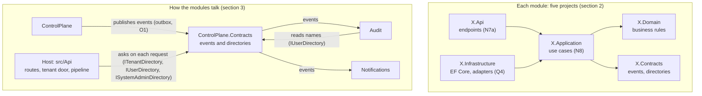
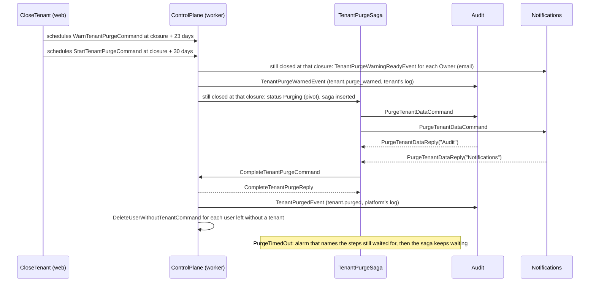

# Architecture: multi-tenant SaaS starter template (API)

This document is the single source of truth for the API in `apps/api/`. If the code does not agree with this document, the code changes. No other file overrides it.

Each rule has an id (for example `R4`, `W2`). Use the id when you refer to a rule in a review, a commit message or a comment.

## Codemap

This map helps a first reader find their way in the code. It names rules and patterns, not files, so it stays true when files change. Source: Aleksey Kladov, "ARCHITECTURE.md".

The host in `src/Api` connects three modules: ControlPlane, Notifications and Audit. Each module is five projects (section 2). A module sees another module only through that module's `Contracts` project. A module tells others what happened with an event, through the outbox. A module reads another module's data through a directory, an interface in `Contracts`.

| I look for | I find it in | Rule |
| --- | --- | --- |
| An endpoint | The module's `Api` project, in the folder of its audience and then of its resource, in the class `{Resource}Endpoints`. The method has the action's name | N5, N7a, N7e |
| A route prefix and its audience | The host's route groups | N5 |
| A use case | The module's `Application` project, in the folder `{Resource}/{Action}/`: the command or query, its handler and its validator | N8 |
| A business rule | The module's `Domain` project, in the folder of the aggregate. The root has the folder's singular name | N8, M1 |
| Persistence | The module's `Infrastructure` project, under `Persistence/`: the DbContext, a folder for each resource with its repository and its query class, and `Migrations/` | Q1 to Q4, N8 |
| Who handles an event | The event is in the publisher's `Contracts` project, in the folder of its resource. Its handlers are in each listening module's `Application` project, in the use case folder of the handler. The message tables of section 6 name each one | N8, section 6 |
| An error code | The owner's static `...ErrorCodes` class | Section 2, N11w |
| A test | Next to the module it tests, or in `tests/` for the whole system. A class is named by its use case or by the class it tests | N9 |
| A generated file | A file that ends in `.g.cs`, `.gen.ts` or `.gen.css`, and `openapi/v1.json`. The table in section 2 names each generator | D1, "Generated files" in section 2 |
| A rule | This document, by its id | |

## Purpose and scope

The purpose is a multi-tenant SaaS starter template. Every future product is built on it. The scope is the API only. Correctness, clear boundaries and tenant isolation are more important than speed.

### Fixed rules

1. Each decision agrees with the books and with industry practice.
2. Each deviation from the books is written down openly. A silent deviation is not permitted.
3. There is no billing.
4. There are no commercially licensed packages: MediatR, AutoMapper, MassTransit v9+, FluentAssertions.
5. The architecture controls the tool. The tool does not control the architecture. If a tool does not fit the structure, the tool goes or the deviation is approved openly.
6. The template is platform independent. Provider detail (example: the database provider) does not go into the architecture. It goes into the setup notes.
7. Infrastructure without a use does not go in. A part is added only if it catches a failure that no other control catches.

Setup notes for providers are in docs/setup.md.

### Scope of the first template

The first template runs one flow from start to end: tenant creation.

| In scope | Reason |
| --- | --- |
| `POST /v1/platform/tenants` | The work itself |
| Root system admins come from configuration (`ControlPlane:SystemAdmins:RootEmails`), and `POST` and `DELETE /v1/platform/users/{userId}/system-admin` | The first person who creates a tenant cannot get on the system admin list in another way. A system admin grants and revokes the others, and nobody needs SQL for it (section 6, "Root system admins"; step r5) |
| Tenant creation process (one transaction, then the Owner's sign-up and email) | The approved flow (section 6, "Tenant creation process") |
| One handler that sends the invitation email (Notifications) | Every invitation ends with it: a new tenant's first Owner, an Owner the platform invites, a person a member invites (section 6, "Invitation sign-up") |
| The handlers that write the audit entry of every command, in the tenant's log and the platform's log (Audit, K3) | The uses of the Audit module |
| The endpoint that accepts an invitation | Without it, the first Owner cannot exist |
| `GET /v1/me/tenants` | The user sees their tenants after sign-in |
| `GET /v1/me`, `GET /v1/tenants/{tenantId}` and `GET /v1/platform/tenants/{tenantId}` | The web and the platform app read the signed-in user and one tenant (api-catalog, step 20c) |
| Each user's language and time zone, `PATCH /v1/me/preferences`, and the two invitation emails in English, Turkish and Arabic (api-catalog, K8, step 20j; section 6, "Language and time zone") | The web speaks three languages, and its Preferences screen sets both values for every tenant and device. The API writes text only in emails |
| Each user's email address and names in ControlPlane, which the user (`PATCH /v1/me`) and a system admin change, and `PATCH` and `DELETE /v1/platform/users/{userId}` (A7, A8) | The platform screens list users by email address and name, not by the identity provider's id. The identity provider keeps no name |
| The identity provider's invitation for an invited address without an account, and its withdrawal (A7; section 6, "Invitation sign-up") | The identity provider is invite-only. Without its invitation, a person with no account, the first Owner of a new tenant included, cannot sign up |
| One read endpoint behind the tenant door. Example: `GET /v1/tenants/{tenantId}/members` | It exercises the tenant door, membership, RLS and the permission check |
| `GET /v1/platform/tenants` and `GET /v1/platform/users` | The platform app lists every tenant and every user. Each tenant shows its members and Owners counted, and, while it has no Owner, its Owner invitation, from the tenant's summary (R12; api-catalog, K10). Each user shows how many tenants they are a member of, from the user's count (R13; api-catalog, K11) |
| `GET /v1/platform/users/{userId}` | The platform's user detail: the user, who suspended them, and every membership, with whether the user is the tenant's last Owner (api-catalog, step 20l; section 6, "What the screens read") |
| `POST /v1/me/invitations/preview` | The accept screen names the tenant, the inviter and the role before the person accepts, and says when the link is expired, used or cancelled (api-catalog, K12; section 6, "What the screens read") |
| `POST /v1/platform/tenants/{tenantId}/invitations` | A tenant whose first Owner never accepted has no Owner; the platform invites one (api-catalog, K9; section 6, "Owner invitation") |
| `POST /v1/platform/tenants/{tenantId}/suspend` and `.../reactivate` | A system admin stops a tenant's members, for a reason, and lets them in again (section 6) |
| `PATCH /v1/platform/tenants/{tenantId}`, `POST .../close` and `.../reopen` | Only the platform renames a tenant; a system admin closes a tenant and reopens it within the reopen period (api-catalog, K4, step 20h; section 6, "Tenant lifecycle") |
| `POST /v1/platform/users/{userId}/suspend` and `.../reactivate` | A system admin stops a user in every tenant, and lets them in again (A9) |
| The tenant purge: when a closed tenant's reopen period ends, every module deletes its data of the tenant, after a warning email to its Owners, and the tenant row stays as a tombstone (section 6, "Tenant purge"; api-catalog, K4) | The template's reference use of a saga (the maintainer's decision D1 in the review of 2026-10-21). GDPR, Article 5(1)(e) (storage limitation) and Article 28(3)(g) (deletion at the end of the service) |
| `POST`, `GET /v1/tenants/{tenantId}/invitations` and `DELETE .../invitations/{invitationId}` | An Owner or an Admin invites members, lists the pending invitations and revokes one (api-catalog, step 20d; section 6, "Member invitation") |
| `PATCH` and `DELETE /v1/tenants/{tenantId}/members/{userId}` | An Owner or an Admin changes a member's role and removes a member (api-catalog, step 20e; section 6, "Member management") |
| `GET`, `POST /v1/tenants/{tenantId}/roles`, `PATCH` and `DELETE .../roles/{roleId}` | A tenant builds its own roles from the tenant pool, and gives them through invitations and role changes (api-catalog, step r4b; section 6, "Custom roles"; A3) |
| `GET /v1/tenants/{tenantId}/audit-log` and `GET /v1/platform/audit-log` | An Owner or an Admin reads the tenant's audit log ("Activity"); a system admin reads the platform's (api-catalog, step 20f; section 6, "Reading the audit logs") |

`docs/api-catalog.md` lists every endpoint of the core API: who may call it, the audit entry it writes, the notification it sends, the external system it reaches and the step that builds it. A change to an endpoint changes api-catalog in the same pull request.

Out of scope: support access, in-app notifications, and an export of a tenant's data before its purge. A tenant is deleted only by its purge (section 6, "Tenant purge").

## 1. The big picture

The system is one code base and one build output. This output runs as two process types: web and worker. A third role, all, runs both in one process, for local development and tests.

| Decision | Source |
| --- | --- |
| The system is one deployment unit. The code is divided by business area | Richards and Ford, FSA 2nd ed., Chapter 11 |
| Each module is a bounded context | Evans, Chapter 14. Khononov, Chapter 3 |
| One artifact, two process types. Web serves HTTP requests. Worker runs background work. A setting selects the role | Twelve-Factor, Factor VIII. Nygard, Chapter 5 (Bulkheads) |
| Each module that stores data has its own PostgreSQL schema. No foreign keys and no joins across modules | Evans, Chapter 14. Richardson, "Database per Service" (adapted to a monolith) |
| The host contains no business rule. It only connects the modules | Industry practice (composition root) |

In Kubernetes this is two Deployments and one image. The requirement is a separate process, not a separate machine.

## 2. Module boundary and structure

Each module is five projects. Another module sees only the `Contracts` project.

| Project | Content | Depends on |
| --- | --- | --- |
| `X.Contracts` | Interfaces, DTOs, event types. No domain types | `SharedKernel` |
| `X.Api` | HTTP endpoints | Application, Contracts, `SharedKernel`; of another module's Contracts, only a response type that two modules answer, with its enum (N8) |
| `X.Application` | Use case handlers, sagas | Domain, Contracts, other modules' Contracts, `SharedKernel` |
| `X.Domain` | Business rules | `SharedKernel` |
| `X.Infrastructure` | EF Core, adapters for external services, contract implementations | Application, Domain, Contracts, `SharedKernel`, `Tenancy` |

`SharedKernel` holds the result and error types (and `StateChange`, what a method that sets a state did: N13), the fixed name of a message on the wire (`MessageNameAttribute`, W12: our own attribute, because `Contracts` references only `SharedKernel`; the maintainer's decision in audit-g3), paging and the list contract (`ListRequest`, `ListSort`, `ListFilter`, and `ListPage`, a record with one constructor, so the OpenAPI document marks each member required; K5 in api-catalog), the cursor of the audit logs (`CursorRequest`, `CursorPage`, `Cursor`), the marker of a tenant entity, two kinds of endpoint metadata (`IdempotencyKeyRequired`, and `CreatedLocation`, the named GET endpoint that reads a created resource), the port through which an endpoint runs its command under the request's key (`IIdempotencyExecutor`, I4; the host implements it), the one list of languages (`Language`, K8 in api-catalog), the check and the split of a retry that grows (`GrowingRetries`: inline pauses under a minute, then scheduled pauses), which ControlPlane's calls to the identity provider and Notifications' invitation email wire into Wolverine each for their own messages, the converter that reads an enum by its exact JSON name (`ExactNameEnumConverter`) and `JsonEnum<T>`, the one place that names an enum member in JSON, which the lists, the converter, the host's field codes and the tests read; `Tenancy` holds the base of a module DbContext, the tenant declaration at the start of each transaction, row level security in migrations, the names of the database roles, the settings that every PostgreSQL connection of the API gets, and the SQL of a CHECK that a column holds one of the code's values (`CheckConstraints`, R15). The error types are validation, not found, conflict, forbidden, unprocessable and too many requests; `Api/ErrorHandling/Problems.cs` maps them to 400, 404, 409, 403, 422 and 429 (RFC 6585). `SharedKernel` also holds the type of an error code, `ErrorCode`, the codes of paging (`PagingErrorCodes`) and the field codes of a validation answer, `FieldErrorCode` (api-catalog, K5). It holds no module's codes: each owner declares its own in one static class whose name ends with `ErrorCodes`, the host in `Api/ErrorHandling/HostErrorCodes.cs` and each module in its Domain project, such as `ControlPlane.Domain/ControlPlaneErrorCodes.cs`, so every layer of the module reaches them. The OpenAPI document joins them into one enum. In the same way, Audit declares the operation of every audit entry once, in `Audit.Domain/AuditOperations.cs`, and the document publishes them as one enum (K3, N11).

- Two controls enforce the boundary: project references (compilation) and architecture tests. Source: Ford, Parsons, Kua, Chapter 2.
- The `Api` project cannot reach the `DbContext`. Source: Evans, Chapter 4.
- A read across modules is a plain method call. The interface is in `A.Contracts`. Its implementation is an `internal sealed` class inside A. The exception is an implementation that another module's handler takes: it is public and sealed, so that Wolverine builds it on its module's DbContext (W1, W9). Today that is `UserDirectory` only. Source: Gamma et al., Chapter 4 (Facade). Evans, Chapter 14 (Open Host Service).
- The shared kernel stays small and carries no business concept. Source: Evans, Chapter 14.
- A response type that two modules answer would live in its owner's `Contracts`, with its enum, and another module's `Api` project could use those types and nothing else of the project. Today there is none: until step r4b it was `RoleResponse` and `MemberRole`, which Audit's details answered. Since step r4b a role in an audit entry's details is Audit's own `AuditRoleResponse`, the role as the entry keeps it from that moment, whose id may be null (N7k; the maintainer's decision in step r4b), and `RoleResponse` sits in ControlPlane's `Api` project. `ReferenceRuleTests` fails for any type of another module's `Contracts` in an `Api` project, so an endpoint never calls another module's read interface past its own `Application` project. Source: Evans, Chapter 14 (Published Language; each bounded context keeps its own model).
- `ExactNameEnumConverter` is in `SharedKernel` because `Language` (in `SharedKernel`) uses it, and an enum names its converter in an attribute, so the converter must be in the enum's project or in a project it references. `MemberRole` used it too until step r4b removed the enum. The converter is no business rule: it reads an enum by the exact JSON name of one member, with the same lookup as `ListFilter`. Source: Evans, Chapter 14 (Shared Kernel). Hunt and Thomas, *The Pragmatic Programmer*, Topic 9 (DRY).
- `Language` is in `SharedKernel` because three layers need the one list: ControlPlane's Domain (a user and an invitation keep one), its Api (the requests and responses) and its Contracts (the messages that Notifications reads to write an email). A Domain project references only `SharedKernel` (`ProjectReferenceTests`), so `SharedKernel` is the one project they all see. A language is no business rule of a module: it is a closed list of values with no behaviour, which no single module owns, as the field codes of a validation answer (`FieldErrorCode`) are. A copy in each layer would make a new language a change in three places, and a copy can drift. Source: Evans, Chapter 14 (Shared Kernel: a small, explicit part of the model that the teams agree to share).
- Test projects are next to their module. Tests of the host and system-wide tests (architecture, end to end) stay in the top tests folder (N9).
- Names, folders, routes and permissions follow section 10.

### One source

| # | Rule | Source |
| --- | --- | --- |
| D1 | A piece of knowledge is written once. A piece of knowledge is a limit, an enum value, an error code, a permission name, a route, a header name, a configuration key or a text that a client shows. 1. Every place that can reference it reads it from its one place. 2. A place that cannot reference it, because it is in another language or in a project that may not reference the source (the table above), reads a generated file. CI fails when a generated file differs from what its generator writes now ("Generated files" below). 3. Where a generator makes no sense, because two modules each own a rule and the rules have a relation, such as "at least as long as", a test compares them, and CI fails on a difference: `AuditTargetNameTests` keeps Audit's target name column at least as wide as a tenant's name. Two exceptions: equal values that mean different things stay separate (a tenant's name and a user's name both allow 100 characters, and one can change without the other); and a test writes out its expected values, so it never computes one with production logic | Hunt and Thomas, *The Pragmatic Programmer*, Topic 9 (DRY: every piece of knowledge has a single, unambiguous, authoritative representation) |

### Generated files

A generated C# file ends in `.g.cs`, a generated TypeScript or CSS file in `.gen.ts` or `.gen.css`. EF Core's migrations and `openapi/v1.json` keep their names, because EF Core's tool and the clients read them by those paths. `pnpm generate`, at the repository root, runs every generator in its order: the CSS of the design tokens, the C# code, the OpenAPI document, then the API client. Each step is a command of its own. The job `generated` in `.github/workflows/ci.yml` runs `scripts/ci/check-generated.sh`: it runs `pnpm generate` and fails when a committed file differs or a new file is not committed, and its message names `pnpm generate`. The root `.gitattributes` marks each generated file `linguist-generated`, so a pull request folds it (GitHub Docs, "Customizing how changed files appear on GitHub").

| Output | Source | Generator | Command |
| --- | --- | --- | --- |
| `ControlPlane.Contracts/Permissions.g.cs`, the permission list that the endpoints and Audit read | `ControlPlane.Domain/PermissionPools.cs`, the one place of the permission names and their pools (Vernon, *Implementing Domain-Driven Design*, Identity and Access). Contracts never references Domain | `apps/api/scripts/generate-permissions.mjs` | `pnpm api:permissions` |
| `src/Api/Internal/Generated/**/*.g.cs`, Wolverine's handler code (W10) | the handlers, messages, sagas, middleware and registrations | Wolverine's `codegen write`; `apps/api/scripts/codegen.mjs` empties the folder first and names each file `.g.cs` after it. The host compiles the files and loads the types by name, so the name changes nothing at run time (`HandlerCodeFileTests`) | `pnpm api:codegen` |
| `openapi/v1.json` (N11) | the request and response types, the endpoints and `Api/Hosting/OpenApiContract.cs` | the build of `src/Api` (`Microsoft.Extensions.ApiDescription.Server`) | `pnpm api:openapi` |
| `packages/api-client/src/generated/**/*.gen.ts`, the client: the types and enum objects, the Zod schemas, the TanStack Query options and the MSW handlers, and the list of operations with their declared response headers | `openapi/v1.json` | Orval (`packages/api-client/orval.config.ts`), then `packages/api-client/scripts/generate-operations.mjs` | `pnpm api:generate` |
| `packages/ui/src/styles/tokens.gen.css`, the CSS variables of the design tokens and Tailwind's `@theme inline` block | `packages/ui/tokens/tokens.json` | `packages/ui/scripts/build-tokens.mjs` | `pnpm ui:tokens` |
| A migration's `.Designer.cs` and each module's `...ModelSnapshot.cs` | the DbContext's model | `dotnet ef migrations add` | none in `pnpm generate`: a migration is written once for each model change, and `PendingModelChangesTests` fails when the model has changed without one. The migration itself is reviewed, because it holds row level security, so `.gitattributes` does not fold it |

## 3. Messaging

If a module needs data, it reads through a contract. To tell other modules that something happened, it uses an event. The outbox carries the event.

### Outbox rules

| # | Rule | Source |
| --- | --- | --- |
| O1 | The event record is written in the same transaction as the business data | Richardson, Chapter 3. Kleppmann, Chapter 11 |
| O2 | Delivery happens after the commit and separately | Richardson, Chapter 3 |
| O3 | Each listening module runs in its own transaction | Vernon, Chapter 10 |
| O4 | Delivery is at least once. A message that arrives again has no second effect | Hohpe and Woolf, Chapter 10 (Idempotent Receiver) |
| O5 | There is one outbox. It is in a shared infrastructure schema | Industry practice. See the deviations list |

### Requirements for the messaging tool

The tool is Wolverine. The tested version is the one that `apps/api/Directory.Packages.props` names. The tool is measured against these nine requirements. Each requirement is tested with real PostgreSQL.

1. The event record is written in the same transaction as the business data.
2. Each listening module runs in its own transaction.
3. With many pods, only one pod takes a message at a time.
4. A message that arrives again has no second effect.
5. If a pod dies, its unfinished message is not lost. Another pod takes it.
6. A message that always fails is moved aside. The queue does not block.
7. The tenant travels with the message.
8. The `Domain` and `Contracts` projects do not see the tool's types. `Api`, `Application` and `Infrastructure` can.
9. The architecture controls the tool. We decide the module structure, the schema layout and the transaction rule.

Requirements 3 and 5 are tested with two workers on one database (`TwoWorkerTests`).

### Handlers and pipeline

Wolverine is the dispatcher. An endpoint sends a command or a query through `IMessageBus`. A handler is a plain class. Shared behaviour is Wolverine middleware. Source: Fowler, PoEAA Chapter 9 (Service Layer). Hohpe and Woolf, Chapter 3 (Pipes and Filters) and Chapter 10 (Message Dispatcher).

| Order | Command chain | Query chain |
| --- | --- | --- |
| 1 | HTTP: authentication, rate limit, the user's state (A9) and tenant membership, authorization (ASP.NET Core) | HTTP: authentication, rate limit, the user's state (A9) and tenant membership, authorization (ASP.NET Core) |
| 2 | Logging and tracing | Logging and tracing |
| 3 | The transaction opens, the tenant is declared | The transaction opens, the tenant is declared |
| 4 | Input validation | Input validation |
| 5 | Handler | Cache (only on marked queries) |
| 6 | Save, commit, then outbox dispatch | Handler |

Authorization runs once, in ASP.NET Core, before the endpoint sends the message. A refused request opens no transaction, with one exception: on a platform route, the system door may send `GrantRootSystemAdminCommand` before authorization, for a person with a second factor whose verified address is in the list of root system admins (section 6, "Root system admins"). Its handler opens a Wolverine transaction; for a person it grants nothing, such as a suspended user, the transaction is empty and the request then answers 403. A message from a queue has no caller and is not authorized again.

- Wolverine opens and closes the transaction. We set the rule: each handler runs in its own transaction, which changes one aggregate, or more than one of its module only as M2 allows.
- A handler that calls an external service uses no DbContext, so no transaction is open during the call. It returns its result as a message, or nothing. A call that fails for good goes to the dead letter queue (W11). Source: Nygard, Chapter 5 (Integration Points).
- A handler returns the messages it sends in one `OutgoingMessages`, Wolverine's list of cascading messages: `(Result, OutgoingMessages)` or `(Result<T>, OutgoingMessages)` for a handler with a result, `OutgoingMessages` alone for one without. An early return is `(error, [])`. No handler returns a tuple of messages, so no early return lists a null for each message. A tuple may hold other return values beside it, such as a saga to insert (`Insert<T>`). `HandlerMessageTests` fails for a tuple that holds more than one message. `CommandAuditTests` reads from a handler's source the messages it adds to the `OutgoingMessages` it returns: an element of the list it returns or declares, or an argument of `Add` or `Insert` on it. A message the handler builds and does not add publishes nothing (K3). Source: Wolverine, "Cascading Messages" (the maintainer's decision in step r2b).
- A domain event is handled inside the module and in the same transaction. An integration event leaves the module through the outbox. Source: Vernon, Chapter 8.
- HTTP endpoints are plain ASP.NET minimal APIs. The tool's own endpoint model (Wolverine.Http) is not used.

### Commands and queries

A module reads and writes one database through one DbContext. Its commands and its queries reach that DbContext through different interfaces. There is no read store. Source: Microsoft, *.NET Microservices: Architecture for Containerized .NET Applications*, "Apply simplified CQRS and DDD patterns in a microservice" (eShop). Evans, Chapter 6 (Repositories). Martin, *Agile Software Development*, the Interface Segregation Principle.

| # | Rule | Source |
| --- | --- | --- |
| Q1 | A command loads and saves an aggregate through its repository, `I{Aggregate}Repository`, one for each aggregate root: `ITenantRepository` (the tenant, its memberships and its invitations, M1, and the tenant's roles and their permissions, which it reads and writes under the tenant's lock, K6a) and `IUserRepository` (the user, and the user's grant on the system admin list, which it reads and writes under the user's lock, K6l; section 6, "Root system admins"). A method belongs to a repository when a command needs it to decide, such as the facts of an invitation: "is this address already a member" and "how many invitations today" (`FindInvitationFactsAsync`). There is no repository for a part of an aggregate: an invitation's command methods are in `ITenantRepository` | Evans, Chapter 6 (one repository for each aggregate root) |
| Q2 | A query reads through the query class of its resource, `I{Resource}Queries`: `ITenantQueries`, `IMemberQueries`, `IInvitationQueries`, `IRoleQueries`, `IUserQueries`. Each method of a query class reads without tracking and returns a read model, a `...View` record or a page of them, which it builds itself, as eShop's `IOrderQueries` does (`ITenantQueries.FindTenantDetailAsync` answers `TenantDetailView`); it never returns an aggregate. A handler of a query passes the view on. The two queries of a user's deletion, `ListUserMembershipsQuery` and `GetLastOwnershipQuery`, decide for the command that follows them (section 6, "User deletion"), so they read through the repositories of that command | eShop, "simplified CQRS": commands use repositories, queries use query classes |
| Q3 | Each method exists once on its side. A read that both sides need has one place in the repository, which loads the aggregate a command may change and tracks it, and one in the query class, which answers a view: `IUserRepository.FindUserForUpdateAsync` loads and locks a user (K6a), `IUserQueries.FindMeAsync` answers `MeView`. A domain rule that a query needs stays in Domain and reads the view's values: the preview checks the address with `Invitation.CheckEmail(email, verifiedEmails)` | Martin, the Interface Segregation Principle |
| Q4 | Each interface sits in its resource folder in `Application` (`Tenants/ITenantRepository.cs`, `Members/IMemberQueries.cs`), and each implementation in `Infrastructure/Persistence/{Resource}/` (`Persistence/Tenants/TenantRepository.cs`). Both sides use the same DbContext, which Wolverine builds once for the handler, so a handler that takes two of them works in one transaction (W1). Row level security does not change: the tenant is declared at the start of each transaction (W2) | N8. Evans, Chapter 6 |

### Wolverine setup rules

Rules W1 to W9 come from a spike. The spike is in `apps/api/spikes/WolverineRlsSpike`. The T numbers are the tests in the spike.

| # | Rule | Reason | Evidence |
| --- | --- | --- | --- |
| W1 | Wolverine's EF Core middleware opens and closes the transaction. There is no hand-written transaction code. One exception: TenantDirectory opens a short transaction of its own in the HTTP pipeline, before any message is sent, to read the membership. The system door's `GrantRootSystemAdminCommand` also runs in the HTTP pipeline, but through Wolverine, which opens its transaction (section 3, "Handlers and pipeline"). | The business data and the outgoing message go into one transaction, and a saga's record with them (O1, S6) | T3, T4 |
| W2 | The module's DbContext reads the tenant from the message context. An EF Core transaction interceptor runs `set_config('app.tenant_id', ..., true)` when the transaction starts | R4, R5 | T1, T2, T5, T6 |
| W3 | An endpoint on the tenant path relies on the tenant middleware, which sets the tenant on the message bus, and uses `InvokeAsync`. Accepting an invitation and previewing it (`GetInvitationPreview`) use `InvokeForTenantAsync` with the tenant from the code. Renaming, suspending, reactivating, closing, reopening and reading one tenant (`GetTenant`) use `InvokeForTenantAsync` with the tenant from the platform route. Inviting an Owner (`InviteOwner`) passes the tenant of the platform route to the idempotency executor, as `InviteMember` does. Making a member an Owner (`MakeOwner`) uses `InvokeForTenantAsync` with the tenant from the platform route. Deleting a user (`DELETE /v1/platform/users/{userId}`) uses `InvokeForTenantAsync` with each tenant that `ListUserMembershipsQuery` answered, which the user's own memberships prove (R11), for `GetLastOwnershipQuery` and `RemoveUserMembershipCommand`. Creating a tenant passes the id the server chose to the idempotency executor. Inviting a member (`InviteMember`) passes the tenant of the route, which the tenant door has proved, to the idempotency executor. It uses `InvokeAsync` with `DeliveryOptions.TenantId` and the key's envelope headers (I4). Both Wolverine invocation methods put the tenant on the envelope. The tenant goes to the following messages automatically. A message without a tenant carries the value `*DEFAULT*`. The interceptor does not treat this value as a tenant | Requirement 7, R5. Wolverine, message bus invocation | T3, T6 |
| W4 | `MultipleHandlerBehavior.Separated` is on | O3 | T8 |
| W5 | Messages wait in durable queues, and the message store is in the shared `wolverine` schema. In the role `all`, a message goes to a durable local queue (`UseDurableLocalQueues`). In the roles `web` and `worker`, every message goes through the outbox to one PostgreSQL queue in the same schema (Wolverine's PostgreSQL transport). Only a worker listens to that queue, and it hands an event with several handlers on to durable local queues, one for each handler (W4). A web host runs no durability agent (`DurabilityAgentEnabled = false`): outbox and inbox recovery run in a worker | O1, O5, Requirement 5, section 1 | T3, `HostRoleTests` |
| W6 | A saga derives from Wolverine's `Saga` class. Its record is stored with EF Core in the module's own schema: the tenant purge's in `control_plane.tenant_purge_sagas`, a tenant table under row level security (R1). The `Version` property is mapped as a concurrency token. `SagaConcurrencyException` is retried three times, inline, before every other rule but Wolverine's own (`ApiPipeline`): of two messages a saga handles at once, the second fails on the version and runs again on the first one's result. Wolverine's published faults stay off: the tenant purge hears no fault, because its timeout raises the alarm for a step that failed for good (section 6, "Tenant purge"). A saga that needs to hear a fault turns them on (S13) | S3, S8 | T7, T9, `ExistingRetryPolicyTests` |
| W7 | A business rule rejection returns before any data changes, at the start of the handler or in a Validate or Before method. A failure after a change is an exception | Wolverine also commits a handler that returns a failed `Result` | T10a, T10b |
| W8 | The transaction middleware is first in the Wolverine chain. Validation runs inside the transaction. Authorization runs before, in ASP.NET Core | This is Wolverine's behaviour. A rejected request opens an empty transaction and writes no data | Generated handler code |
| W9 | Handler, saga, message and DbContext types are `public` | Wolverine's handler code is in another assembly than the handler: the host's (W10), or one that a test host compiles (section 9, rule 11) | Compile errors CS0051 and CS0122 |
| W10 | The handler code is written before the build and committed. `pnpm api:codegen` runs Wolverine's `codegen write`, which writes it to `src/Api/Internal/Generated`, and names each file `.g.cs` ("Generated files", section 2). The host loads it as static types (`TypeLoadMode.Static`) and compiles nothing at runtime. The host has no `WolverineFx.RuntimeCompilation`. The command gives the host a database setting it never opens, because Wolverine orders the frames by the message storage the host has. The role and the environment change no code; `HandlerCodeFileTests` writes it in each role. Wolverine finds each type by its name and finds the handlers in the committed registry. It compares no code, so out-of-date code runs old frames or leaves a new handler out without an error. `HandlerCodeFileTests` writes the code again and fails when it differs from the committed files. A static host builds every handler when it starts. The OpenAPI document build and the architecture tests' composed hosts handle no message, so they use `TypeLoadMode.Auto` and load no handler | A host that compiled its handler code at runtime kept the compiled code and the compiler's copies of ten framework assemblies (about 25 MB) for the life of its process. The test process grew by 26 to 41 MB for each host. Wolverine, "Working with Code Generation" | `HandlerCodeFileTests`, `HostMemoryTests` |
| W11 | Every queued message retries an exception three times inline, after the pauses of `QueuedRetries`. It then goes to the dead letter queue. Message-specific rules run first. The invitation email (`InvitationReadyEvent`) and the warning before a tenant's purge (`TenantPurgeWarningReadyEvent`), both with `Notifications:InvitationEmails:RetryDelays`, and the calls to the identity provider (`OpenSignUpCommand`, `WithdrawSignUpCommand`, `DeleteIdentityAccountCommand`, with `ControlPlane:IdentityProvider:RetryDelays`) keep their rules. The global fallback declines an inline `InvokeAsync` envelope, which has no queue destination | Nygard, *Release It!*, Chapter 5 (bounded retries). Hohpe and Woolf, "Dead Letter Channel". Wolverine, "Error Handling" | `DefaultRetryTests`, `ExistingRetryPolicyTests` |
| W12 | A node with no handler for a message from the PostgreSQL queue does not drop it. A missing handler (`IMissingHandler`) puts it back in the queue's scheduled table, with the same id, after `Host:Messaging:UnknownMessages:Delay`. The header `unknown-message-tries` counts the put-backs. After `Host:Messaging:UnknownMessages:Tries` put-backs, the message goes to the dead letter queue. A message in a durable local queue goes to the dead letter queue at once: Wolverine marks it as handled after the missing handler runs, and that mark overwrites a put-back in the inbox. Wolverine's own control messages keep Wolverine's default. Each put-back is a warning, and each dead letter is an error, with the message type, the try and the trace id. W12 does not cover a handler that only the new version adds to a message the old version knows: an old worker hands such a message only to the handlers it knows (W4, W5). Every message has a fixed name on the wire, `[MessageName("member-invited")]` (`SharedKernel`), which the host's naming strategy (`Api/Messaging/MessageNames.cs`) gives Wolverine, so a moved or renamed type keeps its name and an old and a new node still understand each other; a renamed name is a message contract change. `HostRoleTests` reads a queued message by its fixed name | During a rolling deploy an old worker takes a message only the new version handles. Wolverine 6.47 drops it without a log at warning level (`NoHandlerContinuation`). Hohpe and Woolf, "Dead Letter Channel" and "Invalid Message Channel". Nygard, *Release It!*, Chapter 5 (bounded retries) | `UnknownMessageTests` |
| W13 | A dead letter expires. Wolverine writes each dead letter with an expiry, `Host:Messaging:DeadLetters:Retention` after it fails (14 days by default), and a worker's durability agent deletes it after that. The expiry is a column of the dead letter table, so the migration step turns expiration on too (`MessageStorage`). The API has no endpoint for dead letters: the maintainer reads and retries them in the database (`docs/deployment.md`, section 14) | Wolverine keeps a dead letter forever by default. An invitation email's envelope holds the email address and the link with its secret. Wolverine, "Dead Letter Storage", "Dead Letter Expiration" (off by default). GDPR, Article 5(1)(e) (storage limitation) | `DeadLetterRetentionTests` |
| W14 | A host adds the fixed names of W12 (`MessageNames`) to Wolverine before it creates its `WolverineOptions`, under a lock (`MessageNames.Register`). `ApiPipeline` and the migration step's store host call it before `AddWolverine`. Only the first call changes Wolverine's list; every later call only reads it | Wolverine 6.48.3 keeps its naming strategies in one static `List` per process, without a lock (`WolverineMessageNaming`). `InsertFirst` changes that list, and each new `WolverineOptions` reads it in the constructor of its `HandlerGraph`. When the registration ran inside `AddWolverine`, hosts that started at the same time in one test process changed and read the list at once. Two inserts at once left a null in the list, and every later host in the process failed with a `NullReferenceException`; a read during an insert failed with "Collection was modified". A production process starts one host, so it never saw this. Wolverine's `main` (6.51.3) has the same list | `Api.ArchitectureTests` in a loop: 6 of 100 runs failed before, 0 of 200 after |

### HTTP idempotency

| # | Rule | Source |
| --- | --- | --- |
| I1 | Every POST that creates something or starts a process requires an idempotency key. An endpoint that only reads, or sets a state such as suspend or reactivate, does not. GET and DELETE take no key. An endpoint opts in with `IdempotencyKeyRequired` metadata. The OpenAPI document declares its header as required, and `Idempotent-Replayed` on each answer that may be a replay: every answer but 400, 401 and the default. The list is wider than what one operation saves; the header is optional | Stripe, "Idempotent requests". RFC 9110, section 9.2.2 |
| I2 | The header is `Idempotency-Key`. It contains 1 to 255 visible ASCII characters. A missing or invalid key answers 400. Authorization runs before the key check. `IdempotencyMiddleware` holds the one name, the one maximum length and the one range of characters; the OpenAPI document, its pattern, the check of the key and the column `api.idempotency_keys.key` use them | IETF Idempotency-Key draft 07. Stripe, "Idempotent requests" |
| I3 | The host owns `api.idempotency_keys`. A key is unique for the identity provider's user id and the key together. The row holds the method, route, SHA-256 of the body and route values, a lease and its expiry, the saved handler result, and its creation time. It holds no request body or tenant column | Brandur Leach, "Implementing Stripe-like Idempotency Keys in Postgres" |
| I4 | The claim is one short, atomic database statement before the handler runs. The endpoint calls `IIdempotencyExecutor`. The key, subject and lease travel in envelope headers. Middleware holds a row lock in the handler's Wolverine transaction. A postprocessor writes the handler's `Result<T>` and clears the lock through the handler's own DbContext, before Wolverine commits its transaction. The result and business data commit together. A command with no business DbContext uses `ApiDbContext` and Wolverine's own transaction frames. The layer opens or commits no handler transaction | Brandur Leach, atomic phases. W1. Wolverine, "Middleware", "After is before the commit" |
| I5 | A finished request with the same input replays the saved result. The endpoint maps it through the same pure function to HTTP. Status, body and Location stay the same. The reply carries `Idempotent-Replayed: true`. The saved result includes the first trace id so a replayed Problem Details body stays the same. A running request answers 409. Another body, route value, method or endpoint under the key answers 422 | Stripe, "Idempotent requests". IETF draft 07 |
| I6 | Validation failures are not saved. A business rejection is saved before any business change (W7). An exception rolls back the business transaction and releases the claim. A server failure from that exception saves no result. A retry runs again. Each endpoint's mapping is a pure function of its saved result | Stripe, "Idempotent requests". W7 |
| I7 | `Host:Idempotency:KeyRetention` is at least 24 hours. A worker hosted service sends a Wolverine cleanup message each hour. The handler deletes expired rows and keeps an active lease. The role all includes this worker service. A web host does not run it | Stripe, "Idempotent requests". Twelve-Factor, Factor VIII |

The claim expires after `IdempotencyExecutor.ClaimLifetime` so a crashed caller does not hold a key forever.
An expired, unfinished claim can be taken again only when no live handler holds its row lock.
Its new lease fences the old handler: if that handler can no longer update its claim, its whole transaction rolls back.
`CreateTenant_CommitFailsAfterTheResultWrite_RollsBackTheTenantAndResult` verifies this transaction boundary on the production code.

Sources: [Stripe](https://docs.stripe.com/api/idempotent_requests), [Brandur Leach](https://brandur.org/idempotency-keys), [IETF draft 07](https://greenbytes.de/tech/specs/draft-ietf-httpapi-idempotency-key-header-07.html), [RFC 9110](https://www.rfc-editor.org/rfc/rfc9110.html#section-9.2.2).

### Concurrency

| # | Rule | Source |
| --- | --- | --- |
| K6 | Locks: which row a handler locks, in which order, and what it checks again under the lock. K6a to K6n are its parts | Kleppmann, *Designing Data-Intensive Applications*, Chapter 7, "Write Skew and Phantoms". Fowler, PoEAA, "Coarse-Grained Lock". Evans, Chapter 6, "Aggregates". Vernon, "Effective Aggregate Design". PostgreSQL documentation, "Explicit Locking" |
| K6a | Every handler that changes data, a saga step included, first locks the root row of each aggregate it changes (`SELECT ... FOR UPDATE`); a transaction changes more than one aggregate only as M2 allows. A user's count of memberships is the one exception: it is derived data that one `UPDATE` adds to under its own row lock (R13, K6k), so a command that changes only the count does not lock the user row first. Updating a tenant locks that tenant's row. Updating an invoice would lock that invoice's row, never the tenant's. A handler that changes a membership or an invitation locks the tenant row, because they belong to the tenant aggregate (M1). A repository method that returns an aggregate root locks it: its name ends with `ForUpdateAsync` or `ForNoKeyUpdateAsync`. A read that a command needs without a change to the root returns a value (an id, a flag, a count, a profile), never the root: `IUserRepository.FindUserIdAsync` answers an id, and `FindProfileAsync` answers the `UserProfile` value: the actor of a command, by the identity provider id, or the member whose view `ChangeMemberRole` answers, or the member whose address a deletion erases from a tenant's invitations (`RemoveUserMembershipCommand`), by the user id. `ListJoinedTenantsAsync` answers the ids of the tenants where a user accepted an invitation, which a user's deletion reads under the user's lock (K6l). A part of an aggregate (a membership, an invitation) may come back without a lock of its own, because the handler locked its root first. In ControlPlane a query class never returns an aggregate (Q2), so a handler gets a root only from a repository (Q1), and it cannot change a root that it did not lock. Audit's `IAuditLog` returns its entries without a lock, because an entry is only added, never changed (K3). The tenant's roles are the one root that a repository returns without a row lock of its own: `ITenantRepository.FindRolesAsync` reads them with their permissions and without tracking, in `TenantRoles`, and `MemberFacts` carries them, so a rule asks what a role may do; `FindRoleFactsAsync` reads the one custom role a command changes, tracked, in `RoleFacts`. This stays safe because every command that writes a role, a role's permissions, a membership or an invitation locks the tenant row first: `CreateRole`, `UpdateRole` and `DeleteRole` lock it as the member commands do (M1, the tenant is the lock boundary; Fowler, PoEAA, "Coarse-Grained Lock"; the maintainer's decision in step r4b). A read of the roles in a command therefore sees no change that another command has not committed before it took the lock. Test: `RepositoryLockTests`. It checks that every method of an `I{Aggregate}Repository` that returns a root locks it, and that no method of an `I{Resource}Queries` returns a root. It checks no other interface. It checks that a returned type wraps a root only in the reads this rule names, `FindRolesAsync`, `FindMemberFactsAsync` and `FindRoleFactsAsync` (`LoadAggregateRoot_WrappedInAReturnedType_IsOnlyAReadThatK6aNames`). It finds the roots as N8 places them, the Domain type with its folder's singular name, and it does not check the parts | Evans, Chapter 6, "Aggregates". Vernon, "Effective Aggregate Design". Fowler, PoEAA, "Coarse-Grained Lock". Kleppmann, *Designing Data-Intensive Applications*, Chapter 7, "Preventing Lost Updates" |
| K6b | A rule that only keeps a value unique uses a database constraint (a unique index), not a lock | As K6 |
| K6c | Locks are taken in one order: the aggregate root first. The one row that an endpoint locks before it is the host's idempotency claim (I4). A second request with the same key never waits for that claim: it answers 409 | As K6 |
| K6d | A lock lives only inside one transaction, never across two HTTP requests | As K6 |
| K6e | Today `CreateTenant` (the tenant it added), `RenameTenant`, `SuspendTenant`, `ReactivateTenant`, `CloseTenant`, `ReopenTenant`, `AcceptInvitation`, `InviteMember`, `InviteOwner`, `MakeOwner`, `RevokeInvitation`, `ChangeMemberRole`, `RemoveMember`, `CreateRole`, `UpdateRole` and `DeleteRole` lock the tenant row, and so do the steps of the tenant purge that change or read the tenant, `WarnTenantPurgeCommand`, `StartTenantPurgeCommand` and `CompleteTenantPurgeCommand` (K6n). `AcceptInvitation` and `RevokeInvitation` then lock the invitation. `MakeOwner` takes no other lock: it reads the user's status without one | As K6 |
| K6f | `AcceptInvitation` then locks a known user's row (`FOR NO KEY UPDATE`), so a deletion of that user runs before or after it (A8). Two acceptances of one user in two tenants both count the membership on that row (R13), so they run one after the other. A share lock there would let both read the row and then both wait to update it: a deadlock. A person who is not a user yet has no row to lock. So before it reads the user, the acceptance takes a transaction advisory lock on the identity provider id (`pg_advisory_xact_lock`, `IUserRepository.FindUserForNoKeyUpdateAsync`). Two acceptances of such a person in two tenants then run one after the other: the second waits for the first to commit, finds the user the first one added, locks its row and joins as a known user. Without the lock, both added a user, and the unique index on `external_id` refused the second with 500. The order stays the tenant row, the invitation, the identity provider id, the user row. Only an acceptance and the system door's grant of a root system admin take the advisory lock. The door's grant takes it before the user row and locks no tenant row and no invitation, and no transaction that holds a user row waits for a tenant row, an invitation or the advisory lock, so no order of waits closes a cycle. A root system admin's grant at the system door (`GrantRootSystemAdminCommand`, section 6, "Root system admins") finds its user with the same `FindUserForNoKeyUpdateAsync`, so it takes the same advisory lock, and it and an acceptance by that person run one after the other. No test runs the two at once. Tests: `AcceptInvitation_WhileADeletionHoldsTheUser_WaitsAndIsRefused`, `AcceptInvitation_OneKnownUserIntoTwoTenantsAtOnce_JoinsBothAndCountsTwo`, `AcceptInvitation_APersonWhoIsNotAUserYetIntoTwoTenantsAtOnce_JoinsBothAndCountsTwo` | PostgreSQL documentation, "Explicit Locking" ("Advisory Locks") |
| K6g | A request passes the tenant door before it waits for the lock, so the tenant's status may change while it waits. So every tenant command that locks the tenant row (`InviteMember`, `RevokeInvitation`, `ChangeMemberRole`, `RemoveMember`, `CreateRole`, `UpdateRole`, `DeleteRole`) asks again under the lock whether the tenant is active (`Tenant.CheckMemberAccess`, the rule the door asks). It asks right after it checks the actor's membership, and it refuses a suspended or a closed tenant with the door's answer. The seven start with one function, `TenantActor.LockAsync` in `ControlPlane.Application/Tenants/`. It locks the tenant first, and then returns the tenant, the actor and the actor's membership, or the error. Tests: `InviteMember_ByAnAdminRemovedWhileItWaited_IsNotFoundAndCreatesNothing`, `TenantCommand_WaitingWhileTheTenantCloses_IsForbiddenAndChangesNothing` | Kleppmann, *Designing Data-Intensive Applications*, Chapter 7, "Write Skew and Phantoms" |
| K6h | `CloseTenant` cancels every pending invitation under the same lock, so an invitation and a closure at once never leave a pending invitation on a closed tenant. `AcceptInvitation` refuses a suspended tenant after the invitation's own checks (section 6), and finds an invitation of a closed tenant cancelled. Tests: `AcceptInvitation_WhileASuspensionHoldsTheTenant_WaitsAndIsThenAConflict`, `CloseTenantAndInviteMember_AtOnceWithTheClosureFirst_LeaveNoPendingInvitation`, `CloseTenantAndInviteMember_AtOnceWithTheInvitationFirst_LeaveNoPendingInvitation` | Kleppmann, *Designing Data-Intensive Applications*, Chapter 7, "Write Skew and Phantoms" |
| K6i | `InviteMember` checks the daily limit and replaces a pending invitation under the tenant's lock. The partial unique index on the tenant and the stored `email` of pending invitations is the second guard (K6b). Tests: `InviteMember_TwoAtOnceToTheSameEmail_EndWithOnePendingInvitation`, `InviteMember_TwoAtOnceWithOnePlaceLeft_NeverPassTheLimit` | Kleppmann, *Designing Data-Intensive Applications*, Chapter 7, "Write Skew and Phantoms" |
| K6j | `ChangeMemberRole` and `RemoveMember` read the actor's and the target's memberships and count the Owners under the tenant's lock, so two changes at once never leave a tenant without an Owner. `InviteOwner` counts the Owners under the tenant's lock, so an acceptance and a new Owner invitation at once run one after the other. When the acceptance comes first, the invitation is refused. When the invitation comes first, the old link is cancelled. Tests: `ChangeMemberRole_TheOnlyTwoOwnersDemoteEachOtherAtOnce_LeaveOneOwner`, `RemoveMember_TheOnlyTwoOwnersRemoveEachOtherAtOnce_LeaveOneOwner`, `AcceptAndInviteOwner_AtOnceWithTheAcceptanceFirst_KeepTheOwnerAndInviteNobody`, `AcceptAndInviteOwner_AtOnceWithTheInvitationFirst_CancelTheOldLinkAndLeaveOnePendingInvitation` | Kleppmann, *Designing Data-Intensive Applications*, Chapter 7, "Write Skew and Phantoms" |
| K6k | Under the same lock, every command that changes a membership or an invitation saves through `ITenantRepository.SaveAsync`, which writes the tenant's summary (R12), so the summary says what the rows say. The summary is written in the command's transaction; it takes no lock of its own. Every command that adds or removes a membership (`AcceptInvitation`, `RemoveMember`, `RemoveUserMembershipCommand`) changes the user's count (R13) with one `UPDATE` that adds to the stored value | As K6 |
| K6l | `SuspendUser`, `ReactivateUser`, `RenameUser`, `RenameMe`, `DeleteUser`, `ChangePreferences`, `GrantSystemAdmin` and `RevokeSystemAdmin` lock the user row (`FOR UPDATE`), and `RevokeSystemAdmin` then locks the user's grant on the system admin list. `GrantRootSystemAdminCommand` locks the user row with `FOR NO KEY UPDATE`, after the advisory lock (K6f), which waits for the others. A user's deletion leaves each tenant with `RemoveUserMembershipCommand`, which locks that tenant's row and counts the Owners again (section 6, "User deletion"). Under the same lock it cancels the user's pending invitations there and erases the user's address from that tenant's invitations; it reads the user's address without a lock of the user and takes no other lock. `DeleteUser` and `DeleteUserWithoutTenantCommand` read the tenants the user joined under the user's lock, through the user's declaration (R11), and lock no tenant row. After their commit, `EraseFormerMemberCommand` locks one such tenant's row in that tenant's transaction, and under that lock erases the user's address from its invitations; it reads the address from the message, holds no user row and takes no other lock, so the order stays the tenant row first (K6c). Test: `DeleteUser_BecomesTheLastOwnerWhileItRuns_StopsKeepsTheUserAndTheTenantsItLeftStayLeft` | As K6 |
| K6m | `RecordSignUpHandler` (`RecordSignUpCommand`) and `ExpireSignUpHandler` lock the tenant row and then the invitation (section 6, "Invitation sign-up"). `CreateTenant` adds a new tenant, and the slug's unique index decides between two creations (K6b); it then locks the tenant it added and invites its Owner under that lock. Test: `RecordSignUp_WhileAnotherTransactionHoldsTheTenant_WaitsForIt` | As K6 |
| K6n | The tenant purge (section 6, "Tenant purge"). `WarnTenantPurgeCommand` and `StartTenantPurgeCommand` lock the tenant row and then check that the tenant is still closed at the message's closure, so a reopening runs before or after them, never between the check and the change. `CompleteTenantPurgeCommand` locks the tenant row, deletes the tenant's rows, and then changes each former member's count (R13) with one `UPDATE` each, in the order of the user ids, so two purges that share users take the user rows in one order; it takes no other lock, and the tenant row stays first (K6c). `DeleteUserWithoutTenantCommand` then locks the user row in its own transaction, as `DeleteUser` does, and `EraseFormerMemberCommand` follows it in each tenant the user joined (K6l). No new lock is taken and no order changes. Tests: `TenantPurgeTests`, `CloseTenant_ReopenedAndClosedAgain_SchedulesItsOwnAndTheFirstClosuresDoNothing` | As K6 |

K6 keeps the id it has in api-catalog, so the rule has one name in both documents.

### Saga rules

These are the template's rules for a saga. The template's one saga, its reference use, is the tenant purge, `TenantPurgeSaga` (section 6, "Tenant purge"; the maintainer's decision D1 in the review of 2026-10-21): a forward recovery saga, whose pivot is its first step and whose steps after it only retry, with no compensation (S5). Its pivot is its first step, so nothing comes before it for S11 to hold; the status `Purging`, which the pivot sets, tells other work that the purge runs, and refuses a reopening. Its retries end in an alarm, not in compensation: section 11 records this against S9. Tenant creation is one transaction, not a saga, because its first step and its pivot both write ControlPlane's own database, and only retryable steps follow (S2, S5; section 6, "Tenant creation process"; the maintainer's decision D1 in step r3). A product built on the template holds a new saga to S1 to S13.

| # | Rule | Source |
| --- | --- | --- |
| S1 | The default is an event. There is no saga | Richardson, Chapter 4 |
| S2 | A saga is built only if three conditions are true together: the process covers more than one module or an external system, it needs compensation or a timeout, and someone asks "where is the process now" | Richardson, Chapter 4. Khononov, Chapter 9 |
| S3 | Saga state is kept in its own record. It is not hidden in a field of another entity | Hohpe and Woolf, Chapter 7 (Process Manager) |
| S4 | The type is orchestration | Richardson, Chapter 4 |
| S5 | There are three kinds of step: compensatable, pivot, retryable. Work that cannot be undone comes after the pivot | Richardson, Chapter 4 |
| S6 | The saga record and the outgoing message are written in the same transaction | O1 |
| S7 | Each step and each compensation can be repeated safely | Hohpe and Woolf, Chapter 10 |
| S8 | Only one message is handled for the same saga at a time. The version number on the record protects this | Fowler, PoEAA Chapter 16 |
| S9 | A transient failure is tried a limited number of times. Then compensation starts. If compensation also fails, the saga goes to the "needs attention" state and raises an alert | Nygard, Chapter 5 |
| S10 | Each wait has a timeout | Nygard, Chapter 5 (Timeouts) |
| S11 | Until the pivot, the record the saga changes shows a pending state of its own, so other work sees that the process runs | Richardson, Chapter 4 (semantic lock) |
| S12 | The saga class is unit tested without a host. The saga does not call external services. It only decides and returns messages | Khorikov, Chapter 7 |
| S13 | A saga shares no message with another handler. It hears its steps through replies and faults sent to it, not through events meant for other modules. A test enforces it | Richardson, Chapter 4 (command and reply). Wolverine runs a saga alone at the endpoint its message arrives on |

A pending state of S11 is the business state of the record and stays in its status. Step tracking and retry counts are not put in the status. They stay in the saga record.

The saga class is in the `Application` project. The `Domain` project does not see Wolverine.

### Cache rules

The rules are part of the architecture. The code is not in the first template.

1. The cache runs only on queries and is off by default.
2. The cache step comes after authorization.
3. The step adds the tenant id to the key. A handler cannot add it and cannot forget it.
4. Each entry has a lifetime and a memory limit.
5. When a command changes data, the related entry is removed.
6. With many pods, a shared cache is used or the lifetime is kept short.

## 4. Tenant source and isolation

The tenant id is in the API path. The id in the path does not give access. Verified identity and membership give access. The database enforces isolation.

### Tenant source

| # | Rule | Source |
| --- | --- | --- |
| T1 | The path is `/v1/tenants/{tenantId}/...`. The value is the id, not the slug. The slug is not used in the path | Azure Architecture Center, "Map requests to tenants". Google AIP-122 |
| T2 | The tenant id is not read from the body, the query string or a header. A handler gets the tenant from the message envelope. A saga's messages may carry the tenant id to find the saga; data access still uses the envelope's tenant. The `tenantId` filter of the platform's audit log (`GET /v1/platform/audit-log`) is no tenant source: it declares nothing, reads no tenant table, and only selects the platform's entries whose target is that tenant (the maintainer's decision in step 20k) | Golding, Chapter 7 |
| T3 | If there is no membership, the response is 404. Its body is the handlers' own `tenant.not_found`, apart from the trace id: the tenant directory answers a stranger with that error, so a caller cannot tell "not a member" from "no such tenant" by the status or the body, also for a suspended or a closed tenant (`TenantNotFoundTests`, `ClosedTenantTests`) | OWASP API Top 10, API1 |
| T4 | `GET /v1/me/tenants` runs without a tenant | Industry practice |
| T5 | System admins are not tenant members. Their door is the `/v1/platform/...` path | Golding, Chapter 2 |
| T6 | The token carries only the user identity. No tenant, role or permission comes from the identity provider | Fixed requirement: the identity provider is authentication only |
| T7 | Membership is verified on each request in one place. No tenant endpoint can go around this filter | OWASP API Top 10, API1 |

A tenant has two descriptive fields. `name` is free text, cannot be empty, has a maximum of 100 characters and does not have to be unique. `slug` is unique and is given when the tenant is created. `GET /v1/me/tenants` returns both, the tenant's status, and the user's role there. The path, authorization and isolation use only the id.

### Row Level Security

| # | Rule | Source |
| --- | --- | --- |
| R1 | Each table that belongs to a tenant has `tenant_id`. RLS is enabled and forced. `TenantDbContext` indexes `tenant_id`, unless a key or a whole index of the table leads with it already: that one serves every read inside the tenant, and an index of `tenant_id` alone beside it only costs each write. A partial index serves only its own rows, so it does not count (`TenantIndexTests`) | Golding, Chapters 8 and 9. PostgreSQL documentation, 11.3 "Multicolumn Indexes" |
| R2 | The application account is not the table owner and cannot bypass RLS | Golding, Chapter 9. OWASP (least privilege) |
| R3 | Migrations run with a separate account. That account is not used at run time. The application does not start while a module misses a migration, and to check it the application account may read each module's migration history table | Twelve-Factor, Factor XII |
| R4 | The tenant is declared at the start of each transaction. A connection-level setting is not permitted. A transaction declares a tenant or a user, never both. A transaction declares one tenant only. One exception, not at run time: a migration that fills derived data, or that moves rows to their own tenant's rows, declares each tenant, or each user, in turn in one block, with `set_config(..., true)`, and clears it at the end. The migration account is not pooled at run time, and row level security holds for each statement. | PostgreSQL connection pool behaviour |
| R5 | If the tenant is not declared, a query returns no data | Nygard, Chapter 5 (Fail Fast) |
| R6 | Tables without a tenant are on an explicit list: `control_plane.tenants`, `control_plane.tenant_summaries`, the tenants' summaries, which the platform reads across tenants as it reads the tenants (R12), `control_plane.users`, `control_plane.system_admins`, `api.idempotency_keys`, and `audit.platform_entries`, the platform's audit log, which has row level security of its own (R11). A test checks every table. The wolverine schema and the migration history tables are exempt by pattern. The wolverine tables hold message bodies, invitation links included, and are not under RLS (see Deviations). | Ford, Parsons, Kua, Chapter 2 |
| R7 | There are only two database accounts: migration and application. Running code has no path that bypasses RLS | Golding, Chapter 9 |
| R8 | A background handler gets the tenant from the message and declares it in the same way | Requirement 7 |
| R9 | Each tenant table is tested with real PostgreSQL: read, update, insert for another tenant | Khorikov, Chapter 10 |
| R10 | At startup the application checks its own account. If the account, or a role it is a member of, is a superuser, can bypass RLS or owns a table, the application does not start. The readiness check asks the same. | Nygard, Chapter 5 (Fail Fast). PostgreSQL documentation, Privileges |
| R11 | The membership table has one more policy, `own_memberships`: `FOR SELECT` only, on `user_id` = the declared user (`app.user_id`, set in the transaction like the tenant). It serves `GET /v1/me/tenants`, a user's deletion, which declares the user to read their memberships (`ListUserMembershipsQuery`, `DeleteUser`), and the platform's user detail, which declares the user in the same way (`GetUser`). The roles table has one more policy, `own_roles`: `FOR SELECT` only, on the roles of the declared user's own memberships, so the user's tenant list (`GET /v1/me/tenants`), the platform's user detail (`GetUser`) and a user's deletion read the role of each membership the user has, and no other role (A2; the maintainer's decision in step r4a). The invitations table has one more policy, `own_accepted_invitations`: `FOR SELECT` only, on `accepted_by` = the declared user, in the shape of `own_memberships`. It serves a user's deletion, which declares the user to find every tenant where the user accepted an invitation, also where no membership is left (`IUserRepository.ListJoinedTenantsAsync`, `DeleteUser`, `DeleteUserWithoutTenantCommand`; A8). It shows no invitation that the user did not accept: not one to the user's address in a tenant they never joined, and not one of another user. No other read that declares a user reads invitations. `role_permissions` has no such policy: a read that declares only a user never needs a custom role's permissions. It asks one question of a role, whether it holds `tenant.owners.manage`, and no custom role can hold it (A3), so `Role.Holding` answers it from the built-in kind and reads no row of `role_permissions` (`RoleTests`). The platform's audit log, `audit.platform_entries`, has row level security, forced, with two policies: `platform_read`, `FOR SELECT` only when the transaction declares neither a tenant nor a user, and `platform_insert`, `FOR INSERT WITH CHECK (true)`, so Audit can add the platform's entry in a tenant's transaction. No tenant route and no me route can read it. The application role has `SELECT` and `INSERT` only. Any policy other than `tenant_isolation` must be on an explicit list, and a test fails on any other. Tests: `TenantIsolationCoverageTests`, `TenantTableIsolationTests`, `OwnMembershipsPolicyTests`, `OwnRolesPolicyTests`, `OwnAcceptedInvitationsPolicyTests`, `PlatformAuditLogTests` | Postgres combines permissive policies with OR. A write policy would widen access |
| R12 | The system admin sees the members and Owners of each tenant and, while it has no Owner, its latest Owner invitation, from ControlPlane's own summary data: each tenant has one row in `control_plane.tenant_summaries`, keyed by the tenant id, with a foreign key to the tenant (`member_count`, `owner_count`, the members whose role holds `tenant.owners.manage` (A1), `owner_invitation_email`, `owner_invitation_expires_at`, `owner_invitation_status`, `owner_invitation_language`). The tenant row keeps only the tenant itself (the maintainer's decision in step r2a). Memberships and invitations are under RLS and the list reads across tenants, so the list cannot count them. The summary table is not under RLS, as the tenants table is not (R6): the platform reads it across tenants. It is written only in the tenant's transaction, under the tenant's lock, and the repository writes only the active tenant's row. Creating a tenant adds its row in the same statement as the tenant, so every tenant has one until its purge deletes the row with the tenant's data; the reads join the summary where it exists, and a tombstone counts nothing (section 6, "Tenant purge"). `ITenantRepository.SaveAsync(tenant)` is the one writer: it saves the transaction's changes, reads the summary of the tenant's memberships and invitations from the rows, and writes it with `TenantSummary.Summarize`, under the tenant's lock (K6). No handler summarizes or reads the summary itself. Every command that changes a membership or an invitation ends with `SaveAsync`, or with `AddMembershipAsync` or `RemoveMembershipAsync`, which use it. A transaction that saved such a change with no summary after it does not commit: the DbContext marks the summary as owed, and `TenantSummaryInterceptor` refuses the commit (`CommitTransaction_AnInvitationSavedWithoutTheSummary_IsRefusedAndAddsNothing`). The address is kept only while the tenant has no Owner, and "expired" is read from the expiry at the moment of a read. A test compares the summary with the rows after each such command of the platform and the tenant web (`TenantSummaries`); `RecordSignUpCommand` has no such test | Golding, Chapter 2. Evans, Chapter 6 (the aggregate root keeps what its invariants need under its lock). Kleppmann, Chapter 11 (derived data) |
| R13 | The system admin sees how many tenants each user is a member of, from the user row: `users.membership_count`. Memberships are under RLS and the user list reads across tenants, and a tenant's transaction cannot declare the user too (R4), so no command can count the user's memberships again. So the count changes by one: `AcceptInvitation` adds 1, for a new user, who starts at 0, as for a known one; `RemoveMember` and `RemoveUserMembershipCommand` take 1 away, and so does the tenant purge for each membership it deletes (`ITenantRepository.PurgeAsync`, K6n). One repository method for each direction holds the whole sequence: `ITenantRepository.AddMembershipAsync` and `RemoveMembershipAsync` change the membership, save it with the tenant's summary (`SaveAsync`, R12), and change the count (`TenantRepositoryTests`). Each change of the count is one `UPDATE ... SET membership_count = membership_count + n`, in the command's transaction, under the tenant's lock (K6); the row lock of the `UPDATE` orders two tenants' commands for one user, so neither loses the other's change. The users table is not under RLS (R6), so the list reads the count with the page, in one query. A test compares the count with the rows after each such command (`StoredMembershipCountOfAsync`, `CountedMembershipsOfAsync`). | Golding, Chapter 2. Kleppmann, Chapter 11 (derived data). PostgreSQL documentation, "UPDATE" (an update locks the row it changes) |
| R14 | The application cannot change an audit entry or delete one alone (K3). A tenant's whole log, `audit.entries` of that tenant, goes only through the tenant purge (section 6, "Tenant purge"), with one function, `audit.purge_tenant_entries()`. A migration creates it as the migration role, so the role owns it. It is `SECURITY DEFINER`, so it runs with its owner's rights, and its `search_path` is fixed to `pg_catalog, pg_temp`, so no object of another schema stands in for a name it uses. It takes no parameter: it deletes only the entries of the tenant the transaction declares, and a transaction without a declared tenant raises an error and deletes nothing. Row level security, forced, still binds the owner, so the policy and the `WHERE` clause both keep the deletion to that tenant. `PUBLIC` may not execute it; the application role may only `EXECUTE` it, and still holds `SELECT` and `INSERT` only on both logs. Audit's `PurgeTenantDataHandler` calls it through `IAuditLog.PurgeTenantEntriesAsync`. The platform's log keeps its entries about the tenant, and the function never reaches it. Tests: `PurgeTenantDataTests` (only the declared tenant's entries go, another tenant's stay, no declared tenant is refused, and the function's owner, `SECURITY DEFINER`, search path and privileges), `ChangeAuditEntry_AsTheApplication_IsRefused` | PCI DSS 4.0, requirement 10.3.2 (audit logs are protected from modifications). OWASP ASVS 4.0, 7.3.3 (security logs are protected from unauthorized modification and deletion). ISO/IEC 27001:2022, Annex A 8.15 (Logging). PostgreSQL documentation, CREATE FUNCTION, "Writing SECURITY DEFINER Functions Safely" |
| R15 | A single-row rule of the code is also a `CHECK` constraint, so a row that the code would never write is refused by the database too: a bug, a script or a manual change. A column of an enum lists the code's values; `CheckConstraints.OneOf` builds the list from the enum, so a new member changes the model and `PendingModelChangesTests` asks for its migration. A `CHECK` is used, not a PostgreSQL enum type: a value is added or dropped by a migration of the constraint, with no `ALTER TYPE`. The constraints: `ck_tenants_status` (`Active`, `Suspended`, `Closed`, `Purging`, `Purged`); `ck_tenants_purged_is_a_tombstone` (a purged tenant has `purged_at` and no `closed_at` or `suspension_reason`); `ck_tenant_summaries_counts` (both counts at least 0, and `member_count >= owner_count`); `ck_tenant_summaries_owner_invitation_status` and `_language` (the values of the code); `ck_tenant_summaries_owner_invitation_together` (the status and the expiry are null together, and without a status the address and the language are null); `ck_tenant_summaries_pending_owner_invitation_has_email` (a pending Owner invitation has its address); `ck_tenant_summaries_owner_invitation_without_owner` (the summary keeps an Owner invitation only while the tenant has no Owner, R12); `ck_users_language`; `ck_users_membership_count` (at least 0, R13); `ck_users_suspension` (`suspended_at` and `suspended_by` are null together); `ck_users_deleted_keeps_no_personal_data` (a deleted user has no email, no names and no time zone, A8); `ck_invitations_status`; `ck_invitations_language`; `ck_invitations_acceptance` (`accepted_at` and `accepted_by` are null together, and only an accepted invitation has them); `ck_invitations_pending_has_email` (step r7a); `ck_tenant_purge_sagas_state`; and in each audit log, `ck_entries_actor_kind`, `ck_entries_kind`, `ck_entries_target_kind`, `ck_platform_entries_actor_kind`, `ck_platform_entries_kind` and `ck_platform_entries_target_kind`. The summary's address and language are not tied to the status the other way: a user's deletion erases an invitation's address (A8), and the language is as the rows of an earlier version needed it (section 13). Tests: `WriteRow_BreakingAControlPlaneCheck_IsRefusedByThatCheck`, `WriteEntry_BreakingAnAuditCheck_IsRefusedByThatCheck` | PostgreSQL documentation, 5.5.1 "Check Constraints". Karwin, *SQL Antipatterns*, Chapter 11 ("31 Flavors") |
| R16 | A row is deleted only as a step of the code. A foreign key restricts the deletion of a row that another row names (`ON DELETE RESTRICT`), so a deletion the code did not order fails at once, inside its statement. Two keys do not restrict: a role's permissions go with the role (`fk_role_permissions_roles_tenant_id_role_id`, `CASCADE`, A3), and an invitation keeps its row when its custom role is deleted (`fk_invitations_roles_tenant_id_role_id`, `SET NULL (role_id)`, step r4b). The purge deletes the tenant's rows in the order of the keys (`ITenantRepository.PurgeAsync`: invitations and memberships before the roles), and it never deletes a tenant row or a user row with them (section 6, "Tenant purge"). The audit logs have no foreign key. Test: `DeleteRow_ThatAnotherRowNames_IsRestrictedButForTheTwoKeysKept` lists the delete rule of every key | PostgreSQL documentation, 5.5.5 "Foreign Keys" (`RESTRICT` is checked at once; `NO ACTION` may wait for the end of the statement) |
| R17 | A text column with a length rule in the domain has the same length in the database: `users.email` `varchar(320)` (`EmailAddress.MaxLength`, as for an invitation's address), `users.first_name` and `users.last_name` `varchar(100)` (`User.NameMaxLength`), `users.time_zone` `varchar(64)`. `api.idempotency_keys.route` and `control_plane.tenant_purge_sagas.waiting` are `text`: no domain rule limits them. Test: `WriteUser_OneCharacterOverALimit_IsRefused` | RFC 5321, section 4.5.3.1. PostgreSQL documentation, 8.3 "Character Types" |
| R18 | Each audit log is keyed by the moment and then the id, `PRIMARY KEY (occurred_at, id)`, so a later retention can partition a log by the moment: the key of a partitioned table must include the partition key. The key's index also serves the platform's cursor (K5), so the platform's log has no other index on these columns. An event that arrives again gives one entry: every copy carries the same id and the same moment, and `AuditLog.RecordAsync` looks the entry up by both. So an event's moment never comes from the clock at the handling of a copy: the purge warning's moment is the moment it was scheduled for (section 6, "Tenant purge"). PostgreSQL keeps a moment to the microsecond and .NET to 100 ns; Npgsql sends the moment to the microsecond, so a copy still finds the entry. No log is partitioned yet (section 12). Tests: `AuditLogKeyTests`, `WarnTenantPurge_ArrivesTwiceAtTwoMoments_RecordsOnceAtTheScheduledMoment` | PostgreSQL documentation, 5.12 "Table Partitioning", "Limitations" |

Work across tenants goes through the tenant list and declares each tenant in turn. RLS does not protect a cache or data that leaves the database. An EF Core query filter is not added as a second layer. RLS is the single source of truth.

## 5. Identity and authorization

The code checks permissions, not roles. System admins enter through a separate door.

| # | Rule | Source |
| --- | --- | --- |
| A1 | Authorization is permission based. The code asks for a permission, not for a role name. A rule of the Owners asks for `tenant.owners.manage`, which only the Owner role holds: giving or taking the Owner role, changing or removing an Owner, inviting an Owner, and "at least one Owner" (K1). An Owner is a member whose role holds it, and every Owner count counts those members (R12). `Role.Holds` asks a role, and `Role.Holding` asks the same in a query: a built-in role by its permissions in code, a custom role by its rows of `role_permissions` (A3). A built-in role is named in code only where it is assigned: the first Owner's invitation at tenant creation, the platform's Owner invitation, and the platform's new Owner (`MakeOwnerHandler`, section 6, "Owner recovery"). The member list's order by role names them too, to show them; it decides nothing. A request gives a role by its id, never by a name (step r4b). Test: `RolePermissionTests` (no other ControlPlane source file names a built-in role; `ControlPlane.Domain/Roles/`, which declares the built-in roles, their names and their permissions, is outside it) | OWASP API Top 10, API5. Golding, Chapter 6 |
| A2 | The built-in roles are Owner, Admin and Member. Each tenant has its own row of each kind, which tenant creation writes in its transaction. Their permissions come from code (`BuiltInRoles`), are the same in each tenant and cannot be changed, and a built-in role cannot be renamed or deleted (409 `role.built_in`). A built-in role has no rows of `role_permissions` (`CreateRole_ACustomRole_WritesRowsOfItsOwnAndNoneForABuiltInRole`). The Owner role holds the tenant pool. The Admin role holds the tenant pool, but not the Owners' permission (A1) and not `tenant.roles.create`, `tenant.roles.update` and `tenant.roles.delete`; it holds `tenant.roles.read`, because it gives roles (the maintainer's decision 1 in step r4b). `roles` is a tenant table under the standard policy (R1). `roles.built_in` is null only for a custom role (A3), a CHECK keeps it to the three kinds, and a unique index keeps one role of each kind in a tenant. Code finds a tenant's role by its kind (`TenantRoles.BuiltIn`), never by a fixed id. A membership and an invitation name a role of their own tenant with a composite foreign key on `(tenant_id, role_id)` to the unique key `(tenant_id, id)`: `ON DELETE RESTRICT` for a membership, and `ON DELETE SET NULL (role_id)` for an invitation, so a finished invitation loses the role of a deleted custom role and keeps its tenant (PostgreSQL 15 and later). A pending invitation always has a role (`ck_invitations_pending_has_role`). A foreign key check bypasses row level security, so the tenant column in the key is what refuses a role of another tenant. Tests: `InsertIntoTenantTable_ARoleOfAnotherTenant_IsRefused` (memberships, invitations, `role_permissions`), `Migrate_EmptyDatabase_WritesTheKeyAndTheIndexThatTheModelCannotHold`, `DeleteRole_ARoleOnlyAFinishedInvitationGave_DeletesItAndTheInvitationKeepsNoRole`, `StoreInvitation_PendingWithoutARole_IsRefused` | Industry practice. PostgreSQL documentation, 5.9, "Row Security Policies" (referential integrity checks bypass row security). Citus documentation, "Multi-tenant applications" (the tenant in every key) |
| A3 | A tenant builds its own roles (custom roles) from the tenant pool (section 6, "Custom roles"). A custom role has no built-in kind (`roles.built_in` is null), and its permissions are its rows of `role_permissions`, a tenant table under the standard policy (R1): `(tenant_id, role_id, permission)`, primary key on all three, and a composite foreign key on `(tenant_id, role_id)` to the role, `ON DELETE CASCADE` (NIST RBAC, permission assignment). It holds one permission at least, only of the tenant pool, and never one of `PermissionPools.OwnerOnly`, which holds `tenant.owners.manage`. It holds `tenant.profile.read`, and when it holds `tenant.invitations.create` or `tenant.members.update` it holds `tenant.roles.read`, as every built-in role does (`Role.CheckRequiredPermissions`, the maintainer's decision on finding 7 in step r4b). Its name is 1 to `Role.NameMaxLength` characters, trimmed, and unique in the tenant without regard to case, built-in names included, so no custom role is called "Owner": the unique index on `(tenant_id, lower(name))` is the second guard behind the tenant's lock (K6b), and the command compares with the same `lower()`. Only an actor whose role holds every permission of a role acts on it (the escalation rule, section 6, "Custom roles"). A tenant has at most `ControlPlane:Roles:MaxCustomRolesPerTenant` custom roles. Tests: `TenantTests`, `RoleTests`, `CreateRoleTests`, `UpdateRoleTests`, `DeleteRoleTests`, `ListRolesTests` | NIST RBAC (ANSI INCITS 359), permission assignment. Kubernetes RBAC, "Privilege escalation prevention". GitHub, "Custom repository roles". GitLab.com, "Custom roles". OWASP API4 |
| A4 | A system admin is not a tenant member. The system admin list is in ControlPlane. It has its own permission list | Golding, Chapter 2 |
| A5 | Each endpoint carries one of three explicit states: public, signed-in only, requires a permission. An endpoint without a state breaks the architecture test. Each endpoint on the tenant path requires a permission. The API receives no webhook: nobody edits a user at the identity provider, so nothing flows back (A7) | OWASP API Top 10, API5 |
| A6 | The system door requires a second factor. The rule is in ControlPlane. The host only translates the identity provider's field into a neutral value. Tenant users are not affected | OWASP ASVS, item 4.3.1 |
| A10 | The API refuses an impersonation session: 401, as any other refused token (API8). The identity provider can open a session as another user, and its session token then carries an `act` claim that names the person who acts. The host checks it in the same place as `sid`, `azp` and `fva` (`Api/Authentication/ClerkAuthentication.cs`). Without the check, the impersonated person would act, and the audit log would name them as the actor (K3). Support access stays deferred (section 12). Test: `AuthenticationTests` | RFC 8693, section 4.1 (the `act` claim). Clerk documentation, "User impersonation", "How to detect impersonated sessions". OWASP API Top 10, API2 |
| A7 | ControlPlane owns a user's email address, first name and last name. The identity provider only signs people in; T6 does not change. The API sends it no name and reads none from it. After a sign-in with Google or Microsoft, the identity provider may keep the names that provider gives on its own side: Clerk's `ExternalAccount`, "a model around an identification obtained by an external provider", has `firstName` and `lastName` (Clerk documentation, "Backend ExternalAccount object", https://clerk.com/docs/reference/backend/types/backend-external-account). ControlPlane's names stay the only names the API uses. The email address is the invited one: accepting an invitation needs a verified address of the person that is the same, and the verified addresses come from the identity provider's server. A root system admin who enters first through the system door gets the listed address. The names come from the person: a person who is not a user yet types them when they accept an invitation (required, 1 to 100 characters each, trimmed, else 400 `request.validation_failed` with `required` or `too_long`); a known user sends none. After that the user corrects their own names (`RenameMe`, `PATCH /v1/me`, the maintainer's decision S2 in the review of 2026-10-21), and a system admin changes them (`RenameUser`, `PATCH /v1/platform/users/{userId}`), in ControlPlane only. Both write `user.renamed` in the platform's log, by the person who acted. The acceptance, `RenameMe` and `RenameUser` check a name with one rule, `PersonNames.ValidPersonName` in `ControlPlane.Application/Validation/`, and the user keeps it trimmed (`User.Join`, `User.Rename`, `User.RenameMe`). Such a root system admin starts with no names, and with English (api-catalog, K8). The identity provider gets no name, no password and no profile, and the API receives no webhook. The API makes four calls to it and no other: let an address sign up, withdraw that permission, read a user's verified email addresses, delete a user (`IIdentityProvider`, adapter in `ControlPlane.Infrastructure/Clerk`). A rule for later, with no code now (the maintainer's decision S2 in the review of 2026-10-21): when per-tenant SSO or SCIM comes, an account whose email domain a tenant has verified is a managed account. Its names come from that tenant's directory, and neither the person nor the platform can change them. The user can still belong to other tenants: SSO decides how they sign in, and memberships decide where. The identity provider routes enterprise SSO by the email domain | Microsoft, Azure Architecture Center, "Federated Identity pattern". Evans, Chapter 14 (Anti-Corruption Layer). Kleppmann, Chapters 11 and 12 (system of record). GDPR, Article 5(1)(c) (data minimisation) |
| A8 | ControlPlane holds only what a screen needs: no image, no phone number, no metadata. Deleting a user is a system admin's explicit action (`DELETE /v1/platform/users/{userId}`), never automatic when the last membership goes, with one exception: a tenant's purge deletes each user it leaves without a membership who is not a system admin, by the platform, through the same erasure (section 6, "Tenant purge"; the maintainer's decision of 2026-10-23, option B). It refuses a system admin (409 `user.is_system_admin`) and the last Owner of an active, suspended, closed or purging tenant (409 `user.last_owner`; `tenantIds` names those tenants). It runs in steps (section 6, "User deletion"). Only when the user has no membership left does it erase the email address, the names and the time zone, which tells where the person lives, and set `DeletedAt`, and write `user.deleted`; the identity provider deletes its user after that commit. The row stays, because audit entries point to it. So a deleted user's names and address are masked in `users`: the row keeps neither. Their address is also erased from the invitations of every tenant they joined (section 6, "User deletion"): a tenant they are a member of when the deletion runs, as the deletion takes the membership away, and a tenant where they accepted an invitation and that they left before, through `RemoveMember`, after the user's erasure (the maintainer's decision of 2026-10-23, option B). An invitation keeps its address in every state until then, because the address is a historical fact of the invitation; WorkOS and Clerk keep an invitation's address too. A tenant the user never joined keeps its invitations to the address: they are that tenant's data, and they go with the tenant's purge. An audit entry holds no name and no email address (K3), so no audit entry changes: the read side marks the user deleted, with no name, and the screen shows "Deleted user" in its own language. A deleted user cannot be renamed (409 `user.deleted`), and is refused on every `me` and tenant endpoint (403 `user.deleted`, A9) until their session ends Free text in the platform's log holds no personal data. Today that free text is the reason of a tenant's suspension, which the platform's entry of `tenant.suspended` keeps (`TenantSuspendedDetails`): a system admin writes it without a person's name, email address or other personal data, because the platform's log stays after the tenant's purge and after a user's deletion (the maintainer's decision S9 of the review of 2026-10-21) | GDPR, Article 5(1)(c) (data minimisation) and Article 17. Kleppmann, Chapter 7, "Write Skew and Phantoms" |
| A9 | A system admin can suspend a user. A suspended user gets 403 `user.suspended` on every `me` and `tenant` endpoint, accepting an invitation included. The check runs on every request, in one place: `TenantResolutionMiddleware` asks ControlPlane (`IUserDirectory`) for an endpoint with the `me` or the tenant metadata, and authorization turns the user away. It runs before the membership, so a suspended user who is also in a suspended tenant gets `user.suspended`. A deleted user gets 403 `user.deleted` in the same check (A8). No endpoint can go around it: a test fails for a `me` or tenant endpoint without its group's metadata, or with anonymous access (`SuspendedUserRoutesTests`). The platform door is not checked: a system admin cannot be suspended (409 `user.is_system_admin`), so the system admins keep their door. The identity provider is not told; the user can still sign in, and our tables refuse them | OWASP API Top 10, API1 and API5 (one check no endpoint skips, as T7). NIST SP 800-53 Rev. 5, AC-2 (disable accounts) |

Tenant users and system admins sign in with the same identity provider instance. Our tables decide which door a person can use. Terms: "system admin" (Golding), "built-in roles" and "custom roles" (A2, A3).

## 6. Modules and tenant creation

There are three modules. A system admin creates the tenant and the first Owner comes by invitation.

| Module | What it holds |
| --- | --- |
| ControlPlane | Tenant record, system admins, users, memberships, roles and permissions, invitations, tenant creation, the tenant lifecycle (renaming, suspension, closure, reopening), user suspension |
| Notifications | It hears an event and sends a message to a person. In the first template, the invitation emails, to a new tenant's first Owner and to a person a member invited, and the warning before a tenant's purge, to its Owners |
| Audit | It hears an event and writes the record of "who did what to what, and when", in the tenant's log, the platform's log, or both (K3). It serves the two logs to their readers (section 6, "Reading the audit logs"), and deletes a tenant's own log in the tenant's purge (R14) |

Source: Golding, Chapter 2 (control plane). Khononov, Chapter 3 (when you are not sure, keep the boundary wide).

| # | Rule | Source |
| --- | --- | --- |
| M1 | In ControlPlane, memberships and invitations belong to the tenant aggregate. The tenant is a lock boundary: every change to a membership or an invitation locks its row first (K6), and it loads no collection of memberships or invitations. Its root holds the rules of each operation in one instance method: `Invite`, `Accept` (with `CheckInvitationFound` and `CheckAcceptance`, which run first because of the order of locks and answers, section 6), `ChangeRole`, `MakeOwner` (section 6, "Owner recovery"), `Remove`, `RemoveForUserDeletion` (which also cancels and erases the user's invitations, A8), `Revoke`, `Close`, and the changes to a custom role, `CreateRole`, `UpdateRole` and `DeleteRole` (section 6, "Custom roles"), beside the methods of its own status and name. The tenant is the lock boundary of its roles too: a role is not part of the aggregate's rows, but every command that writes a role or its permissions locks the tenant row first (K6a). A method takes only the facts it needs, a small record read under the lock: `InvitationFacts` from `ITenantRepository.FindInvitationFactsAsync`, `MemberFacts` from `FindMemberFactsAsync`, `RoleFacts` from `FindRoleFactsAsync`, the pending invitations of `Close` from `FindPendingInvitationsAsync`, the user's invitations of `RemoveForUserDeletion` from `FindInvitationsOfUserAsync`, and `AcceptanceFacts`, which span the user and the tenant (M2), so the handler reads them through both repositories. A method answers what it changed and what happened (`Invited`, `RoleChange`, `Closed`, `UserDeparture`, a membership). A handler locks the tenant, reads the facts, calls the method, saves through the repository (`SaveAsync`, or `AddInvitationAsync`, `AddMembershipAsync` and `RemoveMembershipAsync`, which end with it, K6k) and turns the answer into messages; it holds no rule. A step that changes one invitation by the invitation's own rule calls that method of the part under the tenant's lock: `RecordSignUp` (`Invitation.RecordSignUp`) and `ExpireSignUp` (`Invitation.SignUpToWithdrawAt`) (K6m). `CreateTenant`, `InviteMember` and `InviteOwner` call the same `Invite`: the inviter, a member with their role or the platform, is its input. "A tenant always has at least one Owner" is the tenant's rule (api-catalog, K1). A query that needs a rule reads it from Domain: `GetLastOwnership` asks `Tenant.CheckUserDeletion` (Q3). The Domain project sees no Wolverine type (section 3, requirement 8), so a method answers Domain types and the handler builds the messages. Tests: the test of K6, `TenantTests` (the maintainer's decision in step r2b) | Evans, Chapter 6, "Aggregates". Vernon, "Effective Aggregate Design", part I, rule 2 (small aggregates). Fowler, PoEAA, "Coarse-Grained Lock" |
| M2 | Inside one module, one transaction may change more than one aggregate only when a business rule spans them. Today the user's count of memberships follows each membership (R13), `CreateTenant` writes the tenant with its roles, because a tenant always has its built-in roles (A2), and the system door's `GrantRootSystemAdminCommand` adds a root system admin's user with the grant, because the grant needs its user: `AcceptInvitation` changes the tenant and the user (it adds the user, or adds to their count), and `RemoveMember` and `RemoveUserMembershipCommand` change the tenant and the user's count. The count is derived data that the database adds to (K6k), so no rule of the user decides it, and a command that changes only the count does not lock the user row first (K6a). `MakeOwner` reads the user's status as a value, without a lock of the user, and changes only the tenant (K6a), so it is not such a transaction. Each root still applies its own rules through its own methods. The handler is the application service: it calls the roots, locks them in the order of K6, and owns the transaction (W1). Across modules, a change is always an event through the outbox (O1), or a saga's step with its reply (S13; section 6, "Tenant purge"), and a module never writes another module's tables (section 1). This is our rule, not a deviation from the books: the rule of one aggregate in each transaction keeps services apart, which cannot share a transaction, and one module keeps its data in one database behind one DbContext (the maintainer's decision in step r2b) | Kleppmann, *Designing Data-Intensive Applications*, Chapter 7 (the transactions of a single database). Richardson, *Microservices Patterns*, Chapter 5 (the rule of one aggregate in each transaction serves the boundaries of services). Vernon, "Effective Aggregate Design", part II (reasons to break the rule). Evans, Chapters 4 and 14 (the application service) |

### Tenant creation process

Tenant creation is one transaction, not a saga (S1). Its first write and its pivot are both writes in ControlPlane's own database, so one transaction does both and rolls both back on a failure; the steps after it only retry. So it meets neither half of S2: it needs no compensation of its own, and no timeout. It takes the path of `InviteOwner` (section 6, "Owner invitation"), the same rule and the same messages (the maintainer's decision D1 in step r3). The template's reference use of a saga is the tenant purge, which comes in step r7. Source: Richardson, Chapter 4 (compensatable steps, pivot, retryable steps).

1. `CreateTenant` writes the active tenant, its summary (R12), its Owner, Admin and Member roles (A2) and the Owner invitation in one transaction. The invitation code and its link are created here. It sends the identity provider's sign-up (`OpenSignUpCommand`) and the audit event (`TenantCreatedEvent`) through the outbox, in the same transaction (O1). The host saves the command's result in it too (I4). The answer is 201 with the tenant, whose status is `active`.
2. After the commit, the identity provider lets the Owner's address sign up, then Notifications sends the invitation email with its link ("Invitation sign-up", below). Each call is tried a limited number of times, with growing pauses (W11).

The Owner signs up with the identity provider like any invited person, through its invitation. Tenant creation creates no tenant, role or user in the identity provider.

Tenant creation messages (N1):

| Message | Sent by | Handled by | Handler has a transaction |
| --- | --- | --- | --- |
| `CreateTenantCommand` | `POST /v1/platform/tenants` | ControlPlane, `CreateTenantHandler` | Yes |
| `TenantCreatedEvent` | `CreateTenantHandler` | Audit, `RecordTenantCreatedHandler` (`tenant.created`, both logs) | Yes |
| `OpenSignUpCommand` | `CreateTenantHandler` | ControlPlane, `OpenSignUpHandler` (calls the identity provider) | No |
| `RecordSignUpCommand` | `OpenSignUpHandler` | ControlPlane, `RecordSignUpHandler` (records the identity provider's invitation) | Yes |
| `InvitationReadyEvent` | `RecordSignUpHandler` | Notifications, `SendInvitationEmailHandler` (calls the email service) | No |

- `CreateTenant` adds the tenant with one statement, and its summary row with it; the slug's unique index refuses a taken slug, which answers 409 `tenant.slug_taken` and writes nothing (K6b). Its roles follow only when the tenant was added. It then locks the tenant it added and invites the Owner through `Tenant.Invite`, with the platform as the inviter, as `InviteOwner` does (M1). A new tenant has no Owner and no invitation, so the invitation is never refused. Every rejection comes before any change (W7).
- A failure inside the transaction leaves nothing: no tenant, no summary, no invitation, no message (`CreateTenant_TheInvitationCannotBeWritten_WritesNoTenantNoInvitationAndSendsNothing`).
- A failure after the commit undoes nothing. When the identity provider's call or the email goes to the dead letter queue, the tenant stays active and the Owner invitation stays pending, as for `InviteOwner`: the platform invites the Owner again, which replaces the invitation (K9). Tests: `CreateTenant_TheEmailKeepsFailing_LeavesTheTenantActiveAndTheInvitationPending`, `CreateTenant_TheIdentityProviderKeepsFailing_LeavesTheTenantActiveTheInvitationPendingAndSendsNoEmail`.
- The invitation link travels to Notifications inside the message. See the deviations list.
- The invitation link carries one invitation code: the tenant id and a secret, `<tenantId>.<secret>`. Only the hash of the secret is stored. Accepting declares the tenant from the code, then finds the invitation by the hash in that tenant. A missing or empty code answers 400. A wrong tenant, a wrong secret and a malformed code all answer 404. Accepting and the preview of an invitation (section 6, "What the screens read") are the only places where a request names its tenant outside the path. The secret gives the right, not the tenant id.
- Accepting an invitation needs two things: the secret in the code, and a verified email address of the signed-in user that is the same as the invited address. The verified addresses come from the identity provider's server, not from the request.
- The email handler is in `Notifications.Application`. The event type is in `ControlPlane.Contracts`. ControlPlane does not know how to send email.
- Invitation expiry is checked when the invitation is read. There is no nightly job.
- The root system admins come from email addresses in configuration (section 6, "Root system admins").

Source: Golding, Chapter 4. Richardson, Chapter 4.

### Invitation sign-up

The identity provider is invite-only: only its own invitation lets a person without an account sign up. Our invitation stays ours: its tenant, role, lifetime, audit and email. The identity provider's invitation only lets the invited address sign up (A7). This is not a saga: it follows the invitation through events and retried handlers (S1).

| Message | Sent by | Handled by | Handler has a transaction |
| --- | --- | --- | --- |
| `OpenSignUpCommand` | `CreateTenantHandler`, `InviteMemberHandler`, `InviteOwnerHandler` | ControlPlane, `OpenSignUpHandler` (calls the identity provider) | No |
| `RecordSignUpCommand` | `OpenSignUpHandler` | ControlPlane, `RecordSignUpHandler` | Yes |
| `InvitationReadyEvent` | `RecordSignUpHandler` | Notifications, `SendInvitationEmailHandler` (calls the email service) | No |
| `ExpireSignUpCommand` | `RecordSignUpHandler`, scheduled at the invitation's expiry | ControlPlane, `ExpireSignUpHandler` | Yes |
| `WithdrawSignUpCommand` | `RecordSignUpHandler`, `ExpireSignUpHandler`, `InviteMemberHandler` and `InviteOwnerHandler` (a replaced invitation), `RevokeInvitationHandler`, `CloseTenantHandler` | ControlPlane, `WithdrawSignUpHandler` (calls the identity provider) | No |

- The invitation and its event commit first, with the command that opens the sign-up, through the outbox. No call to the identity provider runs inside a transaction (section 3).
- Every invitation takes one pair of messages: a tenant's first Owner, an Owner the platform invites and a person a member invites. `OpenSignUpCommand` (`open-sign-up`) and `InvitationReadyEvent` (`invitation-ready`) replaced the owner's and the member's pairs in step r3; nothing was in production, so the old names are not kept (W12).
- `OpenSignUpHandler` asks the identity provider to let the address sign up until our invitation's expiry, with our accept link, which carries the invitation code. An address with an account needs no invitation: the answer is the accept link itself. Otherwise the answer is the identity provider's link and its invitation's id.
- `RecordSignUpHandler` locks the tenant row and then the invitation (K6), and decides with `Invitation.RecordSignUp`. A pending invitation without an identity provider invitation keeps the id, and the link goes to Notifications. An answer that arrives twice changes nothing; for an address with an account, which has no identity provider invitation to compare, it publishes the email's event again, and the email's idempotency key (`invite/` and the invitation id) sends one email. An answer for an invitation that was revoked, replaced, cancelled or accepted meanwhile, or for one that already has another identity provider invitation, sends no email, and its identity provider invitation is withdrawn. So no email carries a link to an invitation that ended, and nobody can sign up with a link nobody received.
- With the link, `RecordSignUpHandler` schedules `ExpireSignUpCommand` at the invitation's expiry. The identity provider counts an invitation's life in whole days and rounds ours up, so this withdraws its invitation when ours ends. The module's clock decides: a message that arrives before the expiry withdraws nothing. An invitation that ended before withdrew it then; an accepted one needs nothing.
- Revoking, replacing and cancelling an invitation, and closing its tenant, withdraw its identity provider invitation through `WithdrawSignUpCommand`, after the commit. Accepting withdraws nothing.
- The calls have the retries of `ControlPlane:IdentityProvider:RetryDelays`, as the invitation emails have theirs (W11). Each of these messages has one handler, so a retry may be scheduled (W5). After the last try the message goes to the dead letter queue: no email goes out, and the invitation stays pending. The inviter can invite again, which replaces it (K2); for a tenant's Owner the platform does (K9).
- The identity provider redirects to our accept link and adds `__clerk_ticket`. The web signs the person up with the ticket, which verifies the invited address, and then accepts with the code (step 21).
- Each new message type comes with all its handlers in the same release, so the gap of W12 does not apply.

Sources: Microsoft, Azure Architecture Center, "Federated Identity pattern". Richardson, Chapter 3 (transactional outbox). Clerk, "createInvitation" and "Sign-up with application invitations".

### Tenant lifecycle

A system admin renames a tenant, suspends it for a reason and reactivates it, closes it and reopens it (api-catalog, K4). The purge that follows a closure is a saga of its own (section 6, "Tenant purge"). These commands are not a saga: one module changes one row, and closing also cancels the tenant's pending invitations in the same transaction (S1). Each command runs in the tenant's own transaction, with the tenant declared from the platform route (W3), and locks the tenant row (K6). Each sets a state, so none takes an idempotency key (I1).

The moves (K4):

- a new tenant is active from its creation (`CreateTenant`, section 6, "Tenant creation process")
- active → suspended (`SuspendTenant`), suspended → active (`ReactivateTenant`)
- active → closed and suspended → closed (`CloseTenant`)
- closed → active (`ReopenTenant`), only while `closedAt` plus `ControlPlane:Tenants:ReopenPeriod` is in the future
- closed → purging when the reopen period ends (`StartTenantPurgeCommand`, which the closure scheduled), and purging → purged at the purge's end (section 6, "Tenant purge"). Purging and purged have no way back

| Stored status | `POST .../suspend` | `POST .../reactivate` | `POST .../close` | `POST .../reopen` | `PATCH` (rename) |
| --- | --- | --- | --- | --- | --- |
| `Active` | Becomes `Suspended`, with the reason | No change | Becomes `Closed` at this moment | No change | Renamed |
| `Suspended` | No change, the first reason stays | Becomes `Active`, the reason is cleared | Becomes `Closed`, the reason stays | 409 `tenant.not_closed` | Renamed |
| `Closed` | 409 `tenant.not_active` | 409 `tenant.not_active` | No change, the first moment stays | Becomes `Active`, `closedAt` and the reason are cleared; after the period 409 `tenant.reopen_period_ended` | 409 `tenant.not_active` |
| `Purging` | 409 `tenant.not_active` | 409 `tenant.not_active` | 409 `tenant.not_active` | 409 `tenant.not_closed` | 409 `tenant.not_active` |
| `Purged` | 409 `tenant.not_active` | 409 `tenant.not_active` | 409 `tenant.not_active` | 409 `tenant.not_closed` | 409 `tenant.not_active` |

Every success answers 200 with the tenant as the system admin sees it (`TenantResponse`). "No change" answers 200 too, and publishes nothing. Renaming to the name the tenant has is no change either.

| Message | Sent by | Handled by | Handler has a transaction |
| --- | --- | --- | --- |
| `RenameTenantCommand` | `PATCH /v1/platform/tenants/{tenantId}` | ControlPlane, `RenameTenantHandler` | Yes |
| `SuspendTenantCommand` | `POST /v1/platform/tenants/{tenantId}/suspend` | ControlPlane, `SuspendTenantHandler` | Yes |
| `ReactivateTenantCommand` | `POST /v1/platform/tenants/{tenantId}/reactivate` | ControlPlane, `ReactivateTenantHandler` | Yes |
| `CloseTenantCommand` | `POST /v1/platform/tenants/{tenantId}/close` | ControlPlane, `CloseTenantHandler` | Yes |
| `ReopenTenantCommand` | `POST /v1/platform/tenants/{tenantId}/reopen` | ControlPlane, `ReopenTenantHandler` | Yes |
| `TenantRenamedEvent` | `RenameTenantHandler`, on a change of name | Audit, `RecordTenantRenamedHandler` (`tenant.renamed`, both logs) | Yes |
| `TenantSuspendedEvent` | `SuspendTenantHandler`, on a change of status | Audit, `RecordTenantSuspendedHandler` (`tenant.suspended`, both logs) | Yes |
| `TenantReactivatedEvent` | `ReactivateTenantHandler`, on a change of status | Audit, `RecordTenantReactivatedHandler` (`tenant.reactivated`, both logs) | Yes |
| `TenantClosedEvent` | `CloseTenantHandler`, on a change of status | Audit, `RecordTenantClosedHandler` (`tenant.closed`, both logs) | Yes |
| `TenantReopenedEvent` | `ReopenTenantHandler`, on a change of status | Audit, `RecordTenantReopenedHandler` (`tenant.reopened`, both logs) | Yes |

- A request that changes nothing publishes nothing, so Audit records each change once.
- The name is trimmed and checked as at the creation: 1 to 100 characters. A name over 100 characters is a validation problem (400 `request.validation_failed`, `too_long`, N11); an empty one is 400 `tenant.name_invalid`. The slug never changes. Only the platform renames a tenant: the tenant path has no endpoint for the name.
- The suspension's reason is text the system admin writes: required, 1 to 500 characters, trimmed (`SuspendTenantValidator`, field codes `required` and `too_long`). It is stored on the tenant (`suspension_reason`) and shown on the platform side only (`GetTenant`, `ListTenants`). The tenant door answers a member `tenant.suspended`, without it. It holds no personal data: the platform's log keeps it after the tenant's purge (A8). Only the platform's audit entry holds it: the tenant's log is read by the tenant's Owners and Admins (`ListAuditEntries`), so its entry has no details.
- A member who calls a tenant route gets 403 `tenant.suspended` or `tenant.closed`. A non-member still gets 404 (T3): only a member learns that the tenant is suspended or closed. The rule is the tenant's (`Tenant.CheckMemberAccess`); the door asks it on every request (T7), and every tenant command asks it again under the tenant's lock (K6).
- `GET /v1/me/tenants` lists the user's tenants, active, suspended, closed and purging, each with its status.
- Closing stores `closedAt` and cancels every pending invitation of the tenant, expired ones included, in the same transaction. Accepting a cancelled invitation answers 404 `invitation.not_found`, as a revoked one (K2), also after a reopening: a reopening does not bring them back. A closure writes one audit entry in each log, `tenant.closed`, and no `invitation.revoked` entry.
- Accepting an invitation to a suspended tenant answers 409 `tenant.suspended` only for a valid invitation and the right person, as T3. The order is: not found or cancelled (404), a system admin (422 `invitation.system_admin_cannot_join`), already a member (409 `member.exists`), the invitation's own checks (`invitation.not_pending`, `invitation.expired`, `invitation.email_mismatch`), then `tenant.suspended`, then the change. The acceptance locks the tenant row before the invitation (K6), so a suspension or a closure commits before the check or after the change, never between them. A stranger with the link keeps the invitation's own answer, and an expired invitation stays dead after a reactivation. The rules are the tenant's (M1): `Tenant.CheckInvitationFound` refuses a cancelled invitation before the user's lock (K6f), and `Tenant.CheckAcceptance` holds the rest of the order, with the invitation's own checks (`Invitation.CheckAcceptance`). Both are pure, and `Tenant.Accept` asks `CheckAcceptance` again before it uses up the invitation and answers the new membership, so the refusal comes before any change (W7). The handler reads the facts of the person after the user's lock, through both repositories (M2), and checks the names of a person who is not a user yet between the two calls, as a validator would. The invitation of a suspended tenant stays pending and can be accepted after the reactivation.
- Messages already in flight for the tenant still run.
- Reactivation and reopening give the members their access back as before.
- Each new message type comes with all its handlers in the same release, so the gap of W12 does not apply.

Source: Golding, Chapter 2 (control plane, tenant management).

### Tenant purge

A closed tenant whose reopen period ends is purged: every module deletes its data of the tenant, and the tenant row stays as a tombstone (K4). This is the template's reference use of a saga, `TenantPurgeSaga` (S1 to S13; the maintainer's decision D1 in the review of 2026-10-21). It is a forward recovery saga: its first step is its pivot, and every step after it only retries; nothing is undone (S5). Source: Richardson, *Microservices Patterns*, Chapter 4 (pivot, retriable steps, no compensation). It meets the three conditions of S2: it covers every module, it has a timeout, and the platform asks where a tenant's purge stands.

| Message | Sent by | Handled by | Handler has a transaction |
| --- | --- | --- | --- |
| `WarnTenantPurgeCommand` | `CloseTenantHandler`, scheduled at the closure plus `ControlPlane:Tenants:ReopenPeriod` less `ControlPlane:Tenants:PurgeWarningLead` | ControlPlane, `WarnTenantPurgeHandler` | Yes, the tenant's |
| `TenantPurgeWarnedEvent` | `WarnTenantPurgeHandler` | Audit, `RecordTenantPurgeWarnedHandler` (`tenant.purge_warned`, tenant log) | Yes |
| `TenantPurgeWarningReadyEvent` | `WarnTenantPurgeHandler`, one for each Owner | Notifications, `SendTenantPurgeWarningEmailHandler` (calls the email service) | No |
| `StartTenantPurgeCommand` | `CloseTenantHandler`, scheduled at the closure plus the reopen period | ControlPlane, `StartTenantPurgeHandler` (the pivot) | Yes, the tenant's |
| `PurgeTenantDataCommand` | `TenantPurgeSaga` | Audit, `PurgeTenantDataHandler`; Notifications, `PurgeTenantDataHandler` | Audit: yes, the tenant's; Notifications: no |
| `PurgeTenantDataReply` | each module's `PurgeTenantDataHandler` | ControlPlane, `TenantPurgeSaga` | Yes |
| `CompleteTenantPurgeCommand` | `TenantPurgeSaga`, after the last module's reply | ControlPlane, `CompleteTenantPurgeHandler` | Yes, the tenant's |
| `CompleteTenantPurgeReply` | `CompleteTenantPurgeHandler` | ControlPlane, `TenantPurgeSaga` | Yes |
| `PurgeTimedOut` | `TenantPurgeSaga`, at its start, after `ControlPlane:Tenants:PurgeTimeout` | ControlPlane, `TenantPurgeSaga` | Yes |
| `RaiseTenantPurgeAlarmCommand` | `TenantPurgeSaga`, on its timeout before the end | ControlPlane, `RaiseTenantPurgeAlarmHandler` (log and metric) | No |
| `TenantPurgedEvent` | `CompleteTenantPurgeHandler`, without a tenant | Audit, `RecordTenantPurgedHandler` (`tenant.purged`, platform log) | Yes; it declares nothing |
| `DeleteUserWithoutTenantCommand` | `CompleteTenantPurgeHandler`, without a tenant, for each user the purge left without a tenant | ControlPlane, `DeleteUserWithoutTenantHandler` | Yes; it declares the user (R11) |
| `UserDeletedEvent` | `DeleteUserWithoutTenantHandler` | Audit, `RecordUserDeletedHandler` (`user.deleted`, platform log, by the platform) | Yes |
| `DeleteIdentityAccountCommand` | `DeleteUserWithoutTenantHandler` | ControlPlane, `DeleteIdentityAccountHandler` (calls the identity provider) | No |
| `EraseFormerMemberCommand` | `DeleteUserWithoutTenantHandler`, in each tenant where the user accepted an invitation | ControlPlane, `EraseFormerMemberHandler` (section 6, "User deletion") | Yes, the tenant's |

1. The trigger (the maintainer's decision S9 of the review of 2026-10-21, option B: automatic). `CloseTenant` schedules two durable Wolverine messages in its transaction, through the outbox: the warning at the closure plus the reopen period less the warning's lead (30 and 7 days by default, so 23 days), and the purge's start at the closure plus the reopen period. Each carries the tenant id and the closure. On arrival each locks the tenant row (K6) and acts only for a tenant that is still closed at that closure (`Tenant.IsClosedAt`, which compares within a microsecond, because PostgreSQL keeps a moment to the microsecond and .NET to 100 ns). A reopening cancels nothing: the first closure's messages of a tenant that was reopened, or closed again at another moment, do nothing, and a new closure schedules its own. No scheduler other than Wolverine's own scheduled messages is used (section 7; section 12, Hangfire or Quartz.NET). Sources: GDPR, Article 5(1)(e) (storage limitation) and Article 28(3)(g) (deletion at the end of the service).
2. The warning. `WarnTenantPurgeHandler` reads the Owners under the tenant's lock (`ITenantRepository.FindOwnerAddressesAsync`): the members whose role holds `tenant.owners.manage` (A1) and who have an address. For each it publishes `TenantPurgeWarningReadyEvent`, with the Owner's language, the Owner's time zone and the moment of the purge. Notifications writes the email in English, Turkish or Arabic (`TenantPurgeWarningEmailTexts`), in plain text: the tenant will be deleted with all its data in a number of days, on a date and a time, and the platform's administrators can reopen it before then. The date and the time are in the Owner's time zone, followed by the zone as the UI names a zone it has no name for: the city of the IANA name and the offset at that moment, `Istanbul (UTC+3)`, `Kolkata (UTC+5:30)` (F18 in the web app's architecture). The image has no ICU, so the email names no zone in the reader's language. Without a time zone, or with one that the image's time zone data does not know, the moment is in UTC (section 7, "Container image"). The days are the whole days nearest to the time left, at least one, with each language's plural forms (`Email/Days`). The email's idempotency key is the Owner's warning of this purge (`purge-warning/`, the tenant, the user and the moment), and the event has one handler, so it takes the invitation email's retries (`Notifications:InvitationEmails:RetryDelays`, W5, W11). `TenantPurgeWarnedEvent` has an id that the tenant and the closure decide, and its moment is the moment the warning was scheduled for, the closure plus `ReopenPeriod` less `PurgeWarningLead`, so a warning that arrives twice, even later, records one entry (R18); Audit writes `tenant.purge_warned` in the tenant's log, by the platform.
3. The pivot. `StartTenantPurgeHandler` locks the tenant row and, for a tenant still closed at the message's closure, sets the status `Purging` (`Tenant.BeginPurge`). From then on the tenant cannot be reopened (409 `tenant.not_closed`), and the tenant door refuses its members as a closed tenant's (403 `tenant.closed`). `Purging` tells other work that the purge runs, after its pivot; no step comes before the pivot, so S11 has nothing to hold. In the same transaction it inserts the saga's record and sends the saga's first messages (S6). A start that arrives twice finds the tenant purging and does nothing.
4. The modules' steps. The saga sends one `PurgeTenantDataCommand`. Wolverine hands it to each module's handler on a queue of its own (W4), so each participating module gets one message. Each module deletes its data of the tenant in the tenant's transaction (R4), idempotently, and replies with `PurgeTenantDataReply`, which names the module. Audit deletes the tenant's whole log through `audit.purge_tenant_entries()` (R14); the platform's log keeps its entries about the tenant (GDPR, Article 6(1)(f), the provider's accountability; the maintainer's decision S9 of the review of 2026-10-21, option A). Notifications holds no data of a tenant today and replies at once: a module that adds data of a tenant later deletes it in its handler before it replies.
5. The participants. The saga knows no module. The host's composition names each participant through ControlPlane's contract, `TenantPurgeParticipant` (`ModuleComposition`), from a constant of each module's Api entry point: `Audit` and `Notifications`. `StartTenantPurgeHandler` takes them, and the saga's record keeps the names it waits for. A module's Infrastructure may not reference another module's Contracts (section 2), so the host registers them. A new module joins the purge with a handler of `PurgeTenantDataCommand` and one line in `ModuleComposition`; `TenantPurgeParticipantTests` fails when the two lists differ.
6. ControlPlane's last step. When every module has replied, the saga sends `CompleteTenantPurgeCommand`. Under the tenant's lock, `ITenantRepository.PurgeAsync` deletes ControlPlane's data of the tenant in the order the keys need: the invitations and the memberships before `role_permissions` and `roles` (A2, the RESTRICT key of a membership), each removed membership with the user's count (R13), then the tenant's summary (R12). `Tenant.Purge` turns the row into the tombstone: it keeps `id`, `name`, `slug`, `status` (`Purged`), `created_at` and `purged_at`, and clears `suspension_reason` and `closed_at`. The slug's unique index keeps the slug for ever, so no new tenant takes it (K6b). The saga's record stays, so a late or repeated message still finds the state it is ignored by; it holds the tenant id and the state only.
7. After the commit. `TenantPurgedEvent` goes to Audit, which writes `tenant.purged` in the platform's log, by the platform. For each former member whom the purge left without a membership, who is neither deleted nor a system admin, `DeleteUserWithoutTenantCommand` deletes the user through the steps of a user's deletion (section 6, "User deletion", step 3): it locks the user row, checks again that the user is no system admin and has no membership, erases the address, the names and the time zone (`User.Delete`), and publishes `UserDeletedEvent`, by the platform, and `DeleteIdentityAccountCommand`. It also sends `EraseFormerMemberCommand` to each tenant the user joined before, as `DeleteUser` does (section 6, "User deletion", step 5). A user with another membership stays, and so does a system admin (the maintainer's decision of 2026-10-23, option B; GDPR, Article 28(3)(g)). `TenantPurgedEvent` and `DeleteUserWithoutTenantCommand` go without a tenant (`DeliveryOptions` with Wolverine's default tenant id, W3): the tenant's log is gone, and a user's deletion declares the user, never a tenant too (R4).
8. The timeout (S10). The saga schedules `PurgeTimedOut` at its start, `ControlPlane:Tenants:PurgeTimeout` later, one hour by default. A healthy purge ends in seconds: each step is one transaction, which a failure tries three times within seconds before the dead letter queue (W11). An hour also covers a worker that restarts or a deploy, so an alarm means a step that failed for good or a worker that does not run, and a person still sees it the same working day. When the timeout comes before the end, `RaiseTenantPurgeAlarmCommand` writes the error log entry `TenantPurgeTimedOut` with the tenant and the steps the saga still waits for (the modules, then `ControlPlane`), and adds one to the counter `tenant_purge.timed_out` of the meter `Modules.ControlPlane`. The saga keeps waiting after the alarm, and a late reply still completes it. The failed step is in the dead letter queue (W13), where the maintainer retries it (`docs/deployment.md`, section 14).
9. Concurrency (S8). Two replies at once both change the saga's record. The version is its concurrency token, so the second fails with `SagaConcurrencyException` and is tried again three times on the first one's result (W6). A reply that arrives twice, or names a module the saga does not wait for, changes nothing (S7).
10. Each new message type comes with all its handlers in the same release, so the gap of W12 does not apply.

Tests: `TenantPurgeSagaTests` (the saga without a host: the happy path, a reply that arrives twice, the timeout that names the modules still waiting, a late reply after the alarm), `TenantTests` (`BeginPurge`, `Purge`, `IsClosedAt`), `TenantPurgeTests` (the full purge on a database of its own: every module's data gone, another tenant's data kept, the tombstone, `tenant.purged`, the users left without a tenant, the warning in each Owner's language, a start or a warning of a reopened tenant or of an earlier closure), `CloseTenantTests` (both messages scheduled with the closure; a tenant reopened and closed again), `ReopenTenantTests` (409 while purging and after), `PurgeTenantDataTests` and `RecordTenantPurgeWarnedTests` in Audit, `SendTenantPurgeWarningEmailHandlerTests` and `PurgeTenantDataHandlerTests` in Notifications, `TenantPurgeParticipantTests`, `SagaMessageTests`, `SagaNameTests`, and `CloseTenant_TheReopenPeriodEndsOnAWebAndAWorkerHost_WarnsAndPurgesInTheWorker` for the web and worker layout (`HostRoleTests`).

Source: Richardson, *Microservices Patterns*, Chapter 4. Hohpe and Woolf, Chapter 7 (Process Manager). Nygard, *Release It!*, Chapter 5 (Timeouts). GDPR, Articles 5(1)(e), 6(1)(f) and 28(3)(g).

### Member invitation

An Owner or an Admin invites someone to the tenant, lists the pending invitations and revokes one (api-catalog, K1 and K2). This is not a saga: ControlPlane changes the tenant aggregate in one transaction, and the identity provider's sign-up and the email follow it (S1, "Invitation sign-up").

| Message | Sent by | Handled by | Handler has a transaction |
| --- | --- | --- | --- |
| `InviteMemberCommand` | `POST /v1/tenants/{tenantId}/invitations` | ControlPlane, `InviteMemberHandler` | Yes |
| `MemberInvitedEvent` | `InviteMemberHandler` | Audit, `RecordMemberInvitedHandler` (`member.invited`, tenant log) | Yes |
| `OpenSignUpCommand` | `InviteMemberHandler` | ControlPlane, `OpenSignUpHandler` ("Invitation sign-up") | No |
| `InvitationReadyEvent` | `RecordSignUpHandler` | Notifications, `SendInvitationEmailHandler` (calls the email service) | No |
| `RevokeInvitationCommand` | `DELETE /v1/tenants/{tenantId}/invitations/{invitationId}` | ControlPlane, `RevokeInvitationHandler` | Yes |
| `InvitationRevokedEvent` | `RevokeInvitationHandler`, only for a pending invitation | Audit, `RecordInvitationRevokedHandler` (`invitation.revoked`, tenant log) | Yes |

- `InviteMember` locks the tenant row (K6). It then checks, in this order: an inviter who is no longer a member (404 `tenant.not_found`, T3; a removal that held the lock first took their membership), a tenant that is no longer active (403 `tenant.suspended` or `tenant.closed`; a suspension or a closure that held the lock first changed it), a role id the tenant has not (404 `role.not_found`), only an Owner invites an Owner (403 `invitation.owner_requires_owner`, a Domain rule, `Invitation.CheckInviter`), a role that holds a permission the inviter's role does not (403 `role.escalation`, section 6, "Custom roles"), an email that belongs to a member (409 `member.exists`), and the daily limit (429 `invitation.daily_limit_reached`). The last four are the tenant's rules (`Tenant.Invite`, M1): the handler reads their facts under the lock (`ITenantRepository.FindInvitationFactsAsync`) and passes the inviter, a member with their role. Every rejection returns before any change (W7).
- The email address is checked with FluentValidation's `EmailAddress`, as a tenant's first owner's is. It then takes its one form, the value object `EmailAddress` in `ControlPlane.Domain`: trimmed, and in lower case by the invariant culture. The address takes this form once, where it enters the system: a request (`CreateTenant`, `InviteMember`, `InviteOwner`), the identity provider's verified addresses (`AcceptInvitation`, `GetInvitationPreview`, the door's grant of a root system admin) and the root system admins' addresses in configuration. `users.email`, `invitations.email` and `tenant_summaries.owner_invitation_email` keep it, and every comparison of two addresses is plain equality, in .NET and in SQL. No query uses `lower()`; only the list searches match a part of an address with `ILIKE`, which finds and decides nothing, so .NET's and PostgreSQL's case rules never meet. They differ: .NET's invariant culture keeps the Turkish dotted capital I (U+0130), and PostgreSQL's `lower()` makes it an "i" (`InviteMember_AnAddressWithTheTurkishDottedCapitalI_IsTheSameAddressInDotNetAndInTheDatabase`).
- An invitation keeps its address in every state: pending, expired, accepted and cancelled. Only a user's deletion erases it, from a finished invitation (A8; section 6, "User deletion"). `invitations.email` is nullable, and `ck_invitations_pending_has_email` (`status <> 'Pending' OR email IS NOT NULL`) allows null only for the stored states `Accepted` and `Cancelled`. "Expired" is no stored state: a pending invitation is expired from its expiry on, read by the clock at the moment of a read (`Invitation.StateAt`), and a CHECK cannot read the clock. So an expired pending invitation keeps its address too. Every response that shows an invitation's address shows a pending one (`InvitationResponse`) or the summary's Owner invitation (`OwnerInvitationResponse`), so no response shows an erased address, and their `email` stays required.
- A pending invitation to the same address, in its one form, becomes `Cancelled` and is saved first. Then the new invitation is added with a new secret. The partial unique index never sees two pending invitations.
- `MemberInvitedEvent` carries only the ids and the role, by its name, its id and whether it is built in, for Audit (K3). `OpenSignUpCommand` carries the address, the tenant's name and the accept link, which leads to the email once the identity provider has answered ("Invitation sign-up").
- The invitation keeps the language of its email: the request's `language`, else the inviter's own ("Language and time zone").
- `InvitationReadyEvent` has one handler, with the retries of the invitation email (`Notifications:InvitationEmails:RetryDelays`). After the last try the event goes to the dead letter queue, and the invitation stays pending. The email's idempotency key is the invitation's (`invite/` and its id), so an event that arrives twice sends one email.
- A replaced invitation's identity provider invitation is withdrawn, and so is a revoked one's (`WithdrawSignUpCommand`).
- `RevokeInvitation` locks the tenant row. A revoker who is no longer a member answers 404 `tenant.not_found` (T3), and a tenant that is no longer active 403 `tenant.suspended` or `tenant.closed`. It then locks the invitation. A pending invitation, expired or not, becomes `Cancelled`. A pending invitation whose role holds a permission the revoker's role does not answers 403 `role.escalation`, and stays pending. A cancelled one answers 204 and publishes nothing (I1). An accepted one answers 409 `invitation.not_pending`. Row level security hides another tenant's invitation, so its id answers 404 `invitation.not_found`.
- Each new message type comes with all its handlers in the same release, so the gap of W12 does not apply.

Source: Golding, Chapter 2 (control plane, tenant management). Hohpe and Woolf, "Command Message" and "Dead Letter Channel".

### Owner invitation

A tenant has no Owner only when its first Owner never accepted, because the last Owner always stays (api-catalog, K1). The tenant is then active, has no member, and its Owner invitation is pending, expired or cancelled. A tenant with members and an Owner nobody can reach takes the path of "Owner recovery", below. A system admin invites an Owner (api-catalog, K9). This is not a saga: ControlPlane changes the tenant aggregate in one transaction, and the identity provider's sign-up and the email follow it ("Invitation sign-up").

| Message | Sent by | Handled by | Handler has a transaction |
| --- | --- | --- | --- |
| `InviteOwnerCommand` | `POST /v1/platform/tenants/{tenantId}/invitations` | ControlPlane, `InviteOwnerHandler` | Yes |
| `OwnerInvitedEvent` | `InviteOwnerHandler` | Audit, `RecordOwnerInvitedHandler` (`tenant.owner_invited`, both logs) | Yes |
| `OpenSignUpCommand` | `InviteOwnerHandler` | ControlPlane, `OpenSignUpHandler` ("Invitation sign-up") | No |
| `WithdrawSignUpCommand` | `InviteOwnerHandler`, for the replaced invitation | ControlPlane, `WithdrawSignUpHandler` | No |
| `InvitationReadyEvent` | `RecordSignUpHandler` | Notifications, `SendInvitationEmailHandler` | No |

- `InviteOwner` locks the tenant row (K6) and counts the Owners under the lock. It then checks, in this order: an id no tenant has (404 `tenant.not_found`), a tenant that is not active (409 `tenant.not_active`), and an Owner (409 `tenant.has_owner`). The rule is the tenant's (`Tenant.Invite`, M1), the same method a member's invitation calls: the inviter is the platform, which is not held to the daily limit and replaces every pending invitation. Every rejection returns before any change (W7).
- At most one platform Owner invitation is pending. In a tenant without an Owner nobody else invites, so every pending invitation is the platform's, the one `CreateTenant` sent included. Each becomes `Cancelled` and is saved first, also when the new invitation goes to another address; then the new one is added with the role `owner` and a new secret, and the partial unique index never sees two pending invitations. A cancelled invitation's link answers 404 `invitation.not_found` (K2). Its identity provider invitation is withdrawn.
- An acceptance locks the tenant row first too (section 6, "Tenant lifecycle"). An acceptance that holds the lock first gives the tenant its Owner, and the new invitation is refused with 409 `tenant.has_owner`. A new invitation that holds the lock first cancels the old one, and the acceptance answers 404. So two Owner invitations are never pending, and a cancelled link never joins. Tests: `InviteOwnerTests`, and `InviteOwner_OnAWebAndAWorkerHost_RecordsInBothLogsAndEmailsOnceInTheWorker` for the web and worker layout (`HostRoleTests`).
- The invitation takes the sign-up and the email of every invitation: `OpenSignUpCommand`, then `InvitationReadyEvent`, with their retries (W11). Tenant creation takes the same path, so an email that fails ends the same way after both: the invitation stays pending, and the platform invites again. The email is in the invitation's language: the request's `language`, else the system admin's own (K8).
- It creates a resource, so it takes `Idempotency-Key` and answers 201 with the invitation, `InvitationResponse` with the role `owner` (I1, K5).
- `OwnerInvitedEvent` carries the ids, the tenant's name and the replaced invitation's id, and no address (K3).
- A member never invites into a tenant without an Owner: such a tenant has no member, and the tenant door lets in members only (T7). No rule is needed there.
- Each new message type comes with all its handlers in the same release, so the gap of W12 does not apply.

Source: Golding, Chapter 2 (control plane, tenant management). Kleppmann, Chapter 7, "Write Skew and Phantoms".

### Owner recovery

The platform makes an existing member of a tenant an Owner (`MakeOwner`; api-catalog, K13; the maintainer's decision M2 in the review of 2026-10-21). It works whether or not the tenant has an Owner. Example: the only Owner left the company and does not answer; the tenant has an Owner on paper, but nobody can manage it. The old Owner stays, and the new Owner can remove them (K1). The platform otherwise adds no member and gives no other role. It acts on the Owner only: the first Owner at creation, an Owner invitation for a tenant without one, and this action. This is not a saga: ControlPlane changes the tenant aggregate in one transaction (S1). Industry: GitHub and Slack transfer the ownership of an organization in the same way.

| Message | Sent by | Handled by | Handler has a transaction |
| --- | --- | --- | --- |
| `MakeOwnerCommand` | `POST /v1/platform/tenants/{tenantId}/owners` | ControlPlane, `MakeOwnerHandler` | Yes, the tenant's |
| `OwnerMadeEvent` | `MakeOwnerHandler` | Audit, `RecordOwnerMadeHandler` (`tenant.owner_made` in the platform's log, `member.role_changed` in the tenant's log) | Yes |

- The request names the user by our id, in the body (`{ "userId" }`). The platform finds it in the user's detail, which lists the user's memberships (`GetUser`). The platform reads no member list of a tenant for this action.
- `MakeOwner` locks the tenant row (K6), reads the member's facts under the lock (`ITenantRepository.FindMemberFactsAsync`), and reads the user's status as a value, without a lock of the user (`IUserRepository.FindStatusAsync`, K6a). It takes no new lock and changes no lock order. It then checks, in this order: an id no tenant has (404 `tenant.not_found`), a tenant that is not active (409 `tenant.not_active`, the rule of `InviteOwner`), a user who is no member of the tenant (404 `member.not_found`; row level security hides another tenant's members, and an id no user has is no member), a member whose role holds `tenant.owners.manage` (409 `member.already_owner`, A1), and a suspended or a deleted user (409 `user.suspended`, `user.deleted`). The rule is the tenant's (`Tenant.MakeOwner`, M1). The member's role becomes the tenant's Owner role, which the handler finds by its kind (`TenantRoles.BuiltIn`), never by a fixed id, as `InviteOwner` does (A1). Every rejection returns before any change (W7).
- The escalation rule of step r4b does not apply: the actor is the platform, not a member, and holds no role of the tenant.
- It saves through `SaveAsync`, so the summary counts the new Owner in the same transaction (R12).
- It changes a role and creates no resource, so it takes no `Idempotency-Key` (I1). A member who is an Owner already answers 409, so a repeated request answers 409 too. It answers 200 with the user's membership, `UserMembershipResponse`, as the user's detail shows it; `lastOwner` is true only when the tenant had no Owner before.
- The audit has an event of its own, `OwnerMadeEvent`, as `InviteOwner` has `OwnerInvitedEvent` (the maintainer's decision before the merge of step r6). It carries the ids, the tenant's name, the role the member had and the Owner role. The platform's log keeps `tenant.owner_made`, by the system admin. Its target is the tenant, with its name of that moment, so the platform's log filtered by the tenant (`tenantId`, the Activity tab of the tenant) shows it. Its details, `TenantOwnerMadeDetails`, hold the member's id and the role they had: its name, its id and whether it is built in. The tenant's log keeps `member.role_changed`, by the platform, with the member as the target and the details of a member's role change, `MemberRoleChangedDetails` (K3). A worker of the version before has no handler for `owner-made`, so W12 puts the message back in the queue until a new worker takes it.
- The user's status is read without a lock, so a suspension that commits while the request runs may come after the check. The new Owner is then a suspended user, whom the tenant door refuses (A9).
- Tests: `TenantTests` (each refusal, and success with and without an Owner), `MakeOwnerTests` (the role, the summary, both audit entries, each error code, a member of another tenant, and the new Owner who removes the old one), `RecordOwnerMadeTests`, `ListPlatformAuditEntries_AStoredOwnerMade_AnswersTheShapeOfTenantOwnerMade`, and `MakeOwner_OnAWebAndAWorkerHost_RecordsInBothLogsOnceInTheWorker` for the web and worker layout (`HostRoleTests`).

Source: Golding, Chapter 2 (control plane, tenant management). Evans, Chapter 6, "Aggregates". GitHub Docs, "Transferring organization ownership". Slack Help Center, "Transfer ownership of a workspace".

### Tenant summary

The platform's tenant list reads across tenants, where row level security hides the memberships and the invitations (R1, R5). A table of its own, `tenant_summaries`, keeps a summary for it, one row for each tenant (R12; api-catalog, K10).

- `ITenantRepository.SaveAsync` saves the transaction's changes, reads the summary from the tenant's memberships and invitations as the transaction leaves them, and keeps it with `TenantSummary.Summarize`: the members, the Owners, and the latest Owner invitation (by its creation, then its id). It keeps the invitation's address, expiry, status and language only while the tenant has no Owner, because the address is a person's. It is the only code that writes the summary.
- `CreateTenant`, `AcceptInvitation`, `InviteMember`, `InviteOwner`, `MakeOwner`, `RevokeInvitation`, `ChangeMemberRole`, `RemoveMember`, `RemoveUserMembershipCommand`, `CloseTenant` and `RecordSignUpCommand` save through it under the tenant's lock, in their transaction (K6). `RecordSignUpCommand` changes only the invitation's sign-up, which the summary does not show; it saves through it all the same, because the guard asks it of every change to an invitation.
- A command that saves a change to a membership or an invitation and then no summary fails at the commit, and its transaction rolls back (`TenantSummaryInterceptor`).
- `ListTenants` reads the tenant rows with their summaries joined: one query for the page, and one for the total. `GetTenant` reads the tenant with its summary joined, and every Owner of the tenant, in its own transaction (W3). The state `expired` of a pending invitation comes from its expiry at the moment of the read. `reopenableUntil` is `closedAt` plus the reopen period (`Tenant.ReopenableUntil`).
- Tests: `TenantSummaries` (the summary against the rows after each command of the platform and the tenant web, the race tests included; not after `RecordSignUpCommand`), `GetTenantTests`, `ListTenantsTests`.

Source: Evans, Chapter 6, "Aggregates". Kleppmann, Chapter 11 (derived data). Golding, Chapter 2.

### What the screens read

The tenant web and the platform app read these fields and endpoints (api-catalog, step 20l). Each of them only reads.

- The member's tenant (`GetMyTenant`, `MyTenantDetailResponse`): the tenant, when it was created (`tenants.created_at`), the member's role, and the names of the role's permissions in ordinal order, from the role in code (`BuiltInRoles`) for a built-in role and from its rows of `role_permissions` for a custom role (A3). The document types each name as the schema `Permission` (N11), so a misspelt permission name in the web does not compile. The web shows an action only when the list holds its permission. The list is for the screen only: every endpoint still checks its own permission (A1, A5), so a list that is out of date never lets a request through. The handler reads the member's role from their membership in its own transaction.
- `ListMyTenants` and `AcceptInvitation` answer the member's role in each tenant (`MyTenantResponse.role`). `ListMembers` and `ChangeMemberRole` answer `joinedAt` (`memberships.joined_at`). `ListInvitations`, `InviteMember` and `InviteOwner` answer `invitedByName`: `{ firstName, lastName, deleted }` of the inviter, as they are stored at the moment of the read, as the audit names are (K3); `invitedBy` stays. They answer `state` too: the handler reads it with `Invitation.StateAt` and the module's clock at the moment of the read, so a screen never derives it from `expiresAt` by the browser's clock. The list holds pending invitations only, so it is `pending` or `expired`; inviting answers `pending` (`ListInvitations_APendingInvitationAtItsExpiryByTheClock_TurnsFromPendingToExpired`). They answer `language` too: the language the invitation keeps for its email (K8), read from `invitations.language`, never the caller's. A client that invites the same person again can send it back in the request's `language`, so the new email speaks the language of the one it replaces. `ListTenants` and `GetTenant` answer the same field in `ownerInvitation`, from the tenant's summary (R12). The preview does not answer it: the invited person does not need it. `ListUsers`, `SuspendUser`, `ReactivateUser` and `RenameUser` answer `membershipCount` (R13) and `createdAt` (`users.created_at`).
- The invitation preview (`GetInvitationPreview`, `POST /v1/me/invitations/preview`, body `{ code }`). The code is the invitation's secret, so it travels in the body: a URL ends up in access logs, in the browser's history and in `Referer` headers. The preview finds the invitation as accepting does (W3, T2): the tenant of the code is declared, then the invitation is found by the hash of the secret, and row level security hides another tenant's invitation. The order of the answers is:
  1. A missing, empty or blank code: 400 `invitation.code_required`. A body the endpoint cannot read: 400 `request.invalid`.
  2. A code that does not parse, an unknown tenant or an unknown secret: 404 `invitation.not_found`, the body accepting gives, so a code cannot be probed.
  3. No verified email address of the caller is the invited one: 403 `invitation.email_mismatch`, the body accepting gives, for every state of the invitation. The verified addresses come from the identity provider's server, as for accepting. The body holds no address. So a person who holds a forwarded link learns only what the email told them (the maintainer's decision in step 20l).
  4. Else 200 `{ tenantName, inviterName, role, expiresAt, state }`.
- `inviterName` is `{ kind, firstName, lastName, deleted }`. `kind` is `platform`, with no names and no `deleted`, when a system admin invited: the system admin list holds the inviter. So the screen never shows a system admin's name. `state` is `pending`, `expired` (pending past its expiry, read at the moment of the request), `accepted` or `cancelled` (`Invitation.StateAt`). The preview answers the state of a cancelled invitation, where accepting answers 404: only the invited person sees it. An invitation of a suspended tenant answers `pending`; accepting it then answers 409 `tenant.suspended` (`GetInvitationPreview_AnInvitationOfASuspendedTenant_IsPending`).
- The preview shares accepting's rate limit, because a guessed code also costs a call to the identity provider (API4). It changes nothing, publishes nothing and writes no audit entry (K3). The me door refuses a suspended or a deleted user (A9).
- The user detail (`GetUser`, `GET /v1/platform/users/{userId}`, `platform.users.read`): the user as in the list, `suspendedAt`, `suspendedBy` and `memberships`. `suspendedBy` holds the names of the system admin who suspended the user: `SuspendUser` writes `users.suspended_by`, and `ReactivateUser` clears it. The memberships are under row level security, so the handler declares the user (R11), as a user's deletion does. One query reads them, with their tenants and roles joined, by the tenant's name, then id. `lastOwner` is true when the user's role holds `tenant.owners.manage` (A1) in a tenant whose summary counts one Owner (R12): the user's own memberships show no other member.
- Each list is one query for its page, and one for its total: the new fields are on the rows that the page reads, or on a row that it joins (the role, the inviter's user). A test sends a page of one item and a page of three, and counts the SQL commands of each request (`SqlCommands`, section 9): a longer page sends no more.
- Tests: `GetMyTenantTests`, `ListMyTenantsTests`, `ListMembersTests`, `ListInvitationsTests`, `InviteMemberTests`, `InviteOwnerTests`, `GetInvitationPreviewTests`, `ListUsersTests`, `GetUserTests`.

Source: OWASP API Security Top 10, API1 and API3. GDPR, Article 5(1)(c) (data minimisation). RFC 9110, section 17.9 (sensitive information in URIs).

### User deletion

A system admin deletes a user (A8). A user's memberships are under row level security, and a transaction declares one tenant (R4), so no transaction can check every tenant and change them together. The deletion runs in steps, each in a transaction of its own; the endpoint sends steps 1 to 3 one after the other. This is not a saga: the request waits for each of them and answers with the result (S1). Steps 4 and 5 follow the commit of step 3 as its messages, and the request does not wait for them.

| Message | Sent by | Handled by | Handler has a transaction |
| --- | --- | --- | --- |
| `ListUserMembershipsQuery` | `DELETE /v1/platform/users/{userId}` | ControlPlane, `ListUserMembershipsHandler` | Yes; it declares the user (R11) |
| `GetLastOwnershipQuery` | the same endpoint, once for each tenant the user owns that is active, suspended, closed or purging | ControlPlane, `GetLastOwnershipHandler` | Yes, the tenant's |
| `RemoveUserMembershipCommand` | the same endpoint, once for each tenant the user is a member of | ControlPlane, `RemoveUserMembershipHandler` | Yes, the tenant's |
| `UserMembershipRemovedEvent` | `RemoveUserMembershipHandler` | Audit, `RecordUserMembershipRemovedHandler` (`member.removed`, tenant log, by the platform) | Yes |
| `WithdrawSignUpCommand` | `RemoveUserMembershipHandler` and `EraseFormerMemberHandler`, for each pending invitation they cancelled that has an identity provider invitation | ControlPlane, `WithdrawSignUpHandler` (calls the identity provider) | No |
| `DeleteUserCommand` | the same endpoint, last | ControlPlane, `DeleteUserHandler` | Yes; it declares the user (R11) |
| `UserDeletedEvent` | `DeleteUserHandler`, only for the first deletion | Audit, `RecordUserDeletedHandler` (`user.deleted`, platform log) | Yes |
| `DeleteIdentityAccountCommand` | `DeleteUserHandler` | ControlPlane, `DeleteIdentityAccountHandler` (calls the identity provider) | No |
| `EraseFormerMemberCommand` | `DeleteUserHandler`, in each tenant where the user accepted an invitation | ControlPlane, `EraseFormerMemberHandler` | Yes, the tenant's |

1. The check. `ListUserMembershipsQuery` finds the user (404 `user.not_found`), refuses a system admin (409 `user.is_system_admin`) and lists the user's memberships, by tenant id. For each tenant the user owns that is active, suspended, closed or purging, `GetLastOwnershipQuery` asks the tenant's rule (`Tenant.CheckUserDeletion`, K1), without a lock. If the user is the last Owner of any, the answer is 409 `user.last_owner`, `tenantIds` names those tenants, and nothing changes.
2. The removals. For each membership, `RemoveUserMembershipCommand` locks the tenant row (K6), counts the Owners again under the lock, and removes the membership. The tenant's `RemoveForUserDeletion` asks the same rule again. If the user became the tenant's last Owner since the check, it changes nothing there and the request stops with 409 `user.last_owner` for that tenant. The tenants the user already left stay left; the user is not erased. In the same transaction, under the same lock, the tenant's invitations lose the user's address (A8, the same `Tenant.RemoveForUserDeletion`, which answers a `UserDeparture`): the invitations the user accepted, the invitations to the user's address, and the invitations to the address of an invitation the user accepted, in every state (`ITenantRepository.FindInvitationsOfUserAsync`). The last kind covers a person who joined with another of their verified addresses, and an earlier invitation that a new one to the same address replaced. The address of the user is read as a value, without a lock of the user (`IUserRepository.FindProfileAsync`, K6a); the step takes no new lock and keeps the lock order. A pending invitation always has an address (`ck_invitations_pending_has_email`), so a pending one among them, expired or not, is cancelled first, as a closure cancels it (K6h). Such an invitation exists when the user joined with another address: `member.exists` asks the members' stored addresses, and the acceptance cancels no other invitation. Its identity provider invitation is withdrawn after the commit (`WithdrawSignUpCommand`). The step writes no audit entry of its own: the user's deletion is audited (`member.removed`, `user.deleted`), and a closure's cancellations write none either. The summary is saved from the rows in the same save (R12). It keeps an Owner invitation's address only while the tenant has no Owner, and the step leaves every tenant with an Owner, because it refuses the last one; so no summary holds an erased address.
3. The erasure. `DeleteUser` locks the user row, declares the user and reads the memberships again. A membership that appeared since, such as an invitation accepted at the same moment, stops it with 409 `user.has_memberships`; a second deletion removes it. An acceptance locks the user's row (`FOR NO KEY UPDATE`, K6) and refuses a deleted user (403 `user.deleted`), so it either commits before this step reads the memberships or finds the user deleted. With none left, it lists the tenants where the user accepted an invitation, under the same lock (`IUserRepository.ListJoinedTenantsAsync`, R11's `own_accepted_invitations`). It then erases the email address, the names and the time zone, sets `DeletedAt`, and publishes `UserDeletedEvent`, `DeleteIdentityAccountCommand` and one `EraseFormerMemberCommand` for each tenant it listed, in that tenant (`DeliveryOptions.TenantId`), in the same transaction. Each carries the user's address as it was before the erasure, or none for a user deleted before.
4. After the commit, `DeleteIdentityAccountHandler` deletes the user at the identity provider, with the retries of `ControlPlane:IdentityProvider:RetryDelays`. A second deletion of a deleted user answers 204, records nothing again, and asks the identity provider again.
5. The tenants the user left before (A8; the maintainer's decision of 2026-10-23, option B: a tenant the user left counts as a tenant they joined). After the commit, `EraseFormerMemberCommand` runs in each tenant step 3 listed, in that tenant's transaction (R4). It locks the tenant row (K6l) and applies the rule of step 2 without its membership part (`Tenant.EraseFormerMember`, which shares the erasure with `RemoveForUserDeletion`): the invitations the user accepted, the invitations to the user's address and to the address of an invitation the user accepted lose the address, and a pending one among them is cancelled first and its identity provider invitation withdrawn after the commit (`WithdrawSignUpCommand`). Example: Ayşe joined Acme by an invitation, Acme removed her and invited her again, and the platform deletes her a month later. Acme's accepted invitation loses her address, and the pending one is cancelled and loses it too. The list holds the tenants step 2 just left too: there the command finds the addresses erased and changes nothing, and a tenant that removed the user while the deletion ran is reached all the same. A tenant with no invitation of the user, a purged one included, saves nothing. A command that arrives twice finds nothing to cancel or erase. A membership in such a tenant is an error, because a deleted user is a member of no tenant. A tenant the user never joined keeps its invitations to the address: they go with that tenant's purge. The step writes no audit entry, as step 2's erasure writes none.
   It runs after the user's erasure, beside `DeleteIdentityAccountCommand`, for three reasons. A tenant's invitations change only in that tenant's transaction (R4), so the step cannot join step 3's transaction. The tenants are listed under the user's lock, which an acceptance also takes (K6f), so no tenant joins the list between the read and the erasure. And the identity provider's deletion keeps its place after step 3: no new step comes before it, so no failure of this step can keep the identity provider's account alive. The cost: the address waits in the message store until each command is handled, and a command that fails for good keeps it in the dead letter queue until its retention ends (W13), with the tenant's invitations not erased. A second deletion sends the commands again, without the address, which a deleted user no longer has; they still reach the invitations the user accepted and those to the addresses of these.

A deleted user is never a member and never an Owner. A deleted user is refused at the door until their session ends (A9), so they cannot accept an invitation meanwhile. A person who signs up again later, with the same address, is a new person: an invitation whose address was erased matches no verified address (`Invitation.CheckEmail`), so the preview refuses them with 403 `invitation.email_mismatch`. The acceptance answers such an invitation by its state before it compares the address: 404 `invitation.not_found` for a cancelled one, 409 `invitation.not_pending` for an accepted one. Tests: `DeleteUserTests` (`DeleteUser_AcceptedInvitationsInTwoTenants_ErasesTheirAddressesAndATenantNeverJoinedKeepsIt`, `DeleteUser_APendingInvitationToTheirAddressInATenantTheyJoined_CancelsItErasesItAndWithdrawsItsSignUp`, `DeleteUser_AnInvitationAcceptedInATenantTheyLeft_ErasesItsAddressesCancelsThePendingOneAndWithdrawsItsSignUp`, `EraseFormerMember_Twice_ChangesNothingMoreAndWithdrawsTheSignUpOnce`, `DeleteUser_AgainAfterAnEarlierDeletionLeftATenantTheyLeftWithTheAddress_ErasesItThere`, `StoreInvitation_PendingWithoutAnAddress_IsRefused`, `StoreInvitation_FinishedWithoutAnAddress_IsStored`), `GetInvitationPreview_AnInvitationWhoseAddressWasErased_IsForbiddenWithTheBodyAcceptingGives`, `PurgeTenant_AMemberLeftWithoutATenantWhoLeftAnotherTenantBefore_ErasesTheirAddressThere`, `DeleteUser_AnInvitationAcceptedInATenantTheyLeftOnAWebAndAWorkerHost_ErasesItAndWithdrawsItsSignUpInTheWorker`, `OwnAcceptedInvitationsPolicyTests`, `TenantTests`, `InvitationTests`.

Source: Kleppmann, Chapter 7, "Write Skew and Phantoms". Vernon, "Effective Aggregate Design". GDPR, Article 17.

### Root system admins

The configuration names the root system admins: `ControlPlane:SystemAdmins:RootEmails`, a list of email addresses (`ControlPlane__SystemAdmins__RootEmails__0`, `__1`, and so on). A system admin grants and revokes the other system admins. The identity provider stores nothing about it, and no webhook flows back (A5, A7). This replaces the first system admin, whose one address counted only while the system admin list was empty (the maintainer's decision M1 in the review of 2026-10-21, step r5).

| Message | Sent by | Handled by | Handler has a transaction |
| --- | --- | --- | --- |
| `GrantRootSystemAdminCommand` | the system door (`SystemAdminDirectory`), before the request's endpoint | ControlPlane, `GrantRootSystemAdminHandler` | Yes |
| `GrantSystemAdminCommand` | `POST /v1/platform/users/{userId}/system-admin` | ControlPlane, `GrantSystemAdminHandler` | Yes |
| `RevokeSystemAdminCommand` | `DELETE /v1/platform/users/{userId}/system-admin` | ControlPlane, `RevokeSystemAdminHandler` | Yes |
| `SystemAdminGrantedEvent` | `GrantRootSystemAdminHandler`, only for a new grant, and `GrantSystemAdminHandler` | Audit, `RecordSystemAdminGrantedHandler` (`system_admin.granted`, platform log) | Yes |
| `SystemAdminRevokedEvent` | `RevokeSystemAdminHandler` | Audit, `RecordSystemAdminRevokedHandler` (`system_admin.revoked`, platform log) | Yes |

- The list must name at least one address, and each item must be an email address in the form `EmailAddress` keeps. Otherwise the API does not start (section 7, rule 2). The check reads no database, so the platform always has a way in, in every environment.
- The system door. A person with a second factor (A6) who is not on the system admin list is checked against the list. A known user's address is ControlPlane's own (A7), so the door compares the stored address with the list (`SystemDoor.IsRoot`) and asks the identity provider nothing. Only for a person who is no user yet does the door read the verified addresses from the identity provider's server, before any transaction (section 3), and compare them with the list, both in their one form (`SystemDoor.RootEmailOf`). When one matches, the door sends `GrantRootSystemAdminCommand`. Its handler finds the person's user, or adds one with the listed address, no names and English (A7, K8), and writes the grant in the same transaction as the event (O1). It works at any time, also while other system admins exist. The handler locks the identity provider id and the user row first (K6f), so two first visits at once write one grant and one entry. The platform granted it, so the platform's log names the platform as the actor (K3).
- The door grants no deleted and no suspended user, as a system admin's grant refuses them (`SystemAdmin.Grant`). A system admin reactivates a suspended user first.
- The door grants a known user only when their stored address is in the list, the address `SystemDoor.IsRoot` reads; the grant's handler checks it again under the user's lock. A tenant member invited at another address, who has also verified a listed address, gets no grant: the door would make a system admin who is no root, and it would grant them again after each revocation. A system admin grants such a user instead.
- Only a person with a second factor who is no user yet costs one call to the identity provider on each platform request; a known user costs none. The rate limit of each user bounds it (section 8).
- Root is read, not stored. `SystemDoor.IsRoot` is the one place that answers "is this system admin a root": it compares the user's stored address with the list, both in their one form. No column and no flag holds it. A user who is no system admin is never a root. The platform's user responses carry `isRootSystemAdmin`, so the platform hides "Revoke" for a root.
- Granting (`platform.system_admins.create`) locks the user row, then refuses an unknown user (404 `user.not_found`), a deleted user (409 `user.deleted`), a suspended user (409 `user.suspended`) and a system admin (409 `system_admin.exists`). A grant creates the user's row on the system admin list, so it takes an `Idempotency-Key` (I1): a retry with the same key replays the first answer (I5). A grant of a system admin with a new key answers 409 and writes nothing. The door needs no verified address for a granted system admin: it reads only the system admin list and the second factor.
- Revoking (`platform.system_admins.delete`) locks the user row and refuses an unknown user (404 `user.not_found`), then locks the grant and refuses a user who is no system admin (404 `system_admin.not_found`), then refuses a root system admin while the list names them (409 `system_admin.root`), and the system admin who calls (409 `system_admin.cannot_revoke_self`): nobody locks themself out by a click. Revoking deletes no user and leaves every membership. The door reads the system admin list on each request, so the revoked user is refused from their next platform request.
- Removing an address from the list and deploying lifts the protection only. The person stays a system admin until another system admin revokes them, explicitly and audited.
- Every system admin holds the platform pool (A4), so every system admin may grant and revoke.
- Tests: `RootSystemAdminTests`, `GrantSystemAdminTests`, `RevokeSystemAdminTests`, `GetUserTests` and `ListUsersTests` (root under two lists), `HostConfigurationTests` (the list on start), `SystemDoorTests`, `RecordSystemAdminGrantedTests`, `RecordSystemAdminRevokedTests`.

Source: OWASP ASVS, item 4.3.1 (administrative interfaces). NIST SP 800-53 Rev. 5, AC-2 (account management) and AC-6 (least privilege). OWASP API Top 10, API5. The Twelve-Factor App, Factor III.

### Member management

An Owner or an Admin changes a member's role and removes a member (api-catalog, K1). This is not a saga: ControlPlane changes the tenant aggregate in one transaction (S1).

| Message | Sent by | Handled by | Handler has a transaction |
| --- | --- | --- | --- |
| `ChangeMemberRoleCommand` | `PATCH /v1/tenants/{tenantId}/members/{userId}` | ControlPlane, `ChangeMemberRoleHandler` | Yes |
| `MemberRoleChangedEvent` | `ChangeMemberRoleHandler`, only when the role changed | Audit, `RecordMemberRoleChangedHandler` (`member.role_changed`, tenant log) | Yes |
| `RemoveMemberCommand` | `DELETE /v1/tenants/{tenantId}/members/{userId}` | ControlPlane, `RemoveMemberHandler` | Yes |
| `MemberRemovedEvent` | `RemoveMemberHandler` | Audit, `RecordMemberRemovedHandler` (`member.removed`, tenant log) | Yes |

- Both commands lock the tenant row (K6). They then read the actor's and the target's memberships and count the Owners, in this order:
  1. The actor is no longer a member, because a change that held the lock before removed them: 404 `tenant.not_found`. The tenant door answers a non-member the same 404 `tenant.not_found` (T3). `InviteMember` and `RevokeInvitation` check the same first (section 6, "Member invitation").
  2. The tenant is no longer active, because a suspension or a closure held the lock before: 403 `tenant.suspended` or `tenant.closed`, the door's answer (section 6, "Tenant lifecycle"). `InviteMember` and `RevokeInvitation` check the same second.
  3. No target membership in the tenant: 404 `member.not_found`. Row level security hides another tenant's members.
  4. `RemoveMember` on yourself: 403 `member.cannot_remove_self`.
  5. An Admin who acts on an Owner, or who gives the Owner role: 403 `member.owner_requires_owner`.
  6. The member's role, or the new role (`ChangeMemberRole`), holds a permission the actor's role does not: 403 `role.escalation` (section 6, "Custom roles").
  7. The change would leave no Owner: 409 `member.last_owner`.
  8. The same role (`ChangeMemberRole` only): 200, and nothing is published (I1).
- `ChangeMemberRole` refuses a role id the tenant has not, another tenant's included, with 404 `role.not_found`, before check 3.
- The rules of checks 3 to 8 are the tenant's (M1): `Tenant.ChangeRole` and `Tenant.Remove`, pure until the change. The handler reads their facts under the lock (`ITenantRepository.FindMemberFactsAsync`: the target's membership and the Owner count). Check 2 is the tenant's too (`Tenant.CheckMemberAccess`). Every rejection returns before any change (W7).
- The Owner count holds every Owner membership, a deleted user's included (api-catalog, K1).
- A member may change their own role under the same rules. Nobody removes themselves, so a removal never meets check 7 one request at a time: the actor is an Owner, and a second Owner is the target. Check 7 guards the count.
- `ChangeMemberRole` answers the member, as `ListMembers` shows them. `RemoveMember` answers 204. Neither takes an idempotency key: both set a state (I1).
- A removed member loses access at once: the tenant door reads the membership on every request (T7). No cache holds it.
- Each new message type comes with all its handlers in the same release, so the gap of W12 does not apply.

Source: Evans, Chapter 6, "Aggregates". Vernon, "Effective Aggregate Design". Kleppmann, Chapter 7, "Write Skew and Phantoms".

### Custom roles

A tenant builds its own roles from the tenant pool, and gives them through invitations and role changes (A3; api-catalog, K1, step r4b). This is not a saga: ControlPlane changes a role in one transaction under the tenant's lock (S1).

| Message | Sent by | Handled by | Handler has a transaction |
| --- | --- | --- | --- |
| `ListRolesQuery` | `GET /v1/tenants/{tenantId}/roles` | ControlPlane, `ListRolesHandler` | Yes, the tenant's |
| `CreateRoleCommand` | `POST /v1/tenants/{tenantId}/roles` | ControlPlane, `CreateRoleHandler` | Yes |
| `RoleCreatedEvent` | `CreateRoleHandler` | Audit, `RecordRoleCreatedHandler` (`role.created`, tenant log) | Yes |
| `UpdateRoleCommand` | `PATCH /v1/tenants/{tenantId}/roles/{roleId}` | ControlPlane, `UpdateRoleHandler` | Yes |
| `RoleUpdatedEvent` | `UpdateRoleHandler`, only when the name or the permissions changed | Audit, `RecordRoleUpdatedHandler` (`role.updated`, tenant log) | Yes |
| `DeleteRoleCommand` | `DELETE /v1/tenants/{tenantId}/roles/{roleId}` | ControlPlane, `DeleteRoleHandler` | Yes |
| `RoleDeletedEvent` | `DeleteRoleHandler` | Audit, `RecordRoleDeletedHandler` (`role.deleted`, tenant log) | Yes |

- Who manages roles (the maintainer's decision 1 in step r4b): `tenant.roles.read`, `tenant.roles.create`, `tenant.roles.update` and `tenant.roles.delete`. Of the built-in roles, the Owner holds all four, and the Admin holds `tenant.roles.read` only; every built-in role that holds `tenant.invitations.create` or `tenant.members.update` holds `tenant.roles.read`, because it must see the roles it gives (`BuiltInRolesTests`). None of them is owner-only, so an Owner may give them to a custom role. Sources: GitHub, "Custom repository roles"; GitLab.com, "Custom roles".
- The escalation rule (the maintainer's decision 2 in step r4b): an actor acts on a role only when the actor's role holds every permission of that role. It applies when the actor creates a role (its permissions), updates one (its permissions before and after), deletes one, invites someone (the role given), changes a member's role (the member's current role and the new one), removes a member (the member's role) and revokes an invitation (the invitation's role). It is one rule, in one place, `Role.CheckEscalation` in Domain, and each operation of the tenant asks it (403 `role.escalation`). An Owner holds every permission, so it never limits an Owner. The current role is our addition: nobody acts on someone stronger. Source: Kubernetes RBAC, "Privilege escalation prevention" (a role can be created or bound only by a subject that holds all its permissions).
- The permissions a custom role needs with the others (the maintainer's decision on finding 7 in step r4b): every custom role holds `tenant.profile.read` (400 `role.profile_read_required`), because every member reads the tenant (`GetMyTenant`), and a custom role that holds `tenant.invitations.create` or `tenant.members.update` holds `tenant.roles.read` (400 `role.roles_read_required`), because it reads the roles it gives. The built-in roles keep the same rule (`CheckRequiredPermissions_ABuiltInRole_IsAllowed`). It is one rule, in one place, `Role.CheckRequiredPermissions` in Domain, beside the escalation rule, and it comes before it. Source: GitHub, "Custom repository roles" (every custom role starts from a base role, so it reads what the base role reads).
- The Owner rules of K1 stay as they are and come before the escalation rule, so an Admin who acts on an Owner keeps the answer `member.owner_requires_owner` or `invitation.owner_requires_owner`. Each Owner rule of the actor is a special case of the escalation rule: only the Owner role holds `tenant.owners.manage`, and the Owner holds every permission. They were not replaced, because a replacement would change the code of an existing test's answer. "At least one member holds `tenant.owners.manage`" stays as it is.
- `CreateRole`, `UpdateRole` and `DeleteRole` lock the tenant row (K6a), as the member commands do (`TenantActor.LockAsync`: an actor who is no longer a member 404 `tenant.not_found`, a tenant that is no longer active 403). The tenant's methods then check, in this order: the actor's role holds the operation's permission (403 `role.not_permitted`; the door asked it before the lock); for an update or a deletion, the role exists in the tenant (404 `role.not_found`) and is custom (409 `role.built_in`); the name (400 `role.name_invalid`, 409 `role.name_taken`); the permissions (400 `role.permission_invalid` for a name outside the tenant pool, 422 `role.permission_owner_only`, 400 `role.permissions_required`); the permissions the others need (400 `role.profile_read_required`, 400 `role.roles_read_required`); the escalation rule (403 `role.escalation`); for a creation, the limit (409 `role.limit_reached`); for a deletion, whether a membership or a pending invitation uses the role (409 `role.in_use`). Every rejection returns before any change (W7). The facts are read under the lock (`ITenantRepository.FindRoleFactsAsync`, `RoleFacts`).
- The limit (the maintainer's decision 3 in step r4b): `ControlPlane:Roles:MaxCustomRolesPerTenant`, 20 by default and at least 1, counts custom roles only. `Tenant.CreateRole` takes it as a parameter, as `Tenant.Invite` takes the daily limit, so a later step may read it from the tenant's plan; only the handler's source of the number would change. Sources: GitLab (fewer than 10), Clerk (10 for each instance), GitHub (20 since August 2025); OWASP API4.
- A request gives a role by its id (`InviteMember`, `ChangeMemberRole`). A response that holds a role answers `RoleResponse` (N7k). The role endpoints answer `RoleDetailResponse`, with the permissions. `CreateRole` takes `Idempotency-Key` and answers 201 without `Location`, as an invitation does (I1, N11v). `UpdateRole` sets a state: the name and the permissions the role has answer 200 and publish nothing (I1).
- A role that a membership or a pending invitation uses cannot be deleted. A finished invitation still names its role, and the deletion takes it away (`ON DELETE SET NULL (role_id)`, A2): the preview answers such an invitation without a role. Its audit entries keep the role's name (K3).
- `RoleCreatedEvent` carries the role's name and permissions, `RoleUpdatedEvent` the old and the new name and the permissions added and removed, `RoleDeletedEvent` the name. The member events (`MemberInvitedEvent`, `MemberRoleChangedEvent`, `MemberRemovedEvent`, `UserMembershipRemovedEvent`) carry each role's name, id and whether it is built in.
- Each new message type comes with all its handlers in the same release, so the gap of W12 does not apply.
- Tests: `TenantTests` and `RoleTests` (one case for each operation, a case for an actor who holds exactly the role's permissions, and a case for one missing permission), `CreateRoleTests`, `UpdateRoleTests`, `DeleteRoleTests`, `ListRolesTests`, `GetMyTenant_AMemberOfACustomRole_ReturnsItsPermissionsAndTheDoorAllowsAndRefusesByThem`, the escalation cases of `InviteMemberTests`, `ChangeMemberRoleTests`, `RemoveMemberTests` and `RevokeInvitationTests`, and `RecordRoleCreatedTests`, `RecordRoleUpdatedTests`, `RecordRoleDeletedTests` in Audit.

Source: NIST RBAC (ANSI INCITS 359). Kubernetes RBAC, "Privilege escalation prevention". Fowler, PoEAA, "Coarse-Grained Lock". OWASP API Security Top 10, API4 and API5.

### Language and time zone

The web speaks English, Turkish and Arabic. The API sends codes and data, and the screen writes every text in its own language (K5). The API writes text only in emails (api-catalog, K8).

| Message | Sent by | Handled by | Handler has a transaction |
| --- | --- | --- | --- |
| `ChangePreferencesCommand` | `PATCH /v1/me/preferences` | ControlPlane, `ChangePreferencesHandler` | Yes; it declares nothing (R6) |
| `UserPreferencesChangedEvent` | `ChangePreferencesHandler`, only when a value changed | Audit, `RecordUserPreferencesChangedHandler` (`user.preferences_changed`, platform log) | Yes |

- One list: `Language` in `SharedKernel` (section 2), `en`, `tr` and `ar`. JSON, the messages and the database keep a language as its tag. `ExactNameEnumConverter` (section 2) reads an exact tag only: never a number, a list of names with commas or a tag with spaces, which the default enum converter would take. So an unknown tag is a body the endpoint cannot read (400 `request.invalid`), as an unknown role is. The OpenAPI document has the one schema `Language` (N11).
- A user keeps `language`, required, and `timeZone`, an IANA name such as `Europe/Dublin`, or null for "not set": the web then uses the browser's time zone. `GetMe` answers both. `ChangePreferences` sets both: it locks the user row (K6), refuses a deleted user under the lock (403 `user.deleted`, A9), and the values the user has change nothing and publish nothing (I1).
- `ChangePreferencesValidator` checks the shape of a time zone only: at most 64 characters (`too_long`), parts of ASCII letters, digits, `_`, `-` and `+`, joined by single slashes (`time_zone_invalid`). The web offers the list from the browser's time zone data, which can be newer or older than the image's (section 7). The API converts a time to a zone in one place only: the email that warns an Owner of a tenant's purge (section 6, "Tenant purge"). There a zone the image does not know gives UTC.
- A new user starts with the language of the invitation they accept (`AcceptInvitation`). A known user keeps theirs. A root system admin who enters first through the system door starts with `en`.
- `InviteMember`, `CreateTenant` and `InviteOwner` take an optional `language` for the invitation's email. Without it, the invitation takes the inviter's own; for `CreateTenant` and `InviteOwner`, the system admin's. The invitation keeps it (`control_plane.invitations.language`).
- `RecordSignUpHandler` puts the invitation's language and lifetime (its expiry minus its creation) into `InvitationReadyEvent`. Notifications writes the email in that language, in plain text, from one block of texts for each language (`InvitationEmailTexts`). The email says how long the link works, in whole days, with each language's plural forms (Unicode CLDR, "Language Plural Rules"), and shows no date or time, so it needs no time zone. `ControlPlane:Invitations:Lifetime` is at least one day, so the email never says "0 days".

Sources: W3C, "Language tags in HTML and XML" and "Working with time zones". IANA Time Zone Database, "Theory and pragmatics of the tz code and data". Microsoft Learn, "Globalization invariant mode". RFC 5646, section 4.4.1 (the column holds 35 characters).

### Audit

| # | Rule | Source |
| --- | --- | --- |
| K3 | Every command writes audit. A command is a message that an endpoint sends, and that changes state. A query (`List...`, `Get...`) and a step inside a saga are not commands. Each command publishes, through the outbox, one event that Audit handles, named in the past tense, in `ControlPlane.Contracts`. A command that changes nothing publishes nothing, so a repeated request writes no second entry. `CreateTenant` is recorded from its own event (`TenantCreatedEvent`), which its transaction writes with the tenant: a creation that rolls back writes no entry. An audit entry holds who acted, the operation (`member.joined`, `user.suspended`), the target's kind and id, and when. `AuditOperations` in `Audit.Domain` declares every operation once, and each Audit handler names its operation from it. A stored operation never changes. It stores no personal name and no email address: the actor is a user id, a target person is an id, and only a target that is not a person keeps its name of that moment (a tenant's name). A `member.invited` entry stores the invitation id, not the email address. The read side resolves names in one batch through `IUserDirectory.FindNamesAsync` in `ControlPlane.Contracts` (API composition); Audit never reads `control_plane` tables. When a system admin deletes a user, `DeleteUser` erases the user's email address and names, so the read side gives the user no name and marks them deleted, and no audit entry changes. An entry is never changed once written: the application role has `SELECT` and `INSERT` only. Tests: `CommandAuditTests`, `AuditOperationTests`, `ChangeAuditEntry_AsTheApplication_IsRefused`, `DeleteUser_UserNamedInTheAuditLog_LeavesNoNameOrEmailInAnyAuditTableAndReadsAsDeletedUser` | GDPR, Articles 4(5) and 25 (pseudonymisation). GDPR, Article 17. Richardson, *Microservices Patterns*, "API composition" |

K3 has two logs. The tenant's log is `audit.entries`, under row level security as every tenant table (R1). The platform's log is `audit.platform_entries`, without a tenant column (R6, R11). A system admin's action goes to the platform's log, with the admin's user id. Both logs keep an actor id as a uuid. When it changes a tenant, the same Audit handler also writes the tenant's log, in the same transaction: there the actor kind is `Platform` and there is no actor id. A role in the details of an entry is the role as it was at that moment: its name, its id and whether it is built in, from ControlPlane's events; an entry written before step r4b keeps the name only. The details of each operation are one type in `Audit.Application`, or none, and `AuditDetailsTypes` holds the decision for every operation. A handler writes the type as JSON, and the read side reads it back by the entry's operation. A stored entry never changes, so a type never changes the JSON it writes; a new field is an addition that an older row lacks. A target that is a tenant keeps the tenant's name in a column of Audit's own width, `AuditEntry.TargetNameMaxLength`. Audit's Domain cannot read ControlPlane's limit (section 2), so `AuditTargetNameTests` checks that the column is at least as wide as `Tenant.NameMaxLength` (rule D1, case 3). The event's id is the entry's id in each log, so an event that arrives twice gives one entry in each log. Sources: Golding, Chapter 2 (control plane). Hohpe and Woolf, Chapter 10 (Idempotent Receiver).

K3 keeps the id it has in api-catalog. Its Audit column, the operation list, is the specification; `AuditOperationTests` fails when it and `AuditOperations` differ. The audit entries of the commands:

| Command | Event | Audit handler | Log | Operation | Actor |
| --- | --- | --- | --- | --- | --- |
| `CreateTenant` | `TenantCreatedEvent` | `RecordTenantCreatedHandler` | platform and tenant | `tenant.created` | the system admin; `Platform` in the tenant's log |
| `RenameTenant` | `TenantRenamedEvent`, only when the name changed | `RecordTenantRenamedHandler` | platform and tenant | `tenant.renamed`; the target keeps the new name; details `TenantRenamedDetails` in both logs | as above |
| `SuspendTenant` | `TenantSuspendedEvent` | `RecordTenantSuspendedHandler` | platform and tenant | `tenant.suspended`; details `TenantSuspendedDetails` in the platform's log only | as above |
| `ReactivateTenant` | `TenantReactivatedEvent` | `RecordTenantReactivatedHandler` | platform and tenant | `tenant.reactivated` | as above |
| `CloseTenant` | `TenantClosedEvent` | `RecordTenantClosedHandler` | platform and tenant | `tenant.closed` | as above |
| `ReopenTenant` | `TenantReopenedEvent` | `RecordTenantReopenedHandler` | platform and tenant | `tenant.reopened` | as above |
| `SuspendUser` | `UserSuspendedEvent` | `RecordUserSuspendedHandler` | platform | `user.suspended` | the system admin |
| `ReactivateUser` | `UserReactivatedEvent` | `RecordUserReactivatedHandler` | platform | `user.reactivated` | the system admin |
| `RenameUser` | `UserRenamedEvent`, only when a name changed | `RecordUserRenamedHandler` | platform | `user.renamed` | the system admin |
| `GrantRootSystemAdminCommand`, from the system door | `SystemAdminGrantedEvent`, only for a new grant | `RecordSystemAdminGrantedHandler` | platform | `system_admin.granted`; the target is the user, by id | `Platform` |
| `GrantSystemAdmin` | `SystemAdminGrantedEvent` | `RecordSystemAdminGrantedHandler` | platform | `system_admin.granted`; the target is the user, by id | the system admin |
| `RevokeSystemAdmin` | `SystemAdminRevokedEvent` | `RecordSystemAdminRevokedHandler` | platform | `system_admin.revoked`; the target is the user, by id | the system admin |
| `InviteOwner` | `OwnerInvitedEvent` | `RecordOwnerInvitedHandler` | platform and tenant | `tenant.owner_invited`; the target is the tenant, with its name; details `TenantOwnerInvitedDetails` | as `CreateTenant` |
| `MakeOwner` | `OwnerMadeEvent` | `RecordOwnerMadeHandler` | platform and tenant | platform: `tenant.owner_made`; the target is the tenant, with its name; details `TenantOwnerMadeDetails` (the member's id and the role they had). Tenant: `member.role_changed`; the target is the member, by id; details `MemberRoleChangedDetails` | the system admin; `Platform` in the tenant's log |
| `RemoveUserMembershipCommand` | `UserMembershipRemovedEvent` | `RecordUserMembershipRemovedHandler` | tenant | `member.removed`; the target is the user, by id; details `MemberRemovedDetails` | `Platform` |
| `DeleteUser` | `UserDeletedEvent`, only for the first deletion | `RecordUserDeletedHandler` | platform | `user.deleted` | the system admin |
| `RenameMe` | `UserRenamedEvent`, only when a name changed | `RecordUserRenamedHandler` | platform | `user.renamed`; the target is the user, by id | the user, for themselves |
| `ChangePreferences` | `UserPreferencesChangedEvent`, only when a value changed | `RecordUserPreferencesChangedHandler` | platform | `user.preferences_changed`; the target is the user, by id; no details: the entry holds no value | the user, for themselves |
| `AcceptInvitation` | `MemberJoinedEvent` | `RecordMemberJoinedHandler` | tenant | `member.joined` | the user who joined |
| `InviteMember` | `MemberInvitedEvent` | `RecordMemberInvitedHandler` | tenant | `member.invited`; the target is the invitation, by id; details `MemberInvitedDetails` | the member who invited |
| `RevokeInvitation` | `InvitationRevokedEvent`, only for a pending invitation | `RecordInvitationRevokedHandler` | tenant | `invitation.revoked`; the target is the invitation, by id | the member who revoked it |
| `ChangeMemberRole` | `MemberRoleChangedEvent`, only when the role changed | `RecordMemberRoleChangedHandler` | tenant | `member.role_changed`; the target is the member, by id; details `MemberRoleChangedDetails` | the member who changed it |
| `RemoveMember` | `MemberRemovedEvent` | `RecordMemberRemovedHandler` | tenant | `member.removed`; the target is the member, by id; details `MemberRemovedDetails` | the member who removed them |
| `CreateRole` | `RoleCreatedEvent` | `RecordRoleCreatedHandler` | tenant | `role.created`; the target is the role, with its name; details `RoleCreatedDetails` | the member who created it |
| `UpdateRole` | `RoleUpdatedEvent`, only when the name or the permissions changed | `RecordRoleUpdatedHandler` | tenant | `role.updated`; the target is the role, with its new name; details `RoleUpdatedDetails` | the member who changed it |
| `DeleteRole` | `RoleDeletedEvent` | `RecordRoleDeletedHandler` | tenant | `role.deleted`; the target is the role, with the name it had | the member who deleted it |

The steps of the tenant purge are no commands: a closure schedules them, and no endpoint sends them. They write audit entries all the same, by the platform (section 6, "Tenant purge"):

| Step | Event | Audit handler | Log | Operation | Actor |
| --- | --- | --- | --- | --- | --- |
| `WarnTenantPurgeCommand`, for a tenant still closed at its closure | `TenantPurgeWarnedEvent`, with an id that the tenant and the closure decide | `RecordTenantPurgeWarnedHandler` | tenant | `tenant.purge_warned`; the target is the tenant, with its name | `Platform` |
| `CompleteTenantPurgeCommand`, the purge's last step | `TenantPurgedEvent`, sent without a tenant | `RecordTenantPurgedHandler` | platform | `tenant.purged`; the target is the tenant, with its name | `Platform` |
| `DeleteUserWithoutTenantCommand`, for each user the purge left without a tenant | `UserDeletedEvent`, with `DeletedBy` null | `RecordUserDeletedHandler` | platform | `user.deleted`; the target is the user, by id | `Platform` |

The tenant's log, the warning's entry included, goes with the purge (R14); the platform's log keeps every entry about the tenant.

### Reading the audit logs

An Owner or an Admin reads the tenant's log, "Activity" on the screen (`tenant.audit.read`). A system admin reads the platform's log (`platform.audit.read`), or only its entries about one tenant (`tenantId`), for the Activity tab of the tenant; the platform never reads a tenant's own log, which would be support access. The endpoints are in `Audit.Api`, in the audience folders (N7): `Tenant/AuditLogs/AuditLogEndpoints.cs` and `Platform/AuditLogs/PlatformAuditLogEndpoints.cs`.

| Message | Sent by | Handled by | Handler has a transaction |
| --- | --- | --- | --- |
| `ListAuditEntriesQuery` | `GET /v1/tenants/{tenantId}/audit-log` | Audit, `ListAuditEntriesHandler` | Yes, the tenant's (R1) |
| `ListPlatformAuditEntriesQuery` | `GET /v1/platform/audit-log` | Audit, `ListPlatformAuditEntriesHandler` | Yes; it declares neither a tenant nor a user (R11) |
| `GetAuditEntryNamesQuery` | both endpoints, after the page | Audit, `GetAuditEntryNamesHandler` (`IUserDirectory`) | Yes, ControlPlane's |

- The lists page by a cursor, newest first, by `occurred_at` and then `id`, both descending (api-catalog, K5). The cursor holds the last item's pair, so an entry written between two requests moves no item to another page. A query selects one more entry than the limit; when it finds it, the answer's `nextCursor` points after the last item, else it is null.
- The cursor is base64url of a version, the moment in UTC ticks, the id and a 4-byte SHA-256 checksum of those. A cursor that does not decode, or whose checksum does not match, answers 400 `paging.cursor_invalid`. The checksum is not a secret: a forged cursor only moves the page within what row level security lets the caller read.
- The names come from ControlPlane, in one call for each page (K3, API composition). The endpoint sends two queries, because Wolverine gives a handler the transaction of one DbContext and the entries and the names live in two modules (W1). Wolverine builds `UserDirectory` in the second handler, on ControlPlane's DbContext, so it is public and sealed: the one contract implementation that is not internal (section 2, W9; `ContractsShapeTests`).
- An actor is a user or the platform (`kind`).
- `displayName` and a user target's `name` hold only a person's real name, else null. The API writes no label: the web speaks English, Turkish and Arabic, and a client could not tell a label from a real name. A client names the platform from `kind`, and a user without a name from `deleted`, as it does for `ListMembers`.
- A user actor and a user target carry `deleted`: true for a user a system admin deleted (A8). Any other actor or target has `deleted` null. An unknown id has no name and `deleted` false. The answer holds no email address.
- The endpoints read the two names from the permission list (`ControlPlane.Contracts/Permissions.g.cs`). `Audit.Api` may use only the shared response types of `ControlPlane.Contracts` (section 2), so `Audit.Application`, which sees the whole project, gives the names to it (`AuditLogs/AuditLogPermissions.cs`). `EndpointAccessTests` fails for an endpoint whose permission the permission list does not hold.
- The `operation` of an entry in both logs is the schema `AuditOperation` of the document (N11). A client so knows every operation, and a new one changes the generated type.
- `details` is the shape of the entry's operation, or null for an operation without details. `AuditDetailsResponse` is polymorphic: each shape is a `...DetailsResponse` in `Tenant/AuditLogs/`, and System.Text.Json writes the operation into it as its discriminator, `operation`. The discriminator values are the constants of `AuditOperations`, which `AuditDetailsTypes` gives to `Audit.Api`. So a generated client narrows `details` by `operation` without a cast. A role in the details is `AuditRoleResponse` (N7k). A stored object that its operation has no type for answers 500: it is a fault, not an answer.
- .NET writes the shapes as `anyOf` with a `discriminator`, not `oneOf` (the maintainer's decision in audit-10). The host gives each shape its own name and requires its `operation` (N11y).
- Tests: `ListAuditEntriesTests` and `ListPlatformAuditEntriesTests` (with each stored shape of the details, as its handler writes it), `CursorRequestTests`, `ListContractTests`, `AuditOperationTests` (a decision about the details of every operation, one operation for each type of details, one response shape for each), `OpenApiContractTests` (the shapes in the document).

Source: Richardson, *Microservices Patterns*, "API composition". Kleppmann, Chapter 3 (index order). PostgreSQL documentation, "Row Constructor Comparison".

## 7. Side tools and configuration

Only email goes into the first template. Hangfire, SignalR and cache code do not.

- A delay is a scheduled Wolverine message, durable in the message store, which the messaging tool's own dispatcher delivers when its moment comes: the withdrawal of an identity provider invitation at its expiry, and the warning and the start of a tenant's purge (section 6). A scheduled message checks on arrival whether it still applies, because nothing cancels it. No other scheduler is used (section 12).
- The tenant purge adds two settings to `ControlPlane:Tenants`: `PurgeWarningLead` (7 days) and `PurgeTimeout` (one hour). `ReopenPeriod` now also sets the moment of the purge (`docs/configuration.md`).

- Notifications does not know the email service directly. Our interface is between them, and the service is an adapter. Source: Freeman and Pryce, GOOS Chapter 8.
- Each email carries an idempotency key. Example: `invite/` and the invitation id. The same key does not produce a second email.
- Tests send no real email. They use a hand-written fake adapter.
- The messaging tool's own dispatcher runs the outbox. A scheduler is not used for this.

Three helper tools are in scope. The OpenAPI document and Scalar are on only in the development environment. OpenTelemetry sends logs, metrics and traces over OTLP. The target address comes from configuration. If there is no address, no data is sent. A test checks the trace id rule: the id on the request is the same in the handler of the event that the request caused.

The build writes the OpenAPI document to openapi/v1.json, and the file is committed. A change to the API then shows in the pull request. Every client's types are generated from it (N11).

### Configuration

1. Each module has its own configuration section. A module does not read another module's configuration.
2. Configuration is validated at startup. If a required setting is missing, the application does not start and names the missing key.
3. A value that changes between environments comes from an environment variable.
4. Passwords and keys are not written in `appsettings.json`.
5. A rule that joins the settings of two modules is checked by the host on start, because only the host sees both. Each module's Infrastructure entry point gives the host its own keys and values. No rule does this today. The one rule there was, the invitation email's wait in the tenant creation saga against the retries before the email, went with the saga in step r3.
6. A configuration class ends in `Options`. A class bound to a section names it in a `Section` constant. Each class has a section of its own, and a vendor's name appears only in a section that holds only that vendor's settings: `IdentityProviderOptions` (`ControlPlane:IdentityProvider`) holds the provider-neutral retries, `ClerkOptions` (`ControlPlane:Clerk`) the Clerk-only settings. `SystemAdminOptions` owns the section `ControlPlane:SystemAdmins` (`ConfigurationSectionTests`). Example: `InvitationOptions`, section `ControlPlane:Invitations`. A class that a bound class holds has no `Section` constant. A class does not take the name of a framework type: the host's class is `HostingOptions`, because `HostOptions` is a framework type.
7. The feature file of a class registers it: `AddOptions<T>()`, `BindConfiguration(T.Section)`, one `Validate` for each rule, then `ValidateOnStart()`. Each message names its key from `T.Section`. A module registers its classes in its Infrastructure entry point. A rule that needs a service, such as the environment, is a `Validate<TService>` step. A check that reads the database or the settings of two modules is an `IValidateOptions<T>` class. No check reads the database today. A check of two modules binds nothing, so its class has no section (rule 5).
8. A list that is unset until it is configured keeps its default in a static field `Default<Property>`. The binder adds configured items to an array that it finds, so the property stays null and configured items replace the defaults. `ConfigurationDocumentTests` reads the field.
9. A key goes under the section of its owner: `<Module>:<Feature>:<Key>` in a module (rule 1), and `Host:<Feature>:<Key>` in the host, such as `Host:RateLimiting:PermitLimit`. A framework's own section keeps the framework's name: `ConnectionStrings`, `Serilog`, `AllowedHosts`, `OTEL_EXPORTER_OTLP_ENDPOINT` and the `ASPNETCORE_` variables. A vendor's name is no framework: the host's OpenID Connect settings are `Host:Authentication`, and its trusted proxies `Host:ForwardedHeaders` (step r5). `ConfigurationSectionTests` fails for a section of the host or a shared project outside `Host` other than `ConnectionStrings`, and for a module's section that is not a feature of the module. A renamed required key needs the steps of `docs/deployment.md`, section 7, "Rename a configuration key".

`docs/configuration.md` lists every key. `ConfigurationDocumentTests` fails when a key that the code binds has no row, when a default differs from the code or from `appsettings.json`, when `appsettings.Example.json` lists other keys, or when `.railway/railway.ts` misses a required key or sets a key that has no row.

Source: Twelve-Factor, Factor III. Nygard, Chapter 5 (Fail Fast). Microsoft Learn, "Options pattern in ASP.NET Core".

### Container image

The API has one container image, built from `apps/api/Dockerfile`. Every process runs from it, and only the configuration and the command change. `Host:Role` selects the web or the worker role. The migration is a command of the same image: `docker run <image> migrate`. The web process listens on port 8080 for the API and on port 8081, the management port, for the health endpoints. A worker listens only on port 8081. Both listen on all interfaces (section 8). The process runs as the base image's non-root user. The image holds no secret, no connection string and no `appsettings.Development.json`. The runtime base image is chiseled: it has no shell and no package manager. It runs in invariant globalization mode, because the code needs no ICU. It carries the time zone data, `/usr/share/zoneinfo`, copied from the SDK image of the build stage, which is the same Ubuntu release: `TimeZoneInfo` reads the zone files and needs no ICU. The purge warning writes its moment in the Owner's time zone with it (section 6, "Tenant purge"). The data adds about 4.5 MB to the image (250.5 MB before, 254.9 MB after, uncompressed). A new digest of the SDK image brings the release's latest data. The `-extra` variant of the base image would bring ICU too, and turn invariant mode off. The image has no Kerberos library, so the API turns GSSAPI encryption off on each database connection (`docs/configuration.md`). CI builds the image and scans it. Then it runs the migration, the web and the worker against PostgreSQL. It checks that each process is ready and that no process tries to load the Kerberos library.

Source: Twelve-Factor, Factors V, VII, IX and XII. CIS Docker Benchmark 4.1. Humble and Farley, *Continuous Delivery*, Chapter 5.

## 8. Resilience and security

### Resilience

| Situation | Rule | Source |
| --- | --- | --- |
| An external service does not answer | Each external call has a time limit | Nygard, Chapter 5 (Timeouts) |
| An external service is down for a long time | The gap between tries grows. When the limit is reached, the message fails for good and goes to the dead letter queue (W11); what it was for stays as it is, such as a pending invitation | Nygard, Chapter 5 |
| The same request arrives twice | The host's idempotency layer claims the key and saves the handler result in the business transaction. A second request replays it (I1 to I7) | Stripe, "Idempotent requests". Brandur Leach, atomic phases |
| A pod is shutting down | The pod takes no new work and finishes the work it has | Twelve-Factor, Factor IX |
| The health of a pod is not known | There are two check endpoints: "I am up" and "I can reach the database" | Industry practice |
| Someone looks for a failure | The trace id stays the same in the log, in the event and in the handler | Nygard, Chapter 8. Twelve-Factor, Factor XI |

### Security

| Attack | Protection | OWASP |
| --- | --- | --- |
| Another tenant's id is put in the path | Membership check and RLS | API1 |
| A forged or expired token | Signature, expiry and issuer are verified on each request. Only a session token is accepted: a token without the session's id (`sid`), such as a JWT template's token, is refused | API2 |
| Extra fields are added to a request | An endpoint reads only the defined fields | API3 |
| Too many requests | A rate limit for each user, kept in each pod. A caller without a user is limited by its client address. Accepting an invitation and its preview share a stricter limit of their own. Lists are paged and the page size has a limit | API4 |
| A tenant user calls a system endpoint | The system door checks the system admin list | API5 |
| A suspended user, or a suspended or closed tenant | A suspended user gets 403 `user.suspended` on every `me` and tenant endpoint, checked in one place on each request (A9). A member of a suspended tenant gets 403 `tenant.suspended`, and a member of a closed one 403 `tenant.closed`, at the tenant door and again under the tenant's lock in every tenant command (K6); a non-member still gets 404, so a stranger learns nothing (T3). Only the platform side sees the reason of a suspension. A system admin cannot be suspended | API1, API5 |
| Internal structure is read from an error message | The error response has one shape and returns no internal detail. A 401 does not say why the token failed: every 401 is `auth.unauthenticated` with the same body, and keeps `WWW-Authenticate: Bearer`. A request the server refuses while it reads it, such as a body over its endpoint's size limit, keeps the server's status (413, 400 or 408); any other exception is a 500 | API8 |
| A browser request from another site | Removed: the API sends no CORS headers. No browser calls the API: the browser calls only its app's BFF, which calls the API from the server (F6 in `docs/frontend/ARCHITECTURE.md`). A mobile app is not subject to CORS. So a CORS policy would have no use (fixed rule 7). Without CORS headers, a browser keeps a script of another origin from reading an answer of the API (WHATWG Fetch Standard, "CORS protocol"). `CorsTests` checks that a preflight and a request from a browser origin get no CORS header | API8 |

All business endpoints start with `/v1`. The only exception is the two health endpoints: `/health/live` and `/health/ready`. These endpoints serve the infrastructure, need no identity and return only "healthy" or "unhealthy". Neither health endpoint is reachable from outside. The outside sees no health information at all.

### Two ports

| Port | Default | Serves | Reached from outside |
| --- | --- | --- | --- |
| Public | 8080 in the container image, which sets `ASPNETCORE_HTTP_PORTS=8080`. The process reads `ASPNETCORE_URLS`, else `ASPNETCORE_HTTP_PORTS` and `ASPNETCORE_HTTPS_PORTS`, else uses `http://localhost:5000` | The business endpoints (`/v1/...`) and, in Development, the OpenAPI document and Scalar | Yes, through the platform's domain |
| Management | 8081 (`Host:ManagementPort`) | `/health/live` and `/health/ready` only | No. Only the platform's health check and Kubernetes probes reach it |

- The web process listens on both ports. A worker listens only on the management port: it has no business endpoints.
- A health path on the public port answers 404. Any other path on the management port answers 404.
- The process chooses by the port that the connection arrived on (`HttpContext.Connection.LocalPort`), never by the `Host` header. A client can put any port in the `Host` header.
- The health endpoints are not endpoint routes. A branch of the pipeline on the management port answers them, before authentication runs.
- Kestrel ignores `ASPNETCORE_URLS` and `ASPNETCORE_HTTP_PORTS` when it is given an endpoint in code. So the host adds the management port to the public addresses that those settings name.
- The process does not start when the management port is a public port.
- The platform routes public traffic to 8080 only. On Railway, `PORT` is 8081 for the health check, and the domain targets 8080. On Kubernetes, both probes use port 8081, and the Service exposes only 8080 (`setup.md`).

Source: Microsoft Learn, "Health checks in ASP.NET Core", "Require host": restrict the health endpoints to a port for monitoring services, and check `HttpContext.Connection.LocalPort`, because the `Host` header can be spoofed. Microsoft Learn, "Configure endpoints for the ASP.NET Core Kestrel web server". Railway docs, "Healthchecks", "Configure the healthcheck port". Spring Boot's `management.server.port` is the same practice.

## 9. Testing

The test is written first. Tests run with real PostgreSQL. We do not fake our own database.

| Kind | Example | Runs with |
| --- | --- | --- |
| Unit | "A cancelled tenant cannot be activated" | Code only |
| Integration | "An Acme user cannot read a Globex row" | Real PostgreSQL |
| Architecture | "No module references the inside of another module", "there is no endpoint without an access state" | Compiled code |
| End to end | A system admin creates a tenant. The Owner gets an email, accepts it and sees the tenant in the list. Another user gets 404 | The full system, real PostgreSQL |

1. The end-to-end test is written first. Source: Freeman and Pryce, GOOS Chapters 4 and 5.
2. Real PostgreSQL runs in a container. An in-memory fake database is not used. Source: Khorikov, Chapter 10.
3. Tests connect with the application account. Migrations run with the separate account. If not, RLS tests have no meaning.
4. Only external services are faked: the identity service and email. A fake is a hand-written implementation of our interface. Source: Khorikov, Chapter 9. Time is faked with FakeTimeProvider. Tokens in tests are signed with a test key the host is given.
5. Each test creates its own tenant.
6. A test host on the shared database of `Api.IntegrationTests` runs no idempotency cleanup. The cleanup deletes every expired row on its database, by the clock of its host. A test that moves a fake clock past the retention would delete the idempotency rows of other tests. `ApiFactory` and `PipelineHost` remove the cleanup from a host on the shared database (`SharedDatabaseCleanupTests`). A test of the cleanup runs on a database of its own. Source: Meszaros, *xUnit Test Patterns*, Chapter 6 (Interacting Tests) and Chapter 18 (Shared Fixture).
7. A run of `Api.IntegrationTests` holds at most 70 percent of the server's `max_connections` at once. The server allows 1800, so the budget is 1260. Production pool settings do not change. Source: Nygard, *Release It!* (2nd ed.), Chapter 5 (Bulkheads); xUnit.net documentation, "Running Tests in Parallel".
   - The worst case is 21 hosts × 41 connections + 36 = 897. It is within the budget.
   - 41 is the most connections one host can hold. A host has two pools, one for requests and one for messages. `Database.ForHost` caps each pool of a test host at 20 connections. A test can ask for fewer. The start check keeps 1 more connection in Npgsql's global pool until the host stops. When a host stops, Wolverine releases each durable local queue on a connection of its own. Without the cap, the messages pool grew to one connection per queue, and one host opened 76 connections.
   - A cap below Wolverine's need stalls its handlers. A cap of 5 did. 20 is far above the 2 to 3 connections that an idle host holds.
   - The cap also limits how many connections a run opens and closes. The side that closes a TCP connection keeps its local port in TIME_WAIT, for 30 s on macOS. Without the cap, a run closed about 48,000 connections in 165 s and used all 16,384 local ports of macOS. Linux reuses such ports on loopback (`tcp_tw_reuse`), so CI did not show the failure. `HostConnectionTests` fails when a stopping host has opened more than 40 connections in its life. Source: Stevens, *TCP/IP Illustrated, Volume 1* (2nd ed.), Chapter 13 (TIME_WAIT).
   - 36 is the most that the fixture and the other connections held.
   - 12 threads run 12 test classes at once. `xunit.runner.json` pins `maxParallelThreads`, so the bound holds on any machine.
   - A class runs one test at a time. A class whose tests run several hosts at once adds its extra hosts. `TwoWorkerTests` and `UnknownMessageTests` run 3 hosts, 2 extra each. `HostEndpointTests`, `HostRoleTests`, `RequestLoggingTests`, `TraceIdTests` and `TenantTransactionTests` run 2 hosts, 1 extra each. So 12 + 9 = 21 hosts.
   - 36 and the number of hosts are measured. A new class with several hosts changes the sum.
   - Every connection of the tests names its owner in `application_name`. A host gives its kind and its test class, as `ApiFactory:CreateTenantTests`. A direct call of the fixture gives `fixture`. Wolverine names its advisory lock connection itself, as `wolverine-advisory-lock`.
   - The assembly fixture counts the connections every 100 ms. It fails the run over the budget and names the owners at the peak.
8. A hung run of `Api.IntegrationTests` leaves its evidence behind. Nobody has to be there when it hangs. Source: Microsoft Learn, "Microsoft.Testing.Platform crash and hang dumps"; xUnit.net documentation, "Configuration with xunit.runner.json" (`longRunningTestSeconds`).
   - The options are in `TestingPlatformCommandLineArguments` of the test project. Under Microsoft.Testing.Platform, xUnit ignores `longRunningTestSeconds` in `xunit.runner.json`.
   - xUnit writes a line for each test that runs for 60 s or more into the diagnostic log of the run (`--long-running 60`). The slowest test, `HostMemoryTests`, takes about 20 s.
   - When no test ends for 3 minutes, the hang dump extension writes a heap dump of the test process and a list of the tests in progress, then ends the run (`--hangdump-timeout 3m`).
   - The files go to the results directory: `bin/Debug/net10.0/TestResults` of the test project on a local run, and `apps/api/TestResults` in CI. When the test step fails, or a hang runs into the job's time limit, CI keeps the folder for 7 days as the artifact `api-test-results`.
   - Read a dump with `dotnet-dump analyze <file>`: `clrstack -all` gives every thread, `dumpasync` gives every waiting async method.
9. A tracked session waits up to 30 s for the messages a test caused, on `ApiFactory` and on `PipelineHost` (`ApiFactory.TrackingTimeout`). Wolverine's default is 5 s. A message that fails for good runs once, and again after each pause of `QueuedRetries`, before it reaches the dead letter queue. Under load each run can take a second, so 5 s is too short.
10. A test that leaves a message scheduled runs on a database of its own. Every Wolverine node runs the scheduled messages of its database when their time comes, whichever node scheduled them. In Balanced mode Wolverine 6.47 starts the scheduled jobs on every node, with or without the durability agent (`WolverineRuntime.startAgentsAsync`). On the shared database, a host of another test runs the message, with its own fakes, inside its own tracked session. Source: Meszaros, *xUnit Test Patterns*, Chapter 6 (Interacting Tests) and Chapter 18 (Shared Fixture).
   - `FixedClockTests` enforces the fixed dates in `Api.IntegrationTests`, the one project whose hosts run Wolverine on the shared database: a test class whose fake clock starts at a fixed date, or at FakeTimeProvider's own start, carries `[FixedClock]` with its reason. A start that reads the real clock, directly or through a field or a local of the class, is not fixed. `TenantPurgeTests` and `IdempotencyRetentionTests` carry it: both run on a database of their own.
   - Example: `InvitationDeliveryTests` schedules an invitation's next try a minute away. A minute later, a host of another test class ran it while its email service was down, and the test saw two dead letters instead of one.
   - The two tests of `InvitationDeliveryTests` with a pause of a minute run on a database of their own.
   - A closure schedules the warning of the tenant's purge and the purge's start, `ControlPlane:Tenants:ReopenPeriod` less `PurgeWarningLead`, and `ReopenPeriod`, after the closure (section 6, "Tenant purge"), by Wolverine's clock, which is the real one. Every test that closes a tenant on the shared database starts its fake clock at the real now (`CloseTenantTests`, `ReopenTenantTests`, `AcceptInvitationTests`), so both come weeks after a run ends. A fixed date would make them due in a later run, and a host of another test would warn and purge that tenant. A test that starts a purge runs on a database of its own (`TenantPurgeTests`, `HostRoleTests`), because the purge schedules its timeout. A test that delivers a closure's messages to a tenant that is no longer closed at that closure may use the shared database: they do nothing and schedule nothing (`CloseTenant_ReopenedAndClosedAgain_SchedulesItsOwnAndTheFirstClosuresDoNothing`).
   - `ExpireSignUpCommand` comes at an invitation's expiry, `ControlPlane:Invitations:Lifetime` after the clock of the test. A test on the shared database starts its fake clock at the real now, so a run ends before it. A fixed date makes it due at once from the day that the date plus the lifetime has passed. Any host on the database then runs it, and it takes the tenant's lock, although the module's clock makes it withdraw nothing. Example: `InviteMemberTests` started its clock at 2026-10-16. From 2026-10-23, the expiry of a test's first invitation took the tenant's lock while `InviteMember_TwoAtOnceWithOnePlaceLeft_NeverPassTheLimit` held that lock and waited for exactly two waiters. The test waited until both requests failed after 30 s. A test on a database of its own may use a fixed date.
11. A test host loads the committed handler code, as production does (W10). A host that adds a handler or a handler policy of a test has chains that the committed code does not hold. It generates and compiles its handler code at runtime (`GenerateHandlerCodeAtRuntime`), and its test class carries `[RuntimeHandlerCode]`; the host does not start without it. These hosts do: `PipelineHost` with its test handlers (`testHandlers: true`), the hosts of `HostRoleTests`, `TwoWorkers` and `IdempotencyTests`, and the new worker of `RollingDeploy`. Only `Api.IntegrationTests` has `WolverineFx.RuntimeCompilation`. Source: Wolverine, "Working with Code Generation".
   - Tests use the committed handler code. A test host may compile handler code at runtime only for a test-only handler, message or policy. The class states which, as the argument of `[RuntimeHandlerCode]`. A class without the argument does not build, and `RuntimeHandlerCodeTests` fails on an empty one. The reason: each runtime compile loads an assembly that stays in memory until the process ends (W10, pull request #92).
   - A test endpoint that sends no test message is not a reason. `PipelineHost` maps the test endpoints in both cases. Without its test handlers, it composes the modules with `ModuleComposition.AddApiWithModules`, the method that `Program` calls, and it loads the committed code. So the handlers and services of a module that `Program` gets through that method reach that host too. The module's endpoints do not: `Program` maps them, and the host maps the test endpoints. A test that calls only such an endpoint, as `/v1/ping` or `/v1/whoami`, uses that host. An endpoint that sends a test message, as `/v1/greetings` or `/v1/tenants/{tenantId}/probes`, needs the test handlers.
   - That host also has test services, such as `ProbeDbContext` and the test key. No test on it runs a module handler, and nothing compares its handler code with the committed files. A test that runs a module handler uses `ApiFactory`.
   - On the committed code, a frame that a test policy adds never runs, because Wolverine finds the type by its name. `ApiFactory` and `PipelineHost` do not start such a host (`CommittedHandlerCodeTests`). A test handler that a host adds with `Discovery.IncludeType` stops the start too (`MissingPreBuiltTypesException`). A handler in an assembly that a host adds with `Discovery.IncludeAssembly` is not found at all, because Wolverine reads the committed registry. So `PipelineHost` with its test handlers generates its code at runtime.
   - The fakes of the tests do not change the committed code. The code takes the email channel from the message's scope and the clock as a singleton. The code of each kind of `ApiFactory` host was written once and compared with the committed files.
   - A host on runtime code compiles the code of a handler chain when its first message arrives. A host that handles no message compiles nothing. JasperFx loads each compiled assembly into a load context that cannot unload, so the compiled code and part of the compiler's memory stay until the process ends (W10). A host on the committed code keeps about 4 MB, because timers of Wolverine and ASP.NET Core keep a stopped host reachable. `HostMemoryTests` fails when a host on the committed code keeps 10 MB or more. It runs alone, after the other tests (`RunsAlone`).
   - Each compile reads the whole image of every referenced assembly, about 250 of them, into native memory. Most of it is garbage when the compile ends, but only finalizers free it, and the GC counts only managed memory. So the GC seldom ran the full collection that starts those finalizers, and the native memory of many compiles piled up. The classes marked `[RuntimeHandlerCode]` make about 150 compiles. In five CI runs they peaked at 9.8 to 10.8 GB. In a local run at the peak, the process held about 4 GB, and its managed heap less than 1 GB. So a host on runtime code compiles with `CollectingAssemblyGenerator`, which runs a full collection after each compile. The finalizers then free that memory at once. `ApiFactory`, and `PipelineHost` with its test handlers, register it. The marked classes then peaked at 4.6 to 5.3 GB in five CI runs, and took about 30 s longer. A class that only calls test endpoints compiles nothing, so moving 14 such classes to the committed code did not lower the peak. In two local runs on a Linux machine with 4 cores and 15 GB, the 9 remaining marked classes peaked at 4.5 to 4.6 GB with the collection and at 8.7 and 9.1 GB without it. The local peaks with it lie in the range of the CI runs, so the local peaks without it pass the target of 8.25 GB that CI must meet. So the collection stays. Source: Microsoft Learn, "Fundamentals of garbage collection"; Richter, *CLR via C#* (4th ed.), Chapter 21 (memory pressure of native resources).
   - CI runs the tests with `scripts/ci/test-api.sh`. It prints the peak resident memory of each test process and stops a process that passes 11 GB, so a regression fails with its reason. All of `Api.IntegrationTests` in one process peaked at 8.9 GB in one run and at 11.0 GB in the next, on a runner with 16 GB. So the script runs the tests in two parts, one after the other: the classes marked `[RuntimeHandlerCode]`, and every other test. Each part peaks at or under 75 percent of the limit (8.25 GB), so a run that passes the limit points to a regression, not to chance.

12. A test of each list that step 20l changed (`ListMyTenants`, `ListMembers`, `ListInvitations`, `ListUsers`) and of the memberships of `GetUser` counts the SQL commands of one request, from Npgsql's spans (`SqlCommands`). The request carries a trace id of its own (`traceparent`), so another test's commands never count. It sends the request once before it counts, because the first request of a pool loads the database's types. A list that reads its page in one query sends as many commands for a page of one item as for a page of three. Source: Fowler, *Patterns of Enterprise Application Architecture*, Chapter 11, "Lazy Load" (ripple loading: one query for each object).

13. A test asserts no exact duration that a real clock measures. It asserts the bound that the clock guarantees, and names that bound. Wolverine waits an inline retry's pause with `Task.Delay`. Its timer counts on the system's coarse clock (`Environment.TickCount64`): one kernel tick on Linux, at most 10 ms, and under 1 ms on macOS. So the timer can fire up to one tick early on a stopwatch, and a tracked session's `SessionTime` counts whole milliseconds. `InvitationDeliveryTests` allowed 1 ms, and on Linux under load a pause of 100 ms measured 98 ms in 2 of 558 runs. It now allows 11 ms (`PauseTolerance`). A test that can use the fake clock (rule 4) uses it instead. Source: dotnet/runtime, `TimerQueue` and `SystemNative_GetLowResolutionTimestamp` (`CLOCK_MONOTONIC_COARSE`); Meszaros, *xUnit Test Patterns*, Chapter 16 (Erratic Test: Nondeterministic Test).
14. A test of a message that Wolverine's inbox recovery hands to another node, because the node that held it died, asserts that it runs once or more there, never an exact number of runs. It asserts the exact number of effects (O4). Wolverine 6.48.3 recovers such a message in two steps: it reads the messages that no node owns, then claims them without checking that they are still unowned (`RecoverIncomingMessagesCommand`, `ReassignIncomingAsync`). A recovery check runs every `ScheduledJobPollingTime`, and its claim runs later, as a message of its own. When a claim takes longer than that interval, the next check reads the same message, and the node runs it twice. `TwoWorkerTests` saw the surviving worker run a message twice during a build on the same machine. With the claim slowed to 1.5 s by a trigger, 10 of 10 runs did. Source: Hohpe and Woolf, *Enterprise Integration Patterns*, "Idempotent Receiver"; Meszaros, *xUnit Test Patterns*, Chapter 16 (Erratic Test).
15. A test that measures the process's resident memory runs on Linux only. A probe freed 400 MB of native memory and read the resident size: on macOS it stayed at 446 MB in 2 of 3 runs, and on Linux it fell to 40 MB in 2 of 3 runs and to 226 MB in the third. So on macOS the resident size often keeps memory that the process freed, and `HostMemoryTests` cannot tell a host that freed its memory from one that kept it. It failed in local full runs on macOS and passed in every CI run on Linux. `HostMemoryTests` carries `SkipUnless = nameof(OnLinux)` with this reason, and the limit of rule 11 holds on CI. Source: Microsoft Learn, `Process.WorkingSet64`; Apple, `madvise(2)` (`MADV_FREE` keeps a freed page until the system needs it).

Unit test standard:

- Each test kind is in its own project: .UnitTests, .IntegrationTests, .EndToEndTests and .ArchitectureTests (N9).
- Each project carries a `TestClassification` trait.
- The structure is Arrange, Act, Assert.
- A test has no `if` and no loop.
- The name pattern is `Operation_Scenario_ExpectedOutcome`. `Operation` is the name of the work, not the method name. Example: `ReopenTenant_Suspended_IsAConflictAndChangesNothing`.

An architecture test enforces the trait, the name pattern and the rule against branches and loops. The branch check does not see loops written with LINQ. Use a theory for several cases.

An architecture test fails when a module DbContext has model changes without a migration (`PendingModelChangesTests`). Source: Microsoft, "Managing Migrations" (EF Core), check for pending model changes.

Module integration tests call a handler with the module's DbContext on real PostgreSQL, inside a transaction the test opens. The Wolverine pipeline is tested in Api.IntegrationTests. The spike in apps/api/spikes is outside the test standard.

The order for a fix is: first a red test that checks the rule, then the fix.

## 10. Names and places

One concept has one name in the code, the route, the table and the documents. A name says what a thing is. A folder says what the code is about and who uses it. Where a rule names a test, the test checks the part of the rule that the note names. The rest of the rule is checked in review.

Sources: Evans, *Domain-Driven Design*, Chapter 2 (Ubiquitous Language). Richards and Ford, *Fundamentals of Software Architecture*, "Component-Based Thinking" (domain partitioning). Robert C. Martin, "Screaming Architecture". Microsoft Learn, "Route handlers in Minimal API apps", route groups. OWASP API Security Top 10 2023, API5. Richardson, *Microservices Patterns*, Chapter 4 (command and reply).

### Names

| # | Rule | Source |
| --- | --- | --- |
| N1 | A feature has one root word. An action (endpoint, command, handler) uses its verb form, with a suffix that names its role (N8): the endpoint `CreateTenant`, the command `CreateTenantCommand`, the handler `CreateTenantHandler`. A record (saga, table) uses its noun form: a saga of the tenant purge would be `TenantPurgeSaga`, `tenant_purge_sagas`. The documents use the noun form: "the tenant creation process". A configuration key keeps its name when a type is renamed | Evans, Chapter 2 |
| N2 | A class that derives from Wolverine's `Saga` ends with `Saga`. Its table ends with `_sagas`. Every table name is plural. Test of the saga class and table names: `SagaNameTests` | Evans, Chapter 2 |
| N3 | A saga handles three kinds of message only: the replies to its steps (`...Reply`), its own timeouts (`...TimedOut`) and Wolverine's `Fault<T>`. It handles no public event. Only a saga handles a `...Reply`. A reply is named after the work it answers: `PurgeTenantDataReply` answers `PurgeTenantDataCommand`. The name makes S13 visible. Test of both sentences: `SagaMessageTests` | Richardson, Chapter 4 |
| N4 | A module's schema is the module's name in snake case: `control_plane`, `audit`. The host's schema is `api`, and its DbContext is `ApiDbContext`. A module's DbContext is `{Module}DbContext`. A name that describes a concept, not the module, stays. A `...Directory` is a read-only interface in a module's `Contracts` that another module calls, one for each resource: the module's facade for that resource (`ITenantDirectory`, `IUserDirectory`, `ISystemAdminDirectory`). One directory breaks "read-only" today: `ISystemAdminDirectory` sends the grant of a root system admin at their first visit (section 6, "Root system admins"); the maintainer decides its place. Test of the schema name: `NamesAndPlacesTests` | Evans, Chapter 2. Richards and Ford, "Component-Based Thinking". Gamma et al., *Design Patterns*, Facade |
| N5 | An audience is who calls an endpoint. Its route prefix and its permission prefix are the same word, and the module folder of its endpoints has that name (table below). The host defines every audience's route group in one file, `Api/Routing/RouteGroups.cs`. A new audience adds one group there. Example: `MapMe` in `RouteGroups.cs`, `/v1/me`, `ControlPlane.Api/Me/`. Test of the endpoint folder against the route prefix: `EndpointPlaceTests`. Test that no other file under `src` calls `MapGroup`: `RouteGroupPlaceTests` | Microsoft Learn, route groups. OWASP API5 |
| N6 | A permission is `audience.resource.action`, in lower snake case. The audience is `platform` or `tenant`. The action is coarse: `read`, `create`, `update`, `delete`, or a business verb. `read` covers a list and a single record. The `me` audience has no permissions: being signed in is enough, and the user reaches only their own data. The platform pool holds `platform.tenants.create`, `platform.tenants.read`, `platform.tenants.update`, `platform.tenants.suspend`, `platform.tenants.reactivate`, `platform.tenants.close`, `platform.tenants.reopen`, `platform.tenants.invite_owner`, `platform.tenants.make_owner`, `platform.users.read`, `platform.users.suspend`, `platform.users.reactivate`, `platform.users.update`, `platform.users.delete`, `platform.system_admins.create`, `platform.system_admins.delete` and `platform.audit.read`; `suspend`, `reactivate`, `close`, `reopen`, `invite_owner` and `make_owner` are business verbs. The tenant pool holds `tenant.members.read` and `tenant.profile.read`, which every built-in role holds, `tenant.members.update`, `tenant.members.delete`, `tenant.invitations.create`, `tenant.invitations.read`, `tenant.invitations.delete`, `tenant.audit.read` and `tenant.roles.read`, which only the Owner and Admin roles hold, and `tenant.owners.manage`, `tenant.roles.create`, `tenant.roles.update` and `tenant.roles.delete`, which only the Owner role holds (A1, A3). A custom role holds any of them but `tenant.owners.manage`. Test of the format and the two audiences, which fails for a permission that starts with `admin.`: `NamesAndPlacesTests` | OWASP API5 |
| N12 | The person who calls a command or a query is its `ActorId`, the identity provider's id of the signed-in person, and it is always the first parameter: `SuspendUserCommand(ActorId, UserId)`. The identity provider's id of anyone else is `ExternalUserId`. `UserId` is only our id of a user, a `Guid`. A name never calls a system admin a bare "admin": in the tenant web, Admin is a role (N5). An event names the user who acted by the action (`SuspendedBy`, `RevokedBy`), as its published language (Evans, Chapter 14) | Cwalina, Barton, Abrams, *Framework Design Guidelines*, "Parameter Design" (the same parameter in the same place). Evans, Chapter 2 |
| N13 | A method that sets a state returns `StateChange`, `Changed` or `Unchanged`, or a `Result<StateChange>` when it can refuse: `Tenant.Suspend`, `Invitation.Revoke`, `User.Delete`. A state the entity has already is `Unchanged`, and the handler then writes and announces nothing (I1). A bare `bool` would not say what `true` means | Martin, *Clean Code*, Chapter 2 (meaningful names) and Chapter 3 (command query separation) |

| Audience | Route prefix | Module folder | Host method in `Api/Routing/RouteGroups.cs` | Permission prefix |
| --- | --- | --- | --- | --- |
| System admin | `/v1/platform` | `Platform/` | `MapPlatform` | `platform.` |
| The signed-in user, acting for themselves | `/v1/me` | `Me/` | `MapMe` | none |
| A tenant member | `/v1/tenants/{tenantId}` | `Tenant/` | `MapTenant` | `tenant.` |

The word for the system admin audience is `Platform`: the provider's app is "Platform" on screen, and in the tenant web "Admin" is a role (the maintainer's decision in step 20k). It is not `System` either: a folder named `System` makes the namespace `...Api.System`, and that namespace hides .NET's `System` namespace. The role keeps its name, "system admin", and it still passes the system door (A6). `Me` is a Visual Basic keyword, so CA1716 does not check namespaces (`.editorconfig`). It still checks types and members.

### Glossary

One concept has one word in the code, the API and its documents. The screen may use another word for it.

| Concept | Word in the code, the API and its documents | Word on the screen | Source |
| --- | --- | --- | --- |
| A customer's isolated space: its members, roles and data | tenant | organisation | The maintainer's decision in audit fix 07. Evans, Chapter 2 |
| An Owner or an Admin ends a pending invitation | revoke (`RevokeInvitation`, `invitation.revoked`) | revoke | The maintainer's decision in audit-g3. Evans, Chapter 2 |
| An invitation that can no longer be accepted, whether it was revoked, replaced, closed with its tenant or ended by the tenant creation | cancelled (`InvitationStatus.Cancelled`, `Invitation.Cancel`) | cancelled | The maintainer's decision in audit-g3 |
| The identity provider's invitation ends, so nobody can sign up with its link | withdraw (`WithdrawSignUpCommand`) | none: the screen never shows it | The maintainer's decision in audit-g3 |
| A closed tenant's data is deleted when its reopen period ends, and its row stays as a tombstone | purge (`TenantPurgeSaga`, `StartTenantPurgeCommand`, `PurgeTenantDataCommand`, the statuses `Purging` and `Purged`, `tenant.purged`) | deleted: "Being deleted" while it runs | The maintainer's decision D1 in the review of 2026-10-21. Evans, Chapter 2 |
| One line of an audit log: who did what to what, and when | entry (`AuditEntry`, `TenantAuditEntry`, `PlatformAuditEntry`, `AuditEntryResponse`; a port lists them with `List...EntriesAsync`) | Activity, for the log | The maintainer's decision in audit-g3. The contract's word, `AuditEntryResponse` |

### Places

| # | Rule | Source |
| --- | --- | --- |
| N7 | The places and names of a module's endpoints and of their requests, responses and enums. N7a to N7t are its parts | Martin, "Screaming Architecture". Fowler, "CQRS" (a read model shaped for its screen) |
| N7a | In a module's `Api` project, the endpoints sit in the audience folder, then in the folder of their resource (N8). Each resource has one `{Resource}Endpoints` class. ControlPlane's classes are `Platform/Tenants/TenantEndpoints.cs`, `Platform/Invitations/PlatformInvitationEndpoints.cs`, `Platform/Members/PlatformMemberEndpoints.cs`, `Platform/Users/UserEndpoints.cs`, `Platform/SystemAdmins/SystemAdminEndpoints.cs`, `Me/Users/MyProfileEndpoints.cs`, `Me/Tenants/MyTenantEndpoints.cs`, `Me/Invitations/MyInvitationEndpoints.cs`, `Tenant/Tenants/TenantProfileEndpoints.cs`, `Tenant/Members/MemberEndpoints.cs`, `Tenant/Invitations/InvitationEndpoints.cs` and `Tenant/Roles/RoleEndpoints.cs`. Audit's classes are `Tenant/AuditLogs/AuditLogEndpoints.cs` and `Platform/AuditLogs/PlatformAuditLogEndpoints.cs`. The module entry point (`ControlPlaneModule.cs`) calls the classes. Test: `EndpointPlaceTests` | Martin, "Screaming Architecture" |
| N7b | Some classes serve a part of a resource. `PlatformInvitationEndpoints` serves the platform's Owner invitation (`InviteOwner`). `PlatformMemberEndpoints` serves the platform's new Owner (`MakeOwner`) and answers `UserMembershipResponse` through `UserEndpoints.ToResponse` (N7g). `SystemAdminEndpoints` serves a user's grant on the system admin list (`GrantSystemAdmin`, `RevokeSystemAdmin`), under the user's route, and answers `UserResponse` through `UserEndpoints.ToResponse` (N7g). `MyProfileEndpoints` serves the signed-in user's own profile (`GetMe`), their names (`RenameMe`) and their preferences (`ChangePreferences`). `MyInvitationEndpoints` serves accepting an invitation and its preview. `TenantProfileEndpoints` serves the tenant of the route itself: `GetMyTenant`, with the permission `tenant.profile.read`, which answers `MyTenantDetailResponse`. `InvitationEndpoints` serves the tenant's invitations, which its Owners and Admins manage | Martin, "Screaming Architecture" |
| N7c | When two audiences have endpoints for one resource, the class of the second carries its audience: `My...` for the signed-in user, `Platform...` for the platform | Martin, "Screaming Architecture" |
| N7d | An operation's one tag in the OpenAPI document is the folder of its endpoints: audience and resource (`Platform/Tenants`, `Tenant/Members`, `Me/Invitations`). It is never a class name (N11c) | Martin, "Screaming Architecture" |
| N7e | An endpoint is a method with the action's name. It has the same name as its handler in `Application`. `DeleteUser` sends the steps of a user's deletion, and then the command of its name (section 6, "User deletion") | As N7 |
| N7f | Each request, response and enum has a file of its own, in the folder of the endpoints that use it. A request is named by its action (`{Action}Request`). A response is named by its resource (`{Resource}Response`). A second shape of the same resource carries its audience in the name (`MyTenantResponse`) | Martin, "Screaming Architecture" |
| N7g | A response that two endpoint classes answer stays in the folder of the first one. `MyTenantResponse` sits in `Me/Tenants/`, and `MyInvitationEndpoints` answers it too. `UserNameResponse` sits in `Tenant/Invitations/`, and `UserEndpoints` answers it too. `RoleResponse` sits in `Tenant/Roles/`, with the role endpoints, and every class with a role answers it, through `RoleEndpoints.ToResponse`. A response that two modules answer would sit in its owner's `Contracts` (N8); since step r4b there is none | Martin, "Screaming Architecture" |
| N7h | A list's sort enum (`ListTenantsSort`) sits next to its query in `Application`, because the query carries it. The name of each member in camel case is a value of `sort`: the name of the response field that it sorts by. A list's filter takes the status enum of its response, or an enum in its endpoint's folder, or an id that the response holds (`roleId`, step r4b) | As N7 |
| N7i | No enum names a role in a request or a response since step r4b: `MemberRole` is gone. A request gives a role by its id (`roleId`), and the role filter of the member and the invitation lists takes a role's id (`roleId`) | As N7 |
| N7j | A body gives a role by its id only, in the required field `roleId`. A value that is no id, a number or a missing field answers 400 `request.invalid`, as any body the endpoint cannot read; an id the tenant has not answers 404 `role.not_found`. Tests: `ChangeMemberRoleTests` and `InviteMemberTests` | As N7 |
| N7k | Every response field that holds a role is named `role`, unless it holds one of two roles: the details of `member.role_changed` hold `oldRole` and `newRole`, as `tenant.renamed` holds `oldName` and `newName`, and the details of `tenant.owner_made` hold `oldRole`, the role before the member became an Owner. A role of the tenant is the one response `RoleResponse`, `{ id, name, builtIn }` (api-catalog, K5): `id` is the role's id, `name` its stored name (`roles.name`, `owner` for the built-in Owner), and `builtIn` whether it is built in. `RoleEndpoints.ToResponse` builds it for every class, from Application's `RoleView`. A role in an audit entry's details is Audit's own `AuditRoleResponse`, `{ id, name, builtIn }`, with an `id` that is null for an entry written before step r4b, which every role was built in for; `AuditLogEndpoints` builds it from the entry's details (the maintainer's decision in step r4b). Test: `OpenApiContractTests` (the two role schemas in the document, for every field named `role` or of either type) | As N7 |
| N7l | `Role.NameOf` in ControlPlane's Domain is the one place where a built-in role becomes text: the name its row stores, which every response, event and audit entry then reads from the row (K3). Inside the module, code finds a built-in role by its kind (`BuiltInRole`) | As N7 |
| N7m | `Language`, in `SharedKernel`, is the one enum of a language in every request and response (section 2) | As N7 |
| N7n | The status of a response is an enum of its own, in the same folder, with only the values that response can carry: `TenantResponseStatus` (active, suspended, closed, purging, purged), `MyTenantResponseStatus` (active, suspended, closed, purging), `UserResponseStatus` (active, suspended, deleted) and `UserMembershipResponseTenantStatus` (active, suspended, closed, purging). A purged tenant has no member, so the member's two enums do not hold it. Who invited is `InviterNameResponseKind` (user, platform). The enum is named after its response, so it hides no Domain type such as `TenantStatus` (N10). Each value is one lowercase word in JSON (`JsonStringEnumMemberName`). Test: `OpenApiContractTests` (every enum property of a `...Response`, not only its status) | As N7 |
| N7o | The state of an invitation is one enum, `InvitationResponseState` (pending, expired, accepted, cancelled), in `Tenant/Invitations/`. It is named after `InvitationResponse`, the first response that holds it. `InvitationResponse`, `InvitationPreviewResponse` and `OwnerInvitationResponse` use it. The description of each says which of its values it can hold: `pending` or `expired` for `InvitationResponse`, every value for the preview, and never `accepted` for the Owner invitation (the maintainer's decision in audit fix 08). Test: `OpenApiContractTests` (the one invitation state enum) | As N7 |
| N7p | The platform reads a tenant in three shapes (K5 in api-catalog): `TenantResponse` for its commands, `TenantListItemResponse` for an item of `ListTenants`, and `TenantDetailResponse` for `GetTenant`, with `owners`. `TenantOwnerResponse` is a part of the detail, and `OwnerInvitationResponse` a part of both | As N7 |
| N7q | A read model of `Application` is named after the response it feeds, with `View` in place of `Response`: `TenantView` feeds `TenantResponse`, `TenantDetailView` feeds `TenantDetailResponse`, `MemberView` feeds `MemberResponse`. A read model is never a summary: "summary" names only the counts that a tenant stores (R12) | Fowler, "CQRS" (a read model shaped for its screen) |
| N7r | The database and ControlPlane keep their own names (`Active`). The module's `Api` project maps them in one place (`Statuses/ResponseStatus.cs`) when it builds each response, so a saved idempotent result replays to the same answer. `DomainNameMapTests` feeds every name of each Domain enum through each map of each module's `ResponseStatus` (`Statuses/ResponseStatus.cs` in ControlPlane's and in Audit's Api). The enums are `TenantStatus`, `InvitationState`, `OwnerInvitationState`, `UserStatus`, `InviterKind`, and Audit's actor and target kinds. So a new Domain value fails a test before it answers 500 | As N7 |
| N7s | A user's status is derived once, in ControlPlane's Domain (`User.StatusOf`, an expression that the user list filters by too): a deletion outranks a suspension | As N7 |
| N7t | Every request and response name is unique in the API, because the OpenAPI document builds its schema names from the type names. Test: `NamesAndPlacesTests` | As N7 |
| N8 | Every module follows one file and folder standard, so a file's name says its role and its folder says its topic (the maintainer's decision in audit-g3). (1) One type in each file, records and enums too, and the file has the type's name. A generated file adds `.g` (`Permissions.g.cs`). (2) The type and the file carry a suffix that names the role: a command `{Action}Command`, a query `{Action}Query`, a handler `{Action}Handler`, a validator `{Action}Validator`, a saga `{Process}Saga`, an integration event in `Contracts` `{PastTense}Event`, a message between a module's own handlers `{Action}Command`, a saga's step that other modules handle `{Work}Command` in the saga owner's Contracts, beside its reply, a saga's reply `{Work}Reply` and timeout `{Wait}TimedOut` (N3), the endpoints of a resource `{Resource}Endpoints`, a request `{Action}Request`, a response `{Resource}Response`, a read model `{Resource}View` (N7), the details of an audit entry `{Operation}Details`, after the operation's constant in `AuditOperations` (K3), a port `I{Name}`, a repository `I{Aggregate}Repository` and a query class `I{Resource}Queries` (Q1, Q2), each implementation the interface's name without `I`, and an adapter for an external system the system's name before it (`ClerkIdentityProvider`, `ResendEmailChannel`; `LogEmailChannel` writes to the log), a read interface in `Contracts` that another module calls `I{Resource}Directory` (N4), an EF Core mapping `{Entity}Configuration` and options `{Name}Options`. Every message also has a fixed name in kebab case (W12): a command, a query and an event without their suffix (`invite-member`, `list-members`, `member-invited`), a reply and a timeout with it (`purge-tenant-data-reply`, `purge-timed-out` for a saga of the tenant purge). The name stays when the type moves or is renamed. A Domain type has its business name and no suffix (Evans): its folder is its aggregate, and the file with the folder's singular name is the root (`Tenants/Tenant.cs`; an invitation belongs to the tenant aggregate, M1). A type outside the two aggregates of Q1 sits in the folder of its concept (`Roles/Role.cs`, `SystemAdmins/SystemAdmin.cs`). (3) In `Application`, each use case has a folder of its own in its resource folder, `{Resource}/{Action}/`, with its command or query, its handler and its validator: `Invitations/InviteMember/`. A use case of one file, such as an event handler in Audit, has its folder too. The types of a saga's process (the saga, its state, its timeouts, its options and its alarm) sit in the folder of the process, in the noun form (`Tenants/TenantPurge/` for the saga of step r7, N10); each of its steps is a use case (`Tenants/PurgeTenantData/`). (3b) A use case sits in the folder of the resource it creates or changes, as the client sees it; a query sits in the folder of the resource it reads. A part of a resource goes with its owner: preferences go to `Users/`. A handler without a route goes to the folder of the resource its message is about (`Invitations/RecordSignUp/`). `InviteOwner` creates an invitation, so it sits in `Invitations/InviteOwner/`. The exception: what the whole module shares stays at the project root: the error lists (`Errors.cs`, `...ErrorCodes.cs`), the permission list (`PermissionPools.cs` in Domain, the generated `Permissions.g.cs` in Contracts; a folder `Permissions/` would hide the type `Permissions`, N10), the list of audit operations (`AuditOperations.cs`) and the module's registration file (`...Module.cs`, `...Infrastructure.cs`). The DbContext sits at the root of `Persistence/` (rule 5). A shared piece that is none of these goes to a folder named by what it is, never `Common/` or `Helpers/`: `Validation/` (`TrimmedLength`), `Statuses/` (`ResponseStatus`), `Authentication/`, `Persistence/Lists/`. (4) A type that several use cases of one resource use sits in the resource folder: `Invitations/InvitationView.cs`. The details of an audit entry sit in the resource folder of the handler that writes them (`Members/MemberInvitedDetails.cs`); `member.removed` has two handlers and one type, `Members/MemberRemovedDetails.cs`. A port sits in the folder of what it serves (Evans, Chapter 6), and a port for an external system in a folder named by that capability: `Identity/IIdentityProvider.cs`, `Email/IEmailChannel.cs`. No project has a `Ports/` folder. A repository and a query class sit in the folder of their resource, as a port does (Q4): `Tenants/ITenantRepository.cs`, `Users/IUserQueries.cs`. (5) Every project of a module uses the resource folders of its `Application` and `Domain`: the folder is the topic, and the suffix is the role. `Contracts` holds them at its root (`ControlPlane.Contracts/Members/MemberInvitedEvent.cs`), `Api` below each audience folder (`Tenant/Members/MemberEndpoints.cs`, N5, N7), and `Infrastructure` below `Persistence/` (`Persistence/Tenants/TenantDirectory.cs`). A response type that two modules answer, with its enum, would be the one exception to the response's place of N7: it would sit in its owner's `Contracts`, in its resource folder, because another module's `Api` project sees no other project of the owner (section 2), and its `Contracts` is its published language (Evans, Chapter 14; the maintainer's decision in audit-10). Since step r4b there is none: Audit answers a role in its own `AuditRoleResponse` (N7k). `Persistence/` also holds the DbContext at its root, `Migrations/`, where EF Core's tool expects it, and `Lists/`, the search and the sort that the query classes share. A folder for each external system stays in `Infrastructure` (`Clerk/`, `Email/`). A module that handles another module's event uses the resource folder of the event (`Audit.Application/Members/RecordMemberInvited/RecordMemberInvitedHandler.cs`). An integration event stays in `Contracts`, because another module sees only that project (section 2). The namespace follows the folder: IDE0130 is a warning in `.editorconfig`, and the build treats warnings as errors; generated code is outside it. The members of every type follow one order, so a reader finds the same kind of member in the same place in every file (the maintainer's decision in audit-g4): by kind (SA1201: fields, constructors, delegates, events, enums, interfaces, properties, indexers, operators, methods, structs, classes), then by access (SA1202: public first), then constants before fields (SA1203), then static before instance (SA1204). StyleCop.Analyzers checks the four rules in the build, every other StyleCop rule is off (`.editorconfig`), and generated code is outside them. Static fields and properties are initialized in the order of the text, so a static member that another static initializer reads is a field, which comes first (`User.StatusExpression`, `Solution.Root`). The stable StyleCop.Analyzers 1.1.118 supports C# up to 7.3, and C# 8 and later need 1.2.0-beta (StyleCop.Analyzers README, "C# language versions"). The code is C# 14, so the build uses 1.2.0-beta.556 (the maintainer's decision in audit-g4). No project has a folder named `Helpers`, `Utils`, `Utilities`, `Common` or `Misc`. Code that several modules use lives only in `SharedKernel` or `Tenancy`. Rules 1 to 5 cover the module projects; the host and the test projects are outside them, and N9 names and places the tests. The namespace rule (IDE0130) covers every project. Tests: `NamesAndPlacesTests` (one type of its name in each file, the role of each handled message, the fixed and unique name of each message, the name of each handler of a command or a query and of each validator, the use case folders, what a project's root holds, the resource folders of `Contracts`, `Api` and `Persistence/`, and the catch-all folder names), `EndpointPlaceTests` (the audience and resource folder of each endpoint), `OpenApiContractTests` (each validator of `XCommand` finds its request `XRequest`) | StyleCop, SA1402 and SA1649. Microsoft, *.NET Microservices: Architecture for Containerized .NET Applications*, "the application layer". Evans, Chapter 6. Microsoft Learn, "Design the infrastructure persistence layer" and IDE0130. Martin, "Screaming Architecture". Richards and Ford, "Component-Based Thinking" |
| N9 | A test project that tests one module sits in the module's folder. A test project that tests a shared project sits next to it. Tests of the whole system (host, architecture, end to end) sit in `apps/api/tests/`. A test project is named `{Project}.{Kind}Tests`, where Kind is Unit, Integration, EndToEnd or Architecture. Inside a test project the folders follow the project it tests. A unit test class is named by the class it tests, with `Tests` (`TenantTests`: the rules of the Tenant aggregate), and sits in the folder of that class (`Tenants/`). An integration test class is named by the use case it tests end to end, with `Tests` (`RenameTenantTests`, `InviteOwnerTests`), and a use case has one class. In `Api.IntegrationTests` it sits in the audience and resource folder of the use case's endpoints (`Platform/Tenants/RenameTenantTests`). In a module's integration test project it sits in the resource folder of the use case's handler (`Invitations/RecordSignUpTests`). An integration test of one class, such as a repository or an adapter, is named by that class (`TenantRepositoryTests`, `ClerkIdentityProviderTests`). A test of a feature that several use cases share, such as the tenant door, or of a host feature, is named by the feature (`SuspendedTenantTests`, `HostRoleTests`). It sits in the folder of its audience or of the code it tests. An end-to-end test is named by its scenario (`TenantCreationTests`). A test's use case is the first part of its name (`Operation_Scenario_ExpectedOutcome`, section 9). A test that checks several use cases goes into the class of the use case it checks last: `AcceptInvitation_AfterItWasRevoked_IsNotFound` sits in `AcceptInvitationTests`. Helper files go into `Fixtures/`. Tests: `NamesAndPlacesTests` (the project name, the name and folder of each unit test class, and the class and folder of each test of a use case) | Section 9. Industry practice |
| N10 | A folder becomes a namespace, and a namespace hides a type of the same name (CS0118). A use case folder has its action's name (`Invitations/InviteMember/`): the role suffix gives every type a longer name (`InviteMemberCommand`), so no type has the folder's name. The folder of a saga's process has the noun form of its root (`Tenants/TenantPurge/`, N1). No folder has the name of a type its project declares or uses from a project it references. Test of that last sentence: `NamesAndPlacesTests` | Cwalina, Barton, Abrams, *Framework Design Guidelines*, "Names of Namespaces" |
| N11 | The API contract: the OpenAPI document, what the host adds to it, and the error answers. N11a to N11z are its parts | Microsoft Learn, "Customize OpenAPI documents" (transformers). OpenAPI Specification 3.1, "Path Templating", "Security Scheme Object". RFC 9457, Problem Details. RFC 9110, sections 10.2.2 (Location), 10.2.3 (Retry-After) and 15.3.2 (201 Created). FluentValidation, `IValidatorDescriptor`. RFC 6750 (bearer tokens). Hunt and Thomas, *The Pragmatic Programmer*, Topic 9 (DRY) |
| N11a | The API contract is code-first. The C# request and response types (N7) are the source. The build writes `openapi/v1.json` from them, and the types of every client are generated from that file. A status is the enum its response declares (N7n), and .NET writes it into the document. Every client uses `@repo/api-client` (`packages/api-client`). No client writes an API type by hand. Tests: `OpenApiDocumentFileTests` (the committed document is current); the `generated` job in `ci.yml` (every committed generated file, the client in `packages/api-client/src/generated/` among them, is the output of `pnpm generate`; section 2, "Generated files") | Hunt and Thomas, *The Pragmatic Programmer*, Topic 9 (DRY) |
| N11b | Every endpoint in the document has an operation id equal to its name, a PascalCase word: `CreateTenant`, `ListMembers` | As N11 |
| N11c | The host adds what the endpoints do not state, in `Api/Hosting/OpenApiContract.cs`. Its transformers change the document only, never the JSON on the wire. It adds the operation ids. It adds each operation's one tag, `{Audience}/{Resource}`, from the namespace of its endpoint class, which follows its folder (N7d, N8). It adds the list of the tags that the document uses. Test: `OpenApiContractTests` (one tag for each operation, an existing `{Audience}/{Resource}` folder) | Microsoft Learn, "Customize OpenAPI documents" (transformers) |
| N11d | It adds the path parameters that a route group puts in a path. A `:guid` constraint gives format uuid, as `{tenantId:guid}`; any other is a plain string | OpenAPI Specification 3.1, "Path Templating" |
| N11e | It adds the values of a list's `sort`. For each enum filter it adds a reference to the schema of the response enum that the filter takes, so a client has one type for both (K5 in api-catalog); an id filter (`roleId`) is a uuid. It adds the limits of a list's query from the constants that the API checks: `page` from `PageRequest.FirstPage`, `pageSize` from `PageRequest.MinPageSize` to `PageRequest.MaxPageSize`, `limit` from `CursorRequest.MinLimit` to `CursorRequest.MaxLimit`, and `q` up to `ListRequest.SearchMaxLength`. The API trims `q` before it counts its length. Each parameter is found by its name. Test: `OpenApiContractTests` (the limits of a list's query) | As N11 |
| N11f | It adds the values of an enum whose schema the generator leaves without values. That is an enum with a converter of its own (`ExactNameEnumConverter`: `Language`, K8 in api-catalog). It adds a reference to the enum's schema in each nullable field of it, which the generator leaves without a schema. Every enum schema has the `type` string, which the generator leaves out of an enum it lists. A nullable enum gets no schema name of its own: the generator gives it its enum's name, and the enum's schema would then refer to itself (`Language?`) | As N11 |
| N11g | It adds the `code`, `errors`, `traceId` and `tenantIds` of the `ProblemDetails` schema. `tenantIds` is only on an error that names tenants (K5 in api-catalog). `code` and `traceId` are required. `errors` and `tenantIds` are not required, and their schemas allow null, because N11s has no other way to say "absent". On the wire an answer leaves them out where they do not apply, and never sends null. `code` is the schema `ErrorCode`. Each field of `errors` lists the schema `FieldErrorCode` | RFC 9457, Problem Details |
| N11h | `ErrorCode` holds the codes of every static `...ErrorCodes` class that the host reaches. `OpenApiContract` reads, by reflection, the host's assembly and each assembly it references, directly or not, that references `SharedKernel`. So it also reads each module's Domain project, which the host does not reference at compile time (`ReferenceRuleTests`). From those assemblies it reads the codes, the audit operations and the validators (N11k), and nothing else | As N11 |
| N11i | It adds the schema `Permission`: every constant of the one class of the permission list, read by reflection, in ordinal order. The class is `ControlPlane.Contracts/Permissions.g.cs`, generated from `ControlPlane.Domain/PermissionPools.cs`. Each field named `permissions` is an array of it, in a request or a response; today that is `MyTenantDetailResponse.permissions`, `RoleDetailResponse.permissions`, `CreateRoleRequest.permissions`, `UpdateRoleRequest.permissions` and `RoleCreatedDetailsResponse.permissions`. The C# type of such a field stays a list of strings, so only the document changes | Hunt and Thomas, *The Pragmatic Programmer*, Topic 9 (DRY) |
| N11j | It adds the schema `AuditOperation`: every constant of `AuditOperations` (`Audit.Domain`), in ordinal order. The host does not reference a Domain project, so it finds the class by its name, in the same assemblies as the error codes. Each field named `operation` outside a shape of N11y refers to it; today that is `AuditEntryResponse.operation`, in both audit logs. Its C# type stays a string | Hunt and Thomas, *The Pragmatic Programmer*, Topic 9 (DRY) |
| N11k | It writes the limits of each request from the validators, which are the one source of them (the maintainer's decision in audit fix 09). The command X of a request `XRequest` carries the request's fields under the same names. So `OpenApiContract` finds X's validator by the request's name, in the same assemblies, and reads its rules through the validator's descriptor. A length rule gives `minLength` and `maxLength`, an email rule `format: email`, and a regex rule `pattern` (N11l). The generator marks a field required from the request's constructor, so the transformer writes no `required`. No request body takes a number, so no rule is a range. Test: `OpenApiContractTests` (the lengths, the emails and the patterns of the requests, and that every `too_long` rule is a length rule) | FluentValidation, `IValidatorDescriptor` |
| N11l | A regex rule gives a `pattern` only where ECMAScript reads the regex as .NET does, because OpenAPI 3.1 reads a pattern as ECMAScript. A regex with `\A`, `\Z` or `\z`, which ECMAScript lacks, is no pattern. A regex with a lookbehind, which ECMAScript has only since ES2018, is no pattern either. The check reads the regex's text, not its options, so a rule with an option such as `IgnoreCase` needs its own decision. A `$` also differs: in .NET it matches before a last line break. So the slug's regex ends with `(?![\s\S])`, the end of the text in both | As N11 |
| N11m | A length that the API counts without the spaces around the value is a length rule too. `TrimmedMaximumLengthValidator` (`ControlPlane.Application/Validation/TrimmedLength.cs`) implements `ILengthValidator`, so the document reads it. It checks a user's names (`RenameUser`, `RenameMe`, `AcceptInvitation`, through `PersonNames.ValidPersonName`), a suspension's reason (`SuspendTenant`) and a tenant's name (`CreateTenant`, `RenameTenant`, with `Tenant.NameMaxLength`). `CreateTenantValidator` checks the slug: `Tenant.SlugMinLength` to `Tenant.SlugMaxLength` characters, and parts of lowercase ASCII letters and digits joined by single hyphens, both with the field code `slug_invalid`. The tenant keeps its own checks of the name and the slug, and reads the same constants (Evans, Chapter 6) | FluentValidation, `IValidatorDescriptor` |
| N11n | The document leaves any other rule out. Today that is each rule written as a predicate (`Must`), the check that a user's names and a suspension's reason are not blank, and the time zone's regex, which ends with `\z`; the web picks a time zone from a list. `OpenApiContractTests` lists each such rule, so a new kind of rule fails until someone decides how the document shows it | As N11 |
| N11o | A description names the API's limit, never its number. It says where the API trims a value before it counts its length. Test: `OpenApiContractTests` (no description that types the number of a limit) | Hunt and Thomas, *The Pragmatic Programmer*, Topic 9 (DRY) |
| N11p | It adds the `http` `bearer` security scheme and requires it for every operation. The two anonymous routes, the document and the API reference, are outside `/v1`, and so outside the document | OpenAPI Specification 3.1, "Security Scheme Object". RFC 6750 (bearer tokens) |
| N11q | It adds a `default` answer with the `ProblemDetails` schema to every operation, for a status that the operation does not list, such as 405, 408, 413, 415 or 500 | RFC 9457, Problem Details |
| N11r | It adds the `Idempotency-Key` parameter and the `Idempotent-Replayed` header (I1, I2, I5), and `Location` on a 201 (N11v). It adds `Retry-After` on the 429 of each operation that the rate limiter covers: an integer, the seconds to wait (RFC 9110, section 10.2.3). `UserRateLimiting.Covers` reads the coverage from the endpoint's metadata: the general limit, or a policy of the endpoint's own. Today the limiter covers every operation. A 429 of a handler, such as the daily limit of invitations, sends no `Retry-After`, so the header is not required. Test: `RetryAfterDocumentTests` (an anonymous caller over the limit gets 429 from exactly the operations that declare `Retry-After`) | RFC 9110, section 10.2.3 (Retry-After) |
| N11s | Every property of a schema that an answer refers to is required, unless it may be null. `ListPage` has one constructor for this, because System.Text.Json marks no member required on a type with two | As N11 |
| N11t | `AddApiContract`, in the same file, registers the document. It also sets the one rule here that the wire follows: the HTTP JSON options read a number only as a JSON number (`JsonNumberHandling.Strict`). The web defaults read one from a string too, and the document then called each integer an integer or a string. No request body takes a number, so no client is refused. A query parameter, such as `page`, is text and is read as before | As N11 |
| N11u | `Api/ErrorHandling/ResultResponses.cs` declares that one `ProblemDetails` schema on every error answer, and 401 and 429 on every operation | RFC 9457, Problem Details |
| N11v | An endpoint that creates a resource declares 201 (`Produces`), and the host answers its success with 201 in place of 200 (`ResultEndpointFilter`): `CreateTenant`, `InviteMember`, `InviteOwner`, `CreateRole`. Every endpoint that takes `Idempotency-Key` declares 201 (I1). Where a GET reads the created resource, the endpoint names that GET endpoint and the route values (`CreatedLocation`). The host builds the address from the GET's own route (`LinkGenerator`), so no route is written twice. The 201 and its replay send it in `Location`: `CreateTenant`, which `GetTenant` reads at `/v1/platform/tenants/{tenantId}`. The API has no GET for one invitation or one role, so `InviteMember`, `InviteOwner` and `CreateRole` send no `Location`, and their description says so: the target URI then identifies the resource (RFC 9110, section 15.3.2). Test: `CreateTenantTests` (the `Location` of a new tenant and of its replay) | RFC 9110, sections 10.2.2 (Location) and 15.3.2 (201 Created) |
| N11w | Every error answer is Problem Details with a `code`, in the form `area.reason`, that an `...ErrorCodes` class declares. `Api/ErrorHandling/Problems.cs` is the one file that writes it. An answer from an `Error` carries the error's code. Any other answer that the host writes gets the code of its status: a 401, a 403 without a refusal, the rate limiter's 429, a body the endpoint cannot read, a route that does not match, or a 500. Tests: `ErrorCodeTests` (only a static readonly field of an `...ErrorCodes` class declares a code, each code once; no code is in the area `membership` or names `staff` (section 10); only `Problems.cs` writes the code member, and only it and `OpenApiContract.cs` name it; every validator rule states a field code); `ProblemDetailsTests` | RFC 9457, Problem Details |
| N11x | A validation answer is `request.validation_failed`. Its `errors` name each field by its command property in camel case, which is the request's JSON name. They list the field code that each failed rule states (`required`, `email_invalid`, `too_long`, `time_zone_invalid`, `slug_invalid`). `detail` stays English, for developers and logs. A client shows its own text from `code`, never from `detail` | RFC 9457, Problem Details |
| N11y | A polymorphic response (`AuditDetailsResponse`) has a `discriminator`. .NET names the schema of each shape after the base and the shape (`AuditDetailsResponseTenantRenamedDetailsResponse`); the host gives it the shape's own name (`TenantRenamedDetailsResponse`, N7t). The shape's discriminator is a constant, the one value of its mapping, and the host requires it, because it is always on the wire. The field of N11j that refers to `AuditOperation` is a field named `operation` outside a shape. .NET writes `anyOf`, and the document keeps it (the maintainer's decision in audit-10). Test: `OpenApiContractTests` (each shape of the details) | OpenAPI Specification 3.1, "Discriminator Object". Microsoft Learn, "Customize OpenAPI documents" (transformers) |
| N11z | It adds `x-enumNames` to every enum of the document: the components, the parameters, the bodies, the answers and their headers. A generated client names each member from it; without it, Orval joins the letters of the value (`servererror`). One rule, `MemberName`, gives each name: the value split on `.`, `_` and `-`, each part in PascalCase, and the suffix `Descending` for a leading `-` (`server.error` is `ServerError`, `-email` is `EmailDescending`). The transformer runs last, because the other transformers write enums too. The wire does not change. Test: `OpenApiContractTests` (one name for each value, unique names in each enum, the rule) | Orval documentation, "Enum Names" |

The ControlPlane module after these rules:

| Project | Folders |
| --- | --- |
| `ControlPlane.Api` | `Platform/Tenants/`, `Platform/Invitations/`, `Platform/Members/`, `Platform/Users/`, `Me/Users/`, `Me/Tenants/`, `Me/Invitations/`, `Tenant/Tenants/`, `Tenant/Members/`, `Tenant/Invitations/`, `Tenant/Roles/` (each with its `...Endpoints` class and its requests, responses and enums), `Statuses/` (`ResponseStatus`), `Authentication/` (the signed-in user's id), `ControlPlaneModule.cs` |
| `ControlPlane.Application` | `Tenants/` (a use case folder for each of `CreateTenant`, `GetTenant`, `GetMyTenant`, `ListTenants`, `ListMyTenants`, `RenameTenant`, `SuspendTenant`, `ReactivateTenant`, `CloseTenant`, `ReopenTenant`, and the steps of the tenant purge: `WarnTenantPurge`, `StartTenantPurge`, `CompleteTenantPurge`, `RaiseTenantPurgeAlarm`; `TenantPurge/`, the folder of the purge's process, with the saga, its state, its timeout and its alarm (N8); and `TenantView`, `MyTenantView`, `TenantOwnerView`, `OwnerInvitationView`, `OwnerAddress` and `TenantOptions`, which several use cases share, and `ITenantRepository` and `ITenantQueries`, Q4), `Invitations/` (a use case folder for each of `InviteMember`, `InviteOwner`, `AcceptInvitation`, `GetInvitationPreview`, `ListInvitations`, `RevokeInvitation`, and the identity provider's sign-up: `OpenSignUp`, `RecordSignUp`, `WithdrawSignUp`, `ExpireSignUp`; and `InvitationView`, `InvitationCode`, `InvitationOptions`, `IInvitationQueries`), `Members/` (`ChangeMemberRole`, `MakeOwner`, `RemoveMember`, `ListMembers`; `MemberView` and `RoleView`, a role as the screens read it, which every view with a role uses; `IMemberQueries`), `Roles/` (`CreateRole`, `UpdateRole`, `DeleteRole`, `ListRoles`; `RoleDetailView`, `RoleOptions`, `IRoleQueries`), `Users/` (`GetMe`, `RenameMe`, `ChangePreferences`, `GetUser`, `ListUsers`, `RenameUser`, `SuspendUser`, `ReactivateUser`, and the steps of a user's deletion: `ListUserMemberships`, `GetLastOwnership`, `RemoveUserMembership`, `DeleteUser`, `DeleteIdentityAccount`, and `DeleteUserWithoutTenant`, which the tenant purge sends; and `UserView`, `UserNameView`, `UserMembershipView`, `UserMembership`, `UserProfile`, `IUserRepository`, `IUserQueries`), `Identity/` (the identity provider's port, the retries of its calls and their options), `Validation/` (`TrimmedLength`, `PersonNames`), `Errors.cs` |
| `ControlPlane.Contracts` | `Members/`, `Invitations/`, `Roles/`, `Tenants/` (with `ITenantDirectory`), `Users/` (with `IUserDirectory`), `SystemAdmins/` (`ISystemAdminDirectory`), `Permissions.g.cs` |
| `ControlPlane.Domain` | One folder for each aggregate, and the module has two (Q1): `Tenants/` (the tenant, its memberships and its invitations, M1) and `Users/`. One folder for each other concept: `Roles/` (the roles, each tenant's own rows, with the permissions of the built-in roles fixed in code, A2, and a custom role's permissions as its rows, `RolePermission`, A3; the tenant's methods change a custom role, M1), `SystemAdmins/` (the grant and the system door; `ISystemAdminDirectory` writes the grant, N4) and `EmailAddresses/` (the value object `EmailAddress`, the one form of an address, section 6, "Member invitation"). `PermissionPools.cs` and `ControlPlaneErrorCodes.cs`, which several folders use, sit at the root |
| `ControlPlane.Infrastructure` | `Persistence/` (the DbContext and its design-time factory at its root, `Migrations/`, `Lists/` (the search pattern and sort direction of the lists), `Tenants/TenantDirectory`, `Users/UserDirectory`, `SystemAdmins/` (`SystemAdminDirectory`, `SystemAdminOptions`), and the repositories and query classes in their resource folders: `Tenants/` (`TenantRepository`, `TenantQueries`, `TenantPurgeSagaConfiguration`), `Members/MemberQueries`, `Invitations/InvitationQueries`, `Roles/RoleQueries`, `Users/` (`UserRepository`, `UserQueries`), Q4; and one EF Core mapping for each entity, `{Entity}Configuration`, in the folder of its resource: `Tenants/` (`TenantConfiguration`, `TenantSummaryConfiguration`, and `TenantSummaryInterceptor`, the guard of R12), `Users/UserConfiguration`, `Roles/RoleConfiguration`, `Roles/RolePermissionConfiguration`, `Members/MembershipConfiguration`, `Invitations/InvitationConfiguration`, `SystemAdmins/SystemAdminConfiguration`), `Clerk/` (the Backend API), `ControlPlaneInfrastructure.cs` |

## 11. Deviations from the books

These deviations were discussed openly and approved.

| Deviation | The way in the books | Reason |
| --- | --- | --- |
| The tenant is in the API path, not in the token | Golding, Chapter 6: the tenant comes in the token | The identity provider stays authentication only. A cancelled membership takes effect immediately. The Azure guidance accepts this way |
| The isolation unit is a schema, not a database | Richardson: a database for each service | The rule is for microservices. It is adapted to a monolith. The change back is cheap |
| There is one shared outbox | Richardson, Chapter 3: the outbox is in the service's own database | An outbox row is a delivery record, not business data. The wolverine tables are not under RLS. They hold message bodies, invitation links included, until Wolverine removes handled messages, and a dead letter until its retention ends (W13). |
| Each module is five projects | Khononov, Chapter 10 and Fowler, PoEAA Chapter 2: a simple structure for a simple module | One pattern was requested. The cost is some nearly empty projects |
| The test name pattern is `Operation_Scenario_ExpectedOutcome` | Khorikov, Chapter 3: a plain sentence | Common in .NET. `Operation` is the name of the work |
| The `Api` and `Application` projects see Wolverine types | Khononov, Chapter 8 (Ports and Adapters): business logic does not see the infrastructure tool, a port is between them | The only reason for our own interface was "what if the tool changes". There is no concrete limitation. `Domain` and `Contracts` stay clean |
| Handler, saga, message and DbContext types are public | Ousterhout, Chapter 5: a module hides its internal detail | Wolverine's handler code is in another assembly than the handler (W9). Project references and the architecture test protect the module boundary |
| The invitation link goes to Notifications inside the message | OWASP, Forgot Password Cheat Sheet: a token is stored only as a hash | The link cannot be produced again later. The secret travels in OpenSignUpCommand, RecordSignUpCommand and InvitationReadyEvent, and stays in the messaging tables until Wolverine removes handled messages, or, for a dead letter, until its retention ends (W13). The identity provider keeps the accept link, with the code, as the redirect URL of its invitation (the maintainer's decision in step 20i); its invitation is withdrawn when ours ends. Protection: the verified email of the person who accepts must be the same as the invited address, the link is single use and expires. An invitation whose email does not go out stays pending: a new invitation to the address replaces it, an Owner or an Admin can revoke a member's, and the platform replaces an Owner's (K9). If a strict audit requires it, change to a signed token |
| The rate limit is kept in each pod | OWASP API4: a limit for each user | A shared store (Redis or the database) is infrastructure the first template does not need. The real limit is the setting times the number of pods |
| In Development, email without an email service is written to the log, link included | OWASP Logging Cheat Sheet: secrets are not logged | Local development and the smoke run need the link without an email account. Outside Development the application does not start without the email service |
| The API image has no `HEALTHCHECK` | CIS Docker Benchmark 4.6: add a `HEALTHCHECK` instruction to the image | The chiseled image has no shell and no `curl` to run a check. The platform checks `/health/live` and `/health/ready` over HTTP on the management port: its own HTTP health check or Kubernetes probes (`setup.md`). Docker ignores `HEALTHCHECK` under Kubernetes |
| The tenant purge has no compensation and no "needs attention" state. A step that fails for good raises the alarm when the purge's timeout comes, and the saga keeps waiting in its state, so a late reply still completes it (section 6, "Tenant purge") | S9: a transient failure is tried a limited number of times, then compensation starts; if compensation also fails, the saga goes to a "needs attention" state and raises an alert | A forward recovery saga has no compensation: its pivot is its first step, and the purge must end (the maintainer's decision D1 in the review of 2026-10-21; Richardson, Chapter 4). The alarm is the alert. The record keeps the steps it waits for, so it answers "where is the purge now". The alarm comes once; a purge stuck after it shows only in that log entry, that counter and the dead letter queue |
| A host adds its message names to Wolverine before it configures Wolverine, under a lock of our own (W14) | Wolverine is used as it is (section 3): its settings go inside `AddWolverine` | Wolverine's list of naming strategies is static and has no lock, so hosts that start at the same time in one process break it. The workaround is one call and a lock. Remove it when Wolverine guards the list |
| An endpoint method returns a `Task` and has no `Async` suffix (`CreateTenant`) | Microsoft Learn, "Task-based Asynchronous Pattern": the name of an asynchronous method ends with `Async` | N7 makes the endpoint's method name the action's name, and N11 makes it the operation id that every client reads. A suffix would put `Async` into every operation id. The handlers keep `HandleAsync` |

## 12. Deferred

These parts are not in the first template. Each one comes in when its written condition is true.

| What | Entry condition |
| --- | --- |
| Hangfire or Quartz.NET | A product needs a recurring schedule, such as a nightly job. One-off delays are scheduled Wolverine messages (section 7): the tenant purge's warning and start need no scheduler. Reconsider both tools then |
| A tamper-evident hash chain over audit entries | A regulated product must detect a deletion or a change of an entry, even by a database admin. Today the application cannot change or delete an entry (K3, R14), but the database owner can |
| SignalR | In-app notifications come into scope |
| Cache code | There is a measured slowness. The rules are ready |
| Circuit breaker | A request that a user waits for goes directly to an external service |
| A separate database account for ControlPlane | A product or audit requirement asks for it |
| Slug in addresses | The frontend wants the tenant name in the address. The slug field is ready. The API path continues to use the id |
| Read model | A report appears that needs a join across modules |
| The indexes that the foreign key convention adds: `ix_invitations_invited_by`, `ix_invitations_accepted_by`, `ix_users_suspended_by` | Before production, `EXPLAIN` on realistic data shows whether a read or a deletion of a user uses each one. One that nothing uses goes in a migration; until then each costs only its writes |
| Partitioning the audit logs by the moment | A log is so large that the deletion of old entries or a read of a period needs it. The key is ready (R18). The migrations are squashed first (step r11a, done) |
| Features | Support access, in-app notifications, an export of a tenant's data before its purge. Custom roles came in step r4b; a roles screen in the web comes with the frontend session, and plans or per-tenant limits wait for billing |

## 13. Open items

- Step r5 renames configuration keys that every environment sets: `ControlPlane:FirstSystemAdminEmail` becomes `ControlPlane:SystemAdmins:RootEmails` (item 0), `Authentication:Clerk:Issuer` and `Authentication:Clerk:AuthorizedParties` become `Host:Authentication:Issuer` and `Host:Authentication:AuthorizedParties`, and `ForwardedHeaders:KnownProxies` and `ForwardedHeaders:KnownNetworks` become `Host:ForwardedHeaders:KnownProxies` and `Host:ForwardedHeaders:KnownNetworks`. The API reads each key only by its new name. Section 7 has no rule for an unknown key, so an old name alone is no error of its own: a required new key is then missing, and the start names it. A forwarded header key under its old name is ignored without an error, and the API then reads no forwarded header. Before the release that holds step r5, the maintainer adds the new shared variables in each environment, once, by hand (`docs/deployment.md`, section 7, "Rename a configuration key"). Behaviour change of step r5: a person whose verified address is in the list becomes a system admin at their first platform request with a second factor at any time, not only while the system admin list is empty.
- Where else a deleted user's address can stay (step r7a, checked with no code). Logs: no log of the deployed API writes an email address. Serilog's request log writes the path without the query (`UseSerilogRequestLogging`: "The default is false" for `IncludeQueryInRequestPath`; Serilog.AspNetCore, `RequestLoggingOptions`), and no path holds an address. OpenTelemetry's ASP.NET Core instrumentation (1.19.0) replaces every query value with `Redacted` by default since version 1.8.1, unless `OTEL_DOTNET_EXPERIMENTAL_ASPNETCORE_DISABLE_URL_QUERY_REDACTION` is `true` (its CHANGELOG), so the address part that a list search may carry is not kept. The HTTP client's log writes the URL of Clerk's `users?email_address=` as `users?*`: .NET 9 and later redact the query in `IHttpClientFactory` logs unless `System.Net.Http.DisableUriRedaction` is set, which nothing sets (Microsoft Learn, ".NET 9 breaking changes", "Query redaction in HttpClientFactory logs"; a run on .NET 10 logged `GET https://api.clerk.test/v1/users?*`). Npgsql leaves a constraint's detail, which names the key's values, out of an exception's message unless the connection string sets `Include Error Detail`, which no environment sets. The one log that writes an address is `LogEmailChannel` (`Email to {To}`), which writes an email to the log in place of sending it, only in Development without Resend (`NotificationsInfrastructure`); it never runs in staging or production. The wolverine tables hold message bodies with the address of an invitation (`OpenSignUpCommand`, `RecordSignUpCommand`, `InvitationReadyEvent`) or of a deleted user (`EraseFormerMemberCommand`, step r7c) until Wolverine removes a handled message, and a dead letter until its retention ends (W13, Deviations); these are not logs. Resend: "While your account is active, email and log data is retained for 30 days on Free, Pro, and Scale plans" (resend.com/security/gdpr, resend.com/docs/knowledge-base/account-quotas-and-limits). Resend documents no API or dashboard action that deletes a sent email: "If you need a specific message removed before the retention window ends, contact us" (resend.com/security/gdpr). Its backups "are persisted for 7 days" (resend.com/security). Database backups: staging gets no backups, because its data can be rebuilt (`docs/deployment.md`, section 4, step 11). Production on Railway keeps a daily backup "for 6 days" and a weekly backup "for 27 days", and a backup can be "manually created, deleted and restored" (Railway docs, "Backups", docs.railway.com/volumes/backups). Its point-in-time recovery keeps "the last 4 full backups", "a restore window of roughly 4 weeks" (Railway docs, "Point-in-Time Recovery", docs.railway.com/volumes/point-in-time-recovery). Neon, the alternative, keeps a restore window of 6 hours on Free, 1 day by default and at most 7 days on Launch, and 1 day by default and at most 30 days on Scale; "WAL records that fall outside the configured history window are automatically removed" (Neon docs, "Restore window", neon.com/docs/introduction/restore-window). So an erased address stays in Resend for up to 30 days, and in production's backups for up to about 4 weeks. A restore from a backup brings an erased address back; the deletion must then run again. The regulator's guidance accepts that erased data stays in a backup "until it is overwritten", when the backup data is put "beyond use" and is not used "for any other purpose" (ICO, "Right to erasure", "Do we have to erase personal data from backup systems?").
- Step r8's purge warning (R18; the maintainer's decision in step r8, option A). Its audit entry has the moment the warning was scheduled for, not the moment it ran. The handler computes that moment from `ReopenPeriod` and `PurgeWarningLead` as they are when it runs. So two copies of one warning give two entries when either setting changes between them.
- `ck_tenant_summaries_owner_invitation_together` still lets a summary keep an Owner invitation without its language, as the rows of a version before the language needed. The application always writes the language, and `OwnerInvitationResponse.language` is required since step r11a, so such a row would make `ListTenants` and `GetTenant` answer 500 for that tenant. A CHECK that ties the language to the status is a schema change, so step r11a leaves it for a later migration (R15).
