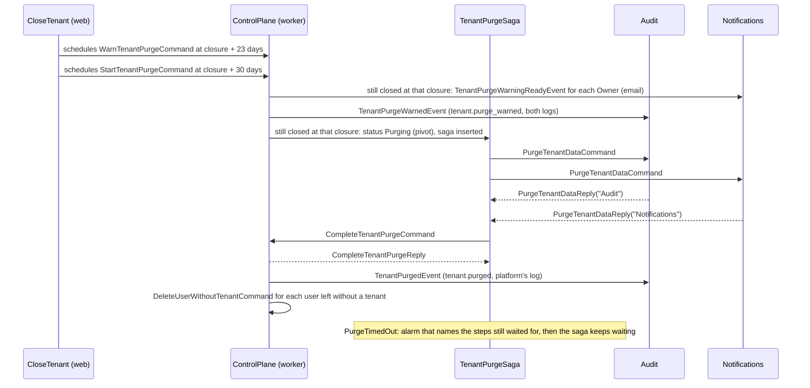

# Tenant purge

This file is a flow of `ARCHITECTURE.md`, section 6. It says what happens, step by step. The rules it cites by id are in `ARCHITECTURE.md` and `api-catalog.md`.

A closed tenant whose reopen period ends is purged: every module deletes its data of the tenant, and the tenant row stays as a tombstone (K4). This is the template's reference use of a saga, `TenantPurgeSaga` (S1 to S13; the maintainer's decision D1 in the review of 2026-10-21). It is a forward recovery saga: its first step is its pivot, and every step after it only retries; nothing is undone (S5). Source: Richardson, *Microservices Patterns*, Chapter 4 (pivot, retriable steps, no compensation). It meets the three conditions of S2: it covers every module, it has a timeout, and the platform asks where a tenant's purge stands.

| Message | Sent by | Handled by | Handler has a transaction |
| --- | --- | --- | --- |
| `WarnTenantPurgeCommand` | `CloseTenantHandler`, scheduled at the closure plus `ControlPlane:Tenants:ReopenPeriod` less `ControlPlane:Tenants:PurgeWarningLead` | ControlPlane, `WarnTenantPurgeHandler` | Yes, the tenant's |
| `TenantPurgeWarnedEvent` | `WarnTenantPurgeHandler` | Audit, `RecordTenantPurgeWarnedHandler` (`tenant.purge_warned`, platform and tenant log) | Yes |
| `TenantPurgeWarningReadyEvent` | `WarnTenantPurgeHandler`, one for each Owner | Notifications, `SendTenantPurgeWarningEmailHandler` (calls the email service) | No |
| `StartTenantPurgeCommand` | `CloseTenantHandler`, scheduled at the closure plus the reopen period | ControlPlane, `StartTenantPurgeHandler` (the pivot) | Yes, the tenant's |
| `PurgeTenantDataCommand` | `TenantPurgeSaga` | Audit, `PurgeTenantDataHandler`; Notifications, `PurgeTenantDataHandler` | Audit: yes, the tenant's; Notifications: no |
| `PurgeTenantDataReply` | each module's `PurgeTenantDataHandler` | ControlPlane, `TenantPurgeSaga` | Yes |
| `CompleteTenantPurgeCommand` | `TenantPurgeSaga`, after the last module's reply | ControlPlane, `CompleteTenantPurgeHandler` | Yes, the tenant's |
| `CompleteTenantPurgeReply` | `CompleteTenantPurgeHandler` | ControlPlane, `TenantPurgeSaga` | Yes |
| `PurgeTimedOut` | `TenantPurgeSaga`, at its start, after `ControlPlane:Tenants:PurgeTimeout` | ControlPlane, `TenantPurgeSaga` | Yes |
| `RaiseTenantPurgeAlarmCommand` | `TenantPurgeSaga`, on its timeout before the end | ControlPlane, `RaiseTenantPurgeAlarmHandler` (log and metric) | No |
| `TenantPurgedEvent` | `CompleteTenantPurgeHandler`, without a tenant | Audit, `RecordTenantPurgedHandler` (`tenant.purged`, platform log) | Yes; it declares nothing |
| `DeleteUserWithoutTenantCommand` | `CompleteTenantPurgeHandler`, without a tenant, for each user the purge left without a tenant | ControlPlane, `DeleteUserWithoutTenantHandler` | Yes; it declares the user (R11) |
| `UserDeletedEvent` | `DeleteUserWithoutTenantHandler` | Audit, `RecordUserDeletedHandler` (`user.deleted`, platform log, by the platform) | Yes |
| `DeleteIdentityAccountCommand` | `DeleteUserWithoutTenantHandler` | ControlPlane, `DeleteIdentityAccountHandler` (calls the identity provider) | No |
| `EraseFormerMemberCommand` | `DeleteUserWithoutTenantHandler`, in each tenant where the user accepted an invitation | ControlPlane, `EraseFormerMemberHandler` (`user-deletion.md`) | Yes, the tenant's |

1. The trigger (the maintainer's decision S9 of the review of 2026-10-21, option B: automatic). `CloseTenant` schedules two durable Wolverine messages in its transaction, through the outbox: the warning at the closure plus the reopen period less the warning's lead (30 and 7 days by default, so 23 days), and the purge's start at the closure plus the reopen period. Each carries the tenant id and the closure. On arrival each locks the tenant row (K6) and acts only for a tenant that is still closed at that closure (`Tenant.IsClosedAt`, which compares within a microsecond, because PostgreSQL keeps a moment to the microsecond and .NET to 100 ns). A reopening cancels nothing: the first closure's messages of a tenant that was reopened, or closed again at another moment, do nothing, and a new closure schedules its own. No scheduler other than Wolverine's own scheduled messages is used (`ARCHITECTURE.md`, section 7; `ARCHITECTURE.md`, section 12, Hangfire or Quartz.NET). Sources: GDPR, Article 5(1)(e) (storage limitation) and Article 28(3)(g) (deletion at the end of the service).
2. The warning. `WarnTenantPurgeHandler` reads the Owners under the tenant's lock (`ITenantRepository.FindOwnerAddressesAsync`): the members whose role holds `tenant.owners.manage` (A1) and who have an address. For each it publishes `TenantPurgeWarningReadyEvent`, with the Owner's language, the Owner's time zone and the moment of the purge. Notifications writes the email in English, Turkish or Arabic, in HTML and plain text, from the generated deletion warning of `packages/emails` (`ARCHITECTURE.md`, section 7, "Email"): the tenant is closed, it will be deleted with all its data at a moment, and "Contact us" asks to reopen it before then. "Contact us" links to the brand's support contact, `supportUrl` of `packages/brand/brand.json`. The subject says the day of the purge. The day and the moment are in the Owner's time zone, followed by the zone as the UI names a zone it has no name for: the city of the IANA name and the offset at that moment, `Istanbul (UTC+3)`, `Kolkata (UTC+5:30)` (F18 in the web app's architecture). The image has no ICU, so the email names no zone in the reader's language (`EmailDates`). Without a time zone, or with one that the image's time zone data does not know, the moment is in UTC (`ARCHITECTURE.md`, section 7, "Container image"). The email says no number of days, because the reopen period is configuration. The email's idempotency key is the Owner's warning of this purge (`purge-warning/`, the tenant, the user and the moment), and the event has one handler, so it takes the invitation email's retries (`Notifications:InvitationEmails:RetryDelays`, W5, W11). `TenantPurgeWarnedEvent` has an id that the tenant and the closure decide, and its moment is the moment the warning was scheduled for, the closure plus `ReopenPeriod` less `PurgeWarningLead`, so a warning that arrives twice, even later, records one entry in each log (R18). The event also carries the moment of the purge, `PurgesAt`; an event that a worker of the version before step r12 publishes during the deploy has none, and its entries then keep no details. Audit writes `tenant.purge_warned` in both logs from the one event, in one transaction, by the platform, with the tenant as the target and the details `{ purgesAt }`: the tenant's log tells its Owners and Admins, and the platform's log tells a system admin which tenants were warned (step r12). `GetTenant` answers the same moment, `purgeWarningAt`, from the closure and the settings (`Tenant.PurgeWarningAt`); nothing stores it.
3. The pivot. `StartTenantPurgeHandler` locks the tenant row and, for a tenant still closed at the message's closure, sets the status `Purging` (`Tenant.BeginPurge`). From then on the tenant cannot be reopened (409 `tenant.not_closed`), and the tenant door refuses its members as a closed tenant's (403 `tenant.closed`). `Purging` tells other work that the purge runs, after its pivot; no step comes before the pivot, so S11 has nothing to hold. In the same transaction it inserts the saga's record and sends the saga's first messages (S6). A start that arrives twice finds the tenant purging and does nothing.
4. The modules' steps. The saga sends one `PurgeTenantDataCommand`. Wolverine hands it to each module's handler on a queue of its own (W4), so each participating module gets one message. Each module deletes its data of the tenant in the tenant's transaction (R4), idempotently, and replies with `PurgeTenantDataReply`, which names the module. Audit deletes the tenant's whole log through `audit.purge_tenant_entries()` (R14); the platform's log keeps its entries about the tenant (GDPR, Article 6(1)(f), the provider's accountability; the maintainer's decision S9 of the review of 2026-10-21, option A). Notifications holds no data of a tenant today and replies at once: a module that adds data of a tenant later deletes it in its handler before it replies.
5. The participants. The saga knows no module. The host's composition names each participant through ControlPlane's contract, `TenantPurgeParticipant` (`ModuleComposition`), from a constant of each module's Api entry point: `Audit` and `Notifications`. `StartTenantPurgeHandler` takes them, and the saga's record keeps the names it waits for. A module's Infrastructure may not reference another module's Contracts (`ARCHITECTURE.md`, section 2), so the host registers them. A new module joins the purge with a handler of `PurgeTenantDataCommand` and one line in `ModuleComposition`; `TenantPurgeParticipantTests` fails when the two lists differ.
6. ControlPlane's last step. When every module has replied, the saga sends `CompleteTenantPurgeCommand`. Under the tenant's lock, `ITenantRepository.PurgeAsync` deletes ControlPlane's data of the tenant in the order the keys need: the invitations and the memberships before `role_permissions` and `roles` (A2, the RESTRICT key of a membership), each removed membership with the user's count (R13), then the tenant's summary (R12). `Tenant.Purge` turns the row into the tombstone: it keeps `id`, `name`, `slug`, `status` (`Purged`), `created_at` and `purged_at`, and clears `suspension_reason` and `closed_at`. The slug's unique index keeps the slug for ever, so no new tenant takes it (K6b). The saga's record stays, so a late or repeated message still finds the state it is ignored by; it holds the tenant id and the state only. Then the tenant's entitlement overrides (ARCHITECTURE.md, E2), which name the tenant and hold the system admin's reason. The tombstone keeps its id, name, slug, status, creation and purge time, and its plan, because a tenant always has one (the column is required); the platform's log keeps its own entries about the overrides.
7. After the commit. `TenantPurgedEvent` goes to Audit, which writes `tenant.purged` in the platform's log, by the platform. For each former member whom the purge left without a membership, who is neither deleted nor a system admin, `DeleteUserWithoutTenantCommand` deletes the user through the steps of a user's deletion (`user-deletion.md`, step 3): it locks the user row, checks again that the user is no system admin and has no membership, erases the address, the names and the time zone (`User.Delete`), and publishes `UserDeletedEvent`, by the platform, and `DeleteIdentityAccountCommand`. It also sends `EraseFormerMemberCommand` to each tenant the user joined before, as `DeleteUser` does (`user-deletion.md`, step 5). A user with another membership stays, and so does a system admin (the maintainer's decision of 2026-10-23, option B; GDPR, Article 28(3)(g)). `TenantPurgedEvent` and `DeleteUserWithoutTenantCommand` go without a tenant (`DeliveryOptions` with Wolverine's default tenant id, W3): the tenant's log is gone, and a user's deletion declares the user, never a tenant too (R4).
8. The timeout (S10). The saga schedules `PurgeTimedOut` at its start, `ControlPlane:Tenants:PurgeTimeout` later, one hour by default. A healthy purge ends in seconds: each step is one transaction, which a failure tries three times within seconds before the dead letter queue (W11). An hour also covers a worker that restarts or a deploy, so an alarm means a step that failed for good or a worker that does not run, and a person still sees it the same working day. When the timeout comes before the end, `RaiseTenantPurgeAlarmCommand` writes the error log entry `TenantPurgeTimedOut` with the tenant and the steps the saga still waits for (the modules, then `ControlPlane`), and adds one to the counter `tenant_purge.timed_out` of the meter `Modules.ControlPlane`. The saga keeps waiting after the alarm, and a late reply still completes it. The failed step is in the dead letter queue (W13), where the maintainer retries it (`docs/deployment.md`, section 14).
9. Concurrency (S8). Two replies at once both change the saga's record. The version is its concurrency token, so the second fails with `SagaConcurrencyException` and is tried again three times on the first one's result (W6). A reply that arrives twice, or names a module the saga does not wait for, changes nothing (S7).
10. Each new message type comes with all its handlers in the same release, so the gap of W12 does not apply.

Tests: `TenantPurgeSagaTests` (the saga without a host: the happy path, a reply that arrives twice, the timeout that names the modules still waiting, a late reply after the alarm), `TenantTests` (`BeginPurge`, `Purge`, `IsClosedAt`), `TenantPurgeTests` (the full purge on a database of its own: every module's data gone, another tenant's data kept, the tombstone, `tenant.purged`, the users left without a tenant, the warning in each Owner's language, a start or a warning of a reopened tenant or of an earlier closure), `CloseTenantTests` (both messages scheduled with the closure; a tenant reopened and closed again), `ReopenTenantTests` (409 while purging and after), `PurgeTenantDataTests` and `RecordTenantPurgeWarnedTests` in Audit, `SendTenantPurgeWarningEmailHandlerTests` and `PurgeTenantDataHandlerTests` in Notifications, `TenantPurgeParticipantTests`, `SagaMessageTests`, `SagaNameTests`, and `CloseTenant_TheReopenPeriodEndsOnAWebAndAWorkerHost_WarnsAndPurgesInTheWorker` for the web and worker layout (`HostRoleTests`).

Source: Richardson, *Microservices Patterns*, Chapter 4. Hohpe and Woolf, Chapter 7 (Process Manager). Nygard, *Release It!*, Chapter 5 (Timeouts). GDPR, Articles 5(1)(e), 6(1)(f) and 28(3)(g).
