# Platform app · 1 · Entry

Who sees this section: A system admin who is not signed in yet. Two-step verification is required.

Where the values come from: Sign-in, codes, authenticator and backup codes: Clerk. System admin check: our API.

12 screens. Each part below is one screen and state. The PNG beside this file is the screen at scale 1.

| Screen | Device |
|---|---|
| [1.01 · Sign in](#101--sign-in) | Desktop |
| [1.02 · Check your email](#102--check-your-email) | Desktop |
| [1.03 · Set up the authenticator](#103--set-up-the-authenticator) | Desktop |
| [1.04 · Save backup codes](#104--save-backup-codes) | Desktop |
| [1.05 · Authenticator code](#105--authenticator-code) | Desktop |
| [1.06 · Backup code](#106--backup-code) | Desktop |
| [1.07 · Wrong code · locked](#107--wrong-code--locked) | Desktop |
| [1.08 · Not a system admin](#108--not-a-system-admin) | Desktop |
| [1.09 · Sign in · dark](#109--sign-in--dark) | Desktop |
| [1.10 · Phone · sign in](#110--phone--sign-in) | Phone |
| [1.11 · Phone · check your email](#111--phone--check-your-email) | Phone |
| [1.12 · Phone · two-step verification](#112--phone--two-step-verification) | Phone |

### 1.01 · Sign in

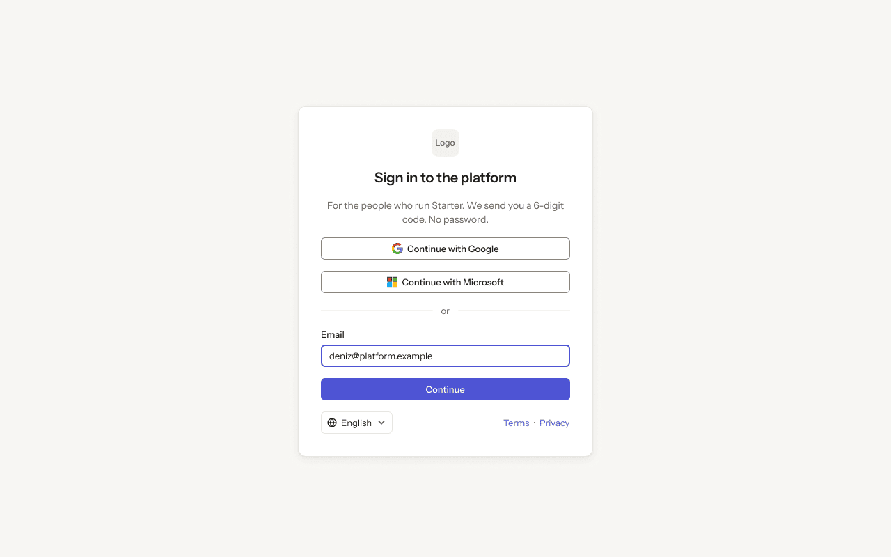

- **Who sees it:** A system admin who is not signed in yet. Two-step verification is required.
- **Device:** Desktop (1280 px and wider).
- **This state shows:** as the title says.
- **Values come from:** Sign-in, codes, authenticator and backup codes: Clerk. System admin check: our API.
- **Components:** Auth footer, Button ×3, Input.
- **Actions:**
  - "Continue": goes to [1.02 · Check your email](#102--check-your-email).
- **Texts, word for word, top to bottom:**

  - Logo
  - Sign in to the platform
  - For the people who run Starter. We send you a 6-digit code. No password.
  - Continue with Google
  - Continue with Microsoft
  - or
  - Email
  - deniz@platform.example
  - Continue
  - English
  - Terms
  - ·
  - Privacy

Figma: [148:788](https://www.figma.com/design/3Ev111okX8xCBwR9B3hyBM/?node-id=148-788)

### 1.02 · Check your email

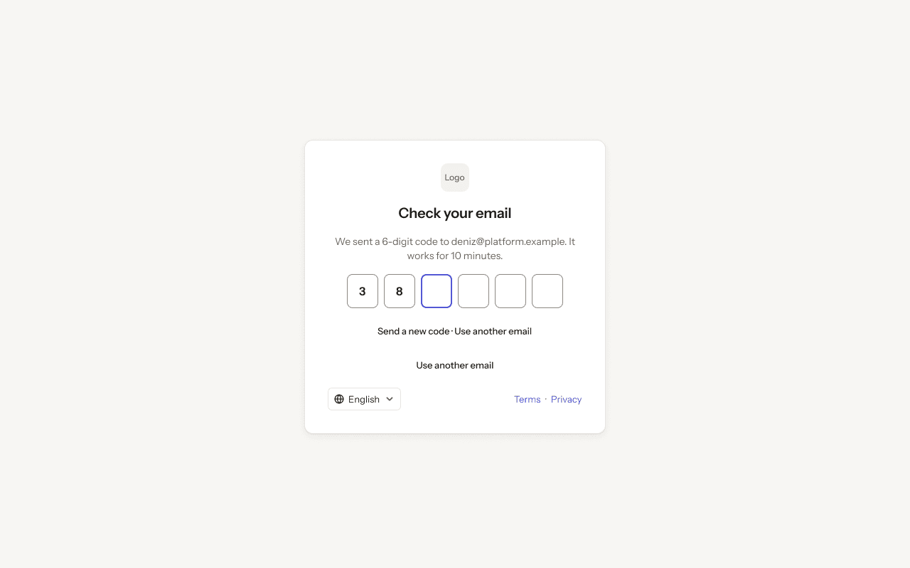

- **Who sees it:** A system admin who is not signed in yet. Two-step verification is required.
- **Device:** Desktop (1280 px and wider).
- **This state shows:** as the title says.
- **Values come from:** Sign-in, codes, authenticator and backup codes: Clerk. System admin check: our API.
- **Components:** Auth footer, Button ×2.
- **Actions:**
  - "3": goes to [1.03 · Set up the authenticator](#103--set-up-the-authenticator).
  - "We sent a 6-digit code to deniz@platform.example. It works for 10 minutes.": goes to [1.05 · Authenticator code](#105--authenticator-code).
- **Texts, word for word, top to bottom:**

  - Logo
  - Check your email
  - We sent a 6-digit code to deniz@platform.example. It works for 10 minutes.
  - 3
  - 8
  - Send a new code · Use another email
  - Use another email
  - English
  - Terms
  - ·
  - Privacy

Figma: [148:824](https://www.figma.com/design/3Ev111okX8xCBwR9B3hyBM/?node-id=148-824)

### 1.03 · Set up the authenticator

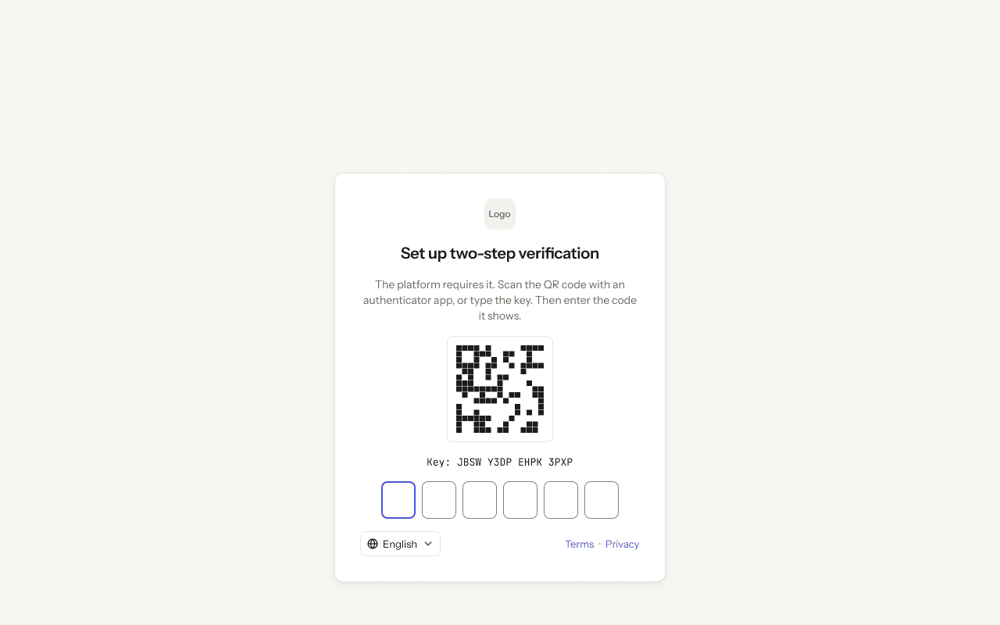

- **Who sees it:** A system admin who is not signed in yet. Two-step verification is required.
- **Device:** Desktop (1280 px and wider).
- **This state shows:** as the title says.
- **Values come from:** Sign-in, codes, authenticator and backup codes: Clerk. System admin check: our API.
- **Components:** Auth footer.
- **Actions:**
  - "Area": goes to [1.04 · Save backup codes](#104--save-backup-codes).
- **Texts, word for word, top to bottom:**

  - Logo
  - Set up two-step verification
  - The platform requires it. Scan the QR code with an authenticator app, or type the key. Then enter the code it shows.
  - Key: JBSW Y3DP EHPK 3PXP
  - English
  - Terms
  - ·
  - Privacy

Figma: [148:847](https://www.figma.com/design/3Ev111okX8xCBwR9B3hyBM/?node-id=148-847)

### 1.04 · Save backup codes

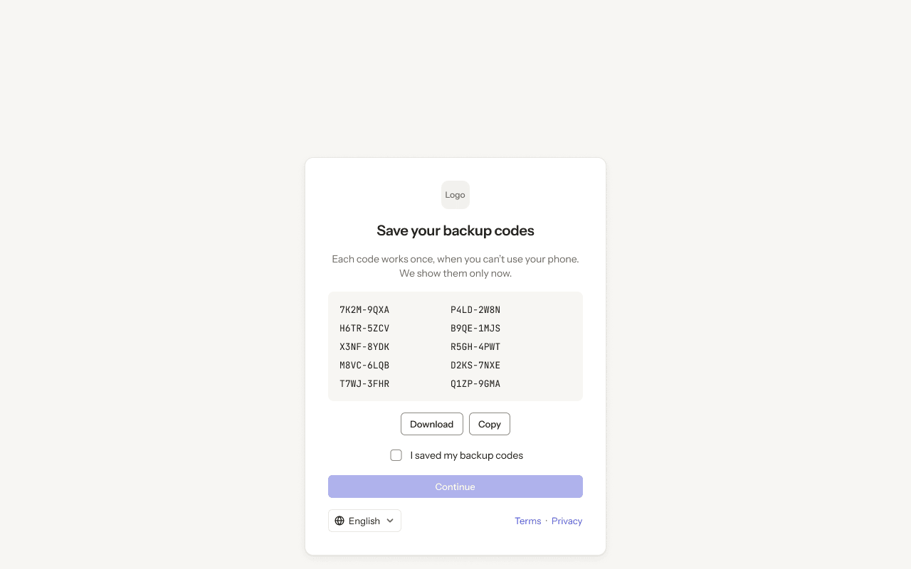

- **Who sees it:** A system admin who is not signed in yet. Two-step verification is required.
- **Device:** Desktop (1280 px and wider).
- **This state shows:** as the title says.
- **Values come from:** Sign-in, codes, authenticator and backup codes: Clerk. System admin check: our API.
- **Components:** Auth footer, Button ×3, Checkbox.
- **Actions:**
  - No prototype link on this screen. The buttons follow the section's other screens.
- **Texts, word for word, top to bottom:**

  - Logo
  - Save your backup codes
  - Each code works once, when you can’t use your phone. We show them only now.
  - 7K2M-9QXA
  - P4LD-2W8N
  - H6TR-5ZCV
  - B9QE-1MJS
  - X3NF-8YDK
  - R5GH-4PWT
  - M8VC-6LQB
  - D2KS-7NXE
  - T7WJ-3FHR
  - Q1ZP-9GMA
  - Download
  - Copy
  - I saved my backup codes
  - Continue
  - English
  - Terms
  - ·
  - Privacy

Figma: [148:966](https://www.figma.com/design/3Ev111okX8xCBwR9B3hyBM/?node-id=148-966)

### 1.05 · Authenticator code

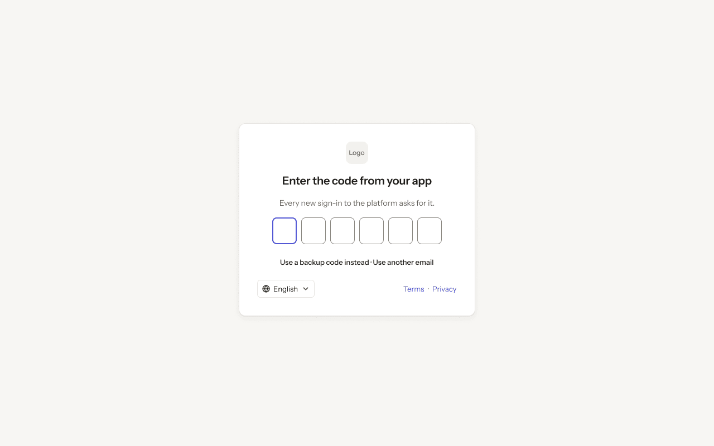

- **Who sees it:** A system admin who is not signed in yet. Two-step verification is required.
- **Device:** Desktop (1280 px and wider).
- **This state shows:** as the title says.
- **Values come from:** Sign-in, codes, authenticator and backup codes: Clerk. System admin check: our API.
- **Components:** Auth footer, Button.
- **Actions:**
  - "Use a backup code instead · Use another email": goes to [1.06 · Backup code](#106--backup-code).
  - "Enter the code from your app": goes to [4.01 · Organisations · all](../04-organisations/README.md#401--organisations--all).
- **Texts, word for word, top to bottom:**

  - Logo
  - Enter the code from your app
  - Every new sign-in to the platform asks for it.
  - Use a backup code instead · Use another email
  - English
  - Terms
  - ·
  - Privacy

Figma: [148:1012](https://www.figma.com/design/3Ev111okX8xCBwR9B3hyBM/?node-id=148-1012)

### 1.06 · Backup code

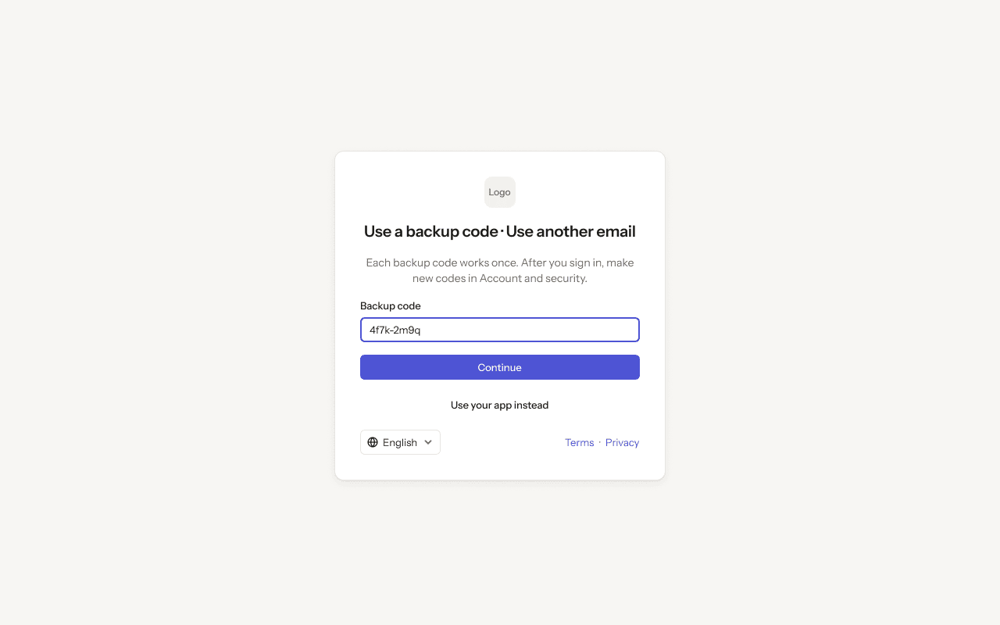

- **Who sees it:** A system admin who is not signed in yet. Two-step verification is required.
- **Device:** Desktop (1280 px and wider).
- **This state shows:** as the title says.
- **Values come from:** Sign-in, codes, authenticator and backup codes: Clerk. System admin check: our API.
- **Components:** Auth footer, Button ×2, Input.
- **Actions:**
  - "Continue": goes to [4.01 · Organisations · all](../04-organisations/README.md#401--organisations--all).
- **Texts, word for word, top to bottom:**

  - Logo
  - Use a backup code · Use another email
  - Each backup code works once. After you sign in, make new codes in Account and security.
  - Backup code
  - 4f7k-2m9q
  - Continue
  - Use your app instead
  - English
  - Terms
  - ·
  - Privacy

Figma: [148:1030](https://www.figma.com/design/3Ev111okX8xCBwR9B3hyBM/?node-id=148-1030)

### 1.07 · Wrong code · locked

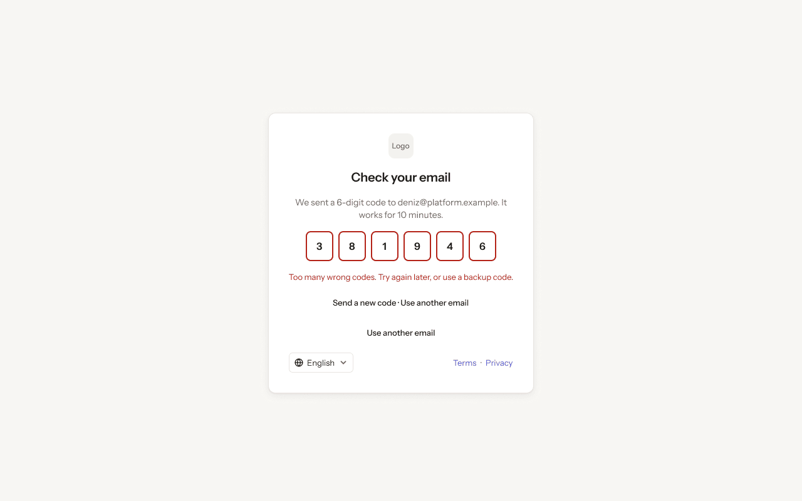

- **Who sees it:** A system admin who is not signed in yet. Two-step verification is required.
- **Device:** Desktop (1280 px and wider).
- **This state shows:** after too many wrong attempts.
- **Values come from:** Sign-in, codes, authenticator and backup codes: Clerk. System admin check: our API.
- **Components:** Auth footer, Button ×2.
- **Actions:**
  - No prototype link on this screen. The buttons follow the section's other screens.
- **Texts, word for word, top to bottom:**

  - Logo
  - Check your email
  - We sent a 6-digit code to deniz@platform.example. It works for 10 minutes.
  - 3
  - 8
  - 1
  - 9
  - 4
  - 6
  - Too many wrong codes. Try again later, or use a backup code.
  - Send a new code · Use another email
  - Use another email
  - English
  - Terms
  - ·
  - Privacy

Figma: [148:1048](https://www.figma.com/design/3Ev111okX8xCBwR9B3hyBM/?node-id=148-1048)

### 1.08 · Not a system admin

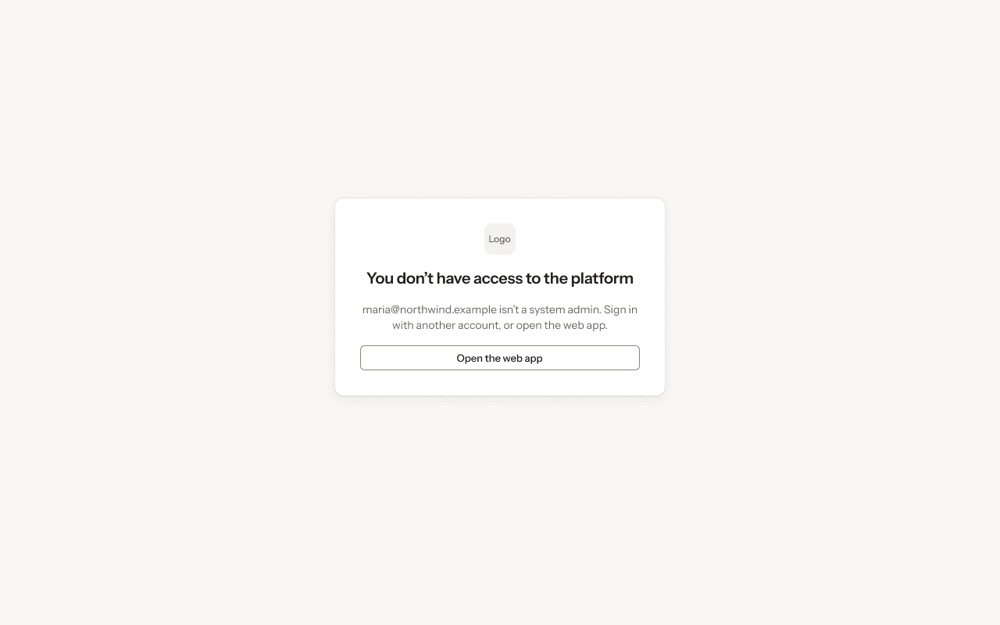

- **Who sees it:** A system admin who is not signed in yet. Two-step verification is required.
- **Device:** Desktop (1280 px and wider).
- **This state shows:** as the title says.
- **Values come from:** Sign-in, codes, authenticator and backup codes: Clerk. System admin check: our API.
- **Components:** Button.
- **Actions:**
  - No prototype link on this screen. The buttons follow the section's other screens.
- **Texts, word for word, top to bottom:**

  - Logo
  - You don’t have access to the platform
  - maria@northwind.example isn’t a system admin. Sign in with another account, or open the web app.
  - Open the web app

Figma: [148:1074](https://www.figma.com/design/3Ev111okX8xCBwR9B3hyBM/?node-id=148-1074)

### 1.09 · Sign in · dark

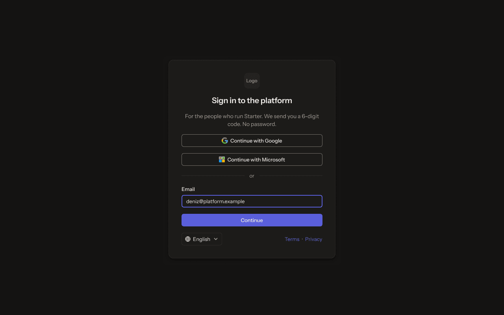

- **Who sees it:** A system admin who is not signed in yet. Two-step verification is required.
- **Device:** Desktop (1280 px and wider).
- **This state shows:** in the dark theme.
- **Values come from:** Sign-in, codes, authenticator and backup codes: Clerk. System admin check: our API.
- **Components:** Auth footer, Button ×3, Input.
- **Actions:**
  - No prototype link on this screen. The buttons follow the section's other screens.
- **Texts, word for word, top to bottom:**

  - Logo
  - Sign in to the platform
  - For the people who run Starter. We send you a 6-digit code. No password.
  - Continue with Google
  - Continue with Microsoft
  - or
  - Email
  - deniz@platform.example
  - Continue
  - English
  - Terms
  - ·
  - Privacy

Figma: [148:1087](https://www.figma.com/design/3Ev111okX8xCBwR9B3hyBM/?node-id=148-1087)

### 1.10 · Phone · sign in

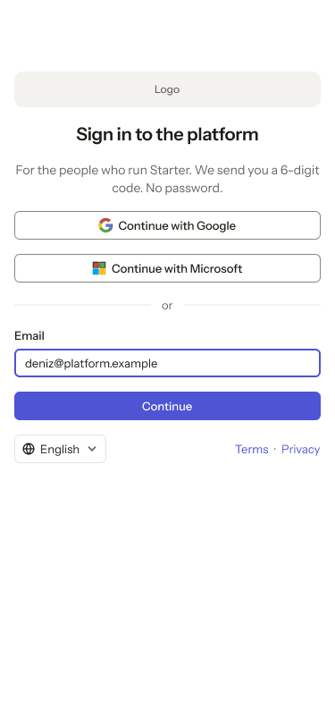

- **Who sees it:** A system admin who is not signed in yet. Two-step verification is required.
- **Device:** Phone (up to 767 px).
- **This state shows:** on a phone.
- **Values come from:** Sign-in, codes, authenticator and backup codes: Clerk. System admin check: our API.
- **Components:** Auth footer, Button ×3, Input.
- **Actions:**
  - "Continue": goes to [1.11 · Phone · check your email](#111--phone--check-your-email).
- **Texts, word for word, top to bottom:**

  - Logo
  - Sign in to the platform
  - For the people who run Starter. We send you a 6-digit code. No password.
  - Continue with Google
  - Continue with Microsoft
  - or
  - Email
  - deniz@platform.example
  - Continue
  - English
  - Terms
  - ·
  - Privacy

Figma: [259:16845](https://www.figma.com/design/3Ev111okX8xCBwR9B3hyBM/?node-id=259-16845)

### 1.11 · Phone · check your email

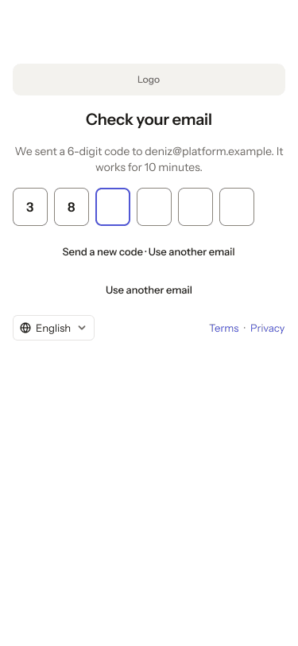

- **Who sees it:** A system admin who is not signed in yet. Two-step verification is required.
- **Device:** Phone (up to 767 px).
- **This state shows:** on a phone.
- **Values come from:** Sign-in, codes, authenticator and backup codes: Clerk. System admin check: our API.
- **Components:** Auth footer, Button ×2.
- **Actions:**
  - "We sent a 6-digit code to deniz@platform.example. It works for 10 minutes.": goes to [1.12 · Phone · two-step verification](#112--phone--two-step-verification).
- **Texts, word for word, top to bottom:**

  - Logo
  - Check your email
  - We sent a 6-digit code to deniz@platform.example. It works for 10 minutes.
  - 3
  - 8
  - Send a new code · Use another email
  - Use another email
  - English
  - Terms
  - ·
  - Privacy

Figma: [259:16890](https://www.figma.com/design/3Ev111okX8xCBwR9B3hyBM/?node-id=259-16890)

### 1.12 · Phone · two-step verification

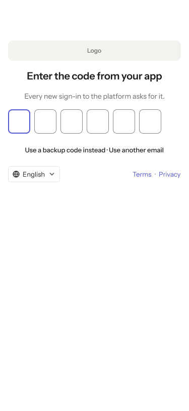

- **Who sees it:** A system admin who is not signed in yet. Two-step verification is required.
- **Device:** Phone (up to 767 px).
- **This state shows:** on a phone.
- **Values come from:** Sign-in, codes, authenticator and backup codes: Clerk. System admin check: our API.
- **Components:** Auth footer, Button.
- **Actions:**
  - "Enter the code from your app": goes to [4.43 · Phone · Organisations](../04-organisations/README.md#443--phone--organisations).
- **Texts, word for word, top to bottom:**

  - Logo
  - Enter the code from your app
  - Every new sign-in to the platform asks for it.
  - Use a backup code instead · Use another email
  - English
  - Terms
  - ·
  - Privacy

Figma: [259:16926](https://www.figma.com/design/3Ev111okX8xCBwR9B3hyBM/?node-id=259-16926)
