# Platform app · 2 · Shell

Who sees this section: Every signed-in system admin.

Where the values come from: Person: our API. Unread count: our API notifications and the live stream. Environment strip: APP_ENVIRONMENT. Connection bar: network state and API health.

26 screens. Each part below is one screen and state. The PNG beside this file is the screen at scale 1.

| Screen | Device |
|---|---|
| [2.01 · Shell](#201--shell) | Desktop |
| [2.02 · Command menu](#202--command-menu) | Desktop |
| [2.03 · Account menu](#203--account-menu) | Desktop |
| [2.04 · Page not found](#204--page-not-found) | Desktop |
| [2.05 · Section failed](#205--section-failed) | Desktop |
| [2.06 · App couldn’t start](#206--app-couldnt-start) | Desktop |
| [2.07 · Session ended](#207--session-ended) | Desktop |
| [2.08 · Offline](#208--offline) | Desktop |
| [2.09 · Back online](#209--back-online) | Desktop |
| [2.10 · Server not answering](#210--server-not-answering) | Desktop |
| [2.11 · Browser tab](#211--browser-tab) | Desktop |
| [2.12 · Staging](#212--staging) | Desktop |
| [2.13 · Dark](#213--dark) | Desktop |
| [2.14 · Phone · menu open](#214--phone--menu-open) | Phone |
| [2.15 · Phone · settings menu open](#215--phone--settings-menu-open) | Phone |
| [2.16 · Phone · Staging](#216--phone--staging) | Phone |
| [2.17 · Phone · loading](#217--phone--loading) | Phone |
| [2.18 · Phone · error](#218--phone--error) | Phone |
| [2.19 · Phone · empty](#219--phone--empty) | Phone |
| [2.20 · Phone · dark](#220--phone--dark) | Phone |
| [2.21 · Phone · Arabic](#221--phone--arabic) | Phone |
| [2.22 · Page not found · old link](#222--page-not-found--old-link) | Desktop |
| [2.23 · Organisation not found](#223--organisation-not-found) | Desktop |
| [2.24 · Page not found · signed out](#224--page-not-found--signed-out) | Desktop |
| [2.25 · Phone · page not found](#225--phone--page-not-found) | Phone |
| [2.26 · Page not found · dark](#226--page-not-found--dark) | Desktop |

### 2.01 · Shell

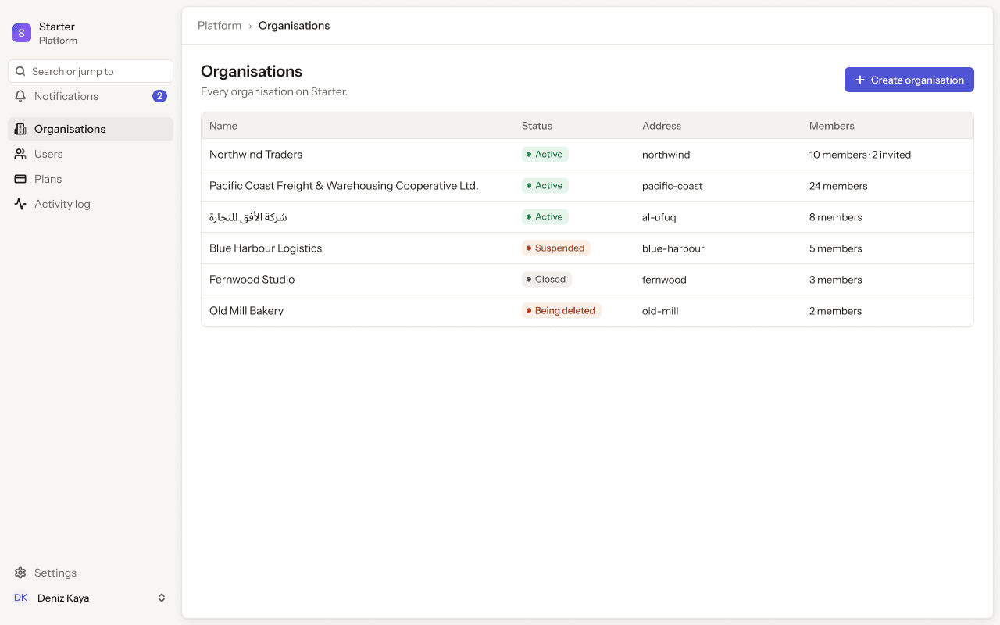

- **Who sees it:** Every signed-in system admin.
- **Device:** Desktop (1280 px and wider).
- **This state shows:** as the title says.
- **Values come from:** Person: our API. Unread count: our API notifications and the live stream. Environment strip: APP_ENVIRONMENT. Connection bar: network state and API health.
- **Components:** Button, Pill ×6, Platform sidebar, Top bar.
- **Actions:**
  - "Notifications": goes to [3.01 · Bell · unread](../03-notifications/README.md#301--bell--unread).
  - "Search or jump to": goes to [2.02 · Command menu](#202--command-menu).
  - "Deniz Kaya": goes to [2.03 · Account menu](#203--account-menu).
  - "Settings": goes to [8.01 · Profile · ideal](../08-settings-profile/README.md#801--profile--ideal).
- **Texts, word for word, top to bottom:**

  - S
  - Starter
  - Platform
  - Search or jump to
  - Notifications
  - 2
  - Organisations
  - Users
  - Plans
  - Activity log
  - Settings
  - DK
  - Deniz Kaya
  - Platform
  - ›
  - Organisations
  - Organisations
  - Every organisation on Starter.
  - Create organisation
  - Name
  - Status
  - Address
  - Members
  - Northwind Traders
  - Active
  - northwind
  - 10 members · 2 invited
  - Pacific Coast Freight & Warehousing Cooperative Ltd.
  - Active
  - pacific-coast
  - 24 members
  - شركة الأفق للتجارة
  - Active
  - al-ufuq
  - 8 members
  - Blue Harbour Logistics
  - Suspended
  - blue-harbour
  - 5 members
  - Fernwood Studio
  - Closed
  - fernwood
  - 3 members
  - Old Mill Bakery
  - Being deleted
  - old-mill
  - 2 members

Figma: [167:1117](https://www.figma.com/design/3Ev111okX8xCBwR9B3hyBM/?node-id=167-1117)

### 2.02 · Command menu

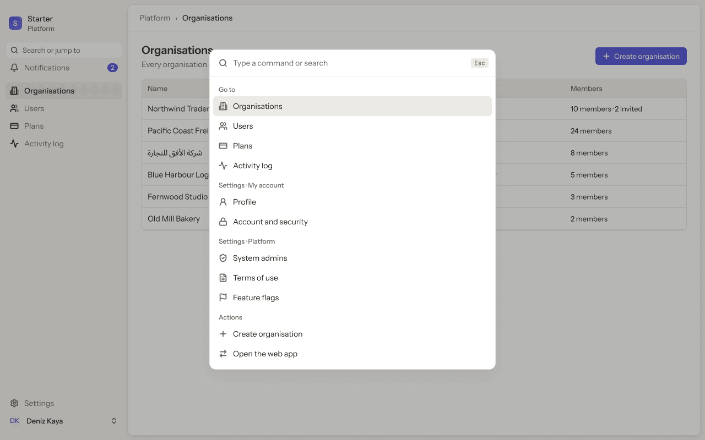

- **Who sees it:** Every signed-in system admin.
- **Device:** Desktop (1280 px and wider).
- **This state shows:** as the title says.
- **Values come from:** Person: our API. Unread count: our API notifications and the live stream. Environment strip: APP_ENVIRONMENT. Connection bar: network state and API health.
- **Components:** Button, Icon/activity, Icon/arrow-right-left, Icon/building-2, Icon/credit-card, Icon/file-text, Icon/flag, Icon/lock, Icon/plus, Icon/search, Icon/shield-check, Icon/user, Icon/users, Kbd, Pill ×6, Platform sidebar, Top bar.
- **Actions:**
  - "Organisations": goes to [4.01 · Organisations · all](../04-organisations/README.md#401--organisations--all).
  - "Notifications": goes to [3.01 · Bell · unread](../03-notifications/README.md#301--bell--unread).
  - "Deniz Kaya": goes to [2.03 · Account menu](#203--account-menu).
  - "Users": goes to [5.01 · Users · all](../05-users/README.md#501--users--all).
  - "Plans": goes to [6.01 · Plans](../06-plans/README.md#601--plans).
  - "Activity log": goes to [7.01 · Activity log](../07-activity-log/README.md#701--activity-log).
  - "Settings": goes to [8.01 · Profile · ideal](../08-settings-profile/README.md#801--profile--ideal).
- **Texts, word for word, top to bottom:**

  - S
  - Starter
  - Platform
  - Search or jump to
  - Notifications
  - 2
  - Organisations
  - Users
  - Plans
  - Activity log
  - Settings
  - DK
  - Deniz Kaya
  - Platform
  - ›
  - Organisations
  - Organisations
  - Every organisation on Starter.
  - Create organisation
  - Name
  - Status
  - Address
  - Members
  - Northwind Traders
  - Active
  - northwind
  - 10 members · 2 invited
  - Pacific Coast Freight & Warehousing Cooperative Ltd.
  - Active
  - pacific-coast
  - 24 members
  - شركة الأفق للتجارة
  - Active
  - al-ufuq
  - 8 members
  - Blue Harbour Logistics
  - Suspended
  - blue-harbour
  - 5 members
  - Fernwood Studio
  - Closed
  - fernwood
  - 3 members
  - Old Mill Bakery
  - Being deleted
  - old-mill
  - 2 members
  - Type a command or search
  - Esc
  - Go to
  - Organisations
  - Users
  - Plans
  - Activity log
  - Settings · My account
  - Profile
  - Account and security
  - Settings · Platform
  - System admins
  - Terms of use
  - Feature flags
  - Actions
  - Create organisation
  - Open the web app

Figma: [167:1412](https://www.figma.com/design/3Ev111okX8xCBwR9B3hyBM/?node-id=167-1412)

### 2.03 · Account menu

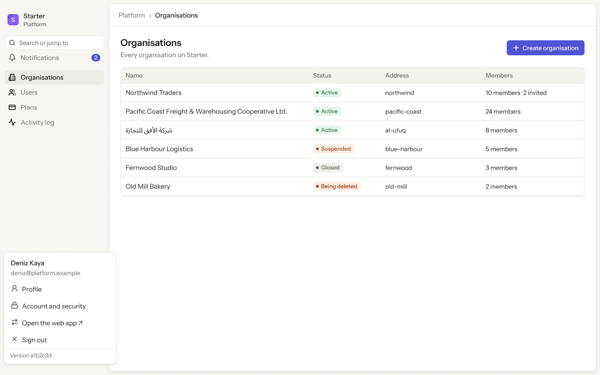

- **Who sees it:** Every signed-in system admin.
- **Device:** Desktop (1280 px and wider).
- **This state shows:** as the title says.
- **Values come from:** Person: our API. Unread count: our API notifications and the live stream. Environment strip: APP_ENVIRONMENT. Connection bar: network state and API health.
- **Components:** Account menu · Version, Button, Icon/arrow-right-left, Icon/lock, Icon/user, Icon/x, Pill ×6, Platform sidebar, Top bar.
- **Actions:**
  - "Version a1b2c3d": goes to node 218:1103 (not a numbered screen).
  - "Organisations": goes to [4.01 · Organisations · all](../04-organisations/README.md#401--organisations--all).
  - "Notifications": goes to [3.01 · Bell · unread](../03-notifications/README.md#301--bell--unread).
  - "Search or jump to": goes to [2.02 · Command menu](#202--command-menu).
  - "Users": goes to [5.01 · Users · all](../05-users/README.md#501--users--all).
  - "Plans": goes to [6.01 · Plans](../06-plans/README.md#601--plans).
  - "Activity log": goes to [7.01 · Activity log](../07-activity-log/README.md#701--activity-log).
  - "Settings": goes to [8.01 · Profile · ideal](../08-settings-profile/README.md#801--profile--ideal).
- **Texts, word for word, top to bottom:**

  - S
  - Starter
  - Platform
  - Search or jump to
  - Notifications
  - 2
  - Organisations
  - Users
  - Plans
  - Activity log
  - Settings
  - DK
  - Deniz Kaya
  - Platform
  - ›
  - Organisations
  - Organisations
  - Every organisation on Starter.
  - Create organisation
  - Name
  - Status
  - Address
  - Members
  - Northwind Traders
  - Active
  - northwind
  - 10 members · 2 invited
  - Pacific Coast Freight & Warehousing Cooperative Ltd.
  - Active
  - pacific-coast
  - 24 members
  - شركة الأفق للتجارة
  - Active
  - al-ufuq
  - 8 members
  - Blue Harbour Logistics
  - Suspended
  - blue-harbour
  - 5 members
  - Fernwood Studio
  - Closed
  - fernwood
  - 3 members
  - Old Mill Bakery
  - Being deleted
  - old-mill
  - 2 members
  - Deniz Kaya
  - deniz@platform.example
  - Profile
  - Account and security
  - Open the web app ↗
  - Sign out
  - Version a1b2c3d

Figma: [167:1811](https://www.figma.com/design/3Ev111okX8xCBwR9B3hyBM/?node-id=167-1811)

### 2.04 · Page not found

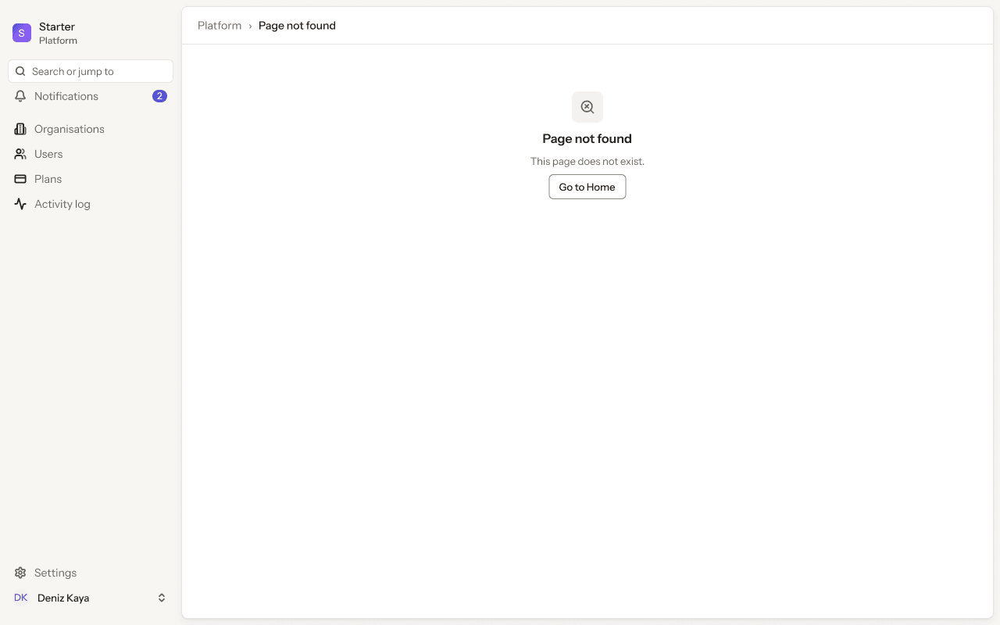

- **Who sees it:** Every signed-in system admin.
- **Device:** Desktop (1280 px and wider).
- **This state shows:** when the address points to nothing the person can open.
- **Values come from:** Person: our API. Unread count: our API notifications and the live stream. Environment strip: APP_ENVIRONMENT. Connection bar: network state and API health.
- **Components:** Empty state, Platform sidebar, Top bar.
- **Actions:**
  - "Organisations": goes to [4.01 · Organisations · all](../04-organisations/README.md#401--organisations--all).
  - "Notifications": goes to [3.01 · Bell · unread](../03-notifications/README.md#301--bell--unread).
  - "Search or jump to": goes to [2.02 · Command menu](#202--command-menu).
  - "Deniz Kaya": goes to [2.03 · Account menu](#203--account-menu).
  - "Go to Home": goes to [4.01 · Organisations · all](../04-organisations/README.md#401--organisations--all).
  - "Users": goes to [5.01 · Users · all](../05-users/README.md#501--users--all).
  - "Plans": goes to [6.01 · Plans](../06-plans/README.md#601--plans).
  - "Activity log": goes to [7.01 · Activity log](../07-activity-log/README.md#701--activity-log).
  - "Settings": goes to [8.01 · Profile · ideal](../08-settings-profile/README.md#801--profile--ideal).
- **Texts, word for word, top to bottom:**

  - S
  - Starter
  - Platform
  - Search or jump to
  - Notifications
  - 2
  - Organisations
  - Users
  - Plans
  - Activity log
  - Settings
  - DK
  - Deniz Kaya
  - Platform
  - ›
  - Page not found
  - Page not found
  - This page does not exist.
  - Go to Home

Figma: [167:1974](https://www.figma.com/design/3Ev111okX8xCBwR9B3hyBM/?node-id=167-1974)

### 2.05 · Section failed

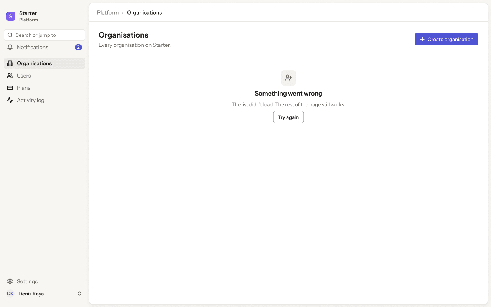

- **Who sees it:** Every signed-in system admin.
- **Device:** Desktop (1280 px and wider).
- **This state shows:** when the action fails.
- **Values come from:** Person: our API. Unread count: our API notifications and the live stream. Environment strip: APP_ENVIRONMENT. Connection bar: network state and API health.
- **Components:** Button, Empty state, Platform sidebar, Top bar.
- **Actions:**
  - "Organisations": goes to [4.01 · Organisations · all](../04-organisations/README.md#401--organisations--all).
  - "Notifications": goes to [3.01 · Bell · unread](../03-notifications/README.md#301--bell--unread).
  - "Search or jump to": goes to [2.02 · Command menu](#202--command-menu).
  - "Deniz Kaya": goes to [2.03 · Account menu](#203--account-menu).
  - "Try again": goes to [4.01 · Organisations · all](../04-organisations/README.md#401--organisations--all).
  - "Users": goes to [5.01 · Users · all](../05-users/README.md#501--users--all).
  - "Plans": goes to [6.01 · Plans](../06-plans/README.md#601--plans).
  - "Activity log": goes to [7.01 · Activity log](../07-activity-log/README.md#701--activity-log).
  - "Settings": goes to [8.01 · Profile · ideal](../08-settings-profile/README.md#801--profile--ideal).
- **Texts, word for word, top to bottom:**

  - S
  - Starter
  - Platform
  - Search or jump to
  - Notifications
  - 2
  - Organisations
  - Users
  - Plans
  - Activity log
  - Settings
  - DK
  - Deniz Kaya
  - Platform
  - ›
  - Organisations
  - Organisations
  - Every organisation on Starter.
  - Create organisation
  - Something went wrong
  - The list didn’t load. The rest of the page still works.
  - Try again

Figma: [167:2129](https://www.figma.com/design/3Ev111okX8xCBwR9B3hyBM/?node-id=167-2129)

### 2.06 · App couldn’t start

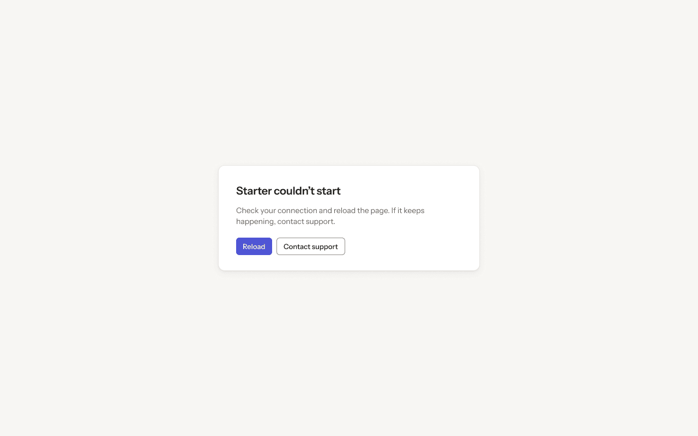

- **Who sees it:** Every signed-in system admin.
- **Device:** Desktop (1280 px and wider).
- **This state shows:** as the title says.
- **Values come from:** Person: our API. Unread count: our API notifications and the live stream. Environment strip: APP_ENVIRONMENT. Connection bar: network state and API health.
- **Components:** Button ×2.
- **Actions:**
  - "Reload": goes to [4.01 · Organisations · all](../04-organisations/README.md#401--organisations--all).
- **Texts, word for word, top to bottom:**

  - Starter couldn’t start
  - Check your connection and reload the page. If it keeps happening, contact support.
  - Reload
  - Contact support

Figma: [167:2417](https://www.figma.com/design/3Ev111okX8xCBwR9B3hyBM/?node-id=167-2417)

### 2.07 · Session ended

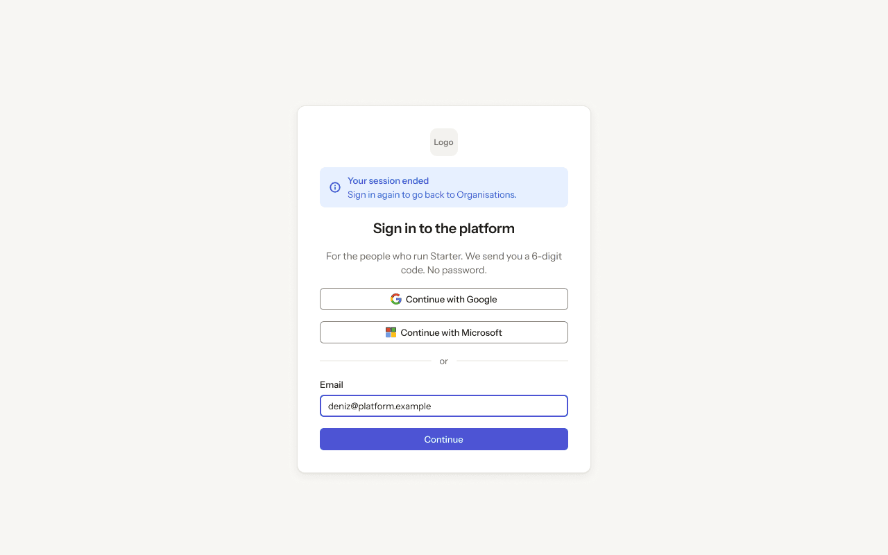

- **Who sees it:** Every signed-in system admin.
- **Device:** Desktop (1280 px and wider).
- **This state shows:** as the title says.
- **Values come from:** Person: our API. Unread count: our API notifications and the live stream. Environment strip: APP_ENVIRONMENT. Connection bar: network state and API health.
- **Components:** Banner, Button ×3, Input.
- **Actions:**
  - "Continue": goes to [1.02 · Check your email](../01-entry/README.md#102--check-your-email).
- **Texts, word for word, top to bottom:**

  - Logo
  - Your session ended
  - Sign in again to go back to Organisations.
  - Sign in to the platform
  - For the people who run Starter. We send you a 6-digit code. No password.
  - Continue with Google
  - Continue with Microsoft
  - or
  - Email
  - deniz@platform.example
  - Continue

Figma: [167:2424](https://www.figma.com/design/3Ev111okX8xCBwR9B3hyBM/?node-id=167-2424)

### 2.08 · Offline

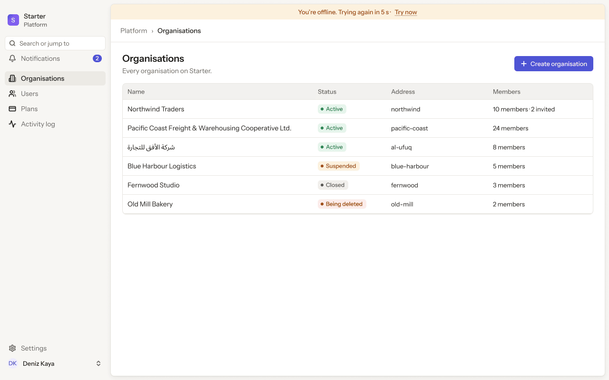

- **Who sees it:** Every signed-in system admin.
- **Device:** Desktop (1280 px and wider).
- **This state shows:** when the browser loses the network.
- **Values come from:** Person: our API. Unread count: our API notifications and the live stream. Environment strip: APP_ENVIRONMENT. Connection bar: network state and API health.
- **Components:** Button, Connection bar, Pill ×6, Platform sidebar, Top bar.
- **Actions:**
  - "Organisations": goes to [4.01 · Organisations · all](../04-organisations/README.md#401--organisations--all).
  - "Notifications": goes to [3.01 · Bell · unread](../03-notifications/README.md#301--bell--unread).
  - "Search or jump to": goes to [2.02 · Command menu](#202--command-menu).
  - "Deniz Kaya": goes to [2.03 · Account menu](#203--account-menu).
  - "Try now": goes to [2.09 · Back online](#209--back-online).
  - "Users": goes to [5.01 · Users · all](../05-users/README.md#501--users--all).
  - "Plans": goes to [6.01 · Plans](../06-plans/README.md#601--plans).
  - "Activity log": goes to [7.01 · Activity log](../07-activity-log/README.md#701--activity-log).
  - "Settings": goes to [8.01 · Profile · ideal](../08-settings-profile/README.md#801--profile--ideal).
- **Texts, word for word, top to bottom:**

  - S
  - Starter
  - Platform
  - Search or jump to
  - Notifications
  - 2
  - Organisations
  - Users
  - Plans
  - Activity log
  - Settings
  - DK
  - Deniz Kaya
  - You’re offline. Trying again in 5 s ·
  - Try now
  - Platform
  - ›
  - Organisations
  - Organisations
  - Every organisation on Starter.
  - Create organisation
  - Name
  - Status
  - Address
  - Members
  - Northwind Traders
  - Active
  - northwind
  - 10 members · 2 invited
  - Pacific Coast Freight & Warehousing Cooperative Ltd.
  - Active
  - pacific-coast
  - 24 members
  - شركة الأفق للتجارة
  - Active
  - al-ufuq
  - 8 members
  - Blue Harbour Logistics
  - Suspended
  - blue-harbour
  - 5 members
  - Fernwood Studio
  - Closed
  - fernwood
  - 3 members
  - Old Mill Bakery
  - Being deleted
  - old-mill
  - 2 members

Figma: [167:2497](https://www.figma.com/design/3Ev111okX8xCBwR9B3hyBM/?node-id=167-2497)

### 2.09 · Back online

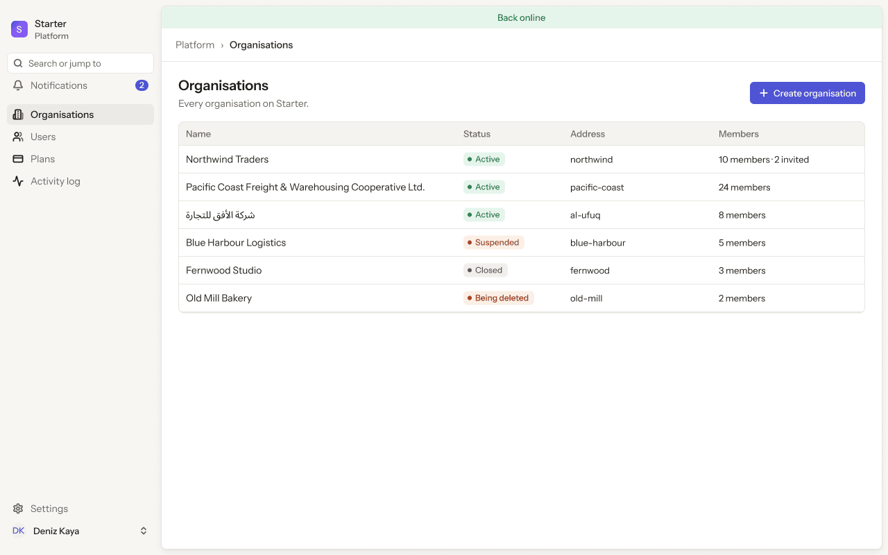

- **Who sees it:** Every signed-in system admin.
- **Device:** Desktop (1280 px and wider).
- **This state shows:** as the title says.
- **Values come from:** Person: our API. Unread count: our API notifications and the live stream. Environment strip: APP_ENVIRONMENT. Connection bar: network state and API health.
- **Components:** Button, Connection bar, Pill ×6, Platform sidebar, Top bar.
- **Actions:**
  - "Organisations": goes to [4.01 · Organisations · all](../04-organisations/README.md#401--organisations--all).
  - "Notifications": goes to [3.01 · Bell · unread](../03-notifications/README.md#301--bell--unread).
  - "Search or jump to": goes to [2.02 · Command menu](#202--command-menu).
  - "Deniz Kaya": goes to [2.03 · Account menu](#203--account-menu).
  - "Users": goes to [5.01 · Users · all](../05-users/README.md#501--users--all).
  - "Plans": goes to [6.01 · Plans](../06-plans/README.md#601--plans).
  - "Activity log": goes to [7.01 · Activity log](../07-activity-log/README.md#701--activity-log).
  - "Settings": goes to [8.01 · Profile · ideal](../08-settings-profile/README.md#801--profile--ideal).
- **Texts, word for word, top to bottom:**

  - S
  - Starter
  - Platform
  - Search or jump to
  - Notifications
  - 2
  - Organisations
  - Users
  - Plans
  - Activity log
  - Settings
  - DK
  - Deniz Kaya
  - Back online
  - Platform
  - ›
  - Organisations
  - Organisations
  - Every organisation on Starter.
  - Create organisation
  - Name
  - Status
  - Address
  - Members
  - Northwind Traders
  - Active
  - northwind
  - 10 members · 2 invited
  - Pacific Coast Freight & Warehousing Cooperative Ltd.
  - Active
  - pacific-coast
  - 24 members
  - شركة الأفق للتجارة
  - Active
  - al-ufuq
  - 8 members
  - Blue Harbour Logistics
  - Suspended
  - blue-harbour
  - 5 members
  - Fernwood Studio
  - Closed
  - fernwood
  - 3 members
  - Old Mill Bakery
  - Being deleted
  - old-mill
  - 2 members

Figma: [167:2633](https://www.figma.com/design/3Ev111okX8xCBwR9B3hyBM/?node-id=167-2633)

### 2.10 · Server not answering

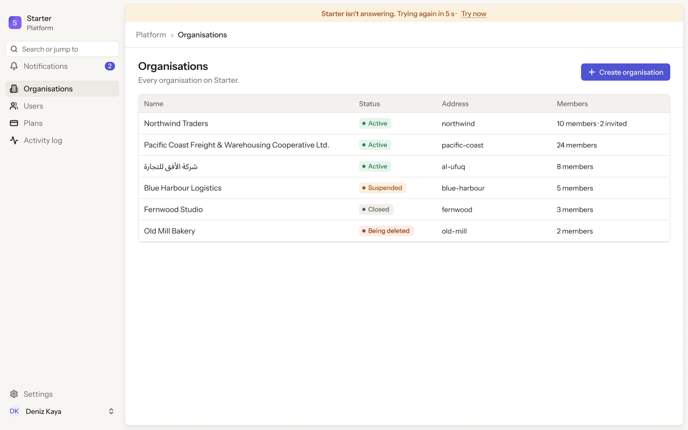

- **Who sees it:** Every signed-in system admin.
- **Device:** Desktop (1280 px and wider).
- **This state shows:** as the title says.
- **Values come from:** Person: our API. Unread count: our API notifications and the live stream. Environment strip: APP_ENVIRONMENT. Connection bar: network state and API health.
- **Components:** Button, Connection bar, Pill ×6, Platform sidebar, Top bar.
- **Actions:**
  - "Organisations": goes to [4.01 · Organisations · all](../04-organisations/README.md#401--organisations--all).
  - "Notifications": goes to [3.01 · Bell · unread](../03-notifications/README.md#301--bell--unread).
  - "Search or jump to": goes to [2.02 · Command menu](#202--command-menu).
  - "Deniz Kaya": goes to [2.03 · Account menu](#203--account-menu).
  - "Try now": goes to [2.09 · Back online](#209--back-online).
  - "Users": goes to [5.01 · Users · all](../05-users/README.md#501--users--all).
  - "Plans": goes to [6.01 · Plans](../06-plans/README.md#601--plans).
  - "Activity log": goes to [7.01 · Activity log](../07-activity-log/README.md#701--activity-log).
  - "Settings": goes to [8.01 · Profile · ideal](../08-settings-profile/README.md#801--profile--ideal).
- **Texts, word for word, top to bottom:**

  - S
  - Starter
  - Platform
  - Search or jump to
  - Notifications
  - 2
  - Organisations
  - Users
  - Plans
  - Activity log
  - Settings
  - DK
  - Deniz Kaya
  - Starter isn’t answering. Trying again in 5 s ·
  - Try now
  - Platform
  - ›
  - Organisations
  - Organisations
  - Every organisation on Starter.
  - Create organisation
  - Name
  - Status
  - Address
  - Members
  - Northwind Traders
  - Active
  - northwind
  - 10 members · 2 invited
  - Pacific Coast Freight & Warehousing Cooperative Ltd.
  - Active
  - pacific-coast
  - 24 members
  - شركة الأفق للتجارة
  - Active
  - al-ufuq
  - 8 members
  - Blue Harbour Logistics
  - Suspended
  - blue-harbour
  - 5 members
  - Fernwood Studio
  - Closed
  - fernwood
  - 3 members
  - Old Mill Bakery
  - Being deleted
  - old-mill
  - 2 members

Figma: [167:2768](https://www.figma.com/design/3Ev111okX8xCBwR9B3hyBM/?node-id=167-2768)

### 2.11 · Browser tab

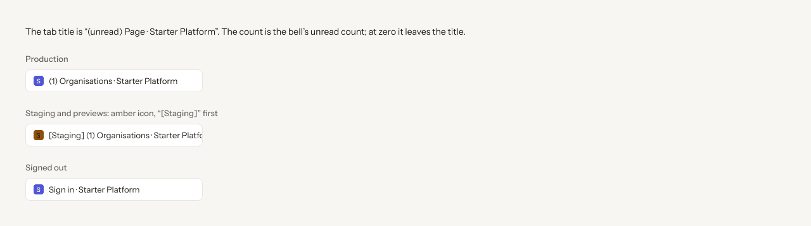

- **Who sees it:** Every signed-in system admin.
- **Device:** Desktop (1280 px and wider).
- **This state shows:** as the title says.
- **Values come from:** Person: our API. Unread count: our API notifications and the live stream. Environment strip: APP_ENVIRONMENT. Connection bar: network state and API health.
- **Components:** none (drawn without instances).
- **Actions:**
  - No prototype link on this screen. The buttons follow the section's other screens.
- **Texts, word for word, top to bottom:**

  - The tab title is “(unread) Page · Starter Platform”. The count is the bell’s unread count; at zero it leaves the title.
  - Production
  - S
  - (1) Organisations · Starter Platform
  - Staging and previews: amber icon, “\[Staging\]” first
  - S
  - \[Staging\] (1) Organisations · Starter Platform
  - Signed out
  - S
  - Sign in · Starter Platform

Figma: [167:17717](https://www.figma.com/design/3Ev111okX8xCBwR9B3hyBM/?node-id=167-17717)

### 2.12 · Staging

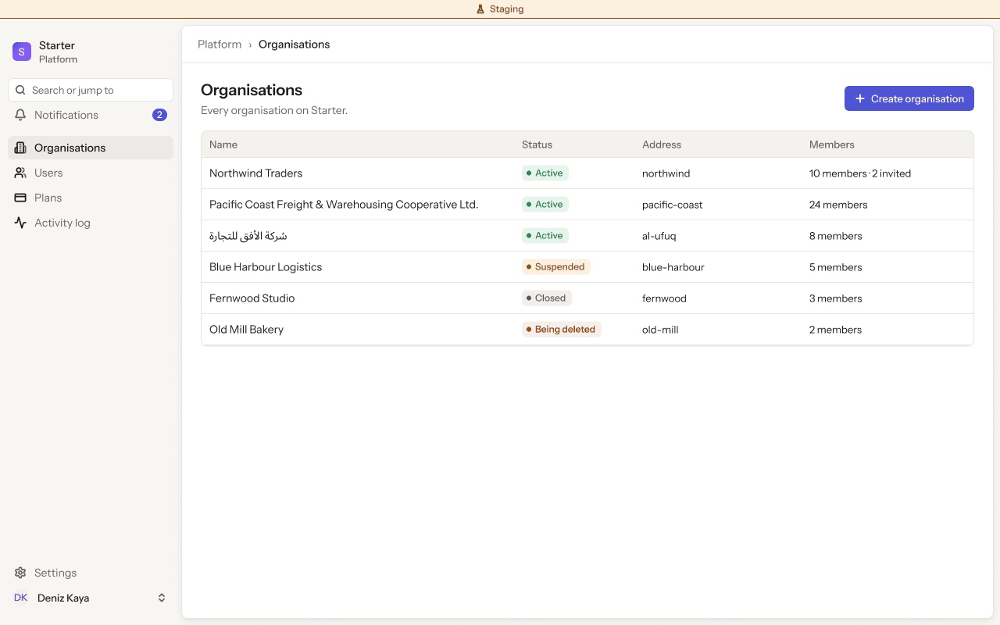

- **Who sees it:** Every signed-in system admin.
- **Device:** Desktop (1280 px and wider).
- **This state shows:** as the title says.
- **Values come from:** Person: our API. Unread count: our API notifications and the live stream. Environment strip: APP_ENVIRONMENT. Connection bar: network state and API health.
- **Components:** Button, Environment strip, Pill ×6, Platform sidebar, Top bar.
- **Actions:**
  - "Organisations": goes to [4.01 · Organisations · all](../04-organisations/README.md#401--organisations--all).
  - "Notifications": goes to [3.01 · Bell · unread](../03-notifications/README.md#301--bell--unread).
  - "Search or jump to": goes to [2.02 · Command menu](#202--command-menu).
  - "Deniz Kaya": goes to [2.03 · Account menu](#203--account-menu).
- **Texts, word for word, top to bottom:**

  - Staging
  - S
  - Starter
  - Platform
  - Search or jump to
  - Notifications
  - 2
  - Organisations
  - Users
  - Plans
  - Activity log
  - Settings
  - DK
  - Deniz Kaya
  - Platform
  - ›
  - Organisations
  - Organisations
  - Every organisation on Starter.
  - Create organisation
  - Name
  - Status
  - Address
  - Members
  - Northwind Traders
  - Active
  - northwind
  - 10 members · 2 invited
  - Pacific Coast Freight & Warehousing Cooperative Ltd.
  - Active
  - pacific-coast
  - 24 members
  - شركة الأفق للتجارة
  - Active
  - al-ufuq
  - 8 members
  - Blue Harbour Logistics
  - Suspended
  - blue-harbour
  - 5 members
  - Fernwood Studio
  - Closed
  - fernwood
  - 3 members
  - Old Mill Bakery
  - Being deleted
  - old-mill
  - 2 members

Figma: [167:17737](https://www.figma.com/design/3Ev111okX8xCBwR9B3hyBM/?node-id=167-17737)

### 2.13 · Dark

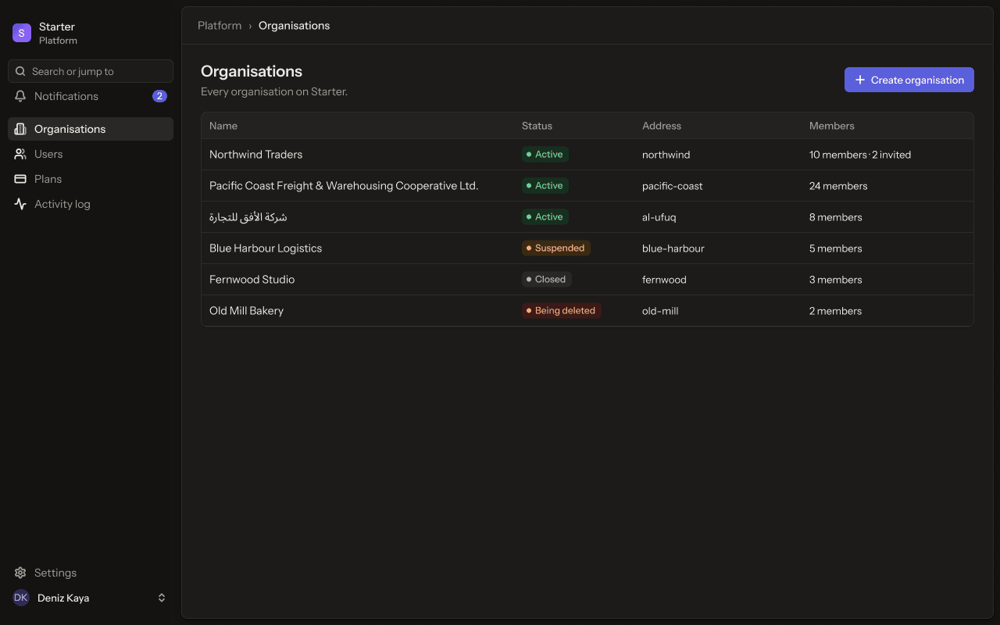

- **Who sees it:** Every signed-in system admin.
- **Device:** Desktop (1280 px and wider).
- **This state shows:** in the dark theme.
- **Values come from:** Person: our API. Unread count: our API notifications and the live stream. Environment strip: APP_ENVIRONMENT. Connection bar: network state and API health.
- **Components:** Button, Pill ×6, Platform sidebar, Top bar.
- **Actions:**
  - "Organisations": goes to [4.01 · Organisations · all](../04-organisations/README.md#401--organisations--all).
  - "Notifications": goes to [3.01 · Bell · unread](../03-notifications/README.md#301--bell--unread).
  - "Search or jump to": goes to [2.02 · Command menu](#202--command-menu).
  - "Deniz Kaya": goes to [2.03 · Account menu](#203--account-menu).
  - "Users": goes to [5.01 · Users · all](../05-users/README.md#501--users--all).
  - "Plans": goes to [6.01 · Plans](../06-plans/README.md#601--plans).
  - "Activity log": goes to [7.01 · Activity log](../07-activity-log/README.md#701--activity-log).
  - "Settings": goes to [8.01 · Profile · ideal](../08-settings-profile/README.md#801--profile--ideal).
- **Texts, word for word, top to bottom:**

  - S
  - Starter
  - Platform
  - Search or jump to
  - Notifications
  - 2
  - Organisations
  - Users
  - Plans
  - Activity log
  - Settings
  - DK
  - Deniz Kaya
  - Platform
  - ›
  - Organisations
  - Organisations
  - Every organisation on Starter.
  - Create organisation
  - Name
  - Status
  - Address
  - Members
  - Northwind Traders
  - Active
  - northwind
  - 10 members · 2 invited
  - Pacific Coast Freight & Warehousing Cooperative Ltd.
  - Active
  - pacific-coast
  - 24 members
  - شركة الأفق للتجارة
  - Active
  - al-ufuq
  - 8 members
  - Blue Harbour Logistics
  - Suspended
  - blue-harbour
  - 5 members
  - Fernwood Studio
  - Closed
  - fernwood
  - 3 members
  - Old Mill Bakery
  - Being deleted
  - old-mill
  - 2 members

Figma: [167:17874](https://www.figma.com/design/3Ev111okX8xCBwR9B3hyBM/?node-id=167-17874)

### 2.14 · Phone · menu open

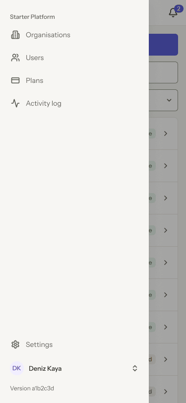

- **Who sees it:** Every signed-in system admin.
- **Device:** Phone (up to 767 px).
- **This state shows:** on a phone.
- **Values come from:** Person: our API. Unread count: our API notifications and the live stream. Environment strip: APP_ENVIRONMENT. Connection bar: network state and API health.
- **Components:** Button, Input, Phone list row ×10, Phone top bar, Platform phone drawer, Select.
- **Actions:**
  - "Fernwood Studio": goes to node 218:1103 (not a numbered screen).
  - "Organisations": goes to [4.43 · Phone · Organisations](../04-organisations/README.md#443--phone--organisations).
  - "Users": goes to [5.16 · Phone · Users](../05-users/README.md#516--phone--users).
  - "Plans": goes to [6.17 · Phone · Plans](../06-plans/README.md#617--phone--plans).
  - "All · 10": goes to [7.08 · Phone · Activity log](../07-activity-log/README.md#708--phone--activity-log).
  - "Settings": goes to [8.07 · Phone · Profile](../08-settings-profile/README.md#807--phone--profile).
  - "2": goes to [4.43 · Phone · Organisations](../04-organisations/README.md#443--phone--organisations).
- **Texts, word for word, top to bottom:**

  - Organisations
  - 2
  - Create organisation
  - Search by name or address
  - All · 10
  - Northwind Traders
  - Team · 10 members
  - Active
  - Pacific Coast Freight & Warehousing Cooperative Ltd.
  - Business · Contract · 24 members
  - Active
  - شركة الأفق للتجارة
  - Business trial · 8 members
  - Active
  - Harbourside Dental
  - Free · waiting for Owner
  - Active
  - Lindqvist Design Studio
  - Team · payment retrying
  - Active
  - Marrow & Vine Catering
  - Team · grace until 20 Nov
  - Active
  - Copperleaf Tutoring
  - Free · 3 members
  - Active
  - Blue Harbour Logistics
  - Team · 5 members
  - Suspended
  - Fernwood Studio
  - Team · 3 members
  - Closed
  - Old Mill Bakery
  - Free · 2 members
  - Being deleted
  - Starter Platform
  - Organisations
  - Users
  - Plans
  - Activity log
  - Settings
  - DK
  - Deniz Kaya
  - Version a1b2c3d

Figma: [264:17543](https://www.figma.com/design/3Ev111okX8xCBwR9B3hyBM/?node-id=264-17543)

### 2.15 · Phone · settings menu open

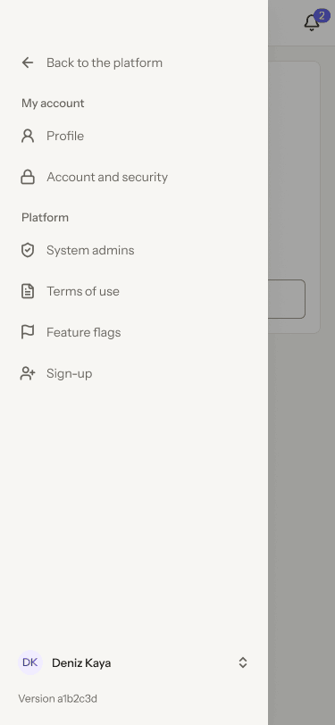

- **Who sees it:** Every signed-in system admin.
- **Device:** Phone (up to 767 px).
- **This state shows:** on a phone.
- **Values come from:** Person: our API. Unread count: our API notifications and the live stream. Environment strip: APP_ENVIRONMENT. Connection bar: network state and API health.
- **Components:** Button, Phone top bar, Platform phone drawer · Settings.
- **Actions:**
  - "Version a1b2c3d": goes to node 218:1103 (not a numbered screen).
  - "Back to the platform": goes to [4.43 · Phone · Organisations](../04-organisations/README.md#443--phone--organisations).
  - "Email": goes to [8.07 · Phone · Profile](../08-settings-profile/README.md#807--phone--profile).
  - "Change it in Account and security.": goes to [9.13 · Phone · Account and security](../09-settings-account-and-security/README.md#913--phone--account-and-security).
  - "Istanbul (UTC+03:00)": goes to [10.14 · Phone · System admins](../10-settings-system-admins/README.md#1014--phone--system-admins).
  - "Terms of use": goes to [11.14 · Phone · Terms of use](../11-settings-terms-of-use/README.md#1114--phone--terms-of-use).
  - "Feature flags": goes to [12.19 · Phone · Feature flags](../12-settings-feature-flags/README.md#1219--phone--feature-flags).
  - "Sign-up": goes to [13.05 · Phone · Sign-up](../13-settings-sign-up/README.md#1305--phone--sign-up).
  - "2": goes to [8.07 · Phone · Profile](../08-settings-profile/README.md#807--phone--profile).
- **Texts, word for word, top to bottom:**

  - Profile
  - 2
  - Name
  - Deniz Kaya
  - Email
  - deniz@platform.example
  - Change it in Account and security.
  - Language
  - English
  - Time zone
  - Istanbul (UTC+03:00)
  - Edit profile
  - Back to the platform
  - My account
  - Profile
  - Account and security
  - Platform
  - System admins
  - Terms of use
  - Feature flags
  - Sign-up
  - DK
  - Deniz Kaya
  - Version a1b2c3d

Figma: [264:17611](https://www.figma.com/design/3Ev111okX8xCBwR9B3hyBM/?node-id=264-17611)

### 2.16 · Phone · Staging

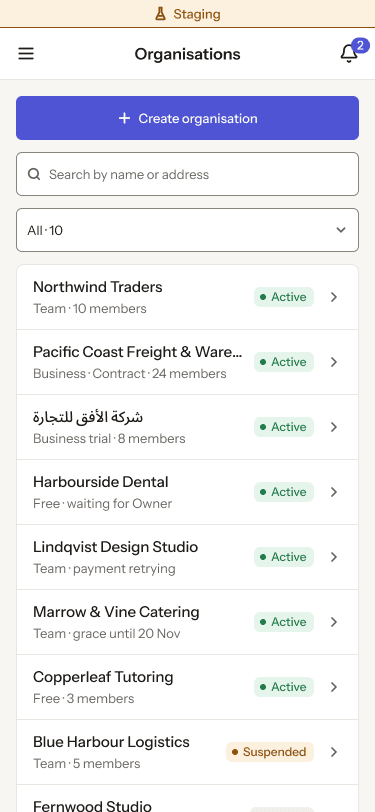

- **Who sees it:** Every signed-in system admin.
- **Device:** Phone (up to 767 px).
- **This state shows:** on a phone.
- **Values come from:** Person: our API. Unread count: our API notifications and the live stream. Environment strip: APP_ENVIRONMENT. Connection bar: network state and API health.
- **Components:** Button, Environment strip, Input, Phone list row ×10, Phone top bar, Select.
- **Actions:**
  - "Area": goes to [2.14 · Phone · menu open](#214--phone--menu-open).
  - "2": goes to [3.08 · Phone · Notifications](../03-notifications/README.md#308--phone--notifications).
- **Texts, word for word, top to bottom:**

  - Staging
  - Organisations
  - 2
  - Create organisation
  - Search by name or address
  - All · 10
  - Northwind Traders
  - Team · 10 members
  - Active
  - Pacific Coast Freight & Warehousing Cooperative Ltd.
  - Business · Contract · 24 members
  - Active
  - شركة الأفق للتجارة
  - Business trial · 8 members
  - Active
  - Harbourside Dental
  - Free · waiting for Owner
  - Active
  - Lindqvist Design Studio
  - Team · payment retrying
  - Active
  - Marrow & Vine Catering
  - Team · grace until 20 Nov
  - Active
  - Copperleaf Tutoring
  - Free · 3 members
  - Active
  - Blue Harbour Logistics
  - Team · 5 members
  - Suspended
  - Fernwood Studio
  - Team · 3 members
  - Closed
  - Old Mill Bakery
  - Free · 2 members
  - Being deleted

Figma: [264:17700](https://www.figma.com/design/3Ev111okX8xCBwR9B3hyBM/?node-id=264-17700)

### 2.17 · Phone · loading

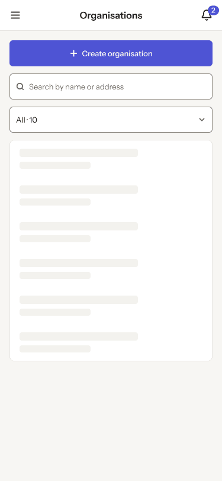

- **Who sees it:** Every signed-in system admin.
- **Device:** Phone (up to 767 px).
- **This state shows:** while the request runs; on a phone.
- **Values come from:** Person: our API. Unread count: our API notifications and the live stream. Environment strip: APP_ENVIRONMENT. Connection bar: network state and API health.
- **Components:** Button, Input, Phone top bar, Select, Skeleton ×12.
- **Actions:**
  - "Area": goes to [2.14 · Phone · menu open](#214--phone--menu-open).
  - "2": goes to [3.08 · Phone · Notifications](../03-notifications/README.md#308--phone--notifications).
- **Texts, word for word, top to bottom:**

  - Organisations
  - 2
  - Create organisation
  - Search by name or address
  - All · 10

Figma: [264:17738](https://www.figma.com/design/3Ev111okX8xCBwR9B3hyBM/?node-id=264-17738)

### 2.18 · Phone · error

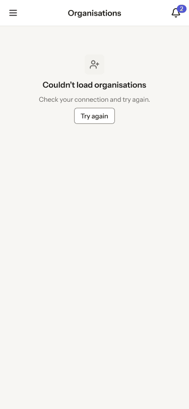

- **Who sees it:** Every signed-in system admin.
- **Device:** Phone (up to 767 px).
- **This state shows:** when the request fails; on a phone.
- **Values come from:** Person: our API. Unread count: our API notifications and the live stream. Environment strip: APP_ENVIRONMENT. Connection bar: network state and API health.
- **Components:** Empty state, Phone top bar.
- **Actions:**
  - "Area": goes to [2.14 · Phone · menu open](#214--phone--menu-open).
  - "2": goes to [3.08 · Phone · Notifications](../03-notifications/README.md#308--phone--notifications).
- **Texts, word for word, top to bottom:**

  - Organisations
  - 2
  - Couldn’t load organisations
  - Check your connection and try again.
  - Try again

Figma: [264:17891](https://www.figma.com/design/3Ev111okX8xCBwR9B3hyBM/?node-id=264-17891)

### 2.19 · Phone · empty

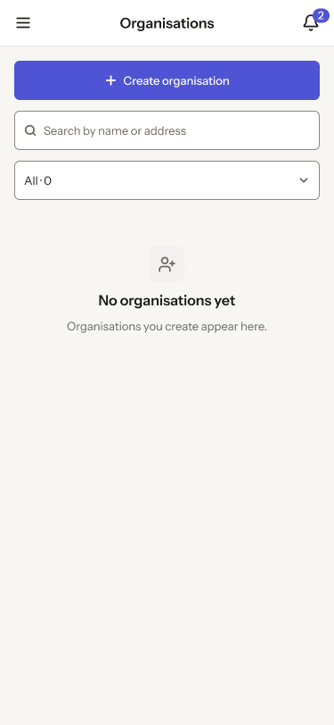

- **Who sees it:** Every signed-in system admin.
- **Device:** Phone (up to 767 px).
- **This state shows:** when there is nothing to list yet; on a phone.
- **Values come from:** Person: our API. Unread count: our API notifications and the live stream. Environment strip: APP_ENVIRONMENT. Connection bar: network state and API health.
- **Components:** Button, Empty state, Input, Phone top bar, Select.
- **Actions:**
  - "Area": goes to [2.14 · Phone · menu open](#214--phone--menu-open).
  - "2": goes to [3.08 · Phone · Notifications](../03-notifications/README.md#308--phone--notifications).
- **Texts, word for word, top to bottom:**

  - Organisations
  - 2
  - Create organisation
  - Search by name or address
  - All · 0
  - No organisations yet
  - Organisations you create appear here.

Figma: [264:17952](https://www.figma.com/design/3Ev111okX8xCBwR9B3hyBM/?node-id=264-17952)

### 2.20 · Phone · dark

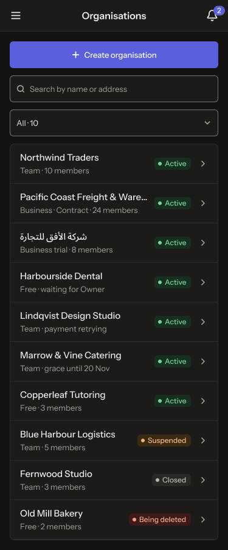

- **Who sees it:** Every signed-in system admin.
- **Device:** Phone (up to 767 px).
- **This state shows:** in the dark theme; on a phone.
- **Values come from:** Person: our API. Unread count: our API notifications and the live stream. Environment strip: APP_ENVIRONMENT. Connection bar: network state and API health.
- **Components:** Button, Input, Phone list row ×10, Phone top bar, Select.
- **Actions:**
  - "Area": goes to [2.14 · Phone · menu open](#214--phone--menu-open).
  - "2": goes to [3.08 · Phone · Notifications](../03-notifications/README.md#308--phone--notifications).
- **Texts, word for word, top to bottom:**

  - Organisations
  - 2
  - Create organisation
  - Search by name or address
  - All · 10
  - Northwind Traders
  - Team · 10 members
  - Active
  - Pacific Coast Freight & Warehousing Cooperative Ltd.
  - Business · Contract · 24 members
  - Active
  - شركة الأفق للتجارة
  - Business trial · 8 members
  - Active
  - Harbourside Dental
  - Free · waiting for Owner
  - Active
  - Lindqvist Design Studio
  - Team · payment retrying
  - Active
  - Marrow & Vine Catering
  - Team · grace until 20 Nov
  - Active
  - Copperleaf Tutoring
  - Free · 3 members
  - Active
  - Blue Harbour Logistics
  - Team · 5 members
  - Suspended
  - Fernwood Studio
  - Team · 3 members
  - Closed
  - Old Mill Bakery
  - Free · 2 members
  - Being deleted

Figma: [264:18013](https://www.figma.com/design/3Ev111okX8xCBwR9B3hyBM/?node-id=264-18013)

### 2.21 · Phone · Arabic

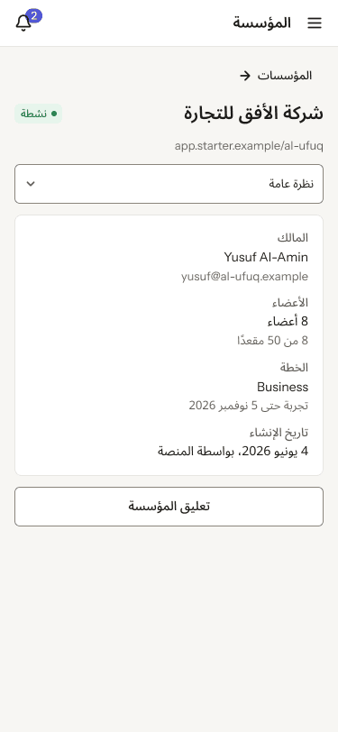

- **Who sees it:** Every signed-in system admin.
- **Device:** Phone (up to 767 px).
- **This state shows:** with the language set to Arabic (right to left); on a phone.
- **Values come from:** Person: our API. Unread count: our API notifications and the live stream. Environment strip: APP_ENVIRONMENT. Connection bar: network state and API health.
- **Components:** Button ×2, Icon/bell, Icon/menu, Pill, Select.
- **Actions:**
  - No prototype link on this screen. The buttons follow the section's other screens.
- **Texts, word for word, top to bottom:**

  - 2
  - المؤسسة
  - المؤسسات
  - نشطة
  - شركة الأفق للتجارة
  - app.starter.example/al-ufuq
  - نظرة عامة
  - المالك
  - Yusuf Al-Amin
  - yusuf@al-ufuq.example
  - الأعضاء
  - 8 أعضاء
  - 8 من 50 مقعدًا
  - الخطة
  - Business
  - تجربة حتى 5 نوفمبر 2026
  - تاريخ الإنشاء
  - 4 يونيو 2026، بواسطة المنصة
  - تعليق المؤسسة

Figma: [264:18030](https://www.figma.com/design/3Ev111okX8xCBwR9B3hyBM/?node-id=264-18030)

### 2.22 · Page not found · old link

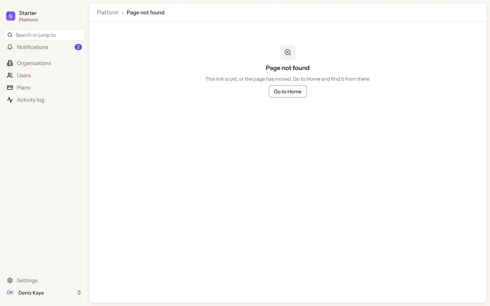

- **Who sees it:** Every signed-in system admin.
- **Device:** Desktop (1280 px and wider).
- **This state shows:** when the address points to nothing the person can open.
- **Values come from:** Person: our API. Unread count: our API notifications and the live stream. Environment strip: APP_ENVIRONMENT. Connection bar: network state and API health.
- **Components:** Empty state, Platform sidebar, Top bar.
- **Actions:**
  - "Go to Home": goes to [4.01 · Organisations · all](../04-organisations/README.md#401--organisations--all).
- **Texts, word for word, top to bottom:**

  - S
  - Starter
  - Platform
  - Search or jump to
  - Notifications
  - 2
  - Organisations
  - Users
  - Plans
  - Activity log
  - Settings
  - DK
  - Deniz Kaya
  - Platform
  - ›
  - Page not found
  - Page not found
  - This link is old, or the page has moved. Go to Home and find it from there.
  - Go to Home

Figma: [296:42348](https://www.figma.com/design/3Ev111okX8xCBwR9B3hyBM/?node-id=296-42348)

### 2.23 · Organisation not found

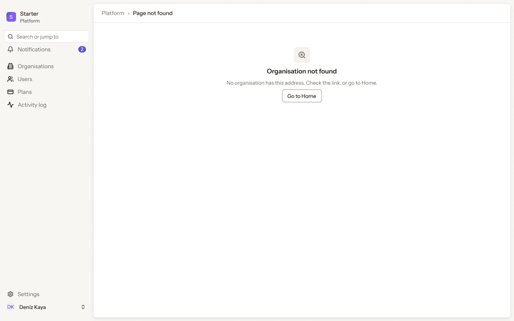

- **Who sees it:** Every signed-in system admin.
- **Device:** Desktop (1280 px and wider).
- **This state shows:** when the address points to nothing the person can open.
- **Values come from:** Person: our API. Unread count: our API notifications and the live stream. Environment strip: APP_ENVIRONMENT. Connection bar: network state and API health.
- **Components:** Empty state, Platform sidebar, Top bar.
- **Actions:**
  - "Go to Home": goes to [4.01 · Organisations · all](../04-organisations/README.md#401--organisations--all).
- **Texts, word for word, top to bottom:**

  - S
  - Starter
  - Platform
  - Search or jump to
  - Notifications
  - 2
  - Organisations
  - Users
  - Plans
  - Activity log
  - Settings
  - DK
  - Deniz Kaya
  - Platform
  - ›
  - Page not found
  - Organisation not found
  - No organisation has this address. Check the link, or go to Home.
  - Go to Home

Figma: [296:42450](https://www.figma.com/design/3Ev111okX8xCBwR9B3hyBM/?node-id=296-42450)

### 2.24 · Page not found · signed out

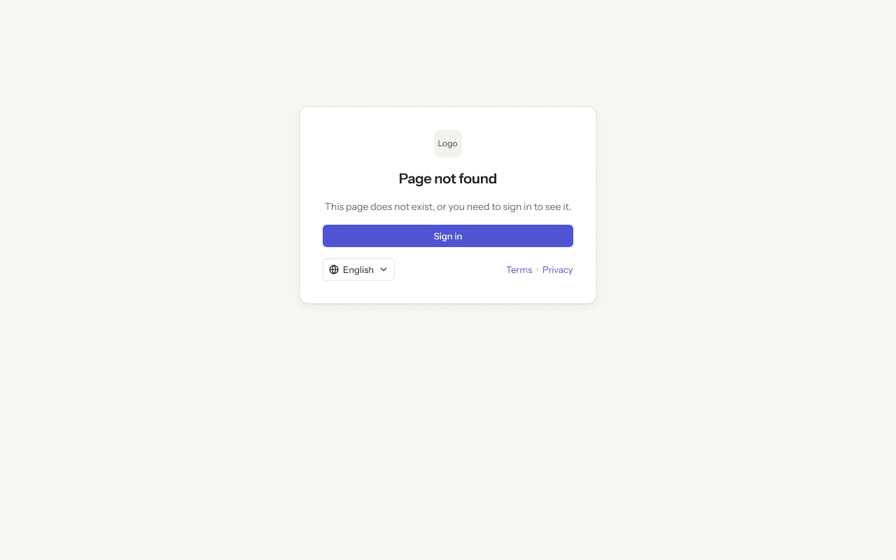

- **Who sees it:** Every signed-in system admin.
- **Device:** Desktop (1280 px and wider).
- **This state shows:** when the address points to nothing the person can open.
- **Values come from:** Person: our API. Unread count: our API notifications and the live stream. Environment strip: APP_ENVIRONMENT. Connection bar: network state and API health.
- **Components:** Auth footer, Button.
- **Actions:**
  - "Sign in": goes to [1.01 · Sign in](../01-entry/README.md#101--sign-in).
- **Texts, word for word, top to bottom:**

  - Logo
  - Page not found
  - This page does not exist, or you need to sign in to see it.
  - Sign in
  - English
  - Terms
  - ·
  - Privacy

Figma: [296:42552](https://www.figma.com/design/3Ev111okX8xCBwR9B3hyBM/?node-id=296-42552)

### 2.25 · Phone · page not found

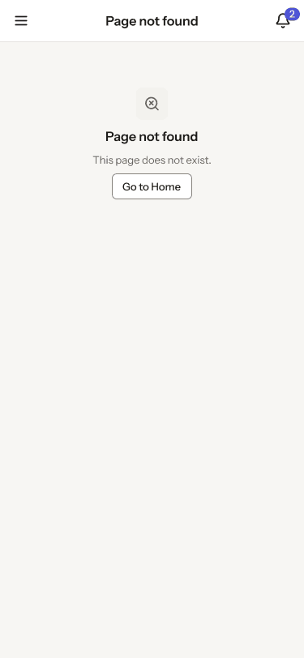

- **Who sees it:** Every signed-in system admin.
- **Device:** Phone (up to 767 px).
- **This state shows:** on a phone; when the address points to nothing the person can open.
- **Values come from:** Person: our API. Unread count: our API notifications and the live stream. Environment strip: APP_ENVIRONMENT. Connection bar: network state and API health.
- **Components:** Empty state, Phone top bar.
- **Actions:**
  - "Go to Home": goes to [4.43 · Phone · Organisations](../04-organisations/README.md#443--phone--organisations).
- **Texts, word for word, top to bottom:**

  - Page not found
  - 2
  - Page not found
  - This page does not exist.
  - Go to Home

Figma: [296:42602](https://www.figma.com/design/3Ev111okX8xCBwR9B3hyBM/?node-id=296-42602)

### 2.26 · Page not found · dark

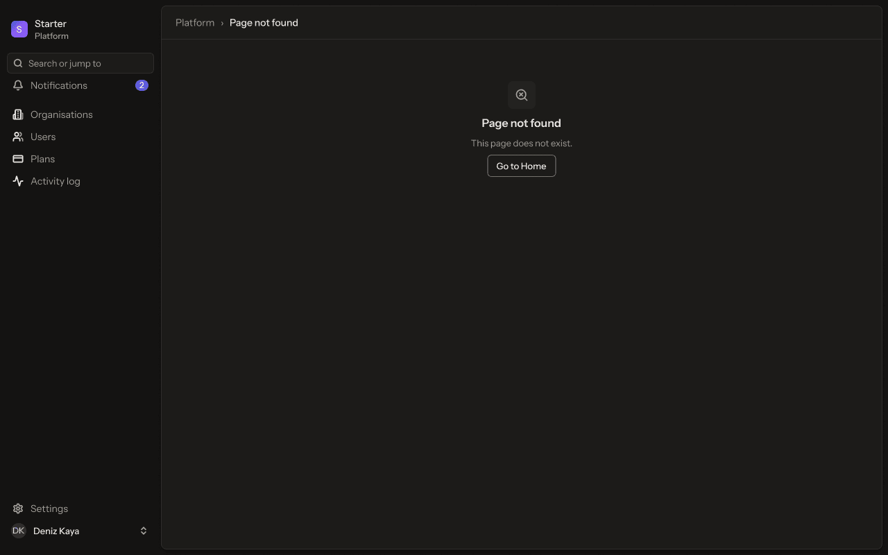

- **Who sees it:** Every signed-in system admin.
- **Device:** Desktop (1280 px and wider).
- **This state shows:** in the dark theme; when the address points to nothing the person can open.
- **Values come from:** Person: our API. Unread count: our API notifications and the live stream. Environment strip: APP_ENVIRONMENT. Connection bar: network state and API health.
- **Components:** Empty state, Platform sidebar, Top bar.
- **Actions:**
  - "Go to Home": goes to [4.01 · Organisations · all](../04-organisations/README.md#401--organisations--all).
- **Texts, word for word, top to bottom:**

  - S
  - Starter
  - Platform
  - Search or jump to
  - Notifications
  - 2
  - Organisations
  - Users
  - Plans
  - Activity log
  - Settings
  - DK
  - Deniz Kaya
  - Platform
  - ›
  - Page not found
  - Page not found
  - This page does not exist.
  - Go to Home

Figma: [296:42654](https://www.figma.com/design/3Ev111okX8xCBwR9B3hyBM/?node-id=296-42654)
