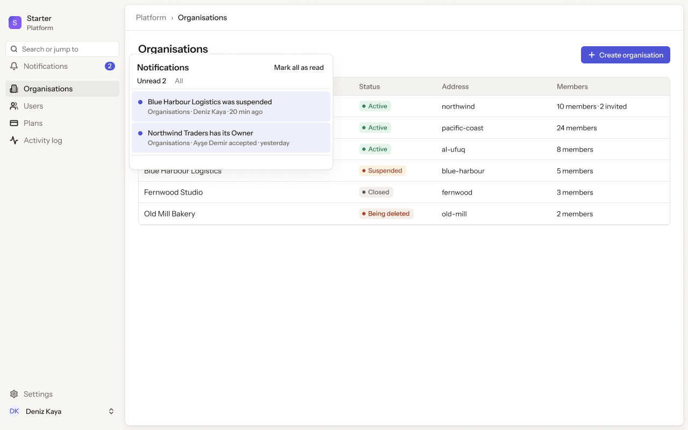
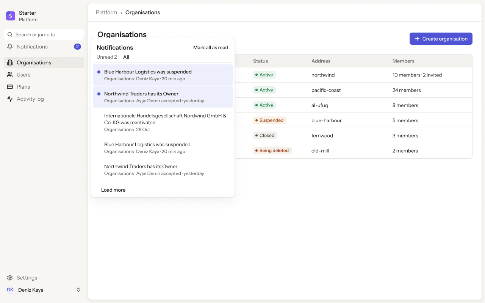
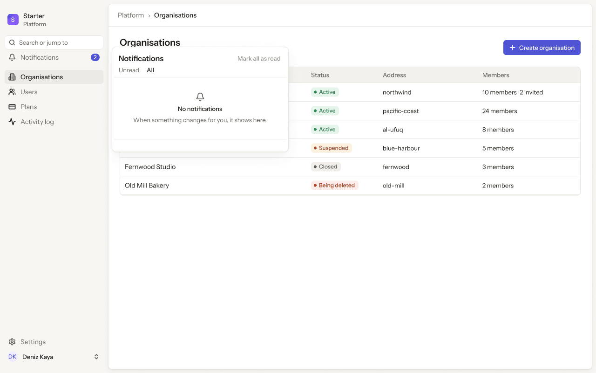
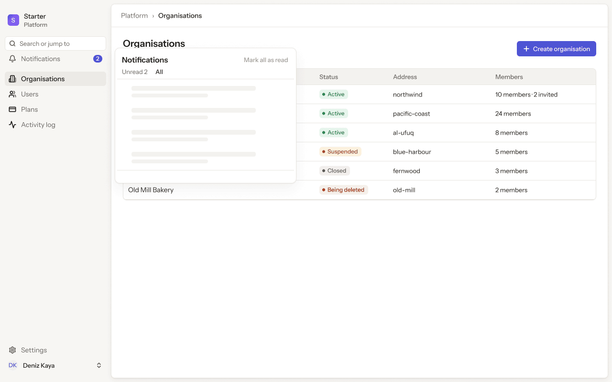
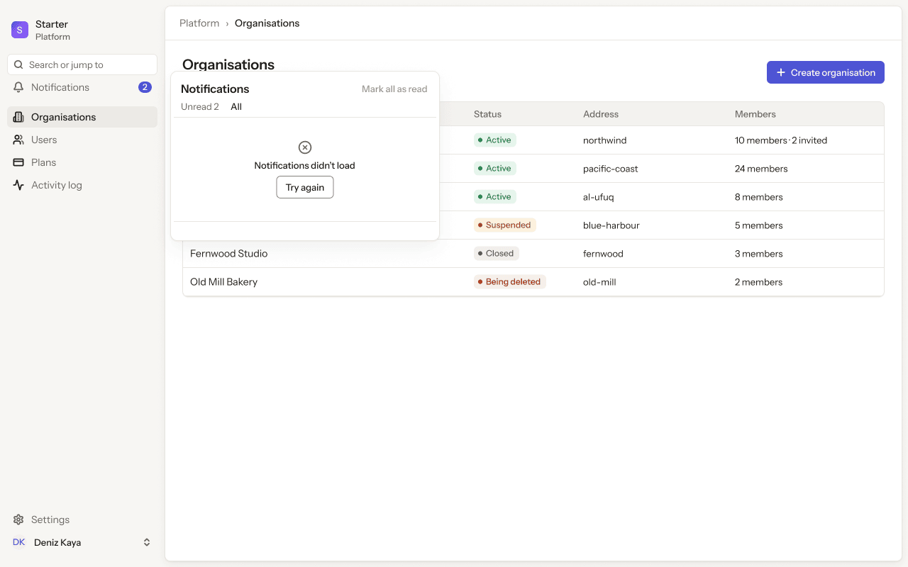
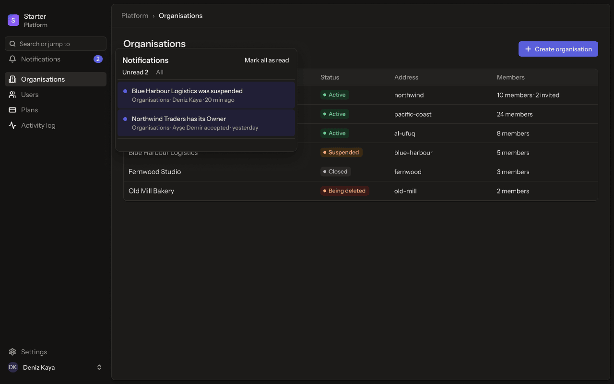
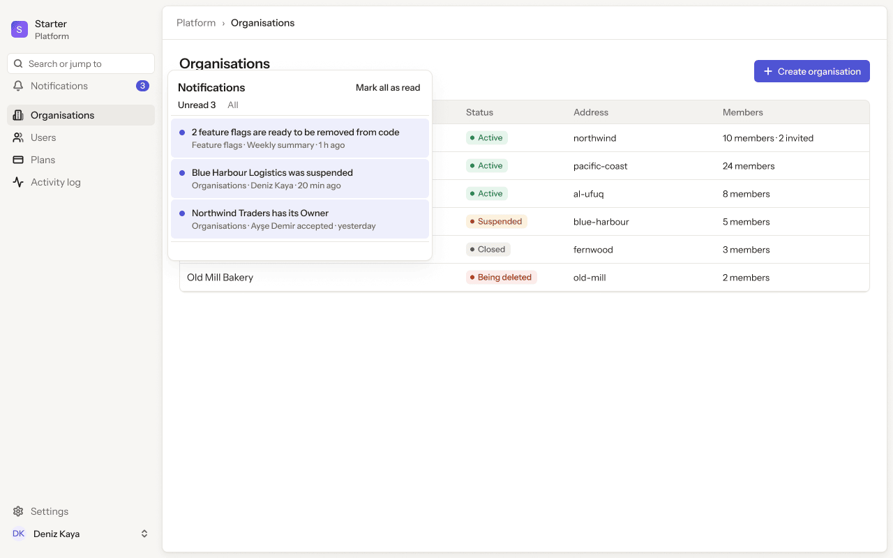
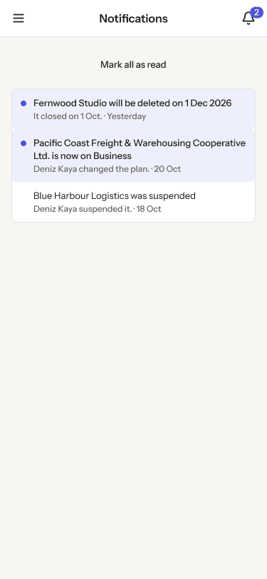

# Platform app · 3 · Notifications

Who sees this section: Every signed-in system admin. Each sees only their own notifications.

Where the values come from: Our API notifications endpoints and the live stream (SSE).

8 screens. Each part below is one screen and state. The PNG beside this file is the screen at scale 1.

| Screen | Device |
|---|---|
| [3.01 · Bell · unread](#301--bell--unread) | Desktop |
| [3.02 · Bell · all](#302--bell--all) | Desktop |
| [3.03 · Bell · empty](#303--bell--empty) | Desktop |
| [3.04 · Bell · loading](#304--bell--loading) | Desktop |
| [3.05 · Bell · error](#305--bell--error) | Desktop |
| [3.06 · Bell · dark](#306--bell--dark) | Desktop |
| [3.07 · Bell · flags to remove](#307--bell--flags-to-remove) | Desktop |
| [3.08 · Phone · Notifications](#308--phone--notifications) | Phone |

### 3.01 · Bell · unread

- **Who sees it:** Every signed-in system admin. Each sees only their own notifications.
- **Device:** Desktop (1280 px and wider).
- **This state shows:** as the title says.
- **Values come from:** Our API notifications endpoints and the live stream (SSE).
- **Components:** Button, Notifications popover, Pill ×6, Platform sidebar, Top bar.
- **Actions:**
  - "Organisations": goes to [4.01 · Organisations · all](../04-organisations/README.md#401--organisations--all).
  - "Search or jump to": goes to [2.02 · Command menu](../02-shell/README.md#202--command-menu).
  - "Deniz Kaya": goes to [2.03 · Account menu](../02-shell/README.md#203--account-menu).
  - "All": goes to [3.02 · Bell · all](#302--bell--all).
  - "Users": goes to [5.01 · Users · all](../05-users/README.md#501--users--all).
  - "Plans": goes to [6.01 · Plans](../06-plans/README.md#601--plans).
  - "Activity log": goes to [7.01 · Activity log](../07-activity-log/README.md#701--activity-log).
  - "Settings": goes to [8.01 · Profile · ideal](../08-settings-profile/README.md#801--profile--ideal).
- **Texts, word for word, top to bottom:**

  - S
  - Starter
  - Platform
  - Search or jump to
  - Notifications
  - 2
  - Organisations
  - Users
  - Plans
  - Activity log
  - Settings
  - DK
  - Deniz Kaya
  - Platform
  - ›
  - Organisations
  - Organisations
  - Every organisation on Starter.
  - Create organisation
  - Name
  - Status
  - Address
  - Members
  - Northwind Traders
  - Active
  - northwind
  - 10 members · 2 invited
  - Pacific Coast Freight & Warehousing Cooperative Ltd.
  - Active
  - pacific-coast
  - 24 members
  - شركة الأفق للتجارة
  - Active
  - al-ufuq
  - 8 members
  - Blue Harbour Logistics
  - Suspended
  - blue-harbour
  - 5 members
  - Fernwood Studio
  - Closed
  - fernwood
  - 3 members
  - Old Mill Bakery
  - Being deleted
  - old-mill
  - 2 members
  - Notifications
  - Mark all as read
  - Unread 2
  - All
  - Blue Harbour Logistics was suspended
  - Organisations · Deniz Kaya · 20 min ago
  - Northwind Traders has its Owner
  - Organisations · Ayşe Demir accepted · yesterday

Figma: [169:13375](https://www.figma.com/design/3Ev111okX8xCBwR9B3hyBM/?node-id=169-13375)

### 3.02 · Bell · all

- **Who sees it:** Every signed-in system admin. Each sees only their own notifications.
- **Device:** Desktop (1280 px and wider).
- **This state shows:** as the title says.
- **Values come from:** Our API notifications endpoints and the live stream (SSE).
- **Components:** Button, Notifications popover, Pill ×6, Platform sidebar, Top bar.
- **Actions:**
  - "Organisations": goes to [4.01 · Organisations · all](../04-organisations/README.md#401--organisations--all).
  - "Notifications": goes to [3.01 · Bell · unread](#301--bell--unread).
  - "Search or jump to": goes to [2.02 · Command menu](../02-shell/README.md#202--command-menu).
  - "Deniz Kaya": goes to [2.03 · Account menu](../02-shell/README.md#203--account-menu).
  - "Unread 2": goes to [3.01 · Bell · unread](#301--bell--unread).
  - "Users": goes to [5.01 · Users · all](../05-users/README.md#501--users--all).
  - "Plans": goes to [6.01 · Plans](../06-plans/README.md#601--plans).
  - "Activity log": goes to [7.01 · Activity log](../07-activity-log/README.md#701--activity-log).
  - "Settings": goes to [8.01 · Profile · ideal](../08-settings-profile/README.md#801--profile--ideal).
- **Texts, word for word, top to bottom:**

  - S
  - Starter
  - Platform
  - Search or jump to
  - Notifications
  - 2
  - Organisations
  - Users
  - Plans
  - Activity log
  - Settings
  - DK
  - Deniz Kaya
  - Platform
  - ›
  - Organisations
  - Organisations
  - Every organisation on Starter.
  - Create organisation
  - Name
  - Status
  - Address
  - Members
  - Northwind Traders
  - Active
  - northwind
  - 10 members · 2 invited
  - Pacific Coast Freight & Warehousing Cooperative Ltd.
  - Active
  - pacific-coast
  - 24 members
  - شركة الأفق للتجارة
  - Active
  - al-ufuq
  - 8 members
  - Blue Harbour Logistics
  - Suspended
  - blue-harbour
  - 5 members
  - Fernwood Studio
  - Closed
  - fernwood
  - 3 members
  - Old Mill Bakery
  - Being deleted
  - old-mill
  - 2 members
  - Notifications
  - Mark all as read
  - Unread 2
  - All
  - Blue Harbour Logistics was suspended
  - Organisations · Deniz Kaya · 20 min ago
  - Northwind Traders has its Owner
  - Organisations · Ayşe Demir accepted · yesterday
  - Internationale Handelsgesellschaft Nordwind GmbH & Co. KG was reactivated
  - Organisations · 28 Oct
  - Blue Harbour Logistics was suspended
  - Organisations · Deniz Kaya · 20 min ago
  - Northwind Traders has its Owner
  - Organisations · Ayşe Demir accepted · yesterday
  - Load more

Figma: [169:13529](https://www.figma.com/design/3Ev111okX8xCBwR9B3hyBM/?node-id=169-13529)

### 3.03 · Bell · empty

- **Who sees it:** Every signed-in system admin. Each sees only their own notifications.
- **Device:** Desktop (1280 px and wider).
- **This state shows:** when there is nothing to list yet.
- **Values come from:** Our API notifications endpoints and the live stream (SSE).
- **Components:** Button, Notifications popover, Pill ×6, Platform sidebar, Top bar.
- **Actions:**
  - "Organisations": goes to [4.01 · Organisations · all](../04-organisations/README.md#401--organisations--all).
  - "Notifications": goes to [3.01 · Bell · unread](#301--bell--unread).
  - "Search or jump to": goes to [2.02 · Command menu](../02-shell/README.md#202--command-menu).
  - "Deniz Kaya": goes to [2.03 · Account menu](../02-shell/README.md#203--account-menu).
  - "All": goes to [3.02 · Bell · all](#302--bell--all).
  - "Unread": goes to [3.01 · Bell · unread](#301--bell--unread).
  - "Users": goes to [5.01 · Users · all](../05-users/README.md#501--users--all).
  - "Plans": goes to [6.01 · Plans](../06-plans/README.md#601--plans).
  - "Activity log": goes to [7.01 · Activity log](../07-activity-log/README.md#701--activity-log).
  - "Settings": goes to [8.01 · Profile · ideal](../08-settings-profile/README.md#801--profile--ideal).
- **Texts, word for word, top to bottom:**

  - S
  - Starter
  - Platform
  - Search or jump to
  - Notifications
  - 2
  - Organisations
  - Users
  - Plans
  - Activity log
  - Settings
  - DK
  - Deniz Kaya
  - Platform
  - ›
  - Organisations
  - Organisations
  - Every organisation on Starter.
  - Create organisation
  - Name
  - Status
  - Address
  - Members
  - Northwind Traders
  - Active
  - northwind
  - 10 members · 2 invited
  - Pacific Coast Freight & Warehousing Cooperative Ltd.
  - Active
  - pacific-coast
  - 24 members
  - شركة الأفق للتجارة
  - Active
  - al-ufuq
  - 8 members
  - Blue Harbour Logistics
  - Suspended
  - blue-harbour
  - 5 members
  - Fernwood Studio
  - Closed
  - fernwood
  - 3 members
  - Old Mill Bakery
  - Being deleted
  - old-mill
  - 2 members
  - Notifications
  - Mark all as read
  - Unread
  - All
  - No notifications
  - When something changes for you, it shows here.

Figma: [169:13703](https://www.figma.com/design/3Ev111okX8xCBwR9B3hyBM/?node-id=169-13703)

### 3.04 · Bell · loading

- **Who sees it:** Every signed-in system admin. Each sees only their own notifications.
- **Device:** Desktop (1280 px and wider).
- **This state shows:** while the request runs.
- **Values come from:** Our API notifications endpoints and the live stream (SSE).
- **Components:** Button, Notifications popover, Pill ×6, Platform sidebar, Top bar.
- **Actions:**
  - "Organisations": goes to [4.01 · Organisations · all](../04-organisations/README.md#401--organisations--all).
  - "Notifications": goes to [3.01 · Bell · unread](#301--bell--unread).
  - "Search or jump to": goes to [2.02 · Command menu](../02-shell/README.md#202--command-menu).
  - "Deniz Kaya": goes to [2.03 · Account menu](../02-shell/README.md#203--account-menu).
  - "All": goes to [3.02 · Bell · all](#302--bell--all).
  - "Unread 2": goes to [3.01 · Bell · unread](#301--bell--unread).
  - "Users": goes to [5.01 · Users · all](../05-users/README.md#501--users--all).
  - "Plans": goes to [6.01 · Plans](../06-plans/README.md#601--plans).
  - "Activity log": goes to [7.01 · Activity log](../07-activity-log/README.md#701--activity-log).
  - "Settings": goes to [8.01 · Profile · ideal](../08-settings-profile/README.md#801--profile--ideal).
- **Texts, word for word, top to bottom:**

  - S
  - Starter
  - Platform
  - Search or jump to
  - Notifications
  - 2
  - Organisations
  - Users
  - Plans
  - Activity log
  - Settings
  - DK
  - Deniz Kaya
  - Platform
  - ›
  - Organisations
  - Organisations
  - Every organisation on Starter.
  - Create organisation
  - Name
  - Status
  - Address
  - Members
  - Northwind Traders
  - Active
  - northwind
  - 10 members · 2 invited
  - Pacific Coast Freight & Warehousing Cooperative Ltd.
  - Active
  - pacific-coast
  - 24 members
  - شركة الأفق للتجارة
  - Active
  - al-ufuq
  - 8 members
  - Blue Harbour Logistics
  - Suspended
  - blue-harbour
  - 5 members
  - Fernwood Studio
  - Closed
  - fernwood
  - 3 members
  - Old Mill Bakery
  - Being deleted
  - old-mill
  - 2 members
  - Notifications
  - Mark all as read
  - Unread 2
  - All

Figma: [169:13852](https://www.figma.com/design/3Ev111okX8xCBwR9B3hyBM/?node-id=169-13852)

### 3.05 · Bell · error

- **Who sees it:** Every signed-in system admin. Each sees only their own notifications.
- **Device:** Desktop (1280 px and wider).
- **This state shows:** when the request fails.
- **Values come from:** Our API notifications endpoints and the live stream (SSE).
- **Components:** Button, Notifications popover, Pill ×6, Platform sidebar, Top bar.
- **Actions:**
  - "Organisations": goes to [4.01 · Organisations · all](../04-organisations/README.md#401--organisations--all).
  - "Notifications": goes to [3.01 · Bell · unread](#301--bell--unread).
  - "Search or jump to": goes to [2.02 · Command menu](../02-shell/README.md#202--command-menu).
  - "Deniz Kaya": goes to [2.03 · Account menu](../02-shell/README.md#203--account-menu).
  - "Try again": goes to [4.01 · Organisations · all](../04-organisations/README.md#401--organisations--all).
  - "All": goes to [3.02 · Bell · all](#302--bell--all).
  - "Unread 2": goes to [3.01 · Bell · unread](#301--bell--unread).
  - "Users": goes to [5.01 · Users · all](../05-users/README.md#501--users--all).
  - "Plans": goes to [6.01 · Plans](../06-plans/README.md#601--plans).
  - "Activity log": goes to [7.01 · Activity log](../07-activity-log/README.md#701--activity-log).
  - "Settings": goes to [8.01 · Profile · ideal](../08-settings-profile/README.md#801--profile--ideal).
- **Texts, word for word, top to bottom:**

  - S
  - Starter
  - Platform
  - Search or jump to
  - Notifications
  - 2
  - Organisations
  - Users
  - Plans
  - Activity log
  - Settings
  - DK
  - Deniz Kaya
  - Platform
  - ›
  - Organisations
  - Organisations
  - Every organisation on Starter.
  - Create organisation
  - Name
  - Status
  - Address
  - Members
  - Northwind Traders
  - Active
  - northwind
  - 10 members · 2 invited
  - Pacific Coast Freight & Warehousing Cooperative Ltd.
  - Active
  - pacific-coast
  - 24 members
  - شركة الأفق للتجارة
  - Active
  - al-ufuq
  - 8 members
  - Blue Harbour Logistics
  - Suspended
  - blue-harbour
  - 5 members
  - Fernwood Studio
  - Closed
  - fernwood
  - 3 members
  - Old Mill Bakery
  - Being deleted
  - old-mill
  - 2 members
  - Notifications
  - Mark all as read
  - Unread 2
  - All
  - Notifications didn’t load
  - Try again

Figma: [169:14006](https://www.figma.com/design/3Ev111okX8xCBwR9B3hyBM/?node-id=169-14006)

### 3.06 · Bell · dark

- **Who sees it:** Every signed-in system admin. Each sees only their own notifications.
- **Device:** Desktop (1280 px and wider).
- **This state shows:** in the dark theme.
- **Values come from:** Our API notifications endpoints and the live stream (SSE).
- **Components:** Button, Notifications popover, Pill ×6, Platform sidebar, Top bar.
- **Actions:**
  - "Organisations": goes to [4.01 · Organisations · all](../04-organisations/README.md#401--organisations--all).
  - "Notifications": goes to [3.01 · Bell · unread](#301--bell--unread).
  - "Search or jump to": goes to [2.02 · Command menu](../02-shell/README.md#202--command-menu).
  - "Deniz Kaya": goes to [2.03 · Account menu](../02-shell/README.md#203--account-menu).
  - "All": goes to [3.02 · Bell · all](#302--bell--all).
  - "Unread 2": goes to [3.01 · Bell · unread](#301--bell--unread).
  - "Users": goes to [5.01 · Users · all](../05-users/README.md#501--users--all).
  - "Plans": goes to [6.01 · Plans](../06-plans/README.md#601--plans).
  - "Activity log": goes to [7.01 · Activity log](../07-activity-log/README.md#701--activity-log).
  - "Settings": goes to [8.01 · Profile · ideal](../08-settings-profile/README.md#801--profile--ideal).
- **Texts, word for word, top to bottom:**

  - S
  - Starter
  - Platform
  - Search or jump to
  - Notifications
  - 2
  - Organisations
  - Users
  - Plans
  - Activity log
  - Settings
  - DK
  - Deniz Kaya
  - Platform
  - ›
  - Organisations
  - Organisations
  - Every organisation on Starter.
  - Create organisation
  - Name
  - Status
  - Address
  - Members
  - Northwind Traders
  - Active
  - northwind
  - 10 members · 2 invited
  - Pacific Coast Freight & Warehousing Cooperative Ltd.
  - Active
  - pacific-coast
  - 24 members
  - شركة الأفق للتجارة
  - Active
  - al-ufuq
  - 8 members
  - Blue Harbour Logistics
  - Suspended
  - blue-harbour
  - 5 members
  - Fernwood Studio
  - Closed
  - fernwood
  - 3 members
  - Old Mill Bakery
  - Being deleted
  - old-mill
  - 2 members
  - Notifications
  - Mark all as read
  - Unread 2
  - All
  - Blue Harbour Logistics was suspended
  - Organisations · Deniz Kaya · 20 min ago
  - Northwind Traders has its Owner
  - Organisations · Ayşe Demir accepted · yesterday

Figma: [169:14158](https://www.figma.com/design/3Ev111okX8xCBwR9B3hyBM/?node-id=169-14158)

### 3.07 · Bell · flags to remove

- **Who sees it:** Every signed-in system admin. Each sees only their own notifications.
- **Device:** Desktop (1280 px and wider).
- **This state shows:** as the title says.
- **Values come from:** Our API notifications endpoints and the live stream (SSE).
- **Components:** Button ×2, Notification item ×3, Pill ×6, Platform sidebar, Top bar.
- **Actions:**
  - "Organisations": goes to [4.01 · Organisations · all](../04-organisations/README.md#401--organisations--all).
  - "Search or jump to": goes to [2.02 · Command menu](../02-shell/README.md#202--command-menu).
  - "Deniz Kaya": goes to [2.03 · Account menu](../02-shell/README.md#203--account-menu).
  - "All": goes to [3.02 · Bell · all](#302--bell--all).
  - "Users": goes to [5.01 · Users · all](../05-users/README.md#501--users--all).
  - "Plans": goes to [6.01 · Plans](../06-plans/README.md#601--plans).
  - "Activity log": goes to [7.01 · Activity log](../07-activity-log/README.md#701--activity-log).
  - "Settings": goes to [8.01 · Profile · ideal](../08-settings-profile/README.md#801--profile--ideal).
  - "Northwind Traders": goes to [12.02 · Feature flags · ready to remove](../12-settings-feature-flags/README.md#1202--feature-flags--ready-to-remove).
- **Texts, word for word, top to bottom:**

  - S
  - Starter
  - Platform
  - Search or jump to
  - Notifications
  - 3
  - Organisations
  - Users
  - Plans
  - Activity log
  - Settings
  - DK
  - Deniz Kaya
  - Platform
  - ›
  - Organisations
  - Organisations
  - Every organisation on Starter.
  - Create organisation
  - Name
  - Status
  - Address
  - Members
  - Northwind Traders
  - Active
  - northwind
  - 10 members · 2 invited
  - Pacific Coast Freight & Warehousing Cooperative Ltd.
  - Active
  - pacific-coast
  - 24 members
  - شركة الأفق للتجارة
  - Active
  - al-ufuq
  - 8 members
  - Blue Harbour Logistics
  - Suspended
  - blue-harbour
  - 5 members
  - Fernwood Studio
  - Closed
  - fernwood
  - 3 members
  - Old Mill Bakery
  - Being deleted
  - old-mill
  - 2 members
  - Notifications
  - Mark all as read
  - Unread 3
  - All
  - 2 feature flags are ready to be removed from code
  - Feature flags · Weekly summary · 1 h ago
  - Blue Harbour Logistics was suspended
  - Organisations · Deniz Kaya · 20 min ago
  - Northwind Traders has its Owner
  - Organisations · Ayşe Demir accepted · yesterday

Figma: [214:14262](https://www.figma.com/design/3Ev111okX8xCBwR9B3hyBM/?node-id=214-14262)

### 3.08 · Phone · Notifications

- **Who sees it:** Every signed-in system admin. Each sees only their own notifications.
- **Device:** Phone (up to 767 px).
- **This state shows:** on a phone.
- **Values come from:** Our API notifications endpoints and the live stream (SSE).
- **Components:** Button, Notification item ×3, Phone top bar.
- **Actions:**
  - "Area": goes to [2.14 · Phone · menu open](../02-shell/README.md#214--phone--menu-open).
- **Texts, word for word, top to bottom:**

  - Notifications
  - 2
  - Mark all as read
  - Fernwood Studio will be deleted on 1 Dec 2026
  - It closed on 1 Oct. · Yesterday
  - Pacific Coast Freight & Warehousing Cooperative Ltd. is now on Business
  - Deniz Kaya changed the plan. · 20 Oct
  - Blue Harbour Logistics was suspended
  - Deniz Kaya suspended it. · 18 Oct

Figma: [263:17773](https://www.figma.com/design/3Ev111okX8xCBwR9B3hyBM/?node-id=263-17773)
