# Platform app · 4 · Organisations

Who sees this section: System admins. Actions need the platform.tenants.* permission of each action.

Where the values come from: Organisations, owners, plans, overrides, lifecycle and billing state: our API (platform.tenants.*).

46 screens. Each part below is one screen and state. The PNG beside this file is the screen at scale 1.

| Screen | Device |
|---|---|
| [4.01 · Organisations · all](#401--organisations--all) | Desktop |
| [4.02 · Organisations · suspended](#402--organisations--suspended) | Desktop |
| [4.03 · Organisations · closed](#403--organisations--closed) | Desktop |
| [4.04 · Organisations · no match](#404--organisations--no-match) | Desktop |
| [4.05 · Organisations · loading](#405--organisations--loading) | Desktop |
| [4.06 · No organisations yet](#406--no-organisations-yet) | Desktop |
| [4.07 · Create organisation](#407--create-organisation) | Desktop |
| [4.08 · Create · address taken](#408--create--address-taken) | Desktop |
| [4.09 · Organisation · overview](#409--organisation--overview) | Desktop |
| [4.10 · Organisation · ⋯ menu](#410--organisation---menu) | Desktop |
| [4.11 · Organisation · waiting for Owner](#411--organisation--waiting-for-owner) | Desktop |
| [4.12 · Invite Owner](#412--invite-owner) | Desktop |
| [4.13 · Rename](#413--rename) | Desktop |
| [4.14 · Organisation · plan](#414--organisation--plan) | Desktop |
| [4.15 · Change plan](#415--change-plan) | Desktop |
| [4.16 · Add override](#416--add-override) | Desktop |
| [4.17 · Remove override](#417--remove-override) | Desktop |
| [4.18 · Organisation · activity log](#418--organisation--activity-log) | Desktop |
| [4.19 · Suspend](#419--suspend) | Desktop |
| [4.20 · Suspended](#420--suspended) | Desktop |
| [4.21 · Reactivate](#421--reactivate) | Desktop |
| [4.22 · Close organisation](#422--close-organisation) | Desktop |
| [4.23 · Closed](#423--closed) | Desktop |
| [4.24 · Reopen](#424--reopen) | Desktop |
| [4.25 · Being deleted](#425--being-deleted) | Desktop |
| [4.26 · Deleted](#426--deleted) | Desktop |
| [4.27 · Plan and billing · card](#427--plan-and-billing--card) | Desktop |
| [4.28 · Plan and billing · in trial](#428--plan-and-billing--in-trial) | Desktop |
| [4.29 · Give trial](#429--give-trial) | Desktop |
| [4.30 · Extend trial](#430--extend-trial) | Desktop |
| [4.31 · Plan and billing · payment retrying](#431--plan-and-billing--payment-retrying) | Desktop |
| [4.32 · Plan and billing · grace](#432--plan-and-billing--grace) | Desktop |
| [4.33 · Plan and billing · moved to Free](#433--plan-and-billing--moved-to-free) | Desktop |
| [4.34 · Plan and billing · Contract](#434--plan-and-billing--contract) | Desktop |
| [4.35 · Switch to Contract](#435--switch-to-contract) | Desktop |
| [4.36 · Plan and billing · scheduled change](#436--plan-and-billing--scheduled-change) | Desktop |
| [4.37 · Organisation · usage](#437--organisation--usage) | Desktop |
| [4.38 · Organisations · billing filter](#438--organisations--billing-filter) | Desktop |
| [4.39 · Organisations · in trial](#439--organisations--in-trial) | Desktop |
| [4.42 · Organisation · usage · Free, quota used](#442--organisation--usage--free-quota-used) | Desktop |
| [4.43 · Phone · Organisations](#443--phone--organisations) | Phone |
| [4.44 · Phone · Organisation](#444--phone--organisation) | Phone |
| [4.45 · Phone · Plan and billing](#445--phone--plan-and-billing) | Phone |
| [4.46 · Phone · Suspend organisation](#446--phone--suspend-organisation) | Phone |
| [4.47 · Phone · Give trial](#447--phone--give-trial) | Phone |
| [4.48 · Phone · Extend trial](#448--phone--extend-trial) | Phone |

### 4.01 · Organisations · all

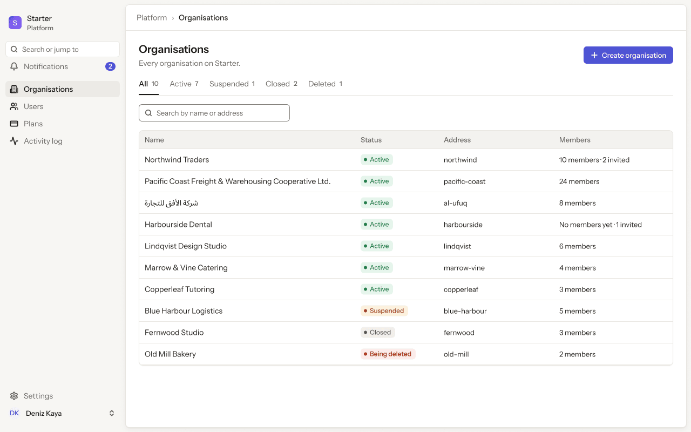

- **Who sees it:** System admins. Actions need the platform.tenants.* permission of each action.
- **Device:** Desktop (1280 px and wider).
- **This state shows:** as the title says.
- **Values come from:** Organisations, owners, plans, overrides, lifecycle and billing state: our API (platform.tenants.*).
- **Components:** Button, Input, Pill ×10, Platform sidebar, Tab ×5, Top bar.
- **Actions:**
  - "Notifications": goes to [3.01 · Bell · unread](../03-notifications/README.md#301--bell--unread).
  - "Search or jump to": goes to [2.02 · Command menu](../02-shell/README.md#202--command-menu).
  - "Deniz Kaya": goes to [2.03 · Account menu](../02-shell/README.md#203--account-menu).
  - "Suspended": goes to [4.02 · Organisations · suspended](#402--organisations--suspended).
  - "Closed": goes to [4.03 · Organisations · closed](#403--organisations--closed).
  - "Northwind Traders": goes to [4.09 · Organisation · overview](#409--organisation--overview).
  - "Harbourside Dental": goes to [4.20 · Suspended](#420--suspended).
  - "Lindqvist Design Studio": goes to [4.23 · Closed](#423--closed).
  - "Marrow & Vine Catering": goes to [4.25 · Being deleted](#425--being-deleted).
  - "Create organisation": goes to [4.07 · Create organisation](#407--create-organisation).
  - "Users": goes to [5.01 · Users · all](../05-users/README.md#501--users--all).
  - "Plans": goes to [6.01 · Plans](../06-plans/README.md#601--plans).
  - "Activity log": goes to [7.01 · Activity log](../07-activity-log/README.md#701--activity-log).
  - "Settings": goes to [8.01 · Profile · ideal](../08-settings-profile/README.md#801--profile--ideal).
- **Texts, word for word, top to bottom:**

  - S
  - Starter
  - Platform
  - Search or jump to
  - Notifications
  - 2
  - Organisations
  - Users
  - Plans
  - Activity log
  - Settings
  - DK
  - Deniz Kaya
  - Platform
  - ›
  - Organisations
  - Organisations
  - Every organisation on Starter.
  - Create organisation
  - All
  - 10
  - Active
  - 7
  - Suspended
  - 1
  - Closed
  - 2
  - Deleted
  - 1
  - Search by name or address
  - Name
  - Status
  - Address
  - Members
  - Northwind Traders
  - Active
  - northwind
  - 10 members · 2 invited
  - Pacific Coast Freight & Warehousing Cooperative Ltd.
  - Active
  - pacific-coast
  - 24 members
  - شركة الأفق للتجارة
  - Active
  - al-ufuq
  - 8 members
  - Harbourside Dental
  - Active
  - harbourside
  - No members yet · 1 invited
  - Lindqvist Design Studio
  - Active
  - lindqvist
  - 6 members
  - Marrow & Vine Catering
  - Active
  - marrow-vine
  - 4 members
  - Copperleaf Tutoring
  - Active
  - copperleaf
  - 3 members
  - Blue Harbour Logistics
  - Suspended
  - blue-harbour
  - 5 members
  - Fernwood Studio
  - Closed
  - fernwood
  - 3 members
  - Old Mill Bakery
  - Being deleted
  - old-mill
  - 2 members

Figma: [175:2812](https://www.figma.com/design/3Ev111okX8xCBwR9B3hyBM/?node-id=175-2812)

### 4.02 · Organisations · suspended

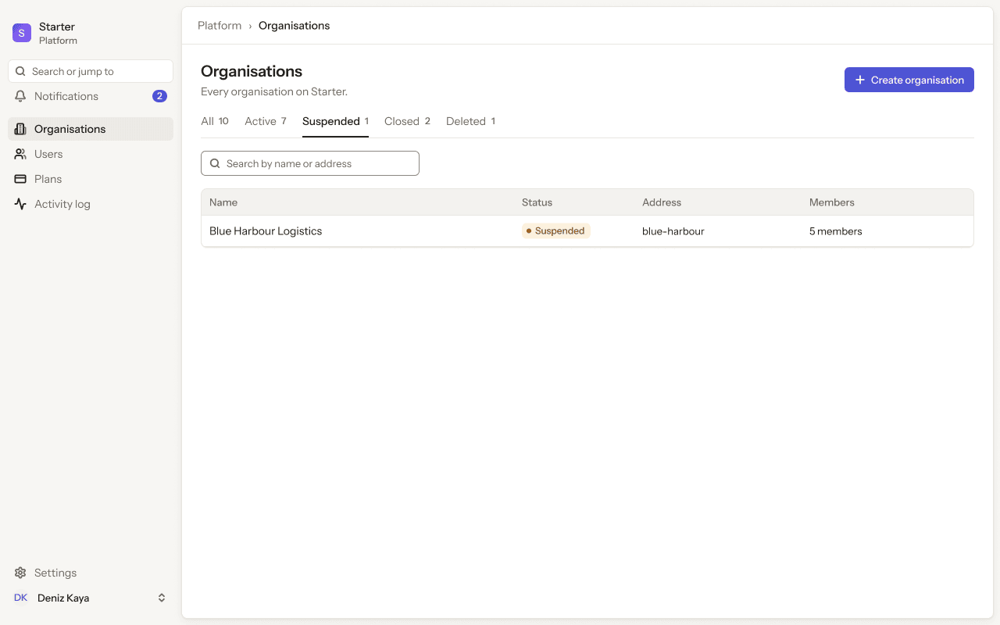

- **Who sees it:** System admins. Actions need the platform.tenants.* permission of each action.
- **Device:** Desktop (1280 px and wider).
- **This state shows:** when the organisation or person is suspended.
- **Values come from:** Organisations, owners, plans, overrides, lifecycle and billing state: our API (platform.tenants.*).
- **Components:** Button, Input, Pill, Platform sidebar, Tab ×5, Top bar.
- **Actions:**
  - "Organisations": goes to [4.01 · Organisations · all](#401--organisations--all).
  - "Notifications": goes to [3.01 · Bell · unread](../03-notifications/README.md#301--bell--unread).
  - "Search or jump to": goes to [2.02 · Command menu](../02-shell/README.md#202--command-menu).
  - "Deniz Kaya": goes to [2.03 · Account menu](../02-shell/README.md#203--account-menu).
  - "All": goes to [4.01 · Organisations · all](#401--organisations--all).
  - "Closed": goes to [4.03 · Organisations · closed](#403--organisations--closed).
  - "Blue Harbour Logistics": goes to [4.20 · Suspended](#420--suspended).
  - "Create organisation": goes to [4.07 · Create organisation](#407--create-organisation).
  - "Users": goes to [5.01 · Users · all](../05-users/README.md#501--users--all).
  - "Plans": goes to [6.01 · Plans](../06-plans/README.md#601--plans).
  - "Activity log": goes to [7.01 · Activity log](../07-activity-log/README.md#701--activity-log).
  - "Settings": goes to [8.01 · Profile · ideal](../08-settings-profile/README.md#801--profile--ideal).
- **Texts, word for word, top to bottom:**

  - S
  - Starter
  - Platform
  - Search or jump to
  - Notifications
  - 2
  - Organisations
  - Users
  - Plans
  - Activity log
  - Settings
  - DK
  - Deniz Kaya
  - Platform
  - ›
  - Organisations
  - Organisations
  - Every organisation on Starter.
  - Create organisation
  - All
  - 10
  - Active
  - 7
  - Suspended
  - 1
  - Closed
  - 2
  - Deleted
  - 1
  - Search by name or address
  - Name
  - Status
  - Address
  - Members
  - Blue Harbour Logistics
  - Suspended
  - blue-harbour
  - 5 members

Figma: [175:3108](https://www.figma.com/design/3Ev111okX8xCBwR9B3hyBM/?node-id=175-3108)

### 4.03 · Organisations · closed

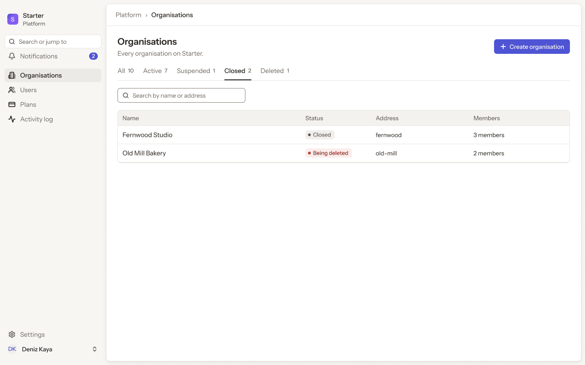

- **Who sees it:** System admins. Actions need the platform.tenants.* permission of each action.
- **Device:** Desktop (1280 px and wider).
- **This state shows:** as the title says.
- **Values come from:** Organisations, owners, plans, overrides, lifecycle and billing state: our API (platform.tenants.*).
- **Components:** Button, Input, Pill ×2, Platform sidebar, Tab ×5, Top bar.
- **Actions:**
  - "Organisations": goes to [4.01 · Organisations · all](#401--organisations--all).
  - "Notifications": goes to [3.01 · Bell · unread](../03-notifications/README.md#301--bell--unread).
  - "Search or jump to": goes to [2.02 · Command menu](../02-shell/README.md#202--command-menu).
  - "Deniz Kaya": goes to [2.03 · Account menu](../02-shell/README.md#203--account-menu).
  - "All": goes to [4.01 · Organisations · all](#401--organisations--all).
  - "Suspended": goes to [4.02 · Organisations · suspended](#402--organisations--suspended).
  - "Fernwood Studio": goes to [4.23 · Closed](#423--closed).
  - "Old Mill Bakery": goes to [4.25 · Being deleted](#425--being-deleted).
  - "Create organisation": goes to [4.07 · Create organisation](#407--create-organisation).
  - "Users": goes to [5.01 · Users · all](../05-users/README.md#501--users--all).
  - "Plans": goes to [6.01 · Plans](../06-plans/README.md#601--plans).
  - "Activity log": goes to [7.01 · Activity log](../07-activity-log/README.md#701--activity-log).
  - "Settings": goes to [8.01 · Profile · ideal](../08-settings-profile/README.md#801--profile--ideal).
- **Texts, word for word, top to bottom:**

  - S
  - Starter
  - Platform
  - Search or jump to
  - Notifications
  - 2
  - Organisations
  - Users
  - Plans
  - Activity log
  - Settings
  - DK
  - Deniz Kaya
  - Platform
  - ›
  - Organisations
  - Organisations
  - Every organisation on Starter.
  - Create organisation
  - All
  - 10
  - Active
  - 7
  - Suspended
  - 1
  - Closed
  - 2
  - Deleted
  - 1
  - Search by name or address
  - Name
  - Status
  - Address
  - Members
  - Fernwood Studio
  - Closed
  - fernwood
  - 3 members
  - Old Mill Bakery
  - Being deleted
  - old-mill
  - 2 members

Figma: [175:3293](https://www.figma.com/design/3Ev111okX8xCBwR9B3hyBM/?node-id=175-3293)

### 4.04 · Organisations · no match

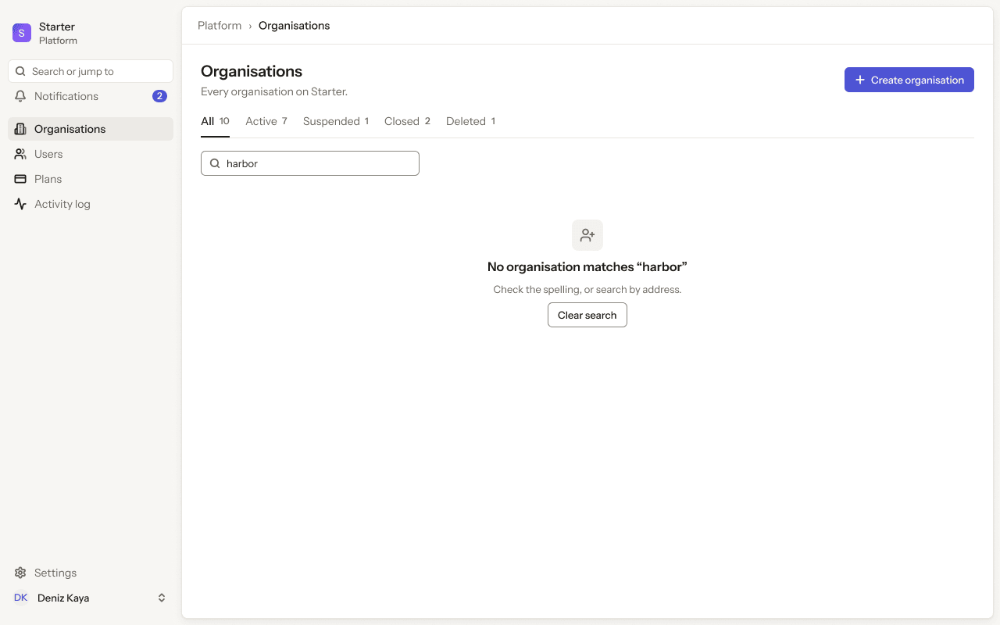

- **Who sees it:** System admins. Actions need the platform.tenants.* permission of each action.
- **Device:** Desktop (1280 px and wider).
- **This state shows:** when a search matches nothing.
- **Values come from:** Organisations, owners, plans, overrides, lifecycle and billing state: our API (platform.tenants.*).
- **Components:** Button, Empty state, Input, Platform sidebar, Tab ×5, Top bar.
- **Actions:**
  - "Organisations": goes to [4.01 · Organisations · all](#401--organisations--all).
  - "Notifications": goes to [3.01 · Bell · unread](../03-notifications/README.md#301--bell--unread).
  - "Search or jump to": goes to [2.02 · Command menu](../02-shell/README.md#202--command-menu).
  - "Deniz Kaya": goes to [2.03 · Account menu](../02-shell/README.md#203--account-menu).
  - "All": goes to [4.01 · Organisations · all](#401--organisations--all).
  - "Suspended": goes to [4.02 · Organisations · suspended](#402--organisations--suspended).
  - "Closed": goes to [4.03 · Organisations · closed](#403--organisations--closed).
  - "Create organisation": goes to [4.07 · Create organisation](#407--create-organisation).
  - "Users": goes to [5.01 · Users · all](../05-users/README.md#501--users--all).
  - "Plans": goes to [6.01 · Plans](../06-plans/README.md#601--plans).
  - "Activity log": goes to [7.01 · Activity log](../07-activity-log/README.md#701--activity-log).
  - "Settings": goes to [8.01 · Profile · ideal](../08-settings-profile/README.md#801--profile--ideal).
- **Texts, word for word, top to bottom:**

  - S
  - Starter
  - Platform
  - Search or jump to
  - Notifications
  - 2
  - Organisations
  - Users
  - Plans
  - Activity log
  - Settings
  - DK
  - Deniz Kaya
  - Platform
  - ›
  - Organisations
  - Organisations
  - Every organisation on Starter.
  - Create organisation
  - All
  - 10
  - Active
  - 7
  - Suspended
  - 1
  - Closed
  - 2
  - Deleted
  - 1
  - harbor
  - No organisation matches “harbor”
  - Check the spelling, or search by address.
  - Clear search

Figma: [175:3478](https://www.figma.com/design/3Ev111okX8xCBwR9B3hyBM/?node-id=175-3478)

### 4.05 · Organisations · loading

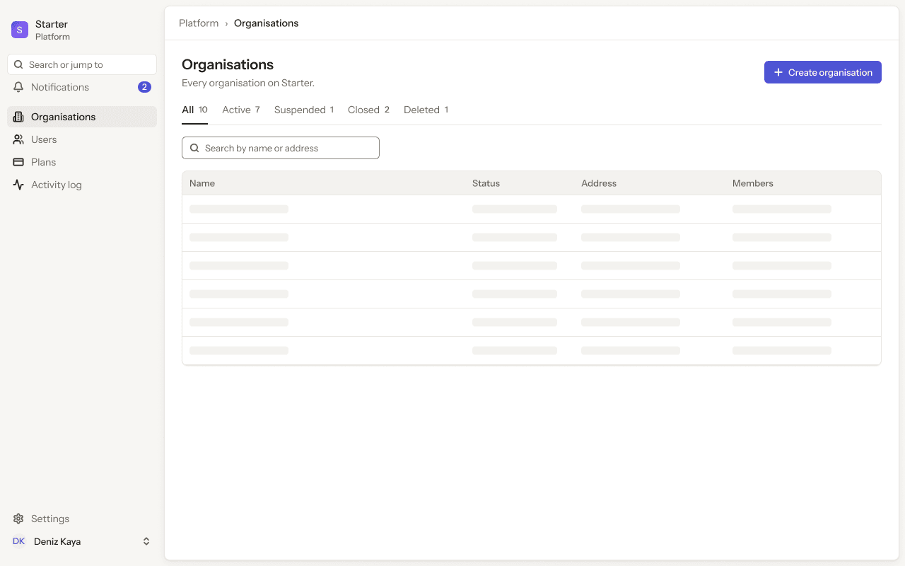

- **Who sees it:** System admins. Actions need the platform.tenants.* permission of each action.
- **Device:** Desktop (1280 px and wider).
- **This state shows:** while the request runs.
- **Values come from:** Organisations, owners, plans, overrides, lifecycle and billing state: our API (platform.tenants.*).
- **Components:** Button, Input, Platform sidebar, Skeleton ×24, Tab ×5, Top bar.
- **Actions:**
  - "Organisations": goes to [4.01 · Organisations · all](#401--organisations--all).
  - "Notifications": goes to [3.01 · Bell · unread](../03-notifications/README.md#301--bell--unread).
  - "Search or jump to": goes to [2.02 · Command menu](../02-shell/README.md#202--command-menu).
  - "Deniz Kaya": goes to [2.03 · Account menu](../02-shell/README.md#203--account-menu).
  - "All": goes to [4.01 · Organisations · all](#401--organisations--all).
  - "Suspended": goes to [4.02 · Organisations · suspended](#402--organisations--suspended).
  - "Closed": goes to [4.03 · Organisations · closed](#403--organisations--closed).
  - "Area": goes to [4.09 · Organisation · overview](#409--organisation--overview).
  - "Area": goes to [4.20 · Suspended](#420--suspended).
  - "Area": goes to [4.23 · Closed](#423--closed).
  - "Area": goes to [4.25 · Being deleted](#425--being-deleted).
  - "Create organisation": goes to [4.07 · Create organisation](#407--create-organisation).
  - "Users": goes to [5.01 · Users · all](../05-users/README.md#501--users--all).
  - "Plans": goes to [6.01 · Plans](../06-plans/README.md#601--plans).
  - "Activity log": goes to [7.01 · Activity log](../07-activity-log/README.md#701--activity-log).
  - "Settings": goes to [8.01 · Profile · ideal](../08-settings-profile/README.md#801--profile--ideal).
- **Texts, word for word, top to bottom:**

  - S
  - Starter
  - Platform
  - Search or jump to
  - Notifications
  - 2
  - Organisations
  - Users
  - Plans
  - Activity log
  - Settings
  - DK
  - Deniz Kaya
  - Platform
  - ›
  - Organisations
  - Organisations
  - Every organisation on Starter.
  - Create organisation
  - All
  - 10
  - Active
  - 7
  - Suspended
  - 1
  - Closed
  - 2
  - Deleted
  - 1
  - Search by name or address
  - Name
  - Status
  - Address
  - Members

Figma: [175:3675](https://www.figma.com/design/3Ev111okX8xCBwR9B3hyBM/?node-id=175-3675)

### 4.06 · No organisations yet

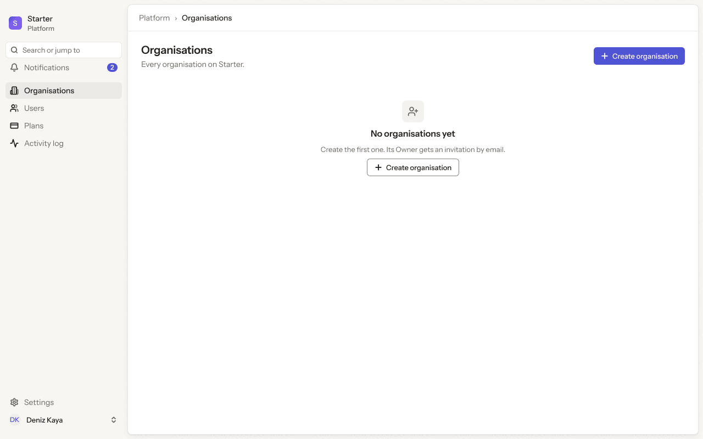

- **Who sees it:** System admins. Actions need the platform.tenants.* permission of each action.
- **Device:** Desktop (1280 px and wider).
- **This state shows:** as the title says.
- **Values come from:** Organisations, owners, plans, overrides, lifecycle and billing state: our API (platform.tenants.*).
- **Components:** Button, Empty state, Platform sidebar, Top bar.
- **Actions:**
  - "Organisations": goes to [4.01 · Organisations · all](#401--organisations--all).
  - "Notifications": goes to [3.01 · Bell · unread](../03-notifications/README.md#301--bell--unread).
  - "Search or jump to": goes to [2.02 · Command menu](../02-shell/README.md#202--command-menu).
  - "Deniz Kaya": goes to [2.03 · Account menu](../02-shell/README.md#203--account-menu).
  - "Create organisation": goes to [4.07 · Create organisation](#407--create-organisation).
  - "Users": goes to [5.01 · Users · all](../05-users/README.md#501--users--all).
  - "Plans": goes to [6.01 · Plans](../06-plans/README.md#601--plans).
  - "Activity log": goes to [7.01 · Activity log](../07-activity-log/README.md#701--activity-log).
  - "Settings": goes to [8.01 · Profile · ideal](../08-settings-profile/README.md#801--profile--ideal).
- **Texts, word for word, top to bottom:**

  - S
  - Starter
  - Platform
  - Search or jump to
  - Notifications
  - 2
  - Organisations
  - Users
  - Plans
  - Activity log
  - Settings
  - DK
  - Deniz Kaya
  - Platform
  - ›
  - Organisations
  - Organisations
  - Every organisation on Starter.
  - Create organisation
  - No organisations yet
  - Create the first one. Its Owner gets an invitation by email.
  - Create organisation

Figma: [175:3892](https://www.figma.com/design/3Ev111okX8xCBwR9B3hyBM/?node-id=175-3892)

### 4.07 · Create organisation

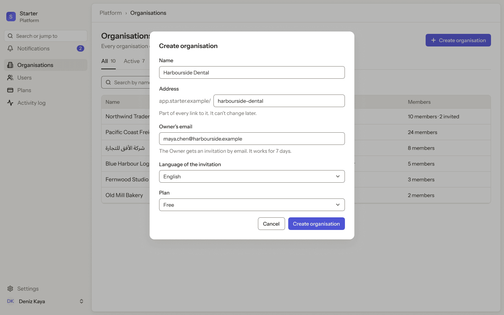

- **Who sees it:** System admins. Actions need the platform.tenants.* permission of each action.
- **Device:** Desktop (1280 px and wider).
- **This state shows:** as the title says.
- **Values come from:** Organisations, owners, plans, overrides, lifecycle and billing state: our API (platform.tenants.*).
- **Components:** Button ×3, Input ×4, Pill ×6, Platform sidebar, Select ×2, Tab ×5, Top bar.
- **Actions:**
  - "Organisations": goes to [4.01 · Organisations · all](#401--organisations--all).
  - "Notifications": goes to [3.01 · Bell · unread](../03-notifications/README.md#301--bell--unread).
  - "Search or jump to": goes to [2.02 · Command menu](../02-shell/README.md#202--command-menu).
  - "Deniz Kaya": goes to [2.03 · Account menu](../02-shell/README.md#203--account-menu).
  - "Cancel": goes to [4.01 · Organisations · all](#401--organisations--all).
  - "Users": goes to [5.01 · Users · all](../05-users/README.md#501--users--all).
  - "Plans": goes to [6.01 · Plans](../06-plans/README.md#601--plans).
  - "Activity log": goes to [7.01 · Activity log](../07-activity-log/README.md#701--activity-log).
  - "Settings": goes to [8.01 · Profile · ideal](../08-settings-profile/README.md#801--profile--ideal).
- **Texts, word for word, top to bottom:**

  - S
  - Starter
  - Platform
  - Search or jump to
  - Notifications
  - 2
  - Organisations
  - Users
  - Plans
  - Activity log
  - Settings
  - DK
  - Deniz Kaya
  - Platform
  - ›
  - Organisations
  - Organisations
  - Every organisation on Starter.
  - Create organisation
  - All
  - 10
  - Active
  - 7
  - Suspended
  - 1
  - Closed
  - 2
  - Deleted
  - 1
  - Search by name or address
  - Name
  - Status
  - Address
  - Members
  - Northwind Traders
  - Active
  - northwind
  - 10 members · 2 invited
  - Pacific Coast Freight & Warehousing Cooperative Ltd.
  - Active
  - pacific-coast
  - 24 members
  - شركة الأفق للتجارة
  - Active
  - al-ufuq
  - 8 members
  - Blue Harbour Logistics
  - Suspended
  - blue-harbour
  - 5 members
  - Fernwood Studio
  - Closed
  - fernwood
  - 3 members
  - Old Mill Bakery
  - Being deleted
  - old-mill
  - 2 members
  - Create organisation
  - Name
  - Harbourside Dental
  - Address
  - app.starter.example/
  - harbourside-dental
  - Part of every link to it. It can’t change later.
  - Owner’s email
  - maya.chen@harbourside.example
  - The Owner gets an invitation by email. It works for 7 days.
  - Language of the invitation
  - English
  - Plan
  - Free
  - Cancel
  - Create organisation

Figma: [175:4074](https://www.figma.com/design/3Ev111okX8xCBwR9B3hyBM/?node-id=175-4074)

### 4.08 · Create · address taken

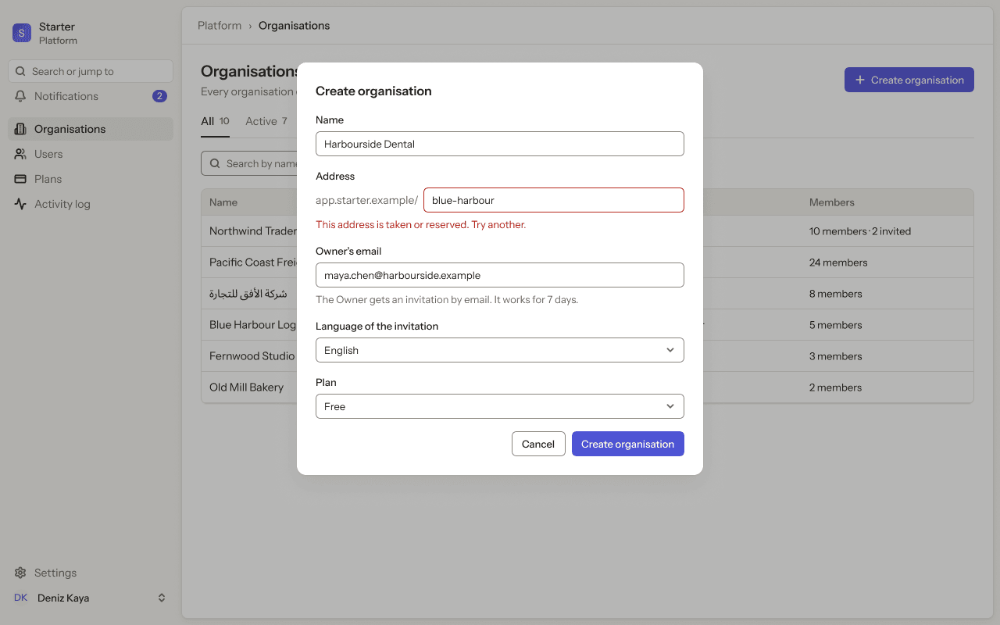

- **Who sees it:** System admins. Actions need the platform.tenants.* permission of each action.
- **Device:** Desktop (1280 px and wider).
- **This state shows:** as the title says.
- **Values come from:** Organisations, owners, plans, overrides, lifecycle and billing state: our API (platform.tenants.*).
- **Components:** Button ×3, Input ×4, Pill ×6, Platform sidebar, Select ×2, Tab ×5, Top bar.
- **Actions:**
  - "Organisations": goes to [4.01 · Organisations · all](#401--organisations--all).
  - "Notifications": goes to [3.01 · Bell · unread](../03-notifications/README.md#301--bell--unread).
  - "Search or jump to": goes to [2.02 · Command menu](../02-shell/README.md#202--command-menu).
  - "Deniz Kaya": goes to [2.03 · Account menu](../02-shell/README.md#203--account-menu).
  - "Cancel": goes to [4.01 · Organisations · all](#401--organisations--all).
  - "Users": goes to [5.01 · Users · all](../05-users/README.md#501--users--all).
  - "Plans": goes to [6.01 · Plans](../06-plans/README.md#601--plans).
  - "Activity log": goes to [7.01 · Activity log](../07-activity-log/README.md#701--activity-log).
  - "Settings": goes to [8.01 · Profile · ideal](../08-settings-profile/README.md#801--profile--ideal).
- **Texts, word for word, top to bottom:**

  - S
  - Starter
  - Platform
  - Search or jump to
  - Notifications
  - 2
  - Organisations
  - Users
  - Plans
  - Activity log
  - Settings
  - DK
  - Deniz Kaya
  - Platform
  - ›
  - Organisations
  - Organisations
  - Every organisation on Starter.
  - Create organisation
  - All
  - 10
  - Active
  - 7
  - Suspended
  - 1
  - Closed
  - 2
  - Deleted
  - 1
  - Search by name or address
  - Name
  - Status
  - Address
  - Members
  - Northwind Traders
  - Active
  - northwind
  - 10 members · 2 invited
  - Pacific Coast Freight & Warehousing Cooperative Ltd.
  - Active
  - pacific-coast
  - 24 members
  - شركة الأفق للتجارة
  - Active
  - al-ufuq
  - 8 members
  - Blue Harbour Logistics
  - Suspended
  - blue-harbour
  - 5 members
  - Fernwood Studio
  - Closed
  - fernwood
  - 3 members
  - Old Mill Bakery
  - Being deleted
  - old-mill
  - 2 members
  - Create organisation
  - Name
  - Harbourside Dental
  - Address
  - app.starter.example/
  - blue-harbour
  - This address is taken or reserved. Try another.
  - Owner’s email
  - maya.chen@harbourside.example
  - The Owner gets an invitation by email. It works for 7 days.
  - Language of the invitation
  - English
  - Plan
  - Free
  - Cancel
  - Create organisation

Figma: [175:4221](https://www.figma.com/design/3Ev111okX8xCBwR9B3hyBM/?node-id=175-4221)

### 4.09 · Organisation · overview

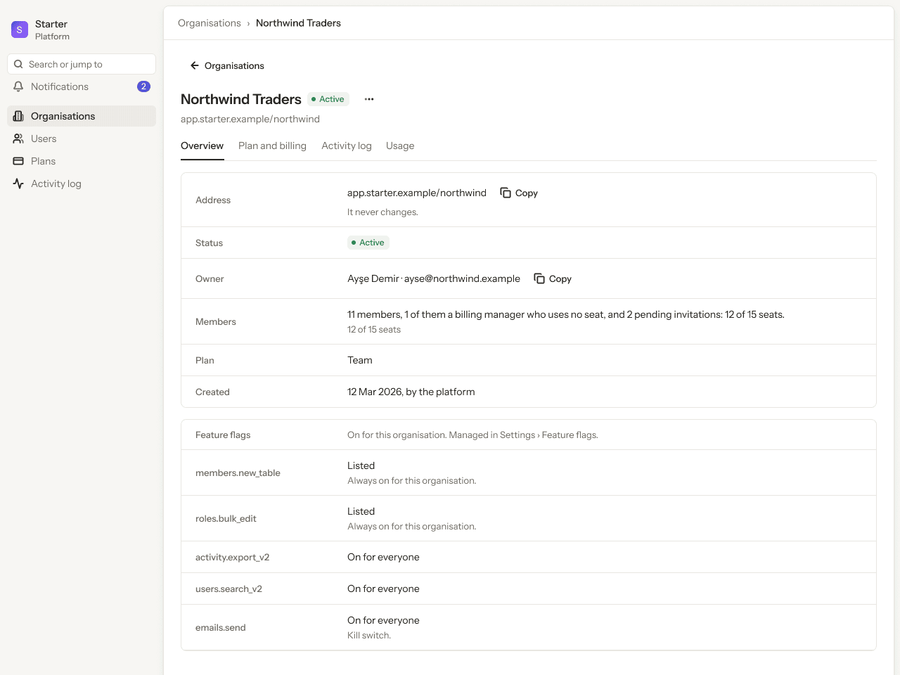

- **Who sees it:** System admins. Actions need the platform.tenants.* permission of each action.
- **Device:** Desktop (1280 px and wider).
- **This state shows:** as the title says.
- **Values come from:** Organisations, owners, plans, overrides, lifecycle and billing state: our API (platform.tenants.*).
- **Components:** Button ×4, Pill ×2, Platform sidebar, Tab ×4, Top bar.
- **Actions:**
  - "Organisations": goes to [4.01 · Organisations · all](#401--organisations--all).
  - "Notifications": goes to [3.01 · Bell · unread](../03-notifications/README.md#301--bell--unread).
  - "Search or jump to": goes to [2.02 · Command menu](../02-shell/README.md#202--command-menu).
  - "Area": goes to [2.03 · Account menu](../02-shell/README.md#203--account-menu).
  - "Area": goes to [4.14 · Organisation · plan](#414--organisation--plan).
  - "Activity log": goes to [4.18 · Organisation · activity log](#418--organisation--activity-log).
  - "Area": goes to [4.10 · Organisation · ⋯ menu](#410--organisation---menu).
  - "Users": goes to [5.01 · Users · all](../05-users/README.md#501--users--all).
  - "Plans": goes to [6.01 · Plans](../06-plans/README.md#601--plans).
  - "Activity log": goes to [7.01 · Activity log](../07-activity-log/README.md#701--activity-log).
  - "Area": goes to [8.01 · Profile · ideal](../08-settings-profile/README.md#801--profile--ideal).
  - "On for this organisation. Managed in Settings › Feature flags.": goes to [12.01 · Feature flags](../12-settings-feature-flags/README.md#1201--feature-flags).
  - "Usage": goes to [4.37 · Organisation · usage](#437--organisation--usage).
- **Texts, word for word, top to bottom:**

  - S
  - Starter
  - Platform
  - Search or jump to
  - Notifications
  - 2
  - Organisations
  - Users
  - Plans
  - Activity log
  - Settings
  - DK
  - Deniz Kaya
  - Organisations
  - ›
  - Northwind Traders
  - Organisations
  - Northwind Traders
  - Active
  - app.starter.example/northwind
  - Overview
  - Plan and billing
  - Activity log
  - Usage
  - Address
  - app.starter.example/northwind
  - Copy
  - It never changes.
  - Status
  - Active
  - Owner
  - Ayşe Demir · ayse@northwind.example
  - Copy
  - Members
  - 11 members, 1 of them a billing manager who uses no seat, and 2 pending invitations: 12 of 15 seats.
  - 12 of 15 seats
  - Plan
  - Team
  - Created
  - 12 Mar 2026, by the platform
  - Feature flags
  - On for this organisation. Managed in Settings › Feature flags.
  - members.new\_table
  - Listed
  - Always on for this organisation.
  - roles.bulk\_edit
  - Listed
  - Always on for this organisation.
  - activity.export\_v2
  - On for everyone
  - users.search\_v2
  - On for everyone
  - emails.send
  - On for everyone
  - Kill switch.

Figma: [176:3644](https://www.figma.com/design/3Ev111okX8xCBwR9B3hyBM/?node-id=176-3644)

### 4.10 · Organisation · ⋯ menu

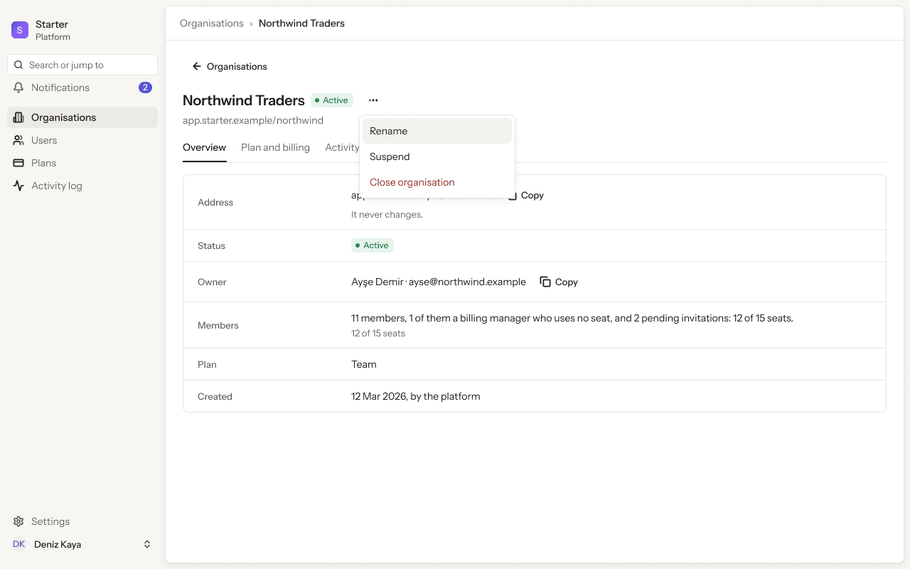

- **Who sees it:** System admins. Actions need the platform.tenants.* permission of each action.
- **Device:** Desktop (1280 px and wider).
- **This state shows:** as the title says.
- **Values come from:** Organisations, owners, plans, overrides, lifecycle and billing state: our API (platform.tenants.*).
- **Components:** Button ×4, Pill ×2, Platform sidebar, Tab ×4, Top bar.
- **Actions:**
  - "Organisations": goes to [4.01 · Organisations · all](#401--organisations--all).
  - "Notifications": goes to [3.01 · Bell · unread](../03-notifications/README.md#301--bell--unread).
  - "Search or jump to": goes to [2.02 · Command menu](../02-shell/README.md#202--command-menu).
  - "Deniz Kaya": goes to [2.03 · Account menu](../02-shell/README.md#203--account-menu).
  - "Overview": goes to [4.09 · Organisation · overview](#409--organisation--overview).
  - "Area": goes to [4.14 · Organisation · plan](#414--organisation--plan).
  - "Activity log": goes to [4.18 · Organisation · activity log](#418--organisation--activity-log).
  - "Rename": goes to [4.13 · Rename](#413--rename).
  - "Suspend": goes to [4.19 · Suspend](#419--suspend).
  - "Close organisation": goes to [4.22 · Close organisation](#422--close-organisation).
  - "Users": goes to [5.01 · Users · all](../05-users/README.md#501--users--all).
  - "Plans": goes to [6.01 · Plans](../06-plans/README.md#601--plans).
  - "Activity log": goes to [7.01 · Activity log](../07-activity-log/README.md#701--activity-log).
  - "Settings": goes to [8.01 · Profile · ideal](../08-settings-profile/README.md#801--profile--ideal).
  - "Usage": goes to [4.37 · Organisation · usage](#437--organisation--usage).
- **Texts, word for word, top to bottom:**

  - S
  - Starter
  - Platform
  - Search or jump to
  - Notifications
  - 2
  - Organisations
  - Users
  - Plans
  - Activity log
  - Settings
  - DK
  - Deniz Kaya
  - Organisations
  - ›
  - Northwind Traders
  - Organisations
  - Northwind Traders
  - Active
  - app.starter.example/northwind
  - Overview
  - Plan and billing
  - Activity log
  - Usage
  - Address
  - app.starter.example/northwind
  - Copy
  - It never changes.
  - Status
  - Active
  - Owner
  - Ayşe Demir · ayse@northwind.example
  - Copy
  - Members
  - 11 members, 1 of them a billing manager who uses no seat, and 2 pending invitations: 12 of 15 seats.
  - 12 of 15 seats
  - Plan
  - Team
  - Created
  - 12 Mar 2026, by the platform
  - Rename
  - Suspend
  - Close organisation

Figma: [176:3905](https://www.figma.com/design/3Ev111okX8xCBwR9B3hyBM/?node-id=176-3905)

### 4.11 · Organisation · waiting for Owner

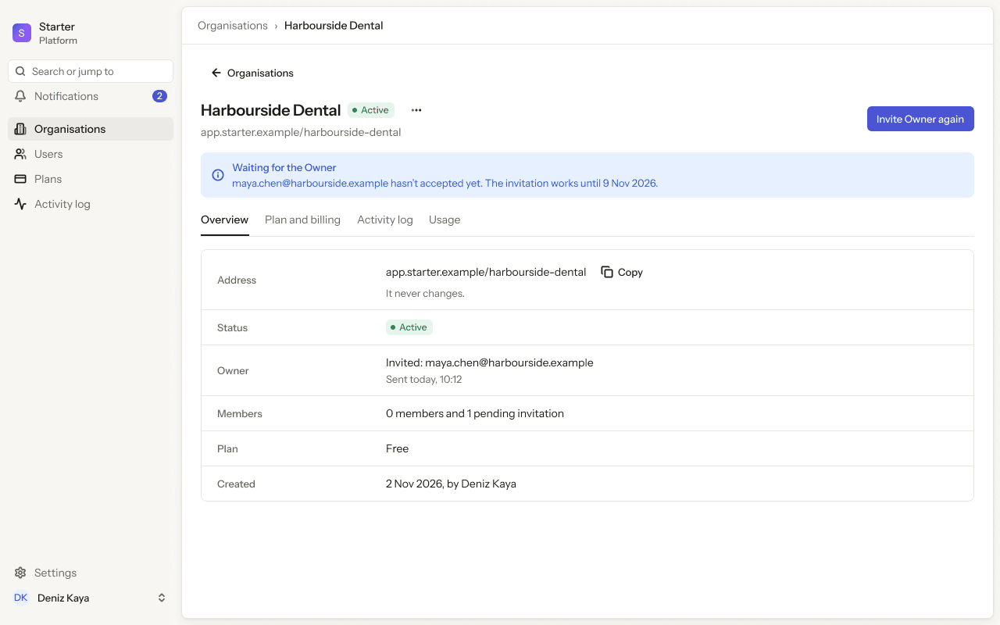

- **Who sees it:** System admins. Actions need the platform.tenants.* permission of each action.
- **Device:** Desktop (1280 px and wider).
- **This state shows:** as the title says.
- **Values come from:** Organisations, owners, plans, overrides, lifecycle and billing state: our API (platform.tenants.*).
- **Components:** Banner, Button ×4, Pill ×2, Platform sidebar, Tab ×4, Top bar.
- **Actions:**
  - "Organisations": goes to [4.01 · Organisations · all](#401--organisations--all).
  - "Notifications": goes to [3.01 · Bell · unread](../03-notifications/README.md#301--bell--unread).
  - "Search or jump to": goes to [2.02 · Command menu](../02-shell/README.md#202--command-menu).
  - "Deniz Kaya": goes to [2.03 · Account menu](../02-shell/README.md#203--account-menu).
  - "Overview": goes to [4.09 · Organisation · overview](#409--organisation--overview).
  - "Area": goes to [4.14 · Organisation · plan](#414--organisation--plan).
  - "Activity log": goes to [4.18 · Organisation · activity log](#418--organisation--activity-log).
  - "Invite Owner again": goes to [4.12 · Invite Owner](#412--invite-owner).
  - "Users": goes to [5.01 · Users · all](../05-users/README.md#501--users--all).
  - "Plans": goes to [6.01 · Plans](../06-plans/README.md#601--plans).
  - "Activity log": goes to [7.01 · Activity log](../07-activity-log/README.md#701--activity-log).
  - "Settings": goes to [8.01 · Profile · ideal](../08-settings-profile/README.md#801--profile--ideal).
  - "Usage": goes to [4.37 · Organisation · usage](#437--organisation--usage).
- **Texts, word for word, top to bottom:**

  - S
  - Starter
  - Platform
  - Search or jump to
  - Notifications
  - 2
  - Organisations
  - Users
  - Plans
  - Activity log
  - Settings
  - DK
  - Deniz Kaya
  - Organisations
  - ›
  - Harbourside Dental
  - Organisations
  - Harbourside Dental
  - Active
  - app.starter.example/harbourside-dental
  - Invite Owner again
  - Waiting for the Owner
  - maya.chen@harbourside.example hasn’t accepted yet. The invitation works until 9 Nov 2026.
  - Overview
  - Plan and billing
  - Activity log
  - Usage
  - Address
  - app.starter.example/harbourside-dental
  - Copy
  - It never changes.
  - Status
  - Active
  - Owner
  - Invited: maya.chen@harbourside.example
  - Sent today, 10:12
  - Members
  - 0 members and 1 pending invitation
  - Plan
  - Free
  - Created
  - 2 Nov 2026, by Deniz Kaya

Figma: [176:4173](https://www.figma.com/design/3Ev111okX8xCBwR9B3hyBM/?node-id=176-4173)

### 4.12 · Invite Owner

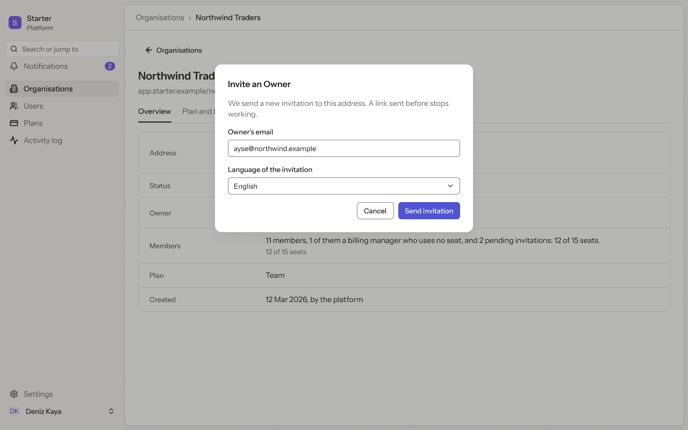

- **Who sees it:** System admins. Actions need the platform.tenants.* permission of each action.
- **Device:** Desktop (1280 px and wider).
- **This state shows:** as the title says.
- **Values come from:** Organisations, owners, plans, overrides, lifecycle and billing state: our API (platform.tenants.*).
- **Components:** Button ×6, Input, Pill ×2, Platform sidebar, Select, Tab ×4, Top bar.
- **Actions:**
  - "Organisations": goes to [4.01 · Organisations · all](#401--organisations--all).
  - "Notifications": goes to [3.01 · Bell · unread](../03-notifications/README.md#301--bell--unread).
  - "Search or jump to": goes to [2.02 · Command menu](../02-shell/README.md#202--command-menu).
  - "Deniz Kaya": goes to [2.03 · Account menu](../02-shell/README.md#203--account-menu).
  - "Cancel": goes to [4.09 · Organisation · overview](#409--organisation--overview).
  - "Users": goes to [5.01 · Users · all](../05-users/README.md#501--users--all).
  - "Plans": goes to [6.01 · Plans](../06-plans/README.md#601--plans).
  - "Activity log": goes to [7.01 · Activity log](../07-activity-log/README.md#701--activity-log).
  - "Settings": goes to [8.01 · Profile · ideal](../08-settings-profile/README.md#801--profile--ideal).
  - "Usage": goes to [4.37 · Organisation · usage](#437--organisation--usage).
- **Texts, word for word, top to bottom:**

  - S
  - Starter
  - Platform
  - Search or jump to
  - Notifications
  - 2
  - Organisations
  - Users
  - Plans
  - Activity log
  - Settings
  - DK
  - Deniz Kaya
  - Organisations
  - ›
  - Northwind Traders
  - Organisations
  - Northwind Traders
  - Active
  - app.starter.example/northwind
  - Overview
  - Plan and billing
  - Activity log
  - Usage
  - Address
  - app.starter.example/northwind
  - Copy
  - It never changes.
  - Status
  - Active
  - Owner
  - Ayşe Demir · ayse@northwind.example
  - Copy
  - Members
  - 11 members, 1 of them a billing manager who uses no seat, and 2 pending invitations: 12 of 15 seats.
  - 12 of 15 seats
  - Plan
  - Team
  - Created
  - 12 Mar 2026, by the platform
  - Invite an Owner
  - We send a new invitation to this address. A link sent before stops working.
  - Owner’s email
  - ayse@northwind.example
  - Language of the invitation
  - English
  - Cancel
  - Send invitation

Figma: [176:4468](https://www.figma.com/design/3Ev111okX8xCBwR9B3hyBM/?node-id=176-4468)

### 4.13 · Rename

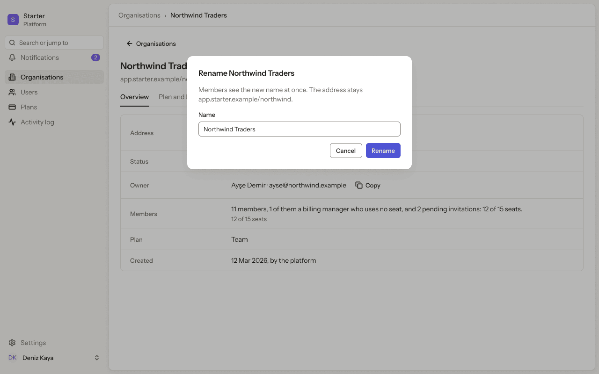

- **Who sees it:** System admins. Actions need the platform.tenants.* permission of each action.
- **Device:** Desktop (1280 px and wider).
- **This state shows:** as the title says.
- **Values come from:** Organisations, owners, plans, overrides, lifecycle and billing state: our API (platform.tenants.*).
- **Components:** Button ×6, Input, Pill ×2, Platform sidebar, Tab ×4, Top bar.
- **Actions:**
  - "Organisations": goes to [4.01 · Organisations · all](#401--organisations--all).
  - "Notifications": goes to [3.01 · Bell · unread](../03-notifications/README.md#301--bell--unread).
  - "Search or jump to": goes to [2.02 · Command menu](../02-shell/README.md#202--command-menu).
  - "Deniz Kaya": goes to [2.03 · Account menu](../02-shell/README.md#203--account-menu).
  - "Cancel": goes to [4.09 · Organisation · overview](#409--organisation--overview).
  - "Users": goes to [5.01 · Users · all](../05-users/README.md#501--users--all).
  - "Plans": goes to [6.01 · Plans](../06-plans/README.md#601--plans).
  - "Activity log": goes to [7.01 · Activity log](../07-activity-log/README.md#701--activity-log).
  - "Settings": goes to [8.01 · Profile · ideal](../08-settings-profile/README.md#801--profile--ideal).
  - "Usage": goes to [4.37 · Organisation · usage](#437--organisation--usage).
- **Texts, word for word, top to bottom:**

  - S
  - Starter
  - Platform
  - Search or jump to
  - Notifications
  - 2
  - Organisations
  - Users
  - Plans
  - Activity log
  - Settings
  - DK
  - Deniz Kaya
  - Organisations
  - ›
  - Northwind Traders
  - Organisations
  - Northwind Traders
  - Active
  - app.starter.example/northwind
  - Overview
  - Plan and billing
  - Activity log
  - Usage
  - Address
  - app.starter.example/northwind
  - Copy
  - It never changes.
  - Status
  - Active
  - Owner
  - Ayşe Demir · ayse@northwind.example
  - Copy
  - Members
  - 11 members, 1 of them a billing manager who uses no seat, and 2 pending invitations: 12 of 15 seats.
  - 12 of 15 seats
  - Plan
  - Team
  - Created
  - 12 Mar 2026, by the platform
  - Rename Northwind Traders
  - Members see the new name at once. The address stays app.starter.example/northwind.
  - Name
  - Northwind Traders
  - Cancel
  - Rename

Figma: [176:4656](https://www.figma.com/design/3Ev111okX8xCBwR9B3hyBM/?node-id=176-4656)

### 4.14 · Organisation · plan

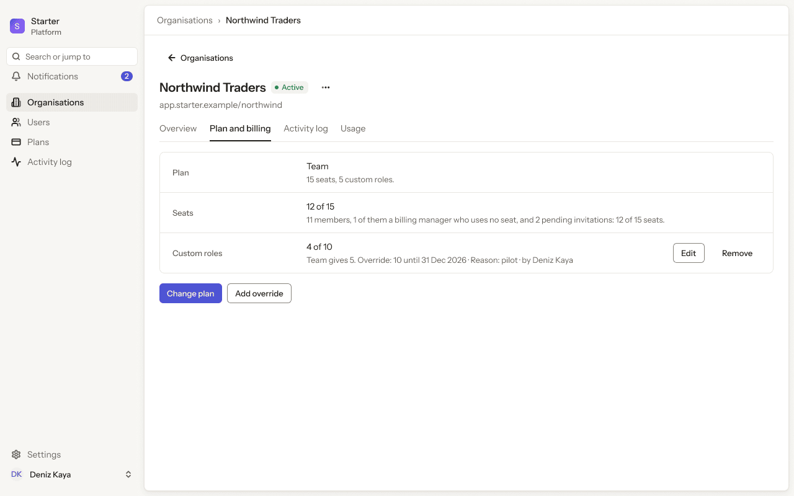

- **Who sees it:** System admins. Actions need the platform.tenants.* permission of each action.
- **Device:** Desktop (1280 px and wider).
- **This state shows:** as the title says.
- **Values come from:** Organisations, owners, plans, overrides, lifecycle and billing state: our API (platform.tenants.*).
- **Components:** Button ×6, Pill, Platform sidebar, Tab ×4, Top bar.
- **Actions:**
  - "Organisations": goes to [4.01 · Organisations · all](#401--organisations--all).
  - "Notifications": goes to [3.01 · Bell · unread](../03-notifications/README.md#301--bell--unread).
  - "Search or jump to": goes to [2.02 · Command menu](../02-shell/README.md#202--command-menu).
  - "Deniz Kaya": goes to [2.03 · Account menu](../02-shell/README.md#203--account-menu).
  - "Overview": goes to [4.09 · Organisation · overview](#409--organisation--overview).
  - "Activity log": goes to [4.18 · Organisation · activity log](#418--organisation--activity-log).
  - "Area": goes to [4.10 · Organisation · ⋯ menu](#410--organisation---menu).
  - "Change plan": goes to [4.15 · Change plan](#415--change-plan).
  - "Add override": goes to [4.16 · Add override](#416--add-override).
  - "Remove": goes to [4.17 · Remove override](#417--remove-override).
  - "Users": goes to [5.01 · Users · all](../05-users/README.md#501--users--all).
  - "Plans": goes to [6.01 · Plans](../06-plans/README.md#601--plans).
  - "Activity log": goes to [7.01 · Activity log](../07-activity-log/README.md#701--activity-log).
  - "Settings": goes to [8.01 · Profile · ideal](../08-settings-profile/README.md#801--profile--ideal).
  - "Usage": goes to [4.37 · Organisation · usage](#437--organisation--usage).
- **Texts, word for word, top to bottom:**

  - S
  - Starter
  - Platform
  - Search or jump to
  - Notifications
  - 2
  - Organisations
  - Users
  - Plans
  - Activity log
  - Settings
  - DK
  - Deniz Kaya
  - Organisations
  - ›
  - Northwind Traders
  - Organisations
  - Northwind Traders
  - Active
  - app.starter.example/northwind
  - Overview
  - Plan and billing
  - Activity log
  - Usage
  - Plan
  - Team
  - 15 seats, 5 custom roles.
  - Seats
  - 12 of 15
  - 11 members, 1 of them a billing manager who uses no seat, and 2 pending invitations: 12 of 15 seats.
  - Custom roles
  - 4 of 10
  - Team gives 5. Override: 10 until 31 Dec 2026 · Reason: pilot · by Deniz Kaya
  - Edit
  - Remove
  - Change plan
  - Add override

Figma: [176:4837](https://www.figma.com/design/3Ev111okX8xCBwR9B3hyBM/?node-id=176-4837)

### 4.15 · Change plan

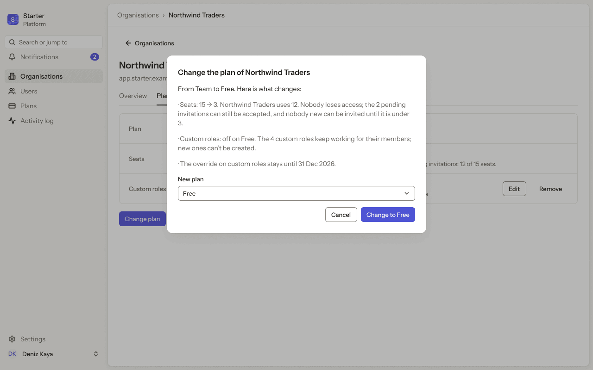

- **Who sees it:** System admins. Actions need the platform.tenants.* permission of each action.
- **Device:** Desktop (1280 px and wider).
- **This state shows:** as the title says.
- **Values come from:** Organisations, owners, plans, overrides, lifecycle and billing state: our API (platform.tenants.*).
- **Components:** Button ×8, Pill, Platform sidebar, Select, Tab ×4, Top bar.
- **Actions:**
  - "Organisations": goes to [4.01 · Organisations · all](#401--organisations--all).
  - "Notifications": goes to [3.01 · Bell · unread](../03-notifications/README.md#301--bell--unread).
  - "Search or jump to": goes to [2.02 · Command menu](../02-shell/README.md#202--command-menu).
  - "Deniz Kaya": goes to [2.03 · Account menu](../02-shell/README.md#203--account-menu).
  - "Cancel": goes to [4.14 · Organisation · plan](#414--organisation--plan).
  - "Users": goes to [5.01 · Users · all](../05-users/README.md#501--users--all).
  - "Plans": goes to [6.01 · Plans](../06-plans/README.md#601--plans).
  - "Activity log": goes to [7.01 · Activity log](../07-activity-log/README.md#701--activity-log).
  - "Settings": goes to [8.01 · Profile · ideal](../08-settings-profile/README.md#801--profile--ideal).
  - "Usage": goes to [4.37 · Organisation · usage](#437--organisation--usage).
- **Texts, word for word, top to bottom:**

  - S
  - Starter
  - Platform
  - Search or jump to
  - Notifications
  - 2
  - Organisations
  - Users
  - Plans
  - Activity log
  - Settings
  - DK
  - Deniz Kaya
  - Organisations
  - ›
  - Northwind Traders
  - Organisations
  - Northwind Traders
  - Active
  - app.starter.example/northwind
  - Overview
  - Plan and billing
  - Activity log
  - Usage
  - Plan
  - Team
  - 15 seats, 5 custom roles.
  - Seats
  - 12 of 15
  - 11 members, 1 of them a billing manager who uses no seat, and 2 pending invitations: 12 of 15 seats.
  - Custom roles
  - 4 of 10
  - Team gives 5. Override: 10 until 31 Dec 2026 · Reason: pilot · by Deniz Kaya
  - Edit
  - Remove
  - Change plan
  - Add override
  - Change the plan of Northwind Traders
  - From Team to Free. Here is what changes:
  - · Seats: 15 → 3. Northwind Traders uses 12. Nobody loses access; the 2 pending invitations can still be accepted, and nobody new can be invited until it is under 3.
  - · Custom roles: off on Free. The 4 custom roles keep working for their members; new ones can’t be created.
  - · The override on custom roles stays until 31 Dec 2026.
  - New plan
  - Free
  - Cancel
  - Change to Free

Figma: [178:4787](https://www.figma.com/design/3Ev111okX8xCBwR9B3hyBM/?node-id=178-4787)

### 4.16 · Add override

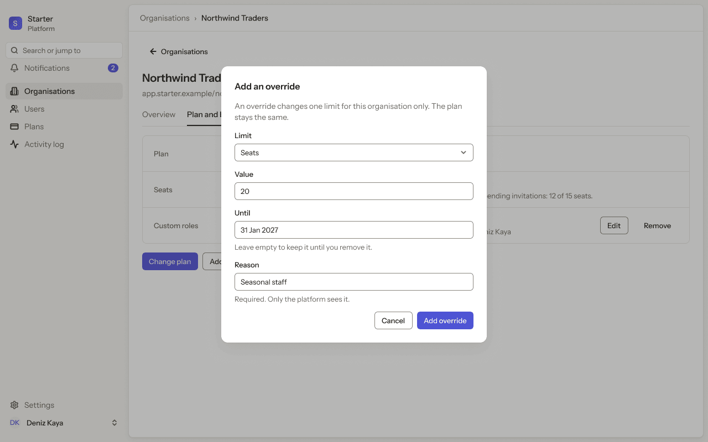

- **Who sees it:** System admins. Actions need the platform.tenants.* permission of each action.
- **Device:** Desktop (1280 px and wider).
- **This state shows:** as the title says.
- **Values come from:** Organisations, owners, plans, overrides, lifecycle and billing state: our API (platform.tenants.*).
- **Components:** Button ×8, Input ×3, Pill, Platform sidebar, Select, Tab ×4, Top bar.
- **Actions:**
  - "Organisations": goes to [4.01 · Organisations · all](#401--organisations--all).
  - "Notifications": goes to [3.01 · Bell · unread](../03-notifications/README.md#301--bell--unread).
  - "Search or jump to": goes to [2.02 · Command menu](../02-shell/README.md#202--command-menu).
  - "Deniz Kaya": goes to [2.03 · Account menu](../02-shell/README.md#203--account-menu).
  - "Cancel": goes to [4.14 · Organisation · plan](#414--organisation--plan).
  - "Users": goes to [5.01 · Users · all](../05-users/README.md#501--users--all).
  - "Plans": goes to [6.01 · Plans](../06-plans/README.md#601--plans).
  - "Activity log": goes to [7.01 · Activity log](../07-activity-log/README.md#701--activity-log).
  - "Settings": goes to [8.01 · Profile · ideal](../08-settings-profile/README.md#801--profile--ideal).
  - "Usage": goes to [4.37 · Organisation · usage](#437--organisation--usage).
- **Texts, word for word, top to bottom:**

  - S
  - Starter
  - Platform
  - Search or jump to
  - Notifications
  - 2
  - Organisations
  - Users
  - Plans
  - Activity log
  - Settings
  - DK
  - Deniz Kaya
  - Organisations
  - ›
  - Northwind Traders
  - Organisations
  - Northwind Traders
  - Active
  - app.starter.example/northwind
  - Overview
  - Plan and billing
  - Activity log
  - Usage
  - Plan
  - Team
  - 15 seats, 5 custom roles.
  - Seats
  - 12 of 15
  - 11 members, 1 of them a billing manager who uses no seat, and 2 pending invitations: 12 of 15 seats.
  - Custom roles
  - 4 of 10
  - Team gives 5. Override: 10 until 31 Dec 2026 · Reason: pilot · by Deniz Kaya
  - Edit
  - Remove
  - Change plan
  - Add override
  - Add an override
  - An override changes one limit for this organisation only. The plan stays the same.
  - Limit
  - Seats
  - Value
  - 20
  - Until
  - 31 Jan 2027
  - Leave empty to keep it until you remove it.
  - Reason
  - Seasonal staff
  - Required. Only the platform sees it.
  - Cancel
  - Add override

Figma: [178:4956](https://www.figma.com/design/3Ev111okX8xCBwR9B3hyBM/?node-id=178-4956)

### 4.17 · Remove override

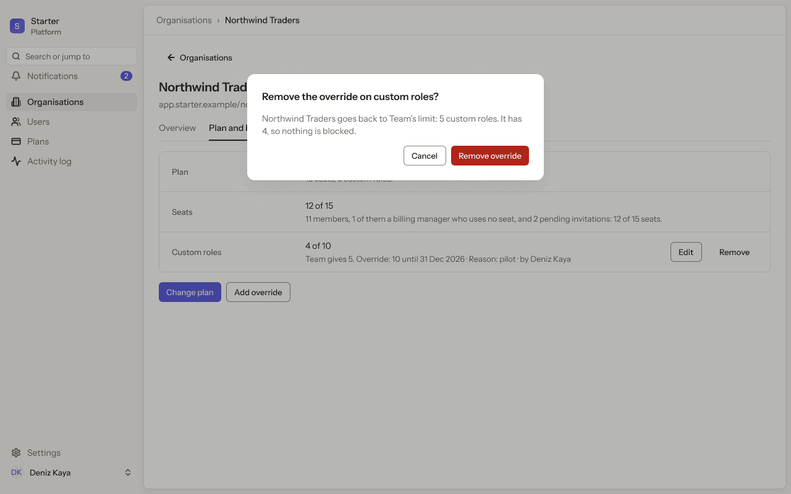

- **Who sees it:** System admins. Actions need the platform.tenants.* permission of each action.
- **Device:** Desktop (1280 px and wider).
- **This state shows:** as the title says.
- **Values come from:** Organisations, owners, plans, overrides, lifecycle and billing state: our API (platform.tenants.*).
- **Components:** Button ×8, Pill, Platform sidebar, Tab ×4, Top bar.
- **Actions:**
  - "Organisations": goes to [4.01 · Organisations · all](#401--organisations--all).
  - "Notifications": goes to [3.01 · Bell · unread](../03-notifications/README.md#301--bell--unread).
  - "Search or jump to": goes to [2.02 · Command menu](../02-shell/README.md#202--command-menu).
  - "Deniz Kaya": goes to [2.03 · Account menu](../02-shell/README.md#203--account-menu).
  - "Cancel": goes to [4.14 · Organisation · plan](#414--organisation--plan).
  - "Users": goes to [5.01 · Users · all](../05-users/README.md#501--users--all).
  - "Plans": goes to [6.01 · Plans](../06-plans/README.md#601--plans).
  - "Activity log": goes to [7.01 · Activity log](../07-activity-log/README.md#701--activity-log).
  - "Settings": goes to [8.01 · Profile · ideal](../08-settings-profile/README.md#801--profile--ideal).
  - "Usage": goes to [4.37 · Organisation · usage](#437--organisation--usage).
- **Texts, word for word, top to bottom:**

  - S
  - Starter
  - Platform
  - Search or jump to
  - Notifications
  - 2
  - Organisations
  - Users
  - Plans
  - Activity log
  - Settings
  - DK
  - Deniz Kaya
  - Organisations
  - ›
  - Northwind Traders
  - Organisations
  - Northwind Traders
  - Active
  - app.starter.example/northwind
  - Overview
  - Plan and billing
  - Activity log
  - Usage
  - Plan
  - Team
  - 15 seats, 5 custom roles.
  - Seats
  - 12 of 15
  - 11 members, 1 of them a billing manager who uses no seat, and 2 pending invitations: 12 of 15 seats.
  - Custom roles
  - 4 of 10
  - Team gives 5. Override: 10 until 31 Dec 2026 · Reason: pilot · by Deniz Kaya
  - Edit
  - Remove
  - Change plan
  - Add override
  - Remove the override on custom roles?
  - Northwind Traders goes back to Team’s limit: 5 custom roles. It has 4, so nothing is blocked.
  - Cancel
  - Remove override

Figma: [178:5148](https://www.figma.com/design/3Ev111okX8xCBwR9B3hyBM/?node-id=178-5148)

### 4.18 · Organisation · activity log

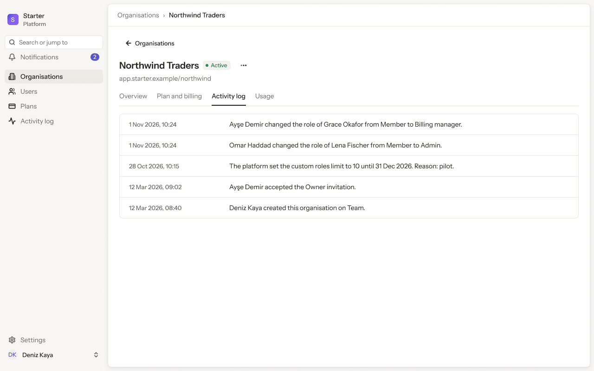

- **Who sees it:** System admins. Actions need the platform.tenants.* permission of each action.
- **Device:** Desktop (1280 px and wider).
- **This state shows:** as the title says.
- **Values come from:** Organisations, owners, plans, overrides, lifecycle and billing state: our API (platform.tenants.*).
- **Components:** Button ×2, Pill, Platform sidebar, Tab ×4, Top bar.
- **Actions:**
  - "Organisations": goes to [4.01 · Organisations · all](#401--organisations--all).
  - "Notifications": goes to [3.01 · Bell · unread](../03-notifications/README.md#301--bell--unread).
  - "Search or jump to": goes to [2.02 · Command menu](../02-shell/README.md#202--command-menu).
  - "Deniz Kaya": goes to [2.03 · Account menu](../02-shell/README.md#203--account-menu).
  - "Overview": goes to [4.09 · Organisation · overview](#409--organisation--overview).
  - "Area": goes to [4.14 · Organisation · plan](#414--organisation--plan).
  - "Area": goes to [4.10 · Organisation · ⋯ menu](#410--organisation---menu).
  - "Users": goes to [5.01 · Users · all](../05-users/README.md#501--users--all).
  - "Plans": goes to [6.01 · Plans](../06-plans/README.md#601--plans).
  - "Activity log": goes to [7.01 · Activity log](../07-activity-log/README.md#701--activity-log).
  - "Settings": goes to [8.01 · Profile · ideal](../08-settings-profile/README.md#801--profile--ideal).
  - "Usage": goes to [4.37 · Organisation · usage](#437--organisation--usage).
- **Texts, word for word, top to bottom:**

  - S
  - Starter
  - Platform
  - Search or jump to
  - Notifications
  - 2
  - Organisations
  - Users
  - Plans
  - Activity log
  - Settings
  - DK
  - Deniz Kaya
  - Organisations
  - ›
  - Northwind Traders
  - Organisations
  - Northwind Traders
  - Active
  - app.starter.example/northwind
  - Overview
  - Plan and billing
  - Activity log
  - Usage
  - 1 Nov 2026, 10:24
  - Ayşe Demir changed the role of Grace Okafor from Member to Billing manager.
  - 1 Nov 2026, 10:24
  - Omar Haddad changed the role of Lena Fischer from Member to Admin.
  - 28 Oct 2026, 10:15
  - The platform set the custom roles limit to 10 until 31 Dec 2026. Reason: pilot.
  - 12 Mar 2026, 09:02
  - Ayşe Demir accepted the Owner invitation.
  - 12 Mar 2026, 08:40
  - Deniz Kaya created this organisation on Team.

Figma: [176:5824](https://www.figma.com/design/3Ev111okX8xCBwR9B3hyBM/?node-id=176-5824)

### 4.19 · Suspend

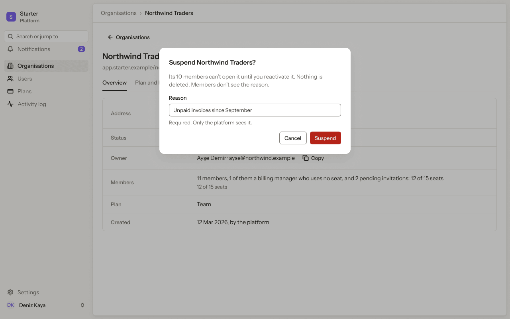

- **Who sees it:** System admins. Actions need the platform.tenants.* permission of each action.
- **Device:** Desktop (1280 px and wider).
- **This state shows:** as the title says.
- **Values come from:** Organisations, owners, plans, overrides, lifecycle and billing state: our API (platform.tenants.*).
- **Components:** Button ×6, Input, Pill ×2, Platform sidebar, Tab ×4, Top bar.
- **Actions:**
  - "Organisations": goes to [4.01 · Organisations · all](#401--organisations--all).
  - "Notifications": goes to [3.01 · Bell · unread](../03-notifications/README.md#301--bell--unread).
  - "Search or jump to": goes to [2.02 · Command menu](../02-shell/README.md#202--command-menu).
  - "Deniz Kaya": goes to [2.03 · Account menu](../02-shell/README.md#203--account-menu).
  - "Cancel": goes to [4.09 · Organisation · overview](#409--organisation--overview).
  - "Users": goes to [5.01 · Users · all](../05-users/README.md#501--users--all).
  - "Plans": goes to [6.01 · Plans](../06-plans/README.md#601--plans).
  - "Activity log": goes to [7.01 · Activity log](../07-activity-log/README.md#701--activity-log).
  - "Settings": goes to [8.01 · Profile · ideal](../08-settings-profile/README.md#801--profile--ideal).
  - "Usage": goes to [4.37 · Organisation · usage](#437--organisation--usage).
- **Texts, word for word, top to bottom:**

  - S
  - Starter
  - Platform
  - Search or jump to
  - Notifications
  - 2
  - Organisations
  - Users
  - Plans
  - Activity log
  - Settings
  - DK
  - Deniz Kaya
  - Organisations
  - ›
  - Northwind Traders
  - Organisations
  - Northwind Traders
  - Active
  - app.starter.example/northwind
  - Overview
  - Plan and billing
  - Activity log
  - Usage
  - Address
  - app.starter.example/northwind
  - Copy
  - It never changes.
  - Status
  - Active
  - Owner
  - Ayşe Demir · ayse@northwind.example
  - Copy
  - Members
  - 11 members, 1 of them a billing manager who uses no seat, and 2 pending invitations: 12 of 15 seats.
  - 12 of 15 seats
  - Plan
  - Team
  - Created
  - 12 Mar 2026, by the platform
  - Suspend Northwind Traders?
  - Its 10 members can’t open it until you reactivate it. Nothing is deleted. Members don’t see the reason.
  - Reason
  - Unpaid invoices since September
  - Required. Only the platform sees it.
  - Cancel
  - Suspend

Figma: [178:5307](https://www.figma.com/design/3Ev111okX8xCBwR9B3hyBM/?node-id=178-5307)

### 4.20 · Suspended

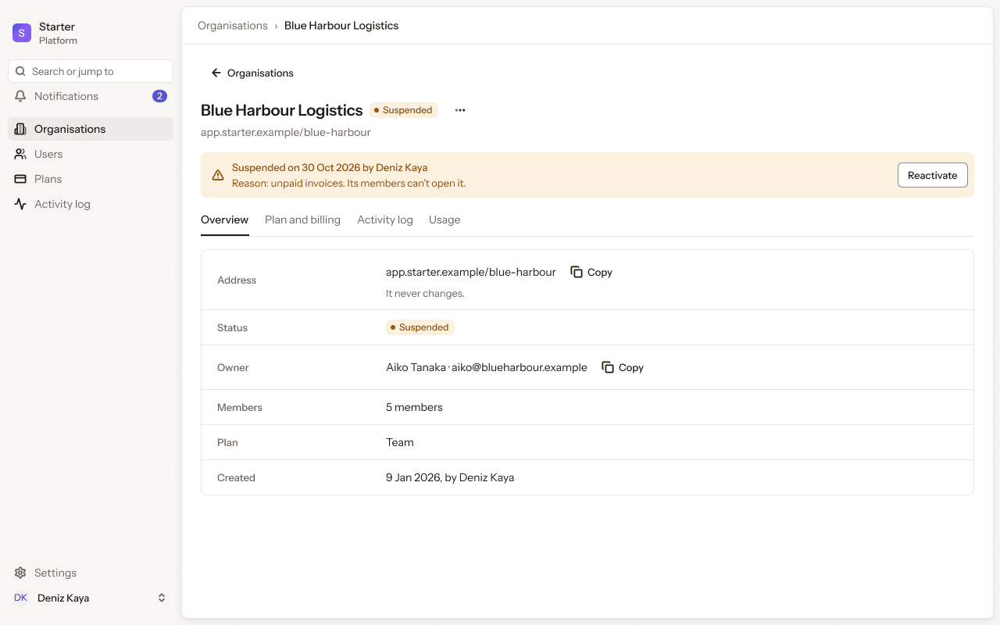

- **Who sees it:** System admins. Actions need the platform.tenants.* permission of each action.
- **Device:** Desktop (1280 px and wider).
- **This state shows:** when the organisation or person is suspended.
- **Values come from:** Organisations, owners, plans, overrides, lifecycle and billing state: our API (platform.tenants.*).
- **Components:** Banner, Button ×4, Pill ×2, Platform sidebar, Tab ×4, Top bar.
- **Actions:**
  - "Organisations": goes to [4.01 · Organisations · all](#401--organisations--all).
  - "Notifications": goes to [3.01 · Bell · unread](../03-notifications/README.md#301--bell--unread).
  - "Search or jump to": goes to [2.02 · Command menu](../02-shell/README.md#202--command-menu).
  - "Deniz Kaya": goes to [2.03 · Account menu](../02-shell/README.md#203--account-menu).
  - "Overview": goes to [4.09 · Organisation · overview](#409--organisation--overview).
  - "Area": goes to [4.14 · Organisation · plan](#414--organisation--plan).
  - "Activity log": goes to [4.18 · Organisation · activity log](#418--organisation--activity-log).
  - "Reactivate": goes to [4.21 · Reactivate](#421--reactivate).
  - "Users": goes to [5.01 · Users · all](../05-users/README.md#501--users--all).
  - "Plans": goes to [6.01 · Plans](../06-plans/README.md#601--plans).
  - "Activity log": goes to [7.01 · Activity log](../07-activity-log/README.md#701--activity-log).
  - "Settings": goes to [8.01 · Profile · ideal](../08-settings-profile/README.md#801--profile--ideal).
  - "Usage": goes to [4.37 · Organisation · usage](#437--organisation--usage).
- **Texts, word for word, top to bottom:**

  - S
  - Starter
  - Platform
  - Search or jump to
  - Notifications
  - 2
  - Organisations
  - Users
  - Plans
  - Activity log
  - Settings
  - DK
  - Deniz Kaya
  - Organisations
  - ›
  - Blue Harbour Logistics
  - Organisations
  - Blue Harbour Logistics
  - Suspended
  - app.starter.example/blue-harbour
  - Suspended on 30 Oct 2026 by Deniz Kaya
  - Reason: unpaid invoices. Its members can’t open it.
  - Reactivate
  - Overview
  - Plan and billing
  - Activity log
  - Usage
  - Address
  - app.starter.example/blue-harbour
  - Copy
  - It never changes.
  - Status
  - Suspended
  - Owner
  - Aiko Tanaka · aiko@blueharbour.example
  - Copy
  - Members
  - 5 members
  - Plan
  - Team
  - Created
  - 9 Jan 2026, by Deniz Kaya

Figma: [178:5489](https://www.figma.com/design/3Ev111okX8xCBwR9B3hyBM/?node-id=178-5489)

### 4.21 · Reactivate

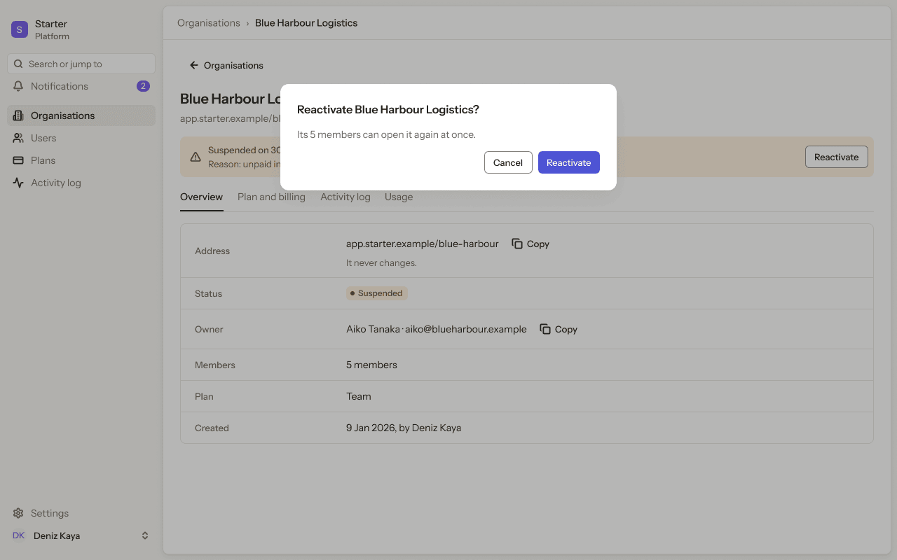

- **Who sees it:** System admins. Actions need the platform.tenants.* permission of each action.
- **Device:** Desktop (1280 px and wider).
- **This state shows:** as the title says.
- **Values come from:** Organisations, owners, plans, overrides, lifecycle and billing state: our API (platform.tenants.*).
- **Components:** Banner, Button ×6, Pill ×2, Platform sidebar, Tab ×4, Top bar.
- **Actions:**
  - "Organisations": goes to [4.01 · Organisations · all](#401--organisations--all).
  - "Notifications": goes to [3.01 · Bell · unread](../03-notifications/README.md#301--bell--unread).
  - "Search or jump to": goes to [2.02 · Command menu](../02-shell/README.md#202--command-menu).
  - "Deniz Kaya": goes to [2.03 · Account menu](../02-shell/README.md#203--account-menu).
  - "Cancel": goes to [4.20 · Suspended](#420--suspended).
  - "Users": goes to [5.01 · Users · all](../05-users/README.md#501--users--all).
  - "Plans": goes to [6.01 · Plans](../06-plans/README.md#601--plans).
  - "Activity log": goes to [7.01 · Activity log](../07-activity-log/README.md#701--activity-log).
  - "Settings": goes to [8.01 · Profile · ideal](../08-settings-profile/README.md#801--profile--ideal).
  - "Usage": goes to [4.37 · Organisation · usage](#437--organisation--usage).
- **Texts, word for word, top to bottom:**

  - S
  - Starter
  - Platform
  - Search or jump to
  - Notifications
  - 2
  - Organisations
  - Users
  - Plans
  - Activity log
  - Settings
  - DK
  - Deniz Kaya
  - Organisations
  - ›
  - Blue Harbour Logistics
  - Organisations
  - Blue Harbour Logistics
  - Suspended
  - app.starter.example/blue-harbour
  - Suspended on 30 Oct 2026 by Deniz Kaya
  - Reason: unpaid invoices. Its members can’t open it.
  - Reactivate
  - Overview
  - Plan and billing
  - Activity log
  - Usage
  - Address
  - app.starter.example/blue-harbour
  - Copy
  - It never changes.
  - Status
  - Suspended
  - Owner
  - Aiko Tanaka · aiko@blueharbour.example
  - Copy
  - Members
  - 5 members
  - Plan
  - Team
  - Created
  - 9 Jan 2026, by Deniz Kaya
  - Reactivate Blue Harbour Logistics?
  - Its 5 members can open it again at once.
  - Cancel
  - Reactivate

Figma: [178:5689](https://www.figma.com/design/3Ev111okX8xCBwR9B3hyBM/?node-id=178-5689)

### 4.22 · Close organisation

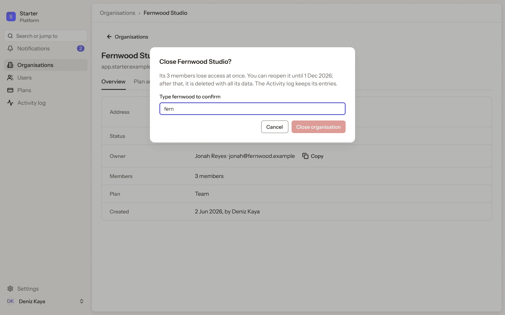

- **Who sees it:** System admins. Actions need the platform.tenants.* permission of each action.
- **Device:** Desktop (1280 px and wider).
- **This state shows:** as the title says.
- **Values come from:** Organisations, owners, plans, overrides, lifecycle and billing state: our API (platform.tenants.*).
- **Components:** Button ×6, Input, Pill ×2, Platform sidebar, Tab ×4, Top bar.
- **Actions:**
  - "Organisations": goes to [4.01 · Organisations · all](#401--organisations--all).
  - "Notifications": goes to [3.01 · Bell · unread](../03-notifications/README.md#301--bell--unread).
  - "Search or jump to": goes to [2.02 · Command menu](../02-shell/README.md#202--command-menu).
  - "Deniz Kaya": goes to [2.03 · Account menu](../02-shell/README.md#203--account-menu).
  - "Cancel": goes to [4.09 · Organisation · overview](#409--organisation--overview).
  - "Users": goes to [5.01 · Users · all](../05-users/README.md#501--users--all).
  - "Plans": goes to [6.01 · Plans](../06-plans/README.md#601--plans).
  - "Activity log": goes to [7.01 · Activity log](../07-activity-log/README.md#701--activity-log).
  - "Settings": goes to [8.01 · Profile · ideal](../08-settings-profile/README.md#801--profile--ideal).
  - "Usage": goes to [4.37 · Organisation · usage](#437--organisation--usage).
- **Texts, word for word, top to bottom:**

  - S
  - Starter
  - Platform
  - Search or jump to
  - Notifications
  - 2
  - Organisations
  - Users
  - Plans
  - Activity log
  - Settings
  - DK
  - Deniz Kaya
  - Organisations
  - ›
  - Fernwood Studio
  - Organisations
  - Fernwood Studio
  - Active
  - app.starter.example/fernwood
  - Overview
  - Plan and billing
  - Activity log
  - Usage
  - Address
  - app.starter.example/fernwood
  - Copy
  - It never changes.
  - Status
  - Active
  - Owner
  - Jonah Reyes · jonah@fernwood.example
  - Copy
  - Members
  - 3 members
  - Plan
  - Team
  - Created
  - 2 Jun 2026, by Deniz Kaya
  - Close Fernwood Studio?
  - Its 3 members lose access at once. You can reopen it until 1 Dec 2026; after that, it is deleted with all its data. The Activity log keeps its entries.
  - Type fernwood to confirm
  - fern
  - Cancel
  - Close organisation

Figma: [178:6032](https://www.figma.com/design/3Ev111okX8xCBwR9B3hyBM/?node-id=178-6032)

### 4.23 · Closed

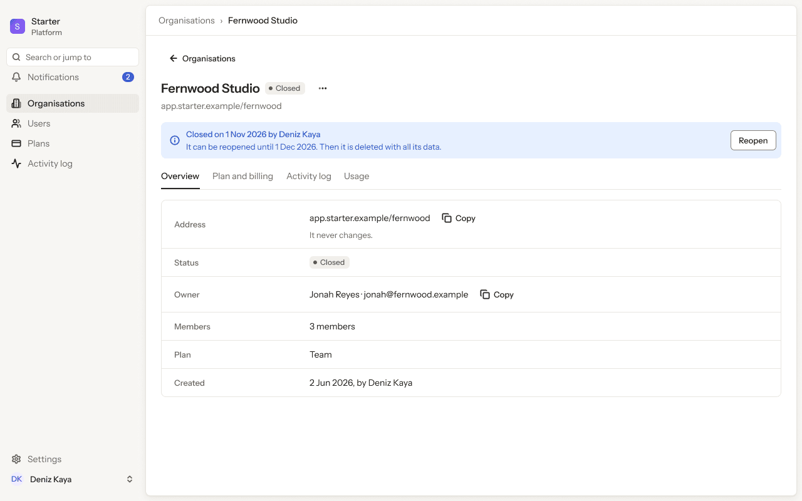

- **Who sees it:** System admins. Actions need the platform.tenants.* permission of each action.
- **Device:** Desktop (1280 px and wider).
- **This state shows:** as the title says.
- **Values come from:** Organisations, owners, plans, overrides, lifecycle and billing state: our API (platform.tenants.*).
- **Components:** Banner, Button ×4, Pill ×2, Platform sidebar, Tab ×4, Top bar.
- **Actions:**
  - "Organisations": goes to [4.01 · Organisations · all](#401--organisations--all).
  - "Notifications": goes to [3.01 · Bell · unread](../03-notifications/README.md#301--bell--unread).
  - "Search or jump to": goes to [2.02 · Command menu](../02-shell/README.md#202--command-menu).
  - "Deniz Kaya": goes to [2.03 · Account menu](../02-shell/README.md#203--account-menu).
  - "Overview": goes to [4.09 · Organisation · overview](#409--organisation--overview).
  - "Area": goes to [4.14 · Organisation · plan](#414--organisation--plan).
  - "Activity log": goes to [4.18 · Organisation · activity log](#418--organisation--activity-log).
  - "Reopen": goes to [4.24 · Reopen](#424--reopen).
  - "Users": goes to [5.01 · Users · all](../05-users/README.md#501--users--all).
  - "Plans": goes to [6.01 · Plans](../06-plans/README.md#601--plans).
  - "Activity log": goes to [7.01 · Activity log](../07-activity-log/README.md#701--activity-log).
  - "Settings": goes to [8.01 · Profile · ideal](../08-settings-profile/README.md#801--profile--ideal).
  - "Usage": goes to [4.37 · Organisation · usage](#437--organisation--usage).
- **Texts, word for word, top to bottom:**

  - S
  - Starter
  - Platform
  - Search or jump to
  - Notifications
  - 2
  - Organisations
  - Users
  - Plans
  - Activity log
  - Settings
  - DK
  - Deniz Kaya
  - Organisations
  - ›
  - Fernwood Studio
  - Organisations
  - Fernwood Studio
  - Closed
  - app.starter.example/fernwood
  - Closed on 1 Nov 2026 by Deniz Kaya
  - It can be reopened until 1 Dec 2026. Then it is deleted with all its data.
  - Reopen
  - Overview
  - Plan and billing
  - Activity log
  - Usage
  - Address
  - app.starter.example/fernwood
  - Copy
  - It never changes.
  - Status
  - Closed
  - Owner
  - Jonah Reyes · jonah@fernwood.example
  - Copy
  - Members
  - 3 members
  - Plan
  - Team
  - Created
  - 2 Jun 2026, by Deniz Kaya

Figma: [178:6213](https://www.figma.com/design/3Ev111okX8xCBwR9B3hyBM/?node-id=178-6213)

### 4.24 · Reopen

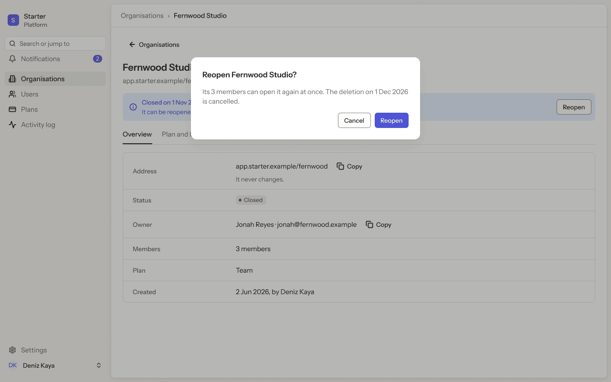

- **Who sees it:** System admins. Actions need the platform.tenants.* permission of each action.
- **Device:** Desktop (1280 px and wider).
- **This state shows:** as the title says.
- **Values come from:** Organisations, owners, plans, overrides, lifecycle and billing state: our API (platform.tenants.*).
- **Components:** Banner, Button ×6, Pill ×2, Platform sidebar, Tab ×4, Top bar.
- **Actions:**
  - "Organisations": goes to [4.01 · Organisations · all](#401--organisations--all).
  - "Notifications": goes to [3.01 · Bell · unread](../03-notifications/README.md#301--bell--unread).
  - "Search or jump to": goes to [2.02 · Command menu](../02-shell/README.md#202--command-menu).
  - "Deniz Kaya": goes to [2.03 · Account menu](../02-shell/README.md#203--account-menu).
  - "Cancel": goes to [4.23 · Closed](#423--closed).
  - "Users": goes to [5.01 · Users · all](../05-users/README.md#501--users--all).
  - "Plans": goes to [6.01 · Plans](../06-plans/README.md#601--plans).
  - "Activity log": goes to [7.01 · Activity log](../07-activity-log/README.md#701--activity-log).
  - "Settings": goes to [8.01 · Profile · ideal](../08-settings-profile/README.md#801--profile--ideal).
  - "Usage": goes to [4.37 · Organisation · usage](#437--organisation--usage).
- **Texts, word for word, top to bottom:**

  - S
  - Starter
  - Platform
  - Search or jump to
  - Notifications
  - 2
  - Organisations
  - Users
  - Plans
  - Activity log
  - Settings
  - DK
  - Deniz Kaya
  - Organisations
  - ›
  - Fernwood Studio
  - Organisations
  - Fernwood Studio
  - Closed
  - app.starter.example/fernwood
  - Closed on 1 Nov 2026 by Deniz Kaya
  - It can be reopened until 1 Dec 2026. Then it is deleted with all its data.
  - Reopen
  - Overview
  - Plan and billing
  - Activity log
  - Usage
  - Address
  - app.starter.example/fernwood
  - Copy
  - It never changes.
  - Status
  - Closed
  - Owner
  - Jonah Reyes · jonah@fernwood.example
  - Copy
  - Members
  - 3 members
  - Plan
  - Team
  - Created
  - 2 Jun 2026, by Deniz Kaya
  - Reopen Fernwood Studio?
  - Its 3 members can open it again at once. The deletion on 1 Dec 2026 is cancelled.
  - Cancel
  - Reopen

Figma: [178:6413](https://www.figma.com/design/3Ev111okX8xCBwR9B3hyBM/?node-id=178-6413)

### 4.25 · Being deleted

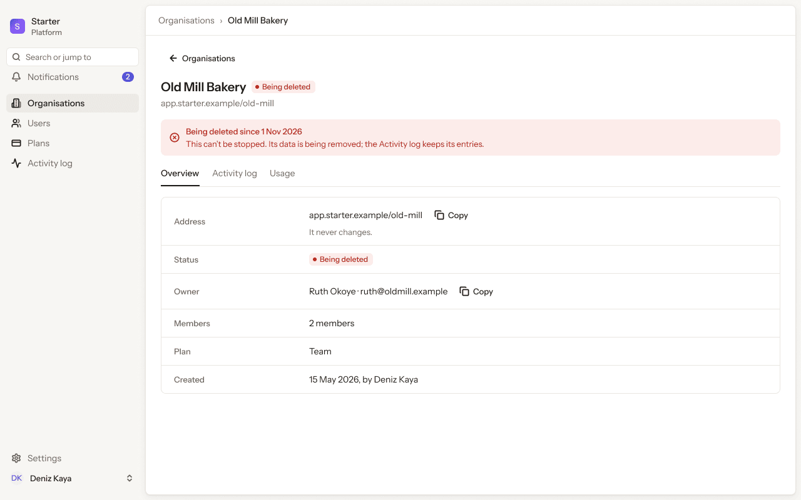

- **Who sees it:** System admins. Actions need the platform.tenants.* permission of each action.
- **Device:** Desktop (1280 px and wider).
- **This state shows:** as the title says.
- **Values come from:** Organisations, owners, plans, overrides, lifecycle and billing state: our API (platform.tenants.*).
- **Components:** Banner, Button ×3, Pill ×2, Platform sidebar, Tab ×3, Top bar.
- **Actions:**
  - "Organisations": goes to [4.01 · Organisations · all](#401--organisations--all).
  - "Notifications": goes to [3.01 · Bell · unread](../03-notifications/README.md#301--bell--unread).
  - "Search or jump to": goes to [2.02 · Command menu](../02-shell/README.md#202--command-menu).
  - "Deniz Kaya": goes to [2.03 · Account menu](../02-shell/README.md#203--account-menu).
  - "Overview": goes to [4.09 · Organisation · overview](#409--organisation--overview).
  - "Activity log": goes to [4.14 · Organisation · plan](#414--organisation--plan).
  - "Activity log": goes to [4.18 · Organisation · activity log](#418--organisation--activity-log).
  - "Users": goes to [5.01 · Users · all](../05-users/README.md#501--users--all).
  - "Plans": goes to [6.01 · Plans](../06-plans/README.md#601--plans).
  - "Activity log": goes to [7.01 · Activity log](../07-activity-log/README.md#701--activity-log).
  - "Settings": goes to [8.01 · Profile · ideal](../08-settings-profile/README.md#801--profile--ideal).
  - "Usage": goes to [4.37 · Organisation · usage](#437--organisation--usage).
- **Texts, word for word, top to bottom:**

  - S
  - Starter
  - Platform
  - Search or jump to
  - Notifications
  - 2
  - Organisations
  - Users
  - Plans
  - Activity log
  - Settings
  - DK
  - Deniz Kaya
  - Organisations
  - ›
  - Old Mill Bakery
  - Organisations
  - Old Mill Bakery
  - Being deleted
  - app.starter.example/old-mill
  - Being deleted since 1 Nov 2026
  - This can’t be stopped. Its data is being removed; the Activity log keeps its entries.
  - Overview
  - Activity log
  - Usage
  - Address
  - app.starter.example/old-mill
  - Copy
  - It never changes.
  - Status
  - Being deleted
  - Owner
  - Ruth Okoye · ruth@oldmill.example
  - Copy
  - Members
  - 2 members
  - Plan
  - Team
  - Created
  - 15 May 2026, by Deniz Kaya

Figma: [178:6600](https://www.figma.com/design/3Ev111okX8xCBwR9B3hyBM/?node-id=178-6600)

### 4.26 · Deleted

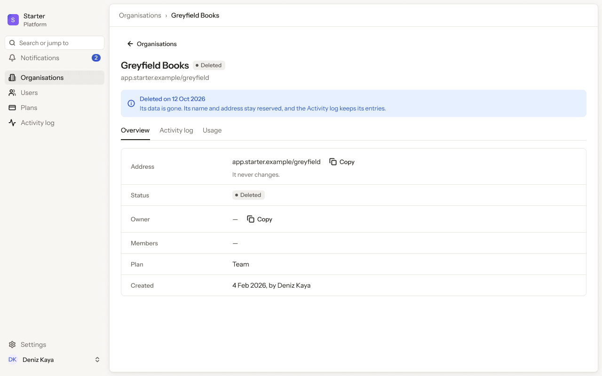

- **Who sees it:** System admins. Actions need the platform.tenants.* permission of each action.
- **Device:** Desktop (1280 px and wider).
- **This state shows:** as the title says.
- **Values come from:** Organisations, owners, plans, overrides, lifecycle and billing state: our API (platform.tenants.*).
- **Components:** Banner, Button ×3, Pill ×2, Platform sidebar, Tab ×3, Top bar.
- **Actions:**
  - "Organisations": goes to [4.01 · Organisations · all](#401--organisations--all).
  - "Notifications": goes to [3.01 · Bell · unread](../03-notifications/README.md#301--bell--unread).
  - "Search or jump to": goes to [2.02 · Command menu](../02-shell/README.md#202--command-menu).
  - "Deniz Kaya": goes to [2.03 · Account menu](../02-shell/README.md#203--account-menu).
  - "Overview": goes to [4.09 · Organisation · overview](#409--organisation--overview).
  - "Activity log": goes to [4.14 · Organisation · plan](#414--organisation--plan).
  - "Activity log": goes to [4.18 · Organisation · activity log](#418--organisation--activity-log).
  - "Users": goes to [5.01 · Users · all](../05-users/README.md#501--users--all).
  - "Plans": goes to [6.01 · Plans](../06-plans/README.md#601--plans).
  - "Activity log": goes to [7.01 · Activity log](../07-activity-log/README.md#701--activity-log).
  - "Settings": goes to [8.01 · Profile · ideal](../08-settings-profile/README.md#801--profile--ideal).
  - "Usage": goes to [4.37 · Organisation · usage](#437--organisation--usage).
- **Texts, word for word, top to bottom:**

  - S
  - Starter
  - Platform
  - Search or jump to
  - Notifications
  - 2
  - Organisations
  - Users
  - Plans
  - Activity log
  - Settings
  - DK
  - Deniz Kaya
  - Organisations
  - ›
  - Greyfield Books
  - Organisations
  - Greyfield Books
  - Deleted
  - app.starter.example/greyfield
  - Deleted on 12 Oct 2026
  - Its data is gone. Its name and address stay reserved, and the Activity log keeps its entries.
  - Overview
  - Activity log
  - Usage
  - Address
  - app.starter.example/greyfield
  - Copy
  - It never changes.
  - Status
  - Deleted
  - Owner
  - —
  - Copy
  - Members
  - —
  - Plan
  - Team
  - Created
  - 4 Feb 2026, by Deniz Kaya

Figma: [178:6800](https://www.figma.com/design/3Ev111okX8xCBwR9B3hyBM/?node-id=178-6800)

### 4.27 · Plan and billing · card

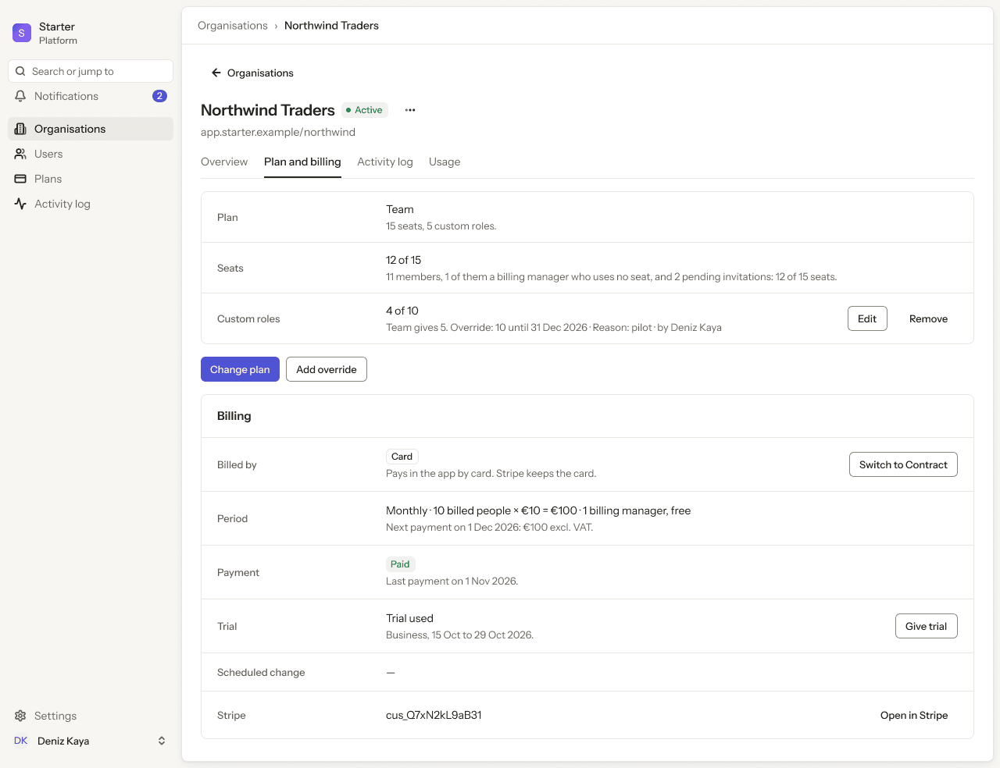

- **Who sees it:** System admins. Actions need the platform.tenants.* permission of each action.
- **Device:** Desktop (1280 px and wider).
- **This state shows:** as the title says.
- **Values come from:** Organisations, owners, plans, overrides, lifecycle and billing state: our API (platform.tenants.*).
- **Components:** Button ×9, Label, Pill ×2, Platform sidebar, Tab ×4, Top bar.
- **Actions:**
  - "Organisations": goes to [4.01 · Organisations · all](#401--organisations--all).
  - "Notifications": goes to [3.01 · Bell · unread](../03-notifications/README.md#301--bell--unread).
  - "Search or jump to": goes to [2.02 · Command menu](../02-shell/README.md#202--command-menu).
  - "Area": goes to [2.03 · Account menu](../02-shell/README.md#203--account-menu).
  - "Overview": goes to [4.09 · Organisation · overview](#409--organisation--overview).
  - "Activity log": goes to [4.18 · Organisation · activity log](#418--organisation--activity-log).
  - "Area": goes to [4.10 · Organisation · ⋯ menu](#410--organisation---menu).
  - "Change plan": goes to [4.15 · Change plan](#415--change-plan).
  - "Add override": goes to [4.16 · Add override](#416--add-override).
  - "Remove": goes to [4.17 · Remove override](#417--remove-override).
  - "Users": goes to [5.01 · Users · all](../05-users/README.md#501--users--all).
  - "Plans": goes to [6.01 · Plans](../06-plans/README.md#601--plans).
  - "Activity log": goes to [7.01 · Activity log](../07-activity-log/README.md#701--activity-log).
  - "Area": goes to [8.01 · Profile · ideal](../08-settings-profile/README.md#801--profile--ideal).
  - "Usage": goes to [4.37 · Organisation · usage](#437--organisation--usage).
  - "Give trial": goes to [4.29 · Give trial](#429--give-trial).
  - "Switch to Contract": goes to [4.35 · Switch to Contract](#435--switch-to-contract).
- **Texts, word for word, top to bottom:**

  - S
  - Starter
  - Platform
  - Search or jump to
  - Notifications
  - 2
  - Organisations
  - Users
  - Plans
  - Activity log
  - Settings
  - DK
  - Deniz Kaya
  - Organisations
  - ›
  - Northwind Traders
  - Organisations
  - Northwind Traders
  - Active
  - app.starter.example/northwind
  - Overview
  - Plan and billing
  - Activity log
  - Usage
  - Plan
  - Team
  - 15 seats, 5 custom roles.
  - Seats
  - 12 of 15
  - 11 members, 1 of them a billing manager who uses no seat, and 2 pending invitations: 12 of 15 seats.
  - Custom roles
  - 4 of 10
  - Team gives 5. Override: 10 until 31 Dec 2026 · Reason: pilot · by Deniz Kaya
  - Edit
  - Remove
  - Change plan
  - Add override
  - Billing
  - Billed by
  - Card
  - Pays in the app by card. Stripe keeps the card.
  - Switch to Contract
  - Period
  - Monthly · 10 billed people × €10 = €100 · 1 billing manager, free
  - Next payment on 1 Dec 2026: €100 excl. VAT.
  - Payment
  - Paid
  - Last payment on 1 Nov 2026.
  - Trial
  - Trial used
  - Business, 15 Oct to 29 Oct 2026.
  - Give trial
  - Scheduled change
  - —
  - Stripe
  - cus\_Q7xN2kL9aB31
  - Open in Stripe

Figma: [248:13857](https://www.figma.com/design/3Ev111okX8xCBwR9B3hyBM/?node-id=248-13857)

### 4.28 · Plan and billing · in trial

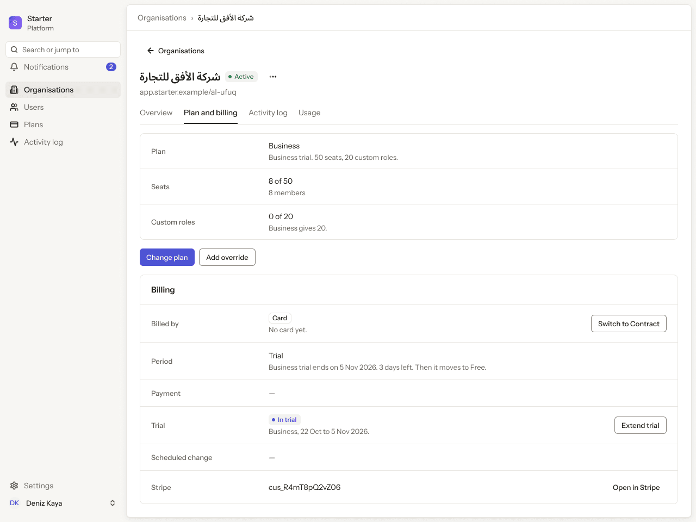

- **Who sees it:** System admins. Actions need the platform.tenants.* permission of each action.
- **Device:** Desktop (1280 px and wider).
- **This state shows:** as the title says.
- **Values come from:** Organisations, owners, plans, overrides, lifecycle and billing state: our API (platform.tenants.*).
- **Components:** Button ×7, Label, Pill ×2, Platform sidebar, Tab ×4, Top bar.
- **Actions:**
  - "Organisations": goes to [4.01 · Organisations · all](#401--organisations--all).
  - "Notifications": goes to [3.01 · Bell · unread](../03-notifications/README.md#301--bell--unread).
  - "Search or jump to": goes to [2.02 · Command menu](../02-shell/README.md#202--command-menu).
  - "Area": goes to [2.03 · Account menu](../02-shell/README.md#203--account-menu).
  - "Overview": goes to [4.09 · Organisation · overview](#409--organisation--overview).
  - "Activity log": goes to [4.18 · Organisation · activity log](#418--organisation--activity-log).
  - "Area": goes to [4.10 · Organisation · ⋯ menu](#410--organisation---menu).
  - "Change plan": goes to [4.15 · Change plan](#415--change-plan).
  - "Add override": goes to [4.16 · Add override](#416--add-override).
  - "Area": goes to [4.17 · Remove override](#417--remove-override).
  - "Users": goes to [5.01 · Users · all](../05-users/README.md#501--users--all).
  - "Plans": goes to [6.01 · Plans](../06-plans/README.md#601--plans).
  - "Activity log": goes to [7.01 · Activity log](../07-activity-log/README.md#701--activity-log).
  - "Area": goes to [8.01 · Profile · ideal](../08-settings-profile/README.md#801--profile--ideal).
  - "Usage": goes to [4.37 · Organisation · usage](#437--organisation--usage).
  - "Extend trial": goes to [4.30 · Extend trial](#430--extend-trial).
- **Texts, word for word, top to bottom:**

  - S
  - Starter
  - Platform
  - Search or jump to
  - Notifications
  - 2
  - Organisations
  - Users
  - Plans
  - Activity log
  - Settings
  - DK
  - Deniz Kaya
  - Organisations
  - ›
  - شركة الأفق للتجارة
  - Organisations
  - شركة الأفق للتجارة
  - Active
  - app.starter.example/al-ufuq
  - Overview
  - Plan and billing
  - Activity log
  - Usage
  - Plan
  - Business
  - Business trial. 50 seats, 20 custom roles.
  - Seats
  - 8 of 50
  - 8 members
  - Custom roles
  - 0 of 20
  - Business gives 20.
  - Change plan
  - Add override
  - Billing
  - Billed by
  - Card
  - No card yet.
  - Switch to Contract
  - Period
  - Trial
  - Business trial ends on 5 Nov 2026. 3 days left. Then it moves to Free.
  - Payment
  - —
  - Trial
  - In trial
  - Business, 22 Oct to 5 Nov 2026.
  - Extend trial
  - Scheduled change
  - —
  - Stripe
  - cus\_R4mT8pQ2vZ06
  - Open in Stripe

Figma: [248:14044](https://www.figma.com/design/3Ev111okX8xCBwR9B3hyBM/?node-id=248-14044)

### 4.29 · Give trial

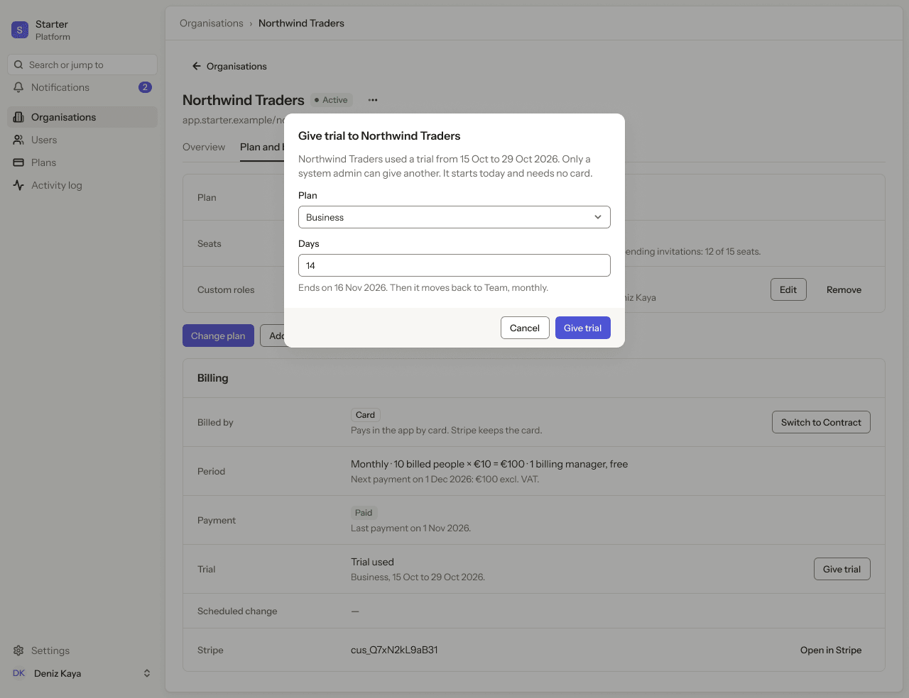

- **Who sees it:** System admins. Actions need the platform.tenants.* permission of each action.
- **Device:** Desktop (1280 px and wider).
- **This state shows:** as the title says.
- **Values come from:** Organisations, owners, plans, overrides, lifecycle and billing state: our API (platform.tenants.*).
- **Components:** Button ×11, Input, Label, Pill ×2, Platform sidebar, Select, Tab ×4, Top bar.
- **Actions:**
  - "Organisations": goes to [4.01 · Organisations · all](#401--organisations--all).
  - "Notifications": goes to [3.01 · Bell · unread](../03-notifications/README.md#301--bell--unread).
  - "Search or jump to": goes to [2.02 · Command menu](../02-shell/README.md#202--command-menu).
  - "Area": goes to [2.03 · Account menu](../02-shell/README.md#203--account-menu).
  - "Overview": goes to [4.09 · Organisation · overview](#409--organisation--overview).
  - "Activity log": goes to [4.18 · Organisation · activity log](#418--organisation--activity-log).
  - "Area": goes to [4.10 · Organisation · ⋯ menu](#410--organisation---menu).
  - "Change plan": goes to [4.15 · Change plan](#415--change-plan).
  - "Add override": goes to [4.16 · Add override](#416--add-override).
  - "Remove": goes to [4.17 · Remove override](#417--remove-override).
  - "Users": goes to [5.01 · Users · all](../05-users/README.md#501--users--all).
  - "Plans": goes to [6.01 · Plans](../06-plans/README.md#601--plans).
  - "Activity log": goes to [7.01 · Activity log](../07-activity-log/README.md#701--activity-log).
  - "Area": goes to [8.01 · Profile · ideal](../08-settings-profile/README.md#801--profile--ideal).
  - "Usage": goes to [4.37 · Organisation · usage](#437--organisation--usage).
  - "Cancel": goes to [4.27 · Plan and billing · card](#427--plan-and-billing--card).
  - "Give trial": goes to [4.28 · Plan and billing · in trial](#428--plan-and-billing--in-trial).
- **Texts, word for word, top to bottom:**

  - S
  - Starter
  - Platform
  - Search or jump to
  - Notifications
  - 2
  - Organisations
  - Users
  - Plans
  - Activity log
  - Settings
  - DK
  - Deniz Kaya
  - Organisations
  - ›
  - Northwind Traders
  - Organisations
  - Northwind Traders
  - Active
  - app.starter.example/northwind
  - Overview
  - Plan and billing
  - Activity log
  - Usage
  - Plan
  - Team
  - 15 seats, 5 custom roles.
  - Seats
  - 12 of 15
  - 11 members, 1 of them a billing manager who uses no seat, and 2 pending invitations: 12 of 15 seats.
  - Custom roles
  - 4 of 10
  - Team gives 5. Override: 10 until 31 Dec 2026 · Reason: pilot · by Deniz Kaya
  - Edit
  - Remove
  - Change plan
  - Add override
  - Billing
  - Billed by
  - Card
  - Pays in the app by card. Stripe keeps the card.
  - Switch to Contract
  - Period
  - Monthly · 10 billed people × €10 = €100 · 1 billing manager, free
  - Next payment on 1 Dec 2026: €100 excl. VAT.
  - Payment
  - Paid
  - Last payment on 1 Nov 2026.
  - Trial
  - Trial used
  - Business, 15 Oct to 29 Oct 2026.
  - Give trial
  - Scheduled change
  - —
  - Stripe
  - cus\_Q7xN2kL9aB31
  - Open in Stripe
  - Give trial to Northwind Traders
  - Northwind Traders used a trial from 15 Oct to 29 Oct 2026. Only a system admin can give another. It starts today and needs no card.
  - Plan
  - Business
  - Days
  - 14
  - Ends on 16 Nov 2026. Then it moves back to Team, monthly.
  - Cancel
  - Give trial

Figma: [249:13778](https://www.figma.com/design/3Ev111okX8xCBwR9B3hyBM/?node-id=249-13778)

### 4.30 · Extend trial

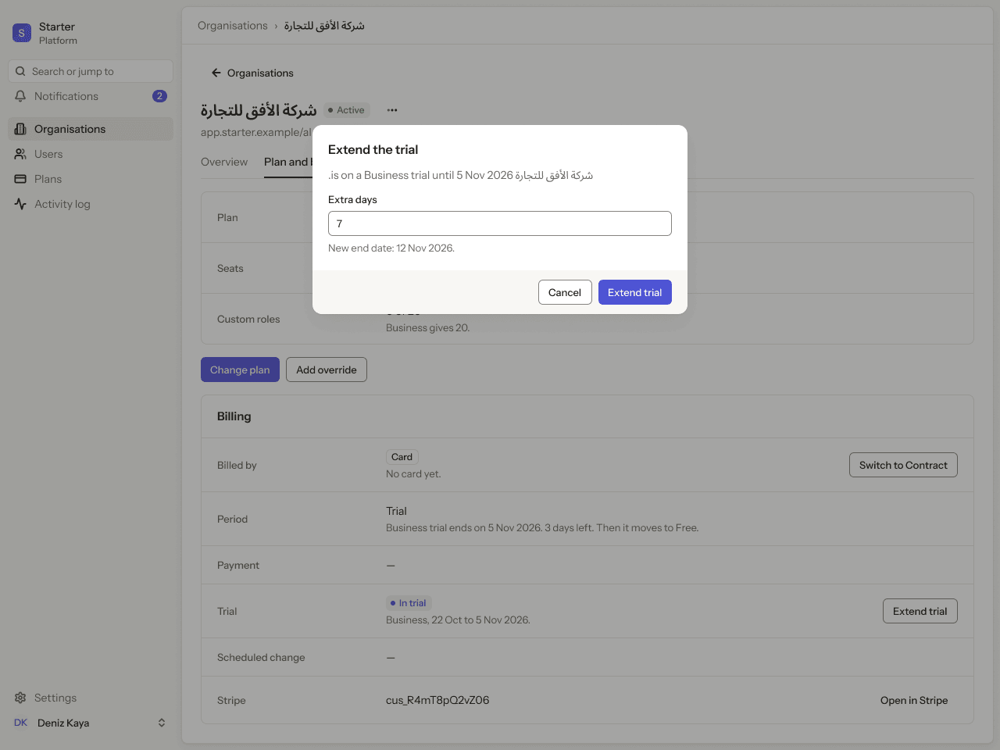

- **Who sees it:** System admins. Actions need the platform.tenants.* permission of each action.
- **Device:** Desktop (1280 px and wider).
- **This state shows:** as the title says.
- **Values come from:** Organisations, owners, plans, overrides, lifecycle and billing state: our API (platform.tenants.*).
- **Components:** Button ×9, Input, Label, Pill ×2, Platform sidebar, Tab ×4, Top bar.
- **Actions:**
  - "Organisations": goes to [4.01 · Organisations · all](#401--organisations--all).
  - "Notifications": goes to [3.01 · Bell · unread](../03-notifications/README.md#301--bell--unread).
  - "Search or jump to": goes to [2.02 · Command menu](../02-shell/README.md#202--command-menu).
  - "Area": goes to [2.03 · Account menu](../02-shell/README.md#203--account-menu).
  - "Overview": goes to [4.09 · Organisation · overview](#409--organisation--overview).
  - "Activity log": goes to [4.18 · Organisation · activity log](#418--organisation--activity-log).
  - "Area": goes to [4.10 · Organisation · ⋯ menu](#410--organisation---menu).
  - "Change plan": goes to [4.15 · Change plan](#415--change-plan).
  - "Add override": goes to [4.16 · Add override](#416--add-override).
  - "Area": goes to [4.17 · Remove override](#417--remove-override).
  - "Users": goes to [5.01 · Users · all](../05-users/README.md#501--users--all).
  - "Plans": goes to [6.01 · Plans](../06-plans/README.md#601--plans).
  - "Activity log": goes to [7.01 · Activity log](../07-activity-log/README.md#701--activity-log).
  - "Area": goes to [8.01 · Profile · ideal](../08-settings-profile/README.md#801--profile--ideal).
  - "Usage": goes to [4.37 · Organisation · usage](#437--organisation--usage).
  - "Cancel": goes to [4.28 · Plan and billing · in trial](#428--plan-and-billing--in-trial).
  - "Extend trial": goes to [4.28 · Plan and billing · in trial](#428--plan-and-billing--in-trial).
- **Texts, word for word, top to bottom:**

  - S
  - Starter
  - Platform
  - Search or jump to
  - Notifications
  - 2
  - Organisations
  - Users
  - Plans
  - Activity log
  - Settings
  - DK
  - Deniz Kaya
  - Organisations
  - ›
  - شركة الأفق للتجارة
  - Organisations
  - شركة الأفق للتجارة
  - Active
  - app.starter.example/al-ufuq
  - Overview
  - Plan and billing
  - Activity log
  - Usage
  - Plan
  - Business
  - Business trial. 50 seats, 20 custom roles.
  - Seats
  - 8 of 50
  - 8 members
  - Custom roles
  - 0 of 20
  - Business gives 20.
  - Change plan
  - Add override
  - Billing
  - Billed by
  - Card
  - No card yet.
  - Switch to Contract
  - Period
  - Trial
  - Business trial ends on 5 Nov 2026. 3 days left. Then it moves to Free.
  - Payment
  - —
  - Trial
  - In trial
  - Business, 22 Oct to 5 Nov 2026.
  - Extend trial
  - Scheduled change
  - —
  - Stripe
  - cus\_R4mT8pQ2vZ06
  - Open in Stripe
  - Extend the trial
  - شركة الأفق للتجارة is on a Business trial until 5 Nov 2026.
  - Extra days
  - 7
  - New end date: 12 Nov 2026.
  - Cancel
  - Extend trial

Figma: [249:13905](https://www.figma.com/design/3Ev111okX8xCBwR9B3hyBM/?node-id=249-13905)

### 4.31 · Plan and billing · payment retrying

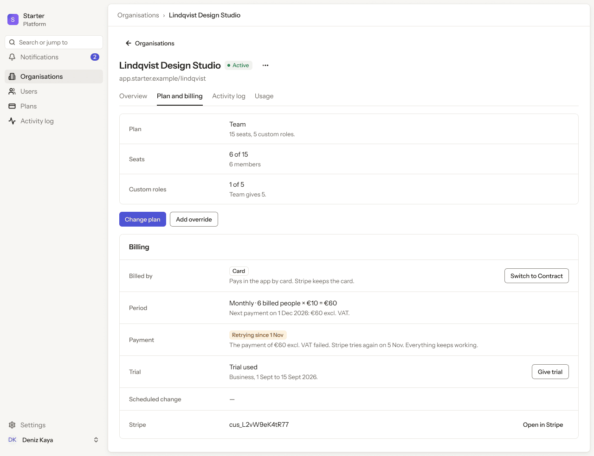

- **Who sees it:** System admins. Actions need the platform.tenants.* permission of each action.
- **Device:** Desktop (1280 px and wider).
- **This state shows:** as the title says.
- **Values come from:** Organisations, owners, plans, overrides, lifecycle and billing state: our API (platform.tenants.*).
- **Components:** Button ×7, Label, Pill ×2, Platform sidebar, Tab ×4, Top bar.
- **Actions:**
  - "Organisations": goes to [4.01 · Organisations · all](#401--organisations--all).
  - "Notifications": goes to [3.01 · Bell · unread](../03-notifications/README.md#301--bell--unread).
  - "Search or jump to": goes to [2.02 · Command menu](../02-shell/README.md#202--command-menu).
  - "Area": goes to [2.03 · Account menu](../02-shell/README.md#203--account-menu).
  - "Overview": goes to [4.09 · Organisation · overview](#409--organisation--overview).
  - "Activity log": goes to [4.18 · Organisation · activity log](#418--organisation--activity-log).
  - "Active": goes to [4.10 · Organisation · ⋯ menu](#410--organisation---menu).
  - "Change plan": goes to [4.15 · Change plan](#415--change-plan).
  - "Add override": goes to [4.16 · Add override](#416--add-override).
  - "Area": goes to [4.17 · Remove override](#417--remove-override).
  - "Users": goes to [5.01 · Users · all](../05-users/README.md#501--users--all).
  - "Plans": goes to [6.01 · Plans](../06-plans/README.md#601--plans).
  - "Activity log": goes to [7.01 · Activity log](../07-activity-log/README.md#701--activity-log).
  - "Area": goes to [8.01 · Profile · ideal](../08-settings-profile/README.md#801--profile--ideal).
  - "Usage": goes to [4.37 · Organisation · usage](#437--organisation--usage).
- **Texts, word for word, top to bottom:**

  - S
  - Starter
  - Platform
  - Search or jump to
  - Notifications
  - 2
  - Organisations
  - Users
  - Plans
  - Activity log
  - Settings
  - DK
  - Deniz Kaya
  - Organisations
  - ›
  - Lindqvist Design Studio
  - Organisations
  - Lindqvist Design Studio
  - Active
  - app.starter.example/lindqvist
  - Overview
  - Plan and billing
  - Activity log
  - Usage
  - Plan
  - Team
  - 15 seats, 5 custom roles.
  - Seats
  - 6 of 15
  - 6 members
  - Custom roles
  - 1 of 5
  - Team gives 5.
  - Change plan
  - Add override
  - Billing
  - Billed by
  - Card
  - Pays in the app by card. Stripe keeps the card.
  - Switch to Contract
  - Period
  - Monthly · 6 billed people × €10 = €60
  - Next payment on 1 Dec 2026: €60 excl. VAT.
  - Payment
  - Retrying since 1 Nov
  - The payment of €60 excl. VAT failed. Stripe tries again on 5 Nov. Everything keeps working.
  - Trial
  - Trial used
  - Business, 1 Sept to 15 Sept 2026.
  - Give trial
  - Scheduled change
  - —
  - Stripe
  - cus\_L2vW9eK4tR77
  - Open in Stripe

Figma: [249:14022](https://www.figma.com/design/3Ev111okX8xCBwR9B3hyBM/?node-id=249-14022)

### 4.32 · Plan and billing · grace

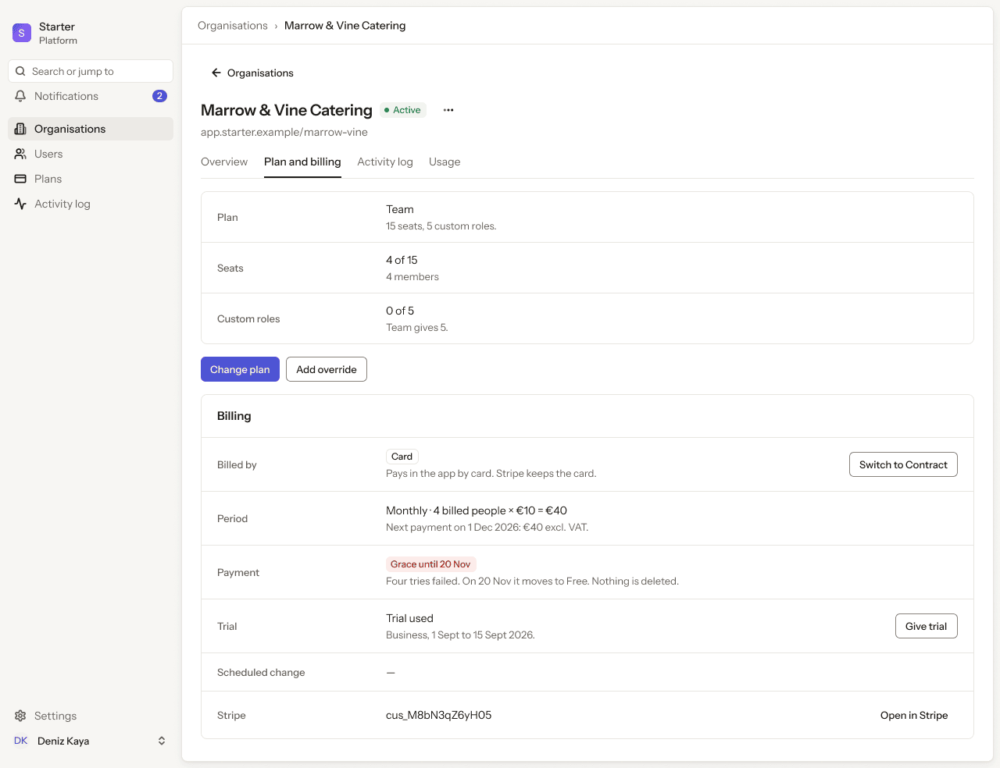

- **Who sees it:** System admins. Actions need the platform.tenants.* permission of each action.
- **Device:** Desktop (1280 px and wider).
- **This state shows:** as the title says.
- **Values come from:** Organisations, owners, plans, overrides, lifecycle and billing state: our API (platform.tenants.*).
- **Components:** Button ×7, Label, Pill ×2, Platform sidebar, Tab ×4, Top bar.
- **Actions:**
  - "Organisations": goes to [4.01 · Organisations · all](#401--organisations--all).
  - "Notifications": goes to [3.01 · Bell · unread](../03-notifications/README.md#301--bell--unread).
  - "Search or jump to": goes to [2.02 · Command menu](../02-shell/README.md#202--command-menu).
  - "Area": goes to [2.03 · Account menu](../02-shell/README.md#203--account-menu).
  - "Overview": goes to [4.09 · Organisation · overview](#409--organisation--overview).
  - "Activity log": goes to [4.18 · Organisation · activity log](#418--organisation--activity-log).
  - "Active": goes to [4.10 · Organisation · ⋯ menu](#410--organisation---menu).
  - "Change plan": goes to [4.15 · Change plan](#415--change-plan).
  - "Add override": goes to [4.16 · Add override](#416--add-override).
  - "Area": goes to [4.17 · Remove override](#417--remove-override).
  - "Users": goes to [5.01 · Users · all](../05-users/README.md#501--users--all).
  - "Plans": goes to [6.01 · Plans](../06-plans/README.md#601--plans).
  - "Activity log": goes to [7.01 · Activity log](../07-activity-log/README.md#701--activity-log).
  - "Area": goes to [8.01 · Profile · ideal](../08-settings-profile/README.md#801--profile--ideal).
  - "Usage": goes to [4.37 · Organisation · usage](#437--organisation--usage).
- **Texts, word for word, top to bottom:**

  - S
  - Starter
  - Platform
  - Search or jump to
  - Notifications
  - 2
  - Organisations
  - Users
  - Plans
  - Activity log
  - Settings
  - DK
  - Deniz Kaya
  - Organisations
  - ›
  - Marrow & Vine Catering
  - Organisations
  - Marrow & Vine Catering
  - Active
  - app.starter.example/marrow-vine
  - Overview
  - Plan and billing
  - Activity log
  - Usage
  - Plan
  - Team
  - 15 seats, 5 custom roles.
  - Seats
  - 4 of 15
  - 4 members
  - Custom roles
  - 0 of 5
  - Team gives 5.
  - Change plan
  - Add override
  - Billing
  - Billed by
  - Card
  - Pays in the app by card. Stripe keeps the card.
  - Switch to Contract
  - Period
  - Monthly · 4 billed people × €10 = €40
  - Next payment on 1 Dec 2026: €40 excl. VAT.
  - Payment
  - Grace until 20 Nov
  - Four tries failed. On 20 Nov it moves to Free. Nothing is deleted.
  - Trial
  - Trial used
  - Business, 1 Sept to 15 Sept 2026.
  - Give trial
  - Scheduled change
  - —
  - Stripe
  - cus\_M8bN3qZ6yH05
  - Open in Stripe

Figma: [249:14222](https://www.figma.com/design/3Ev111okX8xCBwR9B3hyBM/?node-id=249-14222)

### 4.33 · Plan and billing · moved to Free

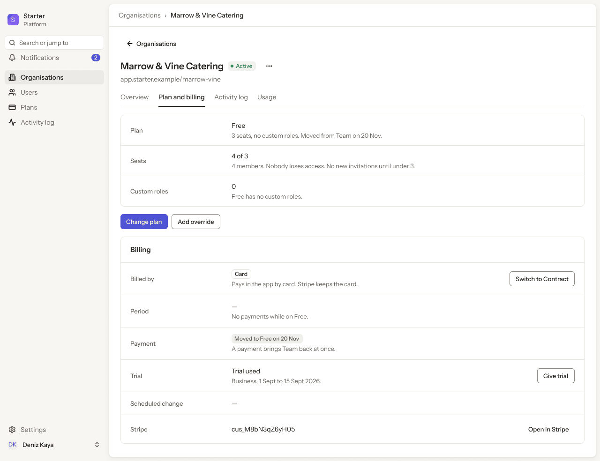

- **Who sees it:** System admins. Actions need the platform.tenants.* permission of each action.
- **Device:** Desktop (1280 px and wider).
- **This state shows:** as the title says.
- **Values come from:** Organisations, owners, plans, overrides, lifecycle and billing state: our API (platform.tenants.*).
- **Components:** Button ×7, Label, Pill ×2, Platform sidebar, Tab ×4, Top bar.
- **Actions:**
  - "Organisations": goes to [4.01 · Organisations · all](#401--organisations--all).
  - "Notifications": goes to [3.01 · Bell · unread](../03-notifications/README.md#301--bell--unread).
  - "Search or jump to": goes to [2.02 · Command menu](../02-shell/README.md#202--command-menu).
  - "Area": goes to [2.03 · Account menu](../02-shell/README.md#203--account-menu).
  - "Overview": goes to [4.09 · Organisation · overview](#409--organisation--overview).
  - "Activity log": goes to [4.18 · Organisation · activity log](#418--organisation--activity-log).
  - "Active": goes to [4.10 · Organisation · ⋯ menu](#410--organisation---menu).
  - "Change plan": goes to [4.15 · Change plan](#415--change-plan).
  - "Add override": goes to [4.16 · Add override](#416--add-override).
  - "Area": goes to [4.17 · Remove override](#417--remove-override).
  - "Users": goes to [5.01 · Users · all](../05-users/README.md#501--users--all).
  - "Plans": goes to [6.01 · Plans](../06-plans/README.md#601--plans).
  - "Activity log": goes to [7.01 · Activity log](../07-activity-log/README.md#701--activity-log).
  - "Area": goes to [8.01 · Profile · ideal](../08-settings-profile/README.md#801--profile--ideal).
  - "Usage": goes to [4.37 · Organisation · usage](#437--organisation--usage).
- **Texts, word for word, top to bottom:**

  - S
  - Starter
  - Platform
  - Search or jump to
  - Notifications
  - 2
  - Organisations
  - Users
  - Plans
  - Activity log
  - Settings
  - DK
  - Deniz Kaya
  - Organisations
  - ›
  - Marrow & Vine Catering
  - Organisations
  - Marrow & Vine Catering
  - Active
  - app.starter.example/marrow-vine
  - Overview
  - Plan and billing
  - Activity log
  - Usage
  - Plan
  - Free
  - 3 seats, no custom roles. Moved from Team on 20 Nov.
  - Seats
  - 4 of 3
  - 4 members. Nobody loses access. No new invitations until under 3.
  - Custom roles
  - 0
  - Free has no custom roles.
  - Change plan
  - Add override
  - Billing
  - Billed by
  - Card
  - Pays in the app by card. Stripe keeps the card.
  - Switch to Contract
  - Period
  - —
  - No payments while on Free.
  - Payment
  - Moved to Free on 20 Nov
  - A payment brings Team back at once.
  - Trial
  - Trial used
  - Business, 1 Sept to 15 Sept 2026.
  - Give trial
  - Scheduled change
  - —
  - Stripe
  - cus\_M8bN3qZ6yH05
  - Open in Stripe

Figma: [249:14422](https://www.figma.com/design/3Ev111okX8xCBwR9B3hyBM/?node-id=249-14422)

### 4.34 · Plan and billing · Contract

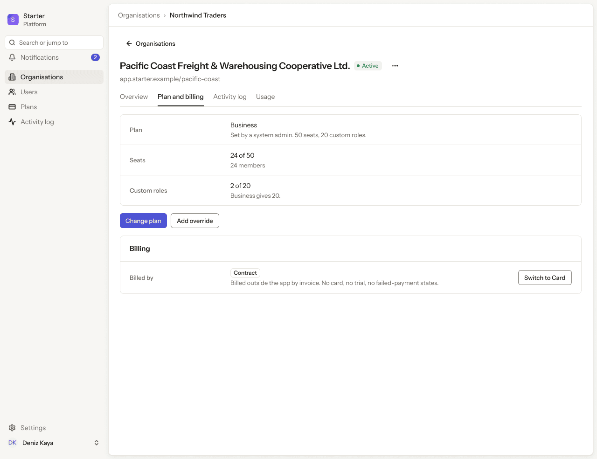

- **Who sees it:** System admins. Actions need the platform.tenants.* permission of each action.
- **Device:** Desktop (1280 px and wider).
- **This state shows:** as the title says.
- **Values come from:** Organisations, owners, plans, overrides, lifecycle and billing state: our API (platform.tenants.*).
- **Components:** Button ×5, Label, Pill, Platform sidebar, Tab ×4, Top bar.
- **Actions:**
  - "Organisations": goes to [4.01 · Organisations · all](#401--organisations--all).
  - "Notifications": goes to [3.01 · Bell · unread](../03-notifications/README.md#301--bell--unread).
  - "Search or jump to": goes to [2.02 · Command menu](../02-shell/README.md#202--command-menu).
  - "Area": goes to [2.03 · Account menu](../02-shell/README.md#203--account-menu).
  - "Overview": goes to [4.09 · Organisation · overview](#409--organisation--overview).
  - "Activity log": goes to [4.18 · Organisation · activity log](#418--organisation--activity-log).
  - "Area": goes to [4.10 · Organisation · ⋯ menu](#410--organisation---menu).
  - "Change plan": goes to [4.15 · Change plan](#415--change-plan).
  - "Add override": goes to [4.16 · Add override](#416--add-override).
  - "Area": goes to [4.17 · Remove override](#417--remove-override).
  - "Users": goes to [5.01 · Users · all](../05-users/README.md#501--users--all).
  - "Plans": goes to [6.01 · Plans](../06-plans/README.md#601--plans).
  - "Activity log": goes to [7.01 · Activity log](../07-activity-log/README.md#701--activity-log).
  - "Area": goes to [8.01 · Profile · ideal](../08-settings-profile/README.md#801--profile--ideal).
  - "Usage": goes to [4.37 · Organisation · usage](#437--organisation--usage).
- **Texts, word for word, top to bottom:**

  - S
  - Starter
  - Platform
  - Search or jump to
  - Notifications
  - 2
  - Organisations
  - Users
  - Plans
  - Activity log
  - Settings
  - DK
  - Deniz Kaya
  - Organisations
  - ›
  - Northwind Traders
  - Organisations
  - Pacific Coast Freight & Warehousing Cooperative Ltd.
  - Active
  - app.starter.example/pacific-coast
  - Overview
  - Plan and billing
  - Activity log
  - Usage
  - Plan
  - Business
  - Set by a system admin. 50 seats, 20 custom roles.
  - Seats
  - 24 of 50
  - 24 members
  - Custom roles
  - 2 of 20
  - Business gives 20.
  - Change plan
  - Add override
  - Billing
  - Billed by
  - Contract
  - Billed outside the app by invoice. No card, no trial, no failed-payment states.
  - Switch to Card

Figma: [249:14622](https://www.figma.com/design/3Ev111okX8xCBwR9B3hyBM/?node-id=249-14622)

### 4.35 · Switch to Contract

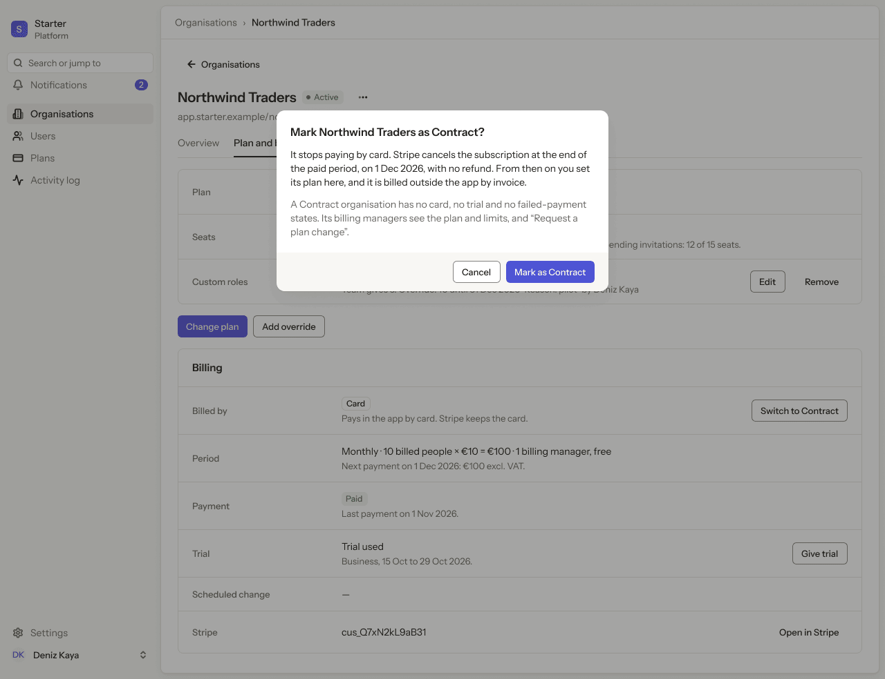

- **Who sees it:** System admins. Actions need the platform.tenants.* permission of each action.
- **Device:** Desktop (1280 px and wider).
- **This state shows:** as the title says.
- **Values come from:** Organisations, owners, plans, overrides, lifecycle and billing state: our API (platform.tenants.*).
- **Components:** Button ×11, Label, Pill ×2, Platform sidebar, Tab ×4, Top bar.
- **Actions:**
  - "Organisations": goes to [4.01 · Organisations · all](#401--organisations--all).
  - "Notifications": goes to [3.01 · Bell · unread](../03-notifications/README.md#301--bell--unread).
  - "Search or jump to": goes to [2.02 · Command menu](../02-shell/README.md#202--command-menu).
  - "Area": goes to [2.03 · Account menu](../02-shell/README.md#203--account-menu).
  - "Overview": goes to [4.09 · Organisation · overview](#409--organisation--overview).
  - "Activity log": goes to [4.18 · Organisation · activity log](#418--organisation--activity-log).
  - "Area": goes to [4.10 · Organisation · ⋯ menu](#410--organisation---menu).
  - "Change plan": goes to [4.15 · Change plan](#415--change-plan).
  - "Add override": goes to [4.16 · Add override](#416--add-override).
  - "Remove": goes to [4.17 · Remove override](#417--remove-override).
  - "Users": goes to [5.01 · Users · all](../05-users/README.md#501--users--all).
  - "Plans": goes to [6.01 · Plans](../06-plans/README.md#601--plans).
  - "Activity log": goes to [7.01 · Activity log](../07-activity-log/README.md#701--activity-log).
  - "Area": goes to [8.01 · Profile · ideal](../08-settings-profile/README.md#801--profile--ideal).
  - "Usage": goes to [4.37 · Organisation · usage](#437--organisation--usage).
  - "Cancel": goes to [4.27 · Plan and billing · card](#427--plan-and-billing--card).
  - "Mark as Contract": goes to [4.34 · Plan and billing · Contract](#434--plan-and-billing--contract).
- **Texts, word for word, top to bottom:**

  - S
  - Starter
  - Platform
  - Search or jump to
  - Notifications
  - 2
  - Organisations
  - Users
  - Plans
  - Activity log
  - Settings
  - DK
  - Deniz Kaya
  - Organisations
  - ›
  - Northwind Traders
  - Organisations
  - Northwind Traders
  - Active
  - app.starter.example/northwind
  - Overview
  - Plan and billing
  - Activity log
  - Usage
  - Plan
  - Team
  - 15 seats, 5 custom roles.
  - Seats
  - 12 of 15
  - 11 members, 1 of them a billing manager who uses no seat, and 2 pending invitations: 12 of 15 seats.
  - Custom roles
  - 4 of 10
  - Team gives 5. Override: 10 until 31 Dec 2026 · Reason: pilot · by Deniz Kaya
  - Edit
  - Remove
  - Change plan
  - Add override
  - Billing
  - Billed by
  - Card
  - Pays in the app by card. Stripe keeps the card.
  - Switch to Contract
  - Period
  - Monthly · 10 billed people × €10 = €100 · 1 billing manager, free
  - Next payment on 1 Dec 2026: €100 excl. VAT.
  - Payment
  - Paid
  - Last payment on 1 Nov 2026.
  - Trial
  - Trial used
  - Business, 15 Oct to 29 Oct 2026.
  - Give trial
  - Scheduled change
  - —
  - Stripe
  - cus\_Q7xN2kL9aB31
  - Open in Stripe
  - Mark Northwind Traders as Contract?
  - It stops paying by card. Stripe cancels the subscription at the end of the paid period, on 1 Dec 2026, with no refund. From then on you set its plan here, and it is billed outside the app by invoice.
  - A Contract organisation has no card, no trial and no failed-payment states. Its billing managers see the plan and limits, and “Request a plan change”.
  - Cancel
  - Mark as Contract

Figma: [249:14827](https://www.figma.com/design/3Ev111okX8xCBwR9B3hyBM/?node-id=249-14827)

### 4.36 · Plan and billing · scheduled change

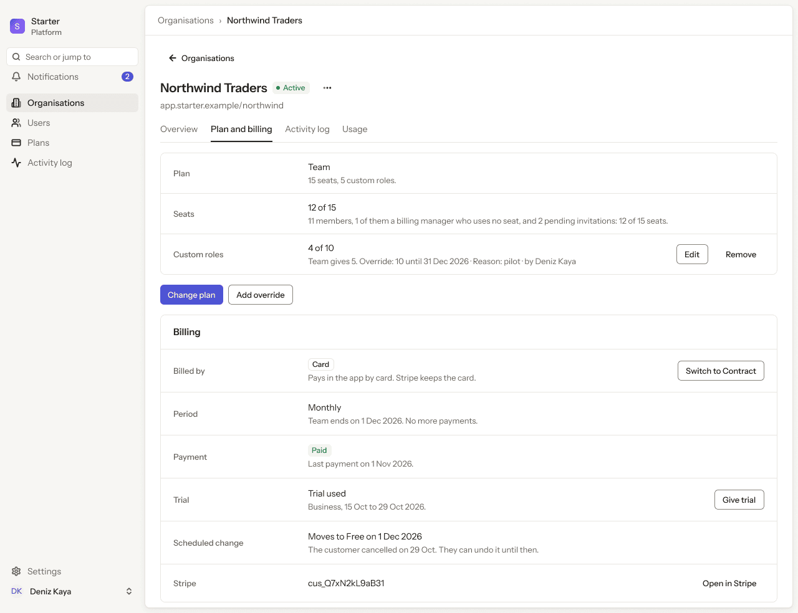

- **Who sees it:** System admins. Actions need the platform.tenants.* permission of each action.
- **Device:** Desktop (1280 px and wider).
- **This state shows:** as the title says.
- **Values come from:** Organisations, owners, plans, overrides, lifecycle and billing state: our API (platform.tenants.*).
- **Components:** Button ×9, Label, Pill ×2, Platform sidebar, Tab ×4, Top bar.
- **Actions:**
  - "Organisations": goes to [4.01 · Organisations · all](#401--organisations--all).
  - "Notifications": goes to [3.01 · Bell · unread](../03-notifications/README.md#301--bell--unread).
  - "Search or jump to": goes to [2.02 · Command menu](../02-shell/README.md#202--command-menu).
  - "Area": goes to [2.03 · Account menu](../02-shell/README.md#203--account-menu).
  - "Overview": goes to [4.09 · Organisation · overview](#409--organisation--overview).
  - "Activity log": goes to [4.18 · Organisation · activity log](#418--organisation--activity-log).
  - "Area": goes to [4.10 · Organisation · ⋯ menu](#410--organisation---menu).
  - "Change plan": goes to [4.15 · Change plan](#415--change-plan).
  - "Add override": goes to [4.16 · Add override](#416--add-override).
  - "Remove": goes to [4.17 · Remove override](#417--remove-override).
  - "Users": goes to [5.01 · Users · all](../05-users/README.md#501--users--all).
  - "Plans": goes to [6.01 · Plans](../06-plans/README.md#601--plans).
  - "Activity log": goes to [7.01 · Activity log](../07-activity-log/README.md#701--activity-log).
  - "Area": goes to [8.01 · Profile · ideal](../08-settings-profile/README.md#801--profile--ideal).
  - "Usage": goes to [4.37 · Organisation · usage](#437--organisation--usage).
- **Texts, word for word, top to bottom:**

  - S
  - Starter
  - Platform
  - Search or jump to
  - Notifications
  - 2
  - Organisations
  - Users
  - Plans
  - Activity log
  - Settings
  - DK
  - Deniz Kaya
  - Organisations
  - ›
  - Northwind Traders
  - Organisations
  - Northwind Traders
  - Active
  - app.starter.example/northwind
  - Overview
  - Plan and billing
  - Activity log
  - Usage
  - Plan
  - Team
  - 15 seats, 5 custom roles.
  - Seats
  - 12 of 15
  - 11 members, 1 of them a billing manager who uses no seat, and 2 pending invitations: 12 of 15 seats.
  - Custom roles
  - 4 of 10
  - Team gives 5. Override: 10 until 31 Dec 2026 · Reason: pilot · by Deniz Kaya
  - Edit
  - Remove
  - Change plan
  - Add override
  - Billing
  - Billed by
  - Card
  - Pays in the app by card. Stripe keeps the card.
  - Switch to Contract
  - Period
  - Monthly
  - Team ends on 1 Dec 2026. No more payments.
  - Payment
  - Paid
  - Last payment on 1 Nov 2026.
  - Trial
  - Trial used
  - Business, 15 Oct to 29 Oct 2026.
  - Give trial
  - Scheduled change
  - Moves to Free on 1 Dec 2026
  - The customer cancelled on 29 Oct. They can undo it until then.
  - Stripe
  - cus\_Q7xN2kL9aB31
  - Open in Stripe

Figma: [249:14939](https://www.figma.com/design/3Ev111okX8xCBwR9B3hyBM/?node-id=249-14939)

### 4.37 · Organisation · usage

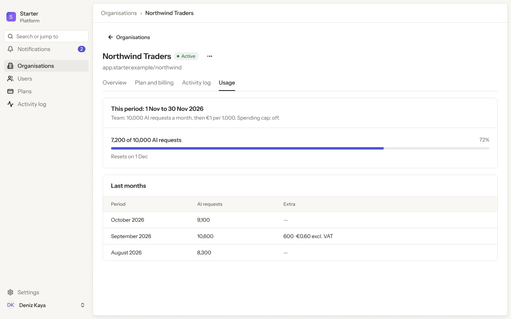

- **Who sees it:** System admins. Actions need the platform.tenants.* permission of each action.
- **Device:** Desktop (1280 px and wider).
- **This state shows:** as the title says.
- **Values come from:** Organisations, owners, plans, overrides, lifecycle and billing state: our API (platform.tenants.*).
- **Components:** Button ×2, Meter, Pill, Platform sidebar, Tab ×4, Top bar.
- **Actions:**
  - "Organisations": goes to [4.01 · Organisations · all](#401--organisations--all).
  - "Notifications": goes to [3.01 · Bell · unread](../03-notifications/README.md#301--bell--unread).
  - "Search or jump to": goes to [2.02 · Command menu](../02-shell/README.md#202--command-menu).
  - "Deniz Kaya": goes to [2.03 · Account menu](../02-shell/README.md#203--account-menu).
  - "Overview": goes to [4.09 · Organisation · overview](#409--organisation--overview).
  - "Activity log": goes to [4.18 · Organisation · activity log](#418--organisation--activity-log).
  - "Area": goes to [4.10 · Organisation · ⋯ menu](#410--organisation---menu).
  - "Area": goes to [4.15 · Change plan](#415--change-plan).
  - "Area": goes to [4.16 · Add override](#416--add-override).
  - "Area": goes to [4.17 · Remove override](#417--remove-override).
  - "Users": goes to [5.01 · Users · all](../05-users/README.md#501--users--all).
  - "Plans": goes to [6.01 · Plans](../06-plans/README.md#601--plans).
  - "Activity log": goes to [7.01 · Activity log](../07-activity-log/README.md#701--activity-log).
  - "Settings": goes to [8.01 · Profile · ideal](../08-settings-profile/README.md#801--profile--ideal).
  - "Plan and billing": goes to [4.27 · Plan and billing · card](#427--plan-and-billing--card).
- **Texts, word for word, top to bottom:**

  - S
  - Starter
  - Platform
  - Search or jump to
  - Notifications
  - 2
  - Organisations
  - Users
  - Plans
  - Activity log
  - Settings
  - DK
  - Deniz Kaya
  - Organisations
  - ›
  - Northwind Traders
  - Organisations
  - Northwind Traders
  - Active
  - app.starter.example/northwind
  - Overview
  - Plan and billing
  - Activity log
  - Usage
  - This period: 1 Nov to 30 Nov 2026
  - Team: 10,000 AI requests a month, then €1 per 1,000. Spending cap: off.
  - 7,200 of 10,000 AI requests
  - 72%
  - Resets on 1 Dec
  - Last months
  - Period
  - AI requests
  - Extra
  - October 2026
  - 9,100
  - —
  - September 2026
  - 10,600
  - 600 · €0.60 excl. VAT
  - August 2026
  - 8,300
  - —

Figma: [250:14652](https://www.figma.com/design/3Ev111okX8xCBwR9B3hyBM/?node-id=250-14652)

### 4.38 · Organisations · billing filter

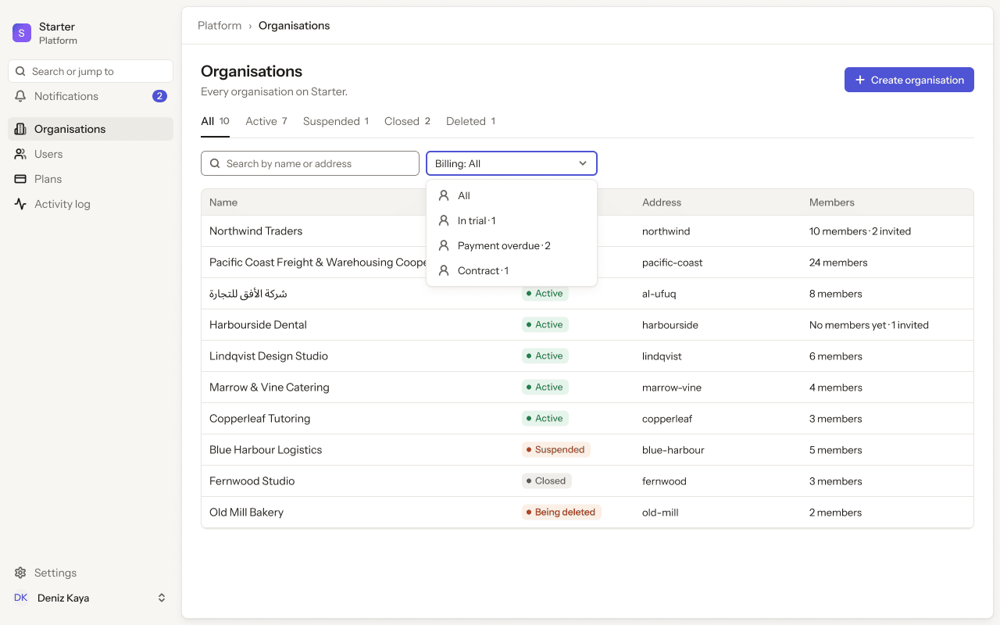

- **Who sees it:** System admins. Actions need the platform.tenants.* permission of each action.
- **Device:** Desktop (1280 px and wider).
- **This state shows:** as the title says.
- **Values come from:** Organisations, owners, plans, overrides, lifecycle and billing state: our API (platform.tenants.*).
- **Components:** Button, Input, Menu item ×4, Pill ×10, Platform sidebar, Select, Tab ×5, Top bar.
- **Actions:**
  - "Notifications": goes to [3.01 · Bell · unread](../03-notifications/README.md#301--bell--unread).
  - "Search or jump to": goes to [2.02 · Command menu](../02-shell/README.md#202--command-menu).
  - "Deniz Kaya": goes to [2.03 · Account menu](../02-shell/README.md#203--account-menu).
  - "Suspended": goes to [4.02 · Organisations · suspended](#402--organisations--suspended).
  - "Closed": goes to [4.03 · Organisations · closed](#403--organisations--closed).
  - "Northwind Traders": goes to [4.09 · Organisation · overview](#409--organisation--overview).
  - "Harbourside Dental": goes to [4.20 · Suspended](#420--suspended).
  - "Lindqvist Design Studio": goes to [4.23 · Closed](#423--closed).
  - "Marrow & Vine Catering": goes to [4.25 · Being deleted](#425--being-deleted).
  - "Create organisation": goes to [4.07 · Create organisation](#407--create-organisation).
  - "Users": goes to [5.01 · Users · all](../05-users/README.md#501--users--all).
  - "Plans": goes to [6.01 · Plans](../06-plans/README.md#601--plans).
  - "Activity log": goes to [7.01 · Activity log](../07-activity-log/README.md#701--activity-log).
  - "Settings": goes to [8.01 · Profile · ideal](../08-settings-profile/README.md#801--profile--ideal).
  - "In trial · 1": goes to [4.39 · Organisations · in trial](#439--organisations--in-trial).
- **Texts, word for word, top to bottom:**

  - S
  - Starter
  - Platform
  - Search or jump to
  - Notifications
  - 2
  - Organisations
  - Users
  - Plans
  - Activity log
  - Settings
  - DK
  - Deniz Kaya
  - Platform
  - ›
  - Organisations
  - Organisations
  - Every organisation on Starter.
  - Create organisation
  - All
  - 10
  - Active
  - 7
  - Suspended
  - 1
  - Closed
  - 2
  - Deleted
  - 1
  - Search by name or address
  - Billing: All
  - Name
  - Status
  - Address
  - Members
  - Northwind Traders
  - Active
  - northwind
  - 10 members · 2 invited
  - Pacific Coast Freight & Warehousing Cooperative Ltd.
  - Active
  - pacific-coast
  - 24 members
  - شركة الأفق للتجارة
  - Active
  - al-ufuq
  - 8 members
  - Harbourside Dental
  - Active
  - harbourside
  - No members yet · 1 invited
  - Lindqvist Design Studio
  - Active
  - lindqvist
  - 6 members
  - Marrow & Vine Catering
  - Active
  - marrow-vine
  - 4 members
  - Copperleaf Tutoring
  - Active
  - copperleaf
  - 3 members
  - Blue Harbour Logistics
  - Suspended
  - blue-harbour
  - 5 members
  - Fernwood Studio
  - Closed
  - fernwood
  - 3 members
  - Old Mill Bakery
  - Being deleted
  - old-mill
  - 2 members
  - All
  - In trial · 1
  - Payment overdue · 2
  - Contract · 1

Figma: [250:14872](https://www.figma.com/design/3Ev111okX8xCBwR9B3hyBM/?node-id=250-14872)

### 4.39 · Organisations · in trial

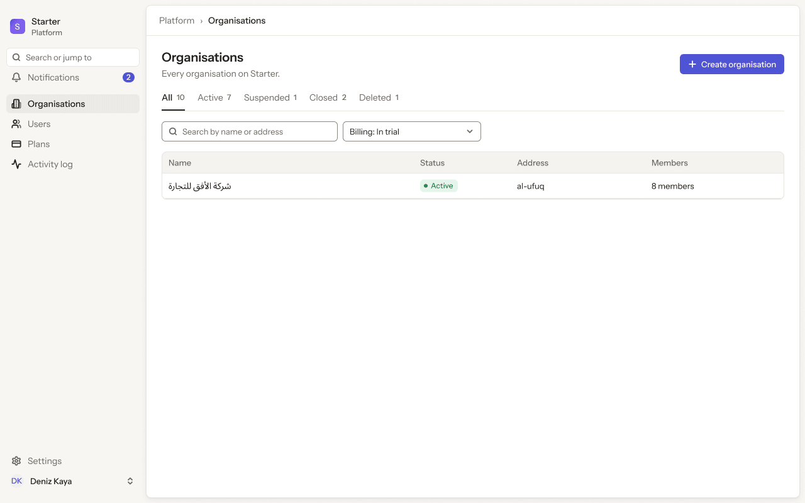

- **Who sees it:** System admins. Actions need the platform.tenants.* permission of each action.
- **Device:** Desktop (1280 px and wider).
- **This state shows:** as the title says.
- **Values come from:** Organisations, owners, plans, overrides, lifecycle and billing state: our API (platform.tenants.*).
- **Components:** Button, Input, Pill, Platform sidebar, Select, Tab ×5, Top bar.
- **Actions:**
  - "Notifications": goes to [3.01 · Bell · unread](../03-notifications/README.md#301--bell--unread).
  - "Search or jump to": goes to [2.02 · Command menu](../02-shell/README.md#202--command-menu).
  - "Deniz Kaya": goes to [2.03 · Account menu](../02-shell/README.md#203--account-menu).
  - "Suspended": goes to [4.02 · Organisations · suspended](#402--organisations--suspended).
  - "Closed": goes to [4.03 · Organisations · closed](#403--organisations--closed).
  - "شركة الأفق للتجارة": goes to [4.09 · Organisation · overview](#409--organisation--overview).
  - "Area": goes to [4.20 · Suspended](#420--suspended).
  - "Area": goes to [4.23 · Closed](#423--closed).
  - "Area": goes to [4.25 · Being deleted](#425--being-deleted).
  - "Create organisation": goes to [4.07 · Create organisation](#407--create-organisation).
  - "Users": goes to [5.01 · Users · all](../05-users/README.md#501--users--all).
  - "Plans": goes to [6.01 · Plans](../06-plans/README.md#601--plans).
  - "Activity log": goes to [7.01 · Activity log](../07-activity-log/README.md#701--activity-log).
  - "Settings": goes to [8.01 · Profile · ideal](../08-settings-profile/README.md#801--profile--ideal).
- **Texts, word for word, top to bottom:**

  - S
  - Starter
  - Platform
  - Search or jump to
  - Notifications
  - 2
  - Organisations
  - Users
  - Plans
  - Activity log
  - Settings
  - DK
  - Deniz Kaya
  - Platform
  - ›
  - Organisations
  - Organisations
  - Every organisation on Starter.
  - Create organisation
  - All
  - 10
  - Active
  - 7
  - Suspended
  - 1
  - Closed
  - 2
  - Deleted
  - 1
  - Search by name or address
  - Billing: In trial
  - Name
  - Status
  - Address
  - Members
  - شركة الأفق للتجارة
  - Active
  - al-ufuq
  - 8 members

Figma: [250:15092](https://www.figma.com/design/3Ev111okX8xCBwR9B3hyBM/?node-id=250-15092)

### 4.42 · Organisation · usage · Free, quota used

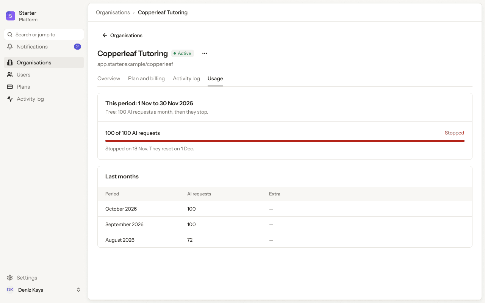

- **Who sees it:** System admins. Actions need the platform.tenants.* permission of each action.
- **Device:** Desktop (1280 px and wider).
- **This state shows:** as the title says.
- **Values come from:** Organisations, owners, plans, overrides, lifecycle and billing state: our API (platform.tenants.*).
- **Components:** Button ×2, Meter, Pill, Platform sidebar, Tab ×4, Top bar.
- **Actions:**
  - "Organisations": goes to [4.01 · Organisations · all](#401--organisations--all).
  - "Notifications": goes to [3.01 · Bell · unread](../03-notifications/README.md#301--bell--unread).
  - "Search or jump to": goes to [2.02 · Command menu](../02-shell/README.md#202--command-menu).
  - "Deniz Kaya": goes to [2.03 · Account menu](../02-shell/README.md#203--account-menu).
  - "Overview": goes to [4.09 · Organisation · overview](#409--organisation--overview).
  - "Activity log": goes to [4.18 · Organisation · activity log](#418--organisation--activity-log).
  - "Area": goes to [4.10 · Organisation · ⋯ menu](#410--organisation---menu).
  - "Area": goes to [4.15 · Change plan](#415--change-plan).
  - "Area": goes to [4.16 · Add override](#416--add-override).
  - "Area": goes to [4.17 · Remove override](#417--remove-override).
  - "Users": goes to [5.01 · Users · all](../05-users/README.md#501--users--all).
  - "Plans": goes to [6.01 · Plans](../06-plans/README.md#601--plans).
  - "Activity log": goes to [7.01 · Activity log](../07-activity-log/README.md#701--activity-log).
  - "Settings": goes to [8.01 · Profile · ideal](../08-settings-profile/README.md#801--profile--ideal).
  - "Plan and billing": goes to [4.27 · Plan and billing · card](#427--plan-and-billing--card).
- **Texts, word for word, top to bottom:**

  - S
  - Starter
  - Platform
  - Search or jump to
  - Notifications
  - 2
  - Organisations
  - Users
  - Plans
  - Activity log
  - Settings
  - DK
  - Deniz Kaya
  - Organisations
  - ›
  - Copperleaf Tutoring
  - Organisations
  - Copperleaf Tutoring
  - Active
  - app.starter.example/copperleaf
  - Overview
  - Plan and billing
  - Activity log
  - Usage
  - This period: 1 Nov to 30 Nov 2026
  - Free: 100 AI requests a month, then they stop.
  - 100 of 100 AI requests
  - Stopped
  - Stopped on 18 Nov. They reset on 1 Dec.
  - Last months
  - Period
  - AI requests
  - Extra
  - October 2026
  - 100
  - —
  - September 2026
  - 100
  - —
  - August 2026
  - 72
  - —

Figma: [257:17089](https://www.figma.com/design/3Ev111okX8xCBwR9B3hyBM/?node-id=257-17089)

### 4.43 · Phone · Organisations

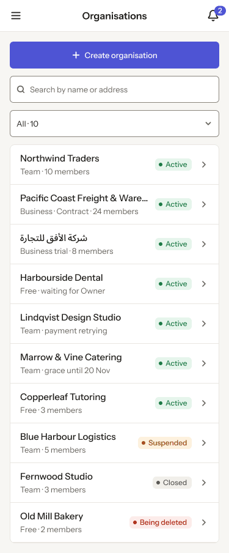

- **Who sees it:** System admins. Actions need the platform.tenants.* permission of each action.
- **Device:** Phone (up to 767 px).
- **This state shows:** on a phone.
- **Values come from:** Organisations, owners, plans, overrides, lifecycle and billing state: our API (platform.tenants.*).
- **Components:** Button, Input, Phone list row ×10, Phone top bar, Select.
- **Actions:**
  - "Area": goes to [2.14 · Phone · menu open](../02-shell/README.md#214--phone--menu-open).
  - "2": goes to [3.08 · Phone · Notifications](../03-notifications/README.md#308--phone--notifications).
  - "Northwind Traders": goes to [4.44 · Phone · Organisation](#444--phone--organisation).
  - "Lindqvist Design Studio": goes to [4.45 · Phone · Plan and billing](#445--phone--plan-and-billing).
  - "شركة الأفق للتجارة": goes to [4.48 · Phone · Extend trial](#448--phone--extend-trial).
- **Texts, word for word, top to bottom:**

  - Organisations
  - 2
  - Create organisation
  - Search by name or address
  - All · 10
  - Northwind Traders
  - Team · 10 members
  - Active
  - Pacific Coast Freight & Warehousing Cooperative Ltd.
  - Business · Contract · 24 members
  - Active
  - شركة الأفق للتجارة
  - Business trial · 8 members
  - Active
  - Harbourside Dental
  - Free · waiting for Owner
  - Active
  - Lindqvist Design Studio
  - Team · payment retrying
  - Active
  - Marrow & Vine Catering
  - Team · grace until 20 Nov
  - Active
  - Copperleaf Tutoring
  - Free · 3 members
  - Active
  - Blue Harbour Logistics
  - Team · 5 members
  - Suspended
  - Fernwood Studio
  - Team · 3 members
  - Closed
  - Old Mill Bakery
  - Free · 2 members
  - Being deleted

Figma: [259:16957](https://www.figma.com/design/3Ev111okX8xCBwR9B3hyBM/?node-id=259-16957)

### 4.44 · Phone · Organisation

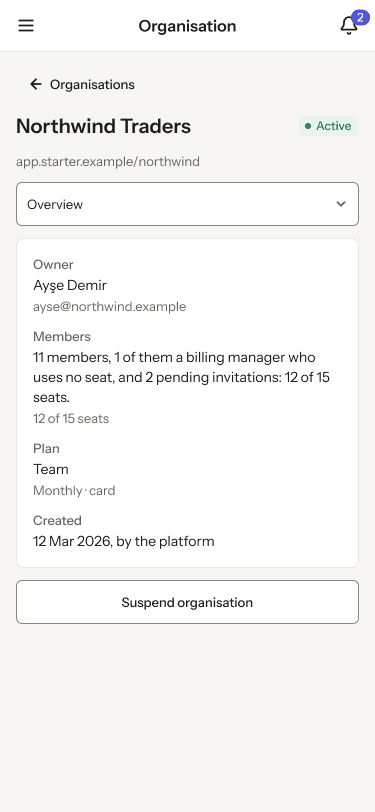

- **Who sees it:** System admins. Actions need the platform.tenants.* permission of each action.
- **Device:** Phone (up to 767 px).
- **This state shows:** on a phone.
- **Values come from:** Organisations, owners, plans, overrides, lifecycle and billing state: our API (platform.tenants.*).
- **Components:** Button ×2, Phone top bar, Pill, Select.
- **Actions:**
  - "Area": goes to [2.14 · Phone · menu open](../02-shell/README.md#214--phone--menu-open).
  - "2": goes to [3.08 · Phone · Notifications](../03-notifications/README.md#308--phone--notifications).
  - "Organisations": goes to [4.43 · Phone · Organisations](#443--phone--organisations).
  - "Overview": goes to [4.45 · Phone · Plan and billing](#445--phone--plan-and-billing).
  - "12 Mar 2026, by the platform": goes to [4.46 · Phone · Suspend organisation](#446--phone--suspend-organisation).
- **Texts, word for word, top to bottom:**

  - Organisation
  - 2
  - Organisations
  - Northwind Traders
  - Active
  - app.starter.example/northwind
  - Overview
  - Owner
  - Ayşe Demir
  - ayse@northwind.example
  - Members
  - 11 members, 1 of them a billing manager who uses no seat, and 2 pending invitations: 12 of 15 seats.
  - 12 of 15 seats
  - Plan
  - Team
  - Monthly · card
  - Created
  - 12 Mar 2026, by the platform
  - Suspend organisation

Figma: [260:16826](https://www.figma.com/design/3Ev111okX8xCBwR9B3hyBM/?node-id=260-16826)

### 4.45 · Phone · Plan and billing

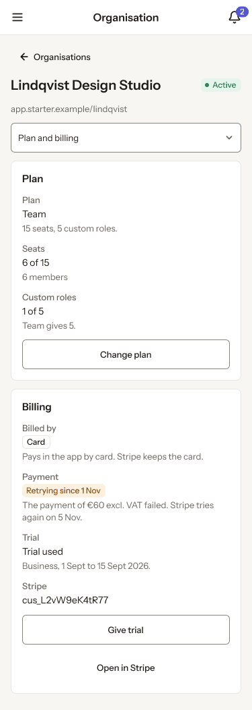

- **Who sees it:** System admins. Actions need the platform.tenants.* permission of each action.
- **Device:** Phone (up to 767 px).
- **This state shows:** on a phone.
- **Values come from:** Organisations, owners, plans, overrides, lifecycle and billing state: our API (platform.tenants.*).
- **Components:** Button ×4, Label, Phone top bar, Pill ×2, Select.
- **Actions:**
  - "Area": goes to [2.14 · Phone · menu open](../02-shell/README.md#214--phone--menu-open).
  - "2": goes to [3.08 · Phone · Notifications](../03-notifications/README.md#308--phone--notifications).
  - "Organisations": goes to [4.43 · Phone · Organisations](#443--phone--organisations).
  - "Give trial": goes to [4.47 · Phone · Give trial](#447--phone--give-trial).
- **Texts, word for word, top to bottom:**

  - Organisation
  - 2
  - Organisations
  - Lindqvist Design Studio
  - Active
  - app.starter.example/lindqvist
  - Plan and billing
  - Plan
  - Plan
  - Team
  - 15 seats, 5 custom roles.
  - Seats
  - 6 of 15
  - 6 members
  - Custom roles
  - 1 of 5
  - Team gives 5.
  - Change plan
  - Billing
  - Billed by
  - Card
  - Pays in the app by card. Stripe keeps the card.
  - Payment
  - Retrying since 1 Nov
  - The payment of €60 excl. VAT failed. Stripe tries again on 5 Nov.
  - Trial
  - Trial used
  - Business, 1 Sept to 15 Sept 2026.
  - Stripe
  - cus\_L2vW9eK4tR77
  - Give trial
  - Open in Stripe

Figma: [260:16908](https://www.figma.com/design/3Ev111okX8xCBwR9B3hyBM/?node-id=260-16908)

### 4.46 · Phone · Suspend organisation

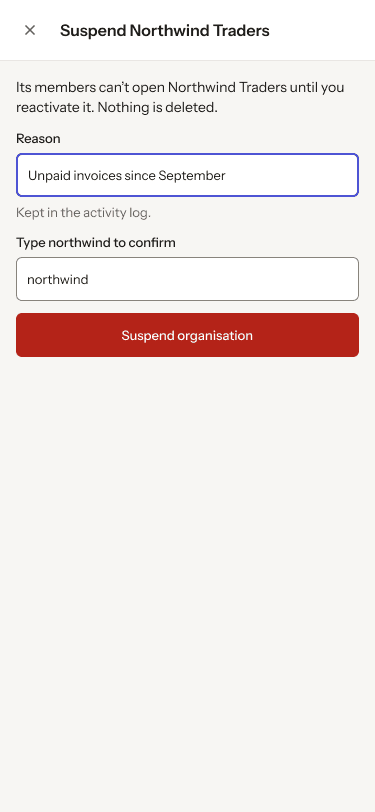

- **Who sees it:** System admins. Actions need the platform.tenants.* permission of each action.
- **Device:** Phone (up to 767 px).
- **This state shows:** on a phone.
- **Values come from:** Organisations, owners, plans, overrides, lifecycle and billing state: our API (platform.tenants.*).
- **Components:** Button, Icon/x, Input ×2.
- **Actions:**
  - "Area": goes to [4.44 · Phone · Organisation](#444--phone--organisation).
  - "Suspend organisation": goes to [4.44 · Phone · Organisation](#444--phone--organisation).
- **Texts, word for word, top to bottom:**

  - Suspend Northwind Traders
  - Its members can’t open Northwind Traders until you reactivate it. Nothing is deleted.
  - Reason
  - Unpaid invoices since September
  - Kept in the activity log.
  - Type northwind to confirm
  - northwind
  - Suspend organisation

Figma: [260:16973](https://www.figma.com/design/3Ev111okX8xCBwR9B3hyBM/?node-id=260-16973)

### 4.47 · Phone · Give trial

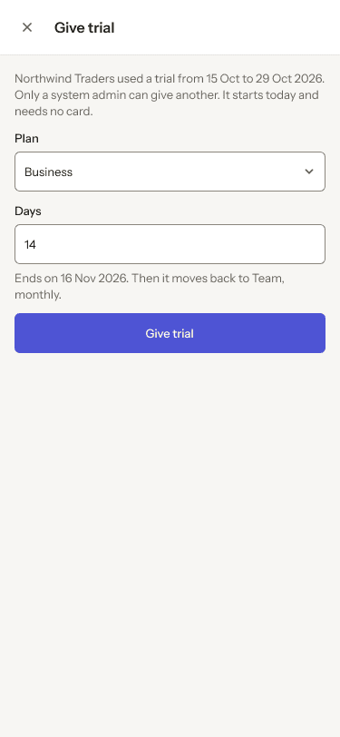

- **Who sees it:** System admins. Actions need the platform.tenants.* permission of each action.
- **Device:** Phone (up to 767 px).
- **This state shows:** on a phone.
- **Values come from:** Organisations, owners, plans, overrides, lifecycle and billing state: our API (platform.tenants.*).
- **Components:** Button, Icon/x, Input, Select.
- **Actions:**
  - "Area": goes to [4.45 · Phone · Plan and billing](#445--phone--plan-and-billing).
  - "Give trial": goes to [4.45 · Phone · Plan and billing](#445--phone--plan-and-billing).
- **Texts, word for word, top to bottom:**

  - Give trial
  - Northwind Traders used a trial from 15 Oct to 29 Oct 2026. Only a system admin can give another. It starts today and needs no card.
  - Plan
  - Business
  - Days
  - 14
  - Ends on 16 Nov 2026. Then it moves back to Team, monthly.
  - Give trial

Figma: [260:17009](https://www.figma.com/design/3Ev111okX8xCBwR9B3hyBM/?node-id=260-17009)

### 4.48 · Phone · Extend trial

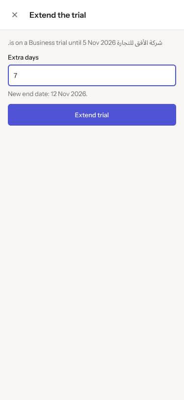

- **Who sees it:** System admins. Actions need the platform.tenants.* permission of each action.
- **Device:** Phone (up to 767 px).
- **This state shows:** on a phone.
- **Values come from:** Organisations, owners, plans, overrides, lifecycle and billing state: our API (platform.tenants.*).
- **Components:** Button, Icon/x, Input.
- **Actions:**
  - "Area": goes to [4.43 · Phone · Organisations](#443--phone--organisations).
  - "Extend trial": goes to [4.43 · Phone · Organisations](#443--phone--organisations).
- **Texts, word for word, top to bottom:**

  - Extend the trial
  - شركة الأفق للتجارة is on a Business trial until 5 Nov 2026.
  - Extra days
  - 7
  - New end date: 12 Nov 2026.
  - Extend trial

Figma: [260:17041](https://www.figma.com/design/3Ev111okX8xCBwR9B3hyBM/?node-id=260-17041)
