# Platform app · 5 · Users

Who sees this section: System admins with platform.users.read. Suspend, reactivate, edit and delete need platform.users.*.

Where the values come from: Users, their organisations and status: our API (platform.users.*). Terms acceptance: our API.

19 screens. Each part below is one screen and state. The PNG beside this file is the screen at scale 1.

| Screen | Device |
|---|---|
| [5.01 · Users · all](#501--users--all) | Desktop |
| [5.02 · Users · suspended](#502--users--suspended) | Desktop |
| [5.03 · Users · no match](#503--users--no-match) | Desktop |
| [5.04 · Users · loading](#504--users--loading) | Desktop |
| [5.05 · User · overview](#505--user--overview) | Desktop |
| [5.06 · User · ⋯ menu](#506--user---menu) | Desktop |
| [5.07 · User · suspended](#507--user--suspended) | Desktop |
| [5.08 · User · system admin](#508--user--system-admin) | Desktop |
| [5.09 · Rename user](#509--rename-user) | Desktop |
| [5.10 · Suspend user](#510--suspend-user) | Desktop |
| [5.11 · Reactivate user](#511--reactivate-user) | Desktop |
| [5.12 · Make Owner](#512--make-owner) | Desktop |
| [5.13 · Delete user](#513--delete-user) | Desktop |
| [5.14 · Can’t delete · last Owner](#514--cant-delete--last-owner) | Desktop |
| [5.15 · Can’t delete · system admin](#515--cant-delete--system-admin) | Desktop |
| [5.16 · Phone · Users](#516--phone--users) | Phone |
| [5.17 · Phone · User](#517--phone--user) | Phone |
| [5.18 · Users · loading more](#518--users--loading-more) | Desktop |
| [5.19 · Users · couldn’t load more](#519--users--couldnt-load-more) | Desktop |

### 5.01 · Users · all

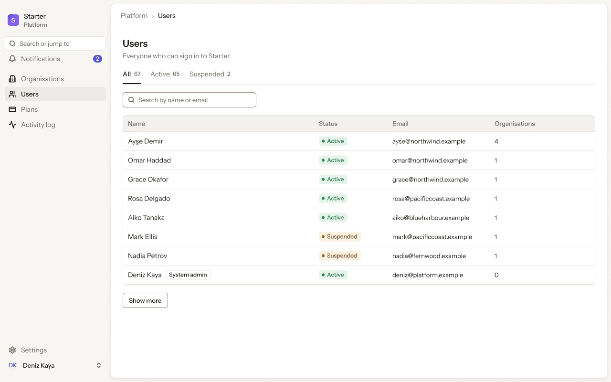

- **Who sees it:** System admins with platform.users.read. Suspend, reactivate, edit and delete need platform.users.*.
- **Device:** Desktop (1280 px and wider).
- **This state shows:** as the title says.
- **Values come from:** Users, their organisations and status: our API (platform.users.*). Terms acceptance: our API.
- **Components:** Button, Input, Label, Pill ×8, Platform sidebar, Tab ×3, Top bar.
- **Actions:**
  - "Organisations": goes to [4.01 · Organisations · all](../04-organisations/README.md#401--organisations--all).
  - "Notifications": goes to [3.01 · Bell · unread](../03-notifications/README.md#301--bell--unread).
  - "Search or jump to": goes to [2.02 · Command menu](../02-shell/README.md#202--command-menu).
  - "Deniz Kaya": goes to [2.03 · Account menu](../02-shell/README.md#203--account-menu).
  - "Suspended": goes to [5.02 · Users · suspended](#502--users--suspended).
  - "Ayşe Demir": goes to [5.05 · User · overview](#505--user--overview).
  - "Aiko Tanaka": goes to [5.07 · User · suspended](#507--user--suspended).
  - "Nadia Petrov": goes to [5.08 · User · system admin](#508--user--system-admin).
  - "Plans": goes to [6.01 · Plans](../06-plans/README.md#601--plans).
  - "Activity log": goes to [7.01 · Activity log](../07-activity-log/README.md#701--activity-log).
  - "Settings": goes to [8.01 · Profile · ideal](../08-settings-profile/README.md#801--profile--ideal).
  - "Show more": goes to [5.18 · Users · loading more](#518--users--loading-more).
- **Texts, word for word, top to bottom:**

  - S
  - Starter
  - Platform
  - Search or jump to
  - Notifications
  - 2
  - Organisations
  - Users
  - Plans
  - Activity log
  - Settings
  - DK
  - Deniz Kaya
  - Platform
  - ›
  - Users
  - Users
  - Everyone who can sign in to Starter.
  - All
  - 67
  - Active
  - 65
  - Suspended
  - 2
  - Search by name or email
  - Name
  - Status
  - Email
  - Organisations
  - Ayşe Demir
  - Active
  - ayse@northwind.example
  - 4
  - Omar Haddad
  - Active
  - omar@northwind.example
  - 1
  - Grace Okafor
  - Active
  - grace@northwind.example
  - 1
  - Rosa Delgado
  - Active
  - rosa@pacificcoast.example
  - 1
  - Aiko Tanaka
  - Active
  - aiko@blueharbour.example
  - 1
  - Mark Ellis
  - Suspended
  - mark@pacificcoast.example
  - 1
  - Nadia Petrov
  - Suspended
  - nadia@fernwood.example
  - 1
  - Deniz Kaya
  - System admin
  - Active
  - deniz@platform.example
  - 0
  - Show more

Figma: [181:5580](https://www.figma.com/design/3Ev111okX8xCBwR9B3hyBM/?node-id=181-5580)

### 5.02 · Users · suspended

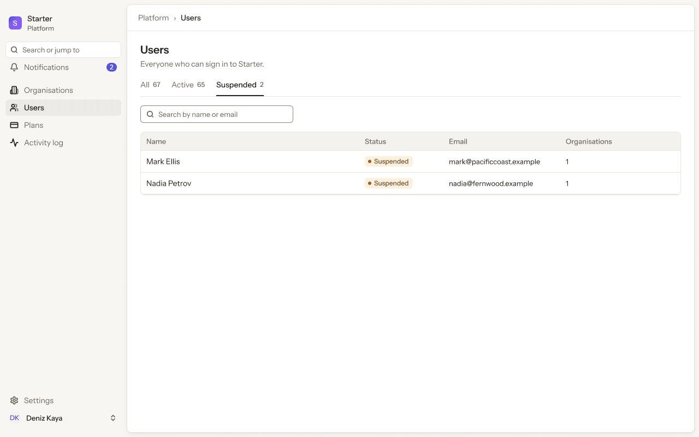

- **Who sees it:** System admins with platform.users.read. Suspend, reactivate, edit and delete need platform.users.*.
- **Device:** Desktop (1280 px and wider).
- **This state shows:** when the organisation or person is suspended.
- **Values come from:** Users, their organisations and status: our API (platform.users.*). Terms acceptance: our API.
- **Components:** Input, Pill ×2, Platform sidebar, Tab ×3, Top bar.
- **Actions:**
  - "Organisations": goes to [4.01 · Organisations · all](../04-organisations/README.md#401--organisations--all).
  - "Users": goes to [5.01 · Users · all](#501--users--all).
  - "Notifications": goes to [3.01 · Bell · unread](../03-notifications/README.md#301--bell--unread).
  - "Search or jump to": goes to [2.02 · Command menu](../02-shell/README.md#202--command-menu).
  - "Deniz Kaya": goes to [2.03 · Account menu](../02-shell/README.md#203--account-menu).
  - "All": goes to [5.01 · Users · all](#501--users--all).
  - "Mark Ellis": goes to [5.07 · User · suspended](#507--user--suspended).
  - "Plans": goes to [6.01 · Plans](../06-plans/README.md#601--plans).
  - "Activity log": goes to [7.01 · Activity log](../07-activity-log/README.md#701--activity-log).
  - "Settings": goes to [8.01 · Profile · ideal](../08-settings-profile/README.md#801--profile--ideal).
- **Texts, word for word, top to bottom:**

  - S
  - Starter
  - Platform
  - Search or jump to
  - Notifications
  - 2
  - Organisations
  - Users
  - Plans
  - Activity log
  - Settings
  - DK
  - Deniz Kaya
  - Platform
  - ›
  - Users
  - Users
  - Everyone who can sign in to Starter.
  - All
  - 67
  - Active
  - 65
  - Suspended
  - 2
  - Search by name or email
  - Name
  - Status
  - Email
  - Organisations
  - Mark Ellis
  - Suspended
  - mark@pacificcoast.example
  - 1
  - Nadia Petrov
  - Suspended
  - nadia@fernwood.example
  - 1

Figma: [181:5933](https://www.figma.com/design/3Ev111okX8xCBwR9B3hyBM/?node-id=181-5933)

### 5.03 · Users · no match

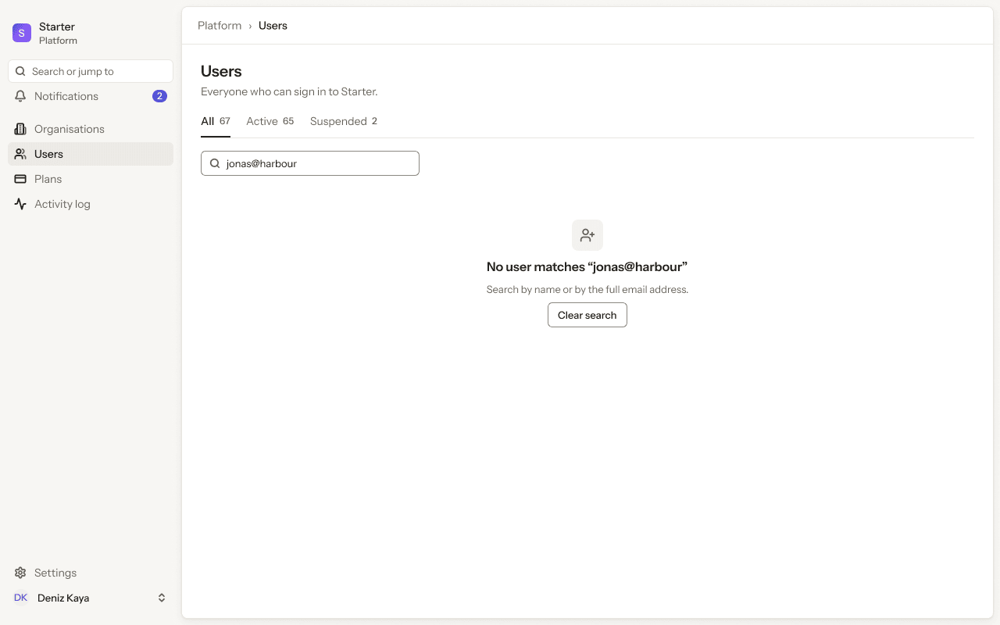

- **Who sees it:** System admins with platform.users.read. Suspend, reactivate, edit and delete need platform.users.*.
- **Device:** Desktop (1280 px and wider).
- **This state shows:** when a search matches nothing.
- **Values come from:** Users, their organisations and status: our API (platform.users.*). Terms acceptance: our API.
- **Components:** Empty state, Input, Platform sidebar, Tab ×3, Top bar.
- **Actions:**
  - "Organisations": goes to [4.01 · Organisations · all](../04-organisations/README.md#401--organisations--all).
  - "Users": goes to [5.01 · Users · all](#501--users--all).
  - "Notifications": goes to [3.01 · Bell · unread](../03-notifications/README.md#301--bell--unread).
  - "Search or jump to": goes to [2.02 · Command menu](../02-shell/README.md#202--command-menu).
  - "Deniz Kaya": goes to [2.03 · Account menu](../02-shell/README.md#203--account-menu).
  - "All": goes to [5.01 · Users · all](#501--users--all).
  - "Suspended": goes to [5.02 · Users · suspended](#502--users--suspended).
  - "Plans": goes to [6.01 · Plans](../06-plans/README.md#601--plans).
  - "Activity log": goes to [7.01 · Activity log](../07-activity-log/README.md#701--activity-log).
  - "Settings": goes to [8.01 · Profile · ideal](../08-settings-profile/README.md#801--profile--ideal).
- **Texts, word for word, top to bottom:**

  - S
  - Starter
  - Platform
  - Search or jump to
  - Notifications
  - 2
  - Organisations
  - Users
  - Plans
  - Activity log
  - Settings
  - DK
  - Deniz Kaya
  - Platform
  - ›
  - Users
  - Users
  - Everyone who can sign in to Starter.
  - All
  - 67
  - Active
  - 65
  - Suspended
  - 2
  - jonas@harbour
  - No user matches “jonas@harbour”
  - Search by name or by the full email address.
  - Clear search

Figma: [181:6116](https://www.figma.com/design/3Ev111okX8xCBwR9B3hyBM/?node-id=181-6116)

### 5.04 · Users · loading

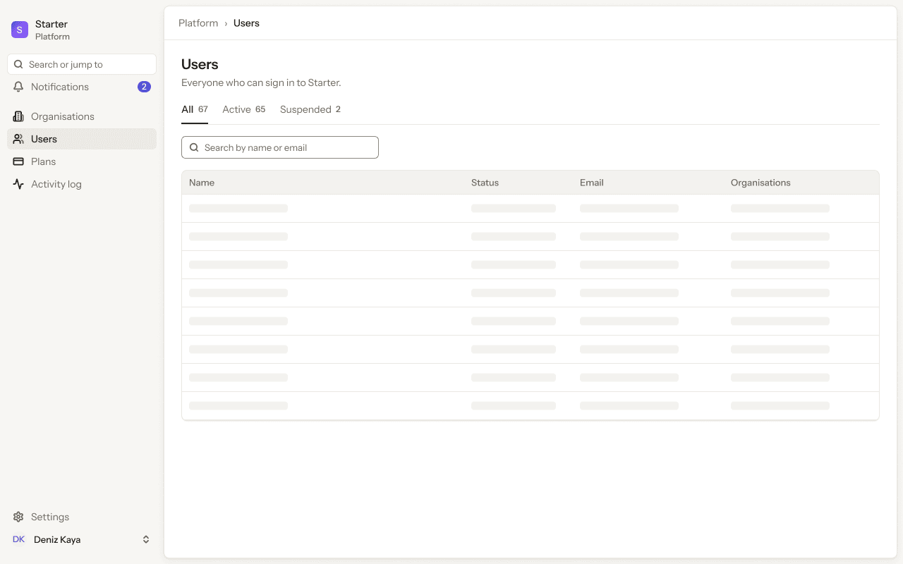

- **Who sees it:** System admins with platform.users.read. Suspend, reactivate, edit and delete need platform.users.*.
- **Device:** Desktop (1280 px and wider).
- **This state shows:** while the request runs.
- **Values come from:** Users, their organisations and status: our API (platform.users.*). Terms acceptance: our API.
- **Components:** Input, Platform sidebar, Skeleton ×32, Tab ×3, Top bar.
- **Actions:**
  - "Organisations": goes to [4.01 · Organisations · all](../04-organisations/README.md#401--organisations--all).
  - "Users": goes to [5.01 · Users · all](#501--users--all).
  - "Notifications": goes to [3.01 · Bell · unread](../03-notifications/README.md#301--bell--unread).
  - "Search or jump to": goes to [2.02 · Command menu](../02-shell/README.md#202--command-menu).
  - "Deniz Kaya": goes to [2.03 · Account menu](../02-shell/README.md#203--account-menu).
  - "All": goes to [5.01 · Users · all](#501--users--all).
  - "Suspended": goes to [5.02 · Users · suspended](#502--users--suspended).
  - "Area": goes to [5.05 · User · overview](#505--user--overview).
  - "Area": goes to [5.07 · User · suspended](#507--user--suspended).
  - "Area": goes to [5.08 · User · system admin](#508--user--system-admin).
  - "Plans": goes to [6.01 · Plans](../06-plans/README.md#601--plans).
  - "Activity log": goes to [7.01 · Activity log](../07-activity-log/README.md#701--activity-log).
  - "Settings": goes to [8.01 · Profile · ideal](../08-settings-profile/README.md#801--profile--ideal).
- **Texts, word for word, top to bottom:**

  - S
  - Starter
  - Platform
  - Search or jump to
  - Notifications
  - 2
  - Organisations
  - Users
  - Plans
  - Activity log
  - Settings
  - DK
  - Deniz Kaya
  - Platform
  - ›
  - Users
  - Users
  - Everyone who can sign in to Starter.
  - All
  - 67
  - Active
  - 65
  - Suspended
  - 2
  - Search by name or email
  - Name
  - Status
  - Email
  - Organisations

Figma: [181:6311](https://www.figma.com/design/3Ev111okX8xCBwR9B3hyBM/?node-id=181-6311)

### 5.05 · User · overview

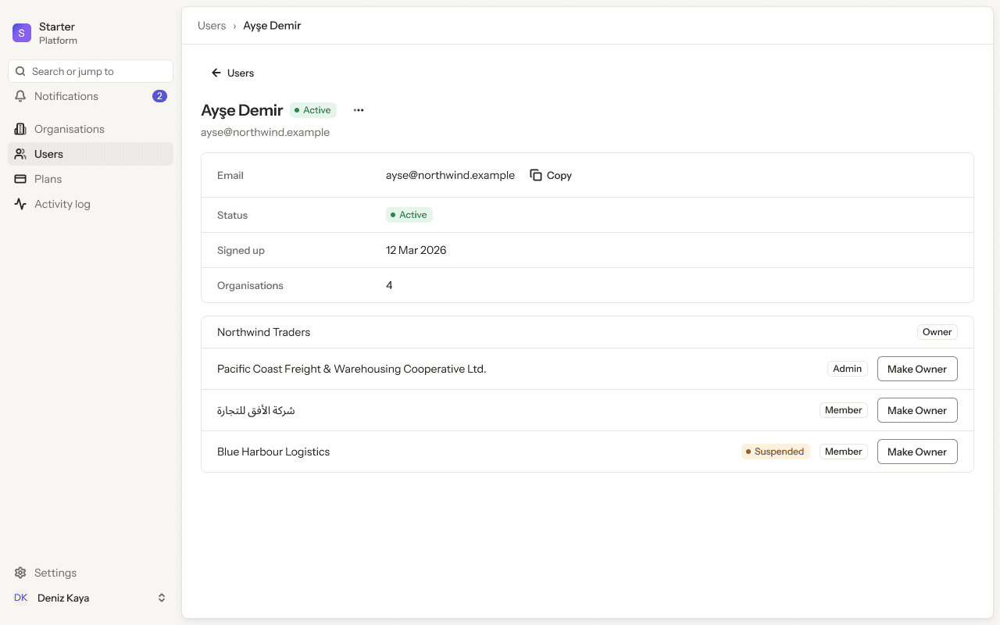

- **Who sees it:** System admins with platform.users.read. Suspend, reactivate, edit and delete need platform.users.*.
- **Device:** Desktop (1280 px and wider).
- **This state shows:** as the title says.
- **Values come from:** Users, their organisations and status: our API (platform.users.*). Terms acceptance: our API.
- **Components:** Button ×6, Label ×4, Pill ×3, Platform sidebar, Top bar.
- **Actions:**
  - "Organisations": goes to [4.01 · Organisations · all](../04-organisations/README.md#401--organisations--all).
  - "Users": goes to [5.01 · Users · all](#501--users--all).
  - "Notifications": goes to [3.01 · Bell · unread](../03-notifications/README.md#301--bell--unread).
  - "Search or jump to": goes to [2.02 · Command menu](../02-shell/README.md#202--command-menu).
  - "Deniz Kaya": goes to [2.03 · Account menu](../02-shell/README.md#203--account-menu).
  - "Area": goes to [5.06 · User · ⋯ menu](#506--user---menu).
  - "Make Owner": goes to [5.12 · Make Owner](#512--make-owner).
  - "Plans": goes to [6.01 · Plans](../06-plans/README.md#601--plans).
  - "Activity log": goes to [7.01 · Activity log](../07-activity-log/README.md#701--activity-log).
  - "Settings": goes to [8.01 · Profile · ideal](../08-settings-profile/README.md#801--profile--ideal).
- **Texts, word for word, top to bottom:**

  - S
  - Starter
  - Platform
  - Search or jump to
  - Notifications
  - 2
  - Organisations
  - Users
  - Plans
  - Activity log
  - Settings
  - DK
  - Deniz Kaya
  - Users
  - ›
  - Ayşe Demir
  - Users
  - Ayşe Demir
  - Active
  - ayse@northwind.example
  - Email
  - ayse@northwind.example
  - Copy
  - Status
  - Active
  - Signed up
  - 12 Mar 2026
  - Organisations
  - 4
  - Northwind Traders
  - Owner
  - Pacific Coast Freight & Warehousing Cooperative Ltd.
  - Admin
  - Make Owner
  - شركة الأفق للتجارة
  - Member
  - Make Owner
  - Blue Harbour Logistics
  - Suspended
  - Member
  - Make Owner

Figma: [181:6532](https://www.figma.com/design/3Ev111okX8xCBwR9B3hyBM/?node-id=181-6532)

### 5.06 · User · ⋯ menu

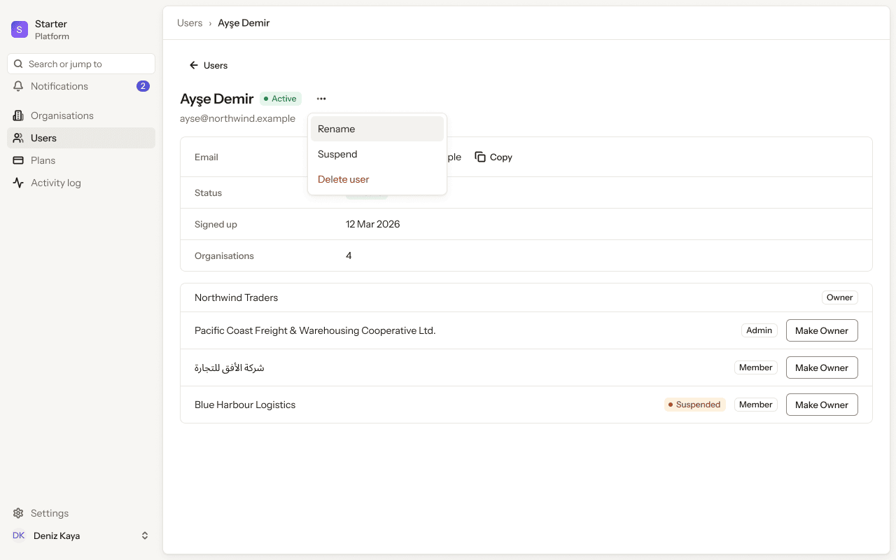

- **Who sees it:** System admins with platform.users.read. Suspend, reactivate, edit and delete need platform.users.*.
- **Device:** Desktop (1280 px and wider).
- **This state shows:** as the title says.
- **Values come from:** Users, their organisations and status: our API (platform.users.*). Terms acceptance: our API.
- **Components:** Button ×6, Label ×4, Pill ×3, Platform sidebar, Top bar.
- **Actions:**
  - "Organisations": goes to [4.01 · Organisations · all](../04-organisations/README.md#401--organisations--all).
  - "Users": goes to [5.01 · Users · all](#501--users--all).
  - "Notifications": goes to [3.01 · Bell · unread](../03-notifications/README.md#301--bell--unread).
  - "Search or jump to": goes to [2.02 · Command menu](../02-shell/README.md#202--command-menu).
  - "Deniz Kaya": goes to [2.03 · Account menu](../02-shell/README.md#203--account-menu).
  - "Rename": goes to [5.09 · Rename user](#509--rename-user).
  - "ayse@northwind.example": goes to [5.10 · Suspend user](#510--suspend-user).
  - "Delete user": goes to [5.14 · Can’t delete · last Owner](#514--cant-delete--last-owner).
  - "Make Owner": goes to [5.12 · Make Owner](#512--make-owner).
  - "Plans": goes to [6.01 · Plans](../06-plans/README.md#601--plans).
  - "Activity log": goes to [7.01 · Activity log](../07-activity-log/README.md#701--activity-log).
  - "Settings": goes to [8.01 · Profile · ideal](../08-settings-profile/README.md#801--profile--ideal).
- **Texts, word for word, top to bottom:**

  - S
  - Starter
  - Platform
  - Search or jump to
  - Notifications
  - 2
  - Organisations
  - Users
  - Plans
  - Activity log
  - Settings
  - DK
  - Deniz Kaya
  - Users
  - ›
  - Ayşe Demir
  - Users
  - Ayşe Demir
  - Active
  - ayse@northwind.example
  - Email
  - ayse@northwind.example
  - Copy
  - Status
  - Active
  - Signed up
  - 12 Mar 2026
  - Organisations
  - 4
  - Northwind Traders
  - Owner
  - Pacific Coast Freight & Warehousing Cooperative Ltd.
  - Admin
  - Make Owner
  - شركة الأفق للتجارة
  - Member
  - Make Owner
  - Blue Harbour Logistics
  - Suspended
  - Member
  - Make Owner
  - Rename
  - Suspend
  - Delete user

Figma: [181:6803](https://www.figma.com/design/3Ev111okX8xCBwR9B3hyBM/?node-id=181-6803)

### 5.07 · User · suspended

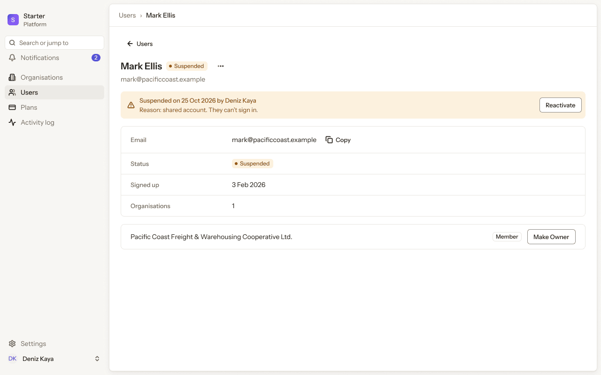

- **Who sees it:** System admins with platform.users.read. Suspend, reactivate, edit and delete need platform.users.*.
- **Device:** Desktop (1280 px and wider).
- **This state shows:** when the organisation or person is suspended.
- **Values come from:** Users, their organisations and status: our API (platform.users.*). Terms acceptance: our API.
- **Components:** Banner, Button ×4, Label, Pill ×2, Platform sidebar, Top bar.
- **Actions:**
  - "Organisations": goes to [4.01 · Organisations · all](../04-organisations/README.md#401--organisations--all).
  - "Users": goes to [5.01 · Users · all](#501--users--all).
  - "Notifications": goes to [3.01 · Bell · unread](../03-notifications/README.md#301--bell--unread).
  - "Search or jump to": goes to [2.02 · Command menu](../02-shell/README.md#202--command-menu).
  - "Deniz Kaya": goes to [2.03 · Account menu](../02-shell/README.md#203--account-menu).
  - "Reactivate": goes to [5.11 · Reactivate user](#511--reactivate-user).
  - "Plans": goes to [6.01 · Plans](../06-plans/README.md#601--plans).
  - "Activity log": goes to [7.01 · Activity log](../07-activity-log/README.md#701--activity-log).
  - "Settings": goes to [8.01 · Profile · ideal](../08-settings-profile/README.md#801--profile--ideal).
- **Texts, word for word, top to bottom:**

  - S
  - Starter
  - Platform
  - Search or jump to
  - Notifications
  - 2
  - Organisations
  - Users
  - Plans
  - Activity log
  - Settings
  - DK
  - Deniz Kaya
  - Users
  - ›
  - Mark Ellis
  - Users
  - Mark Ellis
  - Suspended
  - mark@pacificcoast.example
  - Suspended on 25 Oct 2026 by Deniz Kaya
  - Reason: shared account. They can’t sign in.
  - Reactivate
  - Email
  - mark@pacificcoast.example
  - Copy
  - Status
  - Suspended
  - Signed up
  - 3 Feb 2026
  - Organisations
  - 1
  - Pacific Coast Freight & Warehousing Cooperative Ltd.
  - Member
  - Make Owner

Figma: [181:7081](https://www.figma.com/design/3Ev111okX8xCBwR9B3hyBM/?node-id=181-7081)

### 5.08 · User · system admin

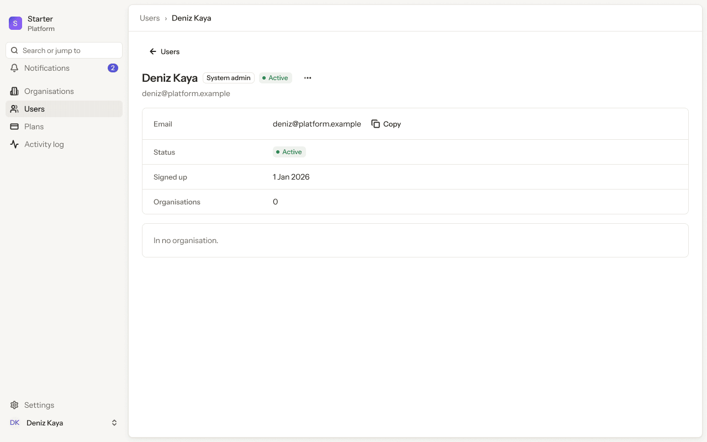

- **Who sees it:** System admins with platform.users.read. Suspend, reactivate, edit and delete need platform.users.*.
- **Device:** Desktop (1280 px and wider).
- **This state shows:** as the title says.
- **Values come from:** Users, their organisations and status: our API (platform.users.*). Terms acceptance: our API.
- **Components:** Button ×3, Label, Pill ×2, Platform sidebar, Top bar.
- **Actions:**
  - "Organisations": goes to [4.01 · Organisations · all](../04-organisations/README.md#401--organisations--all).
  - "Users": goes to [5.01 · Users · all](#501--users--all).
  - "Notifications": goes to [3.01 · Bell · unread](../03-notifications/README.md#301--bell--unread).
  - "Search or jump to": goes to [2.02 · Command menu](../02-shell/README.md#202--command-menu).
  - "Deniz Kaya": goes to [2.03 · Account menu](../02-shell/README.md#203--account-menu).
  - "Plans": goes to [6.01 · Plans](../06-plans/README.md#601--plans).
  - "Activity log": goes to [7.01 · Activity log](../07-activity-log/README.md#701--activity-log).
  - "Settings": goes to [8.01 · Profile · ideal](../08-settings-profile/README.md#801--profile--ideal).
- **Texts, word for word, top to bottom:**

  - S
  - Starter
  - Platform
  - Search or jump to
  - Notifications
  - 2
  - Organisations
  - Users
  - Plans
  - Activity log
  - Settings
  - DK
  - Deniz Kaya
  - Users
  - ›
  - Deniz Kaya
  - Users
  - Deniz Kaya
  - System admin
  - Active
  - deniz@platform.example
  - Email
  - deniz@platform.example
  - Copy
  - Status
  - Active
  - Signed up
  - 1 Jan 2026
  - Organisations
  - 0
  - In no organisation.

Figma: [181:7366](https://www.figma.com/design/3Ev111okX8xCBwR9B3hyBM/?node-id=181-7366)

### 5.09 · Rename user

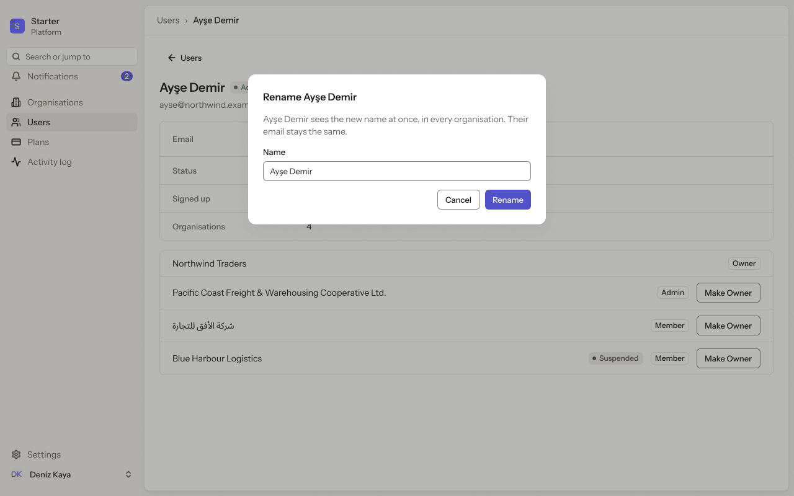

- **Who sees it:** System admins with platform.users.read. Suspend, reactivate, edit and delete need platform.users.*.
- **Device:** Desktop (1280 px and wider).
- **This state shows:** as the title says.
- **Values come from:** Users, their organisations and status: our API (platform.users.*). Terms acceptance: our API.
- **Components:** Button ×8, Input, Label ×4, Pill ×3, Platform sidebar, Top bar.
- **Actions:**
  - "Organisations": goes to [4.01 · Organisations · all](../04-organisations/README.md#401--organisations--all).
  - "Users": goes to [5.01 · Users · all](#501--users--all).
  - "Notifications": goes to [3.01 · Bell · unread](../03-notifications/README.md#301--bell--unread).
  - "Search or jump to": goes to [2.02 · Command menu](../02-shell/README.md#202--command-menu).
  - "Deniz Kaya": goes to [2.03 · Account menu](../02-shell/README.md#203--account-menu).
  - "Cancel": goes to [5.05 · User · overview](#505--user--overview).
  - "Plans": goes to [6.01 · Plans](../06-plans/README.md#601--plans).
  - "Activity log": goes to [7.01 · Activity log](../07-activity-log/README.md#701--activity-log).
  - "Settings": goes to [8.01 · Profile · ideal](../08-settings-profile/README.md#801--profile--ideal).
- **Texts, word for word, top to bottom:**

  - S
  - Starter
  - Platform
  - Search or jump to
  - Notifications
  - 2
  - Organisations
  - Users
  - Plans
  - Activity log
  - Settings
  - DK
  - Deniz Kaya
  - Users
  - ›
  - Ayşe Demir
  - Users
  - Ayşe Demir
  - Active
  - ayse@northwind.example
  - Email
  - ayse@northwind.example
  - Copy
  - Status
  - Active
  - Signed up
  - 12 Mar 2026
  - Organisations
  - 4
  - Northwind Traders
  - Owner
  - Pacific Coast Freight & Warehousing Cooperative Ltd.
  - Admin
  - Make Owner
  - شركة الأفق للتجارة
  - Member
  - Make Owner
  - Blue Harbour Logistics
  - Suspended
  - Member
  - Make Owner
  - Rename Ayşe Demir
  - Ayşe Demir sees the new name at once, in every organisation. Their email stays the same.
  - Name
  - Ayşe Demir
  - Cancel
  - Rename

Figma: [182:6366](https://www.figma.com/design/3Ev111okX8xCBwR9B3hyBM/?node-id=182-6366)

### 5.10 · Suspend user

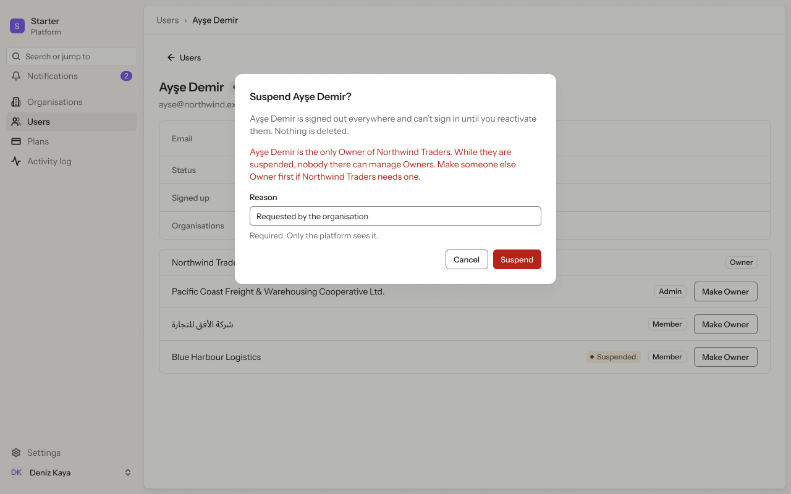

- **Who sees it:** System admins with platform.users.read. Suspend, reactivate, edit and delete need platform.users.*.
- **Device:** Desktop (1280 px and wider).
- **This state shows:** as the title says.
- **Values come from:** Users, their organisations and status: our API (platform.users.*). Terms acceptance: our API.
- **Components:** Button ×8, Input, Label ×4, Pill ×3, Platform sidebar, Top bar.
- **Actions:**
  - "Organisations": goes to [4.01 · Organisations · all](../04-organisations/README.md#401--organisations--all).
  - "Users": goes to [5.01 · Users · all](#501--users--all).
  - "Notifications": goes to [3.01 · Bell · unread](../03-notifications/README.md#301--bell--unread).
  - "Search or jump to": goes to [2.02 · Command menu](../02-shell/README.md#202--command-menu).
  - "Deniz Kaya": goes to [2.03 · Account menu](../02-shell/README.md#203--account-menu).
  - "Cancel": goes to [5.05 · User · overview](#505--user--overview).
  - "Plans": goes to [6.01 · Plans](../06-plans/README.md#601--plans).
  - "Activity log": goes to [7.01 · Activity log](../07-activity-log/README.md#701--activity-log).
  - "Settings": goes to [8.01 · Profile · ideal](../08-settings-profile/README.md#801--profile--ideal).
- **Texts, word for word, top to bottom:**

  - S
  - Starter
  - Platform
  - Search or jump to
  - Notifications
  - 2
  - Organisations
  - Users
  - Plans
  - Activity log
  - Settings
  - DK
  - Deniz Kaya
  - Users
  - ›
  - Ayşe Demir
  - Users
  - Ayşe Demir
  - Active
  - ayse@northwind.example
  - Email
  - ayse@northwind.example
  - Copy
  - Status
  - Active
  - Signed up
  - 12 Mar 2026
  - Organisations
  - 4
  - Northwind Traders
  - Owner
  - Pacific Coast Freight & Warehousing Cooperative Ltd.
  - Admin
  - Make Owner
  - شركة الأفق للتجارة
  - Member
  - Make Owner
  - Blue Harbour Logistics
  - Suspended
  - Member
  - Make Owner
  - Suspend Ayşe Demir?
  - Ayşe Demir is signed out everywhere and can’t sign in until you reactivate them. Nothing is deleted.
  - Ayşe Demir is the only Owner of Northwind Traders. While they are suspended, nobody there can manage Owners. Make someone else Owner first if Northwind Traders needs one.
  - Reason
  - Requested by the organisation
  - Required. Only the platform sees it.
  - Cancel
  - Suspend

Figma: [182:6559](https://www.figma.com/design/3Ev111okX8xCBwR9B3hyBM/?node-id=182-6559)

### 5.11 · Reactivate user

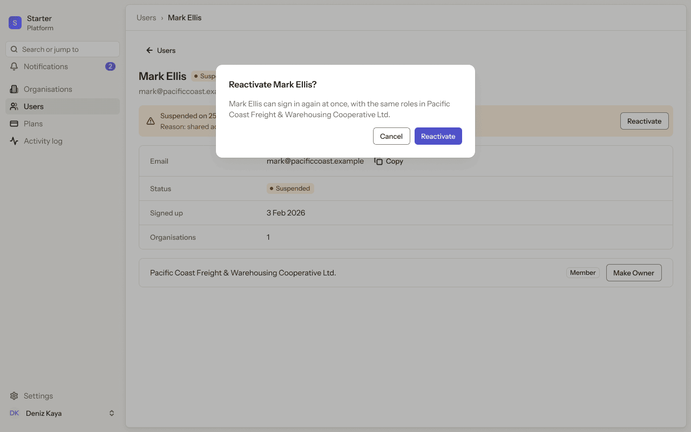

- **Who sees it:** System admins with platform.users.read. Suspend, reactivate, edit and delete need platform.users.*.
- **Device:** Desktop (1280 px and wider).
- **This state shows:** as the title says.
- **Values come from:** Users, their organisations and status: our API (platform.users.*). Terms acceptance: our API.
- **Components:** Banner, Button ×6, Label, Pill ×2, Platform sidebar, Top bar.
- **Actions:**
  - "Organisations": goes to [4.01 · Organisations · all](../04-organisations/README.md#401--organisations--all).
  - "Users": goes to [5.01 · Users · all](#501--users--all).
  - "Notifications": goes to [3.01 · Bell · unread](../03-notifications/README.md#301--bell--unread).
  - "Search or jump to": goes to [2.02 · Command menu](../02-shell/README.md#202--command-menu).
  - "Deniz Kaya": goes to [2.03 · Account menu](../02-shell/README.md#203--account-menu).
  - "Cancel": goes to [5.07 · User · suspended](#507--user--suspended).
  - "Plans": goes to [6.01 · Plans](../06-plans/README.md#601--plans).
  - "Activity log": goes to [7.01 · Activity log](../07-activity-log/README.md#701--activity-log).
  - "Settings": goes to [8.01 · Profile · ideal](../08-settings-profile/README.md#801--profile--ideal).
- **Texts, word for word, top to bottom:**

  - S
  - Starter
  - Platform
  - Search or jump to
  - Notifications
  - 2
  - Organisations
  - Users
  - Plans
  - Activity log
  - Settings
  - DK
  - Deniz Kaya
  - Users
  - ›
  - Mark Ellis
  - Users
  - Mark Ellis
  - Suspended
  - mark@pacificcoast.example
  - Suspended on 25 Oct 2026 by Deniz Kaya
  - Reason: shared account. They can’t sign in.
  - Reactivate
  - Email
  - mark@pacificcoast.example
  - Copy
  - Status
  - Suspended
  - Signed up
  - 3 Feb 2026
  - Organisations
  - 1
  - Pacific Coast Freight & Warehousing Cooperative Ltd.
  - Member
  - Make Owner
  - Reactivate Mark Ellis?
  - Mark Ellis can sign in again at once, with the same roles in Pacific Coast Freight & Warehousing Cooperative Ltd.
  - Cancel
  - Reactivate

Figma: [182:6754](https://www.figma.com/design/3Ev111okX8xCBwR9B3hyBM/?node-id=182-6754)

### 5.12 · Make Owner

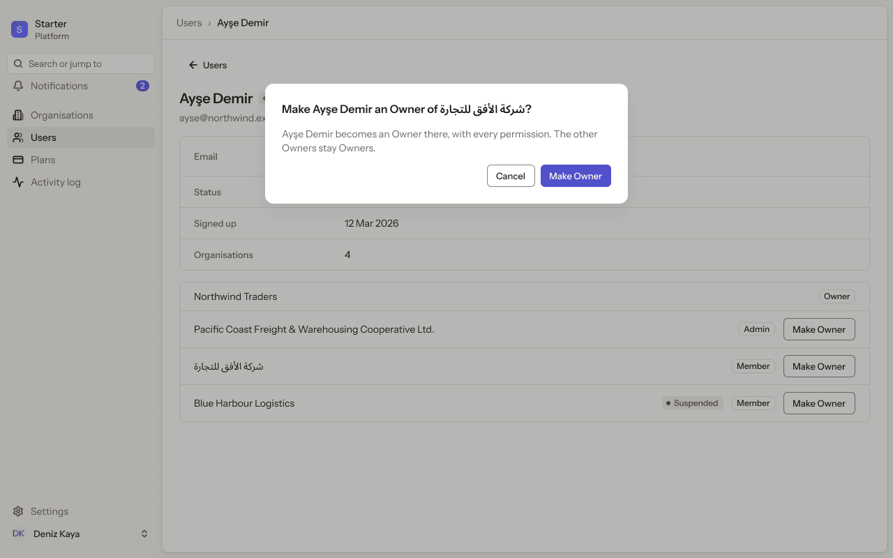

- **Who sees it:** System admins with platform.users.read. Suspend, reactivate, edit and delete need platform.users.*.
- **Device:** Desktop (1280 px and wider).
- **This state shows:** as the title says.
- **Values come from:** Users, their organisations and status: our API (platform.users.*). Terms acceptance: our API.
- **Components:** Button ×8, Label ×4, Pill ×3, Platform sidebar, Top bar.
- **Actions:**
  - "Organisations": goes to [4.01 · Organisations · all](../04-organisations/README.md#401--organisations--all).
  - "Users": goes to [5.01 · Users · all](#501--users--all).
  - "Notifications": goes to [3.01 · Bell · unread](../03-notifications/README.md#301--bell--unread).
  - "Search or jump to": goes to [2.02 · Command menu](../02-shell/README.md#202--command-menu).
  - "Deniz Kaya": goes to [2.03 · Account menu](../02-shell/README.md#203--account-menu).
  - "Cancel": goes to [5.05 · User · overview](#505--user--overview).
  - "Plans": goes to [6.01 · Plans](../06-plans/README.md#601--plans).
  - "Activity log": goes to [7.01 · Activity log](../07-activity-log/README.md#701--activity-log).
  - "Settings": goes to [8.01 · Profile · ideal](../08-settings-profile/README.md#801--profile--ideal).
- **Texts, word for word, top to bottom:**

  - S
  - Starter
  - Platform
  - Search or jump to
  - Notifications
  - 2
  - Organisations
  - Users
  - Plans
  - Activity log
  - Settings
  - DK
  - Deniz Kaya
  - Users
  - ›
  - Ayşe Demir
  - Users
  - Ayşe Demir
  - Active
  - ayse@northwind.example
  - Email
  - ayse@northwind.example
  - Copy
  - Status
  - Active
  - Signed up
  - 12 Mar 2026
  - Organisations
  - 4
  - Northwind Traders
  - Owner
  - Pacific Coast Freight & Warehousing Cooperative Ltd.
  - Admin
  - Make Owner
  - شركة الأفق للتجارة
  - Member
  - Make Owner
  - Blue Harbour Logistics
  - Suspended
  - Member
  - Make Owner
  - Make Ayşe Demir an Owner of شركة الأفق للتجارة?
  - Ayşe Demir becomes an Owner there, with every permission. The other Owners stay Owners.
  - Cancel
  - Make Owner

Figma: [182:6929](https://www.figma.com/design/3Ev111okX8xCBwR9B3hyBM/?node-id=182-6929)

### 5.13 · Delete user

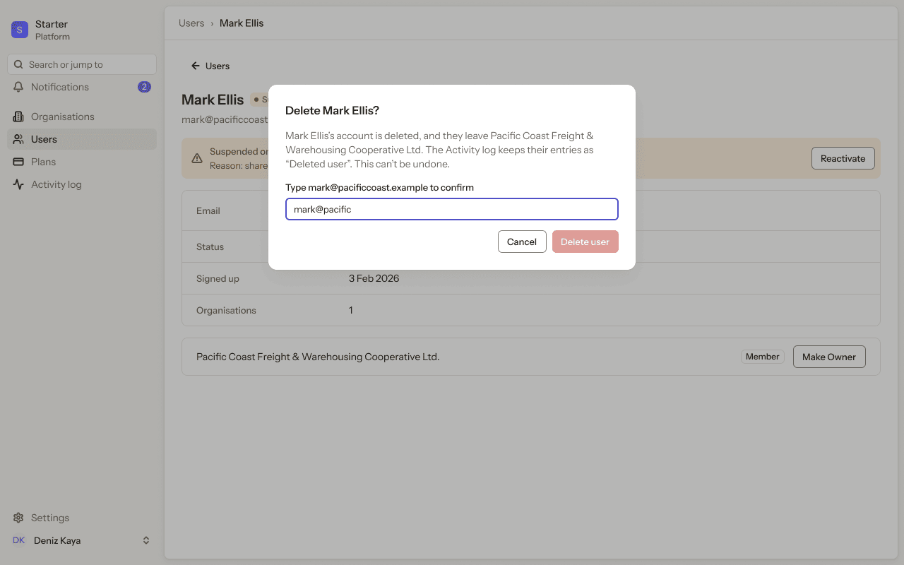

- **Who sees it:** System admins with platform.users.read. Suspend, reactivate, edit and delete need platform.users.*.
- **Device:** Desktop (1280 px and wider).
- **This state shows:** as the title says.
- **Values come from:** Users, their organisations and status: our API (platform.users.*). Terms acceptance: our API.
- **Components:** Banner, Button ×6, Input, Label, Pill ×2, Platform sidebar, Top bar.
- **Actions:**
  - "Organisations": goes to [4.01 · Organisations · all](../04-organisations/README.md#401--organisations--all).
  - "Users": goes to [5.01 · Users · all](#501--users--all).
  - "Notifications": goes to [3.01 · Bell · unread](../03-notifications/README.md#301--bell--unread).
  - "Search or jump to": goes to [2.02 · Command menu](../02-shell/README.md#202--command-menu).
  - "Deniz Kaya": goes to [2.03 · Account menu](../02-shell/README.md#203--account-menu).
  - "Cancel": goes to [5.07 · User · suspended](#507--user--suspended).
  - "Plans": goes to [6.01 · Plans](../06-plans/README.md#601--plans).
  - "Activity log": goes to [7.01 · Activity log](../07-activity-log/README.md#701--activity-log).
  - "Settings": goes to [8.01 · Profile · ideal](../08-settings-profile/README.md#801--profile--ideal).
- **Texts, word for word, top to bottom:**

  - S
  - Starter
  - Platform
  - Search or jump to
  - Notifications
  - 2
  - Organisations
  - Users
  - Plans
  - Activity log
  - Settings
  - DK
  - Deniz Kaya
  - Users
  - ›
  - Mark Ellis
  - Users
  - Mark Ellis
  - Suspended
  - mark@pacificcoast.example
  - Suspended on 25 Oct 2026 by Deniz Kaya
  - Reason: shared account. They can’t sign in.
  - Reactivate
  - Email
  - mark@pacificcoast.example
  - Copy
  - Status
  - Suspended
  - Signed up
  - 3 Feb 2026
  - Organisations
  - 1
  - Pacific Coast Freight & Warehousing Cooperative Ltd.
  - Member
  - Make Owner
  - Delete Mark Ellis?
  - Mark Ellis’s account is deleted, and they leave Pacific Coast Freight & Warehousing Cooperative Ltd. The Activity log keeps their entries as “Deleted user”. This can’t be undone.
  - Type mark@pacificcoast.example to confirm
  - mark@pacific
  - Cancel
  - Delete user

Figma: [182:7114](https://www.figma.com/design/3Ev111okX8xCBwR9B3hyBM/?node-id=182-7114)

### 5.14 · Can’t delete · last Owner

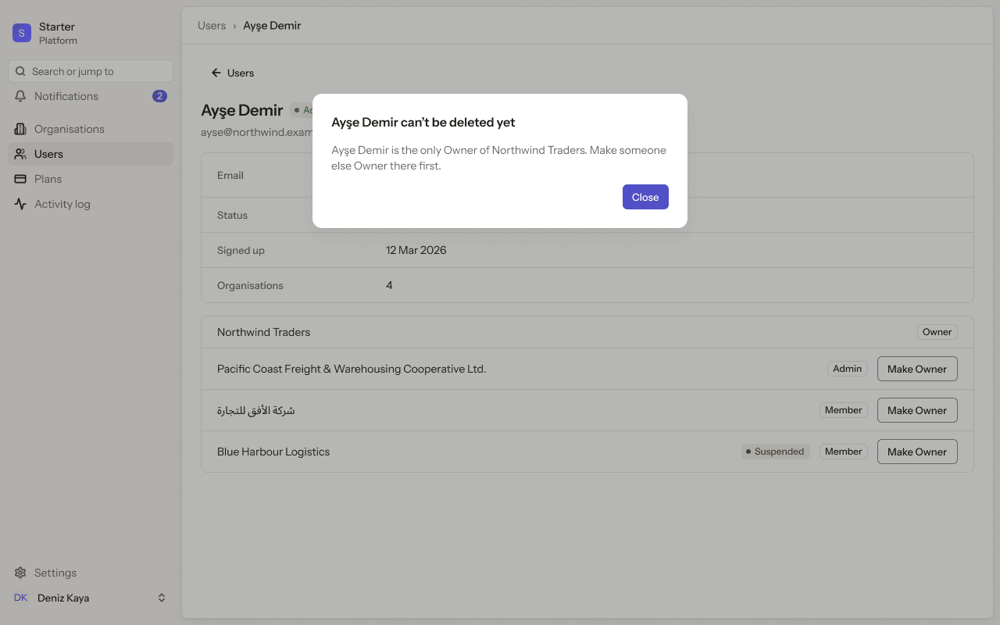

- **Who sees it:** System admins with platform.users.read. Suspend, reactivate, edit and delete need platform.users.*.
- **Device:** Desktop (1280 px and wider).
- **This state shows:** as the title says.
- **Values come from:** Users, their organisations and status: our API (platform.users.*). Terms acceptance: our API.
- **Components:** Button ×7, Label ×4, Pill ×3, Platform sidebar, Top bar.
- **Actions:**
  - "Organisations": goes to [4.01 · Organisations · all](../04-organisations/README.md#401--organisations--all).
  - "Users": goes to [5.01 · Users · all](#501--users--all).
  - "Notifications": goes to [3.01 · Bell · unread](../03-notifications/README.md#301--bell--unread).
  - "Search or jump to": goes to [2.02 · Command menu](../02-shell/README.md#202--command-menu).
  - "Deniz Kaya": goes to [2.03 · Account menu](../02-shell/README.md#203--account-menu).
  - "Close": goes to [5.05 · User · overview](#505--user--overview).
  - "Plans": goes to [6.01 · Plans](../06-plans/README.md#601--plans).
  - "Activity log": goes to [7.01 · Activity log](../07-activity-log/README.md#701--activity-log).
  - "Settings": goes to [8.01 · Profile · ideal](../08-settings-profile/README.md#801--profile--ideal).
- **Texts, word for word, top to bottom:**

  - S
  - Starter
  - Platform
  - Search or jump to
  - Notifications
  - 2
  - Organisations
  - Users
  - Plans
  - Activity log
  - Settings
  - DK
  - Deniz Kaya
  - Users
  - ›
  - Ayşe Demir
  - Users
  - Ayşe Demir
  - Active
  - ayse@northwind.example
  - Email
  - ayse@northwind.example
  - Copy
  - Status
  - Active
  - Signed up
  - 12 Mar 2026
  - Organisations
  - 4
  - Northwind Traders
  - Owner
  - Pacific Coast Freight & Warehousing Cooperative Ltd.
  - Admin
  - Make Owner
  - شركة الأفق للتجارة
  - Member
  - Make Owner
  - Blue Harbour Logistics
  - Suspended
  - Member
  - Make Owner
  - Ayşe Demir can’t be deleted yet
  - Ayşe Demir is the only Owner of Northwind Traders. Make someone else Owner there first.
  - Close

Figma: [182:7297](https://www.figma.com/design/3Ev111okX8xCBwR9B3hyBM/?node-id=182-7297)

### 5.15 · Can’t delete · system admin

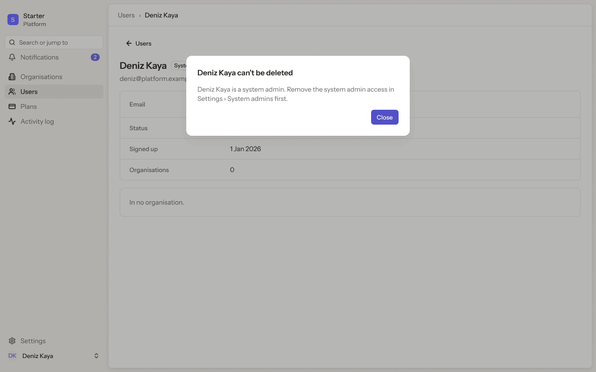

- **Who sees it:** System admins with platform.users.read. Suspend, reactivate, edit and delete need platform.users.*.
- **Device:** Desktop (1280 px and wider).
- **This state shows:** as the title says.
- **Values come from:** Users, their organisations and status: our API (platform.users.*). Terms acceptance: our API.
- **Components:** Button ×4, Label, Pill ×2, Platform sidebar, Top bar.
- **Actions:**
  - "Organisations": goes to [4.01 · Organisations · all](../04-organisations/README.md#401--organisations--all).
  - "Users": goes to [5.01 · Users · all](#501--users--all).
  - "Notifications": goes to [3.01 · Bell · unread](../03-notifications/README.md#301--bell--unread).
  - "Search or jump to": goes to [2.02 · Command menu](../02-shell/README.md#202--command-menu).
  - "Deniz Kaya": goes to [2.03 · Account menu](../02-shell/README.md#203--account-menu).
  - "Close": goes to [5.08 · User · system admin](#508--user--system-admin).
  - "Plans": goes to [6.01 · Plans](../06-plans/README.md#601--plans).
  - "Activity log": goes to [7.01 · Activity log](../07-activity-log/README.md#701--activity-log).
  - "Settings": goes to [8.01 · Profile · ideal](../08-settings-profile/README.md#801--profile--ideal).
- **Texts, word for word, top to bottom:**

  - S
  - Starter
  - Platform
  - Search or jump to
  - Notifications
  - 2
  - Organisations
  - Users
  - Plans
  - Activity log
  - Settings
  - DK
  - Deniz Kaya
  - Users
  - ›
  - Deniz Kaya
  - Users
  - Deniz Kaya
  - System admin
  - Active
  - deniz@platform.example
  - Email
  - deniz@platform.example
  - Copy
  - Status
  - Active
  - Signed up
  - 1 Jan 2026
  - Organisations
  - 0
  - In no organisation.
  - Deniz Kaya can’t be deleted
  - Deniz Kaya is a system admin. Remove the system admin access in Settings › System admins first.
  - Close

Figma: [182:7476](https://www.figma.com/design/3Ev111okX8xCBwR9B3hyBM/?node-id=182-7476)

### 5.16 · Phone · Users

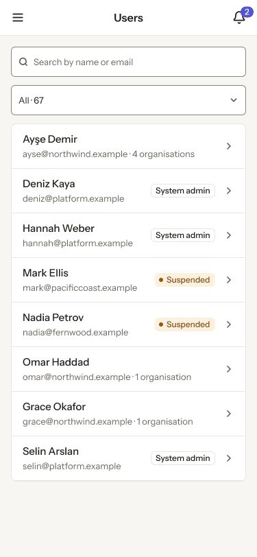

- **Who sees it:** System admins with platform.users.read. Suspend, reactivate, edit and delete need platform.users.*.
- **Device:** Phone (up to 767 px).
- **This state shows:** on a phone.
- **Values come from:** Users, their organisations and status: our API (platform.users.*). Terms acceptance: our API.
- **Components:** Input, Phone list row ×8, Phone top bar, Select.
- **Actions:**
  - "Area": goes to [2.14 · Phone · menu open](../02-shell/README.md#214--phone--menu-open).
  - "2": goes to [3.08 · Phone · Notifications](../03-notifications/README.md#308--phone--notifications).
  - "Ayşe Demir": goes to [5.17 · Phone · User](#517--phone--user).
- **Texts, word for word, top to bottom:**

  - Users
  - 2
  - Search by name or email
  - All · 67
  - Ayşe Demir
  - ayse@northwind.example · 4 organisations
  - Deniz Kaya
  - deniz@platform.example
  - System admin
  - Hannah Weber
  - hannah@platform.example
  - System admin
  - Mark Ellis
  - mark@pacificcoast.example
  - Suspended
  - Nadia Petrov
  - nadia@fernwood.example
  - Suspended
  - Omar Haddad
  - omar@northwind.example · 1 organisation
  - Grace Okafor
  - grace@northwind.example · 1 organisation
  - Selin Arslan
  - selin@platform.example
  - System admin

Figma: [261:16918](https://www.figma.com/design/3Ev111okX8xCBwR9B3hyBM/?node-id=261-16918)

### 5.17 · Phone · User

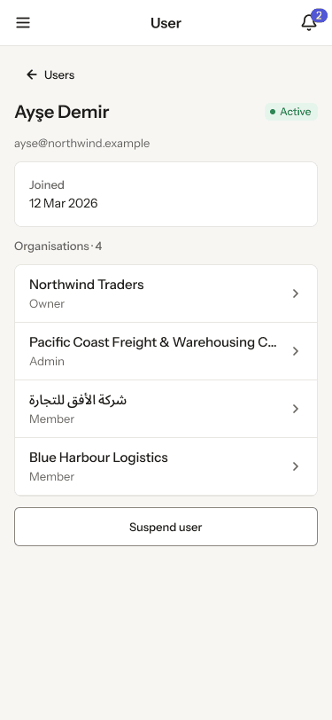

- **Who sees it:** System admins with platform.users.read. Suspend, reactivate, edit and delete need platform.users.*.
- **Device:** Phone (up to 767 px).
- **This state shows:** on a phone.
- **Values come from:** Users, their organisations and status: our API (platform.users.*). Terms acceptance: our API.
- **Components:** Button ×2, Phone list row ×4, Phone top bar, Pill.
- **Actions:**
  - "Area": goes to [2.14 · Phone · menu open](../02-shell/README.md#214--phone--menu-open).
  - "2": goes to [3.08 · Phone · Notifications](../03-notifications/README.md#308--phone--notifications).
  - "Users": goes to [5.16 · Phone · Users](#516--phone--users).
- **Texts, word for word, top to bottom:**

  - User
  - 2
  - Users
  - Ayşe Demir
  - Active
  - ayse@northwind.example
  - Joined
  - 12 Mar 2026
  - Organisations · 4
  - Northwind Traders
  - Owner
  - Pacific Coast Freight & Warehousing Cooperative Ltd.
  - Admin
  - شركة الأفق للتجارة
  - Member
  - Blue Harbour Logistics
  - Member
  - Suspend user

Figma: [261:17024](https://www.figma.com/design/3Ev111okX8xCBwR9B3hyBM/?node-id=261-17024)

### 5.18 · Users · loading more

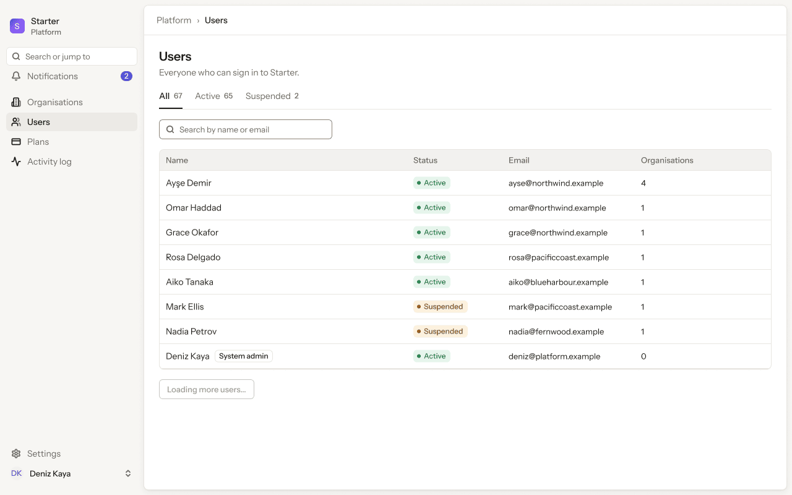

- **Who sees it:** System admins with platform.users.read. Suspend, reactivate, edit and delete need platform.users.*.
- **Device:** Desktop (1280 px and wider).
- **This state shows:** while the next page of rows loads; while the request runs.
- **Values come from:** Users, their organisations and status: our API (platform.users.*). Terms acceptance: our API.
- **Components:** Button, Input, Label, Pill ×8, Platform sidebar, Tab ×3, Top bar.
- **Actions:**
  - No prototype link on this screen. The buttons follow the section's other screens.
- **Texts, word for word, top to bottom:**

  - S
  - Starter
  - Platform
  - Search or jump to
  - Notifications
  - 2
  - Organisations
  - Users
  - Plans
  - Activity log
  - Settings
  - DK
  - Deniz Kaya
  - Platform
  - ›
  - Users
  - Users
  - Everyone who can sign in to Starter.
  - All
  - 67
  - Active
  - 65
  - Suspended
  - 2
  - Search by name or email
  - Name
  - Status
  - Email
  - Organisations
  - Ayşe Demir
  - Active
  - ayse@northwind.example
  - 4
  - Omar Haddad
  - Active
  - omar@northwind.example
  - 1
  - Grace Okafor
  - Active
  - grace@northwind.example
  - 1
  - Rosa Delgado
  - Active
  - rosa@pacificcoast.example
  - 1
  - Aiko Tanaka
  - Active
  - aiko@blueharbour.example
  - 1
  - Mark Ellis
  - Suspended
  - mark@pacificcoast.example
  - 1
  - Nadia Petrov
  - Suspended
  - nadia@fernwood.example
  - 1
  - Deniz Kaya
  - System admin
  - Active
  - deniz@platform.example
  - 0
  - Loading more users…

Figma: [303:18573](https://www.figma.com/design/3Ev111okX8xCBwR9B3hyBM/?node-id=303-18573)

### 5.19 · Users · couldn’t load more

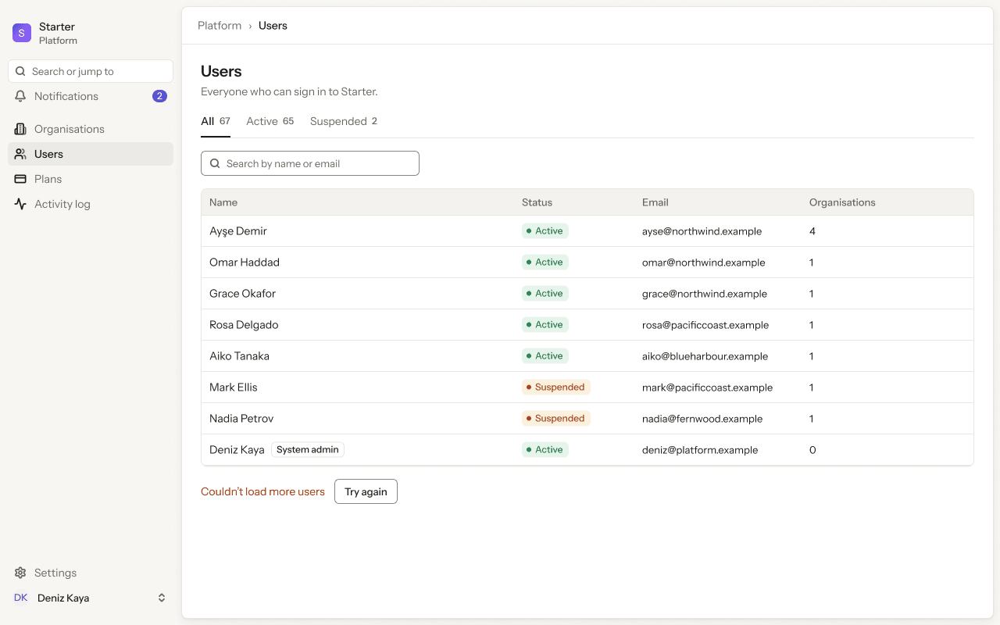

- **Who sees it:** System admins with platform.users.read. Suspend, reactivate, edit and delete need platform.users.*.
- **Device:** Desktop (1280 px and wider).
- **This state shows:** when the next page of rows fails to load.
- **Values come from:** Users, their organisations and status: our API (platform.users.*). Terms acceptance: our API.
- **Components:** Button, Input, Label, Pill ×8, Platform sidebar, Tab ×3, Top bar.
- **Actions:**
  - No prototype link on this screen. The buttons follow the section's other screens.
- **Texts, word for word, top to bottom:**

  - S
  - Starter
  - Platform
  - Search or jump to
  - Notifications
  - 2
  - Organisations
  - Users
  - Plans
  - Activity log
  - Settings
  - DK
  - Deniz Kaya
  - Platform
  - ›
  - Users
  - Users
  - Everyone who can sign in to Starter.
  - All
  - 67
  - Active
  - 65
  - Suspended
  - 2
  - Search by name or email
  - Name
  - Status
  - Email
  - Organisations
  - Ayşe Demir
  - Active
  - ayse@northwind.example
  - 4
  - Omar Haddad
  - Active
  - omar@northwind.example
  - 1
  - Grace Okafor
  - Active
  - grace@northwind.example
  - 1
  - Rosa Delgado
  - Active
  - rosa@pacificcoast.example
  - 1
  - Aiko Tanaka
  - Active
  - aiko@blueharbour.example
  - 1
  - Mark Ellis
  - Suspended
  - mark@pacificcoast.example
  - 1
  - Nadia Petrov
  - Suspended
  - nadia@fernwood.example
  - 1
  - Deniz Kaya
  - System admin
  - Active
  - deniz@platform.example
  - 0
  - Couldn’t load more users
  - Try again

Figma: [303:18802](https://www.figma.com/design/3Ev111okX8xCBwR9B3hyBM/?node-id=303-18802)
