# Platform app · 6 · Plans

Who sees this section: System admins with platform.plans.read. Create and edit need platform.plans.create and platform.plans.update.

Where the values come from: Plans, limits, prices and meters: our API (platform.plans.*).

18 screens. Each part below is one screen and state. The PNG beside this file is the screen at scale 1.

| Screen | Device |
|---|---|
| [6.01 · Plans](#601--plans) | Desktop |
| [6.02 · Plans · loading](#602--plans--loading) | Desktop |
| [6.03 · Plans · couldn’t load](#603--plans--couldnt-load) | Desktop |
| [6.04 · Plan · Team](#604--plan--team) | Desktop |
| [6.05 · Plan · Free · default](#605--plan--free--default) | Desktop |
| [6.06 · Plan · Team · edited](#606--plan--team--edited) | Desktop |
| [6.07 · Save changes · over a limit](#607--save-changes--over-a-limit) | Desktop |
| [6.08 · Plan · Team · saved](#608--plan--team--saved) | Desktop |
| [6.09 · Save · couldn’t check](#609--save--couldnt-check) | Desktop |
| [6.10 · New plan](#610--new-plan) | Desktop |
| [6.11 · New plan · errors](#611--new-plan--errors) | Desktop |
| [6.12 · Plan · created](#612--plan--created) | Desktop |
| [6.13 · Plan · Team · prices and meters](#613--plan--team--prices-and-meters) | Desktop |
| [6.14 · Price change · who pays it](#614--price-change--who-pays-it) | Desktop |
| [6.15 · Plan · Team · customers on the old price](#615--plan--team--customers-on-the-old-price) | Desktop |
| [6.16 · Move to the new price](#616--move-to-the-new-price) | Desktop |
| [6.17 · Phone · Plans](#617--phone--plans) | Phone |
| [6.18 · Phone · Plan](#618--phone--plan) | Phone |

### 6.01 · Plans

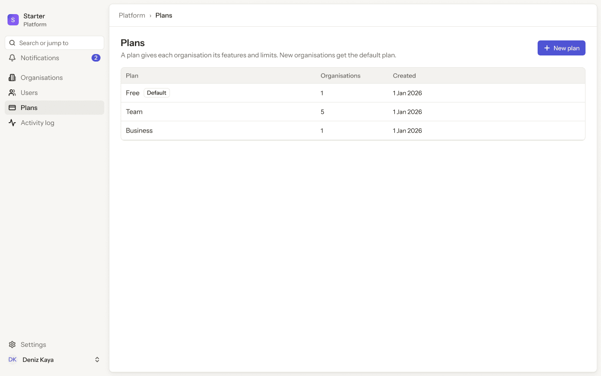

- **Who sees it:** System admins with platform.plans.read. Create and edit need platform.plans.create and platform.plans.update.
- **Device:** Desktop (1280 px and wider).
- **This state shows:** as the title says.
- **Values come from:** Plans, limits, prices and meters: our API (platform.plans.*).
- **Components:** Button, Label, Platform sidebar, Top bar.
- **Actions:**
  - "Organisations": goes to [4.01 · Organisations · all](../04-organisations/README.md#401--organisations--all).
  - "Notifications": goes to [3.01 · Bell · unread](../03-notifications/README.md#301--bell--unread).
  - "Search or jump to": goes to [2.02 · Command menu](../02-shell/README.md#202--command-menu).
  - "Deniz Kaya": goes to [2.03 · Account menu](../02-shell/README.md#203--account-menu).
  - "Users": goes to [5.01 · Users · all](../05-users/README.md#501--users--all).
  - "Team": goes to [6.05 · Plan · Free · default](#605--plan--free--default).
  - "Business": goes to [6.04 · Plan · Team](#604--plan--team).
  - "New plan": goes to [6.10 · New plan](#610--new-plan).
  - "Activity log": goes to [7.01 · Activity log](../07-activity-log/README.md#701--activity-log).
  - "Settings": goes to [8.01 · Profile · ideal](../08-settings-profile/README.md#801--profile--ideal).
- **Texts, word for word, top to bottom:**

  - S
  - Starter
  - Platform
  - Search or jump to
  - Notifications
  - 2
  - Organisations
  - Users
  - Plans
  - Activity log
  - Settings
  - DK
  - Deniz Kaya
  - Platform
  - ›
  - Plans
  - Plans
  - A plan gives each organisation its features and limits. New organisations get the default plan.
  - New plan
  - Plan
  - Organisations
  - Created
  - Free
  - Default
  - 1
  - 1 Jan 2026
  - Team
  - 5
  - 1 Jan 2026
  - Business
  - 1
  - 1 Jan 2026

Figma: [188:7126](https://www.figma.com/design/3Ev111okX8xCBwR9B3hyBM/?node-id=188-7126)

### 6.02 · Plans · loading

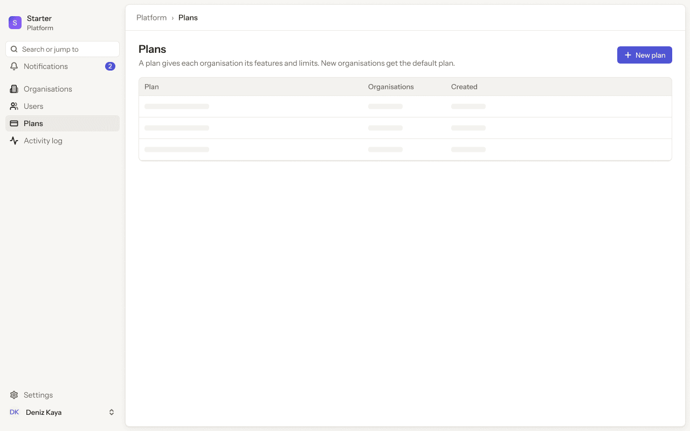

- **Who sees it:** System admins with platform.plans.read. Create and edit need platform.plans.create and platform.plans.update.
- **Device:** Desktop (1280 px and wider).
- **This state shows:** while the request runs.
- **Values come from:** Plans, limits, prices and meters: our API (platform.plans.*).
- **Components:** Button, Platform sidebar, Skeleton ×9, Top bar.
- **Actions:**
  - "Organisations": goes to [4.01 · Organisations · all](../04-organisations/README.md#401--organisations--all).
  - "Notifications": goes to [3.01 · Bell · unread](../03-notifications/README.md#301--bell--unread).
  - "Search or jump to": goes to [2.02 · Command menu](../02-shell/README.md#202--command-menu).
  - "Deniz Kaya": goes to [2.03 · Account menu](../02-shell/README.md#203--account-menu).
  - "Users": goes to [5.01 · Users · all](../05-users/README.md#501--users--all).
  - "Plans": goes to [6.01 · Plans](#601--plans).
  - "Activity log": goes to [7.01 · Activity log](../07-activity-log/README.md#701--activity-log).
  - "Settings": goes to [8.01 · Profile · ideal](../08-settings-profile/README.md#801--profile--ideal).
- **Texts, word for word, top to bottom:**

  - S
  - Starter
  - Platform
  - Search or jump to
  - Notifications
  - 2
  - Organisations
  - Users
  - Plans
  - Activity log
  - Settings
  - DK
  - Deniz Kaya
  - Platform
  - ›
  - Plans
  - Plans
  - A plan gives each organisation its features and limits. New organisations get the default plan.
  - New plan
  - Plan
  - Organisations
  - Created

Figma: [188:7470](https://www.figma.com/design/3Ev111okX8xCBwR9B3hyBM/?node-id=188-7470)

### 6.03 · Plans · couldn’t load

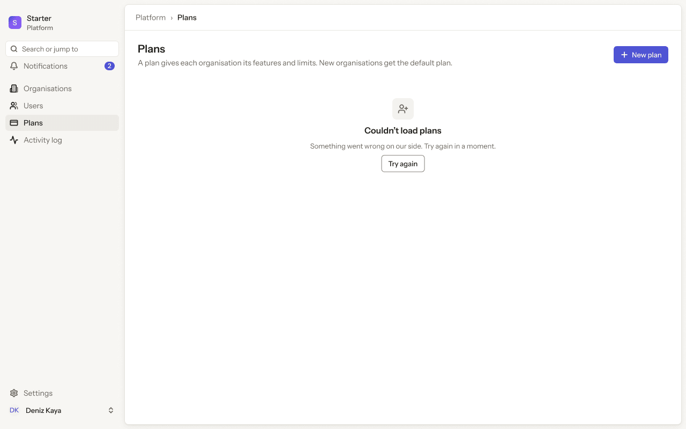

- **Who sees it:** System admins with platform.plans.read. Create and edit need platform.plans.create and platform.plans.update.
- **Device:** Desktop (1280 px and wider).
- **This state shows:** as the title says.
- **Values come from:** Plans, limits, prices and meters: our API (platform.plans.*).
- **Components:** Button, Empty state, Platform sidebar, Top bar.
- **Actions:**
  - "Organisations": goes to [4.01 · Organisations · all](../04-organisations/README.md#401--organisations--all).
  - "Notifications": goes to [3.01 · Bell · unread](../03-notifications/README.md#301--bell--unread).
  - "Search or jump to": goes to [2.02 · Command menu](../02-shell/README.md#202--command-menu).
  - "Deniz Kaya": goes to [2.03 · Account menu](../02-shell/README.md#203--account-menu).
  - "Users": goes to [5.01 · Users · all](../05-users/README.md#501--users--all).
  - "Plans": goes to [6.01 · Plans](#601--plans).
  - "Area": goes to [6.01 · Plans](#601--plans).
  - "Activity log": goes to [7.01 · Activity log](../07-activity-log/README.md#701--activity-log).
  - "Settings": goes to [8.01 · Profile · ideal](../08-settings-profile/README.md#801--profile--ideal).
- **Texts, word for word, top to bottom:**

  - S
  - Starter
  - Platform
  - Search or jump to
  - Notifications
  - 2
  - Organisations
  - Users
  - Plans
  - Activity log
  - Settings
  - DK
  - Deniz Kaya
  - Platform
  - ›
  - Plans
  - Plans
  - A plan gives each organisation its features and limits. New organisations get the default plan.
  - New plan
  - Couldn’t load plans
  - Something went wrong on our side. Try again in a moment.
  - Try again

Figma: [188:7598](https://www.figma.com/design/3Ev111okX8xCBwR9B3hyBM/?node-id=188-7598)

### 6.04 · Plan · Team

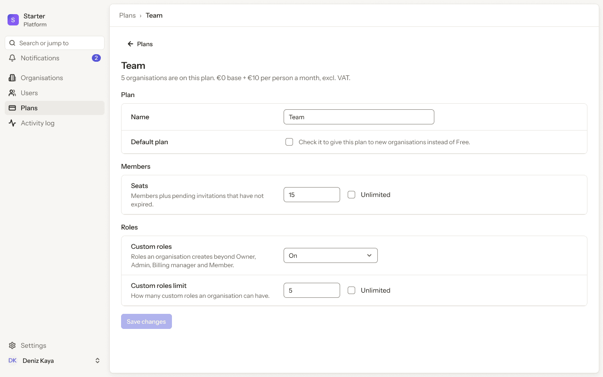

- **Who sees it:** System admins with platform.plans.read. Create and edit need platform.plans.create and platform.plans.update.
- **Device:** Desktop (1280 px and wider).
- **This state shows:** as the title says.
- **Values come from:** Plans, limits, prices and meters: our API (platform.plans.*).
- **Components:** Button ×2, Checkbox ×3, Input ×3, Platform sidebar, Select, Top bar.
- **Actions:**
  - "Organisations": goes to [4.01 · Organisations · all](../04-organisations/README.md#401--organisations--all).
  - "Notifications": goes to [3.01 · Bell · unread](../03-notifications/README.md#301--bell--unread).
  - "Search or jump to": goes to [2.02 · Command menu](../02-shell/README.md#202--command-menu).
  - "Deniz Kaya": goes to [2.03 · Account menu](../02-shell/README.md#203--account-menu).
  - "Users": goes to [5.01 · Users · all](../05-users/README.md#501--users--all).
  - "Plans": goes to [6.01 · Plans](#601--plans).
  - "15": goes to [6.06 · Plan · Team · edited](#606--plan--team--edited).
  - "Activity log": goes to [7.01 · Activity log](../07-activity-log/README.md#701--activity-log).
  - "Settings": goes to [8.01 · Profile · ideal](../08-settings-profile/README.md#801--profile--ideal).
- **Texts, word for word, top to bottom:**

  - S
  - Starter
  - Platform
  - Search or jump to
  - Notifications
  - 2
  - Organisations
  - Users
  - Plans
  - Activity log
  - Settings
  - DK
  - Deniz Kaya
  - Plans
  - ›
  - Team
  - Plans
  - Team
  - 5 organisations are on this plan. €0 base + €10 per person a month, excl. VAT.
  - Plan
  - Name
  - Team
  - Default plan
  - Check it to give this plan to new organisations instead of Free.
  - Members
  - Seats
  - Members plus pending invitations that have not expired.
  - 15
  - Unlimited
  - Roles
  - Custom roles
  - Roles an organisation creates beyond Owner, Admin, Billing manager and Member.
  - On
  - Custom roles limit
  - How many custom roles an organisation can have.
  - 5
  - Unlimited
  - Save changes

Figma: [189:7603](https://www.figma.com/design/3Ev111okX8xCBwR9B3hyBM/?node-id=189-7603)

### 6.05 · Plan · Free · default

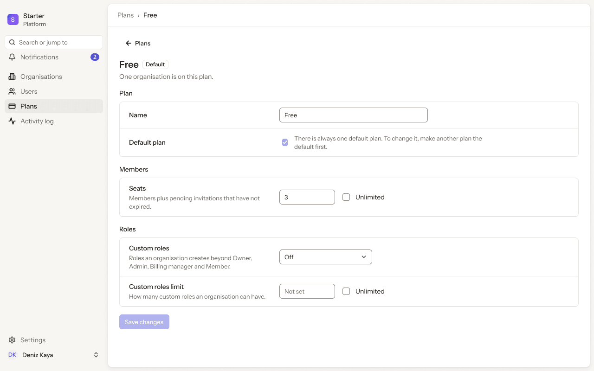

- **Who sees it:** System admins with platform.plans.read. Create and edit need platform.plans.create and platform.plans.update.
- **Device:** Desktop (1280 px and wider).
- **This state shows:** as the title says.
- **Values come from:** Plans, limits, prices and meters: our API (platform.plans.*).
- **Components:** Button ×2, Checkbox ×3, Input ×3, Label, Platform sidebar, Select, Top bar.
- **Actions:**
  - "Organisations": goes to [4.01 · Organisations · all](../04-organisations/README.md#401--organisations--all).
  - "Notifications": goes to [3.01 · Bell · unread](../03-notifications/README.md#301--bell--unread).
  - "Search or jump to": goes to [2.02 · Command menu](../02-shell/README.md#202--command-menu).
  - "Deniz Kaya": goes to [2.03 · Account menu](../02-shell/README.md#203--account-menu).
  - "Users": goes to [5.01 · Users · all](../05-users/README.md#501--users--all).
  - "Plans": goes to [6.01 · Plans](#601--plans).
  - "Activity log": goes to [7.01 · Activity log](../07-activity-log/README.md#701--activity-log).
  - "Settings": goes to [8.01 · Profile · ideal](../08-settings-profile/README.md#801--profile--ideal).
- **Texts, word for word, top to bottom:**

  - S
  - Starter
  - Platform
  - Search or jump to
  - Notifications
  - 2
  - Organisations
  - Users
  - Plans
  - Activity log
  - Settings
  - DK
  - Deniz Kaya
  - Plans
  - ›
  - Free
  - Plans
  - Free
  - Default
  - One organisation is on this plan.
  - Plan
  - Name
  - Free
  - Default plan
  - There is always one default plan. To change it, make another plan the default first.
  - Members
  - Seats
  - Members plus pending invitations that have not expired.
  - 3
  - Unlimited
  - Roles
  - Custom roles
  - Roles an organisation creates beyond Owner, Admin, Billing manager and Member.
  - Off
  - Custom roles limit
  - How many custom roles an organisation can have.
  - Not set
  - Unlimited
  - Save changes

Figma: [189:7966](https://www.figma.com/design/3Ev111okX8xCBwR9B3hyBM/?node-id=189-7966)

### 6.06 · Plan · Team · edited

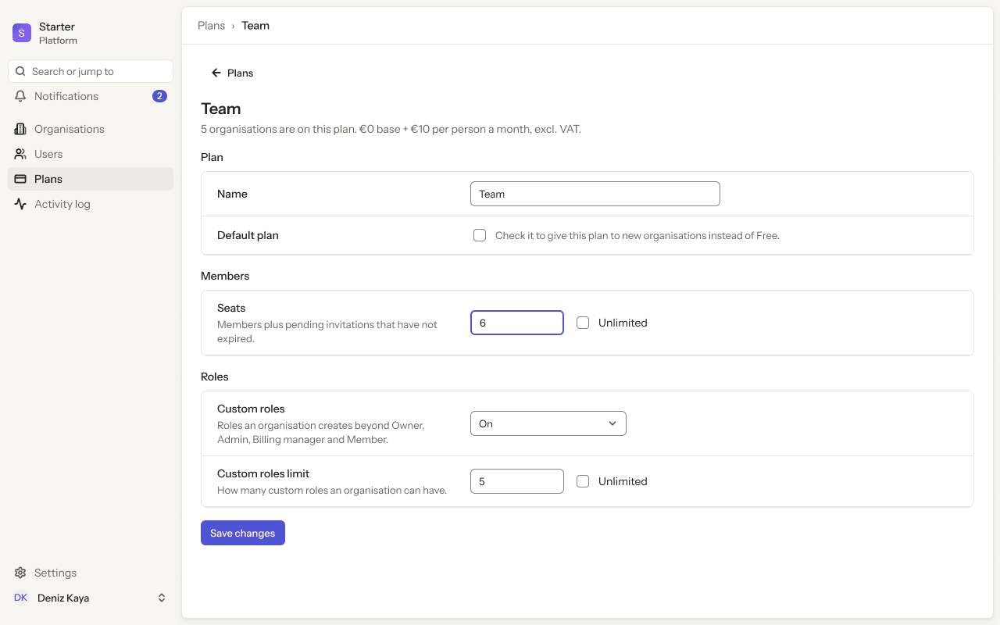

- **Who sees it:** System admins with platform.plans.read. Create and edit need platform.plans.create and platform.plans.update.
- **Device:** Desktop (1280 px and wider).
- **This state shows:** after the person changes a value and before saving.
- **Values come from:** Plans, limits, prices and meters: our API (platform.plans.*).
- **Components:** Button ×2, Checkbox ×3, Input ×3, Platform sidebar, Select, Top bar.
- **Actions:**
  - "Organisations": goes to [4.01 · Organisations · all](../04-organisations/README.md#401--organisations--all).
  - "Notifications": goes to [3.01 · Bell · unread](../03-notifications/README.md#301--bell--unread).
  - "Search or jump to": goes to [2.02 · Command menu](../02-shell/README.md#202--command-menu).
  - "Deniz Kaya": goes to [2.03 · Account menu](../02-shell/README.md#203--account-menu).
  - "Users": goes to [5.01 · Users · all](../05-users/README.md#501--users--all).
  - "Plans": goes to [6.01 · Plans](#601--plans).
  - "Save changes": goes to [6.07 · Save changes · over a limit](#607--save-changes--over-a-limit).
  - "Activity log": goes to [7.01 · Activity log](../07-activity-log/README.md#701--activity-log).
  - "Settings": goes to [8.01 · Profile · ideal](../08-settings-profile/README.md#801--profile--ideal).
- **Texts, word for word, top to bottom:**

  - S
  - Starter
  - Platform
  - Search or jump to
  - Notifications
  - 2
  - Organisations
  - Users
  - Plans
  - Activity log
  - Settings
  - DK
  - Deniz Kaya
  - Plans
  - ›
  - Team
  - Plans
  - Team
  - 5 organisations are on this plan. €0 base + €10 per person a month, excl. VAT.
  - Plan
  - Name
  - Team
  - Default plan
  - Check it to give this plan to new organisations instead of Free.
  - Members
  - Seats
  - Members plus pending invitations that have not expired.
  - 6
  - Unlimited
  - Roles
  - Custom roles
  - Roles an organisation creates beyond Owner, Admin, Billing manager and Member.
  - On
  - Custom roles limit
  - How many custom roles an organisation can have.
  - 5
  - Unlimited
  - Save changes

Figma: [189:8335](https://www.figma.com/design/3Ev111okX8xCBwR9B3hyBM/?node-id=189-8335)

### 6.07 · Save changes · over a limit

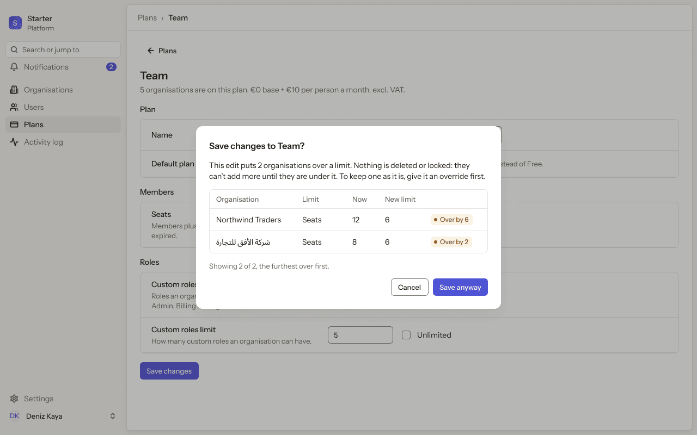

- **Who sees it:** System admins with platform.plans.read. Create and edit need platform.plans.create and platform.plans.update.
- **Device:** Desktop (1280 px and wider).
- **This state shows:** as the title says.
- **Values come from:** Plans, limits, prices and meters: our API (platform.plans.*).
- **Components:** Button ×4, Checkbox ×3, Input ×3, Pill ×2, Platform sidebar, Select, Top bar.
- **Actions:**
  - "Organisations": goes to [4.01 · Organisations · all](../04-organisations/README.md#401--organisations--all).
  - "Notifications": goes to [3.01 · Bell · unread](../03-notifications/README.md#301--bell--unread).
  - "Search or jump to": goes to [2.02 · Command menu](../02-shell/README.md#202--command-menu).
  - "Deniz Kaya": goes to [2.03 · Account menu](../02-shell/README.md#203--account-menu).
  - "Users": goes to [5.01 · Users · all](../05-users/README.md#501--users--all).
  - "Plans": goes to [6.01 · Plans](#601--plans).
  - "Cancel": goes to [6.06 · Plan · Team · edited](#606--plan--team--edited).
  - "Save anyway": goes to [6.08 · Plan · Team · saved](#608--plan--team--saved).
  - "Activity log": goes to [7.01 · Activity log](../07-activity-log/README.md#701--activity-log).
  - "Settings": goes to [8.01 · Profile · ideal](../08-settings-profile/README.md#801--profile--ideal).
- **Texts, word for word, top to bottom:**

  - S
  - Starter
  - Platform
  - Search or jump to
  - Notifications
  - 2
  - Organisations
  - Users
  - Plans
  - Activity log
  - Settings
  - DK
  - Deniz Kaya
  - Plans
  - ›
  - Team
  - Plans
  - Team
  - 5 organisations are on this plan. €0 base + €10 per person a month, excl. VAT.
  - Plan
  - Name
  - Team
  - Default plan
  - Check it to give this plan to new organisations instead of Free.
  - Members
  - Seats
  - Members plus pending invitations that have not expired.
  - 6
  - Unlimited
  - Roles
  - Custom roles
  - Roles an organisation creates beyond Owner, Admin, Billing manager and Member.
  - On
  - Custom roles limit
  - How many custom roles an organisation can have.
  - 5
  - Unlimited
  - Save changes
  - Save changes to Team?
  - This edit puts 2 organisations over a limit. Nothing is deleted or locked: they can’t add more until they are under it. To keep one as it is, give it an override first.
  - Organisation
  - Limit
  - Now
  - New limit
  - Northwind Traders
  - Seats
  - 12
  - 6
  - Over by 6
  - شركة الأفق للتجارة
  - Seats
  - 8
  - 6
  - Over by 2
  - Showing 2 of 2, the furthest over first.
  - Cancel
  - Save anyway

Figma: [190:7652](https://www.figma.com/design/3Ev111okX8xCBwR9B3hyBM/?node-id=190-7652)

### 6.08 · Plan · Team · saved

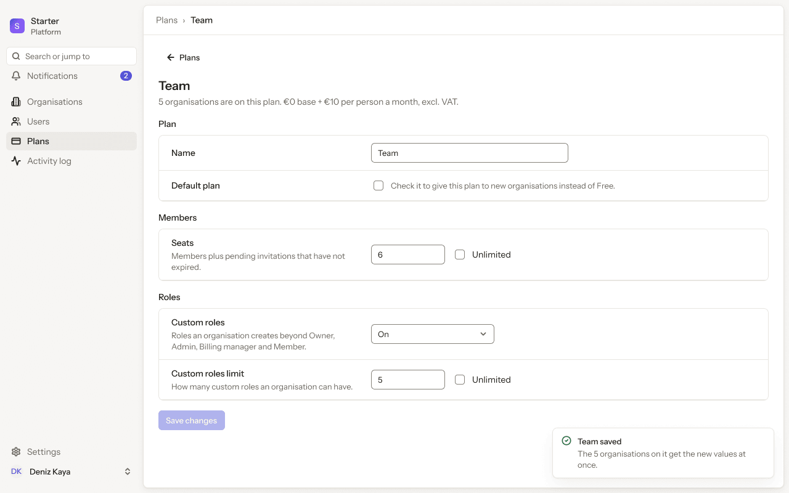

- **Who sees it:** System admins with platform.plans.read. Create and edit need platform.plans.create and platform.plans.update.
- **Device:** Desktop (1280 px and wider).
- **This state shows:** right after a save succeeds.
- **Values come from:** Plans, limits, prices and meters: our API (platform.plans.*).
- **Components:** Button ×2, Checkbox ×3, Input ×3, Platform sidebar, Select, Toast, Top bar.
- **Actions:**
  - "Organisations": goes to [4.01 · Organisations · all](../04-organisations/README.md#401--organisations--all).
  - "Notifications": goes to [3.01 · Bell · unread](../03-notifications/README.md#301--bell--unread).
  - "Search or jump to": goes to [2.02 · Command menu](../02-shell/README.md#202--command-menu).
  - "Deniz Kaya": goes to [2.03 · Account menu](../02-shell/README.md#203--account-menu).
  - "Users": goes to [5.01 · Users · all](../05-users/README.md#501--users--all).
  - "Plans": goes to [6.01 · Plans](#601--plans).
  - "Activity log": goes to [7.01 · Activity log](../07-activity-log/README.md#701--activity-log).
  - "Settings": goes to [8.01 · Profile · ideal](../08-settings-profile/README.md#801--profile--ideal).
- **Texts, word for word, top to bottom:**

  - S
  - Starter
  - Platform
  - Search or jump to
  - Notifications
  - 2
  - Organisations
  - Users
  - Plans
  - Activity log
  - Settings
  - DK
  - Deniz Kaya
  - Plans
  - ›
  - Team
  - Plans
  - Team
  - 5 organisations are on this plan. €0 base + €10 per person a month, excl. VAT.
  - Plan
  - Name
  - Team
  - Default plan
  - Check it to give this plan to new organisations instead of Free.
  - Members
  - Seats
  - Members plus pending invitations that have not expired.
  - 6
  - Unlimited
  - Roles
  - Custom roles
  - Roles an organisation creates beyond Owner, Admin, Billing manager and Member.
  - On
  - Custom roles limit
  - How many custom roles an organisation can have.
  - 5
  - Unlimited
  - Save changes
  - Team saved
  - The 5 organisations on it get the new values at once.

Figma: [190:7769](https://www.figma.com/design/3Ev111okX8xCBwR9B3hyBM/?node-id=190-7769)

### 6.09 · Save · couldn’t check

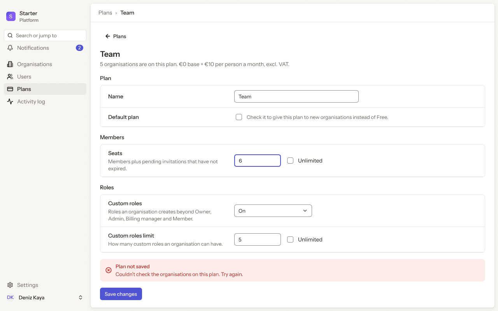

- **Who sees it:** System admins with platform.plans.read. Create and edit need platform.plans.create and platform.plans.update.
- **Device:** Desktop (1280 px and wider).
- **This state shows:** as the title says.
- **Values come from:** Plans, limits, prices and meters: our API (platform.plans.*).
- **Components:** Banner, Button ×2, Checkbox ×3, Input ×3, Platform sidebar, Select, Top bar.
- **Actions:**
  - "Organisations": goes to [4.01 · Organisations · all](../04-organisations/README.md#401--organisations--all).
  - "Notifications": goes to [3.01 · Bell · unread](../03-notifications/README.md#301--bell--unread).
  - "Search or jump to": goes to [2.02 · Command menu](../02-shell/README.md#202--command-menu).
  - "Deniz Kaya": goes to [2.03 · Account menu](../02-shell/README.md#203--account-menu).
  - "Users": goes to [5.01 · Users · all](../05-users/README.md#501--users--all).
  - "Plans": goes to [6.01 · Plans](#601--plans).
  - "Activity log": goes to [7.01 · Activity log](../07-activity-log/README.md#701--activity-log).
  - "Settings": goes to [8.01 · Profile · ideal](../08-settings-profile/README.md#801--profile--ideal).
- **Texts, word for word, top to bottom:**

  - S
  - Starter
  - Platform
  - Search or jump to
  - Notifications
  - 2
  - Organisations
  - Users
  - Plans
  - Activity log
  - Settings
  - DK
  - Deniz Kaya
  - Plans
  - ›
  - Team
  - Plans
  - Team
  - 5 organisations are on this plan. €0 base + €10 per person a month, excl. VAT.
  - Plan
  - Name
  - Team
  - Default plan
  - Check it to give this plan to new organisations instead of Free.
  - Members
  - Seats
  - Members plus pending invitations that have not expired.
  - 6
  - Unlimited
  - Roles
  - Custom roles
  - Roles an organisation creates beyond Owner, Admin, Billing manager and Member.
  - On
  - Custom roles limit
  - How many custom roles an organisation can have.
  - 5
  - Unlimited
  - Plan not saved
  - Couldn’t check the organisations on this plan. Try again.
  - Save changes

Figma: [190:7929](https://www.figma.com/design/3Ev111okX8xCBwR9B3hyBM/?node-id=190-7929)

### 6.10 · New plan

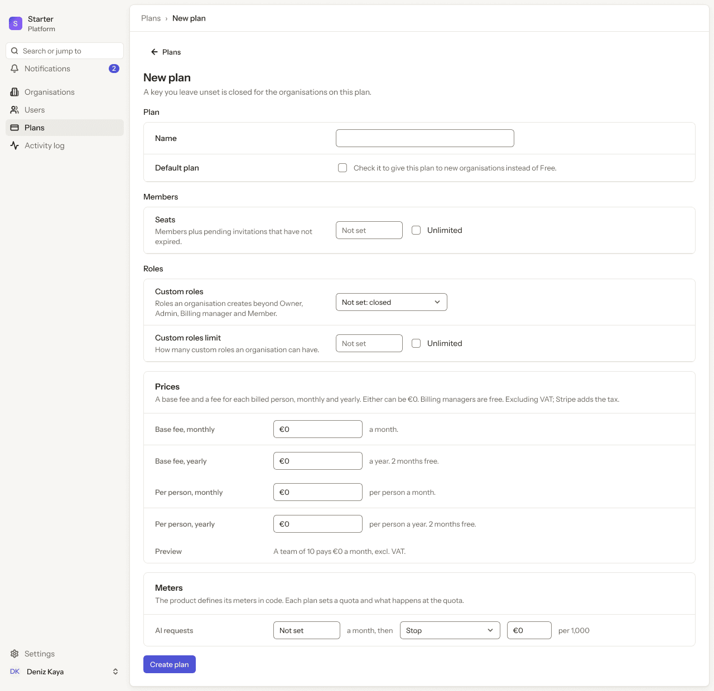

- **Who sees it:** System admins with platform.plans.read. Create and edit need platform.plans.create and platform.plans.update.
- **Device:** Desktop (1280 px and wider).
- **This state shows:** as the title says.
- **Values come from:** Plans, limits, prices and meters: our API (platform.plans.*).
- **Components:** Button ×2, Checkbox ×3, Input ×9, Platform sidebar, Select ×2, Top bar.
- **Actions:**
  - "Organisations": goes to [4.01 · Organisations · all](../04-organisations/README.md#401--organisations--all).
  - "Notifications": goes to [3.01 · Bell · unread](../03-notifications/README.md#301--bell--unread).
  - "Search or jump to": goes to [2.02 · Command menu](../02-shell/README.md#202--command-menu).
  - "Area": goes to [2.03 · Account menu](../02-shell/README.md#203--account-menu).
  - "Users": goes to [5.01 · Users · all](../05-users/README.md#501--users--all).
  - "Plans": goes to [6.01 · Plans](#601--plans).
  - "Area": goes to [6.11 · New plan · errors](#611--new-plan--errors).
  - "Activity log": goes to [7.01 · Activity log](../07-activity-log/README.md#701--activity-log).
  - "Area": goes to [8.01 · Profile · ideal](../08-settings-profile/README.md#801--profile--ideal).
- **Texts, word for word, top to bottom:**

  - S
  - Starter
  - Platform
  - Search or jump to
  - Notifications
  - 2
  - Organisations
  - Users
  - Plans
  - Activity log
  - Settings
  - DK
  - Deniz Kaya
  - Plans
  - ›
  - New plan
  - Plans
  - New plan
  - A key you leave unset is closed for the organisations on this plan.
  - Plan
  - Name
  - Default plan
  - Check it to give this plan to new organisations instead of Free.
  - Members
  - Seats
  - Members plus pending invitations that have not expired.
  - Not set
  - Unlimited
  - Roles
  - Custom roles
  - Roles an organisation creates beyond Owner, Admin, Billing manager and Member.
  - Not set: closed
  - Custom roles limit
  - How many custom roles an organisation can have.
  - Not set
  - Unlimited
  - Prices
  - A base fee and a fee for each billed person, monthly and yearly. Either can be €0. Billing managers are free. Excluding VAT; Stripe adds the tax.
  - Base fee, monthly
  - €0
  - a month.
  - Base fee, yearly
  - €0
  - a year. 2 months free.
  - Per person, monthly
  - €0
  - per person a month.
  - Per person, yearly
  - €0
  - per person a year. 2 months free.
  - Preview
  - A team of 10 pays €0 a month, excl. VAT.
  - Meters
  - The product defines its meters in code. Each plan sets a quota and what happens at the quota.
  - AI requests
  - Not set
  - a month, then
  - Stop
  - €0
  - per 1,000
  - Create plan

Figma: [190:8103](https://www.figma.com/design/3Ev111okX8xCBwR9B3hyBM/?node-id=190-8103)

### 6.11 · New plan · errors

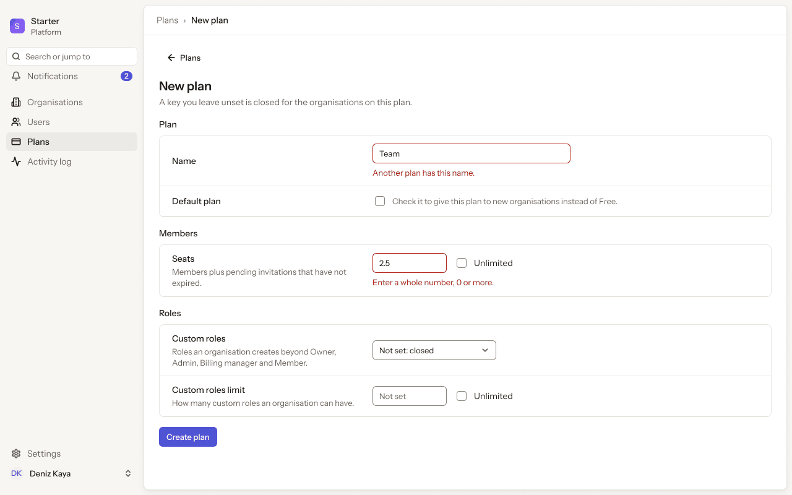

- **Who sees it:** System admins with platform.plans.read. Create and edit need platform.plans.create and platform.plans.update.
- **Device:** Desktop (1280 px and wider).
- **This state shows:** when the request fails.
- **Values come from:** Plans, limits, prices and meters: our API (platform.plans.*).
- **Components:** Button ×2, Checkbox ×3, Input ×3, Platform sidebar, Select, Top bar.
- **Actions:**
  - "Organisations": goes to [4.01 · Organisations · all](../04-organisations/README.md#401--organisations--all).
  - "Notifications": goes to [3.01 · Bell · unread](../03-notifications/README.md#301--bell--unread).
  - "Search or jump to": goes to [2.02 · Command menu](../02-shell/README.md#202--command-menu).
  - "Deniz Kaya": goes to [2.03 · Account menu](../02-shell/README.md#203--account-menu).
  - "Users": goes to [5.01 · Users · all](../05-users/README.md#501--users--all).
  - "Plans": goes to [6.01 · Plans](#601--plans).
  - "Create plan": goes to [6.12 · Plan · created](#612--plan--created).
  - "Activity log": goes to [7.01 · Activity log](../07-activity-log/README.md#701--activity-log).
  - "Settings": goes to [8.01 · Profile · ideal](../08-settings-profile/README.md#801--profile--ideal).
- **Texts, word for word, top to bottom:**

  - S
  - Starter
  - Platform
  - Search or jump to
  - Notifications
  - 2
  - Organisations
  - Users
  - Plans
  - Activity log
  - Settings
  - DK
  - Deniz Kaya
  - Plans
  - ›
  - New plan
  - Plans
  - New plan
  - A key you leave unset is closed for the organisations on this plan.
  - Plan
  - Name
  - Team
  - Another plan has this name.
  - Default plan
  - Check it to give this plan to new organisations instead of Free.
  - Members
  - Seats
  - Members plus pending invitations that have not expired.
  - 2.5
  - Unlimited
  - Enter a whole number, 0 or more.
  - Roles
  - Custom roles
  - Roles an organisation creates beyond Owner, Admin, Billing manager and Member.
  - Not set: closed
  - Custom roles limit
  - How many custom roles an organisation can have.
  - Not set
  - Unlimited
  - Create plan

Figma: [190:8269](https://www.figma.com/design/3Ev111okX8xCBwR9B3hyBM/?node-id=190-8269)

### 6.12 · Plan · created

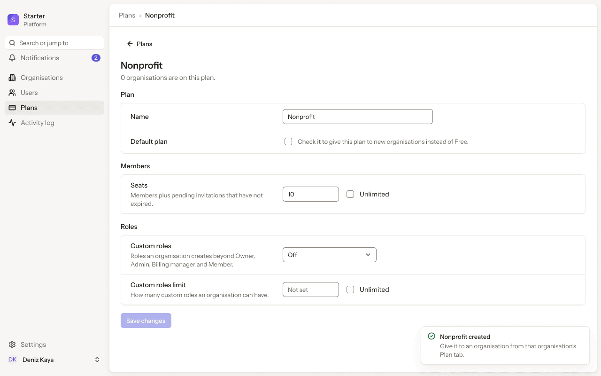

- **Who sees it:** System admins with platform.plans.read. Create and edit need platform.plans.create and platform.plans.update.
- **Device:** Desktop (1280 px and wider).
- **This state shows:** as the title says.
- **Values come from:** Plans, limits, prices and meters: our API (platform.plans.*).
- **Components:** Button ×2, Checkbox ×3, Input ×3, Platform sidebar, Select, Toast, Top bar.
- **Actions:**
  - "Organisations": goes to [4.01 · Organisations · all](../04-organisations/README.md#401--organisations--all).
  - "Notifications": goes to [3.01 · Bell · unread](../03-notifications/README.md#301--bell--unread).
  - "Search or jump to": goes to [2.02 · Command menu](../02-shell/README.md#202--command-menu).
  - "Deniz Kaya": goes to [2.03 · Account menu](../02-shell/README.md#203--account-menu).
  - "Users": goes to [5.01 · Users · all](../05-users/README.md#501--users--all).
  - "Plans": goes to [6.01 · Plans](#601--plans).
  - "Activity log": goes to [7.01 · Activity log](../07-activity-log/README.md#701--activity-log).
  - "Settings": goes to [8.01 · Profile · ideal](../08-settings-profile/README.md#801--profile--ideal).
- **Texts, word for word, top to bottom:**

  - S
  - Starter
  - Platform
  - Search or jump to
  - Notifications
  - 2
  - Organisations
  - Users
  - Plans
  - Activity log
  - Settings
  - DK
  - Deniz Kaya
  - Plans
  - ›
  - Nonprofit
  - Plans
  - Nonprofit
  - 0 organisations are on this plan.
  - Plan
  - Name
  - Nonprofit
  - Default plan
  - Check it to give this plan to new organisations instead of Free.
  - Members
  - Seats
  - Members plus pending invitations that have not expired.
  - 10
  - Unlimited
  - Roles
  - Custom roles
  - Roles an organisation creates beyond Owner, Admin, Billing manager and Member.
  - Off
  - Custom roles limit
  - How many custom roles an organisation can have.
  - Not set
  - Unlimited
  - Save changes
  - Nonprofit created
  - Give it to an organisation from that organisation’s Plan tab.

Figma: [190:8422](https://www.figma.com/design/3Ev111okX8xCBwR9B3hyBM/?node-id=190-8422)

### 6.13 · Plan · Team · prices and meters

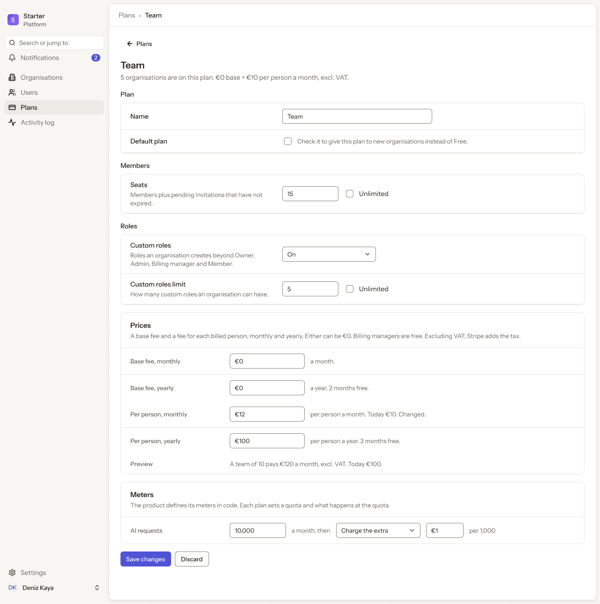

- **Who sees it:** System admins with platform.plans.read. Create and edit need platform.plans.create and platform.plans.update.
- **Device:** Desktop (1280 px and wider).
- **This state shows:** as the title says.
- **Values come from:** Plans, limits, prices and meters: our API (platform.plans.*).
- **Components:** Button ×3, Checkbox ×3, Input ×9, Platform sidebar, Select ×2, Top bar.
- **Actions:**
  - "Organisations": goes to [4.01 · Organisations · all](../04-organisations/README.md#401--organisations--all).
  - "Notifications": goes to [3.01 · Bell · unread](../03-notifications/README.md#301--bell--unread).
  - "Search or jump to": goes to [2.02 · Command menu](../02-shell/README.md#202--command-menu).
  - "Area": goes to [2.03 · Account menu](../02-shell/README.md#203--account-menu).
  - "Users": goes to [5.01 · Users · all](../05-users/README.md#501--users--all).
  - "Plans": goes to [6.01 · Plans](#601--plans).
  - "15": goes to [6.06 · Plan · Team · edited](#606--plan--team--edited).
  - "Activity log": goes to [7.01 · Activity log](../07-activity-log/README.md#701--activity-log).
  - "Area": goes to [8.01 · Profile · ideal](../08-settings-profile/README.md#801--profile--ideal).
  - "Area": goes to [6.14 · Price change · who pays it](#614--price-change--who-pays-it).
  - "Save changes": goes to [6.14 · Price change · who pays it](#614--price-change--who-pays-it).
- **Texts, word for word, top to bottom:**

  - S
  - Starter
  - Platform
  - Search or jump to
  - Notifications
  - 2
  - Organisations
  - Users
  - Plans
  - Activity log
  - Settings
  - DK
  - Deniz Kaya
  - Plans
  - ›
  - Team
  - Plans
  - Team
  - 5 organisations are on this plan. €0 base + €10 per person a month, excl. VAT.
  - Plan
  - Name
  - Team
  - Default plan
  - Check it to give this plan to new organisations instead of Free.
  - Members
  - Seats
  - Members plus pending invitations that have not expired.
  - 15
  - Unlimited
  - Roles
  - Custom roles
  - Roles an organisation creates beyond Owner, Admin, Billing manager and Member.
  - On
  - Custom roles limit
  - How many custom roles an organisation can have.
  - 5
  - Unlimited
  - Prices
  - A base fee and a fee for each billed person, monthly and yearly. Either can be €0. Billing managers are free. Excluding VAT; Stripe adds the tax.
  - Base fee, monthly
  - €0
  - a month.
  - Base fee, yearly
  - €0
  - a year. 2 months free.
  - Per person, monthly
  - €12
  - per person a month. Today €10. Changed.
  - Per person, yearly
  - €100
  - per person a year. 2 months free.
  - Preview
  - A team of 10 pays €120 a month, excl. VAT. Today €100.
  - Meters
  - The product defines its meters in code. Each plan sets a quota and what happens at the quota.
  - AI requests
  - 10,000
  - a month, then
  - Charge the extra
  - €1
  - per 1,000
  - Save changes
  - Discard

Figma: [251:14976](https://www.figma.com/design/3Ev111okX8xCBwR9B3hyBM/?node-id=251-14976)

### 6.14 · Price change · who pays it

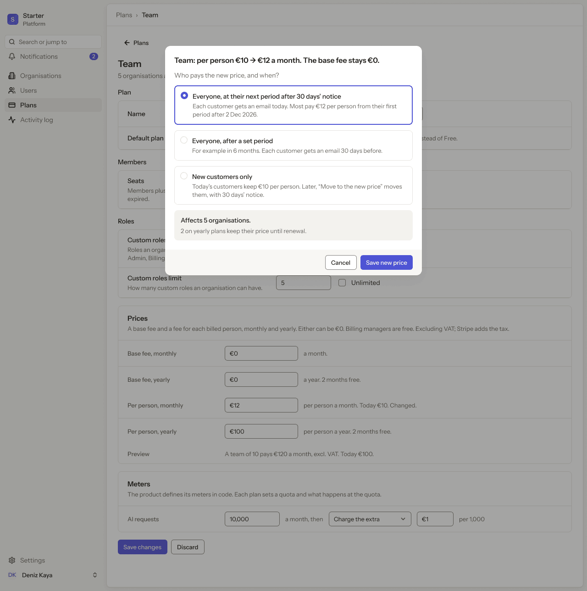

- **Who sees it:** System admins with platform.plans.read. Create and edit need platform.plans.create and platform.plans.update.
- **Device:** Desktop (1280 px and wider).
- **This state shows:** as the title says.
- **Values come from:** Plans, limits, prices and meters: our API (platform.plans.*).
- **Components:** Button ×5, Checkbox ×3, Input ×9, Platform sidebar, Select ×2, Top bar.
- **Actions:**
  - "Organisations": goes to [4.01 · Organisations · all](../04-organisations/README.md#401--organisations--all).
  - "Notifications": goes to [3.01 · Bell · unread](../03-notifications/README.md#301--bell--unread).
  - "Search or jump to": goes to [2.02 · Command menu](../02-shell/README.md#202--command-menu).
  - "Area": goes to [2.03 · Account menu](../02-shell/README.md#203--account-menu).
  - "Users": goes to [5.01 · Users · all](../05-users/README.md#501--users--all).
  - "Plans": goes to [6.01 · Plans](#601--plans).
  - "15": goes to [6.06 · Plan · Team · edited](#606--plan--team--edited).
  - "Activity log": goes to [7.01 · Activity log](../07-activity-log/README.md#701--activity-log).
  - "Area": goes to [8.01 · Profile · ideal](../08-settings-profile/README.md#801--profile--ideal).
  - "Cancel": goes to [6.13 · Plan · Team · prices and meters](#613--plan--team--prices-and-meters).
  - "Save new price": goes to [6.15 · Plan · Team · customers on the old price](#615--plan--team--customers-on-the-old-price).
- **Texts, word for word, top to bottom:**

  - S
  - Starter
  - Platform
  - Search or jump to
  - Notifications
  - 2
  - Organisations
  - Users
  - Plans
  - Activity log
  - Settings
  - DK
  - Deniz Kaya
  - Plans
  - ›
  - Team
  - Plans
  - Team
  - 5 organisations are on this plan. €0 base + €10 per person a month, excl. VAT.
  - Plan
  - Name
  - Team
  - Default plan
  - Check it to give this plan to new organisations instead of Free.
  - Members
  - Seats
  - Members plus pending invitations that have not expired.
  - 15
  - Unlimited
  - Roles
  - Custom roles
  - Roles an organisation creates beyond Owner, Admin, Billing manager and Member.
  - On
  - Custom roles limit
  - How many custom roles an organisation can have.
  - 5
  - Unlimited
  - Prices
  - A base fee and a fee for each billed person, monthly and yearly. Either can be €0. Billing managers are free. Excluding VAT; Stripe adds the tax.
  - Base fee, monthly
  - €0
  - a month.
  - Base fee, yearly
  - €0
  - a year. 2 months free.
  - Per person, monthly
  - €12
  - per person a month. Today €10. Changed.
  - Per person, yearly
  - €100
  - per person a year. 2 months free.
  - Preview
  - A team of 10 pays €120 a month, excl. VAT. Today €100.
  - Meters
  - The product defines its meters in code. Each plan sets a quota and what happens at the quota.
  - AI requests
  - 10,000
  - a month, then
  - Charge the extra
  - €1
  - per 1,000
  - Save changes
  - Discard
  - Team: per person €10 → €12 a month. The base fee stays €0.
  - Who pays the new price, and when?
  - Everyone, at their next period after 30 days’ notice
  - Each customer gets an email today. Most pay €12 per person from their first period after 2 Dec 2026.
  - Everyone, after a set period
  - For example in 6 months. Each customer gets an email 30 days before.
  - New customers only
  - Today’s customers keep €10 per person. Later, “Move to the new price” moves them, with 30 days’ notice.
  - Affects 5 organisations.
  - 2 on yearly plans keep their price until renewal.
  - Cancel
  - Save new price

Figma: [251:15176](https://www.figma.com/design/3Ev111okX8xCBwR9B3hyBM/?node-id=251-15176)

### 6.15 · Plan · Team · customers on the old price

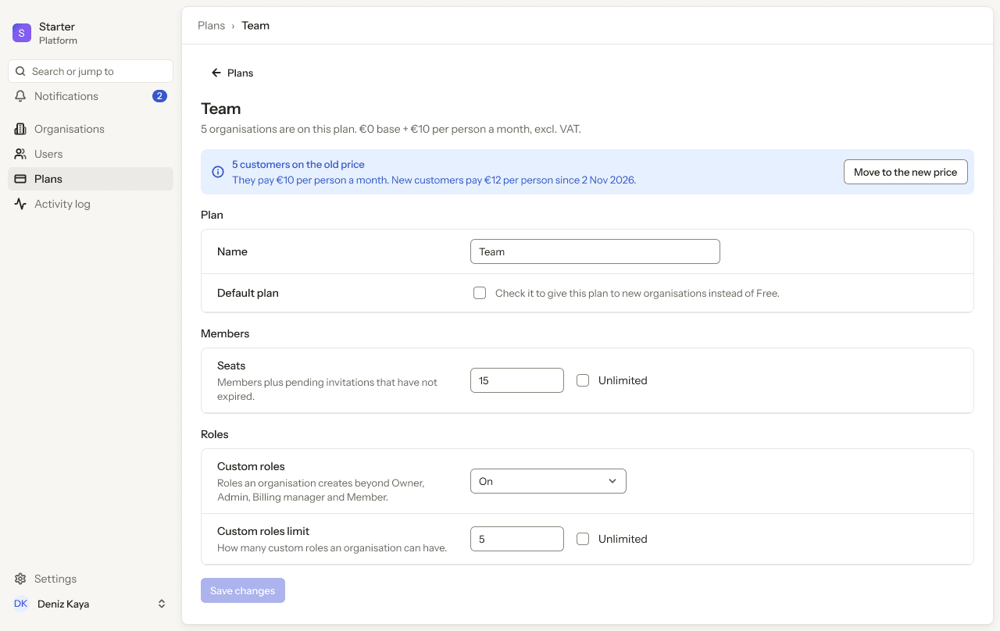

- **Who sees it:** System admins with platform.plans.read. Create and edit need platform.plans.create and platform.plans.update.
- **Device:** Desktop (1280 px and wider).
- **This state shows:** as the title says.
- **Values come from:** Plans, limits, prices and meters: our API (platform.plans.*).
- **Components:** Banner, Button ×2, Checkbox ×3, Input ×3, Platform sidebar, Select, Top bar.
- **Actions:**
  - "Organisations": goes to [4.01 · Organisations · all](../04-organisations/README.md#401--organisations--all).
  - "Notifications": goes to [3.01 · Bell · unread](../03-notifications/README.md#301--bell--unread).
  - "Search or jump to": goes to [2.02 · Command menu](../02-shell/README.md#202--command-menu).
  - "Deniz Kaya": goes to [2.03 · Account menu](../02-shell/README.md#203--account-menu).
  - "Users": goes to [5.01 · Users · all](../05-users/README.md#501--users--all).
  - "Plans": goes to [6.01 · Plans](#601--plans).
  - "Area": goes to [6.06 · Plan · Team · edited](#606--plan--team--edited).
  - "Activity log": goes to [7.01 · Activity log](../07-activity-log/README.md#701--activity-log).
  - "Settings": goes to [8.01 · Profile · ideal](../08-settings-profile/README.md#801--profile--ideal).
  - "Move to the new price": goes to [6.16 · Move to the new price](#616--move-to-the-new-price).
- **Texts, word for word, top to bottom:**

  - S
  - Starter
  - Platform
  - Search or jump to
  - Notifications
  - 2
  - Organisations
  - Users
  - Plans
  - Activity log
  - Settings
  - DK
  - Deniz Kaya
  - Plans
  - ›
  - Team
  - Plans
  - Team
  - 5 organisations are on this plan. €0 base + €10 per person a month, excl. VAT.
  - 5 customers on the old price
  - They pay €10 per person a month. New customers pay €12 per person since 2 Nov 2026.
  - Move to the new price
  - Plan
  - Name
  - Team
  - Default plan
  - Check it to give this plan to new organisations instead of Free.
  - Members
  - Seats
  - Members plus pending invitations that have not expired.
  - 15
  - Unlimited
  - Roles
  - Custom roles
  - Roles an organisation creates beyond Owner, Admin, Billing manager and Member.
  - On
  - Custom roles limit
  - How many custom roles an organisation can have.
  - 5
  - Unlimited
  - Save changes

Figma: [251:15306](https://www.figma.com/design/3Ev111okX8xCBwR9B3hyBM/?node-id=251-15306)

### 6.16 · Move to the new price

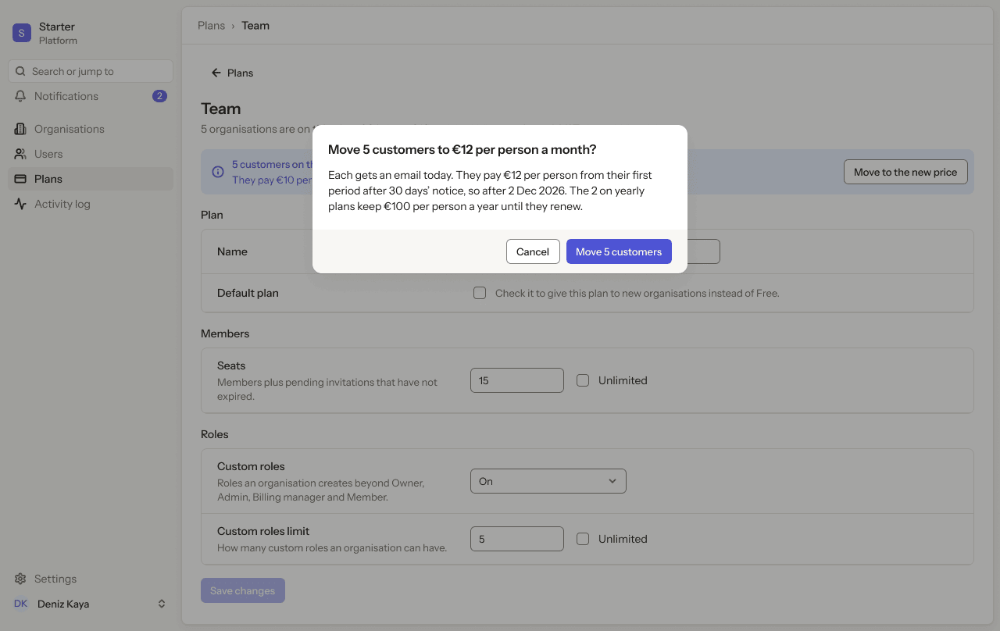

- **Who sees it:** System admins with platform.plans.read. Create and edit need platform.plans.create and platform.plans.update.
- **Device:** Desktop (1280 px and wider).
- **This state shows:** as the title says.
- **Values come from:** Plans, limits, prices and meters: our API (platform.plans.*).
- **Components:** Banner, Button ×4, Checkbox ×3, Input ×3, Platform sidebar, Select, Top bar.
- **Actions:**
  - "Organisations": goes to [4.01 · Organisations · all](../04-organisations/README.md#401--organisations--all).
  - "Notifications": goes to [3.01 · Bell · unread](../03-notifications/README.md#301--bell--unread).
  - "Search or jump to": goes to [2.02 · Command menu](../02-shell/README.md#202--command-menu).
  - "Deniz Kaya": goes to [2.03 · Account menu](../02-shell/README.md#203--account-menu).
  - "Users": goes to [5.01 · Users · all](../05-users/README.md#501--users--all).
  - "Plans": goes to [6.01 · Plans](#601--plans).
  - "Area": goes to [6.06 · Plan · Team · edited](#606--plan--team--edited).
  - "Activity log": goes to [7.01 · Activity log](../07-activity-log/README.md#701--activity-log).
  - "Settings": goes to [8.01 · Profile · ideal](../08-settings-profile/README.md#801--profile--ideal).
  - "Cancel": goes to [6.15 · Plan · Team · customers on the old price](#615--plan--team--customers-on-the-old-price).
  - "Team": goes to [6.04 · Plan · Team](#604--plan--team).
- **Texts, word for word, top to bottom:**

  - S
  - Starter
  - Platform
  - Search or jump to
  - Notifications
  - 2
  - Organisations
  - Users
  - Plans
  - Activity log
  - Settings
  - DK
  - Deniz Kaya
  - Plans
  - ›
  - Team
  - Plans
  - Team
  - 5 organisations are on this plan. €0 base + €10 per person a month, excl. VAT.
  - 5 customers on the old price
  - They pay €10 per person a month. New customers pay €12 per person since 2 Nov 2026.
  - Move to the new price
  - Plan
  - Name
  - Team
  - Default plan
  - Check it to give this plan to new organisations instead of Free.
  - Members
  - Seats
  - Members plus pending invitations that have not expired.
  - 15
  - Unlimited
  - Roles
  - Custom roles
  - Roles an organisation creates beyond Owner, Admin, Billing manager and Member.
  - On
  - Custom roles limit
  - How many custom roles an organisation can have.
  - 5
  - Unlimited
  - Save changes
  - Move 5 customers to €12 per person a month?
  - Each gets an email today. They pay €12 per person from their first period after 30 days’ notice, so after 2 Dec 2026. The 2 on yearly plans keep €100 per person a year until they renew.
  - Cancel
  - Move 5 customers

Figma: [251:15485](https://www.figma.com/design/3Ev111okX8xCBwR9B3hyBM/?node-id=251-15485)

### 6.17 · Phone · Plans

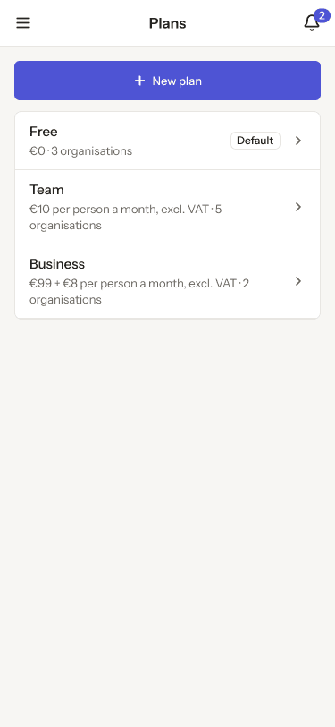

- **Who sees it:** System admins with platform.plans.read. Create and edit need platform.plans.create and platform.plans.update.
- **Device:** Phone (up to 767 px).
- **This state shows:** on a phone.
- **Values come from:** Plans, limits, prices and meters: our API (platform.plans.*).
- **Components:** Button, Phone list row ×3, Phone top bar.
- **Actions:**
  - "Area": goes to [2.14 · Phone · menu open](../02-shell/README.md#214--phone--menu-open).
  - "2": goes to [3.08 · Phone · Notifications](../03-notifications/README.md#308--phone--notifications).
  - "€10 per person a month, excl. VAT · 5 organisations": goes to [6.18 · Phone · Plan](#618--phone--plan).
- **Texts, word for word, top to bottom:**

  - Plans
  - 2
  - New plan
  - Free
  - €0 · 3 organisations
  - Default
  - Team
  - €10 per person a month, excl. VAT · 5 organisations
  - Business
  - €99 + €8 per person a month, excl. VAT · 2 organisations

Figma: [261:17104](https://www.figma.com/design/3Ev111okX8xCBwR9B3hyBM/?node-id=261-17104)

### 6.18 · Phone · Plan

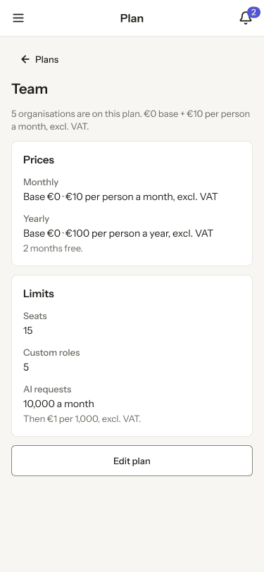

- **Who sees it:** System admins with platform.plans.read. Create and edit need platform.plans.create and platform.plans.update.
- **Device:** Phone (up to 767 px).
- **This state shows:** on a phone.
- **Values come from:** Plans, limits, prices and meters: our API (platform.plans.*).
- **Components:** Button ×2, Phone top bar.
- **Actions:**
  - "Area": goes to [2.14 · Phone · menu open](../02-shell/README.md#214--phone--menu-open).
  - "2": goes to [3.08 · Phone · Notifications](../03-notifications/README.md#308--phone--notifications).
  - "Plans": goes to [6.17 · Phone · Plans](#617--phone--plans).
- **Texts, word for word, top to bottom:**

  - Plan
  - 2
  - Plans
  - Team
  - 5 organisations are on this plan. €0 base + €10 per person a month, excl. VAT.
  - Prices
  - Monthly
  - Base €0 · €10 per person a month, excl. VAT
  - Yearly
  - Base €0 · €100 per person a year, excl. VAT
  - 2 months free.
  - Limits
  - Seats
  - 15
  - Custom roles
  - 5
  - AI requests
  - 10,000 a month
  - Then €1 per 1,000, excl. VAT.
  - Edit plan

Figma: [261:17159](https://www.figma.com/design/3Ev111okX8xCBwR9B3hyBM/?node-id=261-17159)
