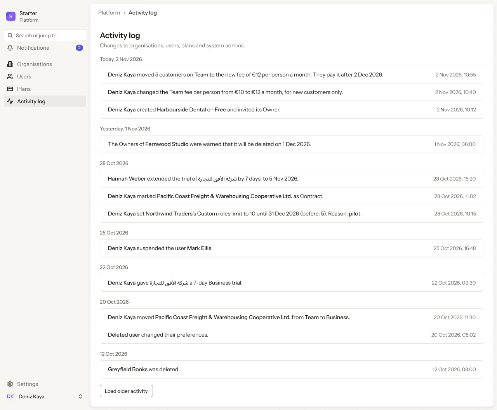
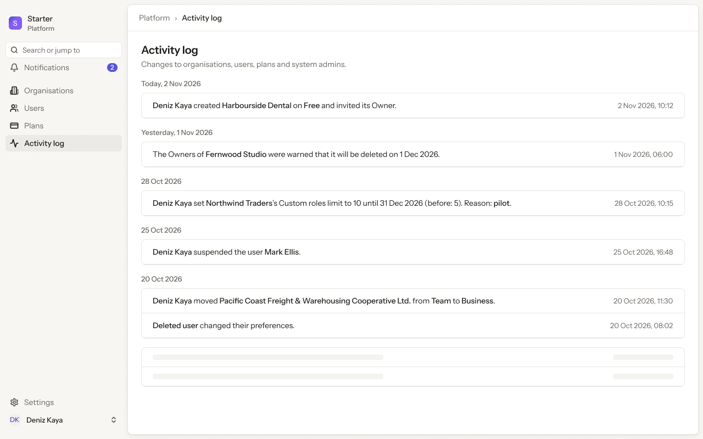
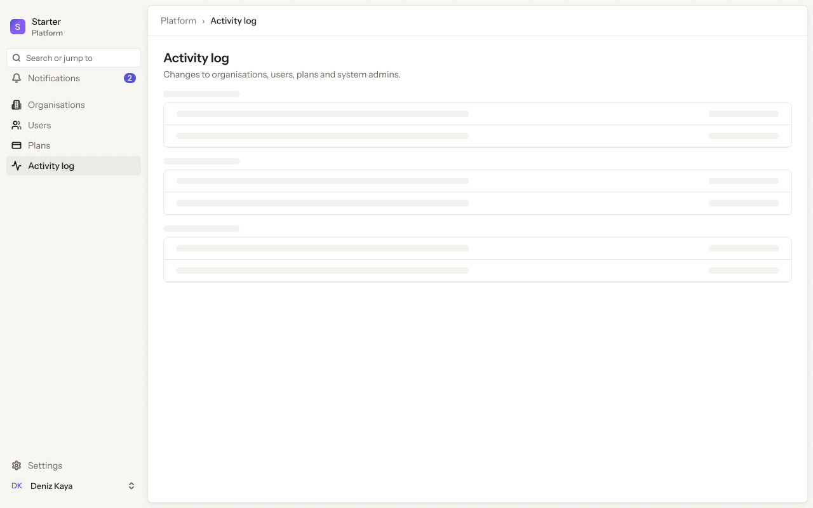
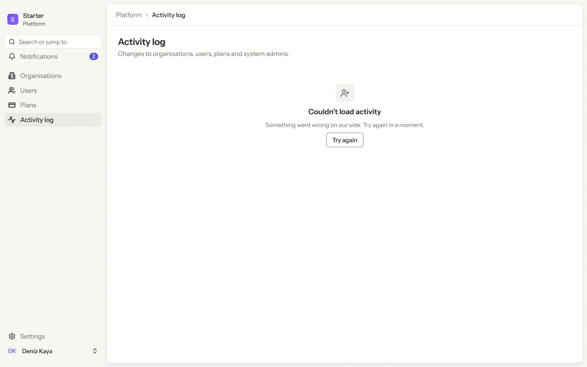
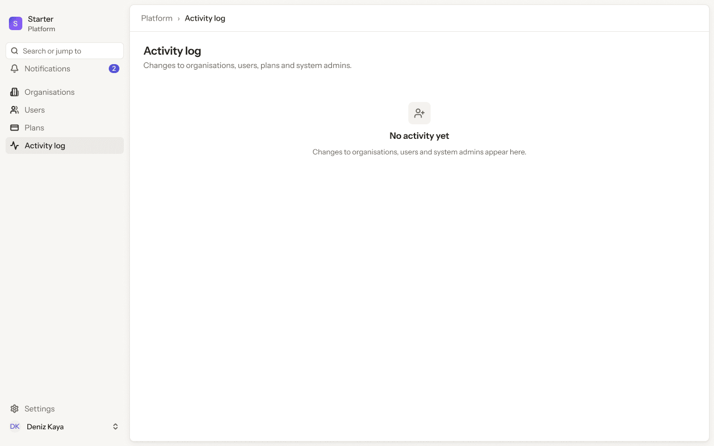
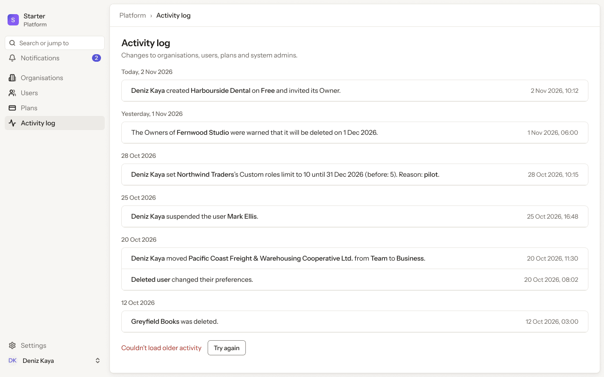
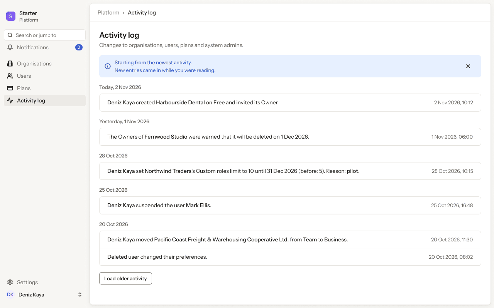
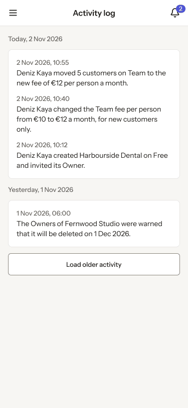

# Platform app · 7 · Activity log

Who sees this section: System admins with platform.audit.read.

Where the values come from: Platform activity log: our API (platform.audit.read).

8 screens. Each part below is one screen and state. The PNG beside this file is the screen at scale 1.

| Screen | Device |
|---|---|
| [7.01 · Activity log](#701--activity-log) | Desktop |
| [7.02 · Activity log · loading older](#702--activity-log--loading-older) | Desktop |
| [7.03 · Activity log · loading](#703--activity-log--loading) | Desktop |
| [7.04 · Activity log · couldn’t load](#704--activity-log--couldnt-load) | Desktop |
| [7.05 · Activity log · empty](#705--activity-log--empty) | Desktop |
| [7.06 · Activity log · older failed](#706--activity-log--older-failed) | Desktop |
| [7.07 · Activity log · restarted](#707--activity-log--restarted) | Desktop |
| [7.08 · Phone · Activity log](#708--phone--activity-log) | Phone |

### 7.01 · Activity log

- **Who sees it:** System admins with platform.audit.read.
- **Device:** Desktop (1280 px and wider).
- **This state shows:** as the title says.
- **Values come from:** Platform activity log: our API (platform.audit.read).
- **Components:** Button, Platform sidebar, Top bar.
- **Actions:**
  - "Organisations": goes to [4.01 · Organisations · all](../04-organisations/README.md#401--organisations--all).
  - "Notifications": goes to [3.01 · Bell · unread](../03-notifications/README.md#301--bell--unread).
  - "Search or jump to": goes to [2.02 · Command menu](../02-shell/README.md#202--command-menu).
  - "Area": goes to [2.03 · Account menu](../02-shell/README.md#203--account-menu).
  - "Users": goes to [5.01 · Users · all](../05-users/README.md#501--users--all).
  - "Plans": goes to [6.01 · Plans](../06-plans/README.md#601--plans).
  - "Deniz Kaya moved 5 customers on Team to the new fee of €12 per person a month. They pay it after 2 Dec 2026.": goes to [4.11 · Organisation · waiting for Owner](../04-organisations/README.md#411--organisation--waiting-for-owner).
  - "The Owners of Fernwood Studio were warned that it will be deleted on 1 Dec 2026.": goes to [4.14 · Organisation · plan](../04-organisations/README.md#414--organisation--plan).
  - "Hannah Weber extended the trial of شركة الأفق للتجارة by 7 days, to 5 Nov 2026.": goes to [5.07 · User · suspended](../05-users/README.md#507--user--suspended).
  - "Area": goes to [7.02 · Activity log · loading older](#702--activity-log--loading-older).
  - "Area": goes to [8.01 · Profile · ideal](../08-settings-profile/README.md#801--profile--ideal).
- **Texts, word for word, top to bottom:**

  - S
  - Starter
  - Platform
  - Search or jump to
  - Notifications
  - 2
  - Organisations
  - Users
  - Plans
  - Activity log
  - Settings
  - DK
  - Deniz Kaya
  - Platform
  - ›
  - Activity log
  - Activity log
  - Changes to organisations, users, plans and system admins.
  - Today, 2 Nov 2026
  - Deniz Kaya moved 5 customers on Team to the new fee of €12 per person a month. They pay it after 2 Dec 2026.
  - 2 Nov 2026, 10:55
  - Deniz Kaya changed the Team fee per person from €10 to €12 a month, for new customers only.
  - 2 Nov 2026, 10:40
  - Deniz Kaya created Harbourside Dental on Free and invited its Owner.
  - 2 Nov 2026, 10:12
  - Yesterday, 1 Nov 2026
  - The Owners of Fernwood Studio were warned that it will be deleted on 1 Dec 2026.
  - 1 Nov 2026, 06:00
  - 28 Oct 2026
  - Hannah Weber extended the trial of شركة الأفق للتجارة by 7 days, to 5 Nov 2026.
  - 28 Oct 2026, 15:20
  - Deniz Kaya marked Pacific Coast Freight & Warehousing Cooperative Ltd. as Contract.
  - 28 Oct 2026, 11:02
  - Deniz Kaya set Northwind Traders’s Custom roles limit to 10 until 31 Dec 2026 (before: 5). Reason: pilot.
  - 28 Oct 2026, 10:15
  - 25 Oct 2026
  - Deniz Kaya suspended the user Mark Ellis.
  - 25 Oct 2026, 16:48
  - 22 Oct 2026
  - Deniz Kaya gave شركة الأفق للتجارة a 7-day Business trial.
  - 22 Oct 2026, 09:30
  - 20 Oct 2026
  - Deniz Kaya moved Pacific Coast Freight & Warehousing Cooperative Ltd. from Team to Business.
  - 20 Oct 2026, 11:30
  - Deleted user changed their preferences.
  - 20 Oct 2026, 08:02
  - 12 Oct 2026
  - Greyfield Books was deleted.
  - 12 Oct 2026, 03:00
  - Load older activity

Figma: [194:8251](https://www.figma.com/design/3Ev111okX8xCBwR9B3hyBM/?node-id=194-8251)

### 7.02 · Activity log · loading older

- **Who sees it:** System admins with platform.audit.read.
- **Device:** Desktop (1280 px and wider).
- **This state shows:** while the request runs.
- **Values come from:** Platform activity log: our API (platform.audit.read).
- **Components:** Platform sidebar, Skeleton ×4, Top bar.
- **Actions:**
  - "Organisations": goes to [4.01 · Organisations · all](../04-organisations/README.md#401--organisations--all).
  - "Notifications": goes to [3.01 · Bell · unread](../03-notifications/README.md#301--bell--unread).
  - "Search or jump to": goes to [2.02 · Command menu](../02-shell/README.md#202--command-menu).
  - "Deniz Kaya": goes to [2.03 · Account menu](../02-shell/README.md#203--account-menu).
  - "Users": goes to [5.01 · Users · all](../05-users/README.md#501--users--all).
  - "Plans": goes to [6.01 · Plans](../06-plans/README.md#601--plans).
  - "Deniz Kaya created Harbourside Dental on Free and invited its Owner.": goes to [4.11 · Organisation · waiting for Owner](../04-organisations/README.md#411--organisation--waiting-for-owner).
  - "Deniz Kaya set Northwind Traders’s Custom roles limit to 10 until 31 Dec 2026 (before: 5). Reason: pilot.": goes to [4.14 · Organisation · plan](../04-organisations/README.md#414--organisation--plan).
  - "Deniz Kaya suspended the user Mark Ellis.": goes to [5.07 · User · suspended](../05-users/README.md#507--user--suspended).
  - "Settings": goes to [8.01 · Profile · ideal](../08-settings-profile/README.md#801--profile--ideal).
- **Texts, word for word, top to bottom:**

  - S
  - Starter
  - Platform
  - Search or jump to
  - Notifications
  - 2
  - Organisations
  - Users
  - Plans
  - Activity log
  - Settings
  - DK
  - Deniz Kaya
  - Platform
  - ›
  - Activity log
  - Activity log
  - Changes to organisations, users, plans and system admins.
  - Today, 2 Nov 2026
  - Deniz Kaya created Harbourside Dental on Free and invited its Owner.
  - 2 Nov 2026, 10:12
  - Yesterday, 1 Nov 2026
  - The Owners of Fernwood Studio were warned that it will be deleted on 1 Dec 2026.
  - 1 Nov 2026, 06:00
  - 28 Oct 2026
  - Deniz Kaya set Northwind Traders’s Custom roles limit to 10 until 31 Dec 2026 (before: 5). Reason: pilot.
  - 28 Oct 2026, 10:15
  - 25 Oct 2026
  - Deniz Kaya suspended the user Mark Ellis.
  - 25 Oct 2026, 16:48
  - 20 Oct 2026
  - Deniz Kaya moved Pacific Coast Freight & Warehousing Cooperative Ltd. from Team to Business.
  - 20 Oct 2026, 11:30
  - Deleted user changed their preferences.
  - 20 Oct 2026, 08:02

Figma: [194:8650](https://www.figma.com/design/3Ev111okX8xCBwR9B3hyBM/?node-id=194-8650)

### 7.03 · Activity log · loading

- **Who sees it:** System admins with platform.audit.read.
- **Device:** Desktop (1280 px and wider).
- **This state shows:** while the request runs.
- **Values come from:** Platform activity log: our API (platform.audit.read).
- **Components:** Platform sidebar, Skeleton ×15, Top bar.
- **Actions:**
  - "Organisations": goes to [4.01 · Organisations · all](../04-organisations/README.md#401--organisations--all).
  - "Notifications": goes to [3.01 · Bell · unread](../03-notifications/README.md#301--bell--unread).
  - "Search or jump to": goes to [2.02 · Command menu](../02-shell/README.md#202--command-menu).
  - "Deniz Kaya": goes to [2.03 · Account menu](../02-shell/README.md#203--account-menu).
  - "Users": goes to [5.01 · Users · all](../05-users/README.md#501--users--all).
  - "Plans": goes to [6.01 · Plans](../06-plans/README.md#601--plans).
  - "Settings": goes to [8.01 · Profile · ideal](../08-settings-profile/README.md#801--profile--ideal).
- **Texts, word for word, top to bottom:**

  - S
  - Starter
  - Platform
  - Search or jump to
  - Notifications
  - 2
  - Organisations
  - Users
  - Plans
  - Activity log
  - Settings
  - DK
  - Deniz Kaya
  - Platform
  - ›
  - Activity log
  - Activity log
  - Changes to organisations, users, plans and system admins.

Figma: [194:9076](https://www.figma.com/design/3Ev111okX8xCBwR9B3hyBM/?node-id=194-9076)

### 7.04 · Activity log · couldn’t load

- **Who sees it:** System admins with platform.audit.read.
- **Device:** Desktop (1280 px and wider).
- **This state shows:** as the title says.
- **Values come from:** Platform activity log: our API (platform.audit.read).
- **Components:** Empty state, Platform sidebar, Top bar.
- **Actions:**
  - "Organisations": goes to [4.01 · Organisations · all](../04-organisations/README.md#401--organisations--all).
  - "Notifications": goes to [3.01 · Bell · unread](../03-notifications/README.md#301--bell--unread).
  - "Search or jump to": goes to [2.02 · Command menu](../02-shell/README.md#202--command-menu).
  - "Deniz Kaya": goes to [2.03 · Account menu](../02-shell/README.md#203--account-menu).
  - "Users": goes to [5.01 · Users · all](../05-users/README.md#501--users--all).
  - "Plans": goes to [6.01 · Plans](../06-plans/README.md#601--plans).
  - "Try again": goes to [7.01 · Activity log](#701--activity-log).
  - "Settings": goes to [8.01 · Profile · ideal](../08-settings-profile/README.md#801--profile--ideal).
- **Texts, word for word, top to bottom:**

  - S
  - Starter
  - Platform
  - Search or jump to
  - Notifications
  - 2
  - Organisations
  - Users
  - Plans
  - Activity log
  - Settings
  - DK
  - Deniz Kaya
  - Platform
  - ›
  - Activity log
  - Activity log
  - Changes to organisations, users, plans and system admins.
  - Couldn’t load activity
  - Something went wrong on our side. Try again in a moment.
  - Try again

Figma: [194:9389](https://www.figma.com/design/3Ev111okX8xCBwR9B3hyBM/?node-id=194-9389)

### 7.05 · Activity log · empty

- **Who sees it:** System admins with platform.audit.read.
- **Device:** Desktop (1280 px and wider).
- **This state shows:** when there is nothing to list yet.
- **Values come from:** Platform activity log: our API (platform.audit.read).
- **Components:** Empty state, Platform sidebar, Top bar.
- **Actions:**
  - "Organisations": goes to [4.01 · Organisations · all](../04-organisations/README.md#401--organisations--all).
  - "Notifications": goes to [3.01 · Bell · unread](../03-notifications/README.md#301--bell--unread).
  - "Search or jump to": goes to [2.02 · Command menu](../02-shell/README.md#202--command-menu).
  - "Deniz Kaya": goes to [2.03 · Account menu](../02-shell/README.md#203--account-menu).
  - "Users": goes to [5.01 · Users · all](../05-users/README.md#501--users--all).
  - "Plans": goes to [6.01 · Plans](../06-plans/README.md#601--plans).
  - "Settings": goes to [8.01 · Profile · ideal](../08-settings-profile/README.md#801--profile--ideal).
- **Texts, word for word, top to bottom:**

  - S
  - Starter
  - Platform
  - Search or jump to
  - Notifications
  - 2
  - Organisations
  - Users
  - Plans
  - Activity log
  - Settings
  - DK
  - Deniz Kaya
  - Platform
  - ›
  - Activity log
  - Activity log
  - Changes to organisations, users, plans and system admins.
  - No activity yet
  - Changes to organisations, users and system admins appear here.

Figma: [194:9598](https://www.figma.com/design/3Ev111okX8xCBwR9B3hyBM/?node-id=194-9598)

### 7.06 · Activity log · older failed

- **Who sees it:** System admins with platform.audit.read.
- **Device:** Desktop (1280 px and wider).
- **This state shows:** when the action fails.
- **Values come from:** Platform activity log: our API (platform.audit.read).
- **Components:** Button, Platform sidebar, Top bar.
- **Actions:**
  - "Organisations": goes to [4.01 · Organisations · all](../04-organisations/README.md#401--organisations--all).
  - "Notifications": goes to [3.01 · Bell · unread](../03-notifications/README.md#301--bell--unread).
  - "Search or jump to": goes to [2.02 · Command menu](../02-shell/README.md#202--command-menu).
  - "Deniz Kaya": goes to [2.03 · Account menu](../02-shell/README.md#203--account-menu).
  - "Users": goes to [5.01 · Users · all](../05-users/README.md#501--users--all).
  - "Plans": goes to [6.01 · Plans](../06-plans/README.md#601--plans).
  - "Deniz Kaya created Harbourside Dental on Free and invited its Owner.": goes to [4.11 · Organisation · waiting for Owner](../04-organisations/README.md#411--organisation--waiting-for-owner).
  - "Deniz Kaya set Northwind Traders’s Custom roles limit to 10 until 31 Dec 2026 (before: 5). Reason: pilot.": goes to [4.14 · Organisation · plan](../04-organisations/README.md#414--organisation--plan).
  - "Deniz Kaya suspended the user Mark Ellis.": goes to [5.07 · User · suspended](../05-users/README.md#507--user--suspended).
  - "Try again": goes to [7.01 · Activity log](#701--activity-log).
  - "Settings": goes to [8.01 · Profile · ideal](../08-settings-profile/README.md#801--profile--ideal).
- **Texts, word for word, top to bottom:**

  - S
  - Starter
  - Platform
  - Search or jump to
  - Notifications
  - 2
  - Organisations
  - Users
  - Plans
  - Activity log
  - Settings
  - DK
  - Deniz Kaya
  - Platform
  - ›
  - Activity log
  - Activity log
  - Changes to organisations, users, plans and system admins.
  - Today, 2 Nov 2026
  - Deniz Kaya created Harbourside Dental on Free and invited its Owner.
  - 2 Nov 2026, 10:12
  - Yesterday, 1 Nov 2026
  - The Owners of Fernwood Studio were warned that it will be deleted on 1 Dec 2026.
  - 1 Nov 2026, 06:00
  - 28 Oct 2026
  - Deniz Kaya set Northwind Traders’s Custom roles limit to 10 until 31 Dec 2026 (before: 5). Reason: pilot.
  - 28 Oct 2026, 10:15
  - 25 Oct 2026
  - Deniz Kaya suspended the user Mark Ellis.
  - 25 Oct 2026, 16:48
  - 20 Oct 2026
  - Deniz Kaya moved Pacific Coast Freight & Warehousing Cooperative Ltd. from Team to Business.
  - 20 Oct 2026, 11:30
  - Deleted user changed their preferences.
  - 20 Oct 2026, 08:02
  - 12 Oct 2026
  - Greyfield Books was deleted.
  - 12 Oct 2026, 03:00
  - Couldn’t load older activity
  - Try again

Figma: [194:9807](https://www.figma.com/design/3Ev111okX8xCBwR9B3hyBM/?node-id=194-9807)

### 7.07 · Activity log · restarted

- **Who sees it:** System admins with platform.audit.read.
- **Device:** Desktop (1280 px and wider).
- **This state shows:** as the title says.
- **Values come from:** Platform activity log: our API (platform.audit.read).
- **Components:** Banner, Button, Platform sidebar, Top bar.
- **Actions:**
  - "Organisations": goes to [4.01 · Organisations · all](../04-organisations/README.md#401--organisations--all).
  - "Notifications": goes to [3.01 · Bell · unread](../03-notifications/README.md#301--bell--unread).
  - "Search or jump to": goes to [2.02 · Command menu](../02-shell/README.md#202--command-menu).
  - "Deniz Kaya": goes to [2.03 · Account menu](../02-shell/README.md#203--account-menu).
  - "Users": goes to [5.01 · Users · all](../05-users/README.md#501--users--all).
  - "Plans": goes to [6.01 · Plans](../06-plans/README.md#601--plans).
  - "Deniz Kaya created Harbourside Dental on Free and invited its Owner.": goes to [4.11 · Organisation · waiting for Owner](../04-organisations/README.md#411--organisation--waiting-for-owner).
  - "Deniz Kaya set Northwind Traders’s Custom roles limit to 10 until 31 Dec 2026 (before: 5). Reason: pilot.": goes to [4.14 · Organisation · plan](../04-organisations/README.md#414--organisation--plan).
  - "Deniz Kaya suspended the user Mark Ellis.": goes to [5.07 · User · suspended](../05-users/README.md#507--user--suspended).
  - "Load older activity": goes to [7.02 · Activity log · loading older](#702--activity-log--loading-older).
  - "Settings": goes to [8.01 · Profile · ideal](../08-settings-profile/README.md#801--profile--ideal).
- **Texts, word for word, top to bottom:**

  - S
  - Starter
  - Platform
  - Search or jump to
  - Notifications
  - 2
  - Organisations
  - Users
  - Plans
  - Activity log
  - Settings
  - DK
  - Deniz Kaya
  - Platform
  - ›
  - Activity log
  - Activity log
  - Changes to organisations, users, plans and system admins.
  - Starting from the newest activity.
  - New entries came in while you were reading.
  - Today, 2 Nov 2026
  - Deniz Kaya created Harbourside Dental on Free and invited its Owner.
  - 2 Nov 2026, 10:12
  - Yesterday, 1 Nov 2026
  - The Owners of Fernwood Studio were warned that it will be deleted on 1 Dec 2026.
  - 1 Nov 2026, 06:00
  - 28 Oct 2026
  - Deniz Kaya set Northwind Traders’s Custom roles limit to 10 until 31 Dec 2026 (before: 5). Reason: pilot.
  - 28 Oct 2026, 10:15
  - 25 Oct 2026
  - Deniz Kaya suspended the user Mark Ellis.
  - 25 Oct 2026, 16:48
  - 20 Oct 2026
  - Deniz Kaya moved Pacific Coast Freight & Warehousing Cooperative Ltd. from Team to Business.
  - 20 Oct 2026, 11:30
  - Deleted user changed their preferences.
  - 20 Oct 2026, 08:02
  - Load older activity

Figma: [194:10202](https://www.figma.com/design/3Ev111okX8xCBwR9B3hyBM/?node-id=194-10202)

### 7.08 · Phone · Activity log

- **Who sees it:** System admins with platform.audit.read.
- **Device:** Phone (up to 767 px).
- **This state shows:** on a phone.
- **Values come from:** Platform activity log: our API (platform.audit.read).
- **Components:** Button, Phone top bar.
- **Actions:**
  - "Area": goes to [2.14 · Phone · menu open](../02-shell/README.md#214--phone--menu-open).
  - "2": goes to [3.08 · Phone · Notifications](../03-notifications/README.md#308--phone--notifications).
- **Texts, word for word, top to bottom:**

  - Activity log
  - 2
  - Today, 2 Nov 2026
  - 2 Nov 2026, 10:55
  - Deniz Kaya moved 5 customers on Team to the new fee of €12 per person a month.
  - 2 Nov 2026, 10:40
  - Deniz Kaya changed the Team fee per person from €10 to €12 a month, for new customers only.
  - 2 Nov 2026, 10:12
  - Deniz Kaya created Harbourside Dental on Free and invited its Owner.
  - Yesterday, 1 Nov 2026
  - 1 Nov 2026, 06:00
  - The Owners of Fernwood Studio were warned that it will be deleted on 1 Dec 2026.
  - Load older activity

Figma: [261:17211](https://www.figma.com/design/3Ev111okX8xCBwR9B3hyBM/?node-id=261-17211)
