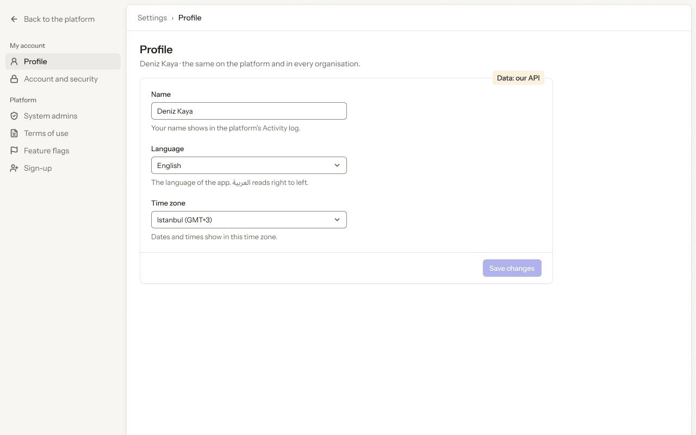
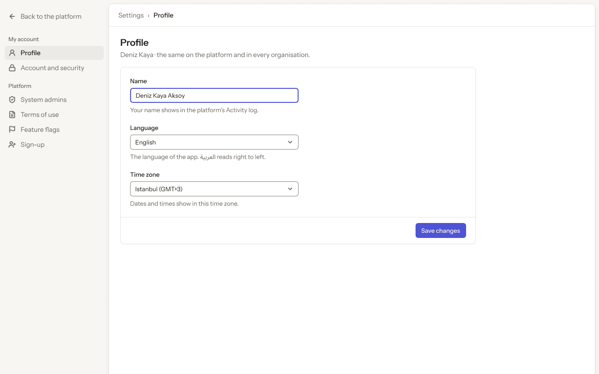
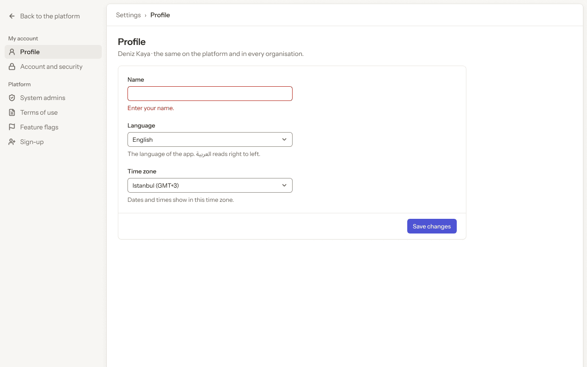
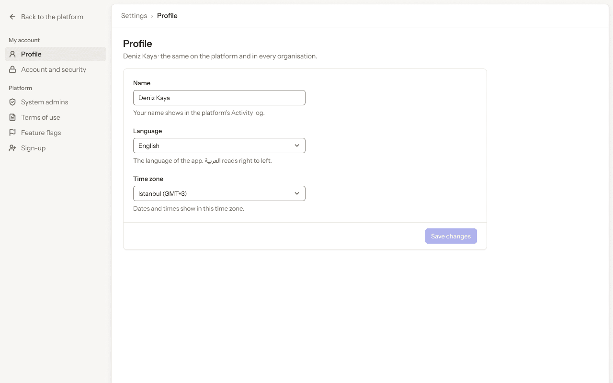
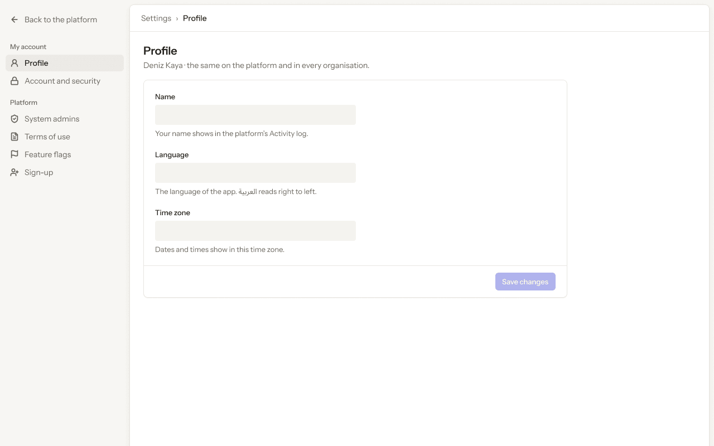
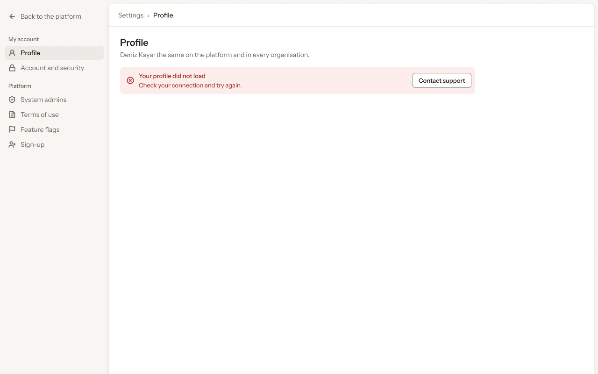
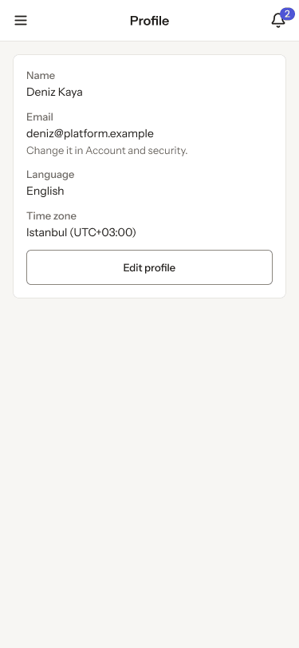

# Platform app · 8 · Settings › Profile

Who sees this section: The signed-in system admin, about themselves.

Where the values come from: Name, picture and language: our API (profile).

7 screens. Each part below is one screen and state. The PNG beside this file is the screen at scale 1.

| Screen | Device |
|---|---|
| [8.01 · Profile · ideal](#801--profile--ideal) | Desktop |
| [8.02 · Profile · edited](#802--profile--edited) | Desktop |
| [8.03 · Profile · name empty](#803--profile--name-empty) | Desktop |
| [8.04 · Profile · saved](#804--profile--saved) | Desktop |
| [8.05 · Profile · loading](#805--profile--loading) | Desktop |
| [8.06 · Profile · error](#806--profile--error) | Desktop |
| [8.07 · Phone · Profile](#807--phone--profile) | Phone |

### 8.01 · Profile · ideal

- **Who sees it:** The signed-in system admin, about themselves.
- **Device:** Desktop (1280 px and wider).
- **This state shows:** when the data loads and every value is present.
- **Values come from:** Name, picture and language: our API (profile).
- **Components:** Button, Input, Platform sidebar, Select ×2, Top bar.
- **Actions:**
  - "Back to the platform": goes to [4.01 · Organisations · all](../04-organisations/README.md#401--organisations--all).
  - "Account and security": goes to [9.01 · Account and security · ideal](../09-settings-account-and-security/README.md#901--account-and-security--ideal).
  - "System admins": goes to [10.01 · System admins](../10-settings-system-admins/README.md#1001--system-admins).
  - "Terms of use": goes to [11.01 · Terms of use](../11-settings-terms-of-use/README.md#1101--terms-of-use).
  - "Deniz Kaya": goes to [2.03 · Account menu](../02-shell/README.md#203--account-menu).
  - "Feature flags": goes to [12.01 · Feature flags](../12-settings-feature-flags/README.md#1201--feature-flags).
  - "Sign-up": goes to [13.01 · Sign-up · off](../13-settings-sign-up/README.md#1301--sign-up--off).
- **Texts, word for word, top to bottom:**

  - Back to the platform
  - My account
  - Profile
  - Account and security
  - Platform
  - System admins
  - Terms of use
  - Feature flags
  - Sign-up
  - DK
  - Deniz Kaya
  - Settings
  - ›
  - Profile
  - Profile
  - Deniz Kaya · the same on the platform and in every organisation.
  - Name
  - Deniz Kaya
  - Your name shows in the platform’s Activity log.
  - Language
  - English
  - The language of the app. العربية reads right to left.
  - Time zone
  - Istanbul (GMT+3)
  - Dates and times show in this time zone.
  - Save changes
  - Data: our API

Figma: [195:8807](https://www.figma.com/design/3Ev111okX8xCBwR9B3hyBM/?node-id=195-8807)

### 8.02 · Profile · edited

- **Who sees it:** The signed-in system admin, about themselves.
- **Device:** Desktop (1280 px and wider).
- **This state shows:** after the person changes a value and before saving.
- **Values come from:** Name, picture and language: our API (profile).
- **Components:** Button, Input, Platform sidebar, Select ×2, Top bar.
- **Actions:**
  - "Back to the platform": goes to [4.01 · Organisations · all](../04-organisations/README.md#401--organisations--all).
  - "Profile": goes to [8.01 · Profile · ideal](#801--profile--ideal).
  - "Account and security": goes to [9.01 · Account and security · ideal](../09-settings-account-and-security/README.md#901--account-and-security--ideal).
  - "System admins": goes to [10.01 · System admins](../10-settings-system-admins/README.md#1001--system-admins).
  - "Terms of use": goes to [11.01 · Terms of use](../11-settings-terms-of-use/README.md#1101--terms-of-use).
  - "Deniz Kaya": goes to [2.03 · Account menu](../02-shell/README.md#203--account-menu).
  - "Feature flags": goes to [12.01 · Feature flags](../12-settings-feature-flags/README.md#1201--feature-flags).
  - "Sign-up": goes to [13.01 · Sign-up · off](../13-settings-sign-up/README.md#1301--sign-up--off).
- **Texts, word for word, top to bottom:**

  - Back to the platform
  - My account
  - Profile
  - Account and security
  - Platform
  - System admins
  - Terms of use
  - Feature flags
  - Sign-up
  - DK
  - Deniz Kaya
  - Settings
  - ›
  - Profile
  - Profile
  - Deniz Kaya · the same on the platform and in every organisation.
  - Name
  - Deniz Kaya Aksoy
  - Your name shows in the platform’s Activity log.
  - Language
  - English
  - The language of the app. العربية reads right to left.
  - Time zone
  - Istanbul (GMT+3)
  - Dates and times show in this time zone.
  - Save changes

Figma: [195:8926](https://www.figma.com/design/3Ev111okX8xCBwR9B3hyBM/?node-id=195-8926)

### 8.03 · Profile · name empty

- **Who sees it:** The signed-in system admin, about themselves.
- **Device:** Desktop (1280 px and wider).
- **This state shows:** when there is nothing to list yet.
- **Values come from:** Name, picture and language: our API (profile).
- **Components:** Button, Input, Platform sidebar, Select ×2, Top bar.
- **Actions:**
  - "Back to the platform": goes to [4.01 · Organisations · all](../04-organisations/README.md#401--organisations--all).
  - "Profile": goes to [8.01 · Profile · ideal](#801--profile--ideal).
  - "Account and security": goes to [9.01 · Account and security · ideal](../09-settings-account-and-security/README.md#901--account-and-security--ideal).
  - "System admins": goes to [10.01 · System admins](../10-settings-system-admins/README.md#1001--system-admins).
  - "Terms of use": goes to [11.01 · Terms of use](../11-settings-terms-of-use/README.md#1101--terms-of-use).
  - "Deniz Kaya": goes to [2.03 · Account menu](../02-shell/README.md#203--account-menu).
  - "Feature flags": goes to [12.01 · Feature flags](../12-settings-feature-flags/README.md#1201--feature-flags).
  - "Sign-up": goes to [13.01 · Sign-up · off](../13-settings-sign-up/README.md#1301--sign-up--off).
- **Texts, word for word, top to bottom:**

  - Back to the platform
  - My account
  - Profile
  - Account and security
  - Platform
  - System admins
  - Terms of use
  - Feature flags
  - Sign-up
  - DK
  - Deniz Kaya
  - Settings
  - ›
  - Profile
  - Profile
  - Deniz Kaya · the same on the platform and in every organisation.
  - Name
  - Enter your name.
  - Language
  - English
  - The language of the app. العربية reads right to left.
  - Time zone
  - Istanbul (GMT+3)
  - Dates and times show in this time zone.
  - Save changes

Figma: [195:9044](https://www.figma.com/design/3Ev111okX8xCBwR9B3hyBM/?node-id=195-9044)

### 8.04 · Profile · saved

- **Who sees it:** The signed-in system admin, about themselves.
- **Device:** Desktop (1280 px and wider).
- **This state shows:** right after a save succeeds.
- **Values come from:** Name, picture and language: our API (profile).
- **Components:** Button, Input, Platform sidebar, Select ×2, Toast, Top bar.
- **Actions:**
  - "Back to the platform": goes to [4.01 · Organisations · all](../04-organisations/README.md#401--organisations--all).
  - "Profile": goes to [8.01 · Profile · ideal](#801--profile--ideal).
  - "Account and security": goes to [9.01 · Account and security · ideal](../09-settings-account-and-security/README.md#901--account-and-security--ideal).
  - "System admins": goes to [10.01 · System admins](../10-settings-system-admins/README.md#1001--system-admins).
  - "Terms of use": goes to [11.01 · Terms of use](../11-settings-terms-of-use/README.md#1101--terms-of-use).
  - "Deniz Kaya": goes to [2.03 · Account menu](../02-shell/README.md#203--account-menu).
  - "Feature flags": goes to [12.01 · Feature flags](../12-settings-feature-flags/README.md#1201--feature-flags).
  - "Sign-up": goes to [13.01 · Sign-up · off](../13-settings-sign-up/README.md#1301--sign-up--off).
- **Texts, word for word, top to bottom:**

  - Back to the platform
  - My account
  - Profile
  - Account and security
  - Platform
  - System admins
  - Terms of use
  - Feature flags
  - Sign-up
  - DK
  - Deniz Kaya
  - Settings
  - ›
  - Profile
  - Profile
  - Deniz Kaya · the same on the platform and in every organisation.
  - Name
  - Deniz Kaya
  - Your name shows in the platform’s Activity log.
  - Language
  - English
  - The language of the app. العربية reads right to left.
  - Time zone
  - Istanbul (GMT+3)
  - Dates and times show in this time zone.
  - Save changes
  - Profile saved
  - Your new name shows in every organisation.

Figma: [195:9158](https://www.figma.com/design/3Ev111okX8xCBwR9B3hyBM/?node-id=195-9158)

### 8.05 · Profile · loading

- **Who sees it:** The signed-in system admin, about themselves.
- **Device:** Desktop (1280 px and wider).
- **This state shows:** while the request runs.
- **Values come from:** Name, picture and language: our API (profile).
- **Components:** Button, Platform sidebar, Skeleton ×3, Top bar.
- **Actions:**
  - "Back to the platform": goes to [4.01 · Organisations · all](../04-organisations/README.md#401--organisations--all).
  - "Profile": goes to [8.01 · Profile · ideal](#801--profile--ideal).
  - "Account and security": goes to [9.01 · Account and security · ideal](../09-settings-account-and-security/README.md#901--account-and-security--ideal).
  - "System admins": goes to [10.01 · System admins](../10-settings-system-admins/README.md#1001--system-admins).
  - "Terms of use": goes to [11.01 · Terms of use](../11-settings-terms-of-use/README.md#1101--terms-of-use).
  - "Deniz Kaya": goes to [2.03 · Account menu](../02-shell/README.md#203--account-menu).
  - "Feature flags": goes to [12.01 · Feature flags](../12-settings-feature-flags/README.md#1201--feature-flags).
  - "Sign-up": goes to [13.01 · Sign-up · off](../13-settings-sign-up/README.md#1301--sign-up--off).
- **Texts, word for word, top to bottom:**

  - Back to the platform
  - My account
  - Profile
  - Account and security
  - Platform
  - System admins
  - Terms of use
  - Feature flags
  - Sign-up
  - DK
  - Deniz Kaya
  - Settings
  - ›
  - Profile
  - Profile
  - Deniz Kaya · the same on the platform and in every organisation.
  - Name
  - Your name shows in the platform’s Activity log.
  - Language
  - The language of the app. العربية reads right to left.
  - Time zone
  - Dates and times show in this time zone.
  - Save changes

Figma: [195:9283](https://www.figma.com/design/3Ev111okX8xCBwR9B3hyBM/?node-id=195-9283)

### 8.06 · Profile · error

- **Who sees it:** The signed-in system admin, about themselves.
- **Device:** Desktop (1280 px and wider).
- **This state shows:** when the request fails.
- **Values come from:** Name, picture and language: our API (profile).
- **Components:** Banner, Platform sidebar, Top bar.
- **Actions:**
  - "Back to the platform": goes to [4.01 · Organisations · all](../04-organisations/README.md#401--organisations--all).
  - "Profile": goes to [8.01 · Profile · ideal](#801--profile--ideal).
  - "Account and security": goes to [9.01 · Account and security · ideal](../09-settings-account-and-security/README.md#901--account-and-security--ideal).
  - "System admins": goes to [10.01 · System admins](../10-settings-system-admins/README.md#1001--system-admins).
  - "Terms of use": goes to [11.01 · Terms of use](../11-settings-terms-of-use/README.md#1101--terms-of-use).
  - "Deniz Kaya": goes to [2.03 · Account menu](../02-shell/README.md#203--account-menu).
  - "Feature flags": goes to [12.01 · Feature flags](../12-settings-feature-flags/README.md#1201--feature-flags).
  - "Sign-up": goes to [13.01 · Sign-up · off](../13-settings-sign-up/README.md#1301--sign-up--off).
- **Texts, word for word, top to bottom:**

  - Back to the platform
  - My account
  - Profile
  - Account and security
  - Platform
  - System admins
  - Terms of use
  - Feature flags
  - Sign-up
  - DK
  - Deniz Kaya
  - Settings
  - ›
  - Profile
  - Profile
  - Deniz Kaya · the same on the platform and in every organisation.
  - Your profile did not load
  - Check your connection and try again.
  - Contact support

Figma: [195:9387](https://www.figma.com/design/3Ev111okX8xCBwR9B3hyBM/?node-id=195-9387)

### 8.07 · Phone · Profile

- **Who sees it:** The signed-in system admin, about themselves.
- **Device:** Phone (up to 767 px).
- **This state shows:** on a phone.
- **Values come from:** Name, picture and language: our API (profile).
- **Components:** Button, Phone top bar.
- **Actions:**
  - "Area": goes to [2.15 · Phone · settings menu open](../02-shell/README.md#215--phone--settings-menu-open).
  - "2": goes to [3.08 · Phone · Notifications](../03-notifications/README.md#308--phone--notifications).
- **Texts, word for word, top to bottom:**

  - Profile
  - 2
  - Name
  - Deniz Kaya
  - Email
  - deniz@platform.example
  - Change it in Account and security.
  - Language
  - English
  - Time zone
  - Istanbul (UTC+03:00)
  - Edit profile

Figma: [261:17256](https://www.figma.com/design/3Ev111okX8xCBwR9B3hyBM/?node-id=261-17256)
