# Platform app · 9 · Settings › Account and security

Who sees this section: The signed-in system admin, about themselves.

Where the values come from: Sign-in methods, sessions and two-step verification (required): Clerk.

13 screens. Each part below is one screen and state. The PNG beside this file is the screen at scale 1.

| Screen | Device |
|---|---|
| [9.01 · Account and security · ideal](#901--account-and-security--ideal) | Desktop |
| [9.02 · Account and security · loading](#902--account-and-security--loading) | Desktop |
| [9.03 · Account and security · error](#903--account-and-security--error) | Desktop |
| [9.04 · Change email](#904--change-email) | Desktop |
| [9.05 · Enter the code](#905--enter-the-code) | Desktop |
| [9.06 · Code wrong](#906--code-wrong) | Desktop |
| [9.07 · Email changed](#907--email-changed) | Desktop |
| [9.08 · Disconnect Google](#908--disconnect-google) | Desktop |
| [9.09 · Google disconnected](#909--google-disconnected) | Desktop |
| [9.10 · Session signed out](#910--session-signed-out) | Desktop |
| [9.11 · Sign out of other sessions](#911--sign-out-of-other-sessions) | Desktop |
| [9.12 · Other sessions signed out](#912--other-sessions-signed-out) | Desktop |
| [9.13 · Phone · Account and security](#913--phone--account-and-security) | Phone |

### 9.01 · Account and security · ideal

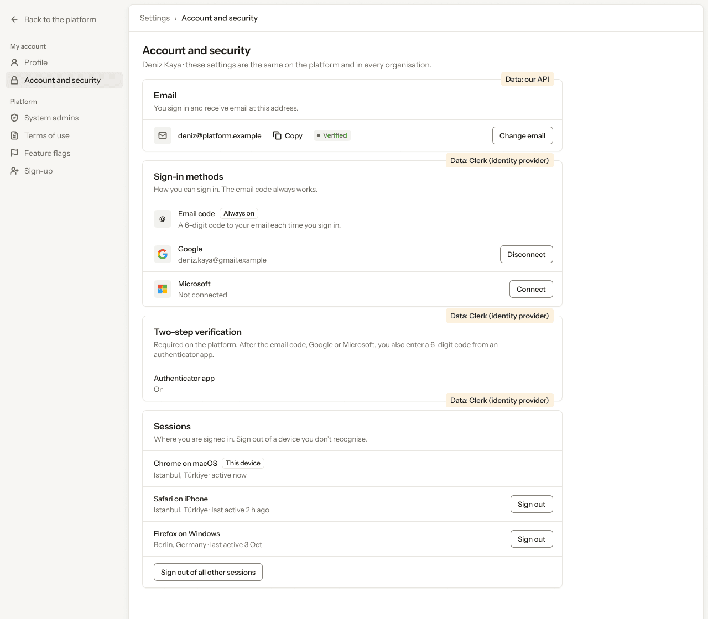

- **Who sees it:** The signed-in system admin, about themselves.
- **Device:** Desktop (1280 px and wider).
- **This state shows:** when the data loads and every value is present.
- **Values come from:** Sign-in methods, sessions and two-step verification (required): Clerk.
- **Components:** Button ×7, Icon/mail, Label ×2, Logo/Google, Logo/Microsoft, Pill, Platform sidebar, Top bar.
- **Actions:**
  - "Back to the platform": goes to [4.01 · Organisations · all](../04-organisations/README.md#401--organisations--all).
  - "Profile": goes to [8.01 · Profile · ideal](../08-settings-profile/README.md#801--profile--ideal).
  - "System admins": goes to [10.01 · System admins](../10-settings-system-admins/README.md#1001--system-admins).
  - "Terms of use": goes to [11.01 · Terms of use](../11-settings-terms-of-use/README.md#1101--terms-of-use).
  - "Deniz Kaya": goes to [2.03 · Account menu](../02-shell/README.md#203--account-menu).
  - "Change email": goes to [9.04 · Change email](#904--change-email).
  - "Disconnect": goes to [9.08 · Disconnect Google](#908--disconnect-google).
  - "Sign out": goes to [9.10 · Session signed out](#910--session-signed-out).
  - "Sign out of all other sessions": goes to [9.11 · Sign out of other sessions](#911--sign-out-of-other-sessions).
  - "Feature flags": goes to [12.01 · Feature flags](../12-settings-feature-flags/README.md#1201--feature-flags).
  - "Sign-up": goes to [13.01 · Sign-up · off](../13-settings-sign-up/README.md#1301--sign-up--off).
- **Texts, word for word, top to bottom:**

  - Back to the platform
  - My account
  - Profile
  - Account and security
  - Platform
  - System admins
  - Terms of use
  - Feature flags
  - Sign-up
  - DK
  - Deniz Kaya
  - Settings
  - ›
  - Account and security
  - Account and security
  - Deniz Kaya · these settings are the same on the platform and in every organisation.
  - Email
  - You sign in and receive email at this address.
  - deniz@platform.example
  - Copy
  - Verified
  - Change email
  - Sign-in methods
  - How you can sign in. The email code always works.
  - @
  - Email code
  - Always on
  - A 6-digit code to your email each time you sign in.
  - Google
  - deniz.kaya@gmail.example
  - Disconnect
  - Microsoft
  - Not connected
  - Connect
  - Two-step verification
  - Required on the platform. After the email code, Google or Microsoft, you also enter a 6-digit code from an authenticator app.
  - Authenticator app
  - On
  - Sessions
  - Where you are signed in. Sign out of a device you don’t recognise.
  - Chrome on macOS
  - This device
  - Istanbul, Türkiye · active now
  - Safari on iPhone
  - Istanbul, Türkiye · last active 2 h ago
  - Sign out
  - Firefox on Windows
  - Berlin, Germany · last active 3 Oct
  - Sign out
  - Sign out of all other sessions
  - Data: our API
  - Data: Clerk (identity provider)
  - Data: Clerk (identity provider)
  - Data: Clerk (identity provider)

Figma: [196:9222](https://www.figma.com/design/3Ev111okX8xCBwR9B3hyBM/?node-id=196-9222)

### 9.02 · Account and security · loading

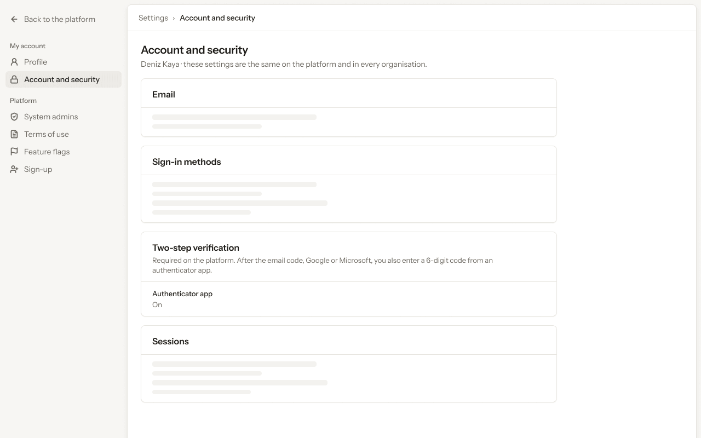

- **Who sees it:** The signed-in system admin, about themselves.
- **Device:** Desktop (1280 px and wider).
- **This state shows:** while the request runs.
- **Values come from:** Sign-in methods, sessions and two-step verification (required): Clerk.
- **Components:** Platform sidebar, Skeleton ×10, Top bar.
- **Actions:**
  - "Back to the platform": goes to [4.01 · Organisations · all](../04-organisations/README.md#401--organisations--all).
  - "Profile": goes to [8.01 · Profile · ideal](../08-settings-profile/README.md#801--profile--ideal).
  - "Account and security": goes to [9.01 · Account and security · ideal](#901--account-and-security--ideal).
  - "System admins": goes to [10.01 · System admins](../10-settings-system-admins/README.md#1001--system-admins).
  - "Terms of use": goes to [11.01 · Terms of use](../11-settings-terms-of-use/README.md#1101--terms-of-use).
  - "Deniz Kaya": goes to [2.03 · Account menu](../02-shell/README.md#203--account-menu).
  - "Feature flags": goes to [12.01 · Feature flags](../12-settings-feature-flags/README.md#1201--feature-flags).
  - "Sign-up": goes to [13.01 · Sign-up · off](../13-settings-sign-up/README.md#1301--sign-up--off).
- **Texts, word for word, top to bottom:**

  - Back to the platform
  - My account
  - Profile
  - Account and security
  - Platform
  - System admins
  - Terms of use
  - Feature flags
  - Sign-up
  - DK
  - Deniz Kaya
  - Settings
  - ›
  - Account and security
  - Account and security
  - Deniz Kaya · these settings are the same on the platform and in every organisation.
  - Email
  - Sign-in methods
  - Two-step verification
  - Required on the platform. After the email code, Google or Microsoft, you also enter a 6-digit code from an authenticator app.
  - Authenticator app
  - On
  - Sessions

Figma: [196:9511](https://www.figma.com/design/3Ev111okX8xCBwR9B3hyBM/?node-id=196-9511)

### 9.03 · Account and security · error

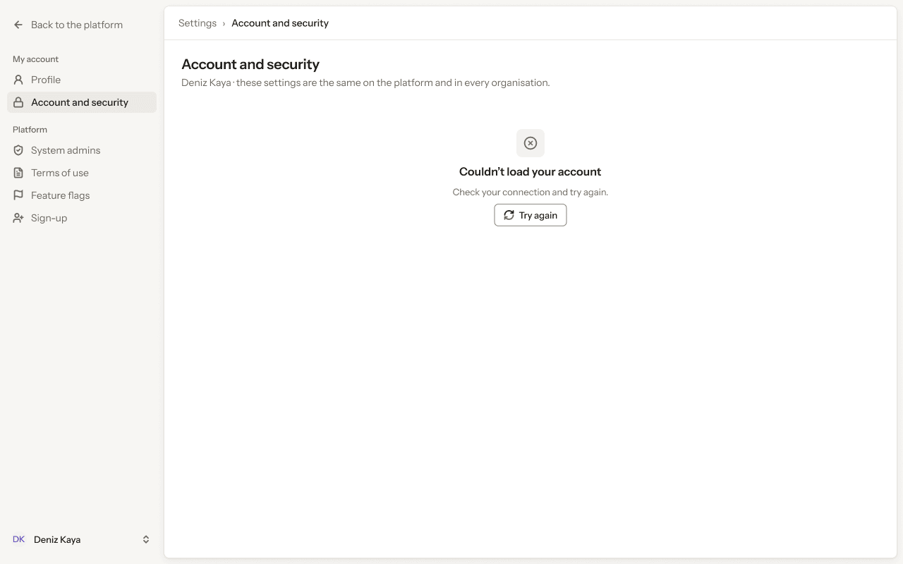

- **Who sees it:** The signed-in system admin, about themselves.
- **Device:** Desktop (1280 px and wider).
- **This state shows:** when the request fails.
- **Values come from:** Sign-in methods, sessions and two-step verification (required): Clerk.
- **Components:** Empty state, Platform sidebar, Top bar.
- **Actions:**
  - "Back to the platform": goes to [4.01 · Organisations · all](../04-organisations/README.md#401--organisations--all).
  - "Profile": goes to [8.01 · Profile · ideal](../08-settings-profile/README.md#801--profile--ideal).
  - "Account and security": goes to [9.01 · Account and security · ideal](#901--account-and-security--ideal).
  - "System admins": goes to [10.01 · System admins](../10-settings-system-admins/README.md#1001--system-admins).
  - "Terms of use": goes to [11.01 · Terms of use](../11-settings-terms-of-use/README.md#1101--terms-of-use).
  - "Deniz Kaya": goes to [2.03 · Account menu](../02-shell/README.md#203--account-menu).
  - "Feature flags": goes to [12.01 · Feature flags](../12-settings-feature-flags/README.md#1201--feature-flags).
  - "Sign-up": goes to [13.01 · Sign-up · off](../13-settings-sign-up/README.md#1301--sign-up--off).
- **Texts, word for word, top to bottom:**

  - Back to the platform
  - My account
  - Profile
  - Account and security
  - Platform
  - System admins
  - Terms of use
  - Feature flags
  - Sign-up
  - DK
  - Deniz Kaya
  - Settings
  - ›
  - Account and security
  - Account and security
  - Deniz Kaya · these settings are the same on the platform and in every organisation.
  - Couldn’t load your account
  - Check your connection and try again.
  - Try again

Figma: [196:9687](https://www.figma.com/design/3Ev111okX8xCBwR9B3hyBM/?node-id=196-9687)

### 9.04 · Change email

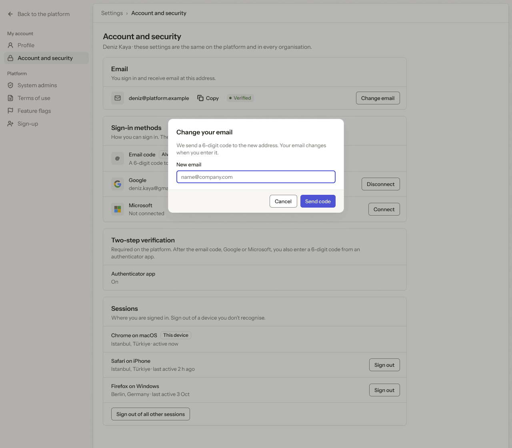

- **Who sees it:** The signed-in system admin, about themselves.
- **Device:** Desktop (1280 px and wider).
- **This state shows:** as the title says.
- **Values come from:** Sign-in methods, sessions and two-step verification (required): Clerk.
- **Components:** Button ×9, Icon/mail, Input, Label ×2, Logo/Google, Logo/Microsoft, Pill, Platform sidebar, Top bar.
- **Actions:**
  - "Back to the platform": goes to [4.01 · Organisations · all](../04-organisations/README.md#401--organisations--all).
  - "Profile": goes to [8.01 · Profile · ideal](../08-settings-profile/README.md#801--profile--ideal).
  - "Account and security": goes to [9.01 · Account and security · ideal](#901--account-and-security--ideal).
  - "System admins": goes to [10.01 · System admins](../10-settings-system-admins/README.md#1001--system-admins).
  - "Terms of use": goes to [11.01 · Terms of use](../11-settings-terms-of-use/README.md#1101--terms-of-use).
  - "Deniz Kaya": goes to [2.03 · Account menu](../02-shell/README.md#203--account-menu).
  - "Feature flags": goes to [12.01 · Feature flags](../12-settings-feature-flags/README.md#1201--feature-flags).
  - "Sign-up": goes to [13.01 · Sign-up · off](../13-settings-sign-up/README.md#1301--sign-up--off).
- **Texts, word for word, top to bottom:**

  - Back to the platform
  - My account
  - Profile
  - Account and security
  - Platform
  - System admins
  - Terms of use
  - Feature flags
  - Sign-up
  - DK
  - Deniz Kaya
  - Settings
  - ›
  - Account and security
  - Account and security
  - Deniz Kaya · these settings are the same on the platform and in every organisation.
  - Email
  - You sign in and receive email at this address.
  - deniz@platform.example
  - Copy
  - Verified
  - Change email
  - Sign-in methods
  - How you can sign in. The email code always works.
  - @
  - Email code
  - Always on
  - A 6-digit code to your email each time you sign in.
  - Google
  - deniz.kaya@gmail.example
  - Disconnect
  - Microsoft
  - Not connected
  - Connect
  - Two-step verification
  - Required on the platform. After the email code, Google or Microsoft, you also enter a 6-digit code from an authenticator app.
  - Authenticator app
  - On
  - Sessions
  - Where you are signed in. Sign out of a device you don’t recognise.
  - Chrome on macOS
  - This device
  - Istanbul, Türkiye · active now
  - Safari on iPhone
  - Istanbul, Türkiye · last active 2 h ago
  - Sign out
  - Firefox on Windows
  - Berlin, Germany · last active 3 Oct
  - Sign out
  - Sign out of all other sessions
  - Change your email
  - We send a 6-digit code to the new address. Your email changes when you enter it.
  - New email
  - name@company.com
  - Cancel
  - Send code

Figma: [196:9838](https://www.figma.com/design/3Ev111okX8xCBwR9B3hyBM/?node-id=196-9838)

### 9.05 · Enter the code

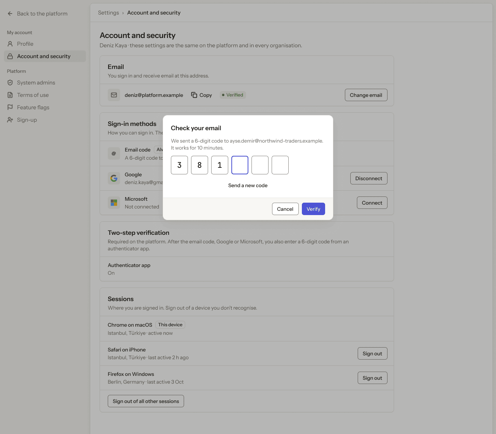

- **Who sees it:** The signed-in system admin, about themselves.
- **Device:** Desktop (1280 px and wider).
- **This state shows:** as the title says.
- **Values come from:** Sign-in methods, sessions and two-step verification (required): Clerk.
- **Components:** Button ×10, Icon/mail, Label ×2, Logo/Google, Logo/Microsoft, Pill, Platform sidebar, Top bar.
- **Actions:**
  - "Back to the platform": goes to [4.01 · Organisations · all](../04-organisations/README.md#401--organisations--all).
  - "Profile": goes to [8.01 · Profile · ideal](../08-settings-profile/README.md#801--profile--ideal).
  - "Account and security": goes to [9.01 · Account and security · ideal](#901--account-and-security--ideal).
  - "System admins": goes to [10.01 · System admins](../10-settings-system-admins/README.md#1001--system-admins).
  - "Terms of use": goes to [11.01 · Terms of use](../11-settings-terms-of-use/README.md#1101--terms-of-use).
  - "Deniz Kaya": goes to [2.03 · Account menu](../02-shell/README.md#203--account-menu).
  - "Feature flags": goes to [12.01 · Feature flags](../12-settings-feature-flags/README.md#1201--feature-flags).
  - "Sign-up": goes to [13.01 · Sign-up · off](../13-settings-sign-up/README.md#1301--sign-up--off).
- **Texts, word for word, top to bottom:**

  - Back to the platform
  - My account
  - Profile
  - Account and security
  - Platform
  - System admins
  - Terms of use
  - Feature flags
  - Sign-up
  - DK
  - Deniz Kaya
  - Settings
  - ›
  - Account and security
  - Account and security
  - Deniz Kaya · these settings are the same on the platform and in every organisation.
  - Email
  - You sign in and receive email at this address.
  - deniz@platform.example
  - Copy
  - Verified
  - Change email
  - Sign-in methods
  - How you can sign in. The email code always works.
  - @
  - Email code
  - Always on
  - A 6-digit code to your email each time you sign in.
  - Google
  - deniz.kaya@gmail.example
  - Disconnect
  - Microsoft
  - Not connected
  - Connect
  - Two-step verification
  - Required on the platform. After the email code, Google or Microsoft, you also enter a 6-digit code from an authenticator app.
  - Authenticator app
  - On
  - Sessions
  - Where you are signed in. Sign out of a device you don’t recognise.
  - Chrome on macOS
  - This device
  - Istanbul, Türkiye · active now
  - Safari on iPhone
  - Istanbul, Türkiye · last active 2 h ago
  - Sign out
  - Firefox on Windows
  - Berlin, Germany · last active 3 Oct
  - Sign out
  - Sign out of all other sessions
  - Check your email
  - We sent a 6-digit code to ayse.demir@northwind-traders.example. It works for 10 minutes.
  - 3
  - 8
  - 1
  - Send a new code
  - Cancel
  - Verify

Figma: [196:10127](https://www.figma.com/design/3Ev111okX8xCBwR9B3hyBM/?node-id=196-10127)

### 9.06 · Code wrong

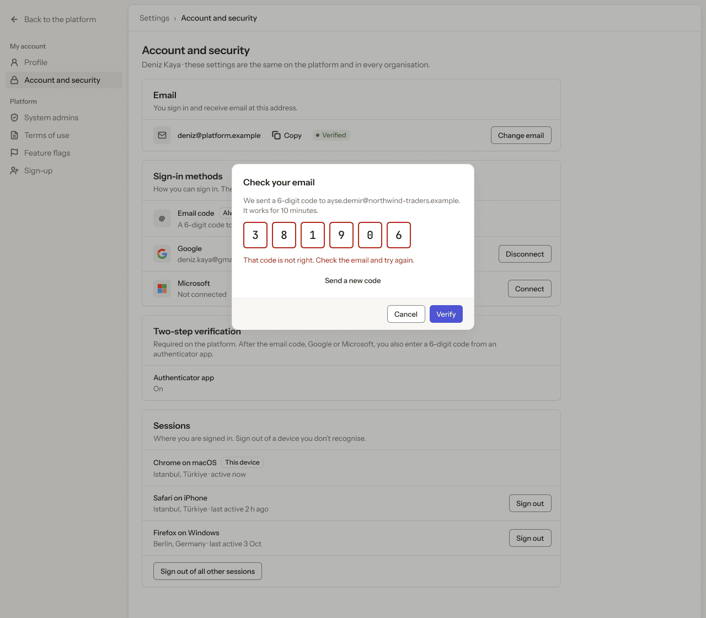

- **Who sees it:** The signed-in system admin, about themselves.
- **Device:** Desktop (1280 px and wider).
- **This state shows:** as the title says.
- **Values come from:** Sign-in methods, sessions and two-step verification (required): Clerk.
- **Components:** Button ×10, Icon/mail, Label ×2, Logo/Google, Logo/Microsoft, Pill, Platform sidebar, Top bar.
- **Actions:**
  - "Back to the platform": goes to [4.01 · Organisations · all](../04-organisations/README.md#401--organisations--all).
  - "Profile": goes to [8.01 · Profile · ideal](../08-settings-profile/README.md#801--profile--ideal).
  - "Account and security": goes to [9.01 · Account and security · ideal](#901--account-and-security--ideal).
  - "System admins": goes to [10.01 · System admins](../10-settings-system-admins/README.md#1001--system-admins).
  - "Terms of use": goes to [11.01 · Terms of use](../11-settings-terms-of-use/README.md#1101--terms-of-use).
  - "Deniz Kaya": goes to [2.03 · Account menu](../02-shell/README.md#203--account-menu).
  - "Feature flags": goes to [12.01 · Feature flags](../12-settings-feature-flags/README.md#1201--feature-flags).
  - "Sign-up": goes to [13.01 · Sign-up · off](../13-settings-sign-up/README.md#1301--sign-up--off).
- **Texts, word for word, top to bottom:**

  - Back to the platform
  - My account
  - Profile
  - Account and security
  - Platform
  - System admins
  - Terms of use
  - Feature flags
  - Sign-up
  - DK
  - Deniz Kaya
  - Settings
  - ›
  - Account and security
  - Account and security
  - Deniz Kaya · these settings are the same on the platform and in every organisation.
  - Email
  - You sign in and receive email at this address.
  - deniz@platform.example
  - Copy
  - Verified
  - Change email
  - Sign-in methods
  - How you can sign in. The email code always works.
  - @
  - Email code
  - Always on
  - A 6-digit code to your email each time you sign in.
  - Google
  - deniz.kaya@gmail.example
  - Disconnect
  - Microsoft
  - Not connected
  - Connect
  - Two-step verification
  - Required on the platform. After the email code, Google or Microsoft, you also enter a 6-digit code from an authenticator app.
  - Authenticator app
  - On
  - Sessions
  - Where you are signed in. Sign out of a device you don’t recognise.
  - Chrome on macOS
  - This device
  - Istanbul, Türkiye · active now
  - Safari on iPhone
  - Istanbul, Türkiye · last active 2 h ago
  - Sign out
  - Firefox on Windows
  - Berlin, Germany · last active 3 Oct
  - Sign out
  - Sign out of all other sessions
  - Check your email
  - We sent a 6-digit code to ayse.demir@northwind-traders.example. It works for 10 minutes.
  - 3
  - 8
  - 1
  - 9
  - 0
  - 6
  - That code is not right. Check the email and try again.
  - Send a new code
  - Cancel
  - Verify

Figma: [196:10424](https://www.figma.com/design/3Ev111okX8xCBwR9B3hyBM/?node-id=196-10424)

### 9.07 · Email changed

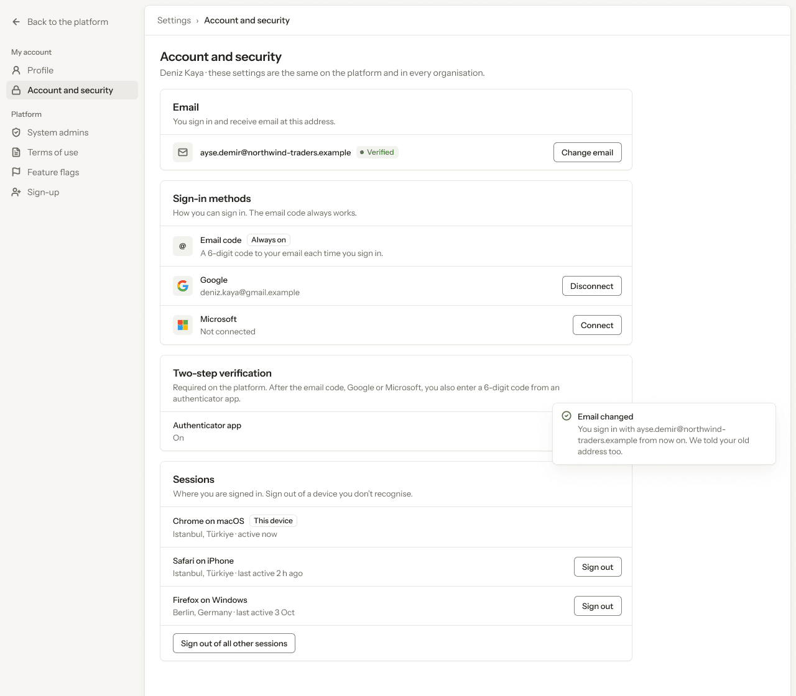

- **Who sees it:** The signed-in system admin, about themselves.
- **Device:** Desktop (1280 px and wider).
- **This state shows:** as the title says.
- **Values come from:** Sign-in methods, sessions and two-step verification (required): Clerk.
- **Components:** Button ×6, Icon/mail, Label ×2, Logo/Google, Logo/Microsoft, Pill, Platform sidebar, Toast, Top bar.
- **Actions:**
  - "Back to the platform": goes to [4.01 · Organisations · all](../04-organisations/README.md#401--organisations--all).
  - "Profile": goes to [8.01 · Profile · ideal](../08-settings-profile/README.md#801--profile--ideal).
  - "Account and security": goes to [9.01 · Account and security · ideal](#901--account-and-security--ideal).
  - "System admins": goes to [10.01 · System admins](../10-settings-system-admins/README.md#1001--system-admins).
  - "Terms of use": goes to [11.01 · Terms of use](../11-settings-terms-of-use/README.md#1101--terms-of-use).
  - "Deniz Kaya": goes to [2.03 · Account menu](../02-shell/README.md#203--account-menu).
  - "Feature flags": goes to [12.01 · Feature flags](../12-settings-feature-flags/README.md#1201--feature-flags).
  - "Sign-up": goes to [13.01 · Sign-up · off](../13-settings-sign-up/README.md#1301--sign-up--off).
- **Texts, word for word, top to bottom:**

  - Back to the platform
  - My account
  - Profile
  - Account and security
  - Platform
  - System admins
  - Terms of use
  - Feature flags
  - Sign-up
  - DK
  - Deniz Kaya
  - Settings
  - ›
  - Account and security
  - Account and security
  - Deniz Kaya · these settings are the same on the platform and in every organisation.
  - Email
  - You sign in and receive email at this address.
  - ayse.demir@northwind-traders.example
  - Verified
  - Change email
  - Sign-in methods
  - How you can sign in. The email code always works.
  - @
  - Email code
  - Always on
  - A 6-digit code to your email each time you sign in.
  - Google
  - deniz.kaya@gmail.example
  - Disconnect
  - Microsoft
  - Not connected
  - Connect
  - Two-step verification
  - Required on the platform. After the email code, Google or Microsoft, you also enter a 6-digit code from an authenticator app.
  - Authenticator app
  - On
  - Sessions
  - Where you are signed in. Sign out of a device you don’t recognise.
  - Chrome on macOS
  - This device
  - Istanbul, Türkiye · active now
  - Safari on iPhone
  - Istanbul, Türkiye · last active 2 h ago
  - Sign out
  - Firefox on Windows
  - Berlin, Germany · last active 3 Oct
  - Sign out
  - Sign out of all other sessions
  - Email changed
  - You sign in with ayse.demir@northwind-traders.example from now on. We told your old address too.

Figma: [196:10725](https://www.figma.com/design/3Ev111okX8xCBwR9B3hyBM/?node-id=196-10725)

### 9.08 · Disconnect Google

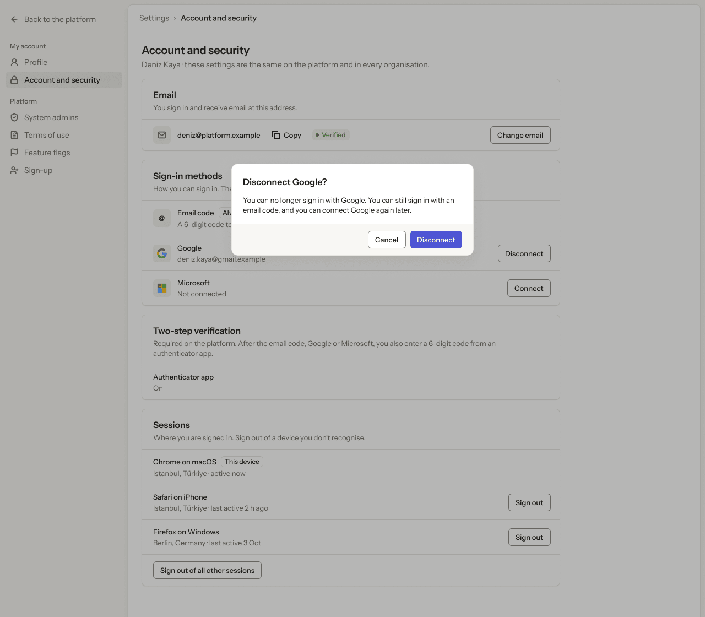

- **Who sees it:** The signed-in system admin, about themselves.
- **Device:** Desktop (1280 px and wider).
- **This state shows:** as the title says.
- **Values come from:** Sign-in methods, sessions and two-step verification (required): Clerk.
- **Components:** Button ×9, Icon/mail, Label ×2, Logo/Google, Logo/Microsoft, Pill, Platform sidebar, Top bar.
- **Actions:**
  - "Back to the platform": goes to [4.01 · Organisations · all](../04-organisations/README.md#401--organisations--all).
  - "Profile": goes to [8.01 · Profile · ideal](../08-settings-profile/README.md#801--profile--ideal).
  - "Account and security": goes to [9.01 · Account and security · ideal](#901--account-and-security--ideal).
  - "System admins": goes to [10.01 · System admins](../10-settings-system-admins/README.md#1001--system-admins).
  - "Terms of use": goes to [11.01 · Terms of use](../11-settings-terms-of-use/README.md#1101--terms-of-use).
  - "Deniz Kaya": goes to [2.03 · Account menu](../02-shell/README.md#203--account-menu).
  - "Feature flags": goes to [12.01 · Feature flags](../12-settings-feature-flags/README.md#1201--feature-flags).
  - "Sign-up": goes to [13.01 · Sign-up · off](../13-settings-sign-up/README.md#1301--sign-up--off).
- **Texts, word for word, top to bottom:**

  - Back to the platform
  - My account
  - Profile
  - Account and security
  - Platform
  - System admins
  - Terms of use
  - Feature flags
  - Sign-up
  - DK
  - Deniz Kaya
  - Settings
  - ›
  - Account and security
  - Account and security
  - Deniz Kaya · these settings are the same on the platform and in every organisation.
  - Email
  - You sign in and receive email at this address.
  - deniz@platform.example
  - Copy
  - Verified
  - Change email
  - Sign-in methods
  - How you can sign in. The email code always works.
  - @
  - Email code
  - Always on
  - A 6-digit code to your email each time you sign in.
  - Google
  - deniz.kaya@gmail.example
  - Disconnect
  - Microsoft
  - Not connected
  - Connect
  - Two-step verification
  - Required on the platform. After the email code, Google or Microsoft, you also enter a 6-digit code from an authenticator app.
  - Authenticator app
  - On
  - Sessions
  - Where you are signed in. Sign out of a device you don’t recognise.
  - Chrome on macOS
  - This device
  - Istanbul, Türkiye · active now
  - Safari on iPhone
  - Istanbul, Türkiye · last active 2 h ago
  - Sign out
  - Firefox on Windows
  - Berlin, Germany · last active 3 Oct
  - Sign out
  - Sign out of all other sessions
  - Disconnect Google?
  - You can no longer sign in with Google. You can still sign in with an email code, and you can connect Google again later.
  - Cancel
  - Disconnect

Figma: [196:10998](https://www.figma.com/design/3Ev111okX8xCBwR9B3hyBM/?node-id=196-10998)

### 9.09 · Google disconnected

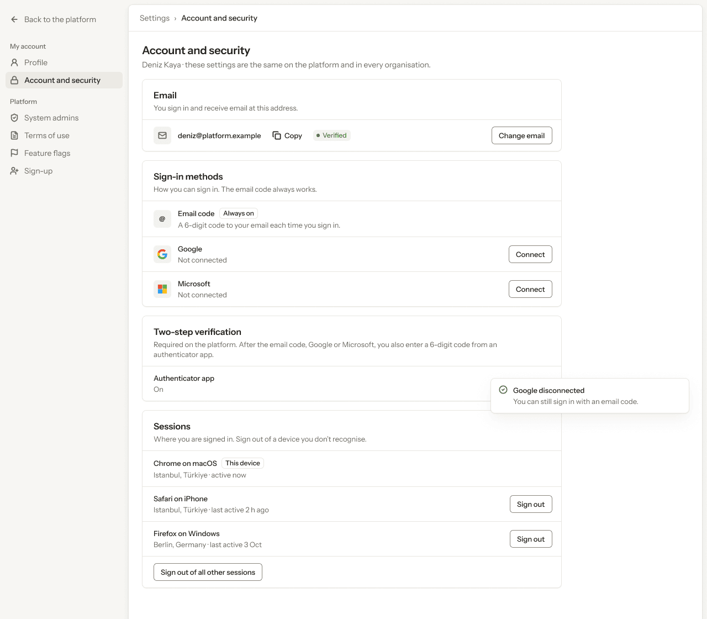

- **Who sees it:** The signed-in system admin, about themselves.
- **Device:** Desktop (1280 px and wider).
- **This state shows:** as the title says.
- **Values come from:** Sign-in methods, sessions and two-step verification (required): Clerk.
- **Components:** Button ×7, Icon/mail, Label ×2, Logo/Google, Logo/Microsoft, Pill, Platform sidebar, Toast, Top bar.
- **Actions:**
  - "Back to the platform": goes to [4.01 · Organisations · all](../04-organisations/README.md#401--organisations--all).
  - "Profile": goes to [8.01 · Profile · ideal](../08-settings-profile/README.md#801--profile--ideal).
  - "Account and security": goes to [9.01 · Account and security · ideal](#901--account-and-security--ideal).
  - "System admins": goes to [10.01 · System admins](../10-settings-system-admins/README.md#1001--system-admins).
  - "Terms of use": goes to [11.01 · Terms of use](../11-settings-terms-of-use/README.md#1101--terms-of-use).
  - "Deniz Kaya": goes to [2.03 · Account menu](../02-shell/README.md#203--account-menu).
  - "Feature flags": goes to [12.01 · Feature flags](../12-settings-feature-flags/README.md#1201--feature-flags).
  - "Sign-up": goes to [13.01 · Sign-up · off](../13-settings-sign-up/README.md#1301--sign-up--off).
- **Texts, word for word, top to bottom:**

  - Back to the platform
  - My account
  - Profile
  - Account and security
  - Platform
  - System admins
  - Terms of use
  - Feature flags
  - Sign-up
  - DK
  - Deniz Kaya
  - Settings
  - ›
  - Account and security
  - Account and security
  - Deniz Kaya · these settings are the same on the platform and in every organisation.
  - Email
  - You sign in and receive email at this address.
  - deniz@platform.example
  - Copy
  - Verified
  - Change email
  - Sign-in methods
  - How you can sign in. The email code always works.
  - @
  - Email code
  - Always on
  - A 6-digit code to your email each time you sign in.
  - Google
  - Not connected
  - Connect
  - Microsoft
  - Not connected
  - Connect
  - Two-step verification
  - Required on the platform. After the email code, Google or Microsoft, you also enter a 6-digit code from an authenticator app.
  - Authenticator app
  - On
  - Sessions
  - Where you are signed in. Sign out of a device you don’t recognise.
  - Chrome on macOS
  - This device
  - Istanbul, Türkiye · active now
  - Safari on iPhone
  - Istanbul, Türkiye · last active 2 h ago
  - Sign out
  - Firefox on Windows
  - Berlin, Germany · last active 3 Oct
  - Sign out
  - Sign out of all other sessions
  - Google disconnected
  - You can still sign in with an email code.

Figma: [196:11282](https://www.figma.com/design/3Ev111okX8xCBwR9B3hyBM/?node-id=196-11282)

### 9.10 · Session signed out

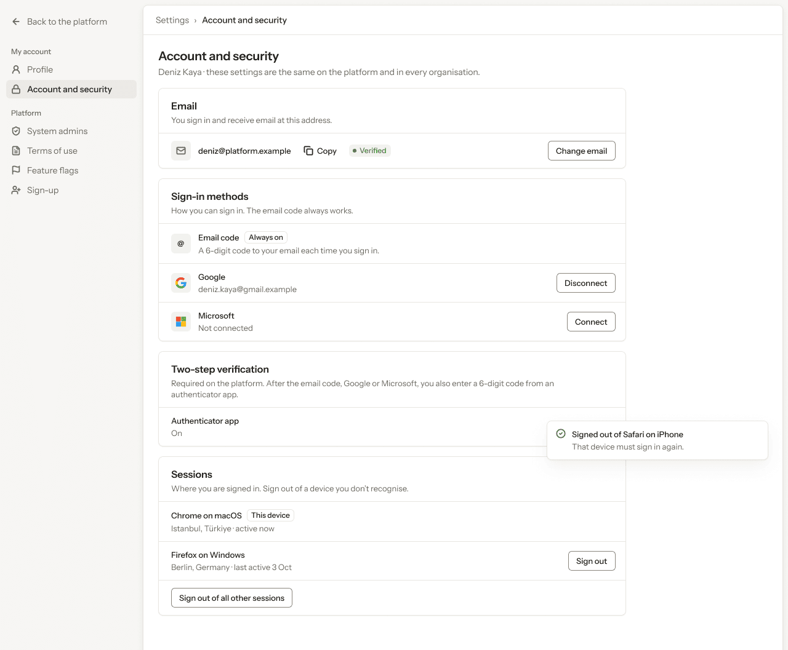

- **Who sees it:** The signed-in system admin, about themselves.
- **Device:** Desktop (1280 px and wider).
- **This state shows:** as the title says.
- **Values come from:** Sign-in methods, sessions and two-step verification (required): Clerk.
- **Components:** Button ×6, Icon/mail, Label ×2, Logo/Google, Logo/Microsoft, Pill, Platform sidebar, Toast, Top bar.
- **Actions:**
  - "Back to the platform": goes to [4.01 · Organisations · all](../04-organisations/README.md#401--organisations--all).
  - "Profile": goes to [8.01 · Profile · ideal](../08-settings-profile/README.md#801--profile--ideal).
  - "Account and security": goes to [9.01 · Account and security · ideal](#901--account-and-security--ideal).
  - "System admins": goes to [10.01 · System admins](../10-settings-system-admins/README.md#1001--system-admins).
  - "Terms of use": goes to [11.01 · Terms of use](../11-settings-terms-of-use/README.md#1101--terms-of-use).
  - "Deniz Kaya": goes to [2.03 · Account menu](../02-shell/README.md#203--account-menu).
  - "Feature flags": goes to [12.01 · Feature flags](../12-settings-feature-flags/README.md#1201--feature-flags).
  - "Sign-up": goes to [13.01 · Sign-up · off](../13-settings-sign-up/README.md#1301--sign-up--off).
- **Texts, word for word, top to bottom:**

  - Back to the platform
  - My account
  - Profile
  - Account and security
  - Platform
  - System admins
  - Terms of use
  - Feature flags
  - Sign-up
  - DK
  - Deniz Kaya
  - Settings
  - ›
  - Account and security
  - Account and security
  - Deniz Kaya · these settings are the same on the platform and in every organisation.
  - Email
  - You sign in and receive email at this address.
  - deniz@platform.example
  - Copy
  - Verified
  - Change email
  - Sign-in methods
  - How you can sign in. The email code always works.
  - @
  - Email code
  - Always on
  - A 6-digit code to your email each time you sign in.
  - Google
  - deniz.kaya@gmail.example
  - Disconnect
  - Microsoft
  - Not connected
  - Connect
  - Two-step verification
  - Required on the platform. After the email code, Google or Microsoft, you also enter a 6-digit code from an authenticator app.
  - Authenticator app
  - On
  - Sessions
  - Where you are signed in. Sign out of a device you don’t recognise.
  - Chrome on macOS
  - This device
  - Istanbul, Türkiye · active now
  - Firefox on Windows
  - Berlin, Germany · last active 3 Oct
  - Sign out
  - Sign out of all other sessions
  - Signed out of Safari on iPhone
  - That device must sign in again.

Figma: [196:11561](https://www.figma.com/design/3Ev111okX8xCBwR9B3hyBM/?node-id=196-11561)

### 9.11 · Sign out of other sessions

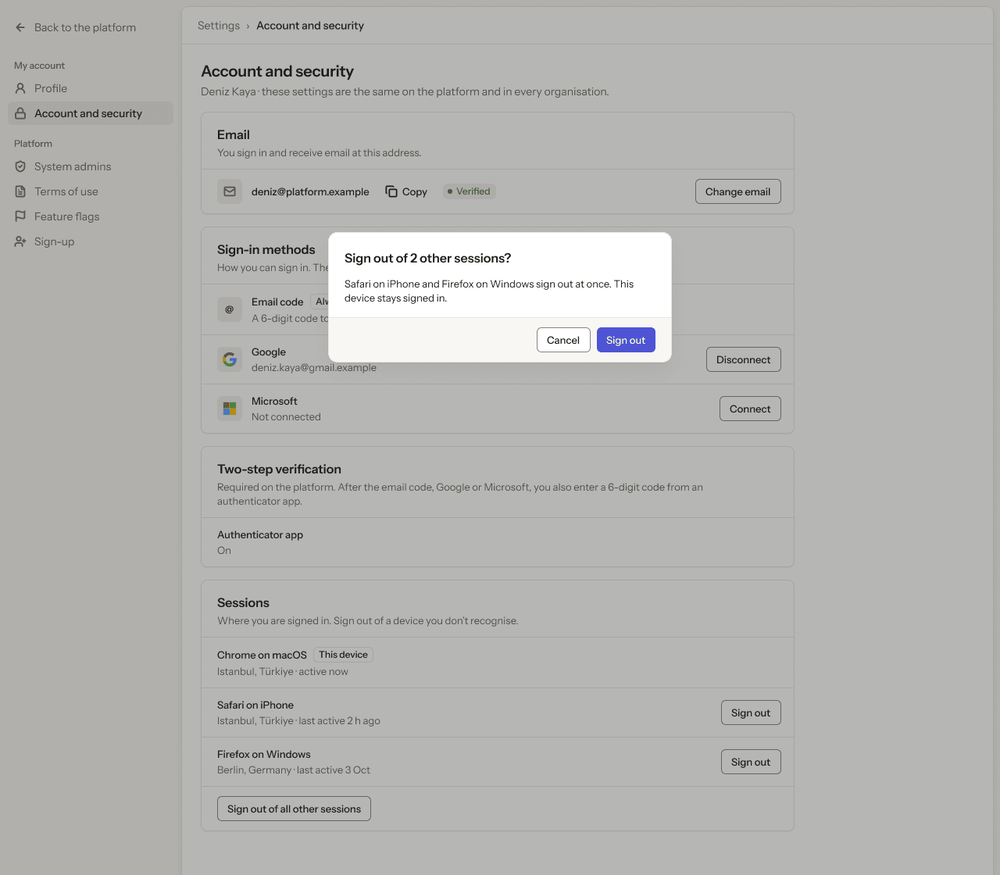

- **Who sees it:** The signed-in system admin, about themselves.
- **Device:** Desktop (1280 px and wider).
- **This state shows:** as the title says.
- **Values come from:** Sign-in methods, sessions and two-step verification (required): Clerk.
- **Components:** Button ×9, Icon/mail, Label ×2, Logo/Google, Logo/Microsoft, Pill, Platform sidebar, Top bar.
- **Actions:**
  - "Back to the platform": goes to [4.01 · Organisations · all](../04-organisations/README.md#401--organisations--all).
  - "Profile": goes to [8.01 · Profile · ideal](../08-settings-profile/README.md#801--profile--ideal).
  - "Account and security": goes to [9.01 · Account and security · ideal](#901--account-and-security--ideal).
  - "System admins": goes to [10.01 · System admins](../10-settings-system-admins/README.md#1001--system-admins).
  - "Terms of use": goes to [11.01 · Terms of use](../11-settings-terms-of-use/README.md#1101--terms-of-use).
  - "Deniz Kaya": goes to [2.03 · Account menu](../02-shell/README.md#203--account-menu).
  - "Feature flags": goes to [12.01 · Feature flags](../12-settings-feature-flags/README.md#1201--feature-flags).
  - "Sign-up": goes to [13.01 · Sign-up · off](../13-settings-sign-up/README.md#1301--sign-up--off).
- **Texts, word for word, top to bottom:**

  - Back to the platform
  - My account
  - Profile
  - Account and security
  - Platform
  - System admins
  - Terms of use
  - Feature flags
  - Sign-up
  - DK
  - Deniz Kaya
  - Settings
  - ›
  - Account and security
  - Account and security
  - Deniz Kaya · these settings are the same on the platform and in every organisation.
  - Email
  - You sign in and receive email at this address.
  - deniz@platform.example
  - Copy
  - Verified
  - Change email
  - Sign-in methods
  - How you can sign in. The email code always works.
  - @
  - Email code
  - Always on
  - A 6-digit code to your email each time you sign in.
  - Google
  - deniz.kaya@gmail.example
  - Disconnect
  - Microsoft
  - Not connected
  - Connect
  - Two-step verification
  - Required on the platform. After the email code, Google or Microsoft, you also enter a 6-digit code from an authenticator app.
  - Authenticator app
  - On
  - Sessions
  - Where you are signed in. Sign out of a device you don’t recognise.
  - Chrome on macOS
  - This device
  - Istanbul, Türkiye · active now
  - Safari on iPhone
  - Istanbul, Türkiye · last active 2 h ago
  - Sign out
  - Firefox on Windows
  - Berlin, Germany · last active 3 Oct
  - Sign out
  - Sign out of all other sessions
  - Sign out of 2 other sessions?
  - Safari on iPhone and Firefox on Windows sign out at once. This device stays signed in.
  - Cancel
  - Sign out

Figma: [196:11832](https://www.figma.com/design/3Ev111okX8xCBwR9B3hyBM/?node-id=196-11832)

### 9.12 · Other sessions signed out

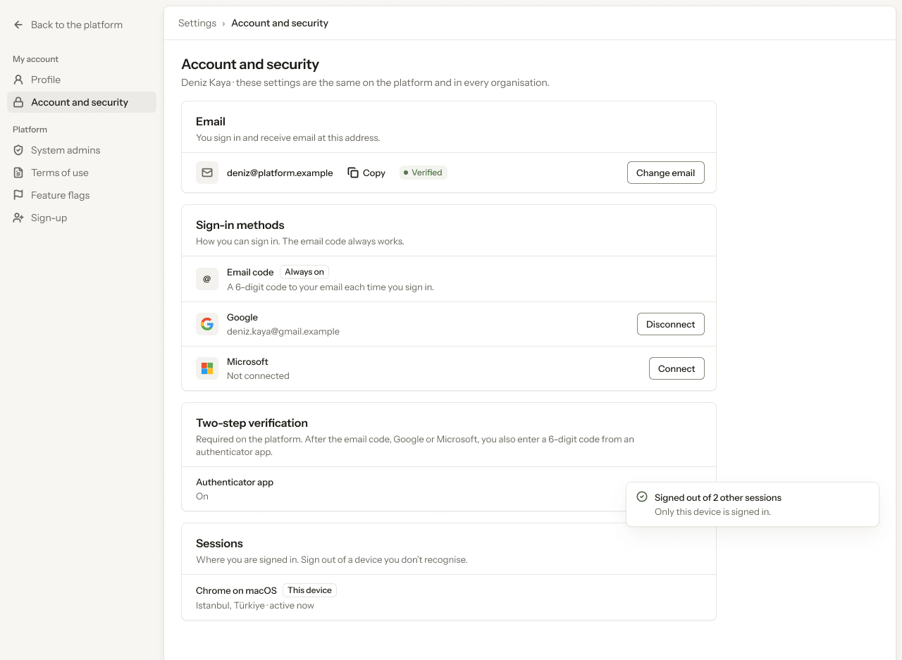

- **Who sees it:** The signed-in system admin, about themselves.
- **Device:** Desktop (1280 px and wider).
- **This state shows:** as the title says.
- **Values come from:** Sign-in methods, sessions and two-step verification (required): Clerk.
- **Components:** Button ×4, Icon/mail, Label ×2, Logo/Google, Logo/Microsoft, Pill, Platform sidebar, Toast, Top bar.
- **Actions:**
  - "Back to the platform": goes to [4.01 · Organisations · all](../04-organisations/README.md#401--organisations--all).
  - "Profile": goes to [8.01 · Profile · ideal](../08-settings-profile/README.md#801--profile--ideal).
  - "Account and security": goes to [9.01 · Account and security · ideal](#901--account-and-security--ideal).
  - "System admins": goes to [10.01 · System admins](../10-settings-system-admins/README.md#1001--system-admins).
  - "Terms of use": goes to [11.01 · Terms of use](../11-settings-terms-of-use/README.md#1101--terms-of-use).
  - "Deniz Kaya": goes to [2.03 · Account menu](../02-shell/README.md#203--account-menu).
  - "Feature flags": goes to [12.01 · Feature flags](../12-settings-feature-flags/README.md#1201--feature-flags).
  - "Sign-up": goes to [13.01 · Sign-up · off](../13-settings-sign-up/README.md#1301--sign-up--off).
- **Texts, word for word, top to bottom:**

  - Back to the platform
  - My account
  - Profile
  - Account and security
  - Platform
  - System admins
  - Terms of use
  - Feature flags
  - Sign-up
  - DK
  - Deniz Kaya
  - Settings
  - ›
  - Account and security
  - Account and security
  - Deniz Kaya · these settings are the same on the platform and in every organisation.
  - Email
  - You sign in and receive email at this address.
  - deniz@platform.example
  - Copy
  - Verified
  - Change email
  - Sign-in methods
  - How you can sign in. The email code always works.
  - @
  - Email code
  - Always on
  - A 6-digit code to your email each time you sign in.
  - Google
  - deniz.kaya@gmail.example
  - Disconnect
  - Microsoft
  - Not connected
  - Connect
  - Two-step verification
  - Required on the platform. After the email code, Google or Microsoft, you also enter a 6-digit code from an authenticator app.
  - Authenticator app
  - On
  - Sessions
  - Where you are signed in. Sign out of a device you don’t recognise.
  - Chrome on macOS
  - This device
  - Istanbul, Türkiye · active now
  - Signed out of 2 other sessions
  - Only this device is signed in.

Figma: [196:12116](https://www.figma.com/design/3Ev111okX8xCBwR9B3hyBM/?node-id=196-12116)

### 9.13 · Phone · Account and security

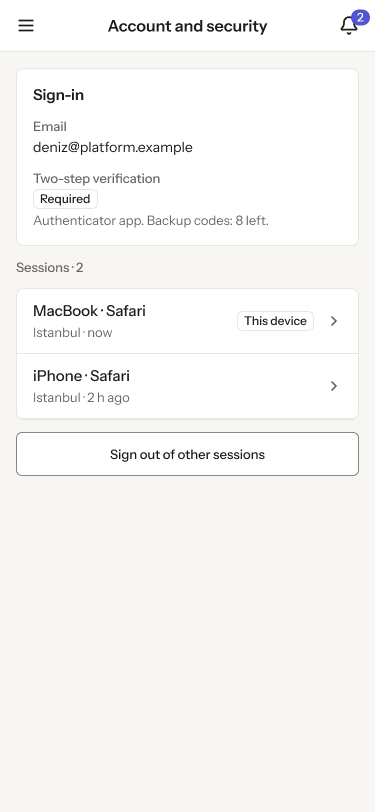

- **Who sees it:** The signed-in system admin, about themselves.
- **Device:** Phone (up to 767 px).
- **This state shows:** on a phone.
- **Values come from:** Sign-in methods, sessions and two-step verification (required): Clerk.
- **Components:** Button, Label, Phone list row ×2, Phone top bar.
- **Actions:**
  - "Area": goes to [2.15 · Phone · settings menu open](../02-shell/README.md#215--phone--settings-menu-open).
  - "2": goes to [3.08 · Phone · Notifications](../03-notifications/README.md#308--phone--notifications).
- **Texts, word for word, top to bottom:**

  - Account and security
  - 2
  - Sign-in
  - Email
  - deniz@platform.example
  - Two-step verification
  - Required
  - Authenticator app. Backup codes: 8 left.
  - Sessions · 2
  - MacBook · Safari
  - Istanbul · now
  - This device
  - iPhone · Safari
  - Istanbul · 2 h ago
  - Sign out of other sessions

Figma: [261:17289](https://www.figma.com/design/3Ev111okX8xCBwR9B3hyBM/?node-id=261-17289)
