# Platform app · 10 · Settings › System admins

Who sees this section: System admins. Add and remove need platform.system_admins.create and platform.system_admins.delete.

Where the values come from: System admins: our API (platform.system_admins.*).

15 screens. Each part below is one screen and state. The PNG beside this file is the screen at scale 1.

| Screen | Device |
|---|---|
| [10.01 · System admins](#1001--system-admins) | Desktop |
| [10.02 · Add system admin](#1002--add-system-admin) | Desktop |
| [10.03 · Add · no user](#1003--add--no-user) | Desktop |
| [10.04 · Add · already an admin](#1004--add--already-an-admin) | Desktop |
| [10.05 · Confirm it’s you](#1005--confirm-its-you) | Desktop |
| [10.06 · Add · confirm](#1006--add--confirm) | Desktop |
| [10.07 · System admin added](#1007--system-admin-added) | Desktop |
| [10.08 · Row menu](#1008--row-menu) | Desktop |
| [10.09 · Your row menu](#1009--your-row-menu) | Desktop |
| [10.10 · Remove system admin](#1010--remove-system-admin) | Desktop |
| [10.11 · System admin removed](#1011--system-admin-removed) | Desktop |
| [10.12 · System admins · loading](#1012--system-admins--loading) | Desktop |
| [10.13 · System admins · couldn’t load](#1013--system-admins--couldnt-load) | Desktop |
| [10.14 · Phone · System admins](#1014--phone--system-admins) | Phone |
| [10.15 · Phone · System admin](#1015--phone--system-admin) | Phone |

### 10.01 · System admins

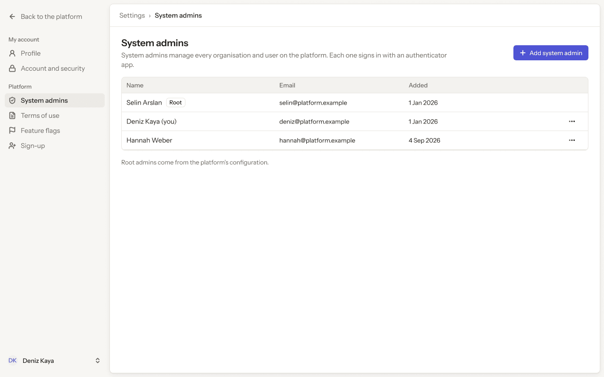

- **Who sees it:** System admins. Add and remove need platform.system_admins.create and platform.system_admins.delete.
- **Device:** Desktop (1280 px and wider).
- **This state shows:** as the title says.
- **Values come from:** System admins: our API (platform.system_admins.*).
- **Components:** Button ×3, Label, Platform sidebar, Top bar.
- **Actions:**
  - "Back to the platform": goes to [4.01 · Organisations · all](../04-organisations/README.md#401--organisations--all).
  - "Profile": goes to [8.01 · Profile · ideal](../08-settings-profile/README.md#801--profile--ideal).
  - "Account and security": goes to [9.01 · Account and security · ideal](../09-settings-account-and-security/README.md#901--account-and-security--ideal).
  - "Terms of use": goes to [11.01 · Terms of use](../11-settings-terms-of-use/README.md#1101--terms-of-use).
  - "Deniz Kaya": goes to [2.03 · Account menu](../02-shell/README.md#203--account-menu).
  - "Add system admin": goes to [10.05 · Confirm it’s you](#1005--confirm-its-you).
  - "Area": goes to [10.08 · Row menu](#1008--row-menu).
  - "Area": goes to [10.09 · Your row menu](#1009--your-row-menu).
  - "Feature flags": goes to [12.01 · Feature flags](../12-settings-feature-flags/README.md#1201--feature-flags).
  - "Sign-up": goes to [13.01 · Sign-up · off](../13-settings-sign-up/README.md#1301--sign-up--off).
- **Texts, word for word, top to bottom:**

  - Back to the platform
  - My account
  - Profile
  - Account and security
  - Platform
  - System admins
  - Terms of use
  - Feature flags
  - Sign-up
  - DK
  - Deniz Kaya
  - Settings
  - ›
  - System admins
  - System admins
  - System admins manage every organisation and user on the platform. Each one signs in with an authenticator app.
  - Add system admin
  - Name
  - Email
  - Added
  - Selin Arslan
  - Root
  - selin@platform.example
  - 1 Jan 2026
  - Deniz Kaya (you)
  - deniz@platform.example
  - 1 Jan 2026
  - Hannah Weber
  - hannah@platform.example
  - 4 Sep 2026
  - Root admins come from the platform’s configuration.

Figma: [198:10279](https://www.figma.com/design/3Ev111okX8xCBwR9B3hyBM/?node-id=198-10279)

### 10.02 · Add system admin

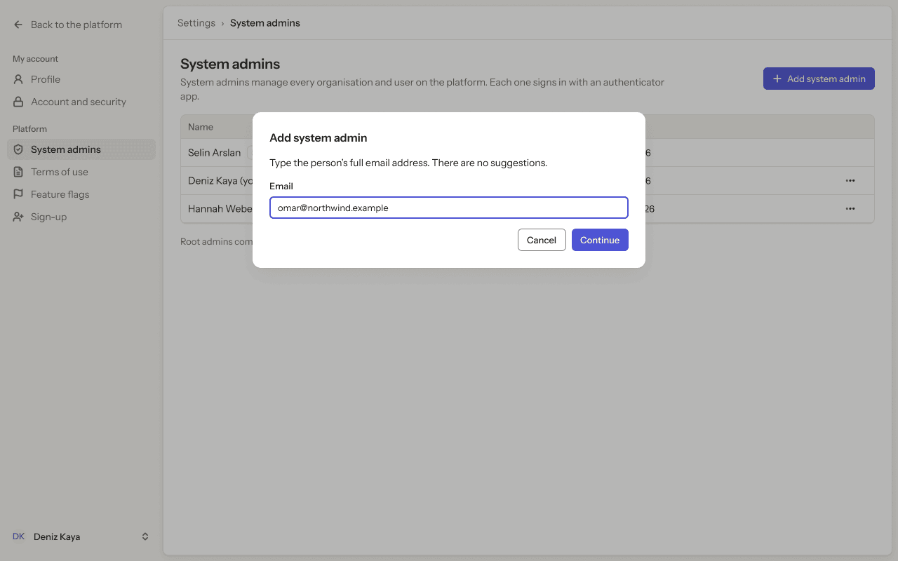

- **Who sees it:** System admins. Add and remove need platform.system_admins.create and platform.system_admins.delete.
- **Device:** Desktop (1280 px and wider).
- **This state shows:** as the title says.
- **Values come from:** System admins: our API (platform.system_admins.*).
- **Components:** Button ×5, Input, Label, Platform sidebar, Top bar.
- **Actions:**
  - "Back to the platform": goes to [4.01 · Organisations · all](../04-organisations/README.md#401--organisations--all).
  - "Profile": goes to [8.01 · Profile · ideal](../08-settings-profile/README.md#801--profile--ideal).
  - "Account and security": goes to [9.01 · Account and security · ideal](../09-settings-account-and-security/README.md#901--account-and-security--ideal).
  - "System admins": goes to [10.01 · System admins](#1001--system-admins).
  - "Terms of use": goes to [11.01 · Terms of use](../11-settings-terms-of-use/README.md#1101--terms-of-use).
  - "Deniz Kaya": goes to [2.03 · Account menu](../02-shell/README.md#203--account-menu).
  - "Cancel": goes to [10.01 · System admins](#1001--system-admins).
  - "Continue": goes to [10.06 · Add · confirm](#1006--add--confirm).
  - "Feature flags": goes to [12.01 · Feature flags](../12-settings-feature-flags/README.md#1201--feature-flags).
  - "Sign-up": goes to [13.01 · Sign-up · off](../13-settings-sign-up/README.md#1301--sign-up--off).
- **Texts, word for word, top to bottom:**

  - Back to the platform
  - My account
  - Profile
  - Account and security
  - Platform
  - System admins
  - Terms of use
  - Feature flags
  - Sign-up
  - DK
  - Deniz Kaya
  - Settings
  - ›
  - System admins
  - System admins
  - System admins manage every organisation and user on the platform. Each one signs in with an authenticator app.
  - Add system admin
  - Name
  - Email
  - Added
  - Selin Arslan
  - Root
  - selin@platform.example
  - 1 Jan 2026
  - Deniz Kaya (you)
  - deniz@platform.example
  - 1 Jan 2026
  - Hannah Weber
  - hannah@platform.example
  - 4 Sep 2026
  - Root admins come from the platform’s configuration.
  - Add system admin
  - Type the person’s full email address. There are no suggestions.
  - Email
  - omar@northwind.example
  - Cancel
  - Continue

Figma: [198:10517](https://www.figma.com/design/3Ev111okX8xCBwR9B3hyBM/?node-id=198-10517)

### 10.03 · Add · no user

- **Who sees it:** System admins. Add and remove need platform.system_admins.create and platform.system_admins.delete.
- **Device:** Desktop (1280 px and wider).
- **This state shows:** as the title says.
- **Values come from:** System admins: our API (platform.system_admins.*).
- **Components:** Button ×5, Input, Label, Platform sidebar, Top bar.
- **Actions:**
  - "Back to the platform": goes to [4.01 · Organisations · all](../04-organisations/README.md#401--organisations--all).
  - "Profile": goes to [8.01 · Profile · ideal](../08-settings-profile/README.md#801--profile--ideal).
  - "Account and security": goes to [9.01 · Account and security · ideal](../09-settings-account-and-security/README.md#901--account-and-security--ideal).
  - "System admins": goes to [10.01 · System admins](#1001--system-admins).
  - "Terms of use": goes to [11.01 · Terms of use](../11-settings-terms-of-use/README.md#1101--terms-of-use).
  - "Deniz Kaya": goes to [2.03 · Account menu](../02-shell/README.md#203--account-menu).
  - "Cancel": goes to [10.01 · System admins](#1001--system-admins).
  - "Continue": goes to [10.06 · Add · confirm](#1006--add--confirm).
  - "Feature flags": goes to [12.01 · Feature flags](../12-settings-feature-flags/README.md#1201--feature-flags).
  - "Sign-up": goes to [13.01 · Sign-up · off](../13-settings-sign-up/README.md#1301--sign-up--off).
- **Texts, word for word, top to bottom:**

  - Back to the platform
  - My account
  - Profile
  - Account and security
  - Platform
  - System admins
  - Terms of use
  - Feature flags
  - Sign-up
  - DK
  - Deniz Kaya
  - Settings
  - ›
  - System admins
  - System admins
  - System admins manage every organisation and user on the platform. Each one signs in with an authenticator app.
  - Add system admin
  - Name
  - Email
  - Added
  - Selin Arslan
  - Root
  - selin@platform.example
  - 1 Jan 2026
  - Deniz Kaya (you)
  - deniz@platform.example
  - 1 Jan 2026
  - Hannah Weber
  - hannah@platform.example
  - 4 Sep 2026
  - Root admins come from the platform’s configuration.
  - Add system admin
  - Type the person’s full email address. There are no suggestions.
  - Email
  - o.haddad@northwind.example
  - No user has this email. They must sign in once first.
  - Cancel
  - Continue

Figma: [198:10595](https://www.figma.com/design/3Ev111okX8xCBwR9B3hyBM/?node-id=198-10595)

### 10.04 · Add · already an admin

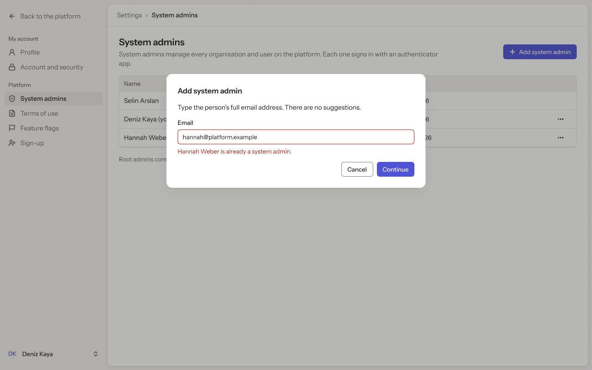

- **Who sees it:** System admins. Add and remove need platform.system_admins.create and platform.system_admins.delete.
- **Device:** Desktop (1280 px and wider).
- **This state shows:** as the title says.
- **Values come from:** System admins: our API (platform.system_admins.*).
- **Components:** Button ×5, Input, Label, Platform sidebar, Top bar.
- **Actions:**
  - "Back to the platform": goes to [4.01 · Organisations · all](../04-organisations/README.md#401--organisations--all).
  - "Profile": goes to [8.01 · Profile · ideal](../08-settings-profile/README.md#801--profile--ideal).
  - "Account and security": goes to [9.01 · Account and security · ideal](../09-settings-account-and-security/README.md#901--account-and-security--ideal).
  - "System admins": goes to [10.01 · System admins](#1001--system-admins).
  - "Terms of use": goes to [11.01 · Terms of use](../11-settings-terms-of-use/README.md#1101--terms-of-use).
  - "Deniz Kaya": goes to [2.03 · Account menu](../02-shell/README.md#203--account-menu).
  - "Cancel": goes to [10.01 · System admins](#1001--system-admins).
  - "Continue": goes to [10.01 · System admins](#1001--system-admins).
  - "Feature flags": goes to [12.01 · Feature flags](../12-settings-feature-flags/README.md#1201--feature-flags).
  - "Sign-up": goes to [13.01 · Sign-up · off](../13-settings-sign-up/README.md#1301--sign-up--off).
- **Texts, word for word, top to bottom:**

  - Back to the platform
  - My account
  - Profile
  - Account and security
  - Platform
  - System admins
  - Terms of use
  - Feature flags
  - Sign-up
  - DK
  - Deniz Kaya
  - Settings
  - ›
  - System admins
  - System admins
  - System admins manage every organisation and user on the platform. Each one signs in with an authenticator app.
  - Add system admin
  - Name
  - Email
  - Added
  - Selin Arslan
  - Root
  - selin@platform.example
  - 1 Jan 2026
  - Deniz Kaya (you)
  - deniz@platform.example
  - 1 Jan 2026
  - Hannah Weber
  - hannah@platform.example
  - 4 Sep 2026
  - Root admins come from the platform’s configuration.
  - Add system admin
  - Type the person’s full email address. There are no suggestions.
  - Email
  - hannah@platform.example
  - Hannah Weber is already a system admin.
  - Cancel
  - Continue

Figma: [198:10674](https://www.figma.com/design/3Ev111okX8xCBwR9B3hyBM/?node-id=198-10674)

### 10.05 · Confirm it’s you

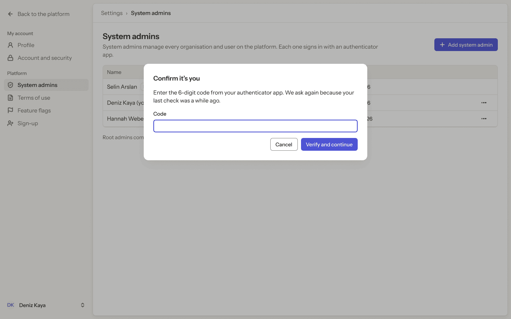

- **Who sees it:** System admins. Add and remove need platform.system_admins.create and platform.system_admins.delete.
- **Device:** Desktop (1280 px and wider).
- **This state shows:** after the person asks for the action, before it runs.
- **Values come from:** System admins: our API (platform.system_admins.*).
- **Components:** Button ×5, Input, Label, Platform sidebar, Top bar.
- **Actions:**
  - "Back to the platform": goes to [4.01 · Organisations · all](../04-organisations/README.md#401--organisations--all).
  - "Profile": goes to [8.01 · Profile · ideal](../08-settings-profile/README.md#801--profile--ideal).
  - "Account and security": goes to [9.01 · Account and security · ideal](../09-settings-account-and-security/README.md#901--account-and-security--ideal).
  - "System admins": goes to [10.01 · System admins](#1001--system-admins).
  - "Terms of use": goes to [11.01 · Terms of use](../11-settings-terms-of-use/README.md#1101--terms-of-use).
  - "Deniz Kaya": goes to [2.03 · Account menu](../02-shell/README.md#203--account-menu).
  - "Cancel": goes to [10.01 · System admins](#1001--system-admins).
  - "Verify and continue": goes to [10.02 · Add system admin](#1002--add-system-admin).
  - "Feature flags": goes to [12.01 · Feature flags](../12-settings-feature-flags/README.md#1201--feature-flags).
  - "Sign-up": goes to [13.01 · Sign-up · off](../13-settings-sign-up/README.md#1301--sign-up--off).
- **Texts, word for word, top to bottom:**

  - Back to the platform
  - My account
  - Profile
  - Account and security
  - Platform
  - System admins
  - Terms of use
  - Feature flags
  - Sign-up
  - DK
  - Deniz Kaya
  - Settings
  - ›
  - System admins
  - System admins
  - System admins manage every organisation and user on the platform. Each one signs in with an authenticator app.
  - Add system admin
  - Name
  - Email
  - Added
  - Selin Arslan
  - Root
  - selin@platform.example
  - 1 Jan 2026
  - Deniz Kaya (you)
  - deniz@platform.example
  - 1 Jan 2026
  - Hannah Weber
  - hannah@platform.example
  - 4 Sep 2026
  - Root admins come from the platform’s configuration.
  - Confirm it’s you
  - Enter the 6-digit code from your authenticator app. We ask again because your last check was a while ago.
  - Code
  - Cancel
  - Verify and continue

Figma: [198:10753](https://www.figma.com/design/3Ev111okX8xCBwR9B3hyBM/?node-id=198-10753)

### 10.06 · Add · confirm

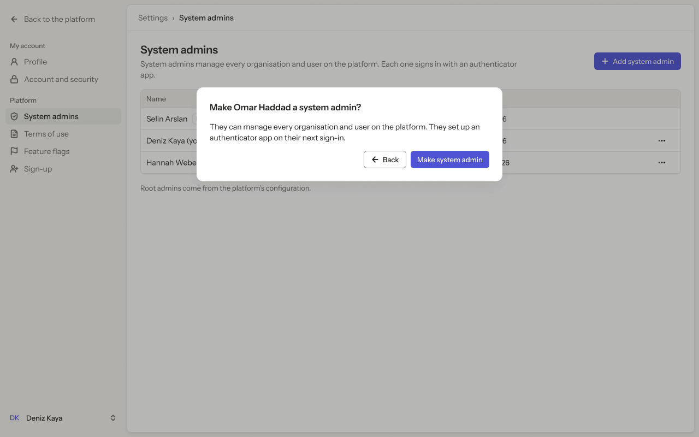

- **Who sees it:** System admins. Add and remove need platform.system_admins.create and platform.system_admins.delete.
- **Device:** Desktop (1280 px and wider).
- **This state shows:** after the person asks for the action, before it runs.
- **Values come from:** System admins: our API (platform.system_admins.*).
- **Components:** Button ×5, Label, Platform sidebar, Top bar.
- **Actions:**
  - "Back to the platform": goes to [4.01 · Organisations · all](../04-organisations/README.md#401--organisations--all).
  - "Profile": goes to [8.01 · Profile · ideal](../08-settings-profile/README.md#801--profile--ideal).
  - "Account and security": goes to [9.01 · Account and security · ideal](../09-settings-account-and-security/README.md#901--account-and-security--ideal).
  - "System admins": goes to [10.01 · System admins](#1001--system-admins).
  - "Terms of use": goes to [11.01 · Terms of use](../11-settings-terms-of-use/README.md#1101--terms-of-use).
  - "Deniz Kaya": goes to [2.03 · Account menu](../02-shell/README.md#203--account-menu).
  - "hannah@platform.example": goes to [10.02 · Add system admin](#1002--add-system-admin).
  - "Make system admin": goes to [10.07 · System admin added](#1007--system-admin-added).
  - "Feature flags": goes to [12.01 · Feature flags](../12-settings-feature-flags/README.md#1201--feature-flags).
  - "Sign-up": goes to [13.01 · Sign-up · off](../13-settings-sign-up/README.md#1301--sign-up--off).
- **Texts, word for word, top to bottom:**

  - Back to the platform
  - My account
  - Profile
  - Account and security
  - Platform
  - System admins
  - Terms of use
  - Feature flags
  - Sign-up
  - DK
  - Deniz Kaya
  - Settings
  - ›
  - System admins
  - System admins
  - System admins manage every organisation and user on the platform. Each one signs in with an authenticator app.
  - Add system admin
  - Name
  - Email
  - Added
  - Selin Arslan
  - Root
  - selin@platform.example
  - 1 Jan 2026
  - Deniz Kaya (you)
  - deniz@platform.example
  - 1 Jan 2026
  - Hannah Weber
  - hannah@platform.example
  - 4 Sep 2026
  - Root admins come from the platform’s configuration.
  - Make Omar Haddad a system admin?
  - They can manage every organisation and user on the platform. They set up an authenticator app on their next sign-in.
  - Back
  - Make system admin

Figma: [198:10831](https://www.figma.com/design/3Ev111okX8xCBwR9B3hyBM/?node-id=198-10831)

### 10.07 · System admin added

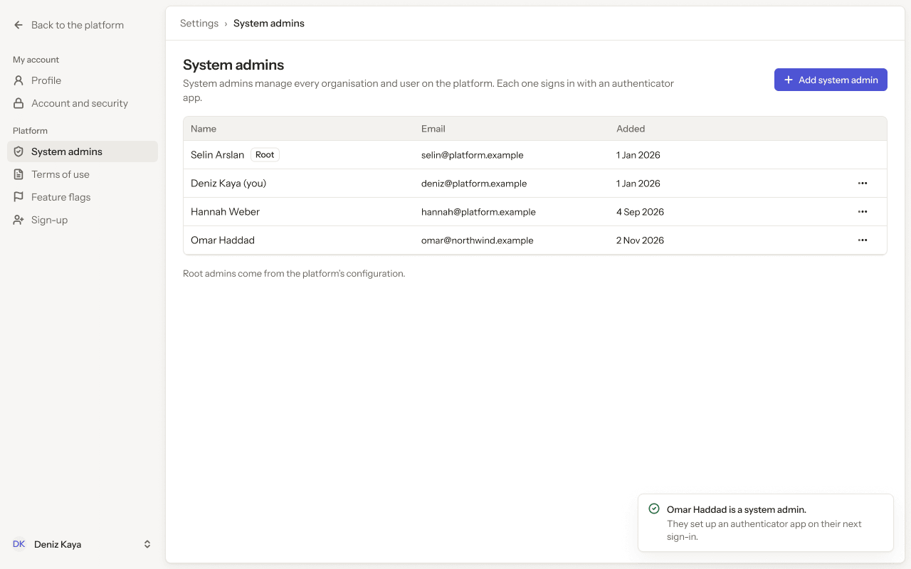

- **Who sees it:** System admins. Add and remove need platform.system_admins.create and platform.system_admins.delete.
- **Device:** Desktop (1280 px and wider).
- **This state shows:** as the title says.
- **Values come from:** System admins: our API (platform.system_admins.*).
- **Components:** Button ×4, Label, Platform sidebar, Toast, Top bar.
- **Actions:**
  - "Back to the platform": goes to [4.01 · Organisations · all](../04-organisations/README.md#401--organisations--all).
  - "Profile": goes to [8.01 · Profile · ideal](../08-settings-profile/README.md#801--profile--ideal).
  - "Account and security": goes to [9.01 · Account and security · ideal](../09-settings-account-and-security/README.md#901--account-and-security--ideal).
  - "System admins": goes to [10.01 · System admins](#1001--system-admins).
  - "Terms of use": goes to [11.01 · Terms of use](../11-settings-terms-of-use/README.md#1101--terms-of-use).
  - "Deniz Kaya": goes to [2.03 · Account menu](../02-shell/README.md#203--account-menu).
  - "Feature flags": goes to [12.01 · Feature flags](../12-settings-feature-flags/README.md#1201--feature-flags).
  - "Sign-up": goes to [13.01 · Sign-up · off](../13-settings-sign-up/README.md#1301--sign-up--off).
- **Texts, word for word, top to bottom:**

  - Back to the platform
  - My account
  - Profile
  - Account and security
  - Platform
  - System admins
  - Terms of use
  - Feature flags
  - Sign-up
  - DK
  - Deniz Kaya
  - Settings
  - ›
  - System admins
  - System admins
  - System admins manage every organisation and user on the platform. Each one signs in with an authenticator app.
  - Add system admin
  - Name
  - Email
  - Added
  - Selin Arslan
  - Root
  - selin@platform.example
  - 1 Jan 2026
  - Deniz Kaya (you)
  - deniz@platform.example
  - 1 Jan 2026
  - Hannah Weber
  - hannah@platform.example
  - 4 Sep 2026
  - Omar Haddad
  - omar@northwind.example
  - 2 Nov 2026
  - Root admins come from the platform’s configuration.
  - Omar Haddad is a system admin.
  - They set up an authenticator app on their next sign-in.

Figma: [198:10901](https://www.figma.com/design/3Ev111okX8xCBwR9B3hyBM/?node-id=198-10901)

### 10.08 · Row menu

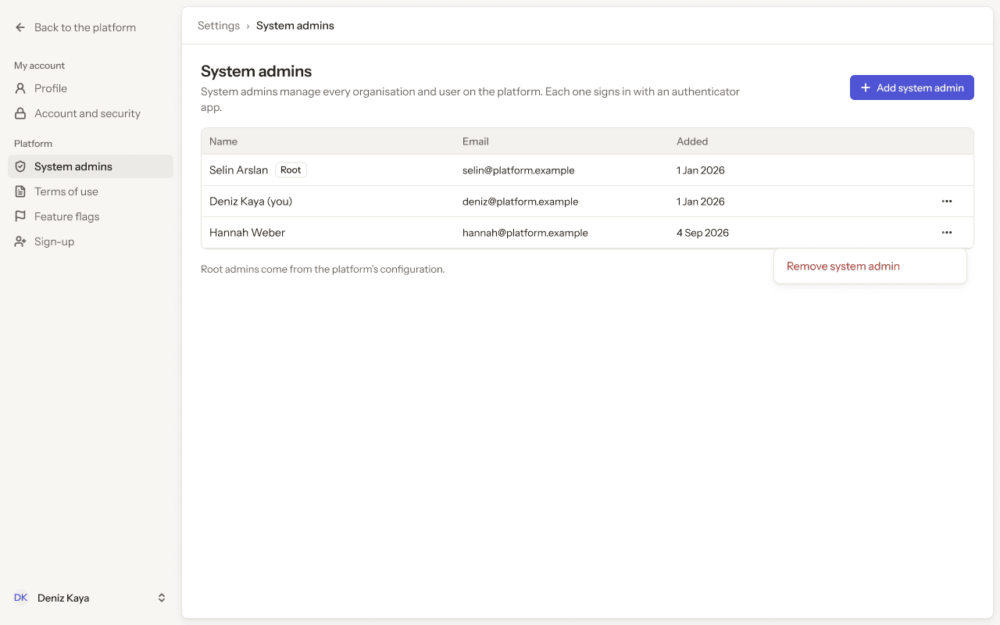

- **Who sees it:** System admins. Add and remove need platform.system_admins.create and platform.system_admins.delete.
- **Device:** Desktop (1280 px and wider).
- **This state shows:** as the title says.
- **Values come from:** System admins: our API (platform.system_admins.*).
- **Components:** Button ×3, Label, Platform sidebar, Top bar.
- **Actions:**
  - "Back to the platform": goes to [4.01 · Organisations · all](../04-organisations/README.md#401--organisations--all).
  - "Profile": goes to [8.01 · Profile · ideal](../08-settings-profile/README.md#801--profile--ideal).
  - "Account and security": goes to [9.01 · Account and security · ideal](../09-settings-account-and-security/README.md#901--account-and-security--ideal).
  - "System admins": goes to [10.01 · System admins](#1001--system-admins).
  - "Terms of use": goes to [11.01 · Terms of use](../11-settings-terms-of-use/README.md#1101--terms-of-use).
  - "Deniz Kaya": goes to [2.03 · Account menu](../02-shell/README.md#203--account-menu).
  - "Remove system admin": goes to [10.10 · Remove system admin](#1010--remove-system-admin).
  - "Feature flags": goes to [12.01 · Feature flags](../12-settings-feature-flags/README.md#1201--feature-flags).
  - "Sign-up": goes to [13.01 · Sign-up · off](../13-settings-sign-up/README.md#1301--sign-up--off).
- **Texts, word for word, top to bottom:**

  - Back to the platform
  - My account
  - Profile
  - Account and security
  - Platform
  - System admins
  - Terms of use
  - Feature flags
  - Sign-up
  - DK
  - Deniz Kaya
  - Settings
  - ›
  - System admins
  - System admins
  - System admins manage every organisation and user on the platform. Each one signs in with an authenticator app.
  - Add system admin
  - Name
  - Email
  - Added
  - Selin Arslan
  - Root
  - selin@platform.example
  - 1 Jan 2026
  - Deniz Kaya (you)
  - deniz@platform.example
  - 1 Jan 2026
  - Hannah Weber
  - hannah@platform.example
  - 4 Sep 2026
  - Root admins come from the platform’s configuration.
  - Remove system admin

Figma: [198:11031](https://www.figma.com/design/3Ev111okX8xCBwR9B3hyBM/?node-id=198-11031)

### 10.09 · Your row menu

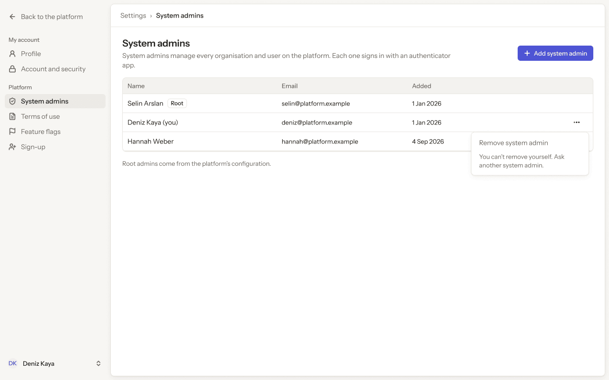

- **Who sees it:** System admins. Add and remove need platform.system_admins.create and platform.system_admins.delete.
- **Device:** Desktop (1280 px and wider).
- **This state shows:** as the title says.
- **Values come from:** System admins: our API (platform.system_admins.*).
- **Components:** Button ×3, Label, Platform sidebar, Top bar.
- **Actions:**
  - "Back to the platform": goes to [4.01 · Organisations · all](../04-organisations/README.md#401--organisations--all).
  - "Profile": goes to [8.01 · Profile · ideal](../08-settings-profile/README.md#801--profile--ideal).
  - "Account and security": goes to [9.01 · Account and security · ideal](../09-settings-account-and-security/README.md#901--account-and-security--ideal).
  - "System admins": goes to [10.01 · System admins](#1001--system-admins).
  - "Terms of use": goes to [11.01 · Terms of use](../11-settings-terms-of-use/README.md#1101--terms-of-use).
  - "Deniz Kaya": goes to [2.03 · Account menu](../02-shell/README.md#203--account-menu).
  - "Feature flags": goes to [12.01 · Feature flags](../12-settings-feature-flags/README.md#1201--feature-flags).
  - "Sign-up": goes to [13.01 · Sign-up · off](../13-settings-sign-up/README.md#1301--sign-up--off).
- **Texts, word for word, top to bottom:**

  - Back to the platform
  - My account
  - Profile
  - Account and security
  - Platform
  - System admins
  - Terms of use
  - Feature flags
  - Sign-up
  - DK
  - Deniz Kaya
  - Settings
  - ›
  - System admins
  - System admins
  - System admins manage every organisation and user on the platform. Each one signs in with an authenticator app.
  - Add system admin
  - Name
  - Email
  - Added
  - Selin Arslan
  - Root
  - selin@platform.example
  - 1 Jan 2026
  - Deniz Kaya (you)
  - deniz@platform.example
  - 1 Jan 2026
  - Hannah Weber
  - hannah@platform.example
  - 4 Sep 2026
  - Root admins come from the platform’s configuration.
  - Remove system admin
  - You can’t remove yourself. Ask another system admin.

Figma: [198:11155](https://www.figma.com/design/3Ev111okX8xCBwR9B3hyBM/?node-id=198-11155)

### 10.10 · Remove system admin

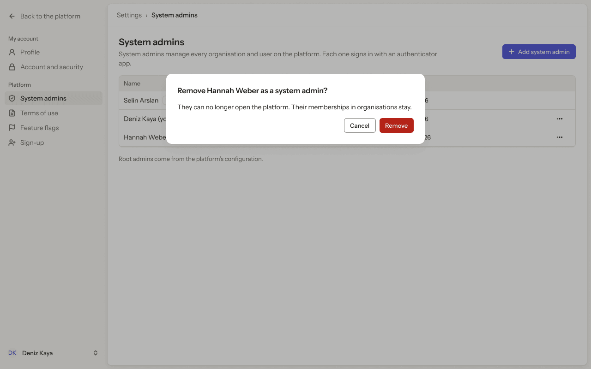

- **Who sees it:** System admins. Add and remove need platform.system_admins.create and platform.system_admins.delete.
- **Device:** Desktop (1280 px and wider).
- **This state shows:** as the title says.
- **Values come from:** System admins: our API (platform.system_admins.*).
- **Components:** Button ×5, Label, Platform sidebar, Top bar.
- **Actions:**
  - "Back to the platform": goes to [4.01 · Organisations · all](../04-organisations/README.md#401--organisations--all).
  - "Profile": goes to [8.01 · Profile · ideal](../08-settings-profile/README.md#801--profile--ideal).
  - "Account and security": goes to [9.01 · Account and security · ideal](../09-settings-account-and-security/README.md#901--account-and-security--ideal).
  - "System admins": goes to [10.01 · System admins](#1001--system-admins).
  - "Terms of use": goes to [11.01 · Terms of use](../11-settings-terms-of-use/README.md#1101--terms-of-use).
  - "Deniz Kaya": goes to [2.03 · Account menu](../02-shell/README.md#203--account-menu).
  - "Cancel": goes to [10.01 · System admins](#1001--system-admins).
  - "Remove": goes to [10.11 · System admin removed](#1011--system-admin-removed).
  - "Feature flags": goes to [12.01 · Feature flags](../12-settings-feature-flags/README.md#1201--feature-flags).
  - "Sign-up": goes to [13.01 · Sign-up · off](../13-settings-sign-up/README.md#1301--sign-up--off).
- **Texts, word for word, top to bottom:**

  - Back to the platform
  - My account
  - Profile
  - Account and security
  - Platform
  - System admins
  - Terms of use
  - Feature flags
  - Sign-up
  - DK
  - Deniz Kaya
  - Settings
  - ›
  - System admins
  - System admins
  - System admins manage every organisation and user on the platform. Each one signs in with an authenticator app.
  - Add system admin
  - Name
  - Email
  - Added
  - Selin Arslan
  - Root
  - selin@platform.example
  - 1 Jan 2026
  - Deniz Kaya (you)
  - deniz@platform.example
  - 1 Jan 2026
  - Hannah Weber
  - hannah@platform.example
  - 4 Sep 2026
  - Root admins come from the platform’s configuration.
  - Remove Hannah Weber as a system admin?
  - They can no longer open the platform. Their memberships in organisations stay.
  - Cancel
  - Remove

Figma: [198:11275](https://www.figma.com/design/3Ev111okX8xCBwR9B3hyBM/?node-id=198-11275)

### 10.11 · System admin removed

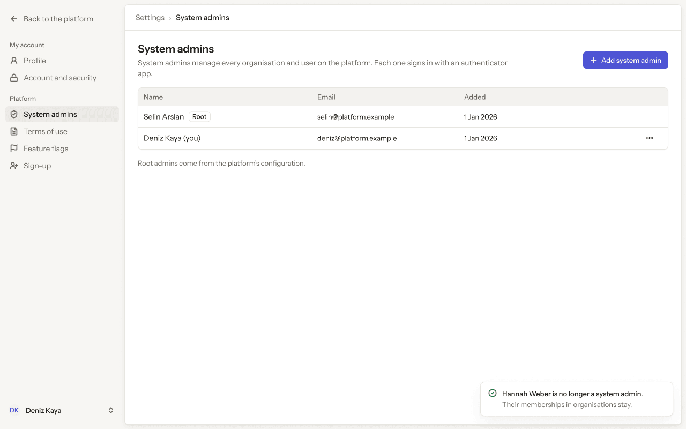

- **Who sees it:** System admins. Add and remove need platform.system_admins.create and platform.system_admins.delete.
- **Device:** Desktop (1280 px and wider).
- **This state shows:** as the title says.
- **Values come from:** System admins: our API (platform.system_admins.*).
- **Components:** Button ×2, Label, Platform sidebar, Toast, Top bar.
- **Actions:**
  - "Back to the platform": goes to [4.01 · Organisations · all](../04-organisations/README.md#401--organisations--all).
  - "Profile": goes to [8.01 · Profile · ideal](../08-settings-profile/README.md#801--profile--ideal).
  - "Account and security": goes to [9.01 · Account and security · ideal](../09-settings-account-and-security/README.md#901--account-and-security--ideal).
  - "System admins": goes to [10.01 · System admins](#1001--system-admins).
  - "Terms of use": goes to [11.01 · Terms of use](../11-settings-terms-of-use/README.md#1101--terms-of-use).
  - "Deniz Kaya": goes to [2.03 · Account menu](../02-shell/README.md#203--account-menu).
  - "Feature flags": goes to [12.01 · Feature flags](../12-settings-feature-flags/README.md#1201--feature-flags).
  - "Sign-up": goes to [13.01 · Sign-up · off](../13-settings-sign-up/README.md#1301--sign-up--off).
- **Texts, word for word, top to bottom:**

  - Back to the platform
  - My account
  - Profile
  - Account and security
  - Platform
  - System admins
  - Terms of use
  - Feature flags
  - Sign-up
  - DK
  - Deniz Kaya
  - Settings
  - ›
  - System admins
  - System admins
  - System admins manage every organisation and user on the platform. Each one signs in with an authenticator app.
  - Add system admin
  - Name
  - Email
  - Added
  - Selin Arslan
  - Root
  - selin@platform.example
  - 1 Jan 2026
  - Deniz Kaya (you)
  - deniz@platform.example
  - 1 Jan 2026
  - Root admins come from the platform’s configuration.
  - Hannah Weber is no longer a system admin.
  - Their memberships in organisations stay.

Figma: [198:11350](https://www.figma.com/design/3Ev111okX8xCBwR9B3hyBM/?node-id=198-11350)

### 10.12 · System admins · loading

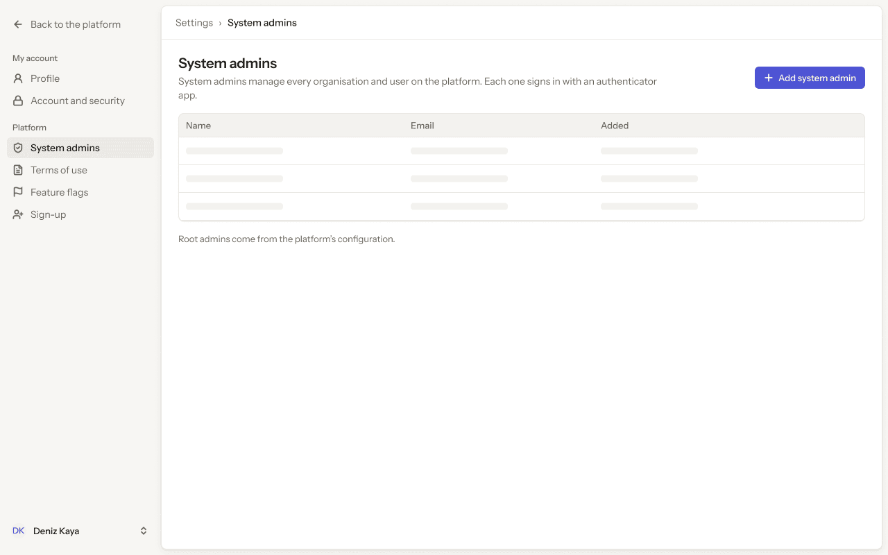

- **Who sees it:** System admins. Add and remove need platform.system_admins.create and platform.system_admins.delete.
- **Device:** Desktop (1280 px and wider).
- **This state shows:** while the request runs.
- **Values come from:** System admins: our API (platform.system_admins.*).
- **Components:** Button, Platform sidebar, Skeleton ×9, Top bar.
- **Actions:**
  - "Back to the platform": goes to [4.01 · Organisations · all](../04-organisations/README.md#401--organisations--all).
  - "Profile": goes to [8.01 · Profile · ideal](../08-settings-profile/README.md#801--profile--ideal).
  - "Account and security": goes to [9.01 · Account and security · ideal](../09-settings-account-and-security/README.md#901--account-and-security--ideal).
  - "System admins": goes to [10.01 · System admins](#1001--system-admins).
  - "Terms of use": goes to [11.01 · Terms of use](../11-settings-terms-of-use/README.md#1101--terms-of-use).
  - "Deniz Kaya": goes to [2.03 · Account menu](../02-shell/README.md#203--account-menu).
  - "Feature flags": goes to [12.01 · Feature flags](../12-settings-feature-flags/README.md#1201--feature-flags).
  - "Sign-up": goes to [13.01 · Sign-up · off](../13-settings-sign-up/README.md#1301--sign-up--off).
- **Texts, word for word, top to bottom:**

  - Back to the platform
  - My account
  - Profile
  - Account and security
  - Platform
  - System admins
  - Terms of use
  - Feature flags
  - Sign-up
  - DK
  - Deniz Kaya
  - Settings
  - ›
  - System admins
  - System admins
  - System admins manage every organisation and user on the platform. Each one signs in with an authenticator app.
  - Add system admin
  - Name
  - Email
  - Added
  - Root admins come from the platform’s configuration.

Figma: [198:11473](https://www.figma.com/design/3Ev111okX8xCBwR9B3hyBM/?node-id=198-11473)

### 10.13 · System admins · couldn’t load

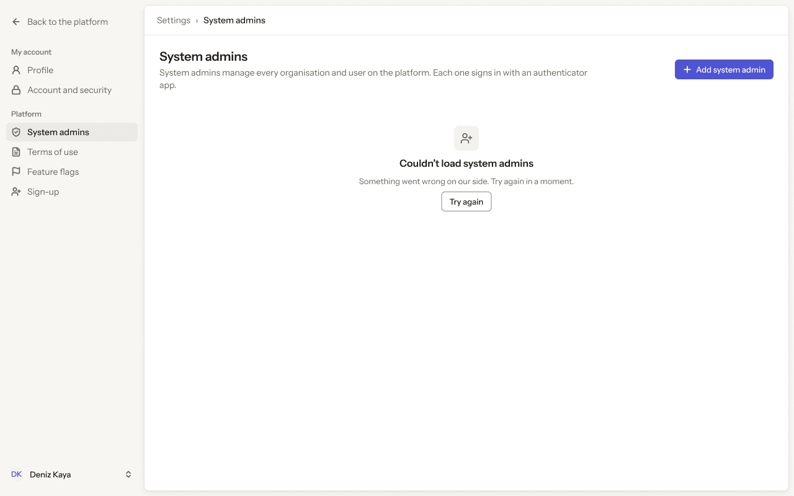

- **Who sees it:** System admins. Add and remove need platform.system_admins.create and platform.system_admins.delete.
- **Device:** Desktop (1280 px and wider).
- **This state shows:** as the title says.
- **Values come from:** System admins: our API (platform.system_admins.*).
- **Components:** Button, Empty state, Platform sidebar, Top bar.
- **Actions:**
  - "Back to the platform": goes to [4.01 · Organisations · all](../04-organisations/README.md#401--organisations--all).
  - "Profile": goes to [8.01 · Profile · ideal](../08-settings-profile/README.md#801--profile--ideal).
  - "Account and security": goes to [9.01 · Account and security · ideal](../09-settings-account-and-security/README.md#901--account-and-security--ideal).
  - "System admins": goes to [10.01 · System admins](#1001--system-admins).
  - "Terms of use": goes to [11.01 · Terms of use](../11-settings-terms-of-use/README.md#1101--terms-of-use).
  - "Deniz Kaya": goes to [2.03 · Account menu](../02-shell/README.md#203--account-menu).
  - "Feature flags": goes to [12.01 · Feature flags](../12-settings-feature-flags/README.md#1201--feature-flags).
  - "Sign-up": goes to [13.01 · Sign-up · off](../13-settings-sign-up/README.md#1301--sign-up--off).
- **Texts, word for word, top to bottom:**

  - Back to the platform
  - My account
  - Profile
  - Account and security
  - Platform
  - System admins
  - Terms of use
  - Feature flags
  - Sign-up
  - DK
  - Deniz Kaya
  - Settings
  - ›
  - System admins
  - System admins
  - System admins manage every organisation and user on the platform. Each one signs in with an authenticator app.
  - Add system admin
  - Couldn’t load system admins
  - Something went wrong on our side. Try again in a moment.
  - Try again

Figma: [198:11603](https://www.figma.com/design/3Ev111okX8xCBwR9B3hyBM/?node-id=198-11603)

### 10.14 · Phone · System admins

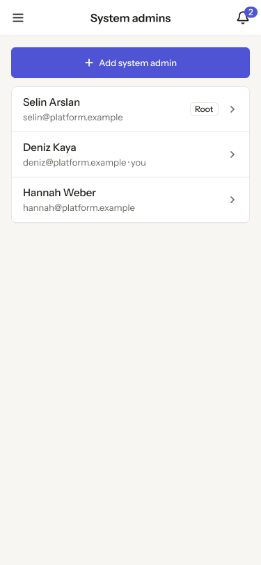

- **Who sees it:** System admins. Add and remove need platform.system_admins.create and platform.system_admins.delete.
- **Device:** Phone (up to 767 px).
- **This state shows:** on a phone.
- **Values come from:** System admins: our API (platform.system_admins.*).
- **Components:** Button, Phone list row ×3, Phone top bar.
- **Actions:**
  - "Area": goes to [2.15 · Phone · settings menu open](../02-shell/README.md#215--phone--settings-menu-open).
  - "2": goes to [3.08 · Phone · Notifications](../03-notifications/README.md#308--phone--notifications).
  - "Hannah Weber": goes to [10.15 · Phone · System admin](#1015--phone--system-admin).
- **Texts, word for word, top to bottom:**

  - System admins
  - 2
  - Add system admin
  - Selin Arslan
  - selin@platform.example
  - Root
  - Deniz Kaya
  - deniz@platform.example · you
  - Hannah Weber
  - hannah@platform.example

Figma: [263:17166](https://www.figma.com/design/3Ev111okX8xCBwR9B3hyBM/?node-id=263-17166)

### 10.15 · Phone · System admin

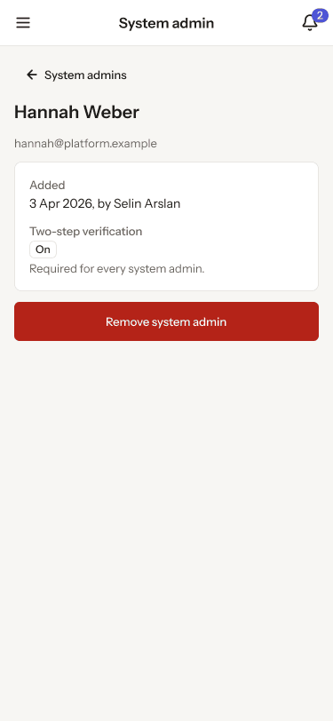

- **Who sees it:** System admins. Add and remove need platform.system_admins.create and platform.system_admins.delete.
- **Device:** Phone (up to 767 px).
- **This state shows:** on a phone.
- **Values come from:** System admins: our API (platform.system_admins.*).
- **Components:** Button ×2, Label, Phone top bar.
- **Actions:**
  - "Area": goes to [2.15 · Phone · settings menu open](../02-shell/README.md#215--phone--settings-menu-open).
  - "2": goes to [3.08 · Phone · Notifications](../03-notifications/README.md#308--phone--notifications).
  - "System admins": goes to [10.14 · Phone · System admins](#1014--phone--system-admins).
- **Texts, word for word, top to bottom:**

  - System admin
  - 2
  - System admins
  - Hannah Weber
  - hannah@platform.example
  - Added
  - 3 Apr 2026, by Selin Arslan
  - Two-step verification
  - On
  - Required for every system admin.
  - Remove system admin

Figma: [263:17223](https://www.figma.com/design/3Ev111okX8xCBwR9B3hyBM/?node-id=263-17223)
