# Platform app · 11 · Settings › Terms of use

Who sees this section: System admins.

Where the values come from: Terms of use versions, effective dates and acceptance counts: our API.

15 screens. Each part below is one screen and state. The PNG beside this file is the screen at scale 1.

| Screen | Device |
|---|---|
| [11.01 · Terms of use](#1101--terms-of-use) | Desktop |
| [11.02 · New version](#1102--new-version) | Desktop |
| [11.03 · New version · errors](#1103--new-version--errors) | Desktop |
| [11.04 · Version added](#1104--version-added) | Desktop |
| [11.05 · Version · accepted](#1105--version--accepted) | Desktop |
| [11.06 · Version · not yet](#1106--version--not-yet) | Desktop |
| [11.07 · Terms of use · loading](#1107--terms-of-use--loading) | Desktop |
| [11.08 · Terms of use · couldn’t load](#1108--terms-of-use--couldnt-load) | Desktop |
| [11.09 · Terms of use · nothing scheduled](#1109--terms-of-use--nothing-scheduled) | Desktop |
| [11.10 · Scheduled version · edit](#1110--scheduled-version--edit) | Desktop |
| [11.11 · Cancel scheduled version](#1111--cancel-scheduled-version) | Desktop |
| [11.12 · Version in force](#1112--version-in-force) | Desktop |
| [11.13 · Version cancelled](#1113--version-cancelled) | Desktop |
| [11.14 · Phone · Terms of use](#1114--phone--terms-of-use) | Phone |
| [11.15 · Phone · Terms of use version](#1115--phone--terms-of-use-version) | Phone |

### 11.01 · Terms of use

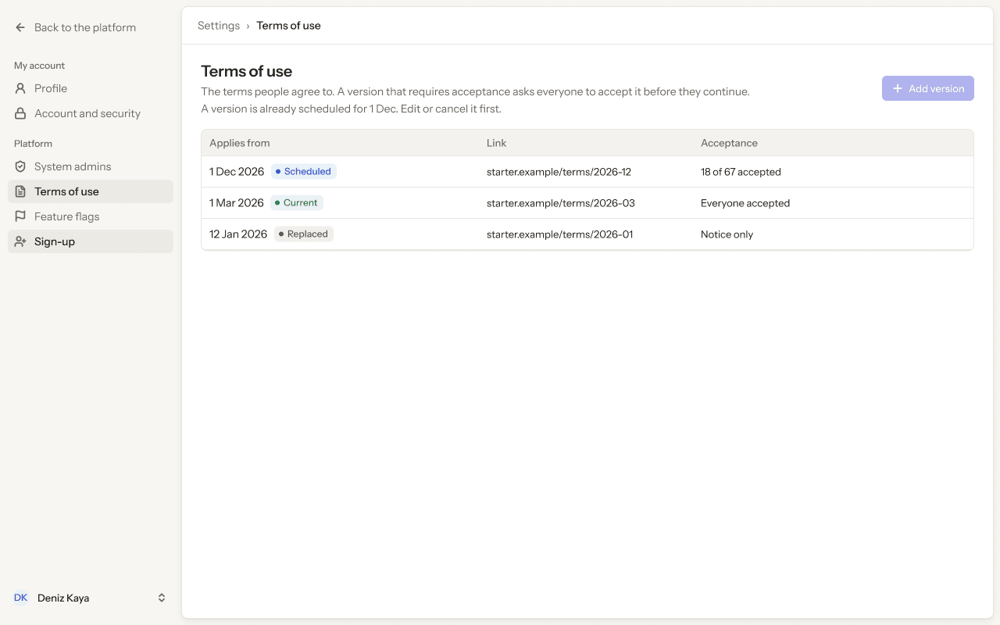

- **Who sees it:** System admins.
- **Device:** Desktop (1280 px and wider).
- **This state shows:** as the title says.
- **Values come from:** Terms of use versions, effective dates and acceptance counts: our API.
- **Components:** Button, Pill ×3, Platform sidebar, Top bar.
- **Actions:**
  - "Back to the platform": goes to [4.01 · Organisations · all](../04-organisations/README.md#401--organisations--all).
  - "Profile": goes to [8.01 · Profile · ideal](../08-settings-profile/README.md#801--profile--ideal).
  - "Account and security": goes to [9.01 · Account and security · ideal](../09-settings-account-and-security/README.md#901--account-and-security--ideal).
  - "System admins": goes to [10.01 · System admins](../10-settings-system-admins/README.md#1001--system-admins).
  - "Deniz Kaya": goes to [2.03 · Account menu](../02-shell/README.md#203--account-menu).
  - "starter.example/terms/2026-12": goes to [11.05 · Version · accepted](#1105--version--accepted).
  - "starter.example/terms/2026-03": goes to [11.12 · Version in force](#1112--version-in-force).
  - "Feature flags": goes to [12.01 · Feature flags](../12-settings-feature-flags/README.md#1201--feature-flags).
  - "Sign-up": goes to [13.01 · Sign-up · off](../13-settings-sign-up/README.md#1301--sign-up--off).
- **Texts, word for word, top to bottom:**

  - Back to the platform
  - My account
  - Profile
  - Account and security
  - Platform
  - System admins
  - Terms of use
  - Feature flags
  - Sign-up
  - DK
  - Deniz Kaya
  - Settings
  - ›
  - Terms of use
  - Terms of use
  - The terms people agree to. A version that requires acceptance asks everyone to accept it before they continue.
  - A version is already scheduled for 1 Dec. Edit or cancel it first.
  - Add version
  - Applies from
  - Link
  - Acceptance
  - 1 Dec 2026
  - Scheduled
  - starter.example/terms/2026-12
  - 18 of 67 accepted
  - 1 Mar 2026
  - Current
  - starter.example/terms/2026-03
  - Everyone accepted
  - 12 Jan 2026
  - Replaced
  - starter.example/terms/2026-01
  - Notice only

Figma: [202:11274](https://www.figma.com/design/3Ev111okX8xCBwR9B3hyBM/?node-id=202-11274)

### 11.02 · New version

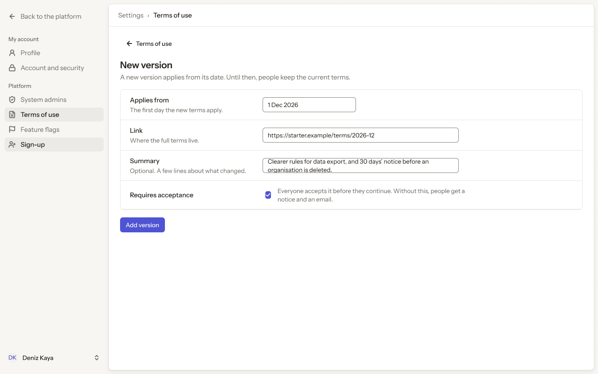

- **Who sees it:** System admins.
- **Device:** Desktop (1280 px and wider).
- **This state shows:** as the title says.
- **Values come from:** Terms of use versions, effective dates and acceptance counts: our API.
- **Components:** Button ×2, Checkbox, Input ×3, Platform sidebar, Top bar.
- **Actions:**
  - "Back to the platform": goes to [4.01 · Organisations · all](../04-organisations/README.md#401--organisations--all).
  - "Profile": goes to [8.01 · Profile · ideal](../08-settings-profile/README.md#801--profile--ideal).
  - "Account and security": goes to [9.01 · Account and security · ideal](../09-settings-account-and-security/README.md#901--account-and-security--ideal).
  - "System admins": goes to [10.01 · System admins](../10-settings-system-admins/README.md#1001--system-admins).
  - "Terms of use": goes to [11.01 · Terms of use](#1101--terms-of-use).
  - "Deniz Kaya": goes to [2.03 · Account menu](../02-shell/README.md#203--account-menu).
  - "Add version": goes to [11.04 · Version added](#1104--version-added).
  - "Feature flags": goes to [12.01 · Feature flags](../12-settings-feature-flags/README.md#1201--feature-flags).
  - "Sign-up": goes to [13.01 · Sign-up · off](../13-settings-sign-up/README.md#1301--sign-up--off).
- **Texts, word for word, top to bottom:**

  - Back to the platform
  - My account
  - Profile
  - Account and security
  - Platform
  - System admins
  - Terms of use
  - Feature flags
  - Sign-up
  - DK
  - Deniz Kaya
  - Settings
  - ›
  - Terms of use
  - Terms of use
  - New version
  - A new version applies from its date. Until then, people keep the current terms.
  - Applies from
  - The first day the new terms apply.
  - 1 Dec 2026
  - Link
  - Where the full terms live.
  - https://starter.example/terms/2026-12
  - Summary
  - Optional. A few lines about what changed.
  - Clearer rules for data export, and 30 days’ notice before an organisation is deleted.
  - Requires acceptance
  - Everyone accepts it before they continue. Without this, people get a notice and an email.
  - Add version

Figma: [202:11455](https://www.figma.com/design/3Ev111okX8xCBwR9B3hyBM/?node-id=202-11455)

### 11.03 · New version · errors

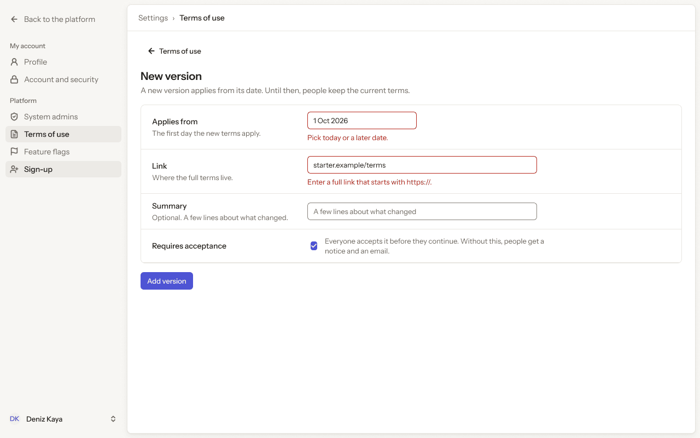

- **Who sees it:** System admins.
- **Device:** Desktop (1280 px and wider).
- **This state shows:** when the request fails.
- **Values come from:** Terms of use versions, effective dates and acceptance counts: our API.
- **Components:** Button ×2, Checkbox, Input ×3, Platform sidebar, Top bar.
- **Actions:**
  - "Back to the platform": goes to [4.01 · Organisations · all](../04-organisations/README.md#401--organisations--all).
  - "Profile": goes to [8.01 · Profile · ideal](../08-settings-profile/README.md#801--profile--ideal).
  - "Account and security": goes to [9.01 · Account and security · ideal](../09-settings-account-and-security/README.md#901--account-and-security--ideal).
  - "System admins": goes to [10.01 · System admins](../10-settings-system-admins/README.md#1001--system-admins).
  - "Terms of use": goes to [11.01 · Terms of use](#1101--terms-of-use).
  - "Deniz Kaya": goes to [2.03 · Account menu](../02-shell/README.md#203--account-menu).
  - "Add version": goes to [11.02 · New version](#1102--new-version).
  - "Feature flags": goes to [12.01 · Feature flags](../12-settings-feature-flags/README.md#1201--feature-flags).
  - "Sign-up": goes to [13.01 · Sign-up · off](../13-settings-sign-up/README.md#1301--sign-up--off).
- **Texts, word for word, top to bottom:**

  - Back to the platform
  - My account
  - Profile
  - Account and security
  - Platform
  - System admins
  - Terms of use
  - Feature flags
  - Sign-up
  - DK
  - Deniz Kaya
  - Settings
  - ›
  - Terms of use
  - Terms of use
  - New version
  - A new version applies from its date. Until then, people keep the current terms.
  - Applies from
  - The first day the new terms apply.
  - 1 Oct 2026
  - Pick today or a later date.
  - Link
  - Where the full terms live.
  - starter.example/terms
  - Enter a full link that starts with https://.
  - Summary
  - Optional. A few lines about what changed.
  - A few lines about what changed
  - Requires acceptance
  - Everyone accepts it before they continue. Without this, people get a notice and an email.
  - Add version

Figma: [202:11654](https://www.figma.com/design/3Ev111okX8xCBwR9B3hyBM/?node-id=202-11654)

### 11.04 · Version added

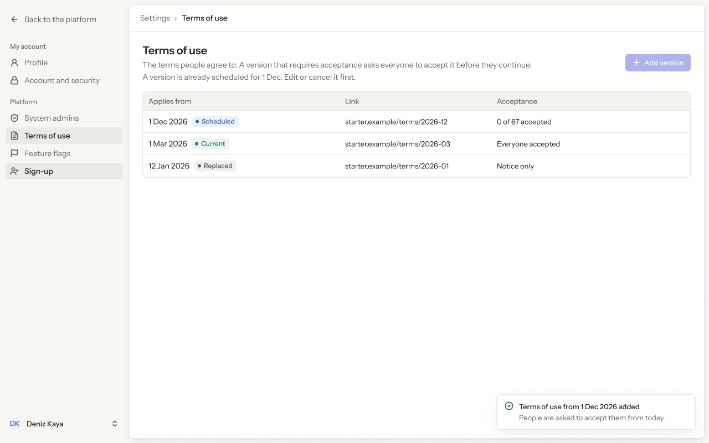

- **Who sees it:** System admins.
- **Device:** Desktop (1280 px and wider).
- **This state shows:** as the title says.
- **Values come from:** Terms of use versions, effective dates and acceptance counts: our API.
- **Components:** Button, Pill ×3, Platform sidebar, Toast, Top bar.
- **Actions:**
  - "Back to the platform": goes to [4.01 · Organisations · all](../04-organisations/README.md#401--organisations--all).
  - "Profile": goes to [8.01 · Profile · ideal](../08-settings-profile/README.md#801--profile--ideal).
  - "Account and security": goes to [9.01 · Account and security · ideal](../09-settings-account-and-security/README.md#901--account-and-security--ideal).
  - "System admins": goes to [10.01 · System admins](../10-settings-system-admins/README.md#1001--system-admins).
  - "Terms of use": goes to [11.01 · Terms of use](#1101--terms-of-use).
  - "Deniz Kaya": goes to [2.03 · Account menu](../02-shell/README.md#203--account-menu).
  - "starter.example/terms/2026-12": goes to [11.05 · Version · accepted](#1105--version--accepted).
  - "Feature flags": goes to [12.01 · Feature flags](../12-settings-feature-flags/README.md#1201--feature-flags).
  - "Sign-up": goes to [13.01 · Sign-up · off](../13-settings-sign-up/README.md#1301--sign-up--off).
- **Texts, word for word, top to bottom:**

  - Back to the platform
  - My account
  - Profile
  - Account and security
  - Platform
  - System admins
  - Terms of use
  - Feature flags
  - Sign-up
  - DK
  - Deniz Kaya
  - Settings
  - ›
  - Terms of use
  - Terms of use
  - The terms people agree to. A version that requires acceptance asks everyone to accept it before they continue.
  - A version is already scheduled for 1 Dec. Edit or cancel it first.
  - Add version
  - Applies from
  - Link
  - Acceptance
  - 1 Dec 2026
  - Scheduled
  - starter.example/terms/2026-12
  - 0 of 67 accepted
  - 1 Mar 2026
  - Current
  - starter.example/terms/2026-03
  - Everyone accepted
  - 12 Jan 2026
  - Replaced
  - starter.example/terms/2026-01
  - Notice only
  - Terms of use from 1 Dec 2026 added
  - People are asked to accept them from today.

Figma: [202:11855](https://www.figma.com/design/3Ev111okX8xCBwR9B3hyBM/?node-id=202-11855)

### 11.05 · Version · accepted

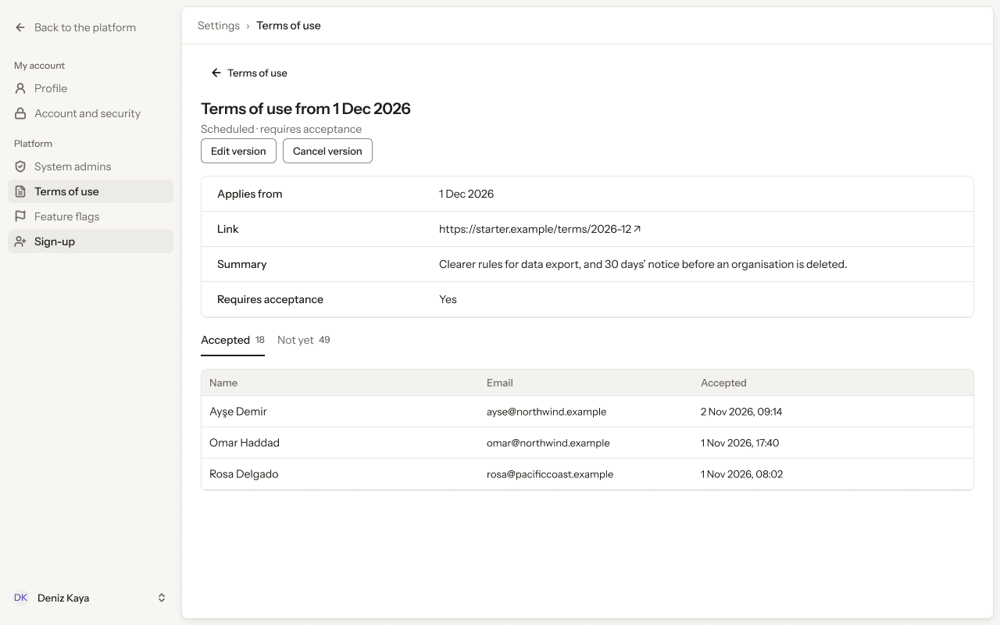

- **Who sees it:** System admins.
- **Device:** Desktop (1280 px and wider).
- **This state shows:** as the title says.
- **Values come from:** Terms of use versions, effective dates and acceptance counts: our API.
- **Components:** Button ×3, Platform sidebar, Tab ×2, Top bar.
- **Actions:**
  - "Back to the platform": goes to [4.01 · Organisations · all](../04-organisations/README.md#401--organisations--all).
  - "Profile": goes to [8.01 · Profile · ideal](../08-settings-profile/README.md#801--profile--ideal).
  - "Account and security": goes to [9.01 · Account and security · ideal](../09-settings-account-and-security/README.md#901--account-and-security--ideal).
  - "System admins": goes to [10.01 · System admins](../10-settings-system-admins/README.md#1001--system-admins).
  - "Terms of use": goes to [11.01 · Terms of use](#1101--terms-of-use).
  - "Deniz Kaya": goes to [2.03 · Account menu](../02-shell/README.md#203--account-menu).
  - "Area": goes to [11.06 · Version · not yet](#1106--version--not-yet).
  - "Edit version": goes to [11.10 · Scheduled version · edit](#1110--scheduled-version--edit).
  - "Cancel version": goes to [11.11 · Cancel scheduled version](#1111--cancel-scheduled-version).
  - "Feature flags": goes to [12.01 · Feature flags](../12-settings-feature-flags/README.md#1201--feature-flags).
  - "Sign-up": goes to [13.01 · Sign-up · off](../13-settings-sign-up/README.md#1301--sign-up--off).
- **Texts, word for word, top to bottom:**

  - Back to the platform
  - My account
  - Profile
  - Account and security
  - Platform
  - System admins
  - Terms of use
  - Feature flags
  - Sign-up
  - DK
  - Deniz Kaya
  - Settings
  - ›
  - Terms of use
  - Terms of use
  - Terms of use from 1 Dec 2026
  - Scheduled · requires acceptance
  - Edit version
  - Cancel version
  - Applies from
  - 1 Dec 2026
  - Link
  - https://starter.example/terms/2026-12 ↗
  - Summary
  - Clearer rules for data export, and 30 days’ notice before an organisation is deleted.
  - Requires acceptance
  - Yes
  - Accepted
  - 18
  - Not yet
  - 49
  - Name
  - Email
  - Accepted
  - Ayşe Demir
  - ayse@northwind.example
  - 2 Nov 2026, 09:14
  - Omar Haddad
  - omar@northwind.example
  - 1 Nov 2026, 17:40
  - Rosa Delgado
  - rosa@pacificcoast.example
  - 1 Nov 2026, 08:02

Figma: [202:11975](https://www.figma.com/design/3Ev111okX8xCBwR9B3hyBM/?node-id=202-11975)

### 11.06 · Version · not yet

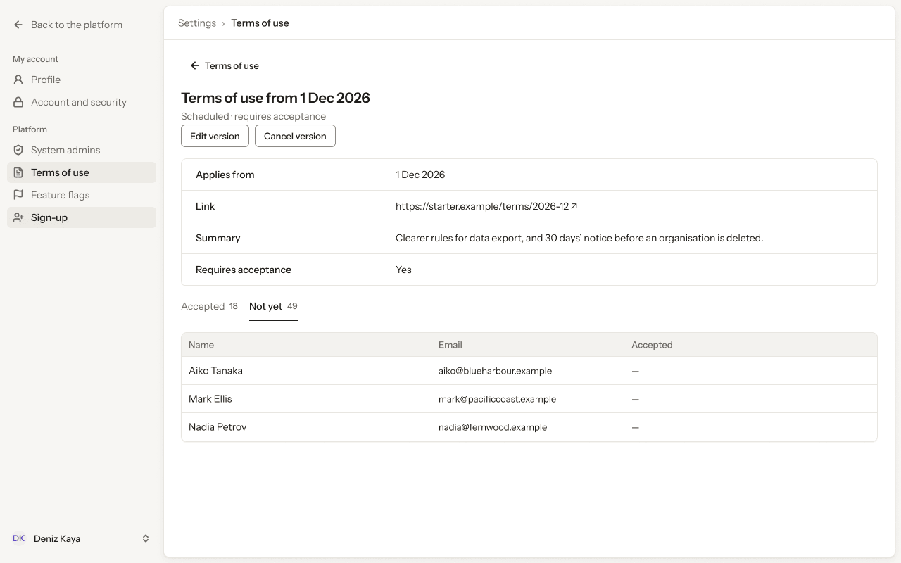

- **Who sees it:** System admins.
- **Device:** Desktop (1280 px and wider).
- **This state shows:** as the title says.
- **Values come from:** Terms of use versions, effective dates and acceptance counts: our API.
- **Components:** Button ×3, Platform sidebar, Tab ×2, Top bar.
- **Actions:**
  - "Back to the platform": goes to [4.01 · Organisations · all](../04-organisations/README.md#401--organisations--all).
  - "Profile": goes to [8.01 · Profile · ideal](../08-settings-profile/README.md#801--profile--ideal).
  - "Account and security": goes to [9.01 · Account and security · ideal](../09-settings-account-and-security/README.md#901--account-and-security--ideal).
  - "System admins": goes to [10.01 · System admins](../10-settings-system-admins/README.md#1001--system-admins).
  - "Terms of use": goes to [11.01 · Terms of use](#1101--terms-of-use).
  - "Deniz Kaya": goes to [2.03 · Account menu](../02-shell/README.md#203--account-menu).
  - "Area": goes to [11.05 · Version · accepted](#1105--version--accepted).
  - "Edit version": goes to [11.10 · Scheduled version · edit](#1110--scheduled-version--edit).
  - "Cancel version": goes to [11.11 · Cancel scheduled version](#1111--cancel-scheduled-version).
  - "Feature flags": goes to [12.01 · Feature flags](../12-settings-feature-flags/README.md#1201--feature-flags).
  - "Sign-up": goes to [13.01 · Sign-up · off](../13-settings-sign-up/README.md#1301--sign-up--off).
- **Texts, word for word, top to bottom:**

  - Back to the platform
  - My account
  - Profile
  - Account and security
  - Platform
  - System admins
  - Terms of use
  - Feature flags
  - Sign-up
  - DK
  - Deniz Kaya
  - Settings
  - ›
  - Terms of use
  - Terms of use
  - Terms of use from 1 Dec 2026
  - Scheduled · requires acceptance
  - Edit version
  - Cancel version
  - Applies from
  - 1 Dec 2026
  - Link
  - https://starter.example/terms/2026-12 ↗
  - Summary
  - Clearer rules for data export, and 30 days’ notice before an organisation is deleted.
  - Requires acceptance
  - Yes
  - Accepted
  - 18
  - Not yet
  - 49
  - Name
  - Email
  - Accepted
  - Aiko Tanaka
  - aiko@blueharbour.example
  - —
  - Mark Ellis
  - mark@pacificcoast.example
  - —
  - Nadia Petrov
  - nadia@fernwood.example
  - —

Figma: [202:12156](https://www.figma.com/design/3Ev111okX8xCBwR9B3hyBM/?node-id=202-12156)

### 11.07 · Terms of use · loading

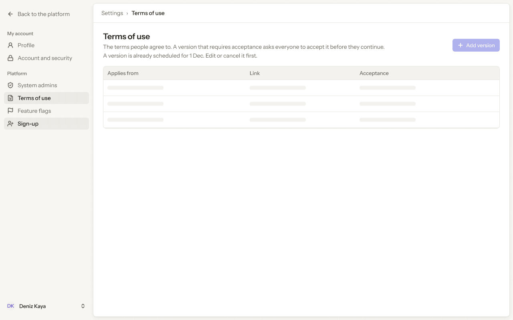

- **Who sees it:** System admins.
- **Device:** Desktop (1280 px and wider).
- **This state shows:** while the request runs.
- **Values come from:** Terms of use versions, effective dates and acceptance counts: our API.
- **Components:** Button, Platform sidebar, Skeleton ×9, Top bar.
- **Actions:**
  - "Back to the platform": goes to [4.01 · Organisations · all](../04-organisations/README.md#401--organisations--all).
  - "Profile": goes to [8.01 · Profile · ideal](../08-settings-profile/README.md#801--profile--ideal).
  - "Account and security": goes to [9.01 · Account and security · ideal](../09-settings-account-and-security/README.md#901--account-and-security--ideal).
  - "System admins": goes to [10.01 · System admins](../10-settings-system-admins/README.md#1001--system-admins).
  - "Terms of use": goes to [11.01 · Terms of use](#1101--terms-of-use).
  - "Deniz Kaya": goes to [2.03 · Account menu](../02-shell/README.md#203--account-menu).
  - "Feature flags": goes to [12.01 · Feature flags](../12-settings-feature-flags/README.md#1201--feature-flags).
  - "Sign-up": goes to [13.01 · Sign-up · off](../13-settings-sign-up/README.md#1301--sign-up--off).
- **Texts, word for word, top to bottom:**

  - Back to the platform
  - My account
  - Profile
  - Account and security
  - Platform
  - System admins
  - Terms of use
  - Feature flags
  - Sign-up
  - DK
  - Deniz Kaya
  - Settings
  - ›
  - Terms of use
  - Terms of use
  - The terms people agree to. A version that requires acceptance asks everyone to accept it before they continue.
  - A version is already scheduled for 1 Dec. Edit or cancel it first.
  - Add version
  - Applies from
  - Link
  - Acceptance

Figma: [202:12337](https://www.figma.com/design/3Ev111okX8xCBwR9B3hyBM/?node-id=202-12337)

### 11.08 · Terms of use · couldn’t load

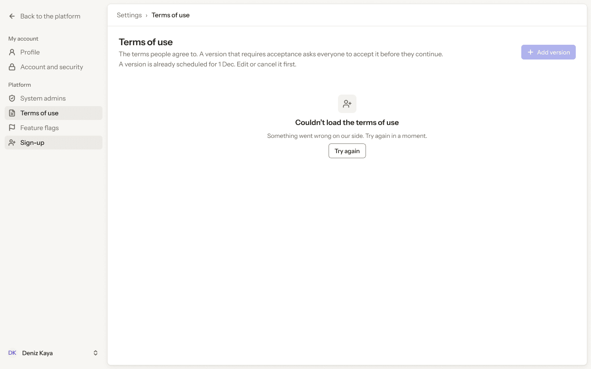

- **Who sees it:** System admins.
- **Device:** Desktop (1280 px and wider).
- **This state shows:** as the title says.
- **Values come from:** Terms of use versions, effective dates and acceptance counts: our API.
- **Components:** Button, Empty state, Platform sidebar, Top bar.
- **Actions:**
  - "Back to the platform": goes to [4.01 · Organisations · all](../04-organisations/README.md#401--organisations--all).
  - "Profile": goes to [8.01 · Profile · ideal](../08-settings-profile/README.md#801--profile--ideal).
  - "Account and security": goes to [9.01 · Account and security · ideal](../09-settings-account-and-security/README.md#901--account-and-security--ideal).
  - "System admins": goes to [10.01 · System admins](../10-settings-system-admins/README.md#1001--system-admins).
  - "Terms of use": goes to [11.01 · Terms of use](#1101--terms-of-use).
  - "Deniz Kaya": goes to [2.03 · Account menu](../02-shell/README.md#203--account-menu).
  - "Feature flags": goes to [12.01 · Feature flags](../12-settings-feature-flags/README.md#1201--feature-flags).
  - "Sign-up": goes to [13.01 · Sign-up · off](../13-settings-sign-up/README.md#1301--sign-up--off).
- **Texts, word for word, top to bottom:**

  - Back to the platform
  - My account
  - Profile
  - Account and security
  - Platform
  - System admins
  - Terms of use
  - Feature flags
  - Sign-up
  - DK
  - Deniz Kaya
  - Settings
  - ›
  - Terms of use
  - Terms of use
  - The terms people agree to. A version that requires acceptance asks everyone to accept it before they continue.
  - A version is already scheduled for 1 Dec. Edit or cancel it first.
  - Add version
  - Couldn’t load the terms of use
  - Something went wrong on our side. Try again in a moment.
  - Try again

Figma: [202:12454](https://www.figma.com/design/3Ev111okX8xCBwR9B3hyBM/?node-id=202-12454)

### 11.09 · Terms of use · nothing scheduled

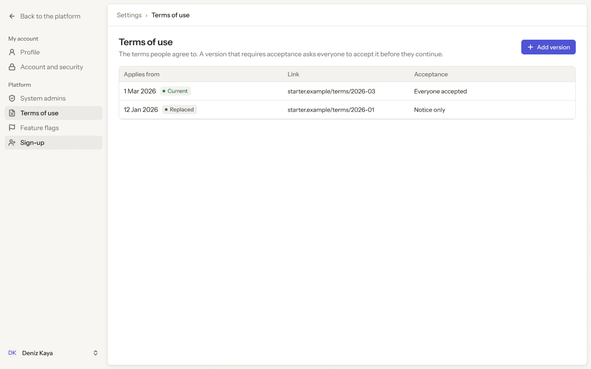

- **Who sees it:** System admins.
- **Device:** Desktop (1280 px and wider).
- **This state shows:** as the title says.
- **Values come from:** Terms of use versions, effective dates and acceptance counts: our API.
- **Components:** Button, Pill ×2, Platform sidebar, Top bar.
- **Actions:**
  - "Back to the platform": goes to [4.01 · Organisations · all](../04-organisations/README.md#401--organisations--all).
  - "Profile": goes to [8.01 · Profile · ideal](../08-settings-profile/README.md#801--profile--ideal).
  - "Account and security": goes to [9.01 · Account and security · ideal](../09-settings-account-and-security/README.md#901--account-and-security--ideal).
  - "System admins": goes to [10.01 · System admins](../10-settings-system-admins/README.md#1001--system-admins).
  - "Deniz Kaya": goes to [2.03 · Account menu](../02-shell/README.md#203--account-menu).
  - "Add version": goes to [11.02 · New version](#1102--new-version).
  - "starter.example/terms/2026-03": goes to [11.12 · Version in force](#1112--version-in-force).
  - "Feature flags": goes to [12.01 · Feature flags](../12-settings-feature-flags/README.md#1201--feature-flags).
  - "Sign-up": goes to [13.01 · Sign-up · off](../13-settings-sign-up/README.md#1301--sign-up--off).
- **Texts, word for word, top to bottom:**

  - Back to the platform
  - My account
  - Profile
  - Account and security
  - Platform
  - System admins
  - Terms of use
  - Feature flags
  - Sign-up
  - DK
  - Deniz Kaya
  - Settings
  - ›
  - Terms of use
  - Terms of use
  - The terms people agree to. A version that requires acceptance asks everyone to accept it before they continue.
  - Add version
  - Applies from
  - Link
  - Acceptance
  - 1 Mar 2026
  - Current
  - starter.example/terms/2026-03
  - Everyone accepted
  - 12 Jan 2026
  - Replaced
  - starter.example/terms/2026-01
  - Notice only

Figma: [207:11799](https://www.figma.com/design/3Ev111okX8xCBwR9B3hyBM/?node-id=207-11799)

### 11.10 · Scheduled version · edit

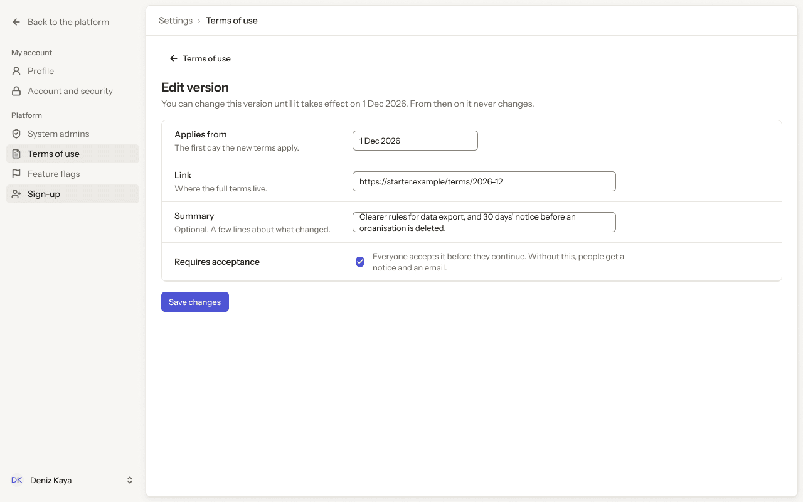

- **Who sees it:** System admins.
- **Device:** Desktop (1280 px and wider).
- **This state shows:** as the title says.
- **Values come from:** Terms of use versions, effective dates and acceptance counts: our API.
- **Components:** Button ×2, Checkbox, Input ×3, Platform sidebar, Top bar.
- **Actions:**
  - "Back to the platform": goes to [4.01 · Organisations · all](../04-organisations/README.md#401--organisations--all).
  - "Profile": goes to [8.01 · Profile · ideal](../08-settings-profile/README.md#801--profile--ideal).
  - "Account and security": goes to [9.01 · Account and security · ideal](../09-settings-account-and-security/README.md#901--account-and-security--ideal).
  - "System admins": goes to [10.01 · System admins](../10-settings-system-admins/README.md#1001--system-admins).
  - "Terms of use": goes to [11.01 · Terms of use](#1101--terms-of-use).
  - "Deniz Kaya": goes to [2.03 · Account menu](../02-shell/README.md#203--account-menu).
  - "Save changes": goes to [11.05 · Version · accepted](#1105--version--accepted).
  - "Feature flags": goes to [12.01 · Feature flags](../12-settings-feature-flags/README.md#1201--feature-flags).
  - "Sign-up": goes to [13.01 · Sign-up · off](../13-settings-sign-up/README.md#1301--sign-up--off).
- **Texts, word for word, top to bottom:**

  - Back to the platform
  - My account
  - Profile
  - Account and security
  - Platform
  - System admins
  - Terms of use
  - Feature flags
  - Sign-up
  - DK
  - Deniz Kaya
  - Settings
  - ›
  - Terms of use
  - Terms of use
  - Edit version
  - You can change this version until it takes effect on 1 Dec 2026. From then on it never changes.
  - Applies from
  - The first day the new terms apply.
  - 1 Dec 2026
  - Link
  - Where the full terms live.
  - https://starter.example/terms/2026-12
  - Summary
  - Optional. A few lines about what changed.
  - Clearer rules for data export, and 30 days’ notice before an organisation is deleted.
  - Requires acceptance
  - Everyone accepts it before they continue. Without this, people get a notice and an email.
  - Save changes

Figma: [208:12093](https://www.figma.com/design/3Ev111okX8xCBwR9B3hyBM/?node-id=208-12093)

### 11.11 · Cancel scheduled version

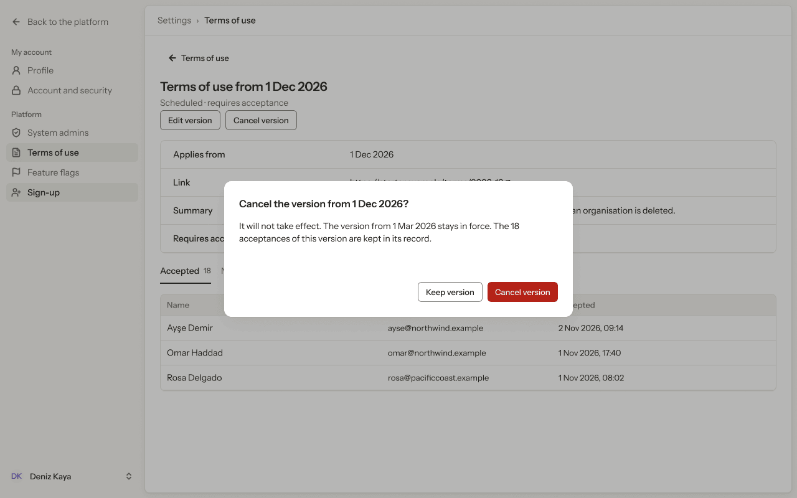

- **Who sees it:** System admins.
- **Device:** Desktop (1280 px and wider).
- **This state shows:** as the title says.
- **Values come from:** Terms of use versions, effective dates and acceptance counts: our API.
- **Components:** Button ×5, Platform sidebar, Tab ×2, Top bar.
- **Actions:**
  - "Keep version": goes to [11.05 · Version · accepted](#1105--version--accepted).
  - "Cancel version": goes to [11.13 · Version cancelled](#1113--version-cancelled).
  - "Feature flags": goes to [12.01 · Feature flags](../12-settings-feature-flags/README.md#1201--feature-flags).
  - "System admins": goes to [10.01 · System admins](../10-settings-system-admins/README.md#1001--system-admins).
  - "Sign-up": goes to [13.01 · Sign-up · off](../13-settings-sign-up/README.md#1301--sign-up--off).
- **Texts, word for word, top to bottom:**

  - Back to the platform
  - My account
  - Profile
  - Account and security
  - Platform
  - System admins
  - Terms of use
  - Feature flags
  - Sign-up
  - DK
  - Deniz Kaya
  - Settings
  - ›
  - Terms of use
  - Terms of use
  - Terms of use from 1 Dec 2026
  - Scheduled · requires acceptance
  - Edit version
  - Cancel version
  - Applies from
  - 1 Dec 2026
  - Link
  - https://starter.example/terms/2026-12 ↗
  - Summary
  - Clearer rules for data export, and 30 days’ notice before an organisation is deleted.
  - Requires acceptance
  - Yes
  - Accepted
  - 18
  - Not yet
  - 49
  - Name
  - Email
  - Accepted
  - Ayşe Demir
  - ayse@northwind.example
  - 2 Nov 2026, 09:14
  - Omar Haddad
  - omar@northwind.example
  - 1 Nov 2026, 17:40
  - Rosa Delgado
  - rosa@pacificcoast.example
  - 1 Nov 2026, 08:02
  - Cancel the version from 1 Dec 2026?
  - It will not take effect. The version from 1 Mar 2026 stays in force. The 18 acceptances of this version are kept in its record.
  - Keep version
  - Cancel version

Figma: [208:12213](https://www.figma.com/design/3Ev111okX8xCBwR9B3hyBM/?node-id=208-12213)

### 11.12 · Version in force

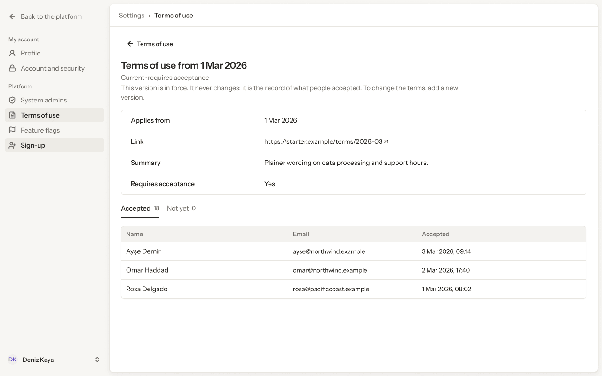

- **Who sees it:** System admins.
- **Device:** Desktop (1280 px and wider).
- **This state shows:** as the title says.
- **Values come from:** Terms of use versions, effective dates and acceptance counts: our API.
- **Components:** Button, Platform sidebar, Tab ×2, Top bar.
- **Actions:**
  - "Back to the platform": goes to [4.01 · Organisations · all](../04-organisations/README.md#401--organisations--all).
  - "Profile": goes to [8.01 · Profile · ideal](../08-settings-profile/README.md#801--profile--ideal).
  - "Account and security": goes to [9.01 · Account and security · ideal](../09-settings-account-and-security/README.md#901--account-and-security--ideal).
  - "System admins": goes to [10.01 · System admins](../10-settings-system-admins/README.md#1001--system-admins).
  - "Terms of use": goes to [11.01 · Terms of use](#1101--terms-of-use).
  - "Deniz Kaya": goes to [2.03 · Account menu](../02-shell/README.md#203--account-menu).
  - "Feature flags": goes to [12.01 · Feature flags](../12-settings-feature-flags/README.md#1201--feature-flags).
  - "Sign-up": goes to [13.01 · Sign-up · off](../13-settings-sign-up/README.md#1301--sign-up--off).
- **Texts, word for word, top to bottom:**

  - Back to the platform
  - My account
  - Profile
  - Account and security
  - Platform
  - System admins
  - Terms of use
  - Feature flags
  - Sign-up
  - DK
  - Deniz Kaya
  - Settings
  - ›
  - Terms of use
  - Terms of use
  - Terms of use from 1 Mar 2026
  - Current · requires acceptance
  - This version is in force. It never changes: it is the record of what people accepted. To change the terms, add a new version.
  - Applies from
  - 1 Mar 2026
  - Link
  - https://starter.example/terms/2026-03 ↗
  - Summary
  - Plainer wording on data processing and support hours.
  - Requires acceptance
  - Yes
  - Accepted
  - 18
  - Not yet
  - 0
  - Name
  - Email
  - Accepted
  - Ayşe Demir
  - ayse@northwind.example
  - 3 Mar 2026, 09:14
  - Omar Haddad
  - omar@northwind.example
  - 2 Mar 2026, 17:40
  - Rosa Delgado
  - rosa@pacificcoast.example
  - 1 Mar 2026, 08:02

Figma: [208:11932](https://www.figma.com/design/3Ev111okX8xCBwR9B3hyBM/?node-id=208-11932)

### 11.13 · Version cancelled

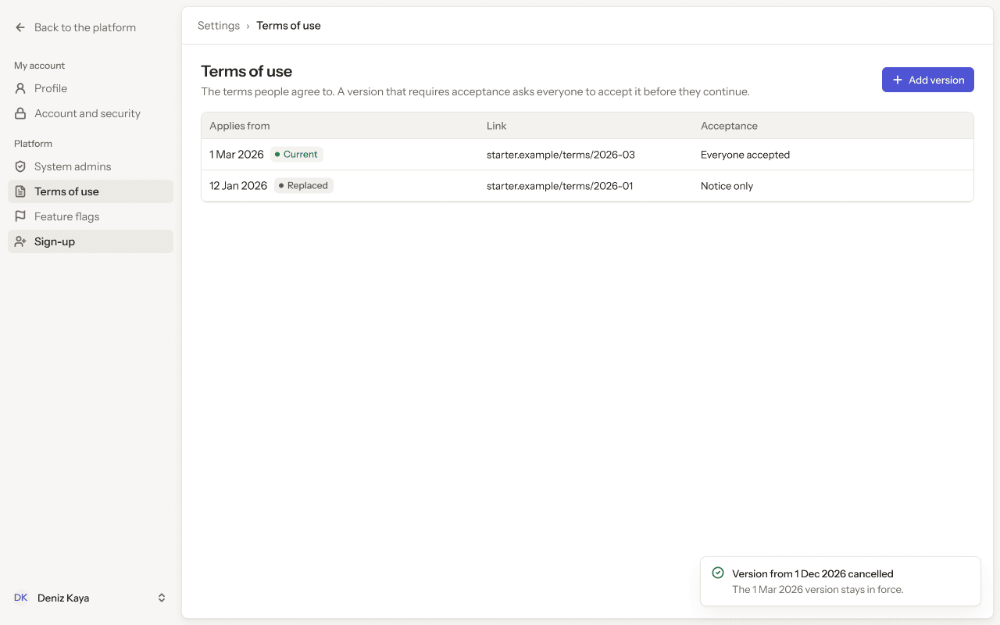

- **Who sees it:** System admins.
- **Device:** Desktop (1280 px and wider).
- **This state shows:** as the title says.
- **Values come from:** Terms of use versions, effective dates and acceptance counts: our API.
- **Components:** Button, Pill ×2, Platform sidebar, Toast, Top bar.
- **Actions:**
  - "Back to the platform": goes to [4.01 · Organisations · all](../04-organisations/README.md#401--organisations--all).
  - "Profile": goes to [8.01 · Profile · ideal](../08-settings-profile/README.md#801--profile--ideal).
  - "Account and security": goes to [9.01 · Account and security · ideal](../09-settings-account-and-security/README.md#901--account-and-security--ideal).
  - "System admins": goes to [10.01 · System admins](../10-settings-system-admins/README.md#1001--system-admins).
  - "Deniz Kaya": goes to [2.03 · Account menu](../02-shell/README.md#203--account-menu).
  - "Add version": goes to [11.02 · New version](#1102--new-version).
  - "starter.example/terms/2026-03": goes to [11.12 · Version in force](#1112--version-in-force).
  - "Feature flags": goes to [12.01 · Feature flags](../12-settings-feature-flags/README.md#1201--feature-flags).
  - "Sign-up": goes to [13.01 · Sign-up · off](../13-settings-sign-up/README.md#1301--sign-up--off).
- **Texts, word for word, top to bottom:**

  - Back to the platform
  - My account
  - Profile
  - Account and security
  - Platform
  - System admins
  - Terms of use
  - Feature flags
  - Sign-up
  - DK
  - Deniz Kaya
  - Settings
  - ›
  - Terms of use
  - Terms of use
  - The terms people agree to. A version that requires acceptance asks everyone to accept it before they continue.
  - Add version
  - Applies from
  - Link
  - Acceptance
  - 1 Mar 2026
  - Current
  - starter.example/terms/2026-03
  - Everyone accepted
  - 12 Jan 2026
  - Replaced
  - starter.example/terms/2026-01
  - Notice only
  - Version from 1 Dec 2026 cancelled
  - The 1 Mar 2026 version stays in force.

Figma: [207:11922](https://www.figma.com/design/3Ev111okX8xCBwR9B3hyBM/?node-id=207-11922)

### 11.14 · Phone · Terms of use

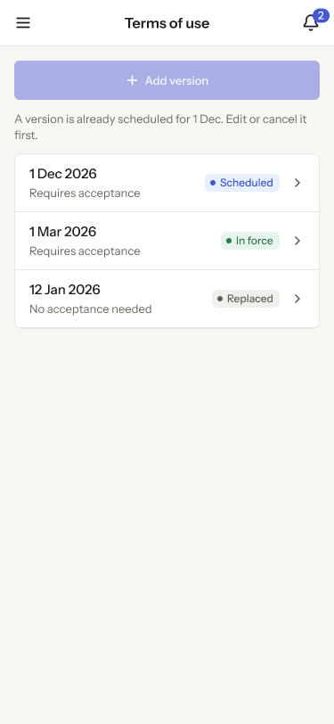

- **Who sees it:** System admins.
- **Device:** Phone (up to 767 px).
- **This state shows:** on a phone.
- **Values come from:** Terms of use versions, effective dates and acceptance counts: our API.
- **Components:** Button, Phone list row ×3, Phone top bar.
- **Actions:**
  - "Area": goes to [2.15 · Phone · settings menu open](../02-shell/README.md#215--phone--settings-menu-open).
  - "2": goes to [3.08 · Phone · Notifications](../03-notifications/README.md#308--phone--notifications).
  - "1 Dec 2026": goes to [11.15 · Phone · Terms of use version](#1115--phone--terms-of-use-version).
- **Texts, word for word, top to bottom:**

  - Terms of use
  - 2
  - Add version
  - A version is already scheduled for 1 Dec. Edit or cancel it first.
  - 1 Dec 2026
  - Requires acceptance
  - Scheduled
  - 1 Mar 2026
  - Requires acceptance
  - In force
  - 12 Jan 2026
  - No acceptance needed
  - Replaced

Figma: [263:17265](https://www.figma.com/design/3Ev111okX8xCBwR9B3hyBM/?node-id=263-17265)

### 11.15 · Phone · Terms of use version

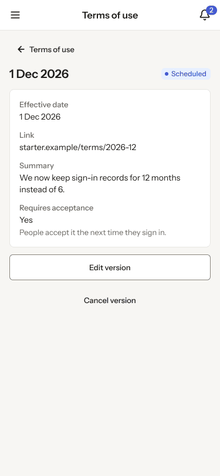

- **Who sees it:** System admins.
- **Device:** Phone (up to 767 px).
- **This state shows:** on a phone.
- **Values come from:** Terms of use versions, effective dates and acceptance counts: our API.
- **Components:** Button ×3, Phone top bar, Pill.
- **Actions:**
  - "Area": goes to [2.15 · Phone · settings menu open](../02-shell/README.md#215--phone--settings-menu-open).
  - "2": goes to [3.08 · Phone · Notifications](../03-notifications/README.md#308--phone--notifications).
  - "Terms of use": goes to [11.14 · Phone · Terms of use](#1114--phone--terms-of-use).
- **Texts, word for word, top to bottom:**

  - Terms of use
  - 2
  - Terms of use
  - 1 Dec 2026
  - Scheduled
  - Effective date
  - 1 Dec 2026
  - Link
  - starter.example/terms/2026-12
  - Summary
  - We now keep sign-in records for 12 months instead of 6.
  - Requires acceptance
  - Yes
  - People accept it the next time they sign in.
  - Edit version
  - Cancel version

Figma: [263:17324](https://www.figma.com/design/3Ev111okX8xCBwR9B3hyBM/?node-id=263-17324)
