# Platform app · 12 · Settings › Feature flags

Who sees this section: System admins.

Where the values come from: Feature flags, their rollout and history: our API and the flag definitions in code.

23 screens. Each part below is one screen and state. The PNG beside this file is the screen at scale 1.

| Screen | Device |
|---|---|
| [12.01 · Feature flags](#1201--feature-flags) | Desktop |
| [12.02 · Feature flags · ready to remove](#1202--feature-flags--ready-to-remove) | Desktop |
| [12.03 · Feature flags · unused](#1203--feature-flags--unused) | Desktop |
| [12.04 · Feature flags · removed from code](#1204--feature-flags--removed-from-code) | Desktop |
| [12.05 · Flag · roles.bulk_edit](#1205--flag--rolesbulk_edit) | Desktop |
| [12.06 · Change percentage](#1206--change-percentage) | Desktop |
| [12.07 · Flag · changed](#1207--flag--changed) | Desktop |
| [12.08 · Add organisation](#1208--add-organisation) | Desktop |
| [12.09 · Remove listed organisation](#1209--remove-listed-organisation) | Desktop |
| [12.10 · Flag · ready to remove](#1210--flag--ready-to-remove) | Desktop |
| [12.11 · Flag · kill switch](#1211--flag--kill-switch) | Desktop |
| [12.12 · Flag · removed from code](#1212--flag--removed-from-code) | Desktop |
| [12.13 · Feature flags · none yet](#1213--feature-flags--none-yet) | Desktop |
| [12.14 · Feature flags · loading](#1214--feature-flags--loading) | Desktop |
| [12.15 · Feature flags · couldn’t load](#1215--feature-flags--couldnt-load) | Desktop |
| [12.16 · Feature flags · dark](#1216--feature-flags--dark) | Desktop |
| [12.17 · Feature flags · Staging](#1217--feature-flags--staging) | Desktop |
| [12.18 · Flag · unused](#1218--flag--unused) | Desktop |
| [12.19 · Phone · Feature flags](#1219--phone--feature-flags) | Phone |
| [12.20 · Phone · Flag](#1220--phone--flag) | Phone |
| [12.21 · Phone · Flag · change rules](#1221--phone--flag--change-rules) | Phone |
| [12.22 · Phone · Kill switch · turn off](#1222--phone--kill-switch--turn-off) | Phone |
| [12.23 · Phone · Kill switch · off](#1223--phone--kill-switch--off) | Phone |

### 12.01 · Feature flags

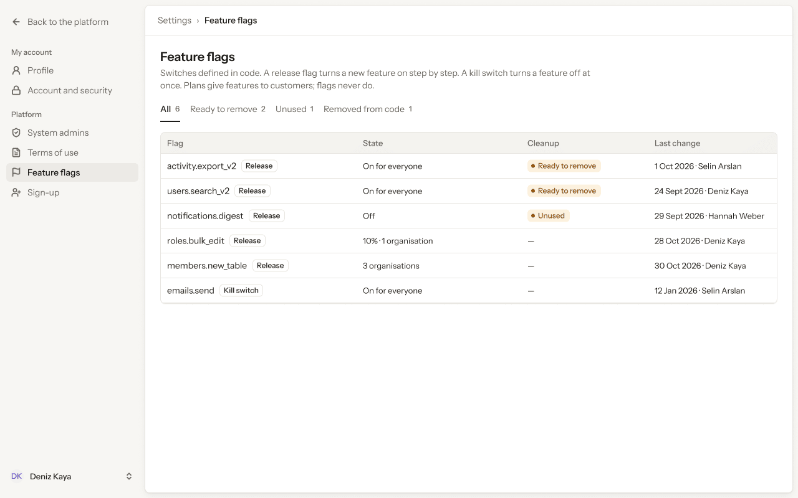

- **Who sees it:** System admins.
- **Device:** Desktop (1280 px and wider).
- **This state shows:** as the title says.
- **Values come from:** Feature flags, their rollout and history: our API and the flag definitions in code.
- **Components:** Label ×6, Pill ×3, Platform sidebar, Tab ×4, Top bar.
- **Actions:**
  - "Back to the platform": goes to [4.01 · Organisations · all](../04-organisations/README.md#401--organisations--all).
  - "Profile": goes to [8.01 · Profile · ideal](../08-settings-profile/README.md#801--profile--ideal).
  - "Account and security": goes to [9.01 · Account and security · ideal](../09-settings-account-and-security/README.md#901--account-and-security--ideal).
  - "Terms of use": goes to [11.01 · Terms of use](../11-settings-terms-of-use/README.md#1101--terms-of-use).
  - "Deniz Kaya": goes to [2.03 · Account menu](../02-shell/README.md#203--account-menu).
  - "Ready to remove": goes to [12.02 · Feature flags · ready to remove](#1202--feature-flags--ready-to-remove).
  - "Unused": goes to [12.03 · Feature flags · unused](#1203--feature-flags--unused).
  - "Removed from code": goes to [12.04 · Feature flags · removed from code](#1204--feature-flags--removed-from-code).
  - "28 Oct 2026 · Deniz Kaya": goes to [12.05 · Flag · roles.bulk_edit](#1205--flag--rolesbulk_edit).
  - "1 Oct 2026 · Selin Arslan": goes to [12.10 · Flag · ready to remove](#1210--flag--ready-to-remove).
  - "24 Sept 2026 · Deniz Kaya": goes to [12.10 · Flag · ready to remove](#1210--flag--ready-to-remove).
  - "12 Jan 2026 · Selin Arslan": goes to [12.11 · Flag · kill switch](#1211--flag--kill-switch).
  - "System admins": goes to [10.01 · System admins](../10-settings-system-admins/README.md#1001--system-admins).
  - "29 Sept 2026 · Hannah Weber": goes to [12.18 · Flag · unused](#1218--flag--unused).
  - "Sign-up": goes to [13.01 · Sign-up · off](../13-settings-sign-up/README.md#1301--sign-up--off).
- **Texts, word for word, top to bottom:**

  - Back to the platform
  - My account
  - Profile
  - Account and security
  - Platform
  - System admins
  - Terms of use
  - Feature flags
  - Sign-up
  - DK
  - Deniz Kaya
  - Settings
  - ›
  - Feature flags
  - Feature flags
  - Switches defined in code. A release flag turns a new feature on step by step. A kill switch turns a feature off at once. Plans give features to customers; flags never do.
  - All
  - 6
  - Ready to remove
  - 2
  - Unused
  - 1
  - Removed from code
  - 1
  - Flag
  - State
  - Cleanup
  - Last change
  - activity.export\_v2
  - Release
  - On for everyone
  - Ready to remove
  - 1 Oct 2026 · Selin Arslan
  - users.search\_v2
  - Release
  - On for everyone
  - Ready to remove
  - 24 Sept 2026 · Deniz Kaya
  - notifications.digest
  - Release
  - Off
  - Unused
  - 29 Sept 2026 · Hannah Weber
  - roles.bulk\_edit
  - Release
  - 10% · 1 organisation
  - —
  - 28 Oct 2026 · Deniz Kaya
  - members.new\_table
  - Release
  - 3 organisations
  - —
  - 30 Oct 2026 · Deniz Kaya
  - emails.send
  - Kill switch
  - On for everyone
  - —
  - 12 Jan 2026 · Selin Arslan

Figma: [211:12145](https://www.figma.com/design/3Ev111okX8xCBwR9B3hyBM/?node-id=211-12145)

### 12.02 · Feature flags · ready to remove

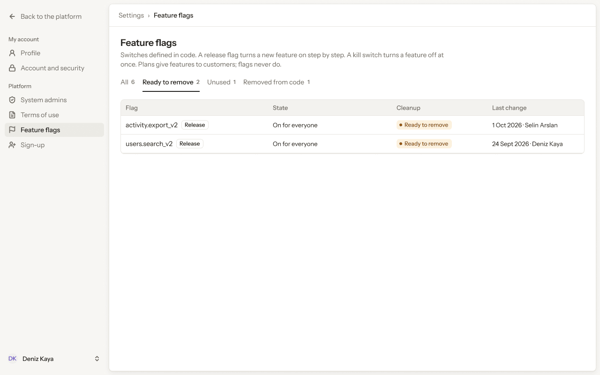

- **Who sees it:** System admins.
- **Device:** Desktop (1280 px and wider).
- **This state shows:** as the title says.
- **Values come from:** Feature flags, their rollout and history: our API and the flag definitions in code.
- **Components:** Label ×2, Pill ×2, Platform sidebar, Tab ×4, Top bar.
- **Actions:**
  - "Back to the platform": goes to [4.01 · Organisations · all](../04-organisations/README.md#401--organisations--all).
  - "Profile": goes to [8.01 · Profile · ideal](../08-settings-profile/README.md#801--profile--ideal).
  - "Account and security": goes to [9.01 · Account and security · ideal](../09-settings-account-and-security/README.md#901--account-and-security--ideal).
  - "Terms of use": goes to [11.01 · Terms of use](../11-settings-terms-of-use/README.md#1101--terms-of-use).
  - "Deniz Kaya": goes to [2.03 · Account menu](../02-shell/README.md#203--account-menu).
  - "All": goes to [12.01 · Feature flags](#1201--feature-flags).
  - "Unused": goes to [12.03 · Feature flags · unused](#1203--feature-flags--unused).
  - "Removed from code": goes to [12.04 · Feature flags · removed from code](#1204--feature-flags--removed-from-code).
  - "1 Oct 2026 · Selin Arslan": goes to [12.10 · Flag · ready to remove](#1210--flag--ready-to-remove).
  - "24 Sept 2026 · Deniz Kaya": goes to [12.10 · Flag · ready to remove](#1210--flag--ready-to-remove).
  - "System admins": goes to [10.01 · System admins](../10-settings-system-admins/README.md#1001--system-admins).
  - "Sign-up": goes to [13.01 · Sign-up · off](../13-settings-sign-up/README.md#1301--sign-up--off).
- **Texts, word for word, top to bottom:**

  - Back to the platform
  - My account
  - Profile
  - Account and security
  - Platform
  - System admins
  - Terms of use
  - Feature flags
  - Sign-up
  - DK
  - Deniz Kaya
  - Settings
  - ›
  - Feature flags
  - Feature flags
  - Switches defined in code. A release flag turns a new feature on step by step. A kill switch turns a feature off at once. Plans give features to customers; flags never do.
  - All
  - 6
  - Ready to remove
  - 2
  - Unused
  - 1
  - Removed from code
  - 1
  - Flag
  - State
  - Cleanup
  - Last change
  - activity.export\_v2
  - Release
  - On for everyone
  - Ready to remove
  - 1 Oct 2026 · Selin Arslan
  - users.search\_v2
  - Release
  - On for everyone
  - Ready to remove
  - 24 Sept 2026 · Deniz Kaya

Figma: [212:12226](https://www.figma.com/design/3Ev111okX8xCBwR9B3hyBM/?node-id=212-12226)

### 12.03 · Feature flags · unused

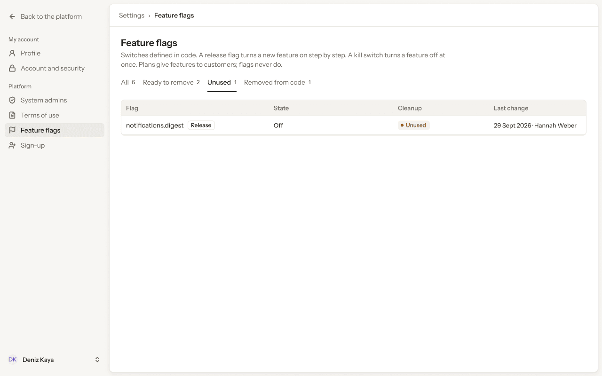

- **Who sees it:** System admins.
- **Device:** Desktop (1280 px and wider).
- **This state shows:** as the title says.
- **Values come from:** Feature flags, their rollout and history: our API and the flag definitions in code.
- **Components:** Label, Pill, Platform sidebar, Tab ×4, Top bar.
- **Actions:**
  - "Back to the platform": goes to [4.01 · Organisations · all](../04-organisations/README.md#401--organisations--all).
  - "Profile": goes to [8.01 · Profile · ideal](../08-settings-profile/README.md#801--profile--ideal).
  - "Account and security": goes to [9.01 · Account and security · ideal](../09-settings-account-and-security/README.md#901--account-and-security--ideal).
  - "Terms of use": goes to [11.01 · Terms of use](../11-settings-terms-of-use/README.md#1101--terms-of-use).
  - "Deniz Kaya": goes to [2.03 · Account menu](../02-shell/README.md#203--account-menu).
  - "All": goes to [12.01 · Feature flags](#1201--feature-flags).
  - "Ready to remove": goes to [12.02 · Feature flags · ready to remove](#1202--feature-flags--ready-to-remove).
  - "Removed from code": goes to [12.04 · Feature flags · removed from code](#1204--feature-flags--removed-from-code).
  - "System admins": goes to [10.01 · System admins](../10-settings-system-admins/README.md#1001--system-admins).
  - "29 Sept 2026 · Hannah Weber": goes to [12.18 · Flag · unused](#1218--flag--unused).
  - "Sign-up": goes to [13.01 · Sign-up · off](../13-settings-sign-up/README.md#1301--sign-up--off).
- **Texts, word for word, top to bottom:**

  - Back to the platform
  - My account
  - Profile
  - Account and security
  - Platform
  - System admins
  - Terms of use
  - Feature flags
  - Sign-up
  - DK
  - Deniz Kaya
  - Settings
  - ›
  - Feature flags
  - Feature flags
  - Switches defined in code. A release flag turns a new feature on step by step. A kill switch turns a feature off at once. Plans give features to customers; flags never do.
  - All
  - 6
  - Ready to remove
  - 2
  - Unused
  - 1
  - Removed from code
  - 1
  - Flag
  - State
  - Cleanup
  - Last change
  - notifications.digest
  - Release
  - Off
  - Unused
  - 29 Sept 2026 · Hannah Weber

Figma: [212:12382](https://www.figma.com/design/3Ev111okX8xCBwR9B3hyBM/?node-id=212-12382)

### 12.04 · Feature flags · removed from code

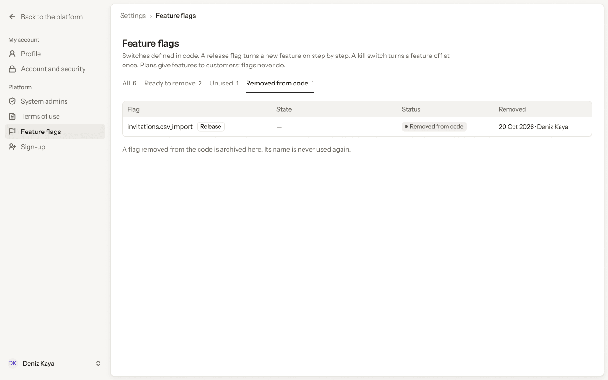

- **Who sees it:** System admins.
- **Device:** Desktop (1280 px and wider).
- **This state shows:** as the title says.
- **Values come from:** Feature flags, their rollout and history: our API and the flag definitions in code.
- **Components:** Label, Pill, Platform sidebar, Tab ×4, Top bar.
- **Actions:**
  - "Back to the platform": goes to [4.01 · Organisations · all](../04-organisations/README.md#401--organisations--all).
  - "Profile": goes to [8.01 · Profile · ideal](../08-settings-profile/README.md#801--profile--ideal).
  - "Account and security": goes to [9.01 · Account and security · ideal](../09-settings-account-and-security/README.md#901--account-and-security--ideal).
  - "Terms of use": goes to [11.01 · Terms of use](../11-settings-terms-of-use/README.md#1101--terms-of-use).
  - "Deniz Kaya": goes to [2.03 · Account menu](../02-shell/README.md#203--account-menu).
  - "All": goes to [12.01 · Feature flags](#1201--feature-flags).
  - "Ready to remove": goes to [12.02 · Feature flags · ready to remove](#1202--feature-flags--ready-to-remove).
  - "Unused": goes to [12.03 · Feature flags · unused](#1203--feature-flags--unused).
  - "invitations.csv_import": goes to [12.12 · Flag · removed from code](#1212--flag--removed-from-code).
  - "System admins": goes to [10.01 · System admins](../10-settings-system-admins/README.md#1001--system-admins).
  - "Sign-up": goes to [13.01 · Sign-up · off](../13-settings-sign-up/README.md#1301--sign-up--off).
- **Texts, word for word, top to bottom:**

  - Back to the platform
  - My account
  - Profile
  - Account and security
  - Platform
  - System admins
  - Terms of use
  - Feature flags
  - Sign-up
  - DK
  - Deniz Kaya
  - Settings
  - ›
  - Feature flags
  - Feature flags
  - Switches defined in code. A release flag turns a new feature on step by step. A kill switch turns a feature off at once. Plans give features to customers; flags never do.
  - All
  - 6
  - Ready to remove
  - 2
  - Unused
  - 1
  - Removed from code
  - 1
  - Flag
  - State
  - Status
  - Removed
  - invitations.csv\_import
  - Release
  - —
  - Removed from code
  - 20 Oct 2026 · Deniz Kaya
  - A flag removed from the code is archived here. Its name is never used again.

Figma: [212:12538](https://www.figma.com/design/3Ev111okX8xCBwR9B3hyBM/?node-id=212-12538)

### 12.05 · Flag · roles.bulk_edit

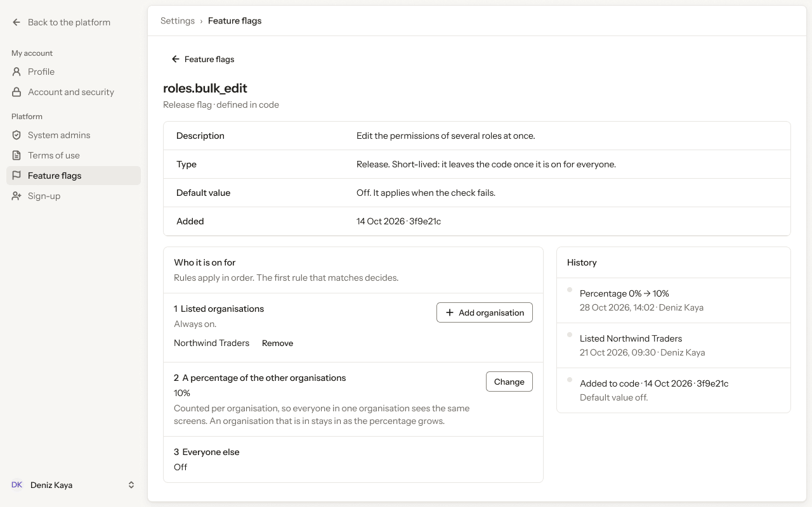

- **Who sees it:** System admins.
- **Device:** Desktop (1280 px and wider).
- **This state shows:** as the title says.
- **Values come from:** Feature flags, their rollout and history: our API and the flag definitions in code.
- **Components:** Button ×4, Platform sidebar, Top bar.
- **Actions:**
  - "Back to the platform": goes to [4.01 · Organisations · all](../04-organisations/README.md#401--organisations--all).
  - "Profile": goes to [8.01 · Profile · ideal](../08-settings-profile/README.md#801--profile--ideal).
  - "Account and security": goes to [9.01 · Account and security · ideal](../09-settings-account-and-security/README.md#901--account-and-security--ideal).
  - "System admins": goes to [10.01 · System admins](../10-settings-system-admins/README.md#1001--system-admins).
  - "Terms of use": goes to [11.01 · Terms of use](../11-settings-terms-of-use/README.md#1101--terms-of-use).
  - "Deniz Kaya": goes to [2.03 · Account menu](../02-shell/README.md#203--account-menu).
  - "Feature flags": goes to [11.01 · Terms of use](../11-settings-terms-of-use/README.md#1101--terms-of-use).
  - "Change": goes to [12.06 · Change percentage](#1206--change-percentage).
  - "Add organisation": goes to [12.08 · Add organisation](#1208--add-organisation).
  - "Remove": goes to [12.09 · Remove listed organisation](#1209--remove-listed-organisation).
  - "Feature flags": goes to [12.01 · Feature flags](#1201--feature-flags).
  - "Sign-up": goes to [13.01 · Sign-up · off](../13-settings-sign-up/README.md#1301--sign-up--off).
- **Texts, word for word, top to bottom:**

  - Back to the platform
  - My account
  - Profile
  - Account and security
  - Platform
  - System admins
  - Terms of use
  - Feature flags
  - Sign-up
  - DK
  - Deniz Kaya
  - Settings
  - ›
  - Feature flags
  - Feature flags
  - roles.bulk\_edit
  - Release flag · defined in code
  - Description
  - Edit the permissions of several roles at once.
  - Type
  - Release. Short-lived: it leaves the code once it is on for everyone.
  - Default value
  - Off. It applies when the check fails.
  - Added
  - 14 Oct 2026 · 3f9e21c
  - Who it is on for
  - Rules apply in order. The first rule that matches decides.
  - 1  Listed organisations
  - Always on.
  - Northwind Traders
  - Remove
  - Add organisation
  - 2  A percentage of the other organisations
  - 10%
  - Counted per organisation, so everyone in one organisation sees the same screens. An organisation that is in stays in as the percentage grows.
  - Change
  - 3  Everyone else
  - Off
  - History
  - Percentage 0% → 10%
  - 28 Oct 2026, 14:02 · Deniz Kaya
  - Listed Northwind Traders
  - 21 Oct 2026, 09:30 · Deniz Kaya
  - Added to code · 14 Oct 2026 · 3f9e21c
  - Default value off.

Figma: [213:12626](https://www.figma.com/design/3Ev111okX8xCBwR9B3hyBM/?node-id=213-12626)

### 12.06 · Change percentage

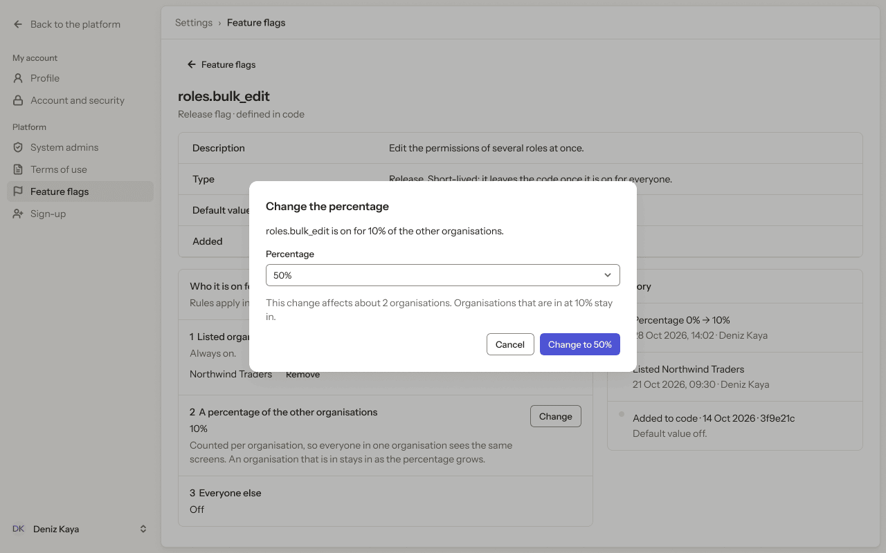

- **Who sees it:** System admins.
- **Device:** Desktop (1280 px and wider).
- **This state shows:** as the title says.
- **Values come from:** Feature flags, their rollout and history: our API and the flag definitions in code.
- **Components:** Button ×6, Platform sidebar, Select, Top bar.
- **Actions:**
  - "Add organisation": goes to [12.05 · Flag · roles.bulk_edit](#1205--flag--rolesbulk_edit).
  - "Change to 50%": goes to [12.07 · Flag · changed](#1207--flag--changed).
  - "Feature flags": goes to [12.01 · Feature flags](#1201--feature-flags).
  - "System admins": goes to [10.01 · System admins](../10-settings-system-admins/README.md#1001--system-admins).
  - "Sign-up": goes to [13.01 · Sign-up · off](../13-settings-sign-up/README.md#1301--sign-up--off).
- **Texts, word for word, top to bottom:**

  - Back to the platform
  - My account
  - Profile
  - Account and security
  - Platform
  - System admins
  - Terms of use
  - Feature flags
  - Sign-up
  - DK
  - Deniz Kaya
  - Settings
  - ›
  - Feature flags
  - Feature flags
  - roles.bulk\_edit
  - Release flag · defined in code
  - Description
  - Edit the permissions of several roles at once.
  - Type
  - Release. Short-lived: it leaves the code once it is on for everyone.
  - Default value
  - Off. It applies when the check fails.
  - Added
  - 14 Oct 2026 · 3f9e21c
  - Who it is on for
  - Rules apply in order. The first rule that matches decides.
  - 1  Listed organisations
  - Always on.
  - Northwind Traders
  - Remove
  - Add organisation
  - 2  A percentage of the other organisations
  - 10%
  - Counted per organisation, so everyone in one organisation sees the same screens. An organisation that is in stays in as the percentage grows.
  - Change
  - 3  Everyone else
  - Off
  - History
  - Percentage 0% → 10%
  - 28 Oct 2026, 14:02 · Deniz Kaya
  - Listed Northwind Traders
  - 21 Oct 2026, 09:30 · Deniz Kaya
  - Added to code · 14 Oct 2026 · 3f9e21c
  - Default value off.
  - Change the percentage
  - roles.bulk\_edit is on for 10% of the other organisations.
  - Percentage
  - 50%
  - This change affects about 2 organisations. Organisations that are in at 10% stay in.
  - Cancel
  - Change to 50%

Figma: [214:13337](https://www.figma.com/design/3Ev111okX8xCBwR9B3hyBM/?node-id=214-13337)

### 12.07 · Flag · changed

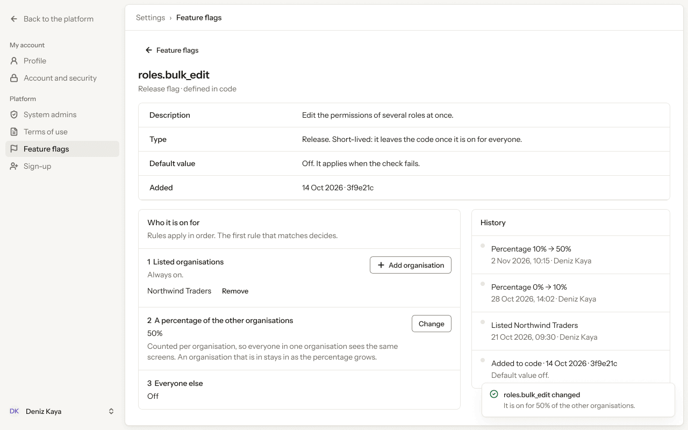

- **Who sees it:** System admins.
- **Device:** Desktop (1280 px and wider).
- **This state shows:** as the title says.
- **Values come from:** Feature flags, their rollout and history: our API and the flag definitions in code.
- **Components:** Button ×4, Platform sidebar, Toast, Top bar.
- **Actions:**
  - "Back to the platform": goes to [4.01 · Organisations · all](../04-organisations/README.md#401--organisations--all).
  - "Profile": goes to [8.01 · Profile · ideal](../08-settings-profile/README.md#801--profile--ideal).
  - "Account and security": goes to [9.01 · Account and security · ideal](../09-settings-account-and-security/README.md#901--account-and-security--ideal).
  - "System admins": goes to [10.01 · System admins](../10-settings-system-admins/README.md#1001--system-admins).
  - "Terms of use": goes to [11.01 · Terms of use](../11-settings-terms-of-use/README.md#1101--terms-of-use).
  - "Deniz Kaya": goes to [2.03 · Account menu](../02-shell/README.md#203--account-menu).
  - "Feature flags": goes to [11.01 · Terms of use](../11-settings-terms-of-use/README.md#1101--terms-of-use).
  - "Feature flags": goes to [12.01 · Feature flags](#1201--feature-flags).
  - "Sign-up": goes to [13.01 · Sign-up · off](../13-settings-sign-up/README.md#1301--sign-up--off).
- **Texts, word for word, top to bottom:**

  - Back to the platform
  - My account
  - Profile
  - Account and security
  - Platform
  - System admins
  - Terms of use
  - Feature flags
  - Sign-up
  - DK
  - Deniz Kaya
  - Settings
  - ›
  - Feature flags
  - Feature flags
  - roles.bulk\_edit
  - Release flag · defined in code
  - Description
  - Edit the permissions of several roles at once.
  - Type
  - Release. Short-lived: it leaves the code once it is on for everyone.
  - Default value
  - Off. It applies when the check fails.
  - Added
  - 14 Oct 2026 · 3f9e21c
  - Who it is on for
  - Rules apply in order. The first rule that matches decides.
  - 1  Listed organisations
  - Always on.
  - Northwind Traders
  - Remove
  - Add organisation
  - 2  A percentage of the other organisations
  - 50%
  - Counted per organisation, so everyone in one organisation sees the same screens. An organisation that is in stays in as the percentage grows.
  - Change
  - 3  Everyone else
  - Off
  - History
  - Percentage 10% → 50%
  - 2 Nov 2026, 10:15 · Deniz Kaya
  - Percentage 0% → 10%
  - 28 Oct 2026, 14:02 · Deniz Kaya
  - Listed Northwind Traders
  - 21 Oct 2026, 09:30 · Deniz Kaya
  - Added to code · 14 Oct 2026 · 3f9e21c
  - Default value off.
  - roles.bulk\_edit changed
  - It is on for 50% of the other organisations.

Figma: [214:12694](https://www.figma.com/design/3Ev111okX8xCBwR9B3hyBM/?node-id=214-12694)

### 12.08 · Add organisation

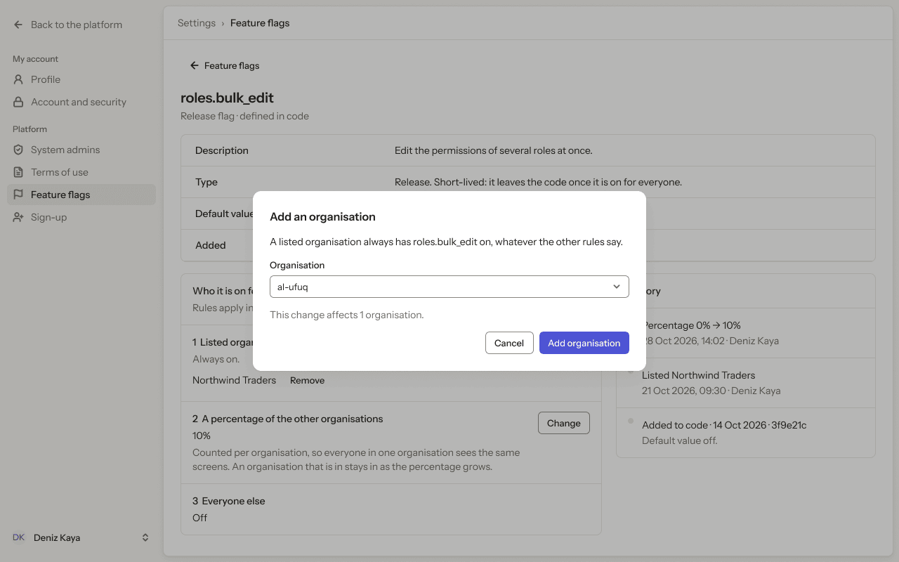

- **Who sees it:** System admins.
- **Device:** Desktop (1280 px and wider).
- **This state shows:** as the title says.
- **Values come from:** Feature flags, their rollout and history: our API and the flag definitions in code.
- **Components:** Button ×6, Platform sidebar, Select, Top bar.
- **Actions:**
  - "Cancel": goes to [12.05 · Flag · roles.bulk_edit](#1205--flag--rolesbulk_edit).
  - "Add organisation": goes to [12.05 · Flag · roles.bulk_edit](#1205--flag--rolesbulk_edit).
  - "Feature flags": goes to [12.01 · Feature flags](#1201--feature-flags).
  - "System admins": goes to [10.01 · System admins](../10-settings-system-admins/README.md#1001--system-admins).
  - "Sign-up": goes to [13.01 · Sign-up · off](../13-settings-sign-up/README.md#1301--sign-up--off).
- **Texts, word for word, top to bottom:**

  - Back to the platform
  - My account
  - Profile
  - Account and security
  - Platform
  - System admins
  - Terms of use
  - Feature flags
  - Sign-up
  - DK
  - Deniz Kaya
  - Settings
  - ›
  - Feature flags
  - Feature flags
  - roles.bulk\_edit
  - Release flag · defined in code
  - Description
  - Edit the permissions of several roles at once.
  - Type
  - Release. Short-lived: it leaves the code once it is on for everyone.
  - Default value
  - Off. It applies when the check fails.
  - Added
  - 14 Oct 2026 · 3f9e21c
  - Who it is on for
  - Rules apply in order. The first rule that matches decides.
  - 1  Listed organisations
  - Always on.
  - Northwind Traders
  - Remove
  - Add organisation
  - 2  A percentage of the other organisations
  - 10%
  - Counted per organisation, so everyone in one organisation sees the same screens. An organisation that is in stays in as the percentage grows.
  - Change
  - 3  Everyone else
  - Off
  - History
  - Percentage 0% → 10%
  - 28 Oct 2026, 14:02 · Deniz Kaya
  - Listed Northwind Traders
  - 21 Oct 2026, 09:30 · Deniz Kaya
  - Added to code · 14 Oct 2026 · 3f9e21c
  - Default value off.
  - Add an organisation
  - A listed organisation always has roles.bulk\_edit on, whatever the other rules say.
  - Organisation
  - al-ufuq
  - This change affects 1 organisation.
  - Cancel
  - Add organisation

Figma: [214:13493](https://www.figma.com/design/3Ev111okX8xCBwR9B3hyBM/?node-id=214-13493)

### 12.09 · Remove listed organisation

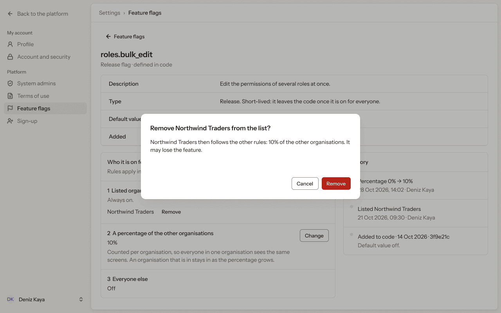

- **Who sees it:** System admins.
- **Device:** Desktop (1280 px and wider).
- **This state shows:** as the title says.
- **Values come from:** Feature flags, their rollout and history: our API and the flag definitions in code.
- **Components:** Button ×6, Platform sidebar, Top bar.
- **Actions:**
  - "Cancel": goes to [12.05 · Flag · roles.bulk_edit](#1205--flag--rolesbulk_edit).
  - "Remove": goes to [12.05 · Flag · roles.bulk_edit](#1205--flag--rolesbulk_edit).
  - "Feature flags": goes to [12.01 · Feature flags](#1201--feature-flags).
  - "System admins": goes to [10.01 · System admins](../10-settings-system-admins/README.md#1001--system-admins).
  - "Sign-up": goes to [13.01 · Sign-up · off](../13-settings-sign-up/README.md#1301--sign-up--off).
- **Texts, word for word, top to bottom:**

  - Back to the platform
  - My account
  - Profile
  - Account and security
  - Platform
  - System admins
  - Terms of use
  - Feature flags
  - Sign-up
  - DK
  - Deniz Kaya
  - Settings
  - ›
  - Feature flags
  - Feature flags
  - roles.bulk\_edit
  - Release flag · defined in code
  - Description
  - Edit the permissions of several roles at once.
  - Type
  - Release. Short-lived: it leaves the code once it is on for everyone.
  - Default value
  - Off. It applies when the check fails.
  - Added
  - 14 Oct 2026 · 3f9e21c
  - Who it is on for
  - Rules apply in order. The first rule that matches decides.
  - 1  Listed organisations
  - Always on.
  - Northwind Traders
  - Remove
  - Add organisation
  - 2  A percentage of the other organisations
  - 10%
  - Counted per organisation, so everyone in one organisation sees the same screens. An organisation that is in stays in as the percentage grows.
  - Change
  - 3  Everyone else
  - Off
  - History
  - Percentage 0% → 10%
  - 28 Oct 2026, 14:02 · Deniz Kaya
  - Listed Northwind Traders
  - 21 Oct 2026, 09:30 · Deniz Kaya
  - Added to code · 14 Oct 2026 · 3f9e21c
  - Default value off.
  - Remove Northwind Traders from the list?
  - Northwind Traders then follows the other rules: 10% of the other organisations. It may lose the feature.
  - Cancel
  - Remove

Figma: [214:13649](https://www.figma.com/design/3Ev111okX8xCBwR9B3hyBM/?node-id=214-13649)

### 12.10 · Flag · ready to remove

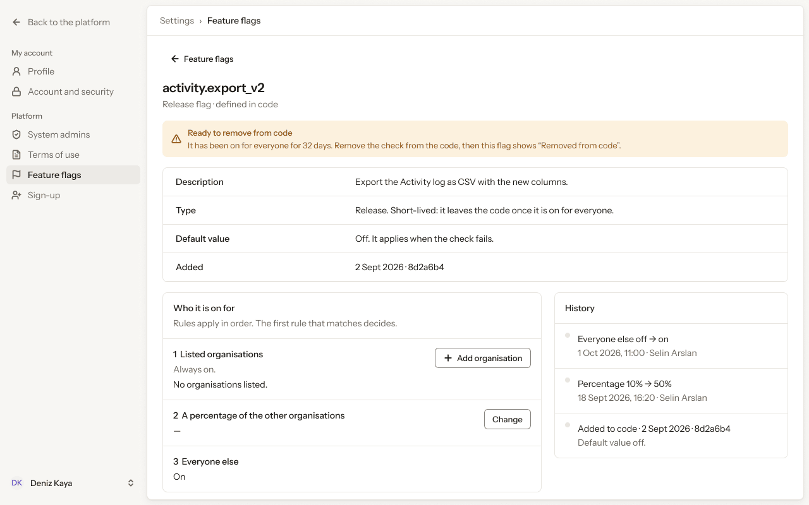

- **Who sees it:** System admins.
- **Device:** Desktop (1280 px and wider).
- **This state shows:** as the title says.
- **Values come from:** Feature flags, their rollout and history: our API and the flag definitions in code.
- **Components:** Banner, Button ×3, Platform sidebar, Top bar.
- **Actions:**
  - "Back to the platform": goes to [4.01 · Organisations · all](../04-organisations/README.md#401--organisations--all).
  - "Profile": goes to [8.01 · Profile · ideal](../08-settings-profile/README.md#801--profile--ideal).
  - "Account and security": goes to [9.01 · Account and security · ideal](../09-settings-account-and-security/README.md#901--account-and-security--ideal).
  - "System admins": goes to [10.01 · System admins](../10-settings-system-admins/README.md#1001--system-admins).
  - "Terms of use": goes to [11.01 · Terms of use](../11-settings-terms-of-use/README.md#1101--terms-of-use).
  - "Deniz Kaya": goes to [2.03 · Account menu](../02-shell/README.md#203--account-menu).
  - "Feature flags": goes to [11.01 · Terms of use](../11-settings-terms-of-use/README.md#1101--terms-of-use).
  - "Feature flags": goes to [12.01 · Feature flags](#1201--feature-flags).
  - "Sign-up": goes to [13.01 · Sign-up · off](../13-settings-sign-up/README.md#1301--sign-up--off).
- **Texts, word for word, top to bottom:**

  - Back to the platform
  - My account
  - Profile
  - Account and security
  - Platform
  - System admins
  - Terms of use
  - Feature flags
  - Sign-up
  - DK
  - Deniz Kaya
  - Settings
  - ›
  - Feature flags
  - Feature flags
  - activity.export\_v2
  - Release flag · defined in code
  - Ready to remove from code
  - It has been on for everyone for 32 days. Remove the check from the code, then this flag shows “Removed from code”.
  - Description
  - Export the Activity log as CSV with the new columns.
  - Type
  - Release. Short-lived: it leaves the code once it is on for everyone.
  - Default value
  - Off. It applies when the check fails.
  - Added
  - 2 Sept 2026 · 8d2a6b4
  - Who it is on for
  - Rules apply in order. The first rule that matches decides.
  - 1  Listed organisations
  - Always on.
  - No organisations listed.
  - Add organisation
  - 2  A percentage of the other organisations
  - —
  - Change
  - 3  Everyone else
  - On
  - History
  - Everyone else off → on
  - 1 Oct 2026, 11:00 · Selin Arslan
  - Percentage 10% → 50%
  - 18 Sept 2026, 16:20 · Selin Arslan
  - Added to code · 2 Sept 2026 · 8d2a6b4
  - Default value off.

Figma: [214:12856](https://www.figma.com/design/3Ev111okX8xCBwR9B3hyBM/?node-id=214-12856)

### 12.11 · Flag · kill switch

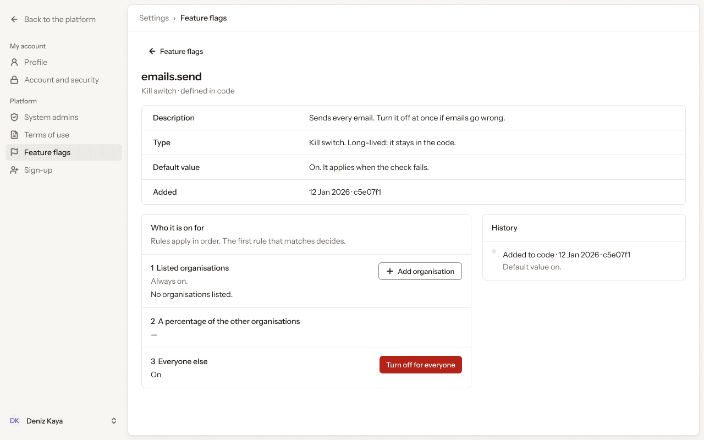

- **Who sees it:** System admins.
- **Device:** Desktop (1280 px and wider).
- **This state shows:** as the title says.
- **Values come from:** Feature flags, their rollout and history: our API and the flag definitions in code.
- **Components:** Button ×3, Platform sidebar, Top bar.
- **Actions:**
  - "Back to the platform": goes to [4.01 · Organisations · all](../04-organisations/README.md#401--organisations--all).
  - "Profile": goes to [8.01 · Profile · ideal](../08-settings-profile/README.md#801--profile--ideal).
  - "Account and security": goes to [9.01 · Account and security · ideal](../09-settings-account-and-security/README.md#901--account-and-security--ideal).
  - "System admins": goes to [10.01 · System admins](../10-settings-system-admins/README.md#1001--system-admins).
  - "Terms of use": goes to [11.01 · Terms of use](../11-settings-terms-of-use/README.md#1101--terms-of-use).
  - "Deniz Kaya": goes to [2.03 · Account menu](../02-shell/README.md#203--account-menu).
  - "Feature flags": goes to [11.01 · Terms of use](../11-settings-terms-of-use/README.md#1101--terms-of-use).
  - "Feature flags": goes to [12.01 · Feature flags](#1201--feature-flags).
  - "Sign-up": goes to [13.01 · Sign-up · off](../13-settings-sign-up/README.md#1301--sign-up--off).
- **Texts, word for word, top to bottom:**

  - Back to the platform
  - My account
  - Profile
  - Account and security
  - Platform
  - System admins
  - Terms of use
  - Feature flags
  - Sign-up
  - DK
  - Deniz Kaya
  - Settings
  - ›
  - Feature flags
  - Feature flags
  - emails.send
  - Kill switch · defined in code
  - Description
  - Sends every email. Turn it off at once if emails go wrong.
  - Type
  - Kill switch. Long-lived: it stays in the code.
  - Default value
  - On. It applies when the check fails.
  - Added
  - 12 Jan 2026 · c5e07f1
  - Who it is on for
  - Rules apply in order. The first rule that matches decides.
  - 1  Listed organisations
  - Always on.
  - No organisations listed.
  - Add organisation
  - 2  A percentage of the other organisations
  - —
  - 3  Everyone else
  - On
  - Turn off for everyone
  - History
  - Added to code · 12 Jan 2026 · c5e07f1
  - Default value on.

Figma: [214:13019](https://www.figma.com/design/3Ev111okX8xCBwR9B3hyBM/?node-id=214-13019)

### 12.12 · Flag · removed from code

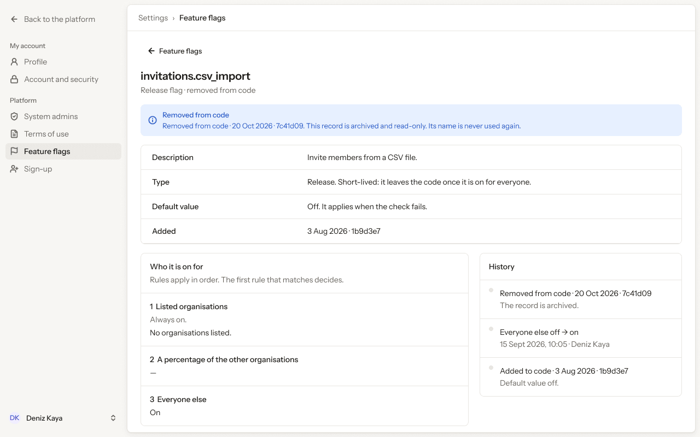

- **Who sees it:** System admins.
- **Device:** Desktop (1280 px and wider).
- **This state shows:** as the title says.
- **Values come from:** Feature flags, their rollout and history: our API and the flag definitions in code.
- **Components:** Banner, Button, Platform sidebar, Top bar.
- **Actions:**
  - "Back to the platform": goes to [4.01 · Organisations · all](../04-organisations/README.md#401--organisations--all).
  - "Profile": goes to [8.01 · Profile · ideal](../08-settings-profile/README.md#801--profile--ideal).
  - "Account and security": goes to [9.01 · Account and security · ideal](../09-settings-account-and-security/README.md#901--account-and-security--ideal).
  - "System admins": goes to [10.01 · System admins](../10-settings-system-admins/README.md#1001--system-admins).
  - "Terms of use": goes to [11.01 · Terms of use](../11-settings-terms-of-use/README.md#1101--terms-of-use).
  - "Deniz Kaya": goes to [2.03 · Account menu](../02-shell/README.md#203--account-menu).
  - "Feature flags": goes to [11.01 · Terms of use](../11-settings-terms-of-use/README.md#1101--terms-of-use).
  - "Feature flags": goes to [12.01 · Feature flags](#1201--feature-flags).
  - "Sign-up": goes to [13.01 · Sign-up · off](../13-settings-sign-up/README.md#1301--sign-up--off).
- **Texts, word for word, top to bottom:**

  - Back to the platform
  - My account
  - Profile
  - Account and security
  - Platform
  - System admins
  - Terms of use
  - Feature flags
  - Sign-up
  - DK
  - Deniz Kaya
  - Settings
  - ›
  - Feature flags
  - Feature flags
  - invitations.csv\_import
  - Release flag · removed from code
  - Removed from code
  - Removed from code · 20 Oct 2026 · 7c41d09. This record is archived and read-only. Its name is never used again.
  - Description
  - Invite members from a CSV file.
  - Type
  - Release. Short-lived: it leaves the code once it is on for everyone.
  - Default value
  - Off. It applies when the check fails.
  - Added
  - 3 Aug 2026 · 1b9d3e7
  - Who it is on for
  - Rules apply in order. The first rule that matches decides.
  - 1  Listed organisations
  - Always on.
  - No organisations listed.
  - 2  A percentage of the other organisations
  - —
  - 3  Everyone else
  - On
  - History
  - Removed from code · 20 Oct 2026 · 7c41d09
  - The record is archived.
  - Everyone else off → on
  - 15 Sept 2026, 10:05 · Deniz Kaya
  - Added to code · 3 Aug 2026 · 1b9d3e7
  - Default value off.

Figma: [214:13174](https://www.figma.com/design/3Ev111okX8xCBwR9B3hyBM/?node-id=214-13174)

### 12.13 · Feature flags · none yet

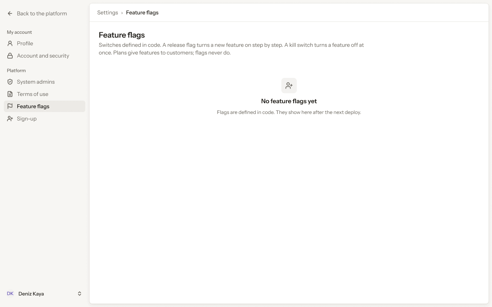

- **Who sees it:** System admins.
- **Device:** Desktop (1280 px and wider).
- **This state shows:** as the title says.
- **Values come from:** Feature flags, their rollout and history: our API and the flag definitions in code.
- **Components:** Empty state, Platform sidebar, Top bar.
- **Actions:**
  - "Back to the platform": goes to [4.01 · Organisations · all](../04-organisations/README.md#401--organisations--all).
  - "Profile": goes to [8.01 · Profile · ideal](../08-settings-profile/README.md#801--profile--ideal).
  - "Account and security": goes to [9.01 · Account and security · ideal](../09-settings-account-and-security/README.md#901--account-and-security--ideal).
  - "Terms of use": goes to [11.01 · Terms of use](../11-settings-terms-of-use/README.md#1101--terms-of-use).
  - "Deniz Kaya": goes to [2.03 · Account menu](../02-shell/README.md#203--account-menu).
  - "Feature flags": goes to [12.01 · Feature flags](#1201--feature-flags).
  - "System admins": goes to [10.01 · System admins](../10-settings-system-admins/README.md#1001--system-admins).
  - "Sign-up": goes to [13.01 · Sign-up · off](../13-settings-sign-up/README.md#1301--sign-up--off).
- **Texts, word for word, top to bottom:**

  - Back to the platform
  - My account
  - Profile
  - Account and security
  - Platform
  - System admins
  - Terms of use
  - Feature flags
  - Sign-up
  - DK
  - Deniz Kaya
  - Settings
  - ›
  - Feature flags
  - Feature flags
  - Switches defined in code. A release flag turns a new feature on step by step. A kill switch turns a feature off at once. Plans give features to customers; flags never do.
  - No feature flags yet
  - Flags are defined in code. They show here after the next deploy.

Figma: [212:12699](https://www.figma.com/design/3Ev111okX8xCBwR9B3hyBM/?node-id=212-12699)

### 12.14 · Feature flags · loading

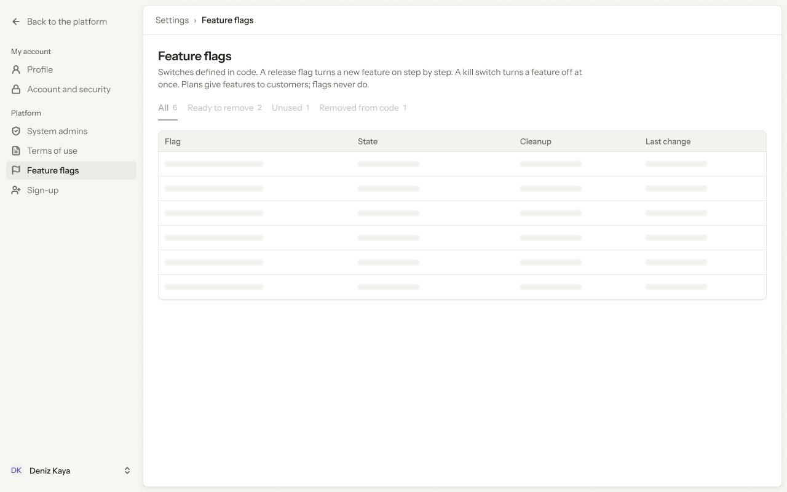

- **Who sees it:** System admins.
- **Device:** Desktop (1280 px and wider).
- **This state shows:** while the request runs.
- **Values come from:** Feature flags, their rollout and history: our API and the flag definitions in code.
- **Components:** Platform sidebar, Skeleton ×24, Tab ×4, Top bar.
- **Actions:**
  - "Back to the platform": goes to [4.01 · Organisations · all](../04-organisations/README.md#401--organisations--all).
  - "Profile": goes to [8.01 · Profile · ideal](../08-settings-profile/README.md#801--profile--ideal).
  - "Account and security": goes to [9.01 · Account and security · ideal](../09-settings-account-and-security/README.md#901--account-and-security--ideal).
  - "Terms of use": goes to [11.01 · Terms of use](../11-settings-terms-of-use/README.md#1101--terms-of-use).
  - "Deniz Kaya": goes to [2.03 · Account menu](../02-shell/README.md#203--account-menu).
  - "Feature flags": goes to [12.01 · Feature flags](#1201--feature-flags).
  - "System admins": goes to [10.01 · System admins](../10-settings-system-admins/README.md#1001--system-admins).
  - "Sign-up": goes to [13.01 · Sign-up · off](../13-settings-sign-up/README.md#1301--sign-up--off).
- **Texts, word for word, top to bottom:**

  - Back to the platform
  - My account
  - Profile
  - Account and security
  - Platform
  - System admins
  - Terms of use
  - Feature flags
  - Sign-up
  - DK
  - Deniz Kaya
  - Settings
  - ›
  - Feature flags
  - Feature flags
  - Switches defined in code. A release flag turns a new feature on step by step. A kill switch turns a feature off at once. Plans give features to customers; flags never do.
  - All
  - 6
  - Ready to remove
  - 2
  - Unused
  - 1
  - Removed from code
  - 1
  - Flag
  - State
  - Cleanup
  - Last change

Figma: [212:13013](https://www.figma.com/design/3Ev111okX8xCBwR9B3hyBM/?node-id=212-13013)

### 12.15 · Feature flags · couldn’t load

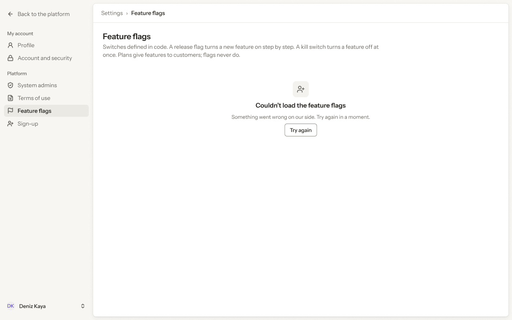

- **Who sees it:** System admins.
- **Device:** Desktop (1280 px and wider).
- **This state shows:** as the title says.
- **Values come from:** Feature flags, their rollout and history: our API and the flag definitions in code.
- **Components:** Empty state, Platform sidebar, Top bar.
- **Actions:**
  - "Back to the platform": goes to [4.01 · Organisations · all](../04-organisations/README.md#401--organisations--all).
  - "Profile": goes to [8.01 · Profile · ideal](../08-settings-profile/README.md#801--profile--ideal).
  - "Account and security": goes to [9.01 · Account and security · ideal](../09-settings-account-and-security/README.md#901--account-and-security--ideal).
  - "Terms of use": goes to [11.01 · Terms of use](../11-settings-terms-of-use/README.md#1101--terms-of-use).
  - "Deniz Kaya": goes to [2.03 · Account menu](../02-shell/README.md#203--account-menu).
  - "Try again": goes to [12.01 · Feature flags](#1201--feature-flags).
  - "System admins": goes to [10.01 · System admins](../10-settings-system-admins/README.md#1001--system-admins).
  - "Sign-up": goes to [13.01 · Sign-up · off](../13-settings-sign-up/README.md#1301--sign-up--off).
- **Texts, word for word, top to bottom:**

  - Back to the platform
  - My account
  - Profile
  - Account and security
  - Platform
  - System admins
  - Terms of use
  - Feature flags
  - Sign-up
  - DK
  - Deniz Kaya
  - Settings
  - ›
  - Feature flags
  - Feature flags
  - Switches defined in code. A release flag turns a new feature on step by step. A kill switch turns a feature off at once. Plans give features to customers; flags never do.
  - Couldn’t load the feature flags
  - Something went wrong on our side. Try again in a moment.
  - Try again

Figma: [212:12856](https://www.figma.com/design/3Ev111okX8xCBwR9B3hyBM/?node-id=212-12856)

### 12.16 · Feature flags · dark

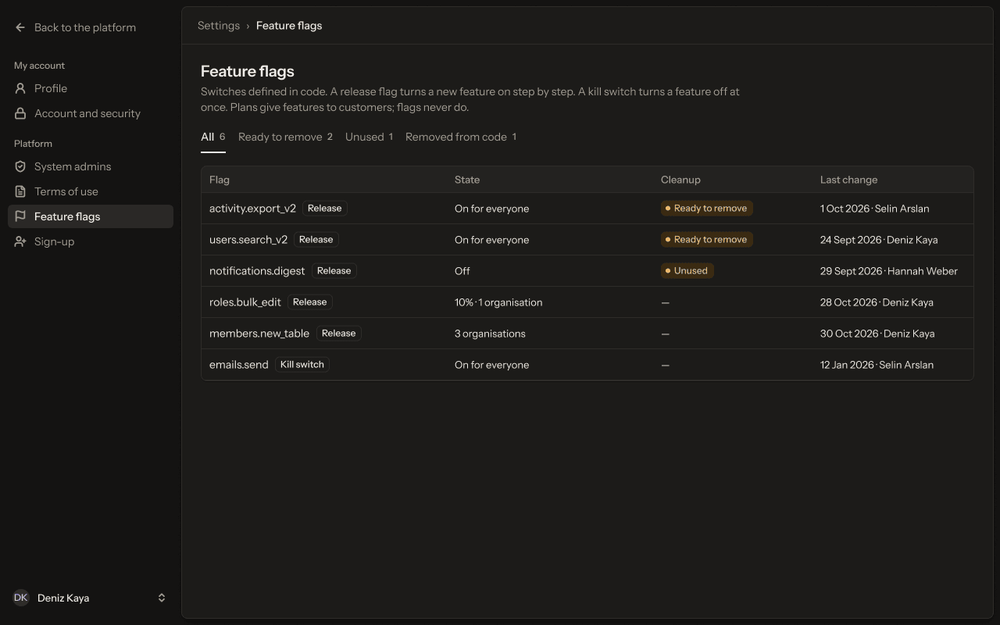

- **Who sees it:** System admins.
- **Device:** Desktop (1280 px and wider).
- **This state shows:** in the dark theme.
- **Values come from:** Feature flags, their rollout and history: our API and the flag definitions in code.
- **Components:** Label ×6, Pill ×3, Platform sidebar, Tab ×4, Top bar.
- **Actions:**
  - "Back to the platform": goes to [4.01 · Organisations · all](../04-organisations/README.md#401--organisations--all).
  - "Profile": goes to [8.01 · Profile · ideal](../08-settings-profile/README.md#801--profile--ideal).
  - "Account and security": goes to [9.01 · Account and security · ideal](../09-settings-account-and-security/README.md#901--account-and-security--ideal).
  - "Terms of use": goes to [11.01 · Terms of use](../11-settings-terms-of-use/README.md#1101--terms-of-use).
  - "Deniz Kaya": goes to [2.03 · Account menu](../02-shell/README.md#203--account-menu).
  - "All": goes to [12.01 · Feature flags](#1201--feature-flags).
  - "Ready to remove": goes to [12.02 · Feature flags · ready to remove](#1202--feature-flags--ready-to-remove).
  - "Unused": goes to [12.03 · Feature flags · unused](#1203--feature-flags--unused).
  - "Removed from code": goes to [12.04 · Feature flags · removed from code](#1204--feature-flags--removed-from-code).
  - "28 Oct 2026 · Deniz Kaya": goes to [12.05 · Flag · roles.bulk_edit](#1205--flag--rolesbulk_edit).
  - "1 Oct 2026 · Selin Arslan": goes to [12.10 · Flag · ready to remove](#1210--flag--ready-to-remove).
  - "24 Sept 2026 · Deniz Kaya": goes to [12.10 · Flag · ready to remove](#1210--flag--ready-to-remove).
  - "12 Jan 2026 · Selin Arslan": goes to [12.11 · Flag · kill switch](#1211--flag--kill-switch).
  - "System admins": goes to [10.01 · System admins](../10-settings-system-admins/README.md#1001--system-admins).
  - "Sign-up": goes to [13.01 · Sign-up · off](../13-settings-sign-up/README.md#1301--sign-up--off).
- **Texts, word for word, top to bottom:**

  - Back to the platform
  - My account
  - Profile
  - Account and security
  - Platform
  - System admins
  - Terms of use
  - Feature flags
  - Sign-up
  - DK
  - Deniz Kaya
  - Settings
  - ›
  - Feature flags
  - Feature flags
  - Switches defined in code. A release flag turns a new feature on step by step. A kill switch turns a feature off at once. Plans give features to customers; flags never do.
  - All
  - 6
  - Ready to remove
  - 2
  - Unused
  - 1
  - Removed from code
  - 1
  - Flag
  - State
  - Cleanup
  - Last change
  - activity.export\_v2
  - Release
  - On for everyone
  - Ready to remove
  - 1 Oct 2026 · Selin Arslan
  - users.search\_v2
  - Release
  - On for everyone
  - Ready to remove
  - 24 Sept 2026 · Deniz Kaya
  - notifications.digest
  - Release
  - Off
  - Unused
  - 29 Sept 2026 · Hannah Weber
  - roles.bulk\_edit
  - Release
  - 10% · 1 organisation
  - —
  - 28 Oct 2026 · Deniz Kaya
  - members.new\_table
  - Release
  - 3 organisations
  - —
  - 30 Oct 2026 · Deniz Kaya
  - emails.send
  - Kill switch
  - On for everyone
  - —
  - 12 Jan 2026 · Selin Arslan

Figma: [214:13858](https://www.figma.com/design/3Ev111okX8xCBwR9B3hyBM/?node-id=214-13858)

### 12.17 · Feature flags · Staging

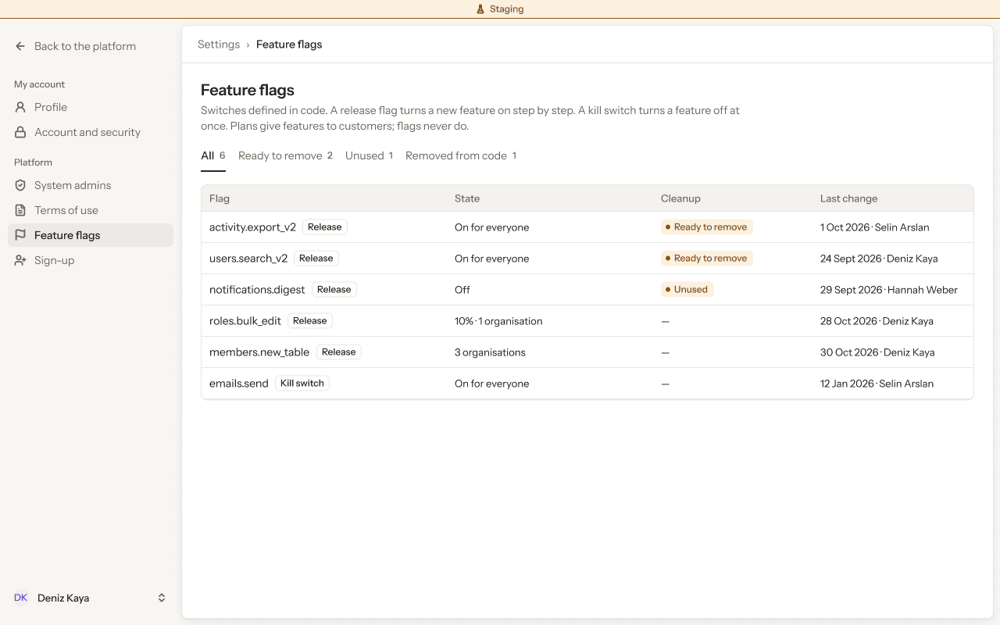

- **Who sees it:** System admins.
- **Device:** Desktop (1280 px and wider).
- **This state shows:** as the title says.
- **Values come from:** Feature flags, their rollout and history: our API and the flag definitions in code.
- **Components:** Environment strip, Label ×6, Pill ×3, Platform sidebar, Tab ×4, Top bar.
- **Actions:**
  - "Back to the platform": goes to [4.01 · Organisations · all](../04-organisations/README.md#401--organisations--all).
  - "Profile": goes to [8.01 · Profile · ideal](../08-settings-profile/README.md#801--profile--ideal).
  - "Account and security": goes to [9.01 · Account and security · ideal](../09-settings-account-and-security/README.md#901--account-and-security--ideal).
  - "Terms of use": goes to [11.01 · Terms of use](../11-settings-terms-of-use/README.md#1101--terms-of-use).
  - "Deniz Kaya": goes to [2.03 · Account menu](../02-shell/README.md#203--account-menu).
  - "All": goes to [12.01 · Feature flags](#1201--feature-flags).
  - "Area": goes to [12.02 · Feature flags · ready to remove](#1202--feature-flags--ready-to-remove).
  - "Area": goes to [12.03 · Feature flags · unused](#1203--feature-flags--unused).
  - "Area": goes to [12.04 · Feature flags · removed from code](#1204--feature-flags--removed-from-code).
  - "29 Sept 2026 · Hannah Weber": goes to [12.05 · Flag · roles.bulk_edit](#1205--flag--rolesbulk_edit).
  - "Last change": goes to [12.10 · Flag · ready to remove](#1210--flag--ready-to-remove).
  - "1 Oct 2026 · Selin Arslan": goes to [12.10 · Flag · ready to remove](#1210--flag--ready-to-remove).
  - "30 Oct 2026 · Deniz Kaya": goes to [12.11 · Flag · kill switch](#1211--flag--kill-switch).
  - "Platform": goes to [10.01 · System admins](../10-settings-system-admins/README.md#1001--system-admins).
  - "Sign-up": goes to [13.01 · Sign-up · off](../13-settings-sign-up/README.md#1301--sign-up--off).
- **Texts, word for word, top to bottom:**

  - Back to the platform
  - My account
  - Profile
  - Account and security
  - Platform
  - System admins
  - Terms of use
  - Feature flags
  - Sign-up
  - DK
  - Deniz Kaya
  - Settings
  - ›
  - Feature flags
  - Feature flags
  - Switches defined in code. A release flag turns a new feature on step by step. A kill switch turns a feature off at once. Plans give features to customers; flags never do.
  - All
  - 6
  - Ready to remove
  - 2
  - Unused
  - 1
  - Removed from code
  - 1
  - Flag
  - State
  - Cleanup
  - Last change
  - activity.export\_v2
  - Release
  - On for everyone
  - Ready to remove
  - 1 Oct 2026 · Selin Arslan
  - users.search\_v2
  - Release
  - On for everyone
  - Ready to remove
  - 24 Sept 2026 · Deniz Kaya
  - notifications.digest
  - Release
  - Off
  - Unused
  - 29 Sept 2026 · Hannah Weber
  - roles.bulk\_edit
  - Release
  - 10% · 1 organisation
  - —
  - 28 Oct 2026 · Deniz Kaya
  - members.new\_table
  - Release
  - 3 organisations
  - —
  - 30 Oct 2026 · Deniz Kaya
  - emails.send
  - Kill switch
  - On for everyone
  - —
  - 12 Jan 2026 · Selin Arslan
  - Staging

Figma: [214:13947](https://www.figma.com/design/3Ev111okX8xCBwR9B3hyBM/?node-id=214-13947)

### 12.18 · Flag · unused

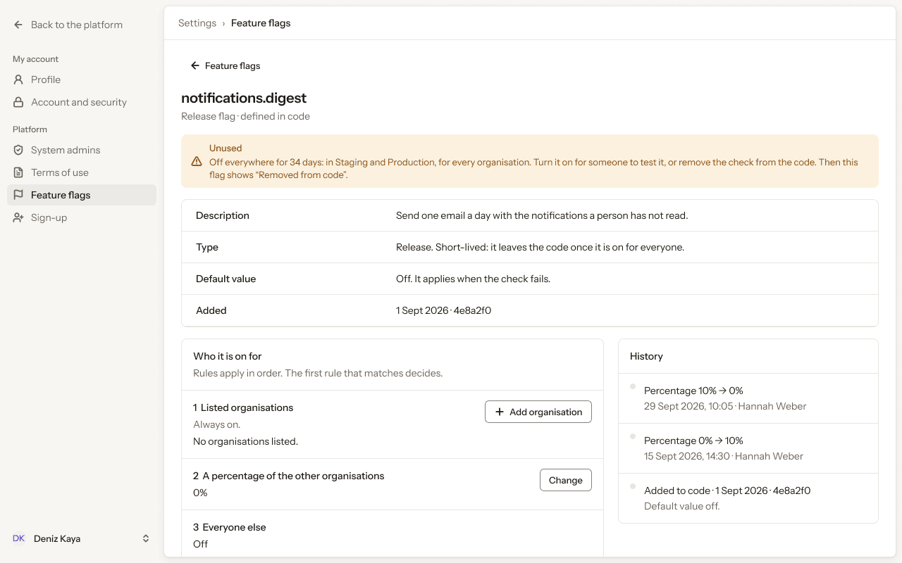

- **Who sees it:** System admins.
- **Device:** Desktop (1280 px and wider).
- **This state shows:** as the title says.
- **Values come from:** Feature flags, their rollout and history: our API and the flag definitions in code.
- **Components:** Banner, Button ×3, Platform sidebar, Top bar.
- **Actions:**
  - "Back to the platform": goes to [4.01 · Organisations · all](../04-organisations/README.md#401--organisations--all).
  - "Profile": goes to [8.01 · Profile · ideal](../08-settings-profile/README.md#801--profile--ideal).
  - "Account and security": goes to [9.01 · Account and security · ideal](../09-settings-account-and-security/README.md#901--account-and-security--ideal).
  - "System admins": goes to [10.01 · System admins](../10-settings-system-admins/README.md#1001--system-admins).
  - "Terms of use": goes to [11.01 · Terms of use](../11-settings-terms-of-use/README.md#1101--terms-of-use).
  - "Deniz Kaya": goes to [2.03 · Account menu](../02-shell/README.md#203--account-menu).
  - "Feature flags": goes to [11.01 · Terms of use](../11-settings-terms-of-use/README.md#1101--terms-of-use).
  - "Feature flags": goes to [12.03 · Feature flags · unused](#1203--feature-flags--unused).
  - "Sign-up": goes to [13.01 · Sign-up · off](../13-settings-sign-up/README.md#1301--sign-up--off).
- **Texts, word for word, top to bottom:**

  - Back to the platform
  - My account
  - Profile
  - Account and security
  - Platform
  - System admins
  - Terms of use
  - Feature flags
  - Sign-up
  - DK
  - Deniz Kaya
  - Settings
  - ›
  - Feature flags
  - Feature flags
  - notifications.digest
  - Release flag · defined in code
  - Unused
  - Off everywhere for 34 days: in Staging and Production, for every organisation. Turn it on for someone to test it, or remove the check from the code. Then this flag shows “Removed from code”.
  - Description
  - Send one email a day with the notifications a person has not read.
  - Type
  - Release. Short-lived: it leaves the code once it is on for everyone.
  - Default value
  - Off. It applies when the check fails.
  - Added
  - 1 Sept 2026 · 4e8a2f0
  - Who it is on for
  - Rules apply in order. The first rule that matches decides.
  - 1  Listed organisations
  - Always on.
  - No organisations listed.
  - Add organisation
  - 2  A percentage of the other organisations
  - 0%
  - Change
  - 3  Everyone else
  - Off
  - History
  - Percentage 10% → 0%
  - 29 Sept 2026, 10:05 · Hannah Weber
  - Percentage 0% → 10%
  - 15 Sept 2026, 14:30 · Hannah Weber
  - Added to code · 1 Sept 2026 · 4e8a2f0
  - Default value off.

Figma: [218:29184](https://www.figma.com/design/3Ev111okX8xCBwR9B3hyBM/?node-id=218-29184)

### 12.19 · Phone · Feature flags

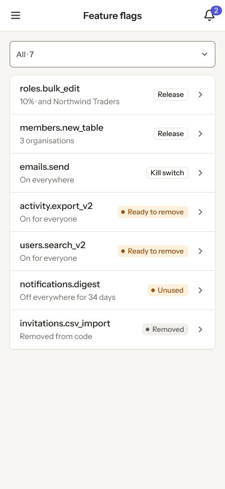

- **Who sees it:** System admins.
- **Device:** Phone (up to 767 px).
- **This state shows:** on a phone.
- **Values come from:** Feature flags, their rollout and history: our API and the flag definitions in code.
- **Components:** Phone list row ×7, Phone top bar, Select.
- **Actions:**
  - "Area": goes to [2.15 · Phone · settings menu open](../02-shell/README.md#215--phone--settings-menu-open).
  - "2": goes to [3.08 · Phone · Notifications](../03-notifications/README.md#308--phone--notifications).
  - "roles.bulk_edit": goes to [12.20 · Phone · Flag](#1220--phone--flag).
  - "emails.send": goes to [12.22 · Phone · Kill switch · turn off](#1222--phone--kill-switch--turn-off).
- **Texts, word for word, top to bottom:**

  - Feature flags
  - 2
  - All · 7
  - roles.bulk\_edit
  - 10% · and Northwind Traders
  - Release
  - members.new\_table
  - 3 organisations
  - Release
  - emails.send
  - On everywhere
  - Kill switch
  - activity.export\_v2
  - On for everyone
  - Ready to remove
  - users.search\_v2
  - On for everyone
  - Ready to remove
  - notifications.digest
  - Off everywhere for 34 days
  - Unused
  - invitations.csv\_import
  - Removed from code
  - Removed

Figma: [263:17380](https://www.figma.com/design/3Ev111okX8xCBwR9B3hyBM/?node-id=263-17380)

### 12.20 · Phone · Flag

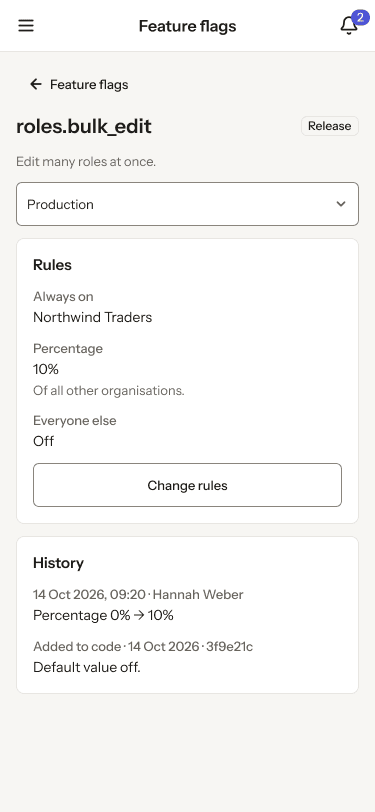

- **Who sees it:** System admins.
- **Device:** Phone (up to 767 px).
- **This state shows:** on a phone.
- **Values come from:** Feature flags, their rollout and history: our API and the flag definitions in code.
- **Components:** Button ×2, Label, Phone top bar, Select.
- **Actions:**
  - "Area": goes to [2.15 · Phone · settings menu open](../02-shell/README.md#215--phone--settings-menu-open).
  - "2": goes to [3.08 · Phone · Notifications](../03-notifications/README.md#308--phone--notifications).
  - "Feature flags": goes to [12.19 · Phone · Feature flags](#1219--phone--feature-flags).
  - "Change rules": goes to [12.21 · Phone · Flag · change rules](#1221--phone--flag--change-rules).
- **Texts, word for word, top to bottom:**

  - Feature flags
  - 2
  - Feature flags
  - roles.bulk\_edit
  - Release
  - Edit many roles at once.
  - Production
  - Rules
  - Always on
  - Northwind Traders
  - Percentage
  - 10%
  - Of all other organisations.
  - Everyone else
  - Off
  - Change rules
  - History
  - 14 Oct 2026, 09:20 · Hannah Weber
  - Percentage 0% → 10%
  - Added to code · 14 Oct 2026 · 3f9e21c
  - Default value off.

Figma: [263:17490](https://www.figma.com/design/3Ev111okX8xCBwR9B3hyBM/?node-id=263-17490)

### 12.21 · Phone · Flag · change rules

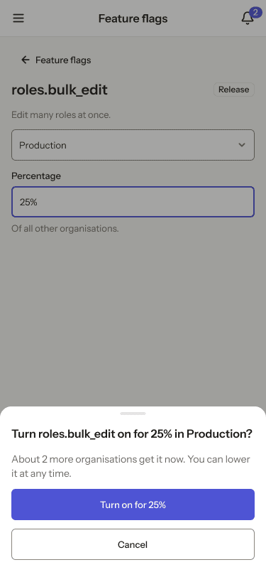

- **Who sees it:** System admins.
- **Device:** Phone (up to 767 px).
- **This state shows:** on a phone.
- **Values come from:** Feature flags, their rollout and history: our API and the flag definitions in code.
- **Components:** Button ×3, Input, Label, Phone top bar, Select.
- **Actions:**
  - "Area": goes to [2.15 · Phone · settings menu open](../02-shell/README.md#215--phone--settings-menu-open).
  - "2": goes to [3.08 · Phone · Notifications](../03-notifications/README.md#308--phone--notifications).
  - "Turn on for 25%": goes to [12.20 · Phone · Flag](#1220--phone--flag).
  - "Cancel": goes to [12.20 · Phone · Flag](#1220--phone--flag).
- **Texts, word for word, top to bottom:**

  - Feature flags
  - 2
  - Feature flags
  - roles.bulk\_edit
  - Release
  - Edit many roles at once.
  - Production
  - Percentage
  - 25%
  - Of all other organisations.
  - Turn roles.bulk\_edit on for 25% in Production?
  - About 2 more organisations get it now. You can lower it at any time.
  - Turn on for 25%
  - Cancel

Figma: [263:17542](https://www.figma.com/design/3Ev111okX8xCBwR9B3hyBM/?node-id=263-17542)

### 12.22 · Phone · Kill switch · turn off

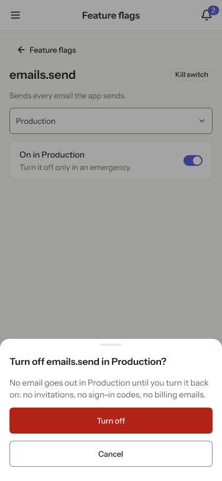

- **Who sees it:** System admins.
- **Device:** Phone (up to 767 px).
- **This state shows:** on a phone.
- **Values come from:** Feature flags, their rollout and history: our API and the flag definitions in code.
- **Components:** Button ×3, Label, Phone top bar, Select, Switch.
- **Actions:**
  - "Area": goes to [2.15 · Phone · settings menu open](../02-shell/README.md#215--phone--settings-menu-open).
  - "2": goes to [3.08 · Phone · Notifications](../03-notifications/README.md#308--phone--notifications).
  - "Turn off": goes to [12.23 · Phone · Kill switch · off](#1223--phone--kill-switch--off).
  - "Cancel": goes to [12.19 · Phone · Feature flags](#1219--phone--feature-flags).
- **Texts, word for word, top to bottom:**

  - Feature flags
  - 2
  - Feature flags
  - emails.send
  - Kill switch
  - Sends every email the app sends.
  - Production
  - On in Production
  - Turn it off only in an emergency.
  - Turn off emails.send in Production?
  - No email goes out in Production until you turn it back on: no invitations, no sign-in codes, no billing emails.
  - Turn off
  - Cancel

Figma: [263:17600](https://www.figma.com/design/3Ev111okX8xCBwR9B3hyBM/?node-id=263-17600)

### 12.23 · Phone · Kill switch · off

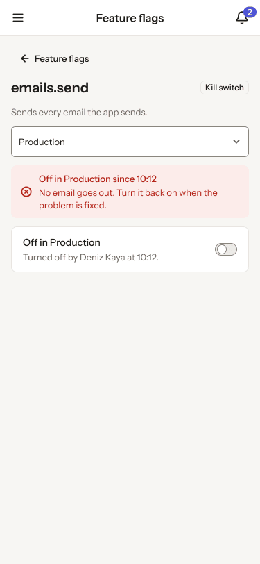

- **Who sees it:** System admins.
- **Device:** Phone (up to 767 px).
- **This state shows:** on a phone.
- **Values come from:** Feature flags, their rollout and history: our API and the flag definitions in code.
- **Components:** Banner, Button, Label, Phone top bar, Select, Switch.
- **Actions:**
  - "Area": goes to [2.15 · Phone · settings menu open](../02-shell/README.md#215--phone--settings-menu-open).
  - "2": goes to [3.08 · Phone · Notifications](../03-notifications/README.md#308--phone--notifications).
  - "Feature flags": goes to [12.19 · Phone · Feature flags](#1219--phone--feature-flags).
- **Texts, word for word, top to bottom:**

  - Feature flags
  - 2
  - Feature flags
  - emails.send
  - Kill switch
  - Sends every email the app sends.
  - Production
  - Off in Production since 10:12
  - No email goes out. Turn it back on when the problem is fixed.
  - Off in Production
  - Turned off by Deniz Kaya at 10:12.

Figma: [263:17655](https://www.figma.com/design/3Ev111okX8xCBwR9B3hyBM/?node-id=263-17655)
