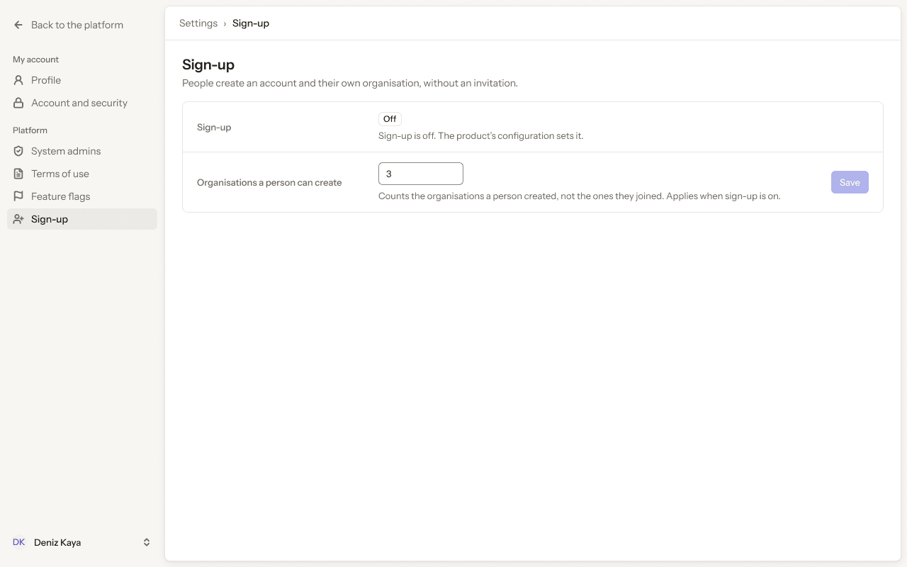
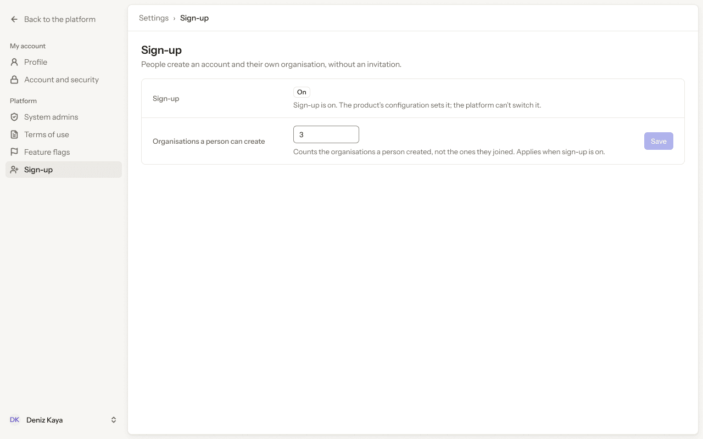
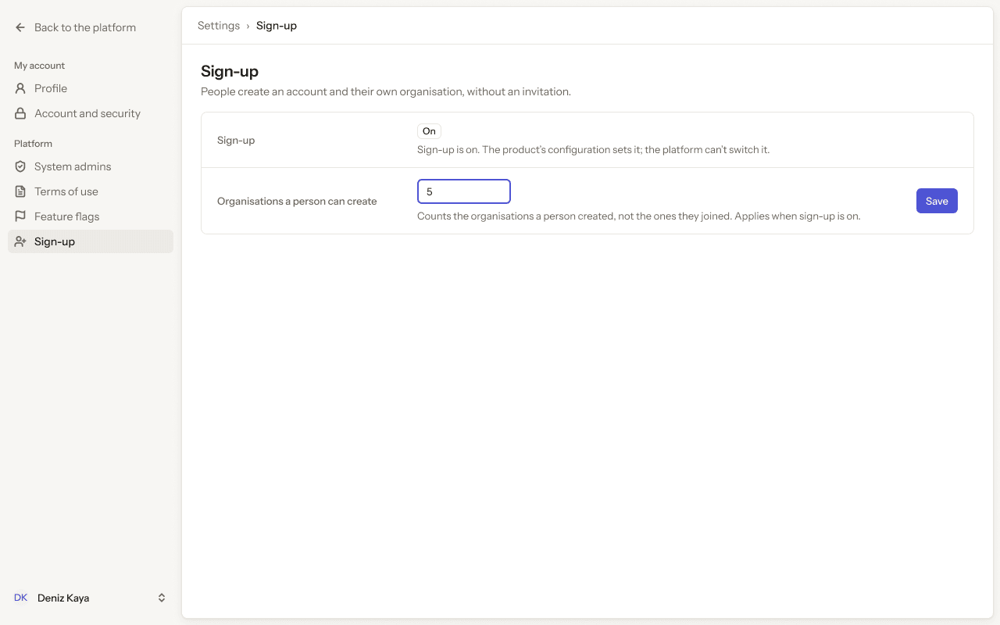
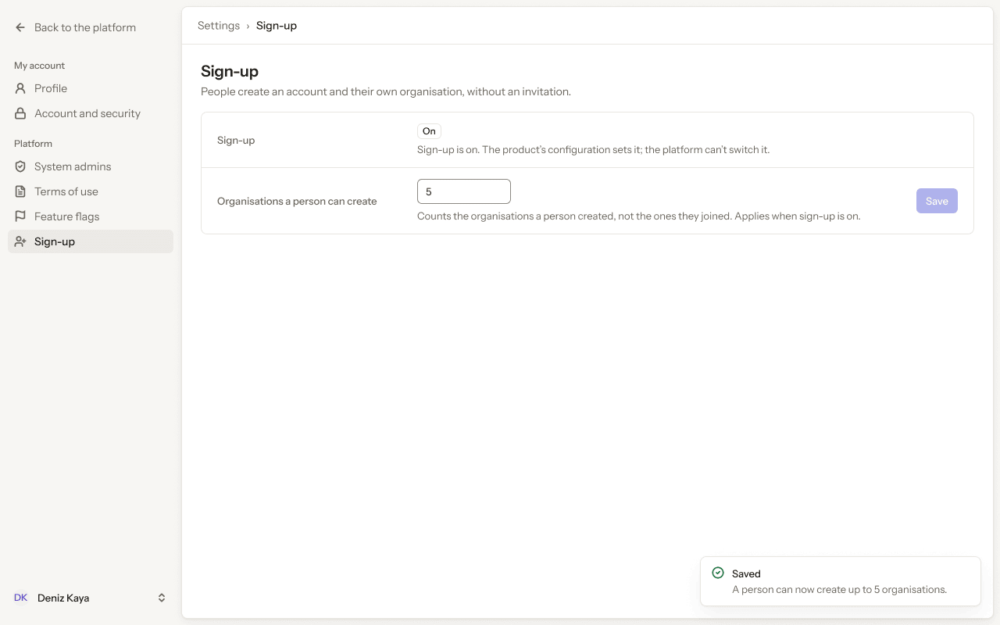
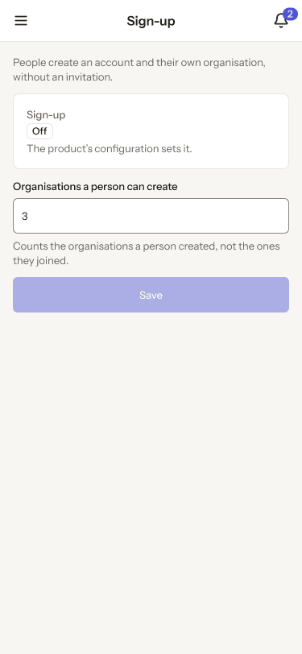

# Platform app · 13 · Settings › Sign-up

Who sees this section: System admins.

Where the values come from: Self-service sign-up setting: our API.

5 screens. Each part below is one screen and state. The PNG beside this file is the screen at scale 1.

| Screen | Device |
|---|---|
| [13.01 · Sign-up · off](#1301--sign-up--off) | Desktop |
| [13.02 · Sign-up · on](#1302--sign-up--on) | Desktop |
| [13.03 · Sign-up · edited](#1303--sign-up--edited) | Desktop |
| [13.04 · Sign-up · saved](#1304--sign-up--saved) | Desktop |
| [13.05 · Phone · Sign-up](#1305--phone--sign-up) | Phone |

### 13.01 · Sign-up · off

- **Who sees it:** System admins.
- **Device:** Desktop (1280 px and wider).
- **This state shows:** as the title says.
- **Values come from:** Self-service sign-up setting: our API.
- **Components:** Button, Input, Label, Platform sidebar, Top bar.
- **Actions:**
  - No prototype link on this screen. The buttons follow the section's other screens.
- **Texts, word for word, top to bottom:**

  - Back to the platform
  - My account
  - Profile
  - Account and security
  - Platform
  - System admins
  - Terms of use
  - Feature flags
  - Sign-up
  - DK
  - Deniz Kaya
  - Settings
  - ›
  - Sign-up
  - Sign-up
  - People create an account and their own organisation, without an invitation.
  - Sign-up
  - Off
  - Sign-up is off. The product’s configuration sets it.
  - Organisations a person can create
  - 3
  - Counts the organisations a person created, not the ones they joined. Applies when sign-up is on.
  - Save

Figma: [254:15956](https://www.figma.com/design/3Ev111okX8xCBwR9B3hyBM/?node-id=254-15956)

### 13.02 · Sign-up · on

- **Who sees it:** System admins.
- **Device:** Desktop (1280 px and wider).
- **This state shows:** as the title says.
- **Values come from:** Self-service sign-up setting: our API.
- **Components:** Button, Input, Label, Platform sidebar, Top bar.
- **Actions:**
  - "Sign-up": goes to [13.01 · Sign-up · off](#1301--sign-up--off).
  - "3": goes to [13.03 · Sign-up · edited](#1303--sign-up--edited).
- **Texts, word for word, top to bottom:**

  - Back to the platform
  - My account
  - Profile
  - Account and security
  - Platform
  - System admins
  - Terms of use
  - Feature flags
  - Sign-up
  - DK
  - Deniz Kaya
  - Settings
  - ›
  - Sign-up
  - Sign-up
  - People create an account and their own organisation, without an invitation.
  - Sign-up
  - On
  - Sign-up is on. The product’s configuration sets it; the platform can’t switch it.
  - Organisations a person can create
  - 3
  - Counts the organisations a person created, not the ones they joined. Applies when sign-up is on.
  - Save

Figma: [254:16157](https://www.figma.com/design/3Ev111okX8xCBwR9B3hyBM/?node-id=254-16157)

### 13.03 · Sign-up · edited

- **Who sees it:** System admins.
- **Device:** Desktop (1280 px and wider).
- **This state shows:** after the person changes a value and before saving.
- **Values come from:** Self-service sign-up setting: our API.
- **Components:** Button, Input, Label, Platform sidebar, Top bar.
- **Actions:**
  - "Sign-up": goes to [13.01 · Sign-up · off](#1301--sign-up--off).
  - "Save": goes to [13.04 · Sign-up · saved](#1304--sign-up--saved).
- **Texts, word for word, top to bottom:**

  - Back to the platform
  - My account
  - Profile
  - Account and security
  - Platform
  - System admins
  - Terms of use
  - Feature flags
  - Sign-up
  - DK
  - Deniz Kaya
  - Settings
  - ›
  - Sign-up
  - Sign-up
  - People create an account and their own organisation, without an invitation.
  - Sign-up
  - On
  - Sign-up is on. The product’s configuration sets it; the platform can’t switch it.
  - Organisations a person can create
  - 5
  - Counts the organisations a person created, not the ones they joined. Applies when sign-up is on.
  - Save

Figma: [254:16358](https://www.figma.com/design/3Ev111okX8xCBwR9B3hyBM/?node-id=254-16358)

### 13.04 · Sign-up · saved

- **Who sees it:** System admins.
- **Device:** Desktop (1280 px and wider).
- **This state shows:** right after a save succeeds.
- **Values come from:** Self-service sign-up setting: our API.
- **Components:** Button, Input, Label, Platform sidebar, Toast, Top bar.
- **Actions:**
  - "Sign-up": goes to [13.01 · Sign-up · off](#1301--sign-up--off).
- **Texts, word for word, top to bottom:**

  - Back to the platform
  - My account
  - Profile
  - Account and security
  - Platform
  - System admins
  - Terms of use
  - Feature flags
  - Sign-up
  - DK
  - Deniz Kaya
  - Settings
  - ›
  - Sign-up
  - Sign-up
  - People create an account and their own organisation, without an invitation.
  - Sign-up
  - On
  - Sign-up is on. The product’s configuration sets it; the platform can’t switch it.
  - Organisations a person can create
  - 5
  - Counts the organisations a person created, not the ones they joined. Applies when sign-up is on.
  - Save
  - Saved
  - A person can now create up to 5 organisations.

Figma: [254:16559](https://www.figma.com/design/3Ev111okX8xCBwR9B3hyBM/?node-id=254-16559)

### 13.05 · Phone · Sign-up

- **Who sees it:** System admins.
- **Device:** Phone (up to 767 px).
- **This state shows:** on a phone.
- **Values come from:** Self-service sign-up setting: our API.
- **Components:** Button, Input, Label, Phone top bar.
- **Actions:**
  - "Area": goes to [2.15 · Phone · settings menu open](../02-shell/README.md#215--phone--settings-menu-open).
  - "2": goes to [3.08 · Phone · Notifications](../03-notifications/README.md#308--phone--notifications).
- **Texts, word for word, top to bottom:**

  - Sign-up
  - 2
  - People create an account and their own organisation, without an invitation.
  - Sign-up
  - Off
  - The product’s configuration sets it.
  - Organisations a person can create
  - 3
  - Counts the organisations a person created, not the ones they joined.
  - Save

Figma: [263:17735](https://www.figma.com/design/3Ev111okX8xCBwR9B3hyBM/?node-id=263-17735)
