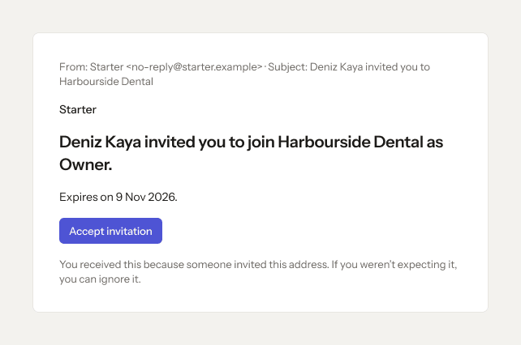
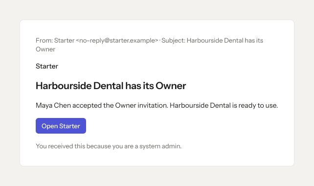
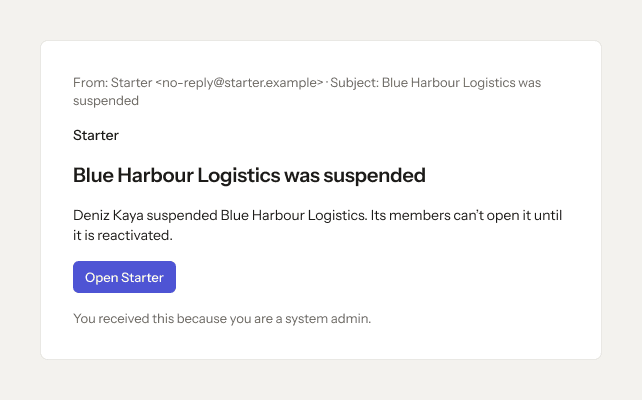
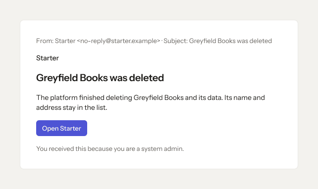

# Platform app · 14 · Emails

Who sees this section: The person the email is sent to.

Where the values come from: Templates: packages/emails. Sender: packages/brand.

5 screens. Each part below is one screen and state. The PNG beside this file is the screen at scale 1.

| Screen | Device |
|---|---|
| [14.01 · Owner invitation](#1401--owner-invitation) | Email |
| [14.02 · Organisation has its Owner](#1402--organisation-has-its-owner) | Email |
| [14.03 · Organisation suspended](#1403--organisation-suspended) | Email |
| [14.04 · Organisation closed](#1404--organisation-closed) | Email |
| [14.05 · Organisation deleted](#1405--organisation-deleted) | Email |

### 14.01 · Owner invitation

- **Who sees it:** The person the email is sent to.
- **Device:** Email (642 px).
- **This state shows:** as the title says.
- **Values come from:** Templates: packages/emails. Sender: packages/brand.
- **Components:** Button.
- **Actions:**
  - No prototype link on this screen. The buttons follow the section's other screens.
- **Texts, word for word, top to bottom:**

  - From: Starter \<no-reply@starter.example\> · Subject: Deniz Kaya invited you to Harbourside Dental
  - Starter
  - Deniz Kaya invited you to join Harbourside Dental as Owner.
  - Expires on 9 Nov 2026.
  - Accept invitation
  - You received this because someone invited this address. If you weren’t expecting it, you can ignore it.

Figma: [203:11818](https://www.figma.com/design/3Ev111okX8xCBwR9B3hyBM/?node-id=203-11818)

### 14.02 · Organisation has its Owner

- **Who sees it:** The person the email is sent to.
- **Device:** Email (642 px).
- **This state shows:** as the title says.
- **Values come from:** Templates: packages/emails. Sender: packages/brand.
- **Components:** Button.
- **Actions:**
  - No prototype link on this screen. The buttons follow the section's other screens.
- **Texts, word for word, top to bottom:**

  - From: Starter \<no-reply@starter.example\> · Subject: Harbourside Dental has its Owner
  - Starter
  - Harbourside Dental has its Owner
  - Maya Chen accepted the Owner invitation. Harbourside Dental is ready to use.
  - Open Starter
  - You received this because you are a system admin.

Figma: [203:11828](https://www.figma.com/design/3Ev111okX8xCBwR9B3hyBM/?node-id=203-11828)

### 14.03 · Organisation suspended

- **Who sees it:** The person the email is sent to.
- **Device:** Email (642 px).
- **This state shows:** when the organisation or person is suspended.
- **Values come from:** Templates: packages/emails. Sender: packages/brand.
- **Components:** Button.
- **Actions:**
  - No prototype link on this screen. The buttons follow the section's other screens.
- **Texts, word for word, top to bottom:**

  - From: Starter \<no-reply@starter.example\> · Subject: Blue Harbour Logistics was suspended
  - Starter
  - Blue Harbour Logistics was suspended
  - Deniz Kaya suspended Blue Harbour Logistics. Its members can’t open it until it is reactivated.
  - Open Starter
  - You received this because you are a system admin.

Figma: [203:11838](https://www.figma.com/design/3Ev111okX8xCBwR9B3hyBM/?node-id=203-11838)

### 14.04 · Organisation closed

- **Who sees it:** The person the email is sent to.
- **Device:** Email (642 px).
- **This state shows:** as the title says.
- **Values come from:** Templates: packages/emails. Sender: packages/brand.
- **Components:** Button.
- **Actions:**
  - No prototype link on this screen. The buttons follow the section's other screens.
- **Texts, word for word, top to bottom:**

  - From: Starter \<no-reply@starter.example\> · Subject: Fernwood Studio was closed
  - Starter
  - Fernwood Studio was closed
  - Deniz Kaya closed Fernwood Studio. It will be deleted on 1 Dec 2026 unless someone reopens it.
  - Open Starter
  - You received this because you are a system admin.

Figma: [203:11848](https://www.figma.com/design/3Ev111okX8xCBwR9B3hyBM/?node-id=203-11848)

### 14.05 · Organisation deleted

- **Who sees it:** The person the email is sent to.
- **Device:** Email (642 px).
- **This state shows:** as the title says.
- **Values come from:** Templates: packages/emails. Sender: packages/brand.
- **Components:** Button.
- **Actions:**
  - No prototype link on this screen. The buttons follow the section's other screens.
- **Texts, word for word, top to bottom:**

  - From: Starter \<no-reply@starter.example\> · Subject: Greyfield Books was deleted
  - Starter
  - Greyfield Books was deleted
  - The platform finished deleting Greyfield Books and its data. Its name and address stay in the list.
  - Open Starter
  - You received this because you are a system admin.

Figma: [203:11858](https://www.figma.com/design/3Ev111okX8xCBwR9B3hyBM/?node-id=203-11858)
