# Web app · 1 · Entry

Who sees this section: Anyone who is not signed in yet: a person signing in, signing up or accepting an invitation.

Where the values come from: Sign-in methods, codes and two-step verification: Clerk (identity provider). Invitation, organisation name and the terms version in force: our API. Support address and privacy link: packages/brand. Language: the locale cookie.

39 screens. Each part below is one screen and state. The PNG beside this file is the screen at scale 1.

| Screen | Device |
|---|---|
| [1.01 · Sign in · sign-up off](#101--sign-in--sign-up-off) | Desktop |
| [1.02 · Sign in · invalid email](#102--sign-in--invalid-email) | Desktop |
| [1.03 · Sign in · sending](#103--sign-in--sending) | Desktop |
| [1.04 · Sign in · failed](#104--sign-in--failed) | Desktop |
| [1.05 · Enter the code](#105--enter-the-code) | Desktop |
| [1.06 · Code wrong](#106--code-wrong) | Desktop |
| [1.07 · Two-step verification](#107--two-step-verification) | Desktop |
| [1.08 · Backup code](#108--backup-code) | Desktop |
| [1.09 · Terms of use updated · with summary](#109--terms-of-use-updated--with-summary) | Desktop |
| [1.10 · Terms of use updated · no summary, accepted box](#110--terms-of-use-updated--no-summary-accepted-box) | Desktop |
| [1.11 · Terms of use updated · loading](#111--terms-of-use-updated--loading) | Desktop |
| [1.12 · Terms of use updated · error](#112--terms-of-use-updated--error) | Desktop |
| [1.13 · Accept invitation](#113--accept-invitation) | Desktop |
| [1.14 · Terms of use updated · phone](#114--terms-of-use-updated--phone) | Phone |
| [1.15 · Accept invitation · terms](#115--accept-invitation--terms) | Desktop |
| [1.16 · Invitation expired](#116--invitation-expired) | Desktop |
| [1.17 · Invitation for another email](#117--invitation-for-another-email) | Desktop |
| [1.18 · Choose an organisation](#118--choose-an-organisation) | Desktop |
| [1.19 · No access yet · account menu](#119--no-access-yet--account-menu) | Desktop |
| [1.20 · Sign in · dark](#120--sign-in--dark) | Desktop |
| [1.21 · Phone · sign in](#121--phone--sign-in) | Phone |
| [1.22 · Phone · enter the code](#122--phone--enter-the-code) | Phone |
| [1.23 · Phone · accept invitation](#123--phone--accept-invitation) | Phone |
| [1.24 · Sign in · sign-up on](#124--sign-in--sign-up-on) | Desktop |
| [1.25 · Create an account](#125--create-an-account) | Desktop |
| [1.26 · Create an account · enter the code](#126--create-an-account--enter-the-code) | Desktop |
| [1.27 · Create an account · accept the terms](#127--create-an-account--accept-the-terms) | Desktop |
| [1.28 · Create your organisation](#128--create-your-organisation) | Desktop |
| [1.29 · Create your organisation · address taken](#129--create-your-organisation--address-taken) | Desktop |
| [1.30 · Trial started · invite your team](#130--trial-started--invite-your-team) | Desktop |
| [1.31 · Home · trial started](#131--home--trial-started) | Desktop |
| [1.32 · Phone · create an account](#132--phone--create-an-account) | Phone |
| [1.33 · Phone · create your organisation](#133--phone--create-your-organisation) | Phone |
| [1.34 · Phone · trial started](#134--phone--trial-started) | Phone |
| [1.35 · Sign in · language list](#135--sign-in--language-list) | Desktop |
| [1.36 · Sign in · no language matches](#136--sign-in--no-language-matches) | Desktop |
| [1.37 · Enter the code · new code sent](#137--enter-the-code--new-code-sent) | Desktop |
| [1.38 · Finishing sign-in](#138--finishing-sign-in) | Desktop |
| [1.39 · Phone · sign in · Arabic](#139--phone--sign-in--arabic) | Phone |

### 1.01 · Sign in · sign-up off

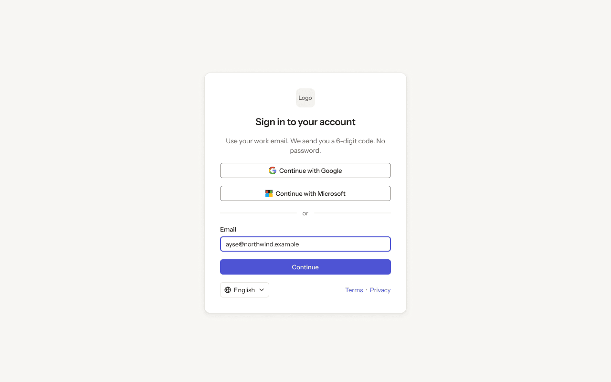

- **Who sees it:** Anyone who is not signed in yet: a person signing in, signing up or accepting an invitation.
- **Device:** Desktop (1280 px and wider).
- **This state shows:** as the title says.
- **Values come from:** Sign-in methods, codes and two-step verification: Clerk (identity provider). Invitation, organisation name and the terms version in force: our API. Support address and privacy link: packages/brand. Language: the locale cookie.
- **Components:** Auth footer, Button ×3, Input.
- **Actions:**
  - "Continue": goes to [1.03 · Sign in · sending](#103--sign-in--sending).
  - "English": goes to [1.35 · Sign in · language list](#135--sign-in--language-list).
- **Texts, word for word, top to bottom:**

  - Logo
  - Sign in to your account
  - Use your work email. We send you a 6-digit code. No password.
  - Continue with Google
  - Continue with Microsoft
  - or
  - Email
  - ayse@northwind.example
  - Continue
  - English
  - Terms
  - ·
  - Privacy

Figma: [94:12379](https://www.figma.com/design/3Ev111okX8xCBwR9B3hyBM/?node-id=94-12379)

### 1.02 · Sign in · invalid email

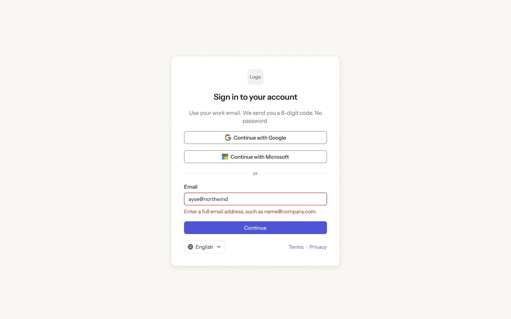

- **Who sees it:** Anyone who is not signed in yet: a person signing in, signing up or accepting an invitation.
- **Device:** Desktop (1280 px and wider).
- **This state shows:** as the title says.
- **Values come from:** Sign-in methods, codes and two-step verification: Clerk (identity provider). Invitation, organisation name and the terms version in force: our API. Support address and privacy link: packages/brand. Language: the locale cookie.
- **Components:** Auth footer, Button ×3, Input.
- **Actions:**
  - No prototype link on this screen. The buttons follow the section's other screens.
- **Texts, word for word, top to bottom:**

  - Logo
  - Sign in to your account
  - Use your work email. We send you a 6-digit code. No password.
  - Continue with Google
  - Continue with Microsoft
  - or
  - Email
  - ayse@northwind
  - Enter a full email address, such as name@company.com.
  - Continue
  - English
  - Terms
  - ·
  - Privacy

Figma: [94:12415](https://www.figma.com/design/3Ev111okX8xCBwR9B3hyBM/?node-id=94-12415)

### 1.03 · Sign in · sending

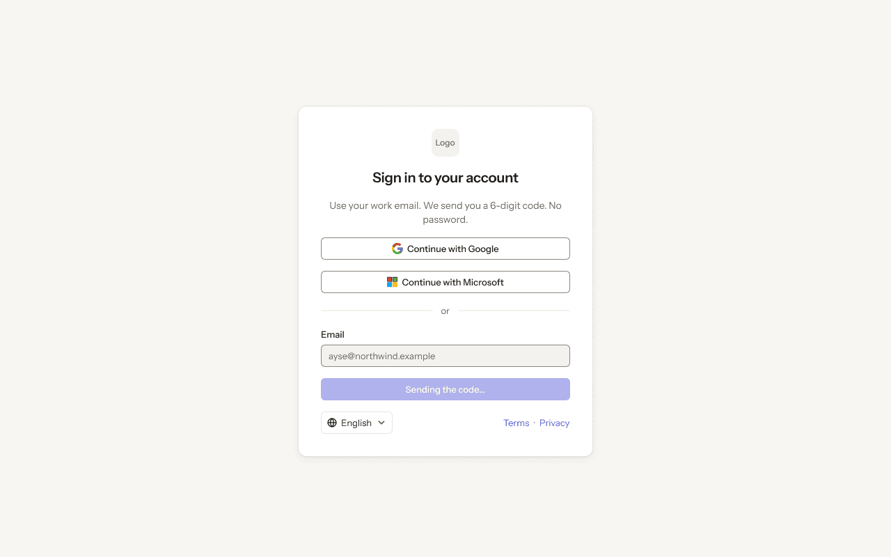

- **Who sees it:** Anyone who is not signed in yet: a person signing in, signing up or accepting an invitation.
- **Device:** Desktop (1280 px and wider).
- **This state shows:** as the title says.
- **Values come from:** Sign-in methods, codes and two-step verification: Clerk (identity provider). Invitation, organisation name and the terms version in force: our API. Support address and privacy link: packages/brand. Language: the locale cookie.
- **Components:** Auth footer, Button ×3, Input.
- **Actions:**
  - "or": goes to [1.05 · Enter the code](#105--enter-the-code).
- **Texts, word for word, top to bottom:**

  - Logo
  - Sign in to your account
  - Use your work email. We send you a 6-digit code. No password.
  - Continue with Google
  - Continue with Microsoft
  - or
  - Email
  - ayse@northwind.example
  - Sending the code…
  - English
  - Terms
  - ·
  - Privacy

Figma: [94:12452](https://www.figma.com/design/3Ev111okX8xCBwR9B3hyBM/?node-id=94-12452)

### 1.04 · Sign in · failed

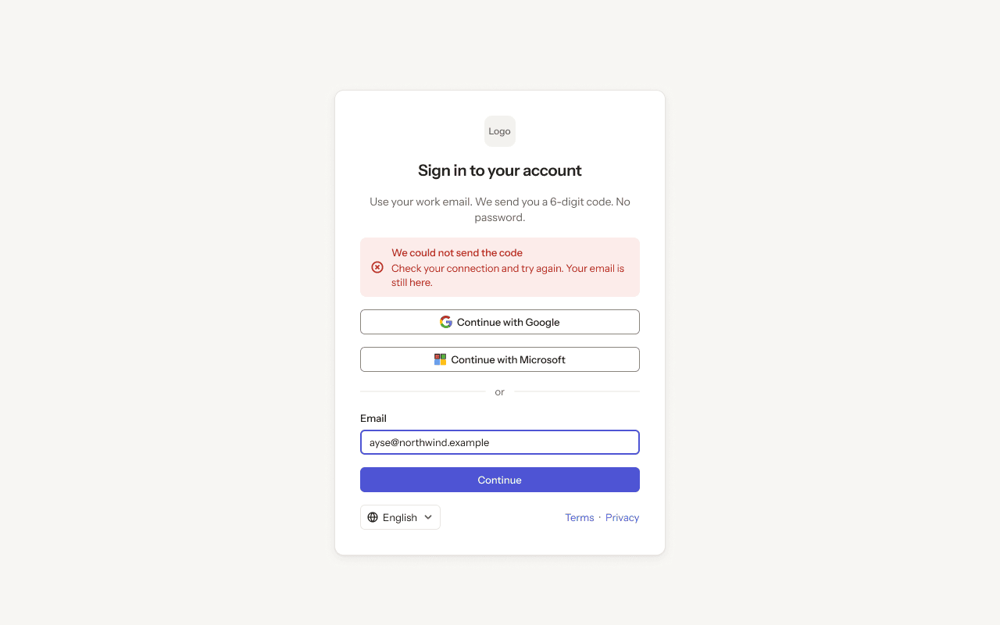

- **Who sees it:** Anyone who is not signed in yet: a person signing in, signing up or accepting an invitation.
- **Device:** Desktop (1280 px and wider).
- **This state shows:** when the action fails.
- **Values come from:** Sign-in methods, codes and two-step verification: Clerk (identity provider). Invitation, organisation name and the terms version in force: our API. Support address and privacy link: packages/brand. Language: the locale cookie.
- **Components:** Auth footer, Banner, Button ×3, Input.
- **Actions:**
  - No prototype link on this screen. The buttons follow the section's other screens.
- **Texts, word for word, top to bottom:**

  - Logo
  - Sign in to your account
  - Use your work email. We send you a 6-digit code. No password.
  - We could not send the code
  - Check your connection and try again. Your email is still here.
  - Continue with Google
  - Continue with Microsoft
  - or
  - Email
  - ayse@northwind.example
  - Continue
  - English
  - Terms
  - ·
  - Privacy

Figma: [94:12488](https://www.figma.com/design/3Ev111okX8xCBwR9B3hyBM/?node-id=94-12488)

### 1.05 · Enter the code

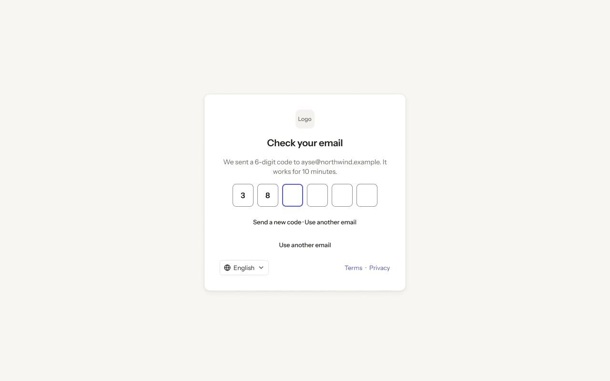

- **Who sees it:** Anyone who is not signed in yet: a person signing in, signing up or accepting an invitation.
- **Device:** Desktop (1280 px and wider).
- **This state shows:** as the title says.
- **Values come from:** Sign-in methods, codes and two-step verification: Clerk (identity provider). Invitation, organisation name and the terms version in force: our API. Support address and privacy link: packages/brand. Language: the locale cookie.
- **Components:** Auth footer, Button ×2.
- **Actions:**
  - "3": goes to [1.07 · Two-step verification](#107--two-step-verification).
  - "Use another email": goes to [1.01 · Sign in · sign-up off](#101--sign-in--sign-up-off).
  - "Send a new code · Use another email": goes to [1.37 · Enter the code · new code sent](#137--enter-the-code--new-code-sent).
- **Texts, word for word, top to bottom:**

  - Logo
  - Check your email
  - We sent a 6-digit code to ayse@northwind.example. It works for 10 minutes.
  - 3
  - 8
  - Send a new code · Use another email
  - Use another email
  - English
  - Terms
  - ·
  - Privacy

Figma: [94:12542](https://www.figma.com/design/3Ev111okX8xCBwR9B3hyBM/?node-id=94-12542)

### 1.06 · Code wrong

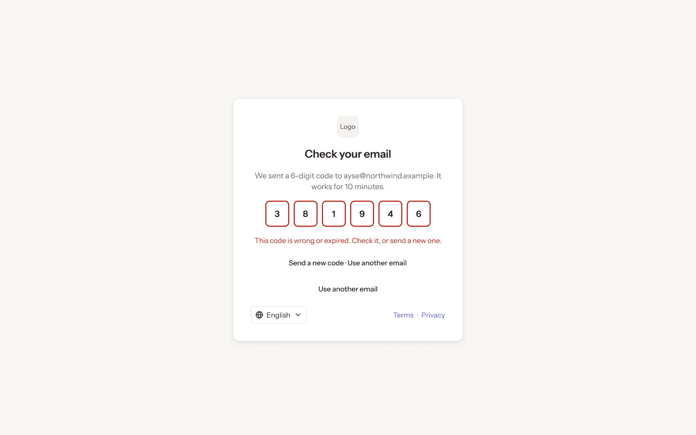

- **Who sees it:** Anyone who is not signed in yet: a person signing in, signing up or accepting an invitation.
- **Device:** Desktop (1280 px and wider).
- **This state shows:** as the title says.
- **Values come from:** Sign-in methods, codes and two-step verification: Clerk (identity provider). Invitation, organisation name and the terms version in force: our API. Support address and privacy link: packages/brand. Language: the locale cookie.
- **Components:** Auth footer, Button ×2.
- **Actions:**
  - No prototype link on this screen. The buttons follow the section's other screens.
- **Texts, word for word, top to bottom:**

  - Logo
  - Check your email
  - We sent a 6-digit code to ayse@northwind.example. It works for 10 minutes.
  - 3
  - 8
  - 1
  - 9
  - 4
  - 6
  - This code is wrong or expired. Check it, or send a new one.
  - Send a new code · Use another email
  - Use another email
  - English
  - Terms
  - ·
  - Privacy

Figma: [94:12569](https://www.figma.com/design/3Ev111okX8xCBwR9B3hyBM/?node-id=94-12569)

### 1.07 · Two-step verification

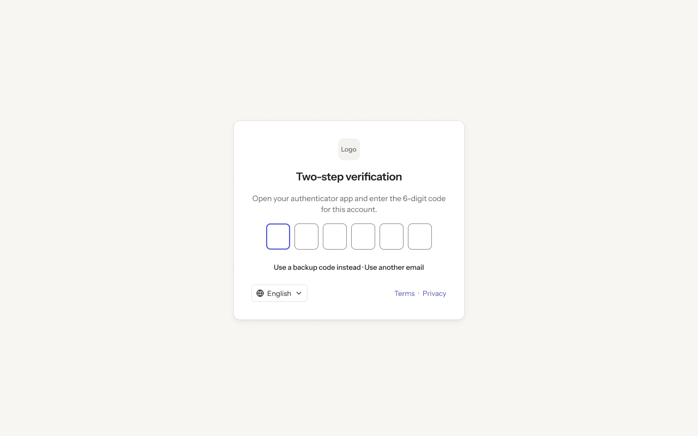

- **Who sees it:** Anyone who is not signed in yet: a person signing in, signing up or accepting an invitation.
- **Device:** Desktop (1280 px and wider).
- **This state shows:** as the title says.
- **Values come from:** Sign-in methods, codes and two-step verification: Clerk (identity provider). Invitation, organisation name and the terms version in force: our API. Support address and privacy link: packages/brand. Language: the locale cookie.
- **Components:** Auth footer, Button.
- **Actions:**
  - "Area": goes to [1.18 · Choose an organisation](#118--choose-an-organisation).
  - "Use a backup code instead · Use another email": goes to [1.08 · Backup code](#108--backup-code).
- **Texts, word for word, top to bottom:**

  - Logo
  - Two-step verification
  - Open your authenticator app and enter the 6-digit code for this account.
  - Use a backup code instead · Use another email
  - English
  - Terms
  - ·
  - Privacy

Figma: [94:12601](https://www.figma.com/design/3Ev111okX8xCBwR9B3hyBM/?node-id=94-12601)

### 1.08 · Backup code

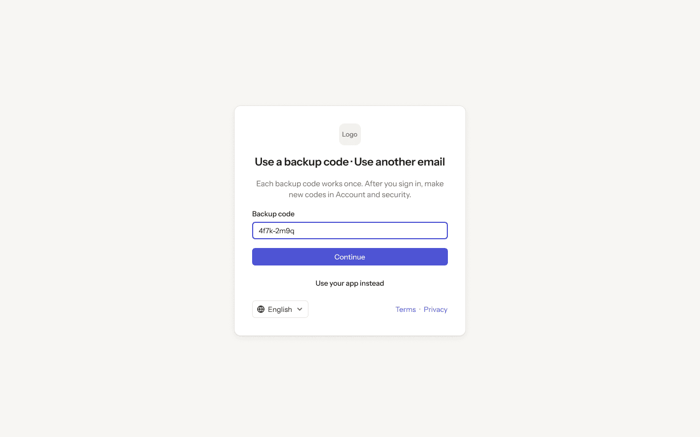

- **Who sees it:** Anyone who is not signed in yet: a person signing in, signing up or accepting an invitation.
- **Device:** Desktop (1280 px and wider).
- **This state shows:** as the title says.
- **Values come from:** Sign-in methods, codes and two-step verification: Clerk (identity provider). Invitation, organisation name and the terms version in force: our API. Support address and privacy link: packages/brand. Language: the locale cookie.
- **Components:** Auth footer, Button ×2, Input.
- **Actions:**
  - "Continue": goes to [1.18 · Choose an organisation](#118--choose-an-organisation).
- **Texts, word for word, top to bottom:**

  - Logo
  - Use a backup code · Use another email
  - Each backup code works once. After you sign in, make new codes in Account and security.
  - Backup code
  - 4f7k-2m9q
  - Continue
  - Use your app instead
  - English
  - Terms
  - ·
  - Privacy

Figma: [94:12620](https://www.figma.com/design/3Ev111okX8xCBwR9B3hyBM/?node-id=94-12620)

### 1.09 · Terms of use updated · with summary

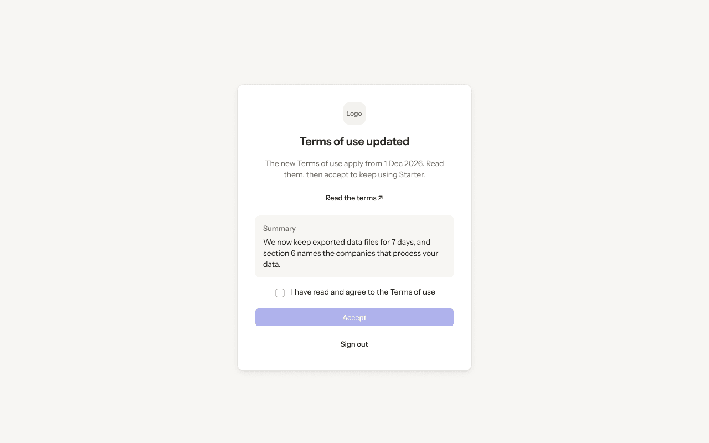

- **Who sees it:** Anyone who is not signed in yet: a person signing in, signing up or accepting an invitation.
- **Device:** Desktop (1280 px and wider).
- **This state shows:** as the title says.
- **Values come from:** Sign-in methods, codes and two-step verification: Clerk (identity provider). Invitation, organisation name and the terms version in force: our API. Support address and privacy link: packages/brand. Language: the locale cookie.
- **Components:** Button ×3, Checkbox.
- **Actions:**
  - No prototype link on this screen. The buttons follow the section's other screens.
- **Texts, word for word, top to bottom:**

  - Logo
  - Terms of use updated
  - The new Terms of use apply from 1 Dec 2026. Read them, then accept to keep using Starter.
  - Read the terms ↗
  - Summary
  - We now keep exported data files for 7 days, and section 6 names the companies that process your data.
  - I have read and agree to the Terms of use
  - Accept
  - Sign out

Figma: [158:15950](https://www.figma.com/design/3Ev111okX8xCBwR9B3hyBM/?node-id=158-15950)

### 1.10 · Terms of use updated · no summary, accepted box

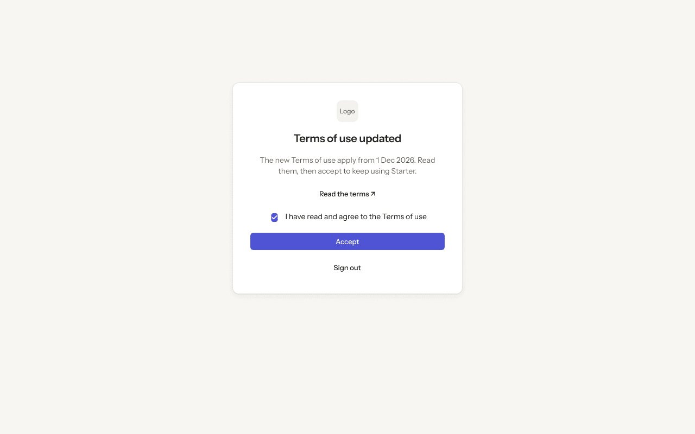

- **Who sees it:** Anyone who is not signed in yet: a person signing in, signing up or accepting an invitation.
- **Device:** Desktop (1280 px and wider).
- **This state shows:** as the title says.
- **Values come from:** Sign-in methods, codes and two-step verification: Clerk (identity provider). Invitation, organisation name and the terms version in force: our API. Support address and privacy link: packages/brand. Language: the locale cookie.
- **Components:** Button ×3, Checkbox.
- **Actions:**
  - No prototype link on this screen. The buttons follow the section's other screens.
- **Texts, word for word, top to bottom:**

  - Logo
  - Terms of use updated
  - The new Terms of use apply from 1 Dec 2026. Read them, then accept to keep using Starter.
  - Read the terms ↗
  - I have read and agree to the Terms of use
  - Accept
  - Sign out

Figma: [158:16008](https://www.figma.com/design/3Ev111okX8xCBwR9B3hyBM/?node-id=158-16008)

### 1.11 · Terms of use updated · loading

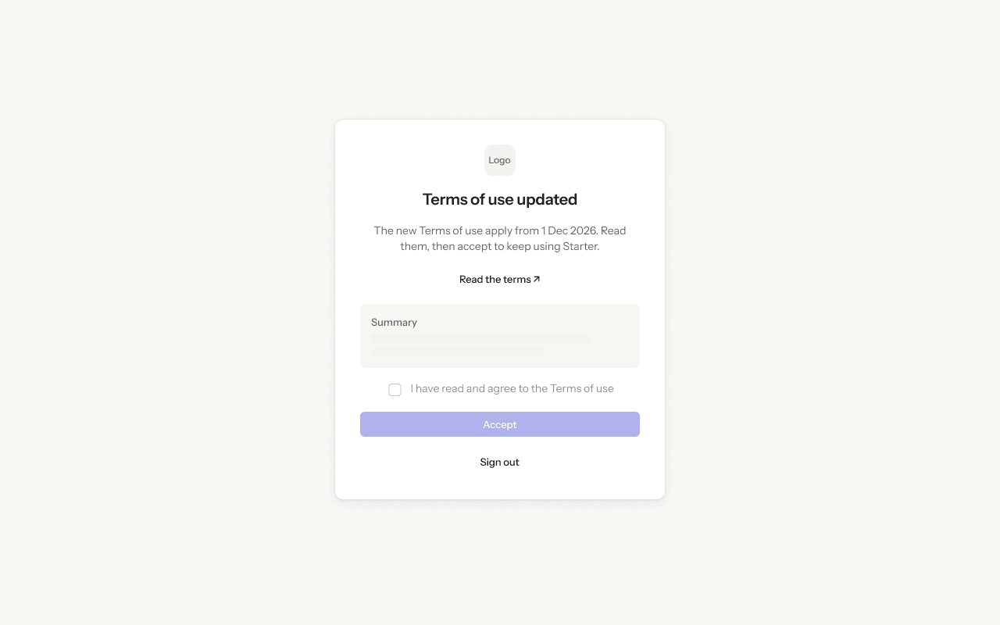

- **Who sees it:** Anyone who is not signed in yet: a person signing in, signing up or accepting an invitation.
- **Device:** Desktop (1280 px and wider).
- **This state shows:** while the request runs.
- **Values come from:** Sign-in methods, codes and two-step verification: Clerk (identity provider). Invitation, organisation name and the terms version in force: our API. Support address and privacy link: packages/brand. Language: the locale cookie.
- **Components:** Button ×3, Checkbox, Skeleton ×2.
- **Actions:**
  - No prototype link on this screen. The buttons follow the section's other screens.
- **Texts, word for word, top to bottom:**

  - Logo
  - Terms of use updated
  - The new Terms of use apply from 1 Dec 2026. Read them, then accept to keep using Starter.
  - Read the terms ↗
  - Summary
  - I have read and agree to the Terms of use
  - Accept
  - Sign out

Figma: [158:16066](https://www.figma.com/design/3Ev111okX8xCBwR9B3hyBM/?node-id=158-16066)

### 1.12 · Terms of use updated · error

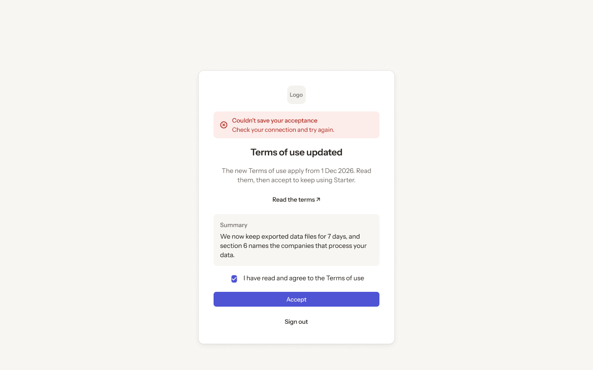

- **Who sees it:** Anyone who is not signed in yet: a person signing in, signing up or accepting an invitation.
- **Device:** Desktop (1280 px and wider).
- **This state shows:** when the request fails.
- **Values come from:** Sign-in methods, codes and two-step verification: Clerk (identity provider). Invitation, organisation name and the terms version in force: our API. Support address and privacy link: packages/brand. Language: the locale cookie.
- **Components:** Banner, Button ×3, Checkbox.
- **Actions:**
  - No prototype link on this screen. The buttons follow the section's other screens.
- **Texts, word for word, top to bottom:**

  - Logo
  - Couldn’t save your acceptance
  - Check your connection and try again.
  - Terms of use updated
  - The new Terms of use apply from 1 Dec 2026. Read them, then accept to keep using Starter.
  - Read the terms ↗
  - Summary
  - We now keep exported data files for 7 days, and section 6 names the companies that process your data.
  - I have read and agree to the Terms of use
  - Accept
  - Sign out

Figma: [158:16125](https://www.figma.com/design/3Ev111okX8xCBwR9B3hyBM/?node-id=158-16125)

### 1.13 · Accept invitation

- **Who sees it:** Anyone who is not signed in yet: a person signing in, signing up or accepting an invitation.
- **Device:** Desktop (1280 px and wider).
- **This state shows:** as the title says.
- **Values come from:** Sign-in methods, codes and two-step verification: Clerk (identity provider). Invitation, organisation name and the terms version in force: our API. Support address and privacy link: packages/brand. Language: the locale cookie.
- **Components:** Auth footer, Button ×3, Input.
- **Actions:**
  - "or": goes to [1.05 · Enter the code](#105--enter-the-code).
- **Texts, word for word, top to bottom:**

  - Logo
  - Join Northwind Traders
  - Omar Haddad invited you as a Member. Sign in with this email to accept.
  - Continue with Google
  - Continue with Microsoft
  - or
  - Email
  - david.okafor@harbour.example
  - The invitation is for this address.
  - Accept and continue
  - English
  - Terms
  - ·
  - Privacy

Figma: [94:12646](https://www.figma.com/design/3Ev111okX8xCBwR9B3hyBM/?node-id=94-12646)

### 1.14 · Terms of use updated · phone

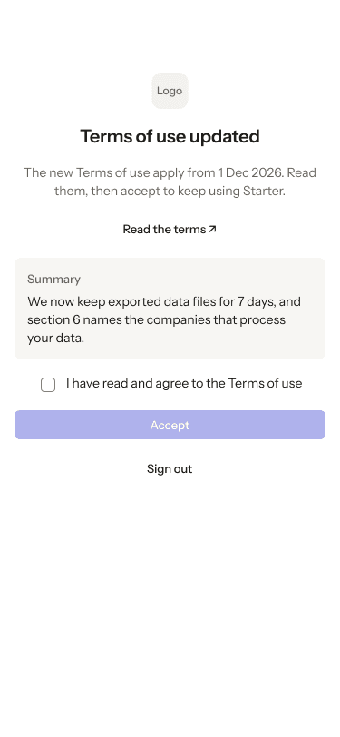

- **Who sees it:** Anyone who is not signed in yet: a person signing in, signing up or accepting an invitation.
- **Device:** Phone (up to 767 px).
- **This state shows:** on a phone.
- **Values come from:** Sign-in methods, codes and two-step verification: Clerk (identity provider). Invitation, organisation name and the terms version in force: our API. Support address and privacy link: packages/brand. Language: the locale cookie.
- **Components:** Button ×3, Checkbox.
- **Actions:**
  - No prototype link on this screen. The buttons follow the section's other screens.
- **Texts, word for word, top to bottom:**

  - Logo
  - Terms of use updated
  - The new Terms of use apply from 1 Dec 2026. Read them, then accept to keep using Starter.
  - Read the terms ↗
  - Summary
  - We now keep exported data files for 7 days, and section 6 names the companies that process your data.
  - I have read and agree to the Terms of use
  - Accept
  - Sign out

Figma: [158:16215](https://www.figma.com/design/3Ev111okX8xCBwR9B3hyBM/?node-id=158-16215)

### 1.15 · Accept invitation · terms

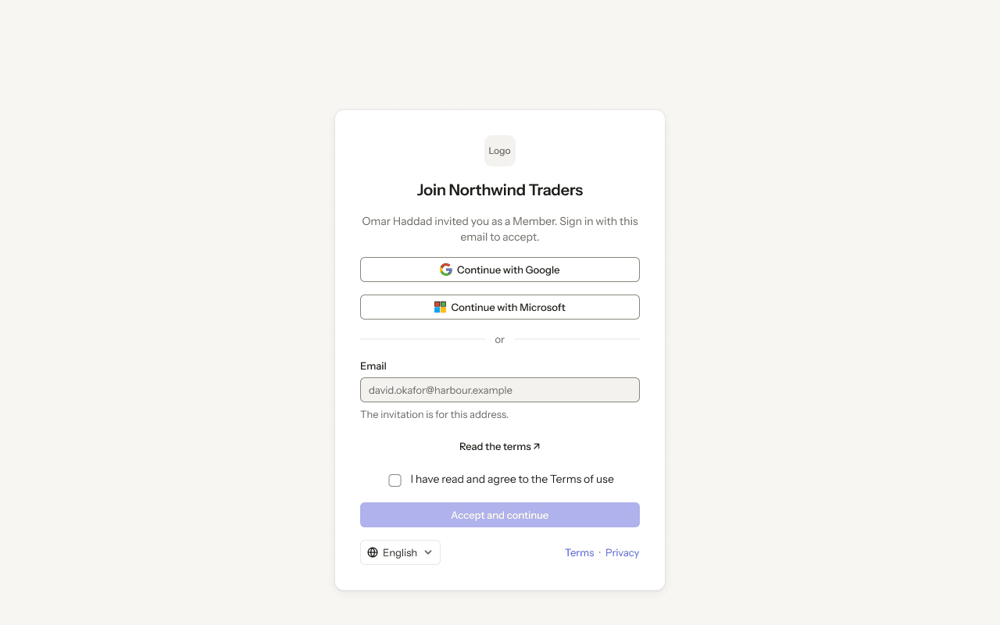

- **Who sees it:** Anyone who is not signed in yet: a person signing in, signing up or accepting an invitation.
- **Device:** Desktop (1280 px and wider).
- **This state shows:** as the title says.
- **Values come from:** Sign-in methods, codes and two-step verification: Clerk (identity provider). Invitation, organisation name and the terms version in force: our API. Support address and privacy link: packages/brand. Language: the locale cookie.
- **Components:** Auth footer, Button ×4, Checkbox, Input.
- **Actions:**
  - No prototype link on this screen. The buttons follow the section's other screens.
- **Texts, word for word, top to bottom:**

  - Logo
  - Join Northwind Traders
  - Omar Haddad invited you as a Member. Sign in with this email to accept.
  - Continue with Google
  - Continue with Microsoft
  - or
  - Email
  - david.okafor@harbour.example
  - The invitation is for this address.
  - Read the terms ↗
  - I have read and agree to the Terms of use
  - Accept and continue
  - English
  - Terms
  - ·
  - Privacy

Figma: [158:16272](https://www.figma.com/design/3Ev111okX8xCBwR9B3hyBM/?node-id=158-16272)

### 1.16 · Invitation expired

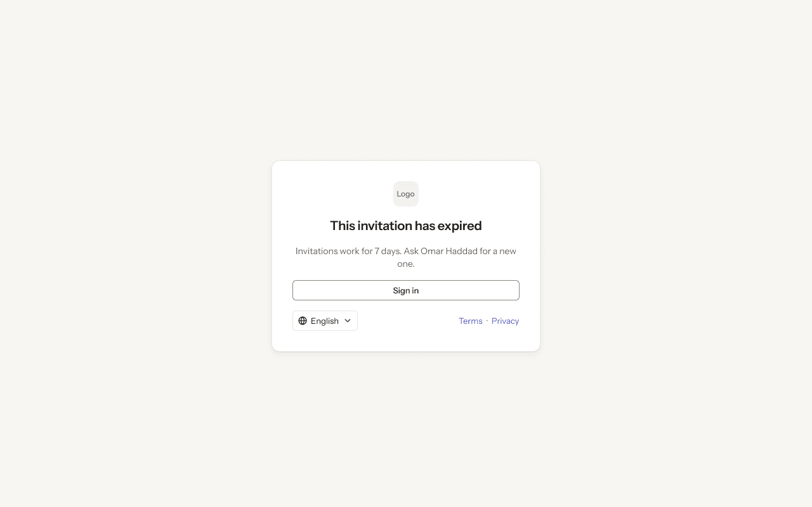

- **Who sees it:** Anyone who is not signed in yet: a person signing in, signing up or accepting an invitation.
- **Device:** Desktop (1280 px and wider).
- **This state shows:** as the title says.
- **Values come from:** Sign-in methods, codes and two-step verification: Clerk (identity provider). Invitation, organisation name and the terms version in force: our API. Support address and privacy link: packages/brand. Language: the locale cookie.
- **Components:** Auth footer, Button.
- **Actions:**
  - "Sign in": goes to [1.01 · Sign in · sign-up off](#101--sign-in--sign-up-off).
- **Texts, word for word, top to bottom:**

  - Logo
  - This invitation has expired
  - Invitations work for 7 days. Ask Omar Haddad for a new one.
  - Sign in
  - English
  - Terms
  - ·
  - Privacy

Figma: [94:12683](https://www.figma.com/design/3Ev111okX8xCBwR9B3hyBM/?node-id=94-12683)

### 1.17 · Invitation for another email

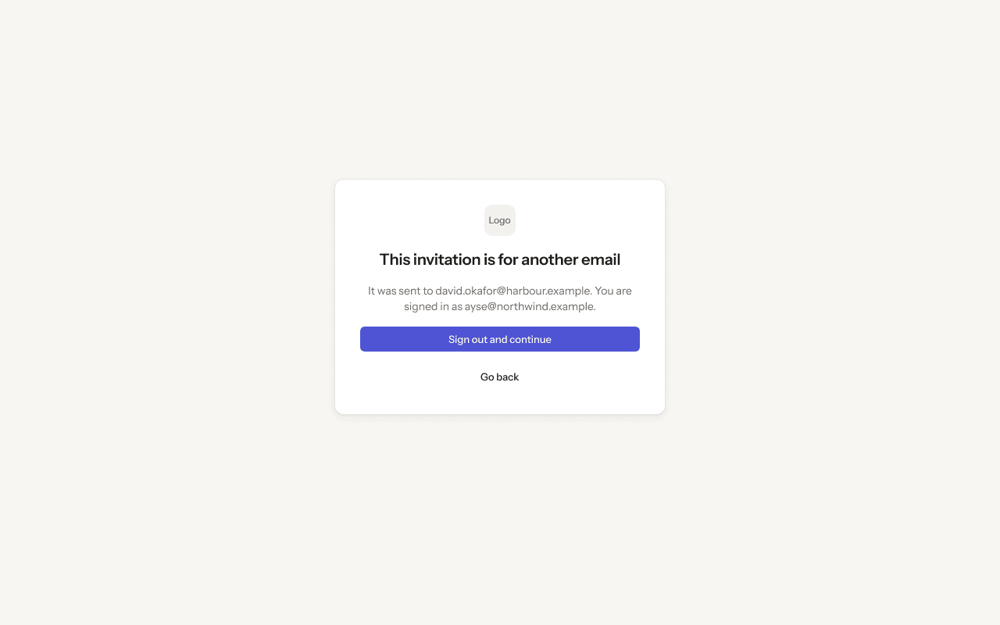

- **Who sees it:** Anyone who is not signed in yet: a person signing in, signing up or accepting an invitation.
- **Device:** Desktop (1280 px and wider).
- **This state shows:** as the title says.
- **Values come from:** Sign-in methods, codes and two-step verification: Clerk (identity provider). Invitation, organisation name and the terms version in force: our API. Support address and privacy link: packages/brand. Language: the locale cookie.
- **Components:** Button ×2.
- **Actions:**
  - No prototype link on this screen. The buttons follow the section's other screens.
- **Texts, word for word, top to bottom:**

  - Logo
  - This invitation is for another email
  - It was sent to david.okafor@harbour.example. You are signed in as ayse@northwind.example.
  - Sign out and continue
  - Go back

Figma: [94:12695](https://www.figma.com/design/3Ev111okX8xCBwR9B3hyBM/?node-id=94-12695)

### 1.18 · Choose an organisation

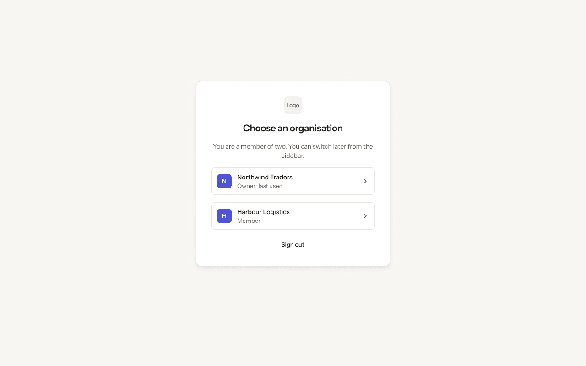

- **Who sees it:** Anyone who is not signed in yet: a person signing in, signing up or accepting an invitation.
- **Device:** Desktop (1280 px and wider).
- **This state shows:** as the title says.
- **Values come from:** Sign-in methods, codes and two-step verification: Clerk (identity provider). Invitation, organisation name and the terms version in force: our API. Support address and privacy link: packages/brand. Language: the locale cookie.
- **Components:** Button, Icon/chevron-down ×2.
- **Actions:**
  - "Northwind Traders": goes to [4.01 · Home · Owner](../04-home/README.md#401--home--owner).
- **Texts, word for word, top to bottom:**

  - Logo
  - Choose an organisation
  - You are a member of two. You can switch later from the sidebar.
  - N
  - Northwind Traders
  - Owner · last used
  - H
  - Harbour Logistics
  - Member
  - Sign out

Figma: [94:12713](https://www.figma.com/design/3Ev111okX8xCBwR9B3hyBM/?node-id=94-12713)

### 1.19 · No access yet · account menu

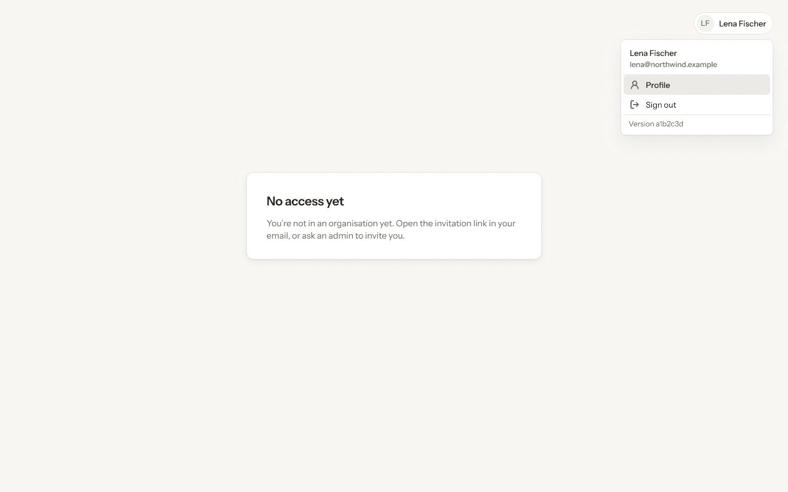

- **Who sees it:** Anyone who is not signed in yet: a person signing in, signing up or accepting an invitation.
- **Device:** Desktop (1280 px and wider).
- **This state shows:** as the title says.
- **Values come from:** Sign-in methods, codes and two-step verification: Clerk (identity provider). Invitation, organisation name and the terms version in force: our API. Support address and privacy link: packages/brand. Language: the locale cookie.
- **Components:** Account menu · Version, Menu item ×2.
- **Actions:**
  - "Version a1b2c3d": goes to node 218:1103 (not a numbered screen).
  - "Profile": goes to [6.01 · Account and security · ideal](../06-settings-account-and-security/README.md#601--account-and-security--ideal).
- **Texts, word for word, top to bottom:**

  - LF
  - Lena Fischer
  - Lena Fischer
  - lena@northwind.example
  - Profile
  - Sign out
  - Version a1b2c3d
  - No access yet
  - You’re not in an organisation yet. Open the invitation link in your email, or ask an admin to invite you.

Figma: [62:12584](https://www.figma.com/design/3Ev111okX8xCBwR9B3hyBM/?node-id=62-12584)

### 1.20 · Sign in · dark

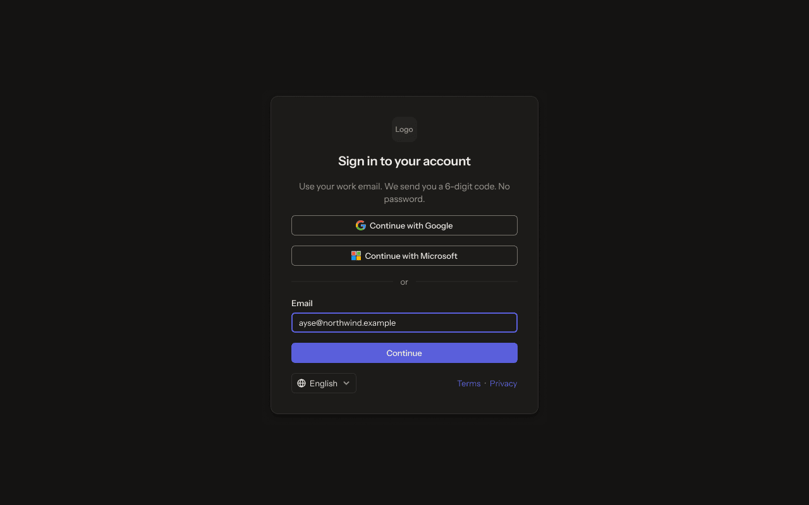

- **Who sees it:** Anyone who is not signed in yet: a person signing in, signing up or accepting an invitation.
- **Device:** Desktop (1280 px and wider).
- **This state shows:** in the dark theme.
- **Values come from:** Sign-in methods, codes and two-step verification: Clerk (identity provider). Invitation, organisation name and the terms version in force: our API. Support address and privacy link: packages/brand. Language: the locale cookie.
- **Components:** Auth footer, Button ×3, Input.
- **Actions:**
  - No prototype link on this screen. The buttons follow the section's other screens.
- **Texts, word for word, top to bottom:**

  - Logo
  - Sign in to your account
  - Use your work email. We send you a 6-digit code. No password.
  - Continue with Google
  - Continue with Microsoft
  - or
  - Email
  - ayse@northwind.example
  - Continue
  - English
  - Terms
  - ·
  - Privacy

Figma: [94:12743](https://www.figma.com/design/3Ev111okX8xCBwR9B3hyBM/?node-id=94-12743)

### 1.21 · Phone · sign in

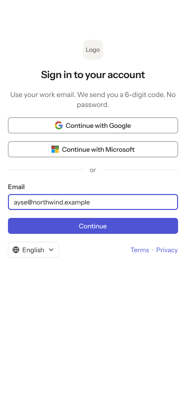

- **Who sees it:** Anyone who is not signed in yet: a person signing in, signing up or accepting an invitation.
- **Device:** Phone (up to 767 px).
- **This state shows:** on a phone.
- **Values come from:** Sign-in methods, codes and two-step verification: Clerk (identity provider). Invitation, organisation name and the terms version in force: our API. Support address and privacy link: packages/brand. Language: the locale cookie.
- **Components:** Auth footer, Button ×3, Input.
- **Actions:**
  - "Continue": goes to [1.22 · Phone · enter the code](#122--phone--enter-the-code).
- **Texts, word for word, top to bottom:**

  - Logo
  - Sign in to your account
  - Use your work email. We send you a 6-digit code. No password.
  - Continue with Google
  - Continue with Microsoft
  - or
  - Email
  - ayse@northwind.example
  - Continue
  - English
  - Terms
  - ·
  - Privacy

Figma: [94:12779](https://www.figma.com/design/3Ev111okX8xCBwR9B3hyBM/?node-id=94-12779)

### 1.22 · Phone · enter the code

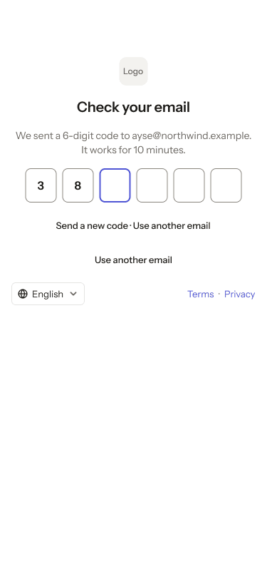

- **Who sees it:** Anyone who is not signed in yet: a person signing in, signing up or accepting an invitation.
- **Device:** Phone (up to 767 px).
- **This state shows:** on a phone.
- **Values come from:** Sign-in methods, codes and two-step verification: Clerk (identity provider). Invitation, organisation name and the terms version in force: our API. Support address and privacy link: packages/brand. Language: the locale cookie.
- **Components:** Auth footer, Button ×2.
- **Actions:**
  - "We sent a 6-digit code to ayse@northwind.example. It works for 10 minutes.": goes to [8.34 · Members · phone](../08-settings-members/README.md#834--members--phone).
- **Texts, word for word, top to bottom:**

  - Logo
  - Check your email
  - We sent a 6-digit code to ayse@northwind.example. It works for 10 minutes.
  - 3
  - 8
  - Send a new code · Use another email
  - Use another email
  - English
  - Terms
  - ·
  - Privacy

Figma: [94:12815](https://www.figma.com/design/3Ev111okX8xCBwR9B3hyBM/?node-id=94-12815)

### 1.23 · Phone · accept invitation

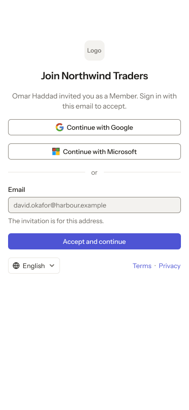

- **Who sees it:** Anyone who is not signed in yet: a person signing in, signing up or accepting an invitation.
- **Device:** Phone (up to 767 px).
- **This state shows:** on a phone.
- **Values come from:** Sign-in methods, codes and two-step verification: Clerk (identity provider). Invitation, organisation name and the terms version in force: our API. Support address and privacy link: packages/brand. Language: the locale cookie.
- **Components:** Auth footer, Button ×3, Input.
- **Actions:**
  - "Accept and continue": goes to [1.22 · Phone · enter the code](#122--phone--enter-the-code).
- **Texts, word for word, top to bottom:**

  - Logo
  - Join Northwind Traders
  - Omar Haddad invited you as a Member. Sign in with this email to accept.
  - Continue with Google
  - Continue with Microsoft
  - or
  - Email
  - david.okafor@harbour.example
  - The invitation is for this address.
  - Accept and continue
  - English
  - Terms
  - ·
  - Privacy

Figma: [94:12842](https://www.figma.com/design/3Ev111okX8xCBwR9B3hyBM/?node-id=94-12842)

### 1.24 · Sign in · sign-up on

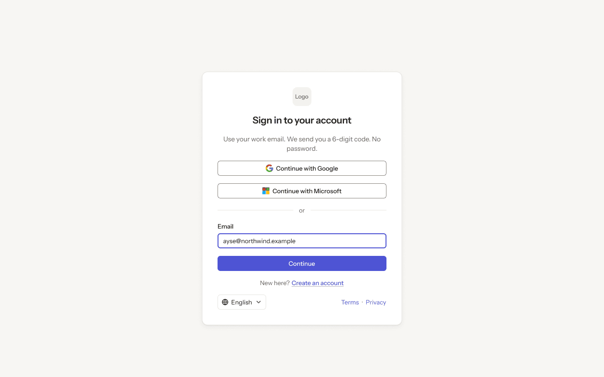

- **Who sees it:** Anyone who is not signed in yet: a person signing in, signing up or accepting an invitation.
- **Device:** Desktop (1280 px and wider).
- **This state shows:** as the title says.
- **Values come from:** Sign-in methods, codes and two-step verification: Clerk (identity provider). Invitation, organisation name and the terms version in force: our API. Support address and privacy link: packages/brand. Language: the locale cookie.
- **Components:** Auth footer, Button ×3, Input.
- **Actions:**
  - "Create an account": goes to [1.25 · Create an account](#125--create-an-account).
- **Texts, word for word, top to bottom:**

  - Logo
  - Sign in to your account
  - Use your work email. We send you a 6-digit code. No password.
  - Continue with Google
  - Continue with Microsoft
  - or
  - Email
  - ayse@northwind.example
  - Continue
  - New here?
  - Create an account
  - English
  - Terms
  - ·
  - Privacy

Figma: [242:22251](https://www.figma.com/design/3Ev111okX8xCBwR9B3hyBM/?node-id=242-22251)

### 1.25 · Create an account

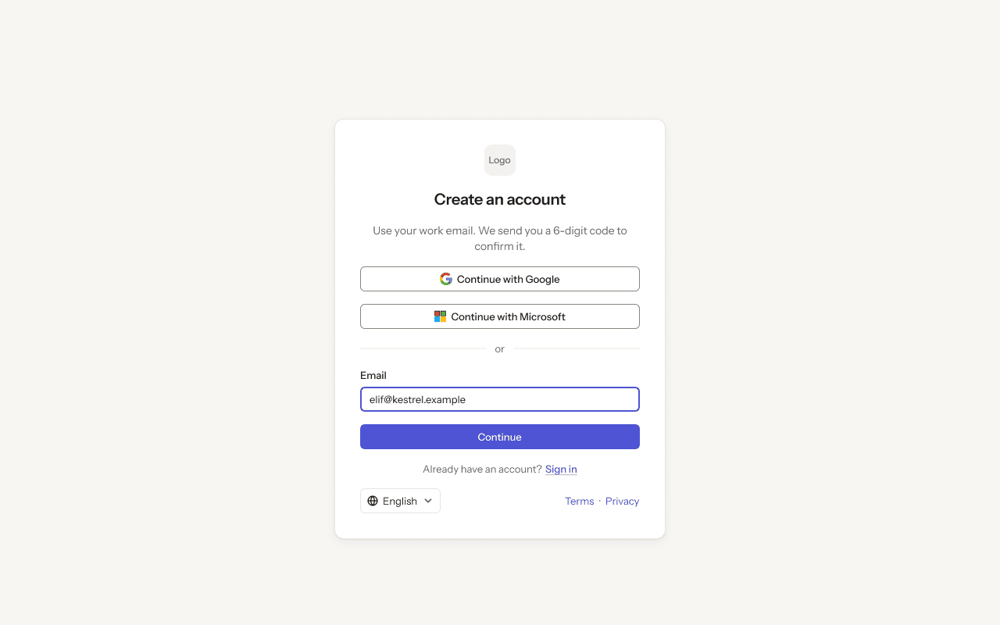

- **Who sees it:** Anyone who is not signed in yet: a person signing in, signing up or accepting an invitation.
- **Device:** Desktop (1280 px and wider).
- **This state shows:** as the title says.
- **Values come from:** Sign-in methods, codes and two-step verification: Clerk (identity provider). Invitation, organisation name and the terms version in force: our API. Support address and privacy link: packages/brand. Language: the locale cookie.
- **Components:** Auth footer, Button ×3, Input.
- **Actions:**
  - "Continue": goes to [1.26 · Create an account · enter the code](#126--create-an-account--enter-the-code).
  - "Sign in": goes to [1.01 · Sign in · sign-up off](#101--sign-in--sign-up-off).
- **Texts, word for word, top to bottom:**

  - Logo
  - Create an account
  - Use your work email. We send you a 6-digit code to confirm it.
  - Continue with Google
  - Continue with Microsoft
  - or
  - Email
  - elif@kestrel.example
  - Continue
  - Already have an account?
  - Sign in
  - English
  - Terms
  - ·
  - Privacy

Figma: [242:22271](https://www.figma.com/design/3Ev111okX8xCBwR9B3hyBM/?node-id=242-22271)

### 1.26 · Create an account · enter the code

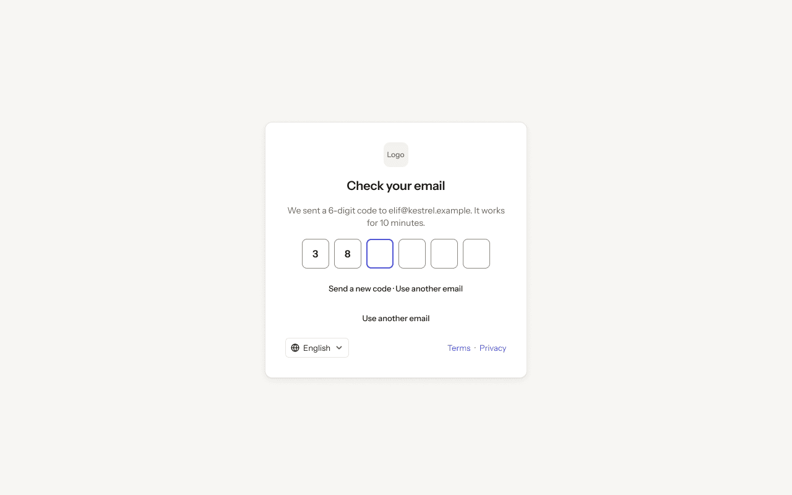

- **Who sees it:** Anyone who is not signed in yet: a person signing in, signing up or accepting an invitation.
- **Device:** Desktop (1280 px and wider).
- **This state shows:** as the title says.
- **Values come from:** Sign-in methods, codes and two-step verification: Clerk (identity provider). Invitation, organisation name and the terms version in force: our API. Support address and privacy link: packages/brand. Language: the locale cookie.
- **Components:** Auth footer, Button ×2.
- **Actions:**
  - No prototype link on this screen. The buttons follow the section's other screens.
- **Texts, word for word, top to bottom:**

  - Logo
  - Check your email
  - We sent a 6-digit code to elif@kestrel.example. It works for 10 minutes.
  - 3
  - 8
  - Send a new code · Use another email
  - Use another email
  - English
  - Terms
  - ·
  - Privacy

Figma: [242:22310](https://www.figma.com/design/3Ev111okX8xCBwR9B3hyBM/?node-id=242-22310)

### 1.27 · Create an account · accept the terms

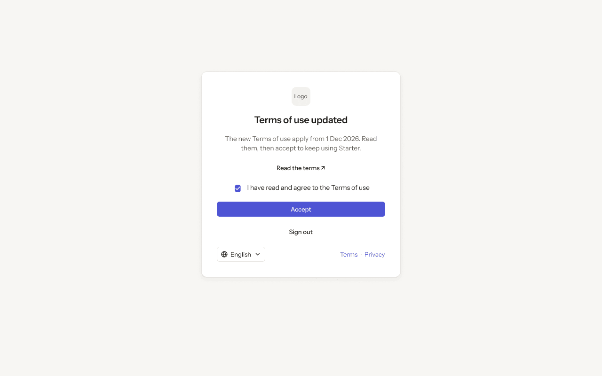

- **Who sees it:** Anyone who is not signed in yet: a person signing in, signing up or accepting an invitation.
- **Device:** Desktop (1280 px and wider).
- **This state shows:** as the title says.
- **Values come from:** Sign-in methods, codes and two-step verification: Clerk (identity provider). Invitation, organisation name and the terms version in force: our API. Support address and privacy link: packages/brand. Language: the locale cookie.
- **Components:** Auth footer, Button ×3, Checkbox.
- **Actions:**
  - "Accept": goes to [1.28 · Create your organisation](#128--create-your-organisation).
- **Texts, word for word, top to bottom:**

  - Logo
  - Terms of use updated
  - The new Terms of use apply from 1 Dec 2026. Read them, then accept to keep using Starter.
  - Read the terms ↗
  - I have read and agree to the Terms of use
  - Accept
  - Sign out
  - English
  - Terms
  - ·
  - Privacy

Figma: [242:22333](https://www.figma.com/design/3Ev111okX8xCBwR9B3hyBM/?node-id=242-22333)

### 1.28 · Create your organisation

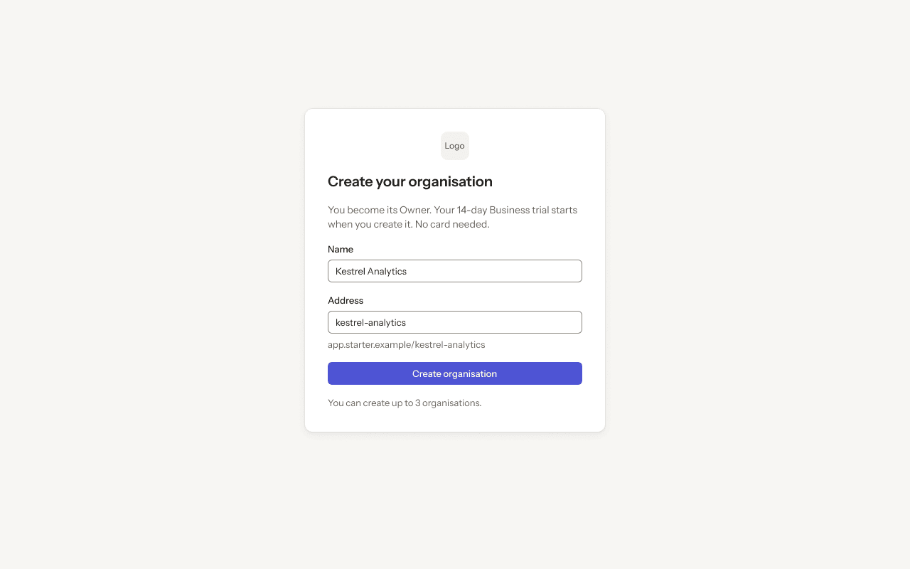

- **Who sees it:** Anyone who is not signed in yet: a person signing in, signing up or accepting an invitation.
- **Device:** Desktop (1280 px and wider).
- **This state shows:** as the title says.
- **Values come from:** Sign-in methods, codes and two-step verification: Clerk (identity provider). Invitation, organisation name and the terms version in force: our API. Support address and privacy link: packages/brand. Language: the locale cookie.
- **Components:** Button, Input ×2.
- **Actions:**
  - "Create organisation": goes to [1.30 · Trial started · invite your team](#130--trial-started--invite-your-team).
- **Texts, word for word, top to bottom:**

  - Logo
  - Create your organisation
  - You become its Owner. Your 14-day Business trial starts when you create it. No card needed.
  - Name
  - Kestrel Analytics
  - Address
  - kestrel-analytics
  - app.starter.example/kestrel-analytics
  - Create organisation
  - You can create up to 3 organisations.

Figma: [242:22345](https://www.figma.com/design/3Ev111okX8xCBwR9B3hyBM/?node-id=242-22345)

### 1.29 · Create your organisation · address taken

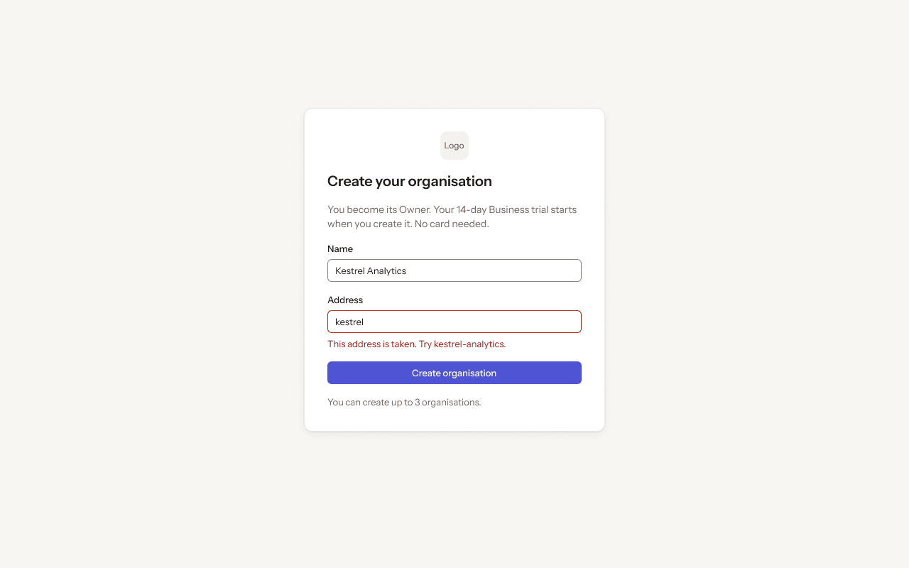

- **Who sees it:** Anyone who is not signed in yet: a person signing in, signing up or accepting an invitation.
- **Device:** Desktop (1280 px and wider).
- **This state shows:** as the title says.
- **Values come from:** Sign-in methods, codes and two-step verification: Clerk (identity provider). Invitation, organisation name and the terms version in force: our API. Support address and privacy link: packages/brand. Language: the locale cookie.
- **Components:** Button, Input ×2.
- **Actions:**
  - "Create organisation": goes to [1.30 · Trial started · invite your team](#130--trial-started--invite-your-team).
- **Texts, word for word, top to bottom:**

  - Logo
  - Create your organisation
  - You become its Owner. Your 14-day Business trial starts when you create it. No card needed.
  - Name
  - Kestrel Analytics
  - Address
  - kestrel
  - This address is taken. Try kestrel-analytics.
  - Create organisation
  - You can create up to 3 organisations.

Figma: [242:22402](https://www.figma.com/design/3Ev111okX8xCBwR9B3hyBM/?node-id=242-22402)

### 1.30 · Trial started · invite your team

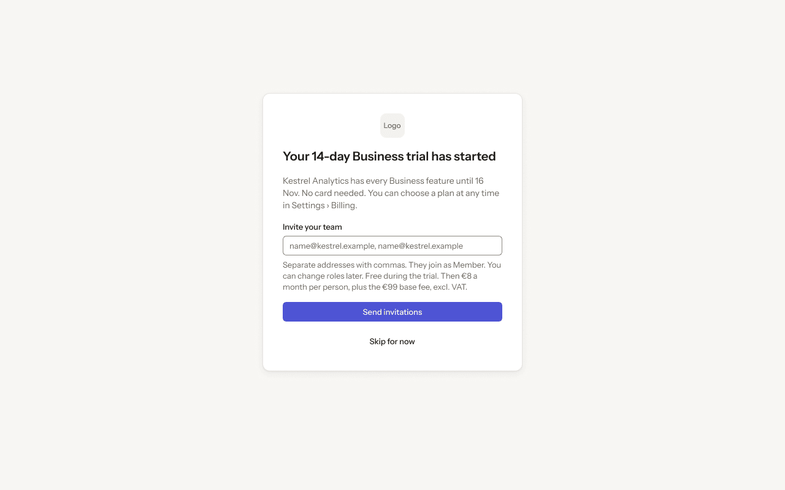

- **Who sees it:** Anyone who is not signed in yet: a person signing in, signing up or accepting an invitation.
- **Device:** Desktop (1280 px and wider).
- **This state shows:** as the title says.
- **Values come from:** Sign-in methods, codes and two-step verification: Clerk (identity provider). Invitation, organisation name and the terms version in force: our API. Support address and privacy link: packages/brand. Language: the locale cookie.
- **Components:** Button ×2, Input.
- **Actions:**
  - "Send invitations": goes to [1.31 · Home · trial started](#131--home--trial-started).
  - "Skip for now": goes to [1.31 · Home · trial started](#131--home--trial-started).
- **Texts, word for word, top to bottom:**

  - Logo
  - Your 14-day Business trial has started
  - Kestrel Analytics has every Business feature until 16 Nov. No card needed. You can choose a plan at any time in Settings › Billing.
  - Invite your team
  - name@kestrel.example, name@kestrel.example
  - Separate addresses with commas. They join as Member. You can change roles later. Free during the trial. Then €8 a month per person, plus the €99 base fee, excl. VAT.
  - Send invitations
  - Skip for now

Figma: [242:22459](https://www.figma.com/design/3Ev111okX8xCBwR9B3hyBM/?node-id=242-22459)

### 1.31 · Home · trial started

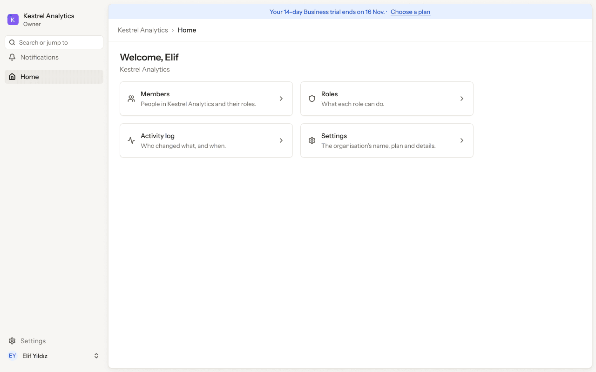

- **Who sees it:** Anyone who is not signed in yet: a person signing in, signing up or accepting an invitation.
- **Device:** Desktop (1280 px and wider).
- **This state shows:** as the title says.
- **Values come from:** Sign-in methods, codes and two-step verification: Clerk (identity provider). Invitation, organisation name and the terms version in force: our API. Support address and privacy link: packages/brand. Language: the locale cookie.
- **Components:** Billing bar, Icon/activity, Icon/chevron-down ×4, Icon/settings, Icon/shield, Icon/users, Sidebar, Top bar.
- **Actions:**
  - "Kestrel Analytics": goes to [8.01 · Members · ideal](../08-settings-members/README.md#801--members--ideal).
  - "Settings": goes to [7.01 · General · ideal](../07-settings-general/README.md#701--general--ideal).
  - "Choose a plan": goes to [10.09 · Change plan · from a trial](../10-settings-billing/README.md#1009--change-plan--from-a-trial).
- **Texts, word for word, top to bottom:**

  - K
  - Kestrel Analytics
  - Owner
  - Search or jump to
  - Notifications
  - Home
  - Settings
  - EY
  - Elif Yıldız
  - Your 14-day Business trial ends on 16 Nov. ·
  - Choose a plan
  - Kestrel Analytics
  - ›
  - Home
  - Welcome, Elif
  - Kestrel Analytics
  - Members
  - People in Kestrel Analytics and their roles.
  - Roles
  - What each role can do.
  - Activity log
  - Who changed what, and when.
  - Settings
  - The organisation’s name, plan and details.

Figma: [243:22315](https://www.figma.com/design/3Ev111okX8xCBwR9B3hyBM/?node-id=243-22315)

### 1.32 · Phone · create an account

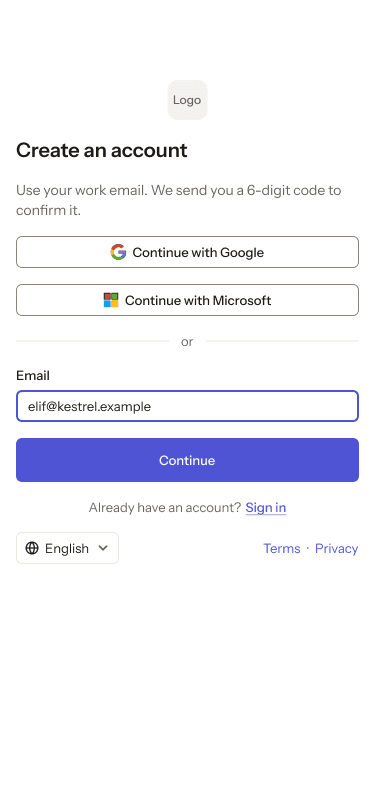

- **Who sees it:** Anyone who is not signed in yet: a person signing in, signing up or accepting an invitation.
- **Device:** Phone (up to 767 px).
- **This state shows:** on a phone.
- **Values come from:** Sign-in methods, codes and two-step verification: Clerk (identity provider). Invitation, organisation name and the terms version in force: our API. Support address and privacy link: packages/brand. Language: the locale cookie.
- **Components:** Auth footer, Button ×3, Input.
- **Actions:**
  - "Continue": goes to [1.33 · Phone · create your organisation](#133--phone--create-your-organisation).
- **Texts, word for word, top to bottom:**

  - Logo
  - Create an account
  - Use your work email. We send you a 6-digit code to confirm it.
  - Continue with Google
  - Continue with Microsoft
  - or
  - Email
  - elif@kestrel.example
  - Continue
  - Already have an account?
  - Sign in
  - English
  - Terms
  - ·
  - Privacy

Figma: [243:22424](https://www.figma.com/design/3Ev111okX8xCBwR9B3hyBM/?node-id=243-22424)

### 1.33 · Phone · create your organisation

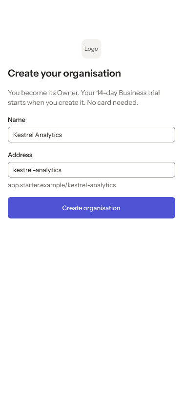

- **Who sees it:** Anyone who is not signed in yet: a person signing in, signing up or accepting an invitation.
- **Device:** Phone (up to 767 px).
- **This state shows:** on a phone.
- **Values come from:** Sign-in methods, codes and two-step verification: Clerk (identity provider). Invitation, organisation name and the terms version in force: our API. Support address and privacy link: packages/brand. Language: the locale cookie.
- **Components:** Button, Input ×2.
- **Actions:**
  - "Create organisation": goes to [1.34 · Phone · trial started](#134--phone--trial-started).
- **Texts, word for word, top to bottom:**

  - Logo
  - Create your organisation
  - You become its Owner. Your 14-day Business trial starts when you create it. No card needed.
  - Name
  - Kestrel Analytics
  - Address
  - kestrel-analytics
  - app.starter.example/kestrel-analytics
  - Create organisation

Figma: [243:22473](https://www.figma.com/design/3Ev111okX8xCBwR9B3hyBM/?node-id=243-22473)

### 1.34 · Phone · trial started

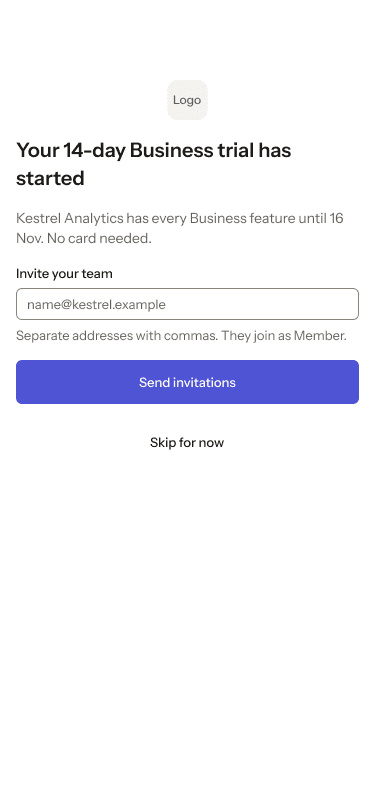

- **Who sees it:** Anyone who is not signed in yet: a person signing in, signing up or accepting an invitation.
- **Device:** Phone (up to 767 px).
- **This state shows:** on a phone.
- **Values come from:** Sign-in methods, codes and two-step verification: Clerk (identity provider). Invitation, organisation name and the terms version in force: our API. Support address and privacy link: packages/brand. Language: the locale cookie.
- **Components:** Button ×2, Input.
- **Actions:**
  - "Send invitations": goes to [8.34 · Members · phone](../08-settings-members/README.md#834--members--phone).
- **Texts, word for word, top to bottom:**

  - Logo
  - Your 14-day Business trial has started
  - Kestrel Analytics has every Business feature until 16 Nov. No card needed.
  - Invite your team
  - name@kestrel.example
  - Separate addresses with commas. They join as Member.
  - Send invitations
  - Skip for now

Figma: [243:22528](https://www.figma.com/design/3Ev111okX8xCBwR9B3hyBM/?node-id=243-22528)

### 1.35 · Sign in · language list

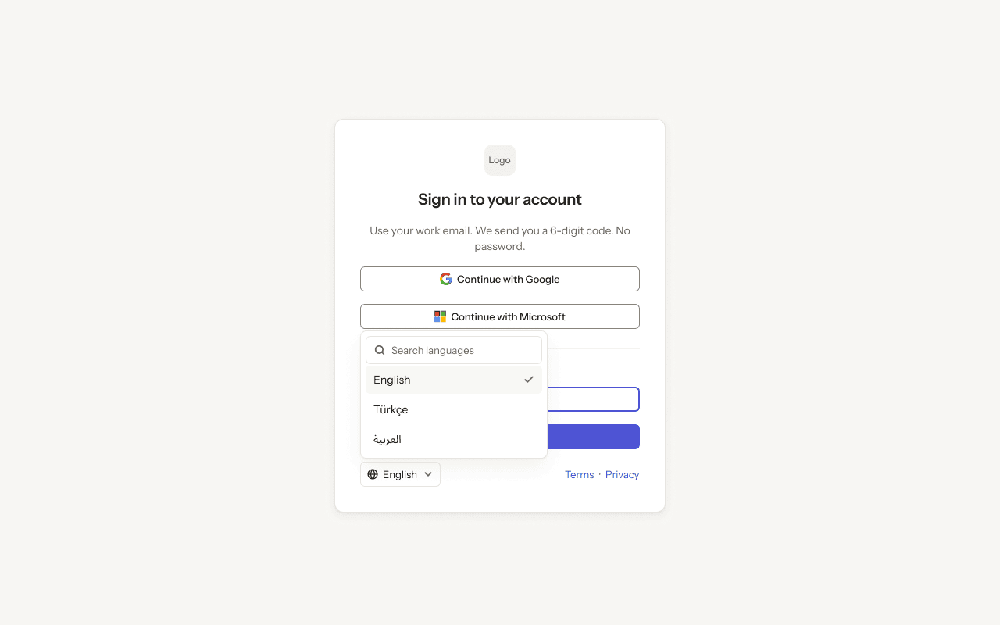

- **Who sees it:** Anyone who is not signed in yet: a person signing in, signing up or accepting an invitation.
- **Device:** Desktop (1280 px and wider).
- **This state shows:** as the title says.
- **Values come from:** Sign-in methods, codes and two-step verification: Clerk (identity provider). Invitation, organisation name and the terms version in force: our API. Support address and privacy link: packages/brand. Language: the locale cookie.
- **Components:** Auth footer, Button ×3, Input, Language list.
- **Actions:**
  - "English": goes to [1.01 · Sign in · sign-up off](#101--sign-in--sign-up-off).
- **Texts, word for word, top to bottom:**

  - Logo
  - Sign in to your account
  - Use your work email. We send you a 6-digit code. No password.
  - Continue with Google
  - Continue with Microsoft
  - or
  - Email
  - ayse@northwind.example
  - Continue
  - English
  - Terms
  - ·
  - Privacy
  - Search languages
  - English
  - Türkçe
  - العربية

Figma: [296:24655](https://www.figma.com/design/3Ev111okX8xCBwR9B3hyBM/?node-id=296-24655)

### 1.36 · Sign in · no language matches

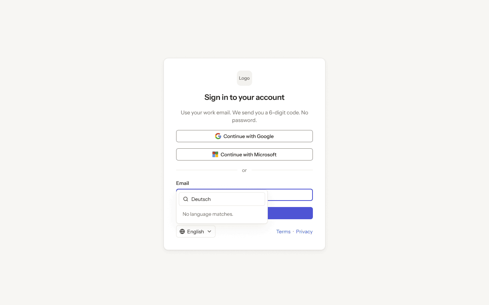

- **Who sees it:** Anyone who is not signed in yet: a person signing in, signing up or accepting an invitation.
- **Device:** Desktop (1280 px and wider).
- **This state shows:** as the title says.
- **Values come from:** Sign-in methods, codes and two-step verification: Clerk (identity provider). Invitation, organisation name and the terms version in force: our API. Support address and privacy link: packages/brand. Language: the locale cookie.
- **Components:** Auth footer, Button ×3, Input, Language list.
- **Actions:**
  - No prototype link on this screen. The buttons follow the section's other screens.
- **Texts, word for word, top to bottom:**

  - Logo
  - Sign in to your account
  - Use your work email. We send you a 6-digit code. No password.
  - Continue with Google
  - Continue with Microsoft
  - or
  - Email
  - ayse@northwind.example
  - Continue
  - English
  - Terms
  - ·
  - Privacy
  - Deutsch
  - No language matches.

Figma: [296:24718](https://www.figma.com/design/3Ev111okX8xCBwR9B3hyBM/?node-id=296-24718)

### 1.37 · Enter the code · new code sent

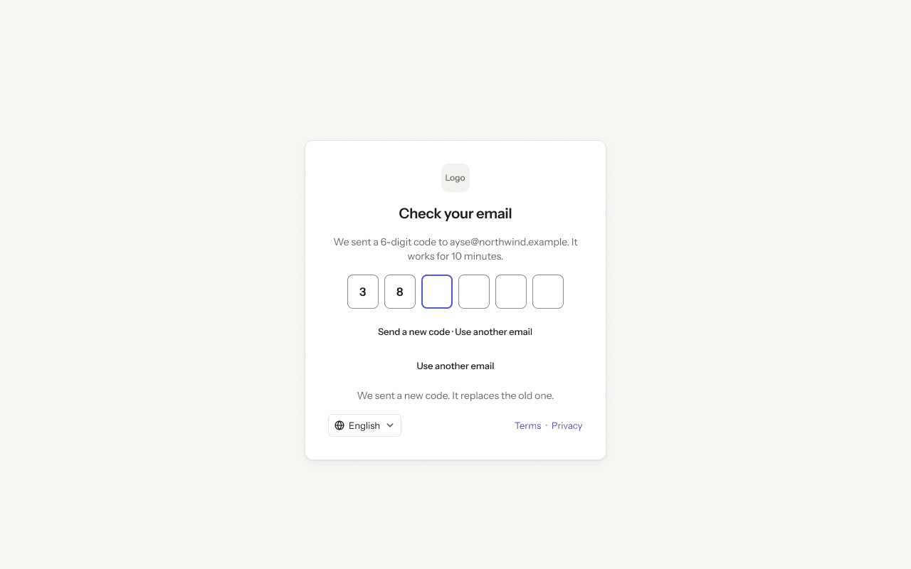

- **Who sees it:** Anyone who is not signed in yet: a person signing in, signing up or accepting an invitation.
- **Device:** Desktop (1280 px and wider).
- **This state shows:** as the title says.
- **Values come from:** Sign-in methods, codes and two-step verification: Clerk (identity provider). Invitation, organisation name and the terms version in force: our API. Support address and privacy link: packages/brand. Language: the locale cookie.
- **Components:** Auth footer, Button ×2.
- **Actions:**
  - No prototype link on this screen. The buttons follow the section's other screens.
- **Texts, word for word, top to bottom:**

  - Logo
  - Check your email
  - We sent a 6-digit code to ayse@northwind.example. It works for 10 minutes.
  - 3
  - 8
  - Send a new code · Use another email
  - Use another email
  - We sent a new code. It replaces the old one.
  - English
  - Terms
  - ·
  - Privacy

Figma: [296:24774](https://www.figma.com/design/3Ev111okX8xCBwR9B3hyBM/?node-id=296-24774)

### 1.38 · Finishing sign-in

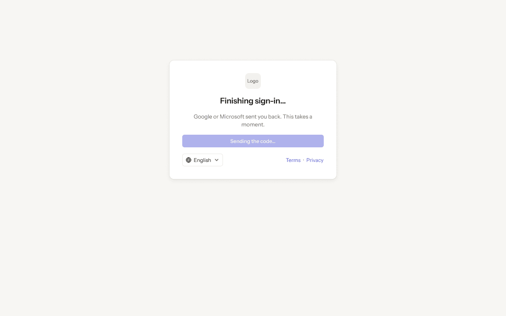

- **Who sees it:** Anyone who is not signed in yet: a person signing in, signing up or accepting an invitation.
- **Device:** Desktop (1280 px and wider).
- **This state shows:** as the title says.
- **Values come from:** Sign-in methods, codes and two-step verification: Clerk (identity provider). Invitation, organisation name and the terms version in force: our API. Support address and privacy link: packages/brand. Language: the locale cookie.
- **Components:** Auth footer, Button.
- **Actions:**
  - No prototype link on this screen. The buttons follow the section's other screens.
- **Texts, word for word, top to bottom:**

  - Logo
  - Finishing sign-in…
  - Google or Microsoft sent you back. This takes a moment.
  - Sending the code…
  - English
  - Terms
  - ·
  - Privacy

Figma: [296:24812](https://www.figma.com/design/3Ev111okX8xCBwR9B3hyBM/?node-id=296-24812)

### 1.39 · Phone · sign in · Arabic

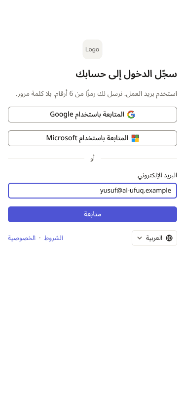

- **Who sees it:** Anyone who is not signed in yet: a person signing in, signing up or accepting an invitation.
- **Device:** Phone (up to 767 px).
- **This state shows:** with the language set to Arabic (right to left); on a phone.
- **Values come from:** Sign-in methods, codes and two-step verification: Clerk (identity provider). Invitation, organisation name and the terms version in force: our API. Support address and privacy link: packages/brand. Language: the locale cookie.
- **Components:** Auth footer, Button ×3, Input.
- **Actions:**
  - No prototype link on this screen. The buttons follow the section's other screens.
- **Texts, word for word, top to bottom:**

  - Logo
  - سجّل الدخول إلى حسابك
  - استخدم بريد العمل. نرسل لك رمزًا من 6 أرقام. بلا كلمة مرور.
  - المتابعة باستخدام Google
  - المتابعة باستخدام Microsoft
  - أو
  - البريد الإلكتروني
  - yusuf@al-ufuq.example
  - متابعة
  - الخصوصية
  - ·
  - الشروط
  - العربية

Figma: [299:25182](https://www.figma.com/design/3Ev111okX8xCBwR9B3hyBM/?node-id=299-25182)
