# Web app · 2 · Shell

Who sees this section: Every signed-in member of an organisation.

Where the values come from: Person, organisations and role: our API (current user and tenants). Unread count: our API notifications and the live stream. Environment strip: APP_ENVIRONMENT. Connection bar: the browser's network state and the API's health. App version: the build's commit.

44 screens. Each part below is one screen and state. The PNG beside this file is the screen at scale 1.

| Screen | Device |
|---|---|
| [2.01 · Shell · one organisation](#201--shell--one-organisation) | Desktop |
| [2.02 · Shell · several organisations](#202--shell--several-organisations) | Desktop |
| [2.03 · Switcher menu](#203--switcher-menu) | Desktop |
| [2.04 · Command menu · several](#204--command-menu--several) | Desktop |
| [2.05 · Command menu · one](#205--command-menu--one) | Desktop |
| [2.06 · Account menu](#206--account-menu) | Desktop |
| [2.07 · Notifications open](#207--notifications-open) | Desktop |
| [2.08 · Tooltip](#208--tooltip) | Desktop |
| [2.09 · First load of the app](#209--first-load-of-the-app) | Desktop |
| [2.10 · Page not found](#210--page-not-found) | Desktop |
| [2.11 · Section failed](#211--section-failed) | Desktop |
| [2.12 · App couldn’t start](#212--app-couldnt-start) | Desktop |
| [2.13 · Organisation suspended](#213--organisation-suspended) | Desktop |
| [2.14 · Organisation closed](#214--organisation-closed) | Desktop |
| [2.15 · No permission](#215--no-permission) | Desktop |
| [2.16 · Role changed while open](#216--role-changed-while-open) | Desktop |
| [2.17 · Suspended while open](#217--suspended-while-open) | Desktop |
| [2.18 · Session ended](#218--session-ended) | Desktop |
| [2.19 · Offline](#219--offline) | Desktop |
| [2.20 · Offline · waiting longer](#220--offline--waiting-longer) | Desktop |
| [2.21 · Back online](#221--back-online) | Desktop |
| [2.22 · Server not answering](#222--server-not-answering) | Desktop |
| [2.23 · Browser tab](#223--browser-tab) | Desktop |
| [2.24 · Staging](#224--staging) | Desktop |
| [2.25 · Staging · dark](#225--staging--dark) | Desktop |
| [2.26 · Staging · phone](#226--staging--phone) | Phone |
| [2.27 · Staging · phone dark](#227--staging--phone-dark) | Phone |
| [2.28 · Dark](#228--dark) | Desktop |
| [2.29 · Phone · menu open](#229--phone--menu-open) | Phone |
| [2.30 · Phone · settings menu open](#230--phone--settings-menu-open) | Phone |
| [2.31 · Billing bar · trial ends in 3 days](#231--billing-bar--trial-ends-in-3-days) | Desktop |
| [2.32 · Billing bar · payment failed](#232--billing-bar--payment-failed) | Desktop |
| [2.33 · Billing bar · last warning](#233--billing-bar--last-warning) | Desktop |
| [2.34 · Billing bar · 80% of a meter](#234--billing-bar--80-of-a-meter) | Desktop |
| [2.35 · Billing bar · meter used up](#235--billing-bar--meter-used-up) | Desktop |
| [2.36 · Billing bar · Free quota used](#236--billing-bar--free-quota-used) | Desktop |
| [2.37 · Billing bar · spending cap reached](#237--billing-bar--spending-cap-reached) | Desktop |
| [2.38 · Switcher · create organisation](#238--switcher--create-organisation) | Desktop |
| [2.39 · Switcher · creation limit reached](#239--switcher--creation-limit-reached) | Desktop |
| [2.40 · Page not found · old link](#240--page-not-found--old-link) | Desktop |
| [2.41 · Organisation not found](#241--organisation-not-found) | Desktop |
| [2.42 · Page not found · signed out](#242--page-not-found--signed-out) | Desktop |
| [2.43 · Phone · page not found](#243--phone--page-not-found) | Phone |
| [2.44 · Page not found · dark](#244--page-not-found--dark) | Desktop |

### 2.01 · Shell · one organisation

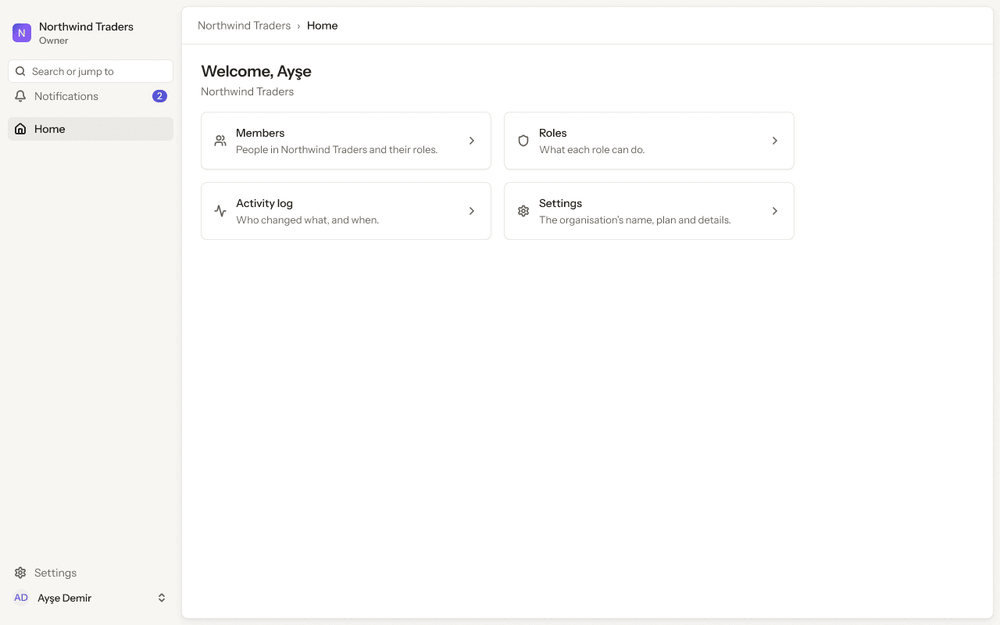

- **Who sees it:** Every signed-in member of an organisation.
- **Device:** Desktop (1280 px and wider).
- **This state shows:** as the title says.
- **Values come from:** Person, organisations and role: our API (current user and tenants). Unread count: our API notifications and the live stream. Environment strip: APP_ENVIRONMENT. Connection bar: the browser's network state and the API's health. App version: the build's commit.
- **Components:** Icon/activity, Icon/chevron-down ×4, Icon/settings, Icon/shield, Icon/users, Sidebar, Top bar.
- **Actions:**
  - "Home": goes to [4.01 · Home · Owner](../04-home/README.md#401--home--owner).
  - "Settings": goes to [7.01 · General · ideal](../07-settings-general/README.md#701--general--ideal).
- **Texts, word for word, top to bottom:**

  - N
  - Northwind Traders
  - Owner
  - Search or jump to
  - Notifications
  - 2
  - Home
  - Settings
  - AD
  - Ayşe Demir
  - Northwind Traders
  - ›
  - Home
  - Welcome, Ayşe
  - Northwind Traders
  - Members
  - People in Northwind Traders and their roles.
  - Roles
  - What each role can do.
  - Activity log
  - Who changed what, and when.
  - Settings
  - The organisation’s name, plan and details.

Figma: [59:4677](https://www.figma.com/design/3Ev111okX8xCBwR9B3hyBM/?node-id=59-4677)

### 2.02 · Shell · several organisations

- **Who sees it:** Every signed-in member of an organisation.
- **Device:** Desktop (1280 px and wider).
- **This state shows:** as the title says.
- **Values come from:** Person, organisations and role: our API (current user and tenants). Unread count: our API notifications and the live stream. Environment strip: APP_ENVIRONMENT. Connection bar: the browser's network state and the API's health. App version: the build's commit.
- **Components:** Icon/activity, Icon/chevron-down ×4, Icon/settings, Icon/shield, Icon/users, Sidebar, Top bar.
- **Actions:**
  - "Home": goes to [4.01 · Home · Owner](../04-home/README.md#401--home--owner).
  - "Settings": goes to [7.01 · General · ideal](../07-settings-general/README.md#701--general--ideal).
- **Texts, word for word, top to bottom:**

  - N
  - Northwind Traders
  - Owner
  - Search or jump to
  - Notifications
  - 2
  - Home
  - Settings
  - AD
  - Ayşe Demir
  - Northwind Traders
  - ›
  - Home
  - Welcome, Ayşe
  - Northwind Traders
  - Members
  - People in Northwind Traders and their roles.
  - Roles
  - What each role can do.
  - Activity log
  - Who changed what, and when.
  - Settings
  - The organisation’s name, plan and details.

Figma: [59:4964](https://www.figma.com/design/3Ev111okX8xCBwR9B3hyBM/?node-id=59-4964)

### 2.03 · Switcher menu

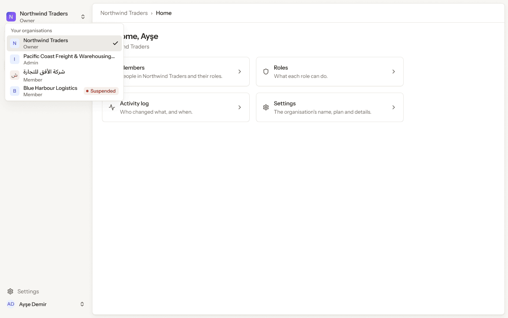

- **Who sees it:** Every signed-in member of an organisation.
- **Device:** Desktop (1280 px and wider).
- **This state shows:** as the title says.
- **Values come from:** Person, organisations and role: our API (current user and tenants). Unread count: our API notifications and the live stream. Environment strip: APP_ENVIRONMENT. Connection bar: the browser's network state and the API's health. App version: the build's commit.
- **Components:** Icon/activity, Icon/check, Icon/chevron-down ×4, Icon/settings, Icon/shield, Icon/users, Pill, Sidebar, Top bar.
- **Actions:**
  - "Home": goes to [4.01 · Home · Owner](../04-home/README.md#401--home--owner).
  - "Settings": goes to [7.01 · General · ideal](../07-settings-general/README.md#701--general--ideal).
- **Texts, word for word, top to bottom:**

  - N
  - Northwind Traders
  - Owner
  - Search or jump to
  - Notifications
  - 2
  - Home
  - Settings
  - AD
  - Ayşe Demir
  - Northwind Traders
  - ›
  - Home
  - Welcome, Ayşe
  - Northwind Traders
  - Members
  - People in Northwind Traders and their roles.
  - Roles
  - What each role can do.
  - Activity log
  - Who changed what, and when.
  - Settings
  - The organisation’s name, plan and details.
  - Your organisations
  - N
  - Northwind Traders
  - Owner
  - I
  - Pacific Coast Freight & Warehousing Cooperative Ltd.
  - Admin
  - ش
  - شركة الأفق للتجارة
  - Member
  - B
  - Blue Harbour Logistics
  - Member
  - Suspended

Figma: [59:5183](https://www.figma.com/design/3Ev111okX8xCBwR9B3hyBM/?node-id=59-5183)

### 2.04 · Command menu · several

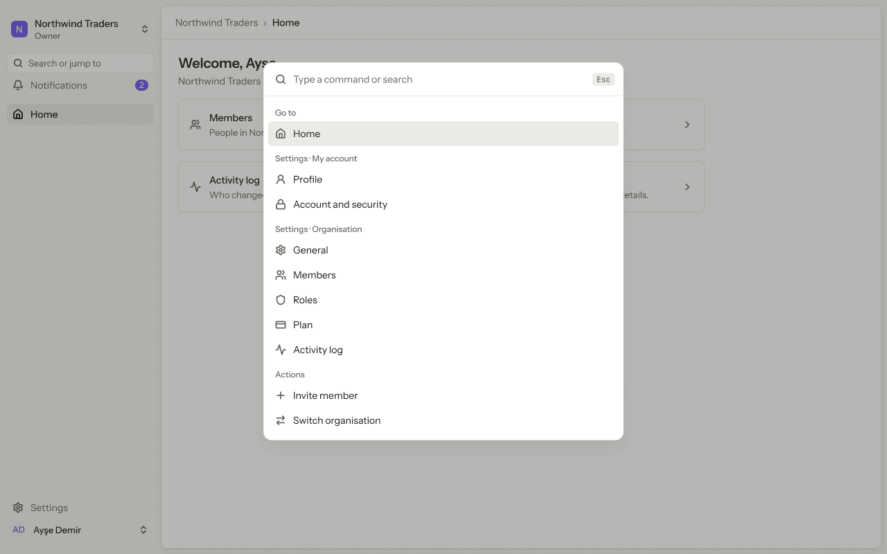

- **Who sees it:** Every signed-in member of an organisation.
- **Device:** Desktop (1280 px and wider).
- **This state shows:** as the title says.
- **Values come from:** Person, organisations and role: our API (current user and tenants). Unread count: our API notifications and the live stream. Environment strip: APP_ENVIRONMENT. Connection bar: the browser's network state and the API's health. App version: the build's commit.
- **Components:** Icon/activity ×2, Icon/arrow-right-left, Icon/chevron-down ×4, Icon/credit-card, Icon/home, Icon/lock, Icon/plus, Icon/search, Icon/settings ×2, Icon/shield ×2, Icon/user, Icon/users ×2, Kbd, Sidebar, Top bar.
- **Actions:**
  - "Home": goes to [4.01 · Home · Owner](../04-home/README.md#401--home--owner).
  - "Settings": goes to [7.01 · General · ideal](../07-settings-general/README.md#701--general--ideal).
- **Texts, word for word, top to bottom:**

  - N
  - Northwind Traders
  - Owner
  - Search or jump to
  - Notifications
  - 2
  - Home
  - Settings
  - AD
  - Ayşe Demir
  - Northwind Traders
  - ›
  - Home
  - Welcome, Ayşe
  - Northwind Traders
  - Members
  - People in Northwind Traders and their roles.
  - Roles
  - What each role can do.
  - Activity log
  - Who changed what, and when.
  - Settings
  - The organisation’s name, plan and details.
  - Type a command or search
  - Esc
  - Go to
  - Home
  - Settings · My account
  - Profile
  - Account and security
  - Settings · Organisation
  - General
  - Members
  - Roles
  - Plan
  - Activity log
  - Actions
  - Invite member
  - Switch organisation

Figma: [59:5435](https://www.figma.com/design/3Ev111okX8xCBwR9B3hyBM/?node-id=59-5435)

### 2.05 · Command menu · one

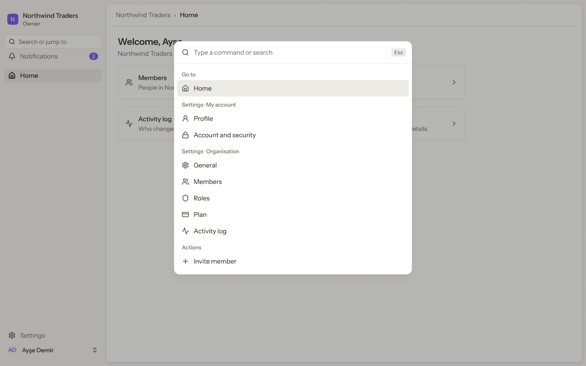

- **Who sees it:** Every signed-in member of an organisation.
- **Device:** Desktop (1280 px and wider).
- **This state shows:** as the title says.
- **Values come from:** Person, organisations and role: our API (current user and tenants). Unread count: our API notifications and the live stream. Environment strip: APP_ENVIRONMENT. Connection bar: the browser's network state and the API's health. App version: the build's commit.
- **Components:** Icon/activity ×2, Icon/chevron-down ×4, Icon/credit-card, Icon/home, Icon/lock, Icon/plus, Icon/search, Icon/settings ×2, Icon/shield ×2, Icon/user, Icon/users ×2, Kbd, Sidebar, Top bar.
- **Actions:**
  - "Home": goes to [4.01 · Home · Owner](../04-home/README.md#401--home--owner).
  - "Settings": goes to [7.01 · General · ideal](../07-settings-general/README.md#701--general--ideal).
- **Texts, word for word, top to bottom:**

  - N
  - Northwind Traders
  - Owner
  - Search or jump to
  - Notifications
  - 2
  - Home
  - Settings
  - AD
  - Ayşe Demir
  - Northwind Traders
  - ›
  - Home
  - Welcome, Ayşe
  - Northwind Traders
  - Members
  - People in Northwind Traders and their roles.
  - Roles
  - What each role can do.
  - Activity log
  - Who changed what, and when.
  - Settings
  - The organisation’s name, plan and details.
  - Type a command or search
  - Esc
  - Go to
  - Home
  - Settings · My account
  - Profile
  - Account and security
  - Settings · Organisation
  - General
  - Members
  - Roles
  - Plan
  - Activity log
  - Actions
  - Invite member

Figma: [59:5795](https://www.figma.com/design/3Ev111okX8xCBwR9B3hyBM/?node-id=59-5795)

### 2.06 · Account menu

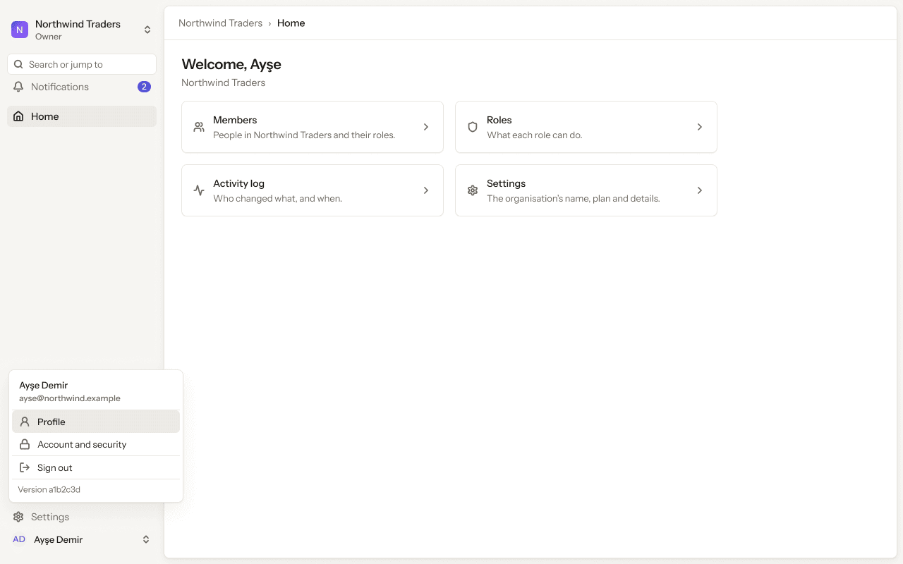

- **Who sees it:** Every signed-in member of an organisation.
- **Device:** Desktop (1280 px and wider).
- **This state shows:** as the title says.
- **Values come from:** Person, organisations and role: our API (current user and tenants). Unread count: our API notifications and the live stream. Environment strip: APP_ENVIRONMENT. Connection bar: the browser's network state and the API's health. App version: the build's commit.
- **Components:** Account menu · Version, Icon/activity, Icon/chevron-down ×4, Icon/settings, Icon/shield, Icon/users, Menu item ×3, Sidebar, Top bar.
- **Actions:**
  - "Version a1b2c3d": goes to node 218:1103 (not a numbered screen).
  - "People in Northwind Traders and their roles.": goes to [2.02 · Shell · several organisations](#202--shell--several-organisations).
  - "Home": goes to [4.01 · Home · Owner](../04-home/README.md#401--home--owner).
  - "Settings": goes to [7.01 · General · ideal](../07-settings-general/README.md#701--general--ideal).
- **Texts, word for word, top to bottom:**

  - N
  - Northwind Traders
  - Owner
  - Search or jump to
  - Notifications
  - 2
  - Home
  - Settings
  - AD
  - Ayşe Demir
  - Northwind Traders
  - ›
  - Home
  - Welcome, Ayşe
  - Northwind Traders
  - Members
  - People in Northwind Traders and their roles.
  - Roles
  - What each role can do.
  - Activity log
  - Who changed what, and when.
  - Settings
  - The organisation’s name, plan and details.
  - Ayşe Demir
  - ayse@northwind.example
  - Profile
  - Account and security
  - Sign out
  - Version a1b2c3d

Figma: [59:6512](https://www.figma.com/design/3Ev111okX8xCBwR9B3hyBM/?node-id=59-6512)

### 2.07 · Notifications open

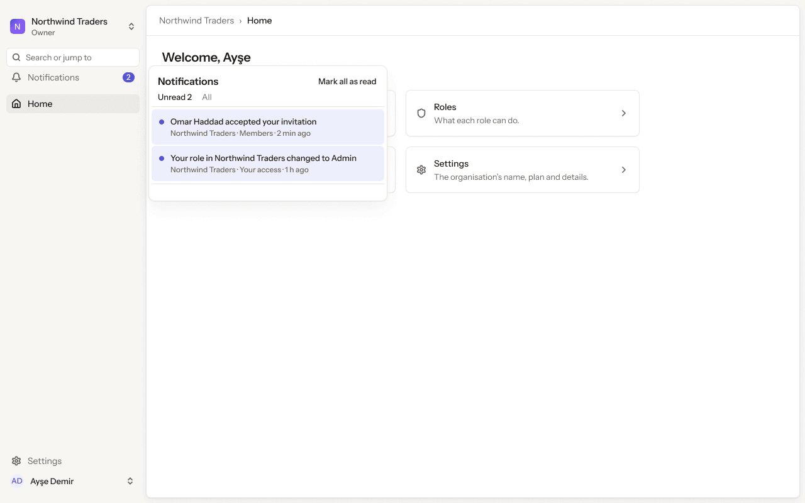

- **Who sees it:** Every signed-in member of an organisation.
- **Device:** Desktop (1280 px and wider).
- **This state shows:** as the title says.
- **Values come from:** Person, organisations and role: our API (current user and tenants). Unread count: our API notifications and the live stream. Environment strip: APP_ENVIRONMENT. Connection bar: the browser's network state and the API's health. App version: the build's commit.
- **Components:** Icon/activity, Icon/chevron-down ×4, Icon/settings, Icon/shield, Icon/users, Notifications popover, Sidebar, Top bar.
- **Actions:**
  - "Omar Haddad accepted your invitation": goes to [2.02 · Shell · several organisations](#202--shell--several-organisations).
  - "Home": goes to [4.01 · Home · Owner](../04-home/README.md#401--home--owner).
  - "Settings": goes to [7.01 · General · ideal](../07-settings-general/README.md#701--general--ideal).
- **Texts, word for word, top to bottom:**

  - N
  - Northwind Traders
  - Owner
  - Search or jump to
  - Notifications
  - 2
  - Home
  - Settings
  - AD
  - Ayşe Demir
  - Northwind Traders
  - ›
  - Home
  - Welcome, Ayşe
  - Northwind Traders
  - Members
  - People in Northwind Traders and their roles.
  - Roles
  - What each role can do.
  - Activity log
  - Who changed what, and when.
  - Settings
  - The organisation’s name, plan and details.
  - Notifications
  - Mark all as read
  - Unread 2
  - All
  - Omar Haddad accepted your invitation
  - Northwind Traders · Members · 2 min ago
  - Your role in Northwind Traders changed to Admin
  - Northwind Traders · Your access · 1 h ago

Figma: [59:6797](https://www.figma.com/design/3Ev111okX8xCBwR9B3hyBM/?node-id=59-6797)

### 2.08 · Tooltip

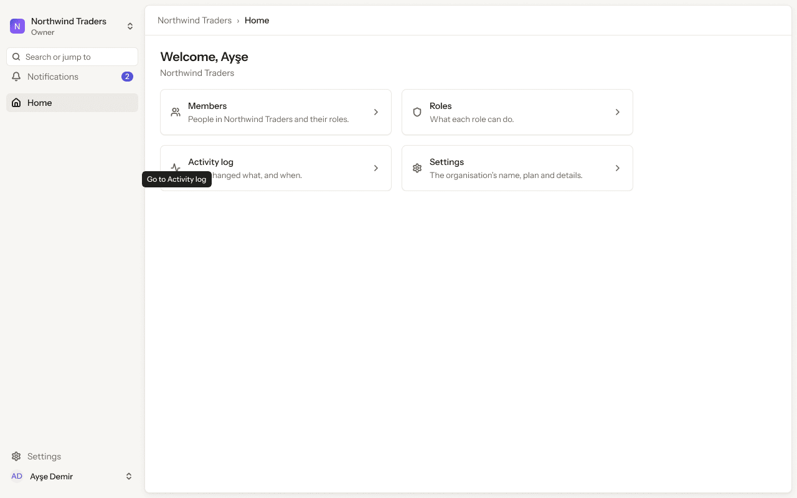

- **Who sees it:** Every signed-in member of an organisation.
- **Device:** Desktop (1280 px and wider).
- **This state shows:** as the title says.
- **Values come from:** Person, organisations and role: our API (current user and tenants). Unread count: our API notifications and the live stream. Environment strip: APP_ENVIRONMENT. Connection bar: the browser's network state and the API's health. App version: the build's commit.
- **Components:** Icon/activity, Icon/chevron-down ×4, Icon/settings, Icon/shield, Icon/users, Sidebar, Tooltip, Top bar.
- **Actions:**
  - "Home": goes to [4.01 · Home · Owner](../04-home/README.md#401--home--owner).
  - "Settings": goes to [7.01 · General · ideal](../07-settings-general/README.md#701--general--ideal).
- **Texts, word for word, top to bottom:**

  - N
  - Northwind Traders
  - Owner
  - Search or jump to
  - Notifications
  - 2
  - Home
  - Settings
  - AD
  - Ayşe Demir
  - Northwind Traders
  - ›
  - Home
  - Welcome, Ayşe
  - Northwind Traders
  - Members
  - People in Northwind Traders and their roles.
  - Roles
  - What each role can do.
  - Activity log
  - Who changed what, and when.
  - Settings
  - The organisation’s name, plan and details.
  - Go to Activity log

Figma: [59:7112](https://www.figma.com/design/3Ev111okX8xCBwR9B3hyBM/?node-id=59-7112)

### 2.09 · First load of the app

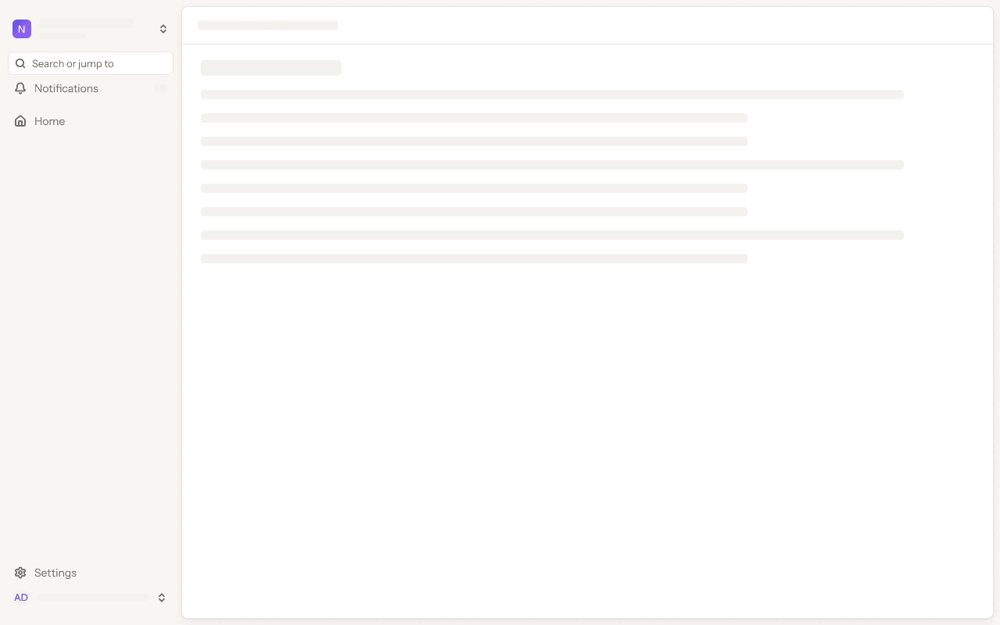

- **Who sees it:** Every signed-in member of an organisation.
- **Device:** Desktop (1280 px and wider).
- **This state shows:** as the title says.
- **Values come from:** Person, organisations and role: our API (current user and tenants). Unread count: our API notifications and the live stream. Environment strip: APP_ENVIRONMENT. Connection bar: the browser's network state and the API's health. App version: the build's commit.
- **Components:** Sidebar, Skeleton ×9, Top bar.
- **Actions:**
  - "Home": goes to [4.01 · Home · Owner](../04-home/README.md#401--home--owner).
  - "Settings": goes to [7.01 · General · ideal](../07-settings-general/README.md#701--general--ideal).
- **Texts, word for word, top to bottom:**

  - N
  - Search or jump to
  - Notifications
  - Home
  - Settings
  - AD

Figma: [59:7402](https://www.figma.com/design/3Ev111okX8xCBwR9B3hyBM/?node-id=59-7402)

### 2.10 · Page not found

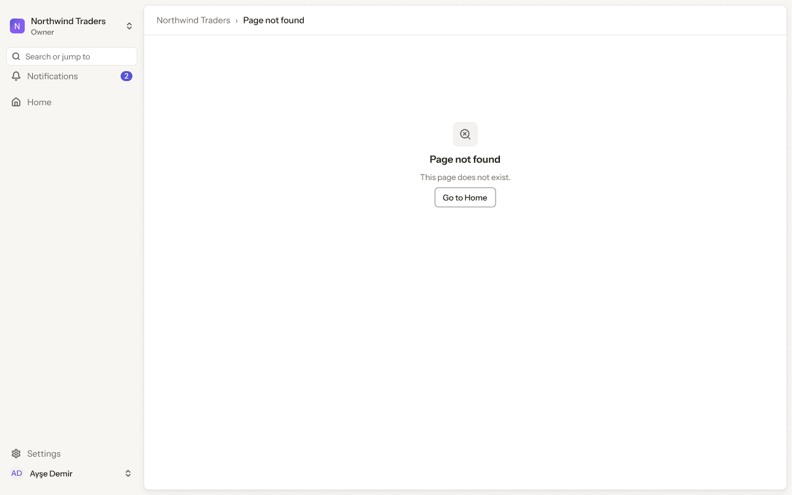

- **Who sees it:** Every signed-in member of an organisation.
- **Device:** Desktop (1280 px and wider).
- **This state shows:** when the address points to nothing the person can open.
- **Values come from:** Person, organisations and role: our API (current user and tenants). Unread count: our API notifications and the live stream. Environment strip: APP_ENVIRONMENT. Connection bar: the browser's network state and the API's health. App version: the build's commit.
- **Components:** Empty state, Sidebar, Top bar.
- **Actions:**
  - "Home": goes to [4.01 · Home · Owner](../04-home/README.md#401--home--owner).
  - "Settings": goes to [7.01 · General · ideal](../07-settings-general/README.md#701--general--ideal).
  - "Go to Home": goes to [4.01 · Home · Owner](../04-home/README.md#401--home--owner).
- **Texts, word for word, top to bottom:**

  - N
  - Northwind Traders
  - Owner
  - Search or jump to
  - Notifications
  - 2
  - Home
  - Settings
  - AD
  - Ayşe Demir
  - Northwind Traders
  - ›
  - Page not found
  - Page not found
  - This page does not exist.
  - Go to Home

Figma: [59:7490](https://www.figma.com/design/3Ev111okX8xCBwR9B3hyBM/?node-id=59-7490)

### 2.11 · Section failed

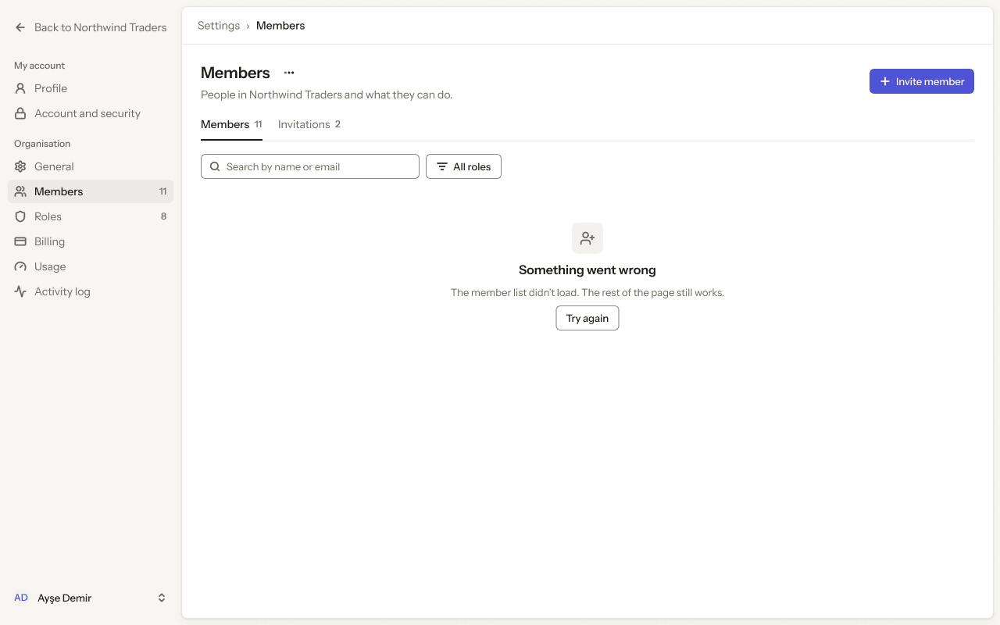

- **Who sees it:** Every signed-in member of an organisation.
- **Device:** Desktop (1280 px and wider).
- **This state shows:** when the action fails.
- **Values come from:** Person, organisations and role: our API (current user and tenants). Unread count: our API notifications and the live stream. Environment strip: APP_ENVIRONMENT. Connection bar: the browser's network state and the API's health. App version: the build's commit.
- **Components:** Button ×3, Empty state, Input, Sidebar, Tab ×2, Top bar.
- **Actions:**
  - "Back to Northwind Traders": goes to [4.01 · Home · Owner](../04-home/README.md#401--home--owner).
  - "Profile": goes to [5.01 · Profile · ideal](../05-settings-profile/README.md#501--profile--ideal).
  - "Account and security": goes to [6.01 · Account and security · ideal](../06-settings-account-and-security/README.md#601--account-and-security--ideal).
  - "General": goes to [7.01 · General · ideal](../07-settings-general/README.md#701--general--ideal).
  - "Members": goes to [8.01 · Members · ideal](../08-settings-members/README.md#801--members--ideal).
  - "Roles": goes to [9.01 · Roles · ideal](../09-settings-roles/README.md#901--roles--ideal).
  - "Billing": goes to [10.01 · Billing · Team, monthly](../10-settings-billing/README.md#1001--billing--team-monthly).
  - "Usage": goes to [11.01 · Usage · Team](../11-settings-usage/README.md#1101--usage--team).
  - "Activity log": goes to [12.01 · Activity log · ideal](../12-settings-activity-log/README.md#1201--activity-log--ideal).
- **Texts, word for word, top to bottom:**

  - Back to Northwind Traders
  - My account
  - Profile
  - Account and security
  - Organisation
  - General
  - Members
  - 11
  - Roles
  - 8
  - Billing
  - Usage
  - Activity log
  - AD
  - Ayşe Demir
  - Settings
  - ›
  - Members
  - Members
  - People in Northwind Traders and what they can do.
  - Invite member
  - Members
  - 11
  - Invitations
  - 2
  - Search by name or email
  - All roles
  - Something went wrong
  - The member list didn’t load. The rest of the page still works.
  - Try again

Figma: [164:17821](https://www.figma.com/design/3Ev111okX8xCBwR9B3hyBM/?node-id=164-17821)

### 2.12 · App couldn’t start

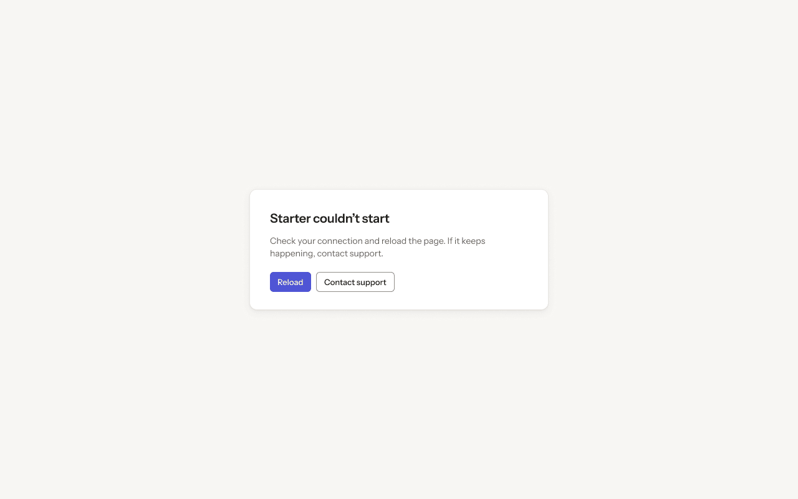

- **Who sees it:** Every signed-in member of an organisation.
- **Device:** Desktop (1280 px and wider).
- **This state shows:** as the title says.
- **Values come from:** Person, organisations and role: our API (current user and tenants). Unread count: our API notifications and the live stream. Environment strip: APP_ENVIRONMENT. Connection bar: the browser's network state and the API's health. App version: the build's commit.
- **Components:** Button ×2.
- **Actions:**
  - No prototype link on this screen. The buttons follow the section's other screens.
- **Texts, word for word, top to bottom:**

  - Starter couldn’t start
  - Check your connection and reload the page. If it keeps happening, contact support.
  - Reload
  - Contact support

Figma: [164:18154](https://www.figma.com/design/3Ev111okX8xCBwR9B3hyBM/?node-id=164-18154)

### 2.13 · Organisation suspended

- **Who sees it:** Every signed-in member of an organisation.
- **Device:** Desktop (1280 px and wider).
- **This state shows:** when the organisation or person is suspended.
- **Values come from:** Person, organisations and role: our API (current user and tenants). Unread count: our API notifications and the live stream. Environment strip: APP_ENVIRONMENT. Connection bar: the browser's network state and the API's health. App version: the build's commit.
- **Components:** Button ×2.
- **Actions:**
  - No prototype link on this screen. The buttons follow the section's other screens.
- **Texts, word for word, top to bottom:**

  - Northwind Traders is suspended
  - You cannot open this organisation right now. Your data and your membership are kept. Contact your organisation’s Owner if you need to know more.
  - Go to my organisations
  - Sign out

Figma: [59:8114](https://www.figma.com/design/3Ev111okX8xCBwR9B3hyBM/?node-id=59-8114)

### 2.14 · Organisation closed

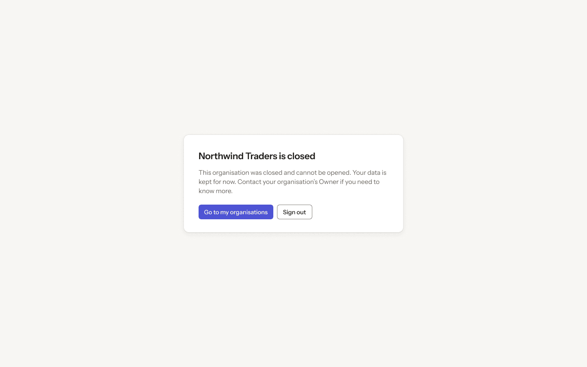

- **Who sees it:** Every signed-in member of an organisation.
- **Device:** Desktop (1280 px and wider).
- **This state shows:** as the title says.
- **Values come from:** Person, organisations and role: our API (current user and tenants). Unread count: our API notifications and the live stream. Environment strip: APP_ENVIRONMENT. Connection bar: the browser's network state and the API's health. App version: the build's commit.
- **Components:** Button ×2.
- **Actions:**
  - No prototype link on this screen. The buttons follow the section's other screens.
- **Texts, word for word, top to bottom:**

  - Northwind Traders is closed
  - This organisation was closed and cannot be opened. Your data is kept for now. Contact your organisation’s Owner if you need to know more.
  - Go to my organisations
  - Sign out

Figma: [59:8132](https://www.figma.com/design/3Ev111okX8xCBwR9B3hyBM/?node-id=59-8132)

### 2.15 · No permission

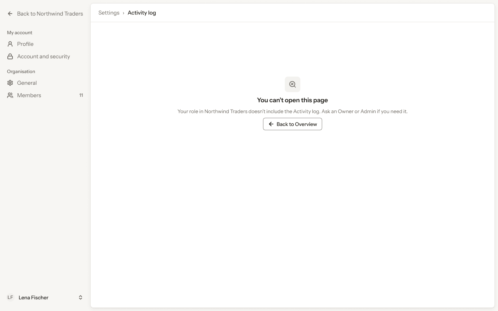

- **Who sees it:** Every signed-in member of an organisation.
- **Device:** Desktop (1280 px and wider).
- **This state shows:** as the title says.
- **Values come from:** Person, organisations and role: our API (current user and tenants). Unread count: our API notifications and the live stream. Environment strip: APP_ENVIRONMENT. Connection bar: the browser's network state and the API's health. App version: the build's commit.
- **Components:** Empty state, Sidebar, Top bar.
- **Actions:**
  - "Back to Northwind Traders": goes to [4.01 · Home · Owner](../04-home/README.md#401--home--owner).
  - "Profile": goes to [5.01 · Profile · ideal](../05-settings-profile/README.md#501--profile--ideal).
  - "Account and security": goes to [6.01 · Account and security · ideal](../06-settings-account-and-security/README.md#601--account-and-security--ideal).
  - "General": goes to [7.01 · General · ideal](../07-settings-general/README.md#701--general--ideal).
  - "Members": goes to [8.01 · Members · ideal](../08-settings-members/README.md#801--members--ideal).
- **Texts, word for word, top to bottom:**

  - Back to Northwind Traders
  - My account
  - Profile
  - Account and security
  - Organisation
  - General
  - Members
  - 11
  - LF
  - Lena Fischer
  - Settings
  - ›
  - Activity log
  - You can’t open this page
  - Your role in Northwind Traders doesn’t include the Activity log. Ask an Owner or Admin if you need it.
  - Back to Overview

Figma: [113:11654](https://www.figma.com/design/3Ev111okX8xCBwR9B3hyBM/?node-id=113-11654)

### 2.16 · Role changed while open

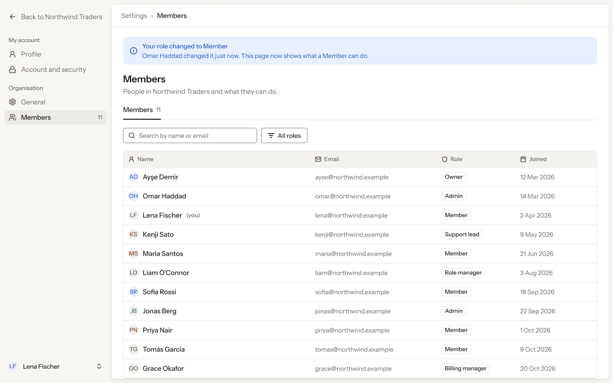

- **Who sees it:** Every signed-in member of an organisation.
- **Device:** Desktop (1280 px and wider).
- **This state shows:** as the title says.
- **Values come from:** Person, organisations and role: our API (current user and tenants). Unread count: our API notifications and the live stream. Environment strip: APP_ENVIRONMENT. Connection bar: the browser's network state and the API's health. App version: the build's commit.
- **Components:** Avatar ×11, Banner, Button, Icon/calendar, Icon/mail, Icon/shield, Icon/user, Input, Label ×11, Sidebar, Tab, Top bar.
- **Actions:**
  - "Back to Northwind Traders": goes to [4.01 · Home · Owner](../04-home/README.md#401--home--owner).
  - "Profile": goes to [5.01 · Profile · ideal](../05-settings-profile/README.md#501--profile--ideal).
  - "Account and security": goes to [6.01 · Account and security · ideal](../06-settings-account-and-security/README.md#601--account-and-security--ideal).
  - "General": goes to [7.01 · General · ideal](../07-settings-general/README.md#701--general--ideal).
  - "Members": goes to [8.01 · Members · ideal](../08-settings-members/README.md#801--members--ideal).
- **Texts, word for word, top to bottom:**

  - Back to Northwind Traders
  - My account
  - Profile
  - Account and security
  - Organisation
  - General
  - Members
  - 11
  - LF
  - Lena Fischer
  - Settings
  - ›
  - Members
  - Your role changed to Member
  - Omar Haddad changed it just now. This page now shows what a Member can do.
  - Members
  - People in Northwind Traders and what they can do.
  - Members
  - 11
  - Search by name or email
  - All roles
  - Name
  - Email
  - Role
  - Joined
  - AD
  - Ayşe Demir
  - ayse@northwind.example
  - Owner
  - 12 Mar 2026
  - OH
  - Omar Haddad
  - omar@northwind.example
  - Admin
  - 14 Mar 2026
  - LF
  - Lena Fischer
  - (you)
  - lena@northwind.example
  - Member
  - 2 Apr 2026
  - KS
  - Kenji Sato
  - kenji@northwind.example
  - Support lead
  - 9 May 2026
  - MS
  - Maria Santos
  - maria@northwind.example
  - Member
  - 21 Jun 2026
  - LO
  - Liam O’Connor
  - liam@northwind.example
  - Role manager
  - 3 Aug 2026
  - SR
  - Sofia Rossi
  - sofia@northwind.example
  - Member
  - 18 Sep 2026
  - JB
  - Jonas Berg
  - jonas@northwind.example
  - Admin
  - 22 Sep 2026
  - PN
  - Priya Nair
  - priya@northwind.example
  - Member
  - 1 Oct 2026
  - TG
  - Tomás García
  - tomas@northwind.example
  - Member
  - 9 Oct 2026
  - GO
  - Grace Okafor
  - grace@northwind.example
  - Billing manager
  - 20 Oct 2026

Figma: [113:11748](https://www.figma.com/design/3Ev111okX8xCBwR9B3hyBM/?node-id=113-11748)

### 2.17 · Suspended while open

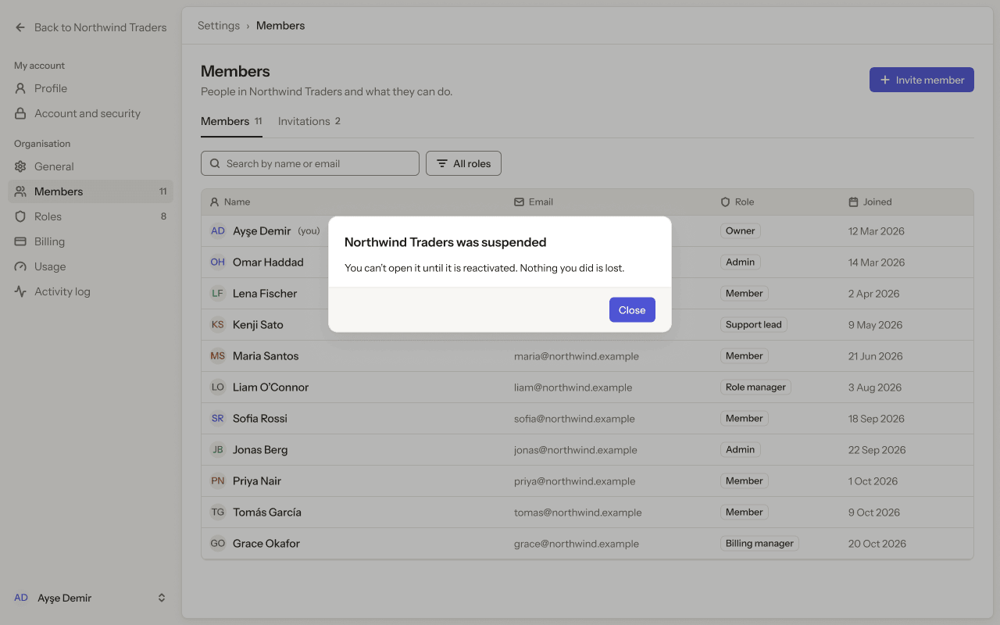

- **Who sees it:** Every signed-in member of an organisation.
- **Device:** Desktop (1280 px and wider).
- **This state shows:** when the organisation or person is suspended.
- **Values come from:** Person, organisations and role: our API (current user and tenants). Unread count: our API notifications and the live stream. Environment strip: APP_ENVIRONMENT. Connection bar: the browser's network state and the API's health. App version: the build's commit.
- **Components:** Avatar ×11, Button ×3, Icon/calendar, Icon/mail, Icon/shield, Icon/user, Input, Label ×11, Sidebar, Tab ×2, Top bar.
- **Actions:**
  - "Back to Northwind Traders": goes to [4.01 · Home · Owner](../04-home/README.md#401--home--owner).
  - "Profile": goes to [5.01 · Profile · ideal](../05-settings-profile/README.md#501--profile--ideal).
  - "Account and security": goes to [6.01 · Account and security · ideal](../06-settings-account-and-security/README.md#601--account-and-security--ideal).
  - "General": goes to [7.01 · General · ideal](../07-settings-general/README.md#701--general--ideal).
  - "Members": goes to [8.01 · Members · ideal](../08-settings-members/README.md#801--members--ideal).
  - "Roles": goes to [9.01 · Roles · ideal](../09-settings-roles/README.md#901--roles--ideal).
  - "Billing": goes to [10.01 · Billing · Team, monthly](../10-settings-billing/README.md#1001--billing--team-monthly).
  - "Usage": goes to [11.01 · Usage · Team](../11-settings-usage/README.md#1101--usage--team).
  - "Activity log": goes to [12.01 · Activity log · ideal](../12-settings-activity-log/README.md#1201--activity-log--ideal).
- **Texts, word for word, top to bottom:**

  - Back to Northwind Traders
  - My account
  - Profile
  - Account and security
  - Organisation
  - General
  - Members
  - 11
  - Roles
  - 8
  - Billing
  - Usage
  - Activity log
  - AD
  - Ayşe Demir
  - Settings
  - ›
  - Members
  - Members
  - People in Northwind Traders and what they can do.
  - Invite member
  - Members
  - 11
  - Invitations
  - 2
  - Search by name or email
  - All roles
  - Name
  - Email
  - Role
  - Joined
  - AD
  - Ayşe Demir
  - (you)
  - ayse@northwind.example
  - Owner
  - 12 Mar 2026
  - OH
  - Omar Haddad
  - omar@northwind.example
  - Admin
  - 14 Mar 2026
  - LF
  - Lena Fischer
  - lena@northwind.example
  - Member
  - 2 Apr 2026
  - KS
  - Kenji Sato
  - kenji@northwind.example
  - Support lead
  - 9 May 2026
  - MS
  - Maria Santos
  - maria@northwind.example
  - Member
  - 21 Jun 2026
  - LO
  - Liam O’Connor
  - liam@northwind.example
  - Role manager
  - 3 Aug 2026
  - SR
  - Sofia Rossi
  - sofia@northwind.example
  - Member
  - 18 Sep 2026
  - JB
  - Jonas Berg
  - jonas@northwind.example
  - Admin
  - 22 Sep 2026
  - PN
  - Priya Nair
  - priya@northwind.example
  - Member
  - 1 Oct 2026
  - TG
  - Tomás García
  - tomas@northwind.example
  - Member
  - 9 Oct 2026
  - GO
  - Grace Okafor
  - grace@northwind.example
  - Billing manager
  - 20 Oct 2026
  - Northwind Traders was suspended
  - You can’t open it until it is reactivated. Nothing you did is lost.
  - Close

Figma: [113:12049](https://www.figma.com/design/3Ev111okX8xCBwR9B3hyBM/?node-id=113-12049)

### 2.18 · Session ended

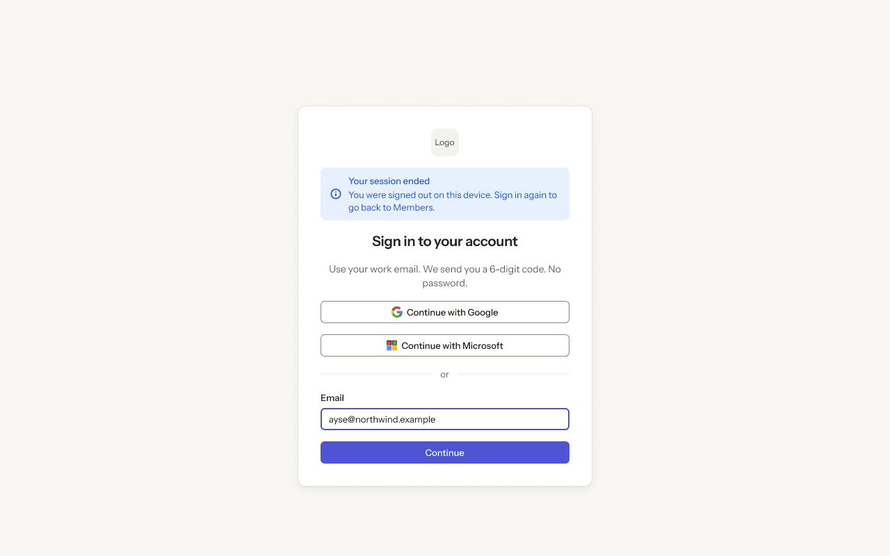

- **Who sees it:** Every signed-in member of an organisation.
- **Device:** Desktop (1280 px and wider).
- **This state shows:** as the title says.
- **Values come from:** Person, organisations and role: our API (current user and tenants). Unread count: our API notifications and the live stream. Environment strip: APP_ENVIRONMENT. Connection bar: the browser's network state and the API's health. App version: the build's commit.
- **Components:** Banner, Button ×3, Input.
- **Actions:**
  - No prototype link on this screen. The buttons follow the section's other screens.
- **Texts, word for word, top to bottom:**

  - Logo
  - Your session ended
  - You were signed out on this device. Sign in again to go back to Members.
  - Sign in to your account
  - Use your work email. We send you a 6-digit code. No password.
  - Continue with Google
  - Continue with Microsoft
  - or
  - Email
  - ayse@northwind.example
  - Continue

Figma: [113:12365](https://www.figma.com/design/3Ev111okX8xCBwR9B3hyBM/?node-id=113-12365)

### 2.19 · Offline

- **Who sees it:** Every signed-in member of an organisation.
- **Device:** Desktop (1280 px and wider).
- **This state shows:** when the browser loses the network.
- **Values come from:** Person, organisations and role: our API (current user and tenants). Unread count: our API notifications and the live stream. Environment strip: APP_ENVIRONMENT. Connection bar: the browser's network state and the API's health. App version: the build's commit.
- **Components:** Avatar ×11, Button ×3, Connection bar, Icon/calendar, Icon/mail, Icon/shield, Icon/user, Input, Label ×11, Sidebar, Tab ×2, Top bar.
- **Actions:**
  - "Back to Northwind Traders": goes to [4.01 · Home · Owner](../04-home/README.md#401--home--owner).
  - "Profile": goes to [5.01 · Profile · ideal](../05-settings-profile/README.md#501--profile--ideal).
  - "Account and security": goes to [6.01 · Account and security · ideal](../06-settings-account-and-security/README.md#601--account-and-security--ideal).
  - "General": goes to [7.01 · General · ideal](../07-settings-general/README.md#701--general--ideal).
  - "Members": goes to [8.01 · Members · ideal](../08-settings-members/README.md#801--members--ideal).
  - "Roles": goes to [9.01 · Roles · ideal](../09-settings-roles/README.md#901--roles--ideal).
  - "Billing": goes to [10.01 · Billing · Team, monthly](../10-settings-billing/README.md#1001--billing--team-monthly).
  - "Usage": goes to [11.01 · Usage · Team](../11-settings-usage/README.md#1101--usage--team).
  - "Activity log": goes to [12.01 · Activity log · ideal](../12-settings-activity-log/README.md#1201--activity-log--ideal).
- **Texts, word for word, top to bottom:**

  - Back to Northwind Traders
  - My account
  - Profile
  - Account and security
  - Organisation
  - General
  - Members
  - 11
  - Roles
  - 8
  - Billing
  - Usage
  - Activity log
  - AD
  - Ayşe Demir
  - You’re offline. Trying again in 5 s ·
  - Try now
  - Settings
  - ›
  - Members
  - Members
  - People in Northwind Traders and what they can do.
  - Invite member
  - Members
  - 11
  - Invitations
  - 2
  - Search by name or email
  - All roles
  - Name
  - Email
  - Role
  - Joined
  - AD
  - Ayşe Demir
  - (you)
  - ayse@northwind.example
  - Owner
  - 12 Mar 2026
  - OH
  - Omar Haddad
  - omar@northwind.example
  - Admin
  - 14 Mar 2026
  - LF
  - Lena Fischer
  - lena@northwind.example
  - Member
  - 2 Apr 2026
  - KS
  - Kenji Sato
  - kenji@northwind.example
  - Support lead
  - 9 May 2026
  - MS
  - Maria Santos
  - maria@northwind.example
  - Member
  - 21 Jun 2026
  - LO
  - Liam O’Connor
  - liam@northwind.example
  - Role manager
  - 3 Aug 2026
  - SR
  - Sofia Rossi
  - sofia@northwind.example
  - Member
  - 18 Sep 2026
  - JB
  - Jonas Berg
  - jonas@northwind.example
  - Admin
  - 22 Sep 2026
  - PN
  - Priya Nair
  - priya@northwind.example
  - Member
  - 1 Oct 2026
  - TG
  - Tomás García
  - tomas@northwind.example
  - Member
  - 9 Oct 2026
  - GO
  - Grace Okafor
  - grace@northwind.example
  - Billing manager
  - 20 Oct 2026

Figma: [164:16542](https://www.figma.com/design/3Ev111okX8xCBwR9B3hyBM/?node-id=164-16542)

### 2.20 · Offline · waiting longer

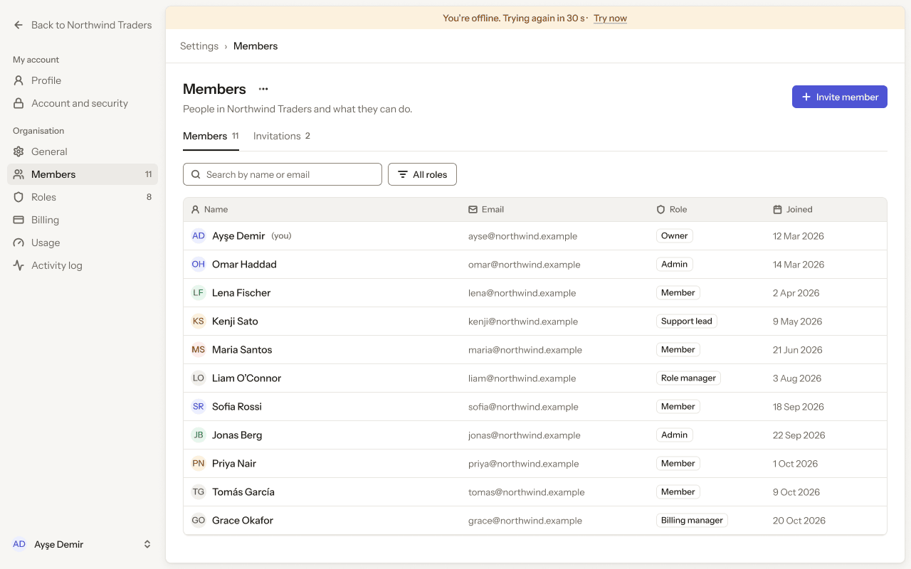

- **Who sees it:** Every signed-in member of an organisation.
- **Device:** Desktop (1280 px and wider).
- **This state shows:** when the browser loses the network.
- **Values come from:** Person, organisations and role: our API (current user and tenants). Unread count: our API notifications and the live stream. Environment strip: APP_ENVIRONMENT. Connection bar: the browser's network state and the API's health. App version: the build's commit.
- **Components:** Avatar ×11, Button ×3, Connection bar, Icon/calendar, Icon/mail, Icon/shield, Icon/user, Input, Label ×11, Sidebar, Tab ×2, Top bar.
- **Actions:**
  - "Back to Northwind Traders": goes to [4.01 · Home · Owner](../04-home/README.md#401--home--owner).
  - "Profile": goes to [5.01 · Profile · ideal](../05-settings-profile/README.md#501--profile--ideal).
  - "Account and security": goes to [6.01 · Account and security · ideal](../06-settings-account-and-security/README.md#601--account-and-security--ideal).
  - "General": goes to [7.01 · General · ideal](../07-settings-general/README.md#701--general--ideal).
  - "Members": goes to [8.01 · Members · ideal](../08-settings-members/README.md#801--members--ideal).
  - "Roles": goes to [9.01 · Roles · ideal](../09-settings-roles/README.md#901--roles--ideal).
  - "Billing": goes to [10.01 · Billing · Team, monthly](../10-settings-billing/README.md#1001--billing--team-monthly).
  - "Usage": goes to [11.01 · Usage · Team](../11-settings-usage/README.md#1101--usage--team).
  - "Activity log": goes to [12.01 · Activity log · ideal](../12-settings-activity-log/README.md#1201--activity-log--ideal).
- **Texts, word for word, top to bottom:**

  - Back to Northwind Traders
  - My account
  - Profile
  - Account and security
  - Organisation
  - General
  - Members
  - 11
  - Roles
  - 8
  - Billing
  - Usage
  - Activity log
  - AD
  - Ayşe Demir
  - You’re offline. Trying again in 30 s ·
  - Try now
  - Settings
  - ›
  - Members
  - Members
  - People in Northwind Traders and what they can do.
  - Invite member
  - Members
  - 11
  - Invitations
  - 2
  - Search by name or email
  - All roles
  - Name
  - Email
  - Role
  - Joined
  - AD
  - Ayşe Demir
  - (you)
  - ayse@northwind.example
  - Owner
  - 12 Mar 2026
  - OH
  - Omar Haddad
  - omar@northwind.example
  - Admin
  - 14 Mar 2026
  - LF
  - Lena Fischer
  - lena@northwind.example
  - Member
  - 2 Apr 2026
  - KS
  - Kenji Sato
  - kenji@northwind.example
  - Support lead
  - 9 May 2026
  - MS
  - Maria Santos
  - maria@northwind.example
  - Member
  - 21 Jun 2026
  - LO
  - Liam O’Connor
  - liam@northwind.example
  - Role manager
  - 3 Aug 2026
  - SR
  - Sofia Rossi
  - sofia@northwind.example
  - Member
  - 18 Sep 2026
  - JB
  - Jonas Berg
  - jonas@northwind.example
  - Admin
  - 22 Sep 2026
  - PN
  - Priya Nair
  - priya@northwind.example
  - Member
  - 1 Oct 2026
  - TG
  - Tomás García
  - tomas@northwind.example
  - Member
  - 9 Oct 2026
  - GO
  - Grace Okafor
  - grace@northwind.example
  - Billing manager
  - 20 Oct 2026

Figma: [164:16862](https://www.figma.com/design/3Ev111okX8xCBwR9B3hyBM/?node-id=164-16862)

### 2.21 · Back online

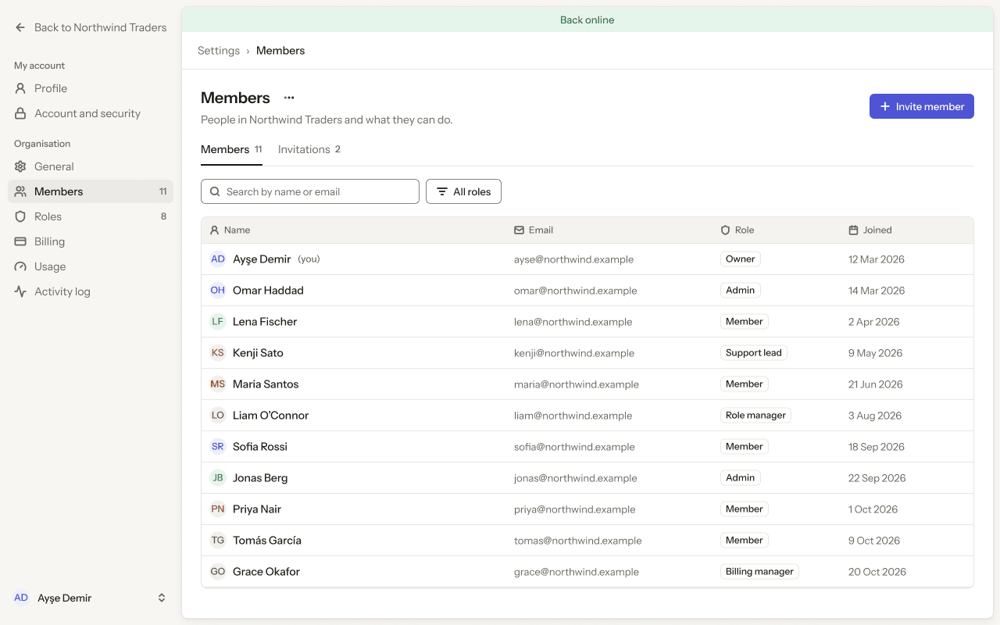

- **Who sees it:** Every signed-in member of an organisation.
- **Device:** Desktop (1280 px and wider).
- **This state shows:** as the title says.
- **Values come from:** Person, organisations and role: our API (current user and tenants). Unread count: our API notifications and the live stream. Environment strip: APP_ENVIRONMENT. Connection bar: the browser's network state and the API's health. App version: the build's commit.
- **Components:** Avatar ×11, Button ×3, Connection bar, Icon/calendar, Icon/mail, Icon/shield, Icon/user, Input, Label ×11, Sidebar, Tab ×2, Top bar.
- **Actions:**
  - "Back to Northwind Traders": goes to [4.01 · Home · Owner](../04-home/README.md#401--home--owner).
  - "Profile": goes to [5.01 · Profile · ideal](../05-settings-profile/README.md#501--profile--ideal).
  - "Account and security": goes to [6.01 · Account and security · ideal](../06-settings-account-and-security/README.md#601--account-and-security--ideal).
  - "General": goes to [7.01 · General · ideal](../07-settings-general/README.md#701--general--ideal).
  - "Members": goes to [8.01 · Members · ideal](../08-settings-members/README.md#801--members--ideal).
  - "Roles": goes to [9.01 · Roles · ideal](../09-settings-roles/README.md#901--roles--ideal).
  - "Billing": goes to [10.01 · Billing · Team, monthly](../10-settings-billing/README.md#1001--billing--team-monthly).
  - "Usage": goes to [11.01 · Usage · Team](../11-settings-usage/README.md#1101--usage--team).
  - "Activity log": goes to [12.01 · Activity log · ideal](../12-settings-activity-log/README.md#1201--activity-log--ideal).
- **Texts, word for word, top to bottom:**

  - Back to Northwind Traders
  - My account
  - Profile
  - Account and security
  - Organisation
  - General
  - Members
  - 11
  - Roles
  - 8
  - Billing
  - Usage
  - Activity log
  - AD
  - Ayşe Demir
  - Back online
  - Settings
  - ›
  - Members
  - Members
  - People in Northwind Traders and what they can do.
  - Invite member
  - Members
  - 11
  - Invitations
  - 2
  - Search by name or email
  - All roles
  - Name
  - Email
  - Role
  - Joined
  - AD
  - Ayşe Demir
  - (you)
  - ayse@northwind.example
  - Owner
  - 12 Mar 2026
  - OH
  - Omar Haddad
  - omar@northwind.example
  - Admin
  - 14 Mar 2026
  - LF
  - Lena Fischer
  - lena@northwind.example
  - Member
  - 2 Apr 2026
  - KS
  - Kenji Sato
  - kenji@northwind.example
  - Support lead
  - 9 May 2026
  - MS
  - Maria Santos
  - maria@northwind.example
  - Member
  - 21 Jun 2026
  - LO
  - Liam O’Connor
  - liam@northwind.example
  - Role manager
  - 3 Aug 2026
  - SR
  - Sofia Rossi
  - sofia@northwind.example
  - Member
  - 18 Sep 2026
  - JB
  - Jonas Berg
  - jonas@northwind.example
  - Admin
  - 22 Sep 2026
  - PN
  - Priya Nair
  - priya@northwind.example
  - Member
  - 1 Oct 2026
  - TG
  - Tomás García
  - tomas@northwind.example
  - Member
  - 9 Oct 2026
  - GO
  - Grace Okafor
  - grace@northwind.example
  - Billing manager
  - 20 Oct 2026

Figma: [164:17182](https://www.figma.com/design/3Ev111okX8xCBwR9B3hyBM/?node-id=164-17182)

### 2.22 · Server not answering

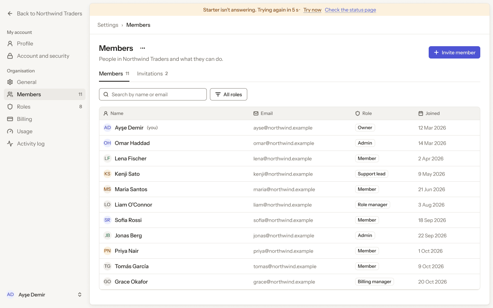

- **Who sees it:** Every signed-in member of an organisation.
- **Device:** Desktop (1280 px and wider).
- **This state shows:** as the title says.
- **Values come from:** Person, organisations and role: our API (current user and tenants). Unread count: our API notifications and the live stream. Environment strip: APP_ENVIRONMENT. Connection bar: the browser's network state and the API's health. App version: the build's commit.
- **Components:** Avatar ×11, Button ×3, Connection bar, Icon/calendar, Icon/mail, Icon/shield, Icon/user, Input, Label ×11, Sidebar, Tab ×2, Top bar.
- **Actions:**
  - "Back to Northwind Traders": goes to [4.01 · Home · Owner](../04-home/README.md#401--home--owner).
  - "Profile": goes to [5.01 · Profile · ideal](../05-settings-profile/README.md#501--profile--ideal).
  - "Account and security": goes to [6.01 · Account and security · ideal](../06-settings-account-and-security/README.md#601--account-and-security--ideal).
  - "General": goes to [7.01 · General · ideal](../07-settings-general/README.md#701--general--ideal).
  - "Members": goes to [8.01 · Members · ideal](../08-settings-members/README.md#801--members--ideal).
  - "Roles": goes to [9.01 · Roles · ideal](../09-settings-roles/README.md#901--roles--ideal).
  - "Billing": goes to [10.01 · Billing · Team, monthly](../10-settings-billing/README.md#1001--billing--team-monthly).
  - "Usage": goes to [11.01 · Usage · Team](../11-settings-usage/README.md#1101--usage--team).
  - "Activity log": goes to [12.01 · Activity log · ideal](../12-settings-activity-log/README.md#1201--activity-log--ideal).
- **Texts, word for word, top to bottom:**

  - Back to Northwind Traders
  - My account
  - Profile
  - Account and security
  - Organisation
  - General
  - Members
  - 11
  - Roles
  - 8
  - Billing
  - Usage
  - Activity log
  - AD
  - Ayşe Demir
  - Starter isn’t answering. Trying again in 5 s ·
  - Try now
  - Check the status page
  - Settings
  - ›
  - Members
  - Members
  - People in Northwind Traders and what they can do.
  - Invite member
  - Members
  - 11
  - Invitations
  - 2
  - Search by name or email
  - All roles
  - Name
  - Email
  - Role
  - Joined
  - AD
  - Ayşe Demir
  - (you)
  - ayse@northwind.example
  - Owner
  - 12 Mar 2026
  - OH
  - Omar Haddad
  - omar@northwind.example
  - Admin
  - 14 Mar 2026
  - LF
  - Lena Fischer
  - lena@northwind.example
  - Member
  - 2 Apr 2026
  - KS
  - Kenji Sato
  - kenji@northwind.example
  - Support lead
  - 9 May 2026
  - MS
  - Maria Santos
  - maria@northwind.example
  - Member
  - 21 Jun 2026
  - LO
  - Liam O’Connor
  - liam@northwind.example
  - Role manager
  - 3 Aug 2026
  - SR
  - Sofia Rossi
  - sofia@northwind.example
  - Member
  - 18 Sep 2026
  - JB
  - Jonas Berg
  - jonas@northwind.example
  - Admin
  - 22 Sep 2026
  - PN
  - Priya Nair
  - priya@northwind.example
  - Member
  - 1 Oct 2026
  - TG
  - Tomás García
  - tomas@northwind.example
  - Member
  - 9 Oct 2026
  - GO
  - Grace Okafor
  - grace@northwind.example
  - Billing manager
  - 20 Oct 2026

Figma: [164:17501](https://www.figma.com/design/3Ev111okX8xCBwR9B3hyBM/?node-id=164-17501)

### 2.23 · Browser tab

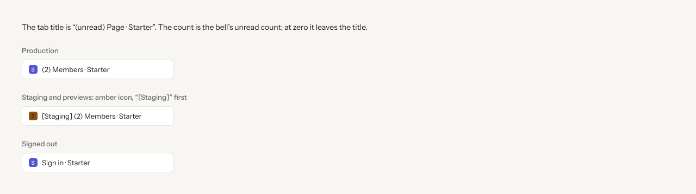

- **Who sees it:** Every signed-in member of an organisation.
- **Device:** Desktop (1280 px and wider).
- **This state shows:** as the title says.
- **Values come from:** Person, organisations and role: our API (current user and tenants). Unread count: our API notifications and the live stream. Environment strip: APP_ENVIRONMENT. Connection bar: the browser's network state and the API's health. App version: the build's commit.
- **Components:** none (drawn without instances).
- **Actions:**
  - No prototype link on this screen. The buttons follow the section's other screens.
- **Texts, word for word, top to bottom:**

  - The tab title is “(unread) Page · Starter”. The count is the bell’s unread count; at zero it leaves the title.
  - Production
  - S
  - (2) Members · Starter
  - Staging and previews: amber icon, “\[Staging\]” first
  - S
  - \[Staging\] (2) Members · Starter
  - Signed out
  - S
  - Sign in · Starter

Figma: [113:12755](https://www.figma.com/design/3Ev111okX8xCBwR9B3hyBM/?node-id=113-12755)

### 2.24 · Staging

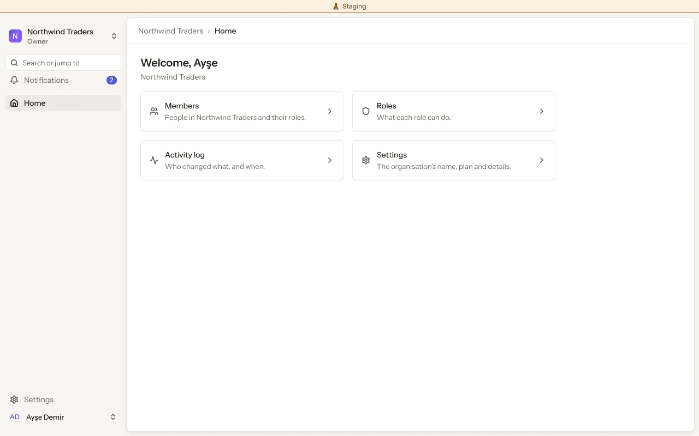

- **Who sees it:** Every signed-in member of an organisation.
- **Device:** Desktop (1280 px and wider).
- **This state shows:** as the title says.
- **Values come from:** Person, organisations and role: our API (current user and tenants). Unread count: our API notifications and the live stream. Environment strip: APP_ENVIRONMENT. Connection bar: the browser's network state and the API's health. App version: the build's commit.
- **Components:** Environment strip, Icon/activity, Icon/chevron-down ×4, Icon/settings, Icon/shield, Icon/users, Sidebar, Top bar.
- **Actions:**
  - "Home": goes to [4.01 · Home · Owner](../04-home/README.md#401--home--owner).
  - "Settings": goes to [7.01 · General · ideal](../07-settings-general/README.md#701--general--ideal).
- **Texts, word for word, top to bottom:**

  - Staging
  - N
  - Northwind Traders
  - Owner
  - Search or jump to
  - Notifications
  - 2
  - Home
  - Settings
  - AD
  - Ayşe Demir
  - Northwind Traders
  - ›
  - Home
  - Welcome, Ayşe
  - Northwind Traders
  - Members
  - People in Northwind Traders and their roles.
  - Roles
  - What each role can do.
  - Activity log
  - Who changed what, and when.
  - Settings
  - The organisation’s name, plan and details.

Figma: [59:8150](https://www.figma.com/design/3Ev111okX8xCBwR9B3hyBM/?node-id=59-8150)

### 2.25 · Staging · dark

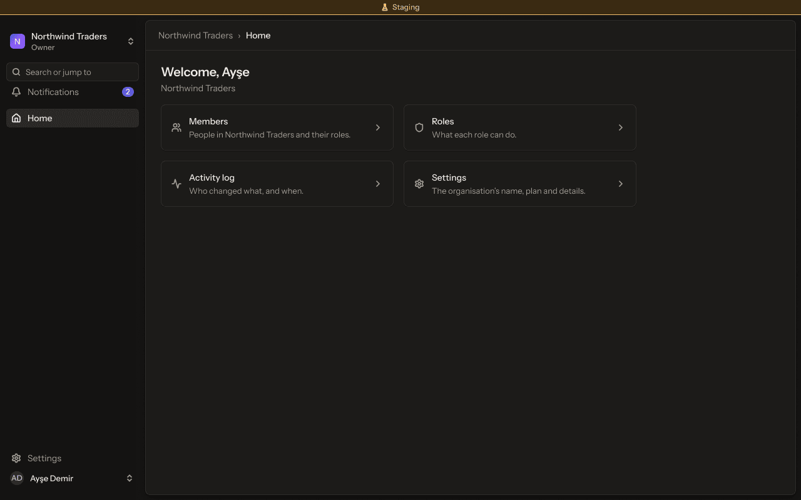

- **Who sees it:** Every signed-in member of an organisation.
- **Device:** Desktop (1280 px and wider).
- **This state shows:** in the dark theme.
- **Values come from:** Person, organisations and role: our API (current user and tenants). Unread count: our API notifications and the live stream. Environment strip: APP_ENVIRONMENT. Connection bar: the browser's network state and the API's health. App version: the build's commit.
- **Components:** Environment strip, Icon/activity, Icon/chevron-down ×4, Icon/settings, Icon/shield, Icon/users, Sidebar, Top bar.
- **Actions:**
  - "Home": goes to [4.01 · Home · Owner](../04-home/README.md#401--home--owner).
  - "Settings": goes to [7.01 · General · ideal](../07-settings-general/README.md#701--general--ideal).
- **Texts, word for word, top to bottom:**

  - Staging
  - N
  - Northwind Traders
  - Owner
  - Search or jump to
  - Notifications
  - 2
  - Home
  - Settings
  - AD
  - Ayşe Demir
  - Northwind Traders
  - ›
  - Home
  - Welcome, Ayşe
  - Northwind Traders
  - Members
  - People in Northwind Traders and their roles.
  - Roles
  - What each role can do.
  - Activity log
  - Who changed what, and when.
  - Settings
  - The organisation’s name, plan and details.

Figma: [145:14896](https://www.figma.com/design/3Ev111okX8xCBwR9B3hyBM/?node-id=145-14896)

### 2.26 · Staging · phone

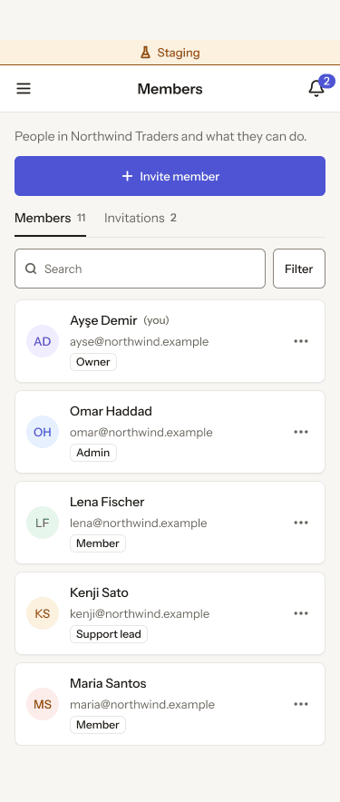

- **Who sees it:** Every signed-in member of an organisation.
- **Device:** Phone (up to 767 px).
- **This state shows:** on a phone.
- **Values come from:** Person, organisations and role: our API (current user and tenants). Unread count: our API notifications and the live stream. Environment strip: APP_ENVIRONMENT. Connection bar: the browser's network state and the API's health. App version: the build's commit.
- **Components:** Button ×2, Environment strip, Input, Member card ×5, Phone top bar, Tab ×2.
- **Actions:**
  - "Area": goes to [2.29 · Phone · menu open](#229--phone--menu-open).
  - "2": goes to [3.14 · Phone · notifications](../03-notifications/README.md#314--phone--notifications).
- **Texts, word for word, top to bottom:**

  - Staging
  - Members
  - 2
  - People in Northwind Traders and what they can do.
  - Invite member
  - Members
  - 11
  - Invitations
  - 2
  - Search
  - Filter
  - AD
  - Ayşe Demir
  - (you)
  - ayse@northwind.example
  - Owner
  - OH
  - Omar Haddad
  - omar@northwind.example
  - Admin
  - LF
  - Lena Fischer
  - lena@northwind.example
  - Member
  - KS
  - Kenji Sato
  - kenji@northwind.example
  - Support lead
  - MS
  - Maria Santos
  - maria@northwind.example
  - Member

Figma: [145:14933](https://www.figma.com/design/3Ev111okX8xCBwR9B3hyBM/?node-id=145-14933)

### 2.27 · Staging · phone dark

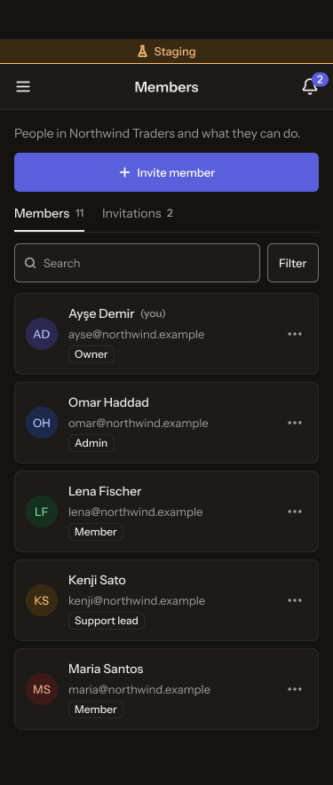

- **Who sees it:** Every signed-in member of an organisation.
- **Device:** Phone (up to 767 px).
- **This state shows:** in the dark theme; on a phone.
- **Values come from:** Person, organisations and role: our API (current user and tenants). Unread count: our API notifications and the live stream. Environment strip: APP_ENVIRONMENT. Connection bar: the browser's network state and the API's health. App version: the build's commit.
- **Components:** Button ×2, Environment strip, Input, Member card ×5, Phone top bar, Tab ×2.
- **Actions:**
  - "Area": goes to [2.29 · Phone · menu open](#229--phone--menu-open).
  - "2": goes to [3.14 · Phone · notifications](../03-notifications/README.md#314--phone--notifications).
- **Texts, word for word, top to bottom:**

  - Staging
  - Members
  - 2
  - People in Northwind Traders and what they can do.
  - Invite member
  - Members
  - 11
  - Invitations
  - 2
  - Search
  - Filter
  - AD
  - Ayşe Demir
  - (you)
  - ayse@northwind.example
  - Owner
  - OH
  - Omar Haddad
  - omar@northwind.example
  - Admin
  - LF
  - Lena Fischer
  - lena@northwind.example
  - Member
  - KS
  - Kenji Sato
  - kenji@northwind.example
  - Support lead
  - MS
  - Maria Santos
  - maria@northwind.example
  - Member

Figma: [145:14972](https://www.figma.com/design/3Ev111okX8xCBwR9B3hyBM/?node-id=145-14972)

### 2.28 · Dark

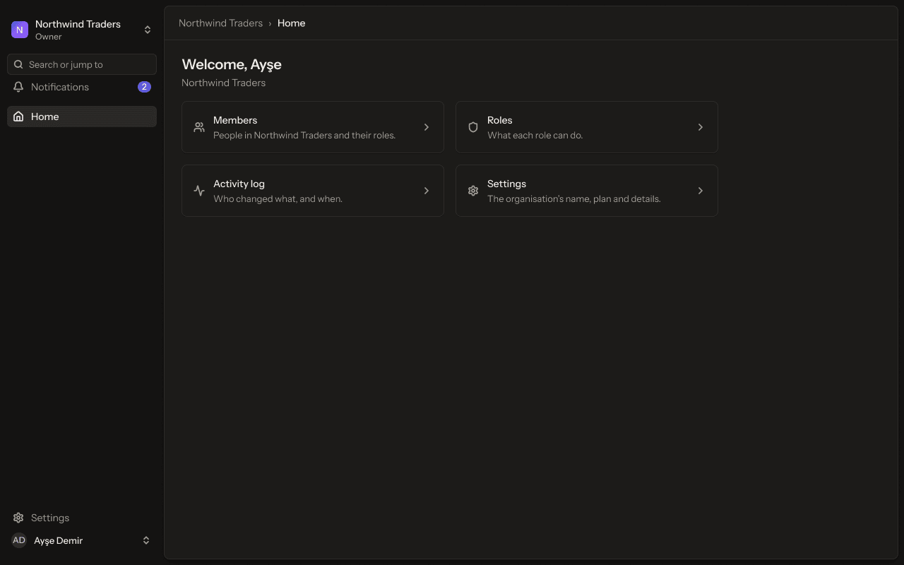

- **Who sees it:** Every signed-in member of an organisation.
- **Device:** Desktop (1280 px and wider).
- **This state shows:** in the dark theme.
- **Values come from:** Person, organisations and role: our API (current user and tenants). Unread count: our API notifications and the live stream. Environment strip: APP_ENVIRONMENT. Connection bar: the browser's network state and the API's health. App version: the build's commit.
- **Components:** Icon/activity, Icon/chevron-down ×4, Icon/settings, Icon/shield, Icon/users, Sidebar, Top bar.
- **Actions:**
  - "Home": goes to [4.01 · Home · Owner](../04-home/README.md#401--home--owner).
  - "Settings": goes to [7.01 · General · ideal](../07-settings-general/README.md#701--general--ideal).
- **Texts, word for word, top to bottom:**

  - N
  - Northwind Traders
  - Owner
  - Search or jump to
  - Notifications
  - 2
  - Home
  - Settings
  - AD
  - Ayşe Demir
  - Northwind Traders
  - ›
  - Home
  - Welcome, Ayşe
  - Northwind Traders
  - Members
  - People in Northwind Traders and their roles.
  - Roles
  - What each role can do.
  - Activity log
  - Who changed what, and when.
  - Settings
  - The organisation’s name, plan and details.

Figma: [59:8371](https://www.figma.com/design/3Ev111okX8xCBwR9B3hyBM/?node-id=59-8371)

### 2.29 · Phone · menu open

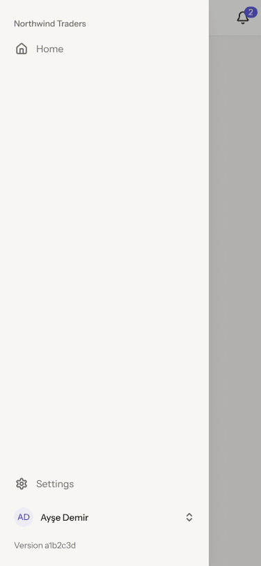

- **Who sees it:** Every signed-in member of an organisation.
- **Device:** Phone (up to 767 px).
- **This state shows:** on a phone.
- **Values come from:** Person, organisations and role: our API (current user and tenants). Unread count: our API notifications and the live stream. Environment strip: APP_ENVIRONMENT. Connection bar: the browser's network state and the API's health. App version: the build's commit.
- **Components:** Phone drawer, Phone top bar.
- **Actions:**
  - "Version a1b2c3d": goes to node 218:1103 (not a numbered screen).
  - "Home": goes to [4.01 · Home · Owner](../04-home/README.md#401--home--owner).
  - "Ayşe Demir": goes to [7.01 · General · ideal](../07-settings-general/README.md#701--general--ideal).
  - "Settings": goes to [2.30 · Phone · settings menu open](#230--phone--settings-menu-open).
  - "Home": goes to [8.34 · Members · phone](../08-settings-members/README.md#834--members--phone).
  - "2": goes to [8.34 · Members · phone](../08-settings-members/README.md#834--members--phone).
- **Texts, word for word, top to bottom:**

  - Members
  - 2
  - Northwind Traders
  - Home
  - Settings
  - AD
  - Ayşe Demir
  - Version a1b2c3d

Figma: [59:8590](https://www.figma.com/design/3Ev111okX8xCBwR9B3hyBM/?node-id=59-8590)

### 2.30 · Phone · settings menu open

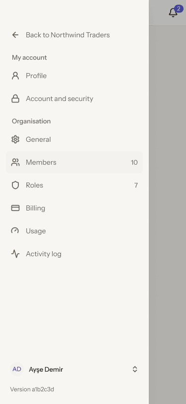

- **Who sees it:** Every signed-in member of an organisation.
- **Device:** Phone (up to 767 px).
- **This state shows:** on a phone.
- **Values come from:** Person, organisations and role: our API (current user and tenants). Unread count: our API notifications and the live stream. Environment strip: APP_ENVIRONMENT. Connection bar: the browser's network state and the API's health. App version: the build's commit.
- **Components:** Phone drawer · Settings, Phone top bar.
- **Actions:**
  - "Version a1b2c3d": goes to node 218:1103 (not a numbered screen).
  - "Back to Northwind Traders": goes to [4.01 · Home · Owner](../04-home/README.md#401--home--owner).
  - "Profile": goes to [5.01 · Profile · ideal](../05-settings-profile/README.md#501--profile--ideal).
  - "Account and security": goes to [6.01 · Account and security · ideal](../06-settings-account-and-security/README.md#601--account-and-security--ideal).
  - "General": goes to [7.01 · General · ideal](../07-settings-general/README.md#701--general--ideal).
  - "Members": goes to [8.01 · Members · ideal](../08-settings-members/README.md#801--members--ideal).
  - "Roles": goes to [9.01 · Roles · ideal](../09-settings-roles/README.md#901--roles--ideal).
  - "Billing": goes to [10.01 · Billing · Team, monthly](../10-settings-billing/README.md#1001--billing--team-monthly).
  - "Usage": goes to [12.01 · Activity log · ideal](../12-settings-activity-log/README.md#1201--activity-log--ideal).
  - "Account and security": goes to [6.07 · Account and security · phone](../06-settings-account-and-security/README.md#607--account-and-security--phone).
  - "Members": goes to [8.34 · Members · phone](../08-settings-members/README.md#834--members--phone).
  - "Billing": goes to [10.22 · Billing · phone](../10-settings-billing/README.md#1022--billing--phone).
  - "Usage": goes to [11.09 · Usage · phone](../11-settings-usage/README.md#1109--usage--phone).
  - "2": goes to [8.34 · Members · phone](../08-settings-members/README.md#834--members--phone).
- **Texts, word for word, top to bottom:**

  - Members
  - 2
  - Back to Northwind Traders
  - My account
  - Profile
  - Account and security
  - Organisation
  - General
  - Members
  - 10
  - Roles
  - 7
  - Billing
  - Usage
  - Activity log
  - AD
  - Ayşe Demir
  - Version a1b2c3d

Figma: [144:15172](https://www.figma.com/design/3Ev111okX8xCBwR9B3hyBM/?node-id=144-15172)

### 2.31 · Billing bar · trial ends in 3 days

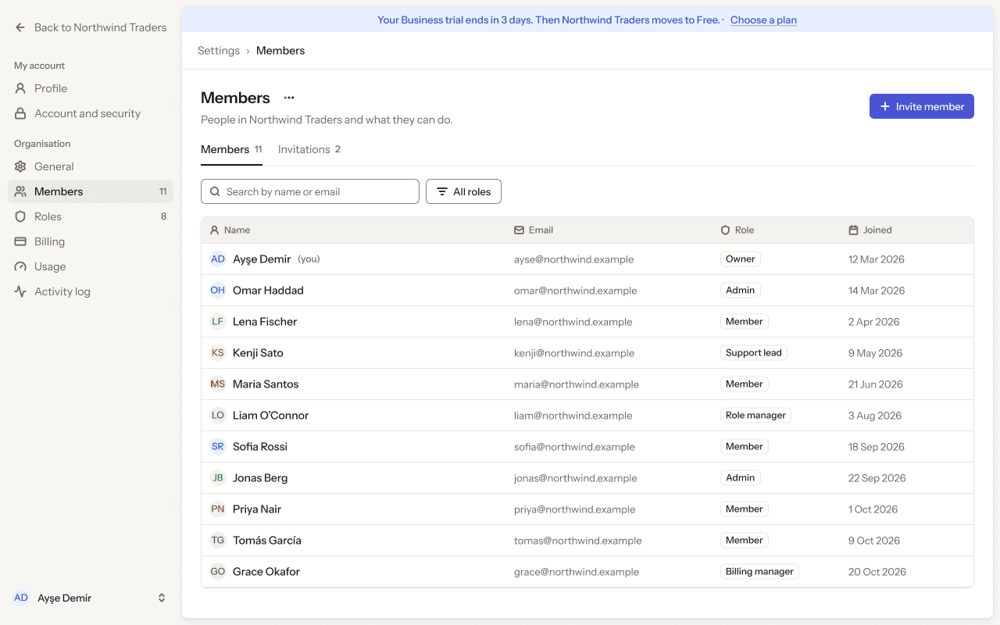

- **Who sees it:** Every signed-in member of an organisation.
- **Device:** Desktop (1280 px and wider).
- **This state shows:** as the title says.
- **Values come from:** Person, organisations and role: our API (current user and tenants). Unread count: our API notifications and the live stream. Environment strip: APP_ENVIRONMENT. Connection bar: the browser's network state and the API's health. App version: the build's commit.
- **Components:** Avatar ×11, Billing bar, Button ×3, Icon/calendar, Icon/mail, Icon/shield, Icon/user, Input, Label ×11, Sidebar, Tab ×2, Top bar.
- **Actions:**
  - "Back to Northwind Traders": goes to [4.01 · Home · Owner](../04-home/README.md#401--home--owner).
  - "Profile": goes to [5.01 · Profile · ideal](../05-settings-profile/README.md#501--profile--ideal).
  - "Account and security": goes to [6.01 · Account and security · ideal](../06-settings-account-and-security/README.md#601--account-and-security--ideal).
  - "General": goes to [7.01 · General · ideal](../07-settings-general/README.md#701--general--ideal).
  - "Members": goes to [8.01 · Members · ideal](../08-settings-members/README.md#801--members--ideal).
  - "Roles": goes to [9.01 · Roles · ideal](../09-settings-roles/README.md#901--roles--ideal).
  - "Billing": goes to [10.01 · Billing · Team, monthly](../10-settings-billing/README.md#1001--billing--team-monthly).
  - "Usage": goes to [11.01 · Usage · Team](../11-settings-usage/README.md#1101--usage--team).
  - "Activity log": goes to [12.01 · Activity log · ideal](../12-settings-activity-log/README.md#1201--activity-log--ideal).
  - "Choose a plan": goes to [10.09 · Change plan · from a trial](../10-settings-billing/README.md#1009--change-plan--from-a-trial).
- **Texts, word for word, top to bottom:**

  - Back to Northwind Traders
  - My account
  - Profile
  - Account and security
  - Organisation
  - General
  - Members
  - 11
  - Roles
  - 8
  - Billing
  - Usage
  - Activity log
  - AD
  - Ayşe Demir
  - Your Business trial ends in 3 days. Then Northwind Traders moves to Free. ·
  - Choose a plan
  - Settings
  - ›
  - Members
  - Members
  - People in Northwind Traders and what they can do.
  - Invite member
  - Members
  - 11
  - Invitations
  - 2
  - Search by name or email
  - All roles
  - Name
  - Email
  - Role
  - Joined
  - AD
  - Ayşe Demir
  - (you)
  - ayse@northwind.example
  - Owner
  - 12 Mar 2026
  - OH
  - Omar Haddad
  - omar@northwind.example
  - Admin
  - 14 Mar 2026
  - LF
  - Lena Fischer
  - lena@northwind.example
  - Member
  - 2 Apr 2026
  - KS
  - Kenji Sato
  - kenji@northwind.example
  - Support lead
  - 9 May 2026
  - MS
  - Maria Santos
  - maria@northwind.example
  - Member
  - 21 Jun 2026
  - LO
  - Liam O’Connor
  - liam@northwind.example
  - Role manager
  - 3 Aug 2026
  - SR
  - Sofia Rossi
  - sofia@northwind.example
  - Member
  - 18 Sep 2026
  - JB
  - Jonas Berg
  - jonas@northwind.example
  - Admin
  - 22 Sep 2026
  - PN
  - Priya Nair
  - priya@northwind.example
  - Member
  - 1 Oct 2026
  - TG
  - Tomás García
  - tomas@northwind.example
  - Member
  - 9 Oct 2026
  - GO
  - Grace Okafor
  - grace@northwind.example
  - Billing manager
  - 20 Oct 2026

Figma: [241:20606](https://www.figma.com/design/3Ev111okX8xCBwR9B3hyBM/?node-id=241-20606)

### 2.32 · Billing bar · payment failed

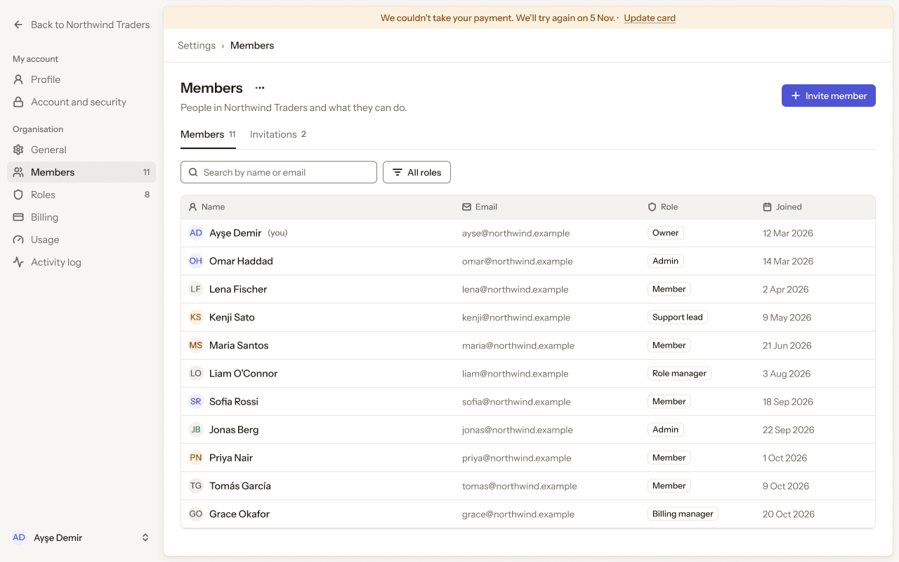

- **Who sees it:** Every signed-in member of an organisation.
- **Device:** Desktop (1280 px and wider).
- **This state shows:** when the action fails.
- **Values come from:** Person, organisations and role: our API (current user and tenants). Unread count: our API notifications and the live stream. Environment strip: APP_ENVIRONMENT. Connection bar: the browser's network state and the API's health. App version: the build's commit.
- **Components:** Avatar ×11, Billing bar, Button ×3, Icon/calendar, Icon/mail, Icon/shield, Icon/user, Input, Label ×11, Sidebar, Tab ×2, Top bar.
- **Actions:**
  - "Back to Northwind Traders": goes to [4.01 · Home · Owner](../04-home/README.md#401--home--owner).
  - "Profile": goes to [5.01 · Profile · ideal](../05-settings-profile/README.md#501--profile--ideal).
  - "Account and security": goes to [6.01 · Account and security · ideal](../06-settings-account-and-security/README.md#601--account-and-security--ideal).
  - "General": goes to [7.01 · General · ideal](../07-settings-general/README.md#701--general--ideal).
  - "Members": goes to [8.01 · Members · ideal](../08-settings-members/README.md#801--members--ideal).
  - "Roles": goes to [9.01 · Roles · ideal](../09-settings-roles/README.md#901--roles--ideal).
  - "Billing": goes to [10.01 · Billing · Team, monthly](../10-settings-billing/README.md#1001--billing--team-monthly).
  - "Usage": goes to [11.01 · Usage · Team](../11-settings-usage/README.md#1101--usage--team).
  - "Activity log": goes to [12.01 · Activity log · ideal](../12-settings-activity-log/README.md#1201--activity-log--ideal).
  - "Update card": goes to [10.15 · Payment failed · retrying](../10-settings-billing/README.md#1015--payment-failed--retrying).
- **Texts, word for word, top to bottom:**

  - Back to Northwind Traders
  - My account
  - Profile
  - Account and security
  - Organisation
  - General
  - Members
  - 11
  - Roles
  - 8
  - Billing
  - Usage
  - Activity log
  - AD
  - Ayşe Demir
  - We couldn’t take your payment. We’ll try again on 5 Nov. ·
  - Update card
  - Settings
  - ›
  - Members
  - Members
  - People in Northwind Traders and what they can do.
  - Invite member
  - Members
  - 11
  - Invitations
  - 2
  - Search by name or email
  - All roles
  - Name
  - Email
  - Role
  - Joined
  - AD
  - Ayşe Demir
  - (you)
  - ayse@northwind.example
  - Owner
  - 12 Mar 2026
  - OH
  - Omar Haddad
  - omar@northwind.example
  - Admin
  - 14 Mar 2026
  - LF
  - Lena Fischer
  - lena@northwind.example
  - Member
  - 2 Apr 2026
  - KS
  - Kenji Sato
  - kenji@northwind.example
  - Support lead
  - 9 May 2026
  - MS
  - Maria Santos
  - maria@northwind.example
  - Member
  - 21 Jun 2026
  - LO
  - Liam O’Connor
  - liam@northwind.example
  - Role manager
  - 3 Aug 2026
  - SR
  - Sofia Rossi
  - sofia@northwind.example
  - Member
  - 18 Sep 2026
  - JB
  - Jonas Berg
  - jonas@northwind.example
  - Admin
  - 22 Sep 2026
  - PN
  - Priya Nair
  - priya@northwind.example
  - Member
  - 1 Oct 2026
  - TG
  - Tomás García
  - tomas@northwind.example
  - Member
  - 9 Oct 2026
  - GO
  - Grace Okafor
  - grace@northwind.example
  - Billing manager
  - 20 Oct 2026

Figma: [241:20846](https://www.figma.com/design/3Ev111okX8xCBwR9B3hyBM/?node-id=241-20846)

### 2.33 · Billing bar · last warning

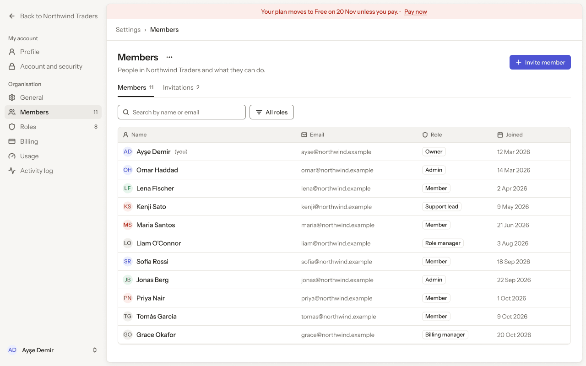

- **Who sees it:** Every signed-in member of an organisation.
- **Device:** Desktop (1280 px and wider).
- **This state shows:** as the title says.
- **Values come from:** Person, organisations and role: our API (current user and tenants). Unread count: our API notifications and the live stream. Environment strip: APP_ENVIRONMENT. Connection bar: the browser's network state and the API's health. App version: the build's commit.
- **Components:** Avatar ×11, Billing bar, Button ×3, Icon/calendar, Icon/mail, Icon/shield, Icon/user, Input, Label ×11, Sidebar, Tab ×2, Top bar.
- **Actions:**
  - "Back to Northwind Traders": goes to [4.01 · Home · Owner](../04-home/README.md#401--home--owner).
  - "Profile": goes to [5.01 · Profile · ideal](../05-settings-profile/README.md#501--profile--ideal).
  - "Account and security": goes to [6.01 · Account and security · ideal](../06-settings-account-and-security/README.md#601--account-and-security--ideal).
  - "General": goes to [7.01 · General · ideal](../07-settings-general/README.md#701--general--ideal).
  - "Members": goes to [8.01 · Members · ideal](../08-settings-members/README.md#801--members--ideal).
  - "Roles": goes to [9.01 · Roles · ideal](../09-settings-roles/README.md#901--roles--ideal).
  - "Billing": goes to [10.01 · Billing · Team, monthly](../10-settings-billing/README.md#1001--billing--team-monthly).
  - "Usage": goes to [11.01 · Usage · Team](../11-settings-usage/README.md#1101--usage--team).
  - "Activity log": goes to [12.01 · Activity log · ideal](../12-settings-activity-log/README.md#1201--activity-log--ideal).
  - "Pay now": goes to [10.16 · Payment failed · grace](../10-settings-billing/README.md#1016--payment-failed--grace).
- **Texts, word for word, top to bottom:**

  - Back to Northwind Traders
  - My account
  - Profile
  - Account and security
  - Organisation
  - General
  - Members
  - 11
  - Roles
  - 8
  - Billing
  - Usage
  - Activity log
  - AD
  - Ayşe Demir
  - Your plan moves to Free on 20 Nov unless you pay. ·
  - Pay now
  - Settings
  - ›
  - Members
  - Members
  - People in Northwind Traders and what they can do.
  - Invite member
  - Members
  - 11
  - Invitations
  - 2
  - Search by name or email
  - All roles
  - Name
  - Email
  - Role
  - Joined
  - AD
  - Ayşe Demir
  - (you)
  - ayse@northwind.example
  - Owner
  - 12 Mar 2026
  - OH
  - Omar Haddad
  - omar@northwind.example
  - Admin
  - 14 Mar 2026
  - LF
  - Lena Fischer
  - lena@northwind.example
  - Member
  - 2 Apr 2026
  - KS
  - Kenji Sato
  - kenji@northwind.example
  - Support lead
  - 9 May 2026
  - MS
  - Maria Santos
  - maria@northwind.example
  - Member
  - 21 Jun 2026
  - LO
  - Liam O’Connor
  - liam@northwind.example
  - Role manager
  - 3 Aug 2026
  - SR
  - Sofia Rossi
  - sofia@northwind.example
  - Member
  - 18 Sep 2026
  - JB
  - Jonas Berg
  - jonas@northwind.example
  - Admin
  - 22 Sep 2026
  - PN
  - Priya Nair
  - priya@northwind.example
  - Member
  - 1 Oct 2026
  - TG
  - Tomás García
  - tomas@northwind.example
  - Member
  - 9 Oct 2026
  - GO
  - Grace Okafor
  - grace@northwind.example
  - Billing manager
  - 20 Oct 2026

Figma: [241:21086](https://www.figma.com/design/3Ev111okX8xCBwR9B3hyBM/?node-id=241-21086)

### 2.34 · Billing bar · 80% of a meter

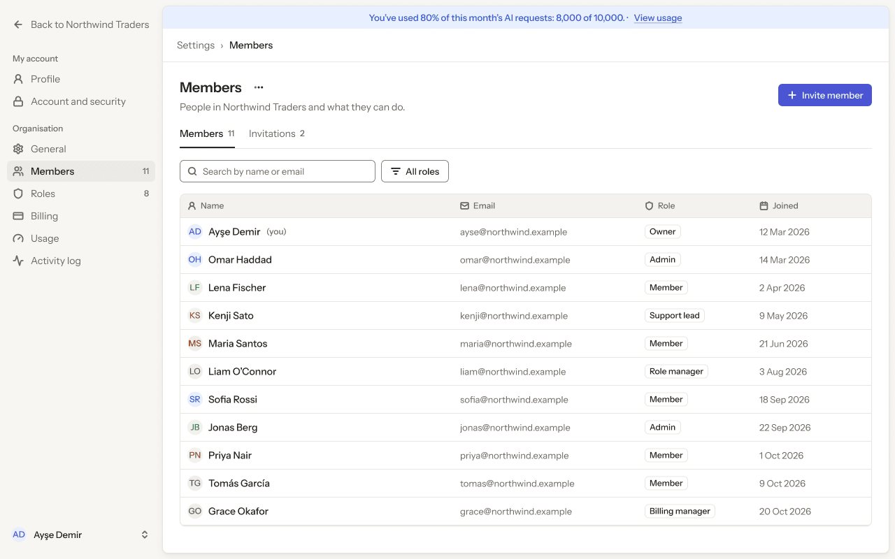

- **Who sees it:** Every signed-in member of an organisation.
- **Device:** Desktop (1280 px and wider).
- **This state shows:** as the title says.
- **Values come from:** Person, organisations and role: our API (current user and tenants). Unread count: our API notifications and the live stream. Environment strip: APP_ENVIRONMENT. Connection bar: the browser's network state and the API's health. App version: the build's commit.
- **Components:** Avatar ×11, Billing bar, Button ×3, Icon/calendar, Icon/mail, Icon/shield, Icon/user, Input, Label ×11, Sidebar, Tab ×2, Top bar.
- **Actions:**
  - "Back to Northwind Traders": goes to [4.01 · Home · Owner](../04-home/README.md#401--home--owner).
  - "Profile": goes to [5.01 · Profile · ideal](../05-settings-profile/README.md#501--profile--ideal).
  - "Account and security": goes to [6.01 · Account and security · ideal](../06-settings-account-and-security/README.md#601--account-and-security--ideal).
  - "General": goes to [7.01 · General · ideal](../07-settings-general/README.md#701--general--ideal).
  - "Members": goes to [8.01 · Members · ideal](../08-settings-members/README.md#801--members--ideal).
  - "Roles": goes to [9.01 · Roles · ideal](../09-settings-roles/README.md#901--roles--ideal).
  - "Billing": goes to [10.01 · Billing · Team, monthly](../10-settings-billing/README.md#1001--billing--team-monthly).
  - "Usage": goes to [11.01 · Usage · Team](../11-settings-usage/README.md#1101--usage--team).
  - "Activity log": goes to [12.01 · Activity log · ideal](../12-settings-activity-log/README.md#1201--activity-log--ideal).
  - "View usage": goes to [11.01 · Usage · Team](../11-settings-usage/README.md#1101--usage--team).
- **Texts, word for word, top to bottom:**

  - Back to Northwind Traders
  - My account
  - Profile
  - Account and security
  - Organisation
  - General
  - Members
  - 11
  - Roles
  - 8
  - Billing
  - Usage
  - Activity log
  - AD
  - Ayşe Demir
  - You’ve used 80% of this month’s AI requests: 8,000 of 10,000. ·
  - View usage
  - Settings
  - ›
  - Members
  - Members
  - People in Northwind Traders and what they can do.
  - Invite member
  - Members
  - 11
  - Invitations
  - 2
  - Search by name or email
  - All roles
  - Name
  - Email
  - Role
  - Joined
  - AD
  - Ayşe Demir
  - (you)
  - ayse@northwind.example
  - Owner
  - 12 Mar 2026
  - OH
  - Omar Haddad
  - omar@northwind.example
  - Admin
  - 14 Mar 2026
  - LF
  - Lena Fischer
  - lena@northwind.example
  - Member
  - 2 Apr 2026
  - KS
  - Kenji Sato
  - kenji@northwind.example
  - Support lead
  - 9 May 2026
  - MS
  - Maria Santos
  - maria@northwind.example
  - Member
  - 21 Jun 2026
  - LO
  - Liam O’Connor
  - liam@northwind.example
  - Role manager
  - 3 Aug 2026
  - SR
  - Sofia Rossi
  - sofia@northwind.example
  - Member
  - 18 Sep 2026
  - JB
  - Jonas Berg
  - jonas@northwind.example
  - Admin
  - 22 Sep 2026
  - PN
  - Priya Nair
  - priya@northwind.example
  - Member
  - 1 Oct 2026
  - TG
  - Tomás García
  - tomas@northwind.example
  - Member
  - 9 Oct 2026
  - GO
  - Grace Okafor
  - grace@northwind.example
  - Billing manager
  - 20 Oct 2026

Figma: [241:21326](https://www.figma.com/design/3Ev111okX8xCBwR9B3hyBM/?node-id=241-21326)

### 2.35 · Billing bar · meter used up

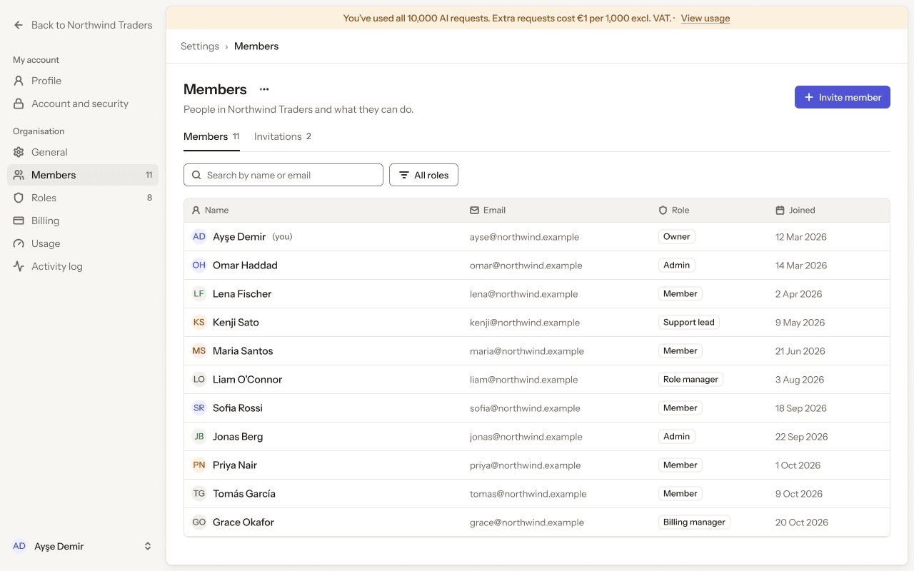

- **Who sees it:** Every signed-in member of an organisation.
- **Device:** Desktop (1280 px and wider).
- **This state shows:** as the title says.
- **Values come from:** Person, organisations and role: our API (current user and tenants). Unread count: our API notifications and the live stream. Environment strip: APP_ENVIRONMENT. Connection bar: the browser's network state and the API's health. App version: the build's commit.
- **Components:** Avatar ×11, Billing bar, Button ×3, Icon/calendar, Icon/mail, Icon/shield, Icon/user, Input, Label ×11, Sidebar, Tab ×2, Top bar.
- **Actions:**
  - "Back to Northwind Traders": goes to [4.01 · Home · Owner](../04-home/README.md#401--home--owner).
  - "Profile": goes to [5.01 · Profile · ideal](../05-settings-profile/README.md#501--profile--ideal).
  - "Account and security": goes to [6.01 · Account and security · ideal](../06-settings-account-and-security/README.md#601--account-and-security--ideal).
  - "General": goes to [7.01 · General · ideal](../07-settings-general/README.md#701--general--ideal).
  - "Members": goes to [8.01 · Members · ideal](../08-settings-members/README.md#801--members--ideal).
  - "Roles": goes to [9.01 · Roles · ideal](../09-settings-roles/README.md#901--roles--ideal).
  - "Billing": goes to [10.01 · Billing · Team, monthly](../10-settings-billing/README.md#1001--billing--team-monthly).
  - "Usage": goes to [11.01 · Usage · Team](../11-settings-usage/README.md#1101--usage--team).
  - "Activity log": goes to [12.01 · Activity log · ideal](../12-settings-activity-log/README.md#1201--activity-log--ideal).
  - "View usage": goes to [11.02 · Usage · over the quota, cap set](../11-settings-usage/README.md#1102--usage--over-the-quota-cap-set).
- **Texts, word for word, top to bottom:**

  - Back to Northwind Traders
  - My account
  - Profile
  - Account and security
  - Organisation
  - General
  - Members
  - 11
  - Roles
  - 8
  - Billing
  - Usage
  - Activity log
  - AD
  - Ayşe Demir
  - You’ve used all 10,000 AI requests. Extra requests cost €1 per 1,000 excl. VAT. ·
  - View usage
  - Settings
  - ›
  - Members
  - Members
  - People in Northwind Traders and what they can do.
  - Invite member
  - Members
  - 11
  - Invitations
  - 2
  - Search by name or email
  - All roles
  - Name
  - Email
  - Role
  - Joined
  - AD
  - Ayşe Demir
  - (you)
  - ayse@northwind.example
  - Owner
  - 12 Mar 2026
  - OH
  - Omar Haddad
  - omar@northwind.example
  - Admin
  - 14 Mar 2026
  - LF
  - Lena Fischer
  - lena@northwind.example
  - Member
  - 2 Apr 2026
  - KS
  - Kenji Sato
  - kenji@northwind.example
  - Support lead
  - 9 May 2026
  - MS
  - Maria Santos
  - maria@northwind.example
  - Member
  - 21 Jun 2026
  - LO
  - Liam O’Connor
  - liam@northwind.example
  - Role manager
  - 3 Aug 2026
  - SR
  - Sofia Rossi
  - sofia@northwind.example
  - Member
  - 18 Sep 2026
  - JB
  - Jonas Berg
  - jonas@northwind.example
  - Admin
  - 22 Sep 2026
  - PN
  - Priya Nair
  - priya@northwind.example
  - Member
  - 1 Oct 2026
  - TG
  - Tomás García
  - tomas@northwind.example
  - Member
  - 9 Oct 2026
  - GO
  - Grace Okafor
  - grace@northwind.example
  - Billing manager
  - 20 Oct 2026

Figma: [241:21566](https://www.figma.com/design/3Ev111okX8xCBwR9B3hyBM/?node-id=241-21566)

### 2.36 · Billing bar · Free quota used

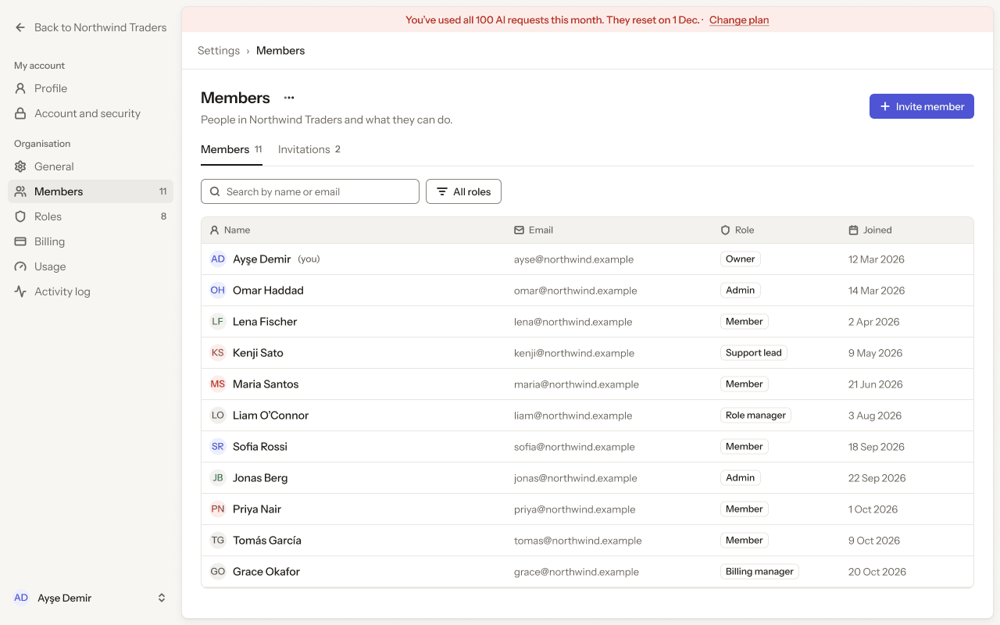

- **Who sees it:** Every signed-in member of an organisation.
- **Device:** Desktop (1280 px and wider).
- **This state shows:** as the title says.
- **Values come from:** Person, organisations and role: our API (current user and tenants). Unread count: our API notifications and the live stream. Environment strip: APP_ENVIRONMENT. Connection bar: the browser's network state and the API's health. App version: the build's commit.
- **Components:** Avatar ×11, Billing bar, Button ×3, Icon/calendar, Icon/mail, Icon/shield, Icon/user, Input, Label ×11, Sidebar, Tab ×2, Top bar.
- **Actions:**
  - "Back to Northwind Traders": goes to [4.01 · Home · Owner](../04-home/README.md#401--home--owner).
  - "Profile": goes to [5.01 · Profile · ideal](../05-settings-profile/README.md#501--profile--ideal).
  - "Account and security": goes to [6.01 · Account and security · ideal](../06-settings-account-and-security/README.md#601--account-and-security--ideal).
  - "General": goes to [7.01 · General · ideal](../07-settings-general/README.md#701--general--ideal).
  - "Members": goes to [8.01 · Members · ideal](../08-settings-members/README.md#801--members--ideal).
  - "Roles": goes to [9.01 · Roles · ideal](../09-settings-roles/README.md#901--roles--ideal).
  - "Billing": goes to [10.01 · Billing · Team, monthly](../10-settings-billing/README.md#1001--billing--team-monthly).
  - "Usage": goes to [11.01 · Usage · Team](../11-settings-usage/README.md#1101--usage--team).
  - "Activity log": goes to [12.01 · Activity log · ideal](../12-settings-activity-log/README.md#1201--activity-log--ideal).
  - "Change plan": goes to [10.02 · Change plan · monthly](../10-settings-billing/README.md#1002--change-plan--monthly).
- **Texts, word for word, top to bottom:**

  - Back to Northwind Traders
  - My account
  - Profile
  - Account and security
  - Organisation
  - General
  - Members
  - 11
  - Roles
  - 8
  - Billing
  - Usage
  - Activity log
  - AD
  - Ayşe Demir
  - You’ve used all 100 AI requests this month. They reset on 1 Dec. ·
  - Change plan
  - Settings
  - ›
  - Members
  - Members
  - People in Northwind Traders and what they can do.
  - Invite member
  - Members
  - 11
  - Invitations
  - 2
  - Search by name or email
  - All roles
  - Name
  - Email
  - Role
  - Joined
  - AD
  - Ayşe Demir
  - (you)
  - ayse@northwind.example
  - Owner
  - 12 Mar 2026
  - OH
  - Omar Haddad
  - omar@northwind.example
  - Admin
  - 14 Mar 2026
  - LF
  - Lena Fischer
  - lena@northwind.example
  - Member
  - 2 Apr 2026
  - KS
  - Kenji Sato
  - kenji@northwind.example
  - Support lead
  - 9 May 2026
  - MS
  - Maria Santos
  - maria@northwind.example
  - Member
  - 21 Jun 2026
  - LO
  - Liam O’Connor
  - liam@northwind.example
  - Role manager
  - 3 Aug 2026
  - SR
  - Sofia Rossi
  - sofia@northwind.example
  - Member
  - 18 Sep 2026
  - JB
  - Jonas Berg
  - jonas@northwind.example
  - Admin
  - 22 Sep 2026
  - PN
  - Priya Nair
  - priya@northwind.example
  - Member
  - 1 Oct 2026
  - TG
  - Tomás García
  - tomas@northwind.example
  - Member
  - 9 Oct 2026
  - GO
  - Grace Okafor
  - grace@northwind.example
  - Billing manager
  - 20 Oct 2026

Figma: [241:21806](https://www.figma.com/design/3Ev111okX8xCBwR9B3hyBM/?node-id=241-21806)

### 2.37 · Billing bar · spending cap reached

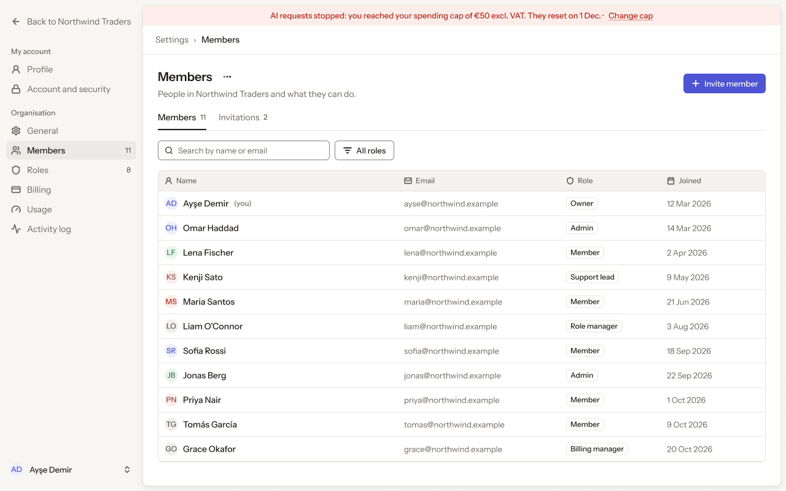

- **Who sees it:** Every signed-in member of an organisation.
- **Device:** Desktop (1280 px and wider).
- **This state shows:** as the title says.
- **Values come from:** Person, organisations and role: our API (current user and tenants). Unread count: our API notifications and the live stream. Environment strip: APP_ENVIRONMENT. Connection bar: the browser's network state and the API's health. App version: the build's commit.
- **Components:** Avatar ×11, Billing bar, Button ×3, Icon/calendar, Icon/mail, Icon/shield, Icon/user, Input, Label ×11, Sidebar, Tab ×2, Top bar.
- **Actions:**
  - "Back to Northwind Traders": goes to [4.01 · Home · Owner](../04-home/README.md#401--home--owner).
  - "Profile": goes to [5.01 · Profile · ideal](../05-settings-profile/README.md#501--profile--ideal).
  - "Account and security": goes to [6.01 · Account and security · ideal](../06-settings-account-and-security/README.md#601--account-and-security--ideal).
  - "General": goes to [7.01 · General · ideal](../07-settings-general/README.md#701--general--ideal).
  - "Members": goes to [8.01 · Members · ideal](../08-settings-members/README.md#801--members--ideal).
  - "Roles": goes to [9.01 · Roles · ideal](../09-settings-roles/README.md#901--roles--ideal).
  - "Billing": goes to [10.01 · Billing · Team, monthly](../10-settings-billing/README.md#1001--billing--team-monthly).
  - "Usage": goes to [11.01 · Usage · Team](../11-settings-usage/README.md#1101--usage--team).
  - "Activity log": goes to [12.01 · Activity log · ideal](../12-settings-activity-log/README.md#1201--activity-log--ideal).
  - "Change cap": goes to [11.03 · Set a spending cap](../11-settings-usage/README.md#1103--set-a-spending-cap).
- **Texts, word for word, top to bottom:**

  - Back to Northwind Traders
  - My account
  - Profile
  - Account and security
  - Organisation
  - General
  - Members
  - 11
  - Roles
  - 8
  - Billing
  - Usage
  - Activity log
  - AD
  - Ayşe Demir
  - AI requests stopped: you reached your spending cap of €50 excl. VAT. They reset on 1 Dec. ·
  - Change cap
  - Settings
  - ›
  - Members
  - Members
  - People in Northwind Traders and what they can do.
  - Invite member
  - Members
  - 11
  - Invitations
  - 2
  - Search by name or email
  - All roles
  - Name
  - Email
  - Role
  - Joined
  - AD
  - Ayşe Demir
  - (you)
  - ayse@northwind.example
  - Owner
  - 12 Mar 2026
  - OH
  - Omar Haddad
  - omar@northwind.example
  - Admin
  - 14 Mar 2026
  - LF
  - Lena Fischer
  - lena@northwind.example
  - Member
  - 2 Apr 2026
  - KS
  - Kenji Sato
  - kenji@northwind.example
  - Support lead
  - 9 May 2026
  - MS
  - Maria Santos
  - maria@northwind.example
  - Member
  - 21 Jun 2026
  - LO
  - Liam O’Connor
  - liam@northwind.example
  - Role manager
  - 3 Aug 2026
  - SR
  - Sofia Rossi
  - sofia@northwind.example
  - Member
  - 18 Sep 2026
  - JB
  - Jonas Berg
  - jonas@northwind.example
  - Admin
  - 22 Sep 2026
  - PN
  - Priya Nair
  - priya@northwind.example
  - Member
  - 1 Oct 2026
  - TG
  - Tomás García
  - tomas@northwind.example
  - Member
  - 9 Oct 2026
  - GO
  - Grace Okafor
  - grace@northwind.example
  - Billing manager
  - 20 Oct 2026

Figma: [241:22046](https://www.figma.com/design/3Ev111okX8xCBwR9B3hyBM/?node-id=241-22046)

### 2.38 · Switcher · create organisation

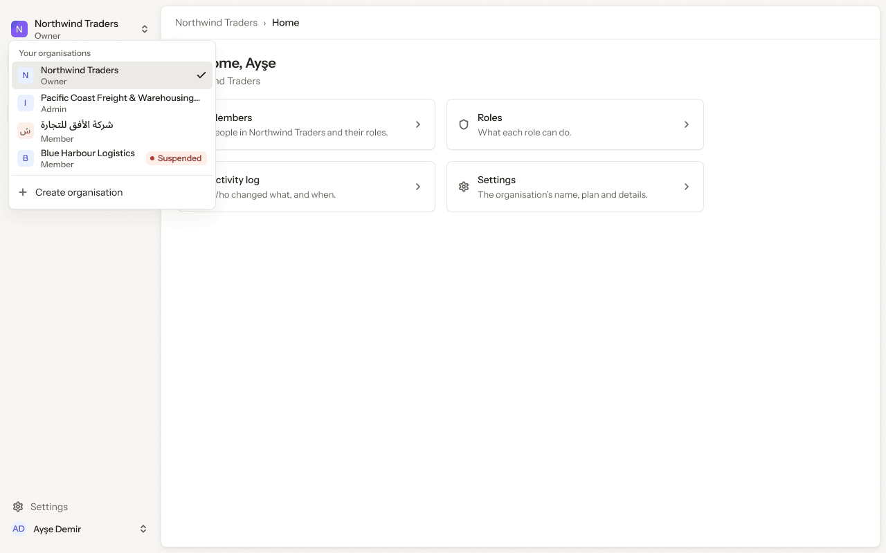

- **Who sees it:** Every signed-in member of an organisation.
- **Device:** Desktop (1280 px and wider).
- **This state shows:** as the title says.
- **Values come from:** Person, organisations and role: our API (current user and tenants). Unread count: our API notifications and the live stream. Environment strip: APP_ENVIRONMENT. Connection bar: the browser's network state and the API's health. App version: the build's commit.
- **Components:** Icon/activity, Icon/check, Icon/chevron-down ×4, Icon/plus, Icon/settings, Icon/shield, Icon/users, Pill, Sidebar, Top bar.
- **Actions:**
  - "Home": goes to [4.01 · Home · Owner](../04-home/README.md#401--home--owner).
  - "Settings": goes to [7.01 · General · ideal](../07-settings-general/README.md#701--general--ideal).
  - "Create organisation": goes to [1.28 · Create your organisation](../01-entry/README.md#128--create-your-organisation).
- **Texts, word for word, top to bottom:**

  - N
  - Northwind Traders
  - Owner
  - Search or jump to
  - Notifications
  - 2
  - Home
  - Settings
  - AD
  - Ayşe Demir
  - Northwind Traders
  - ›
  - Home
  - Welcome, Ayşe
  - Northwind Traders
  - Members
  - People in Northwind Traders and their roles.
  - Roles
  - What each role can do.
  - Activity log
  - Who changed what, and when.
  - Settings
  - The organisation’s name, plan and details.
  - Your organisations
  - N
  - Northwind Traders
  - Owner
  - I
  - Pacific Coast Freight & Warehousing Cooperative Ltd.
  - Admin
  - ش
  - شركة الأفق للتجارة
  - Member
  - B
  - Blue Harbour Logistics
  - Member
  - Suspended
  - Create organisation

Figma: [241:24647](https://www.figma.com/design/3Ev111okX8xCBwR9B3hyBM/?node-id=241-24647)

### 2.39 · Switcher · creation limit reached

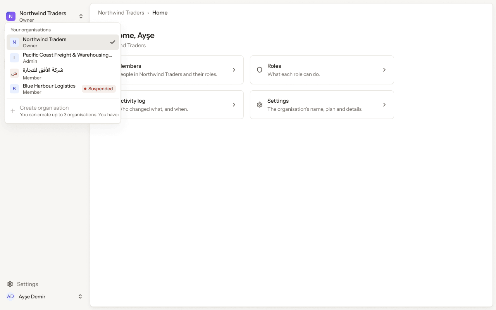

- **Who sees it:** Every signed-in member of an organisation.
- **Device:** Desktop (1280 px and wider).
- **This state shows:** as the title says.
- **Values come from:** Person, organisations and role: our API (current user and tenants). Unread count: our API notifications and the live stream. Environment strip: APP_ENVIRONMENT. Connection bar: the browser's network state and the API's health. App version: the build's commit.
- **Components:** Icon/activity, Icon/check, Icon/chevron-down ×4, Icon/plus, Icon/settings, Icon/shield, Icon/users, Pill, Sidebar, Top bar.
- **Actions:**
  - "Home": goes to [4.01 · Home · Owner](../04-home/README.md#401--home--owner).
  - "Settings": goes to [7.01 · General · ideal](../07-settings-general/README.md#701--general--ideal).
- **Texts, word for word, top to bottom:**

  - N
  - Northwind Traders
  - Owner
  - Search or jump to
  - Notifications
  - 2
  - Home
  - Settings
  - AD
  - Ayşe Demir
  - Northwind Traders
  - ›
  - Home
  - Welcome, Ayşe
  - Northwind Traders
  - Members
  - People in Northwind Traders and their roles.
  - Roles
  - What each role can do.
  - Activity log
  - Who changed what, and when.
  - Settings
  - The organisation’s name, plan and details.
  - Your organisations
  - N
  - Northwind Traders
  - Owner
  - I
  - Pacific Coast Freight & Warehousing Cooperative Ltd.
  - Admin
  - ش
  - شركة الأفق للتجارة
  - Member
  - B
  - Blue Harbour Logistics
  - Member
  - Suspended
  - Create organisation
  - You can create up to 3 organisations. You have created 3.

Figma: [241:24791](https://www.figma.com/design/3Ev111okX8xCBwR9B3hyBM/?node-id=241-24791)

### 2.40 · Page not found · old link

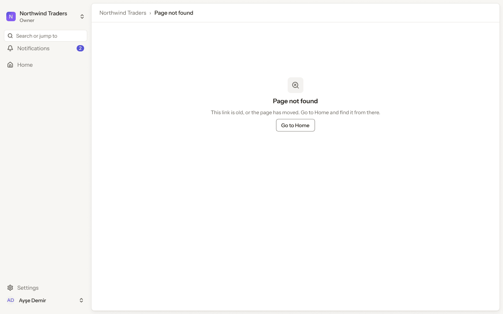

- **Who sees it:** Every signed-in member of an organisation.
- **Device:** Desktop (1280 px and wider).
- **This state shows:** when the address points to nothing the person can open.
- **Values come from:** Person, organisations and role: our API (current user and tenants). Unread count: our API notifications and the live stream. Environment strip: APP_ENVIRONMENT. Connection bar: the browser's network state and the API's health. App version: the build's commit.
- **Components:** Empty state, Sidebar, Top bar.
- **Actions:**
  - "Go to Home": goes to [4.01 · Home · Owner](../04-home/README.md#401--home--owner).
- **Texts, word for word, top to bottom:**

  - N
  - Northwind Traders
  - Owner
  - Search or jump to
  - Notifications
  - 2
  - Home
  - Settings
  - AD
  - Ayşe Demir
  - Northwind Traders
  - ›
  - Page not found
  - Page not found
  - This link is old, or the page has moved. Go to Home and find it from there.
  - Go to Home

Figma: [296:24859](https://www.figma.com/design/3Ev111okX8xCBwR9B3hyBM/?node-id=296-24859)

### 2.41 · Organisation not found

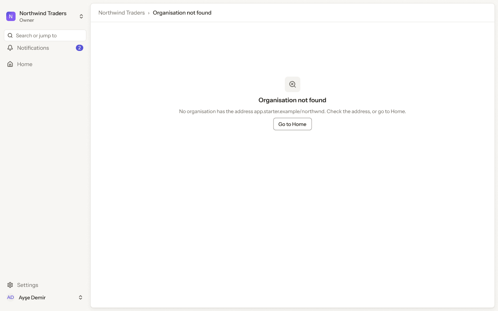

- **Who sees it:** Every signed-in member of an organisation.
- **Device:** Desktop (1280 px and wider).
- **This state shows:** when the address points to nothing the person can open.
- **Values come from:** Person, organisations and role: our API (current user and tenants). Unread count: our API notifications and the live stream. Environment strip: APP_ENVIRONMENT. Connection bar: the browser's network state and the API's health. App version: the build's commit.
- **Components:** Empty state, Sidebar, Top bar.
- **Actions:**
  - "Go to Home": goes to [4.01 · Home · Owner](../04-home/README.md#401--home--owner).
- **Texts, word for word, top to bottom:**

  - N
  - Northwind Traders
  - Owner
  - Search or jump to
  - Notifications
  - 2
  - Home
  - Settings
  - AD
  - Ayşe Demir
  - Northwind Traders
  - ›
  - Organisation not found
  - Organisation not found
  - No organisation has the address app.starter.example/northwnd. Check the address, or go to Home.
  - Go to Home

Figma: [296:24933](https://www.figma.com/design/3Ev111okX8xCBwR9B3hyBM/?node-id=296-24933)

### 2.42 · Page not found · signed out

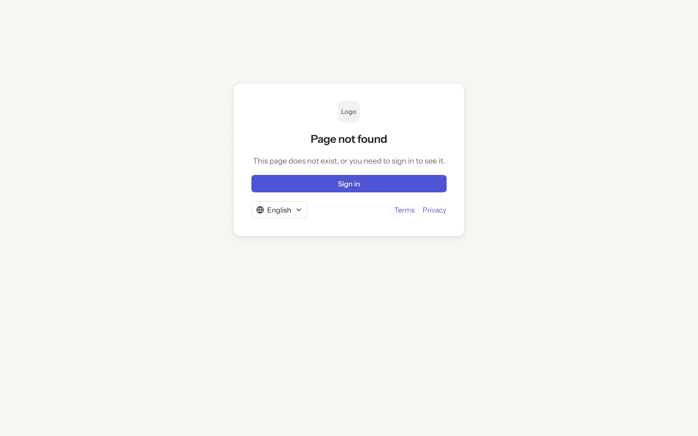

- **Who sees it:** Every signed-in member of an organisation.
- **Device:** Desktop (1280 px and wider).
- **This state shows:** when the address points to nothing the person can open.
- **Values come from:** Person, organisations and role: our API (current user and tenants). Unread count: our API notifications and the live stream. Environment strip: APP_ENVIRONMENT. Connection bar: the browser's network state and the API's health. App version: the build's commit.
- **Components:** Auth footer, Button.
- **Actions:**
  - "Sign in": goes to [1.01 · Sign in · sign-up off](../01-entry/README.md#101--sign-in--sign-up-off).
- **Texts, word for word, top to bottom:**

  - Logo
  - Page not found
  - This page does not exist, or you need to sign in to see it.
  - Sign in
  - English
  - Terms
  - ·
  - Privacy

Figma: [296:25007](https://www.figma.com/design/3Ev111okX8xCBwR9B3hyBM/?node-id=296-25007)

### 2.43 · Phone · page not found

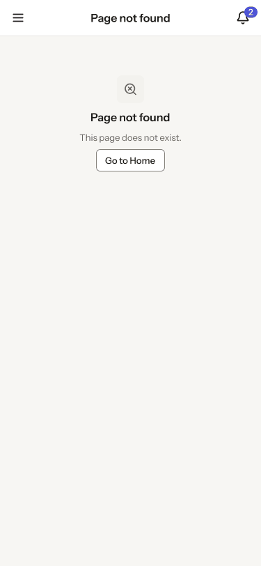

- **Who sees it:** Every signed-in member of an organisation.
- **Device:** Phone (up to 767 px).
- **This state shows:** on a phone; when the address points to nothing the person can open.
- **Values come from:** Person, organisations and role: our API (current user and tenants). Unread count: our API notifications and the live stream. Environment strip: APP_ENVIRONMENT. Connection bar: the browser's network state and the API's health. App version: the build's commit.
- **Components:** Empty state, Phone top bar.
- **Actions:**
  - "Go to Home": goes to [4.01 · Home · Owner](../04-home/README.md#401--home--owner).
- **Texts, word for word, top to bottom:**

  - Page not found
  - 2
  - Page not found
  - This page does not exist.
  - Go to Home

Figma: [296:25057](https://www.figma.com/design/3Ev111okX8xCBwR9B3hyBM/?node-id=296-25057)

### 2.44 · Page not found · dark

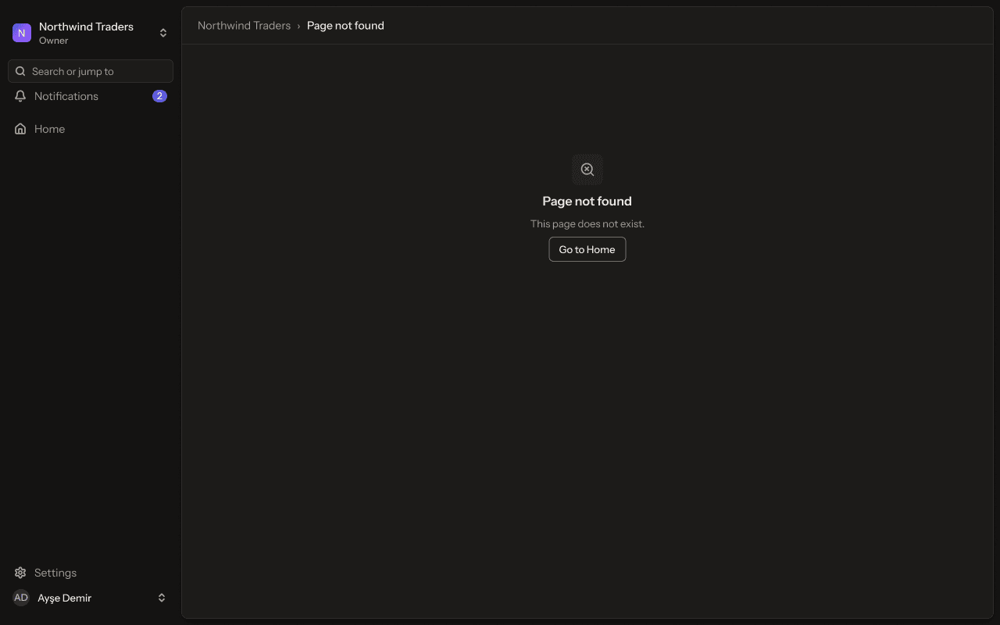

- **Who sees it:** Every signed-in member of an organisation.
- **Device:** Desktop (1280 px and wider).
- **This state shows:** in the dark theme; when the address points to nothing the person can open.
- **Values come from:** Person, organisations and role: our API (current user and tenants). Unread count: our API notifications and the live stream. Environment strip: APP_ENVIRONMENT. Connection bar: the browser's network state and the API's health. App version: the build's commit.
- **Components:** Empty state, Sidebar, Top bar.
- **Actions:**
  - "Go to Home": goes to [4.01 · Home · Owner](../04-home/README.md#401--home--owner).
- **Texts, word for word, top to bottom:**

  - N
  - Northwind Traders
  - Owner
  - Search or jump to
  - Notifications
  - 2
  - Home
  - Settings
  - AD
  - Ayşe Demir
  - Northwind Traders
  - ›
  - Page not found
  - Page not found
  - This page does not exist.
  - Go to Home

Figma: [296:25200](https://www.figma.com/design/3Ev111okX8xCBwR9B3hyBM/?node-id=296-25200)
