# Web app · 3 · Notifications

Who sees this section: Every signed-in member. Each person sees only their own notifications.

Where the values come from: Our API notifications endpoints and the live stream (SSE). Texts: packages/ui notification categories.

20 screens. Each part below is one screen and state. The PNG beside this file is the screen at scale 1.

| Screen | Device |
|---|---|
| [3.01 · Popover · unread (ideal)](#301--popover--unread-ideal) | Desktop |
| [3.02 · Popover · all](#302--popover--all) | Desktop |
| [3.03 · Popover · empty](#303--popover--empty) | Desktop |
| [3.04 · Popover · loading](#304--popover--loading) | Desktop |
| [3.05 · Popover · error](#305--popover--error) | Desktop |
| [3.06 · Popover · offline](#306--popover--offline) | Desktop |
| [3.07 · Popover · new arrives](#307--popover--new-arrives) | Desktop |
| [3.08 · Popover · end of the list](#308--popover--end-of-the-list) | Desktop |
| [3.09 · Popover · all read](#309--popover--all-read) | Desktop |
| [3.10 · Mark all failed](#310--mark-all-failed) | Desktop |
| [3.11 · Item opened](#311--item-opened) | Desktop |
| [3.12 · Keyboard focus](#312--keyboard-focus) | Desktop |
| [3.13 · Tablet](#313--tablet) | Tablet |
| [3.14 · Phone · notifications](#314--phone--notifications) | Phone |
| [3.15 · Phone · notifications empty](#315--phone--notifications-empty) | Phone |
| [3.16 · Dark](#316--dark) | Desktop |
| [3.17 · Popover · billing](#317--popover--billing) | Desktop |
| [3.18 · Popover · last warning and spending cap](#318--popover--last-warning-and-spending-cap) | Desktop |
| [3.19 · Popover · trial](#319--popover--trial) | Desktop |
| [3.20 · Popover · trial ended](#320--popover--trial-ended) | Desktop |

### 3.01 · Popover · unread (ideal)

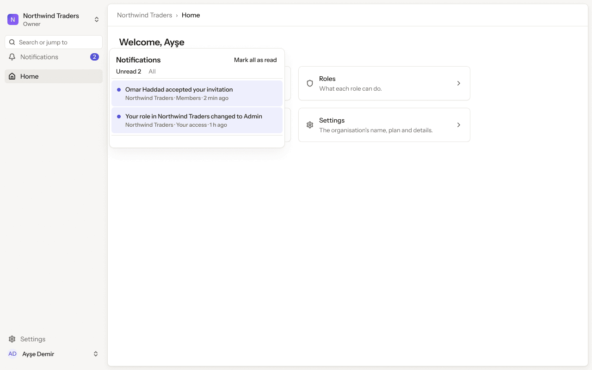

- **Who sees it:** Every signed-in member. Each person sees only their own notifications.
- **Device:** Desktop (1280 px and wider).
- **This state shows:** when the data loads and every value is present.
- **Values come from:** Our API notifications endpoints and the live stream (SSE). Texts: packages/ui notification categories.
- **Components:** Icon/activity, Icon/chevron-down ×4, Icon/settings, Icon/shield, Icon/users, Notifications popover, Sidebar, Top bar.
- **Actions:**
  - "All": goes to [3.02 · Popover · all](#302--popover--all).
  - "Mark all as read": goes to [3.09 · Popover · all read](#309--popover--all-read).
  - "Omar Haddad accepted your invitation": goes to [8.01 · Members · ideal](../08-settings-members/README.md#801--members--ideal).
  - "Omar Haddad accepted your invitation": goes to [3.11 · Item opened](#311--item-opened).
  - "Home": goes to [4.01 · Home · Owner](../04-home/README.md#401--home--owner).
  - "Settings": goes to [7.01 · General · ideal](../07-settings-general/README.md#701--general--ideal).
- **Texts, word for word, top to bottom:**

  - N
  - Northwind Traders
  - Owner
  - Search or jump to
  - Notifications
  - 2
  - Home
  - Settings
  - AD
  - Ayşe Demir
  - Northwind Traders
  - ›
  - Home
  - Welcome, Ayşe
  - Northwind Traders
  - Members
  - People in Northwind Traders and their roles.
  - Roles
  - What each role can do.
  - Activity log
  - Who changed what, and when.
  - Settings
  - The organisation’s name, plan and details.
  - Notifications
  - Mark all as read
  - Unread 2
  - All
  - Omar Haddad accepted your invitation
  - Northwind Traders · Members · 2 min ago
  - Your role in Northwind Traders changed to Admin
  - Northwind Traders · Your access · 1 h ago

Figma: [62:8553](https://www.figma.com/design/3Ev111okX8xCBwR9B3hyBM/?node-id=62-8553)

### 3.02 · Popover · all

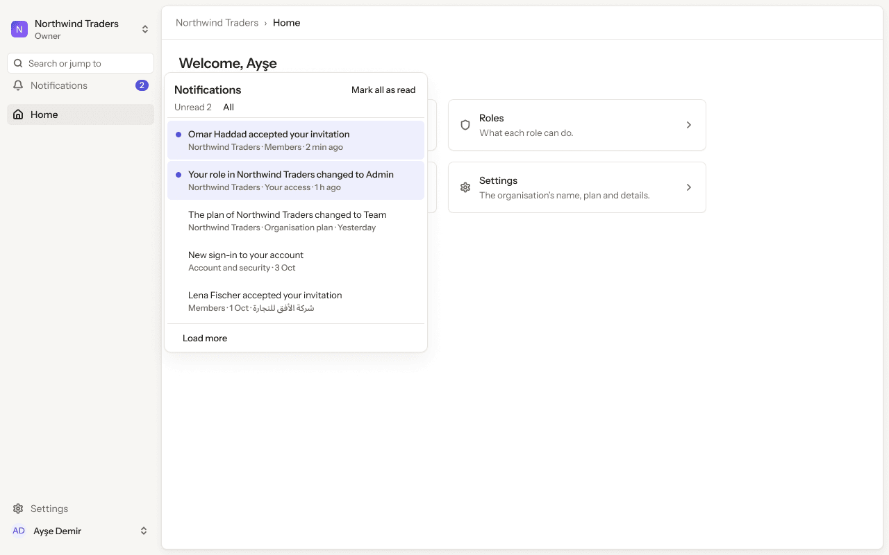

- **Who sees it:** Every signed-in member. Each person sees only their own notifications.
- **Device:** Desktop (1280 px and wider).
- **This state shows:** as the title says.
- **Values come from:** Our API notifications endpoints and the live stream (SSE). Texts: packages/ui notification categories.
- **Components:** Icon/activity, Icon/chevron-down ×4, Icon/settings, Icon/shield, Icon/users, Notifications popover, Sidebar, Top bar.
- **Actions:**
  - "Unread 2": goes to [3.01 · Popover · unread (ideal)](#301--popover--unread-ideal).
  - "Load more": goes to [3.08 · Popover · end of the list](#308--popover--end-of-the-list).
  - "Home": goes to [4.01 · Home · Owner](../04-home/README.md#401--home--owner).
  - "Settings": goes to [7.01 · General · ideal](../07-settings-general/README.md#701--general--ideal).
- **Texts, word for word, top to bottom:**

  - N
  - Northwind Traders
  - Owner
  - Search or jump to
  - Notifications
  - 2
  - Home
  - Settings
  - AD
  - Ayşe Demir
  - Northwind Traders
  - ›
  - Home
  - Welcome, Ayşe
  - Northwind Traders
  - Members
  - People in Northwind Traders and their roles.
  - Roles
  - What each role can do.
  - Activity log
  - Who changed what, and when.
  - Settings
  - The organisation’s name, plan and details.
  - Notifications
  - Mark all as read
  - Unread 2
  - All
  - Omar Haddad accepted your invitation
  - Northwind Traders · Members · 2 min ago
  - Your role in Northwind Traders changed to Admin
  - Northwind Traders · Your access · 1 h ago
  - The plan of Northwind Traders changed to Team
  - Northwind Traders · Organisation plan · Yesterday
  - New sign-in to your account
  - Account and security · 3 Oct
  - Lena Fischer accepted your invitation
  - شركة الأفق للتجارة · Members · 1 Oct
  - Load more

Figma: [62:8838](https://www.figma.com/design/3Ev111okX8xCBwR9B3hyBM/?node-id=62-8838)

### 3.03 · Popover · empty

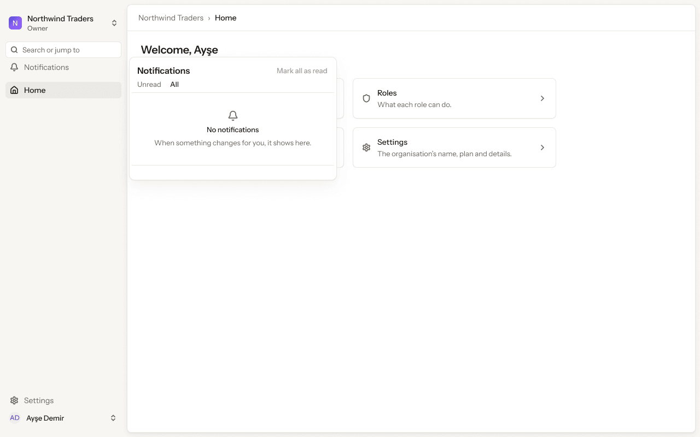

- **Who sees it:** Every signed-in member. Each person sees only their own notifications.
- **Device:** Desktop (1280 px and wider).
- **This state shows:** when there is nothing to list yet.
- **Values come from:** Our API notifications endpoints and the live stream (SSE). Texts: packages/ui notification categories.
- **Components:** Icon/activity, Icon/chevron-down ×4, Icon/settings, Icon/shield, Icon/users, Notifications popover, Sidebar, Top bar.
- **Actions:**
  - "Home": goes to [4.01 · Home · Owner](../04-home/README.md#401--home--owner).
  - "Settings": goes to [7.01 · General · ideal](../07-settings-general/README.md#701--general--ideal).
- **Texts, word for word, top to bottom:**

  - N
  - Northwind Traders
  - Owner
  - Search or jump to
  - Notifications
  - Home
  - Settings
  - AD
  - Ayşe Demir
  - Northwind Traders
  - ›
  - Home
  - Welcome, Ayşe
  - Northwind Traders
  - Members
  - People in Northwind Traders and their roles.
  - Roles
  - What each role can do.
  - Activity log
  - Who changed what, and when.
  - Settings
  - The organisation’s name, plan and details.
  - Notifications
  - Mark all as read
  - Unread
  - All
  - No notifications
  - When something changes for you, it shows here.

Figma: [62:9143](https://www.figma.com/design/3Ev111okX8xCBwR9B3hyBM/?node-id=62-9143)

### 3.04 · Popover · loading

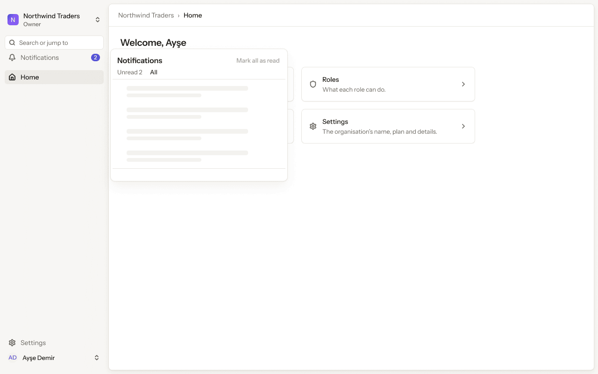

- **Who sees it:** Every signed-in member. Each person sees only their own notifications.
- **Device:** Desktop (1280 px and wider).
- **This state shows:** while the request runs.
- **Values come from:** Our API notifications endpoints and the live stream (SSE). Texts: packages/ui notification categories.
- **Components:** Icon/activity, Icon/chevron-down ×4, Icon/settings, Icon/shield, Icon/users, Notifications popover, Sidebar, Top bar.
- **Actions:**
  - "Home": goes to [4.01 · Home · Owner](../04-home/README.md#401--home--owner).
  - "Settings": goes to [7.01 · General · ideal](../07-settings-general/README.md#701--general--ideal).
- **Texts, word for word, top to bottom:**

  - N
  - Northwind Traders
  - Owner
  - Search or jump to
  - Notifications
  - 2
  - Home
  - Settings
  - AD
  - Ayşe Demir
  - Northwind Traders
  - ›
  - Home
  - Welcome, Ayşe
  - Northwind Traders
  - Members
  - People in Northwind Traders and their roles.
  - Roles
  - What each role can do.
  - Activity log
  - Who changed what, and when.
  - Settings
  - The organisation’s name, plan and details.
  - Notifications
  - Mark all as read
  - Unread 2
  - All

Figma: [62:9423](https://www.figma.com/design/3Ev111okX8xCBwR9B3hyBM/?node-id=62-9423)

### 3.05 · Popover · error

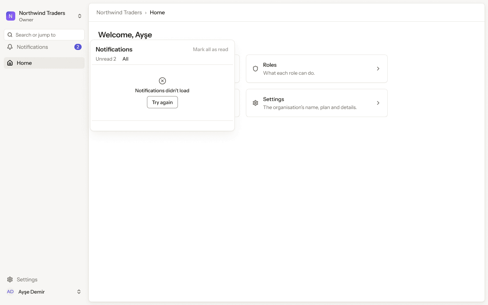

- **Who sees it:** Every signed-in member. Each person sees only their own notifications.
- **Device:** Desktop (1280 px and wider).
- **This state shows:** when the request fails.
- **Values come from:** Our API notifications endpoints and the live stream (SSE). Texts: packages/ui notification categories.
- **Components:** Icon/activity, Icon/chevron-down ×4, Icon/settings, Icon/shield, Icon/users, Notifications popover, Sidebar, Top bar.
- **Actions:**
  - "Home": goes to [4.01 · Home · Owner](../04-home/README.md#401--home--owner).
  - "Settings": goes to [7.01 · General · ideal](../07-settings-general/README.md#701--general--ideal).
- **Texts, word for word, top to bottom:**

  - N
  - Northwind Traders
  - Owner
  - Search or jump to
  - Notifications
  - 2
  - Home
  - Settings
  - AD
  - Ayşe Demir
  - Northwind Traders
  - ›
  - Home
  - Welcome, Ayşe
  - Northwind Traders
  - Members
  - People in Northwind Traders and their roles.
  - Roles
  - What each role can do.
  - Activity log
  - Who changed what, and when.
  - Settings
  - The organisation’s name, plan and details.
  - Notifications
  - Mark all as read
  - Unread 2
  - All
  - Notifications didn’t load
  - Try again

Figma: [62:9708](https://www.figma.com/design/3Ev111okX8xCBwR9B3hyBM/?node-id=62-9708)

### 3.06 · Popover · offline

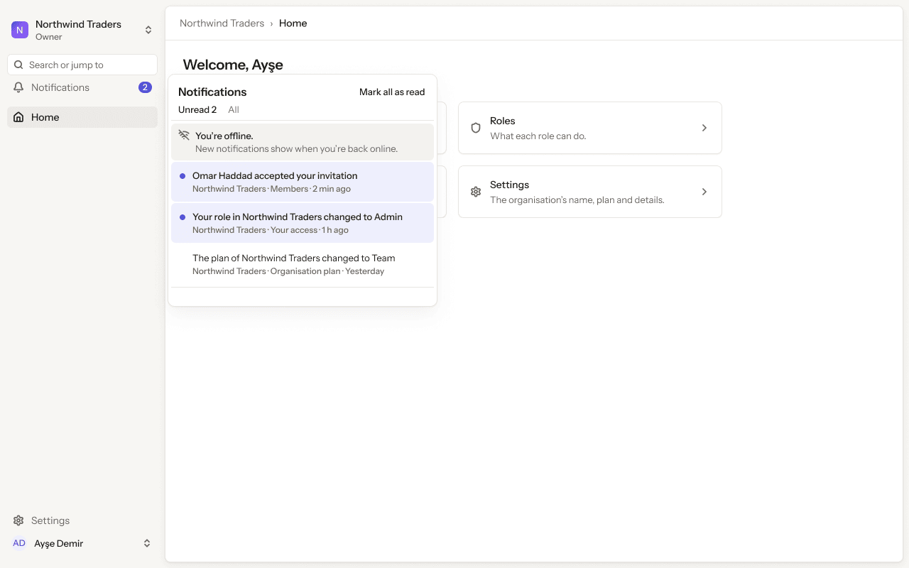

- **Who sees it:** Every signed-in member. Each person sees only their own notifications.
- **Device:** Desktop (1280 px and wider).
- **This state shows:** when the browser loses the network.
- **Values come from:** Our API notifications endpoints and the live stream (SSE). Texts: packages/ui notification categories.
- **Components:** Icon/activity, Icon/chevron-down ×4, Icon/settings, Icon/shield, Icon/users, Notifications popover, Sidebar, Top bar.
- **Actions:**
  - "Home": goes to [4.01 · Home · Owner](../04-home/README.md#401--home--owner).
  - "Settings": goes to [7.01 · General · ideal](../07-settings-general/README.md#701--general--ideal).
- **Texts, word for word, top to bottom:**

  - N
  - Northwind Traders
  - Owner
  - Search or jump to
  - Notifications
  - 2
  - Home
  - Settings
  - AD
  - Ayşe Demir
  - Northwind Traders
  - ›
  - Home
  - Welcome, Ayşe
  - Northwind Traders
  - Members
  - People in Northwind Traders and their roles.
  - Roles
  - What each role can do.
  - Activity log
  - Who changed what, and when.
  - Settings
  - The organisation’s name, plan and details.
  - Notifications
  - Mark all as read
  - Unread 2
  - All
  - You’re offline.
  - New notifications show when you’re back online.
  - Omar Haddad accepted your invitation
  - Northwind Traders · Members · 2 min ago
  - Your role in Northwind Traders changed to Admin
  - Northwind Traders · Your access · 1 h ago
  - The plan of Northwind Traders changed to Team
  - Northwind Traders · Organisation plan · Yesterday

Figma: [62:9991](https://www.figma.com/design/3Ev111okX8xCBwR9B3hyBM/?node-id=62-9991)

### 3.07 · Popover · new arrives

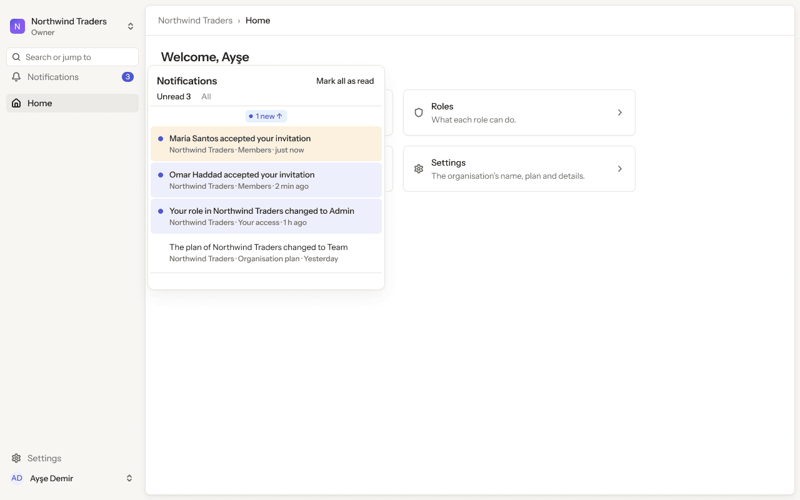

- **Who sees it:** Every signed-in member. Each person sees only their own notifications.
- **Device:** Desktop (1280 px and wider).
- **This state shows:** as the title says.
- **Values come from:** Our API notifications endpoints and the live stream (SSE). Texts: packages/ui notification categories.
- **Components:** Icon/activity, Icon/chevron-down ×4, Icon/settings, Icon/shield, Icon/users, Notifications popover, Sidebar, Top bar.
- **Actions:**
  - "Home": goes to [4.01 · Home · Owner](../04-home/README.md#401--home--owner).
  - "Settings": goes to [7.01 · General · ideal](../07-settings-general/README.md#701--general--ideal).
- **Texts, word for word, top to bottom:**

  - N
  - Northwind Traders
  - Owner
  - Search or jump to
  - Notifications
  - 3
  - Home
  - Settings
  - AD
  - Ayşe Demir
  - Northwind Traders
  - ›
  - Home
  - Welcome, Ayşe
  - Northwind Traders
  - Members
  - People in Northwind Traders and their roles.
  - Roles
  - What each role can do.
  - Activity log
  - Who changed what, and when.
  - Settings
  - The organisation’s name, plan and details.
  - Notifications
  - Mark all as read
  - Unread 3
  - All
  - 1 new ↑
  - Maria Santos accepted your invitation
  - Northwind Traders · Members · just now
  - Omar Haddad accepted your invitation
  - Northwind Traders · Members · 2 min ago
  - Your role in Northwind Traders changed to Admin
  - Northwind Traders · Your access · 1 h ago
  - The plan of Northwind Traders changed to Team
  - Northwind Traders · Organisation plan · Yesterday

Figma: [62:10295](https://www.figma.com/design/3Ev111okX8xCBwR9B3hyBM/?node-id=62-10295)

### 3.08 · Popover · end of the list

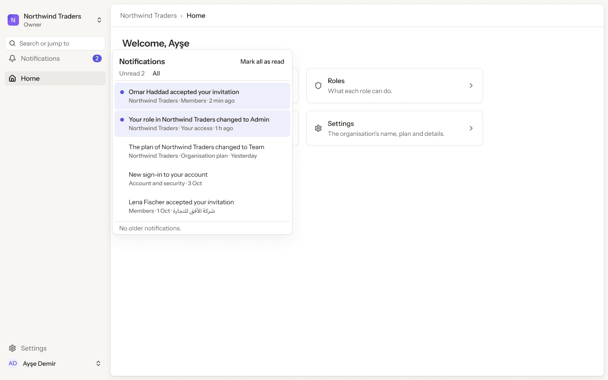

- **Who sees it:** Every signed-in member. Each person sees only their own notifications.
- **Device:** Desktop (1280 px and wider).
- **This state shows:** as the title says.
- **Values come from:** Our API notifications endpoints and the live stream (SSE). Texts: packages/ui notification categories.
- **Components:** Icon/activity, Icon/chevron-down ×4, Icon/settings, Icon/shield, Icon/users, Notifications popover, Sidebar, Top bar.
- **Actions:**
  - "Unread 2": goes to [3.01 · Popover · unread (ideal)](#301--popover--unread-ideal).
  - "Home": goes to [4.01 · Home · Owner](../04-home/README.md#401--home--owner).
  - "Settings": goes to [7.01 · General · ideal](../07-settings-general/README.md#701--general--ideal).
- **Texts, word for word, top to bottom:**

  - N
  - Northwind Traders
  - Owner
  - Search or jump to
  - Notifications
  - 2
  - Home
  - Settings
  - AD
  - Ayşe Demir
  - Northwind Traders
  - ›
  - Home
  - Welcome, Ayşe
  - Northwind Traders
  - Members
  - People in Northwind Traders and their roles.
  - Roles
  - What each role can do.
  - Activity log
  - Who changed what, and when.
  - Settings
  - The organisation’s name, plan and details.
  - Notifications
  - Mark all as read
  - Unread 2
  - All
  - Omar Haddad accepted your invitation
  - Northwind Traders · Members · 2 min ago
  - Your role in Northwind Traders changed to Admin
  - Northwind Traders · Your access · 1 h ago
  - The plan of Northwind Traders changed to Team
  - Northwind Traders · Organisation plan · Yesterday
  - New sign-in to your account
  - Account and security · 3 Oct
  - Lena Fischer accepted your invitation
  - شركة الأفق للتجارة · Members · 1 Oct
  - No older notifications.

Figma: [62:10596](https://www.figma.com/design/3Ev111okX8xCBwR9B3hyBM/?node-id=62-10596)

### 3.09 · Popover · all read

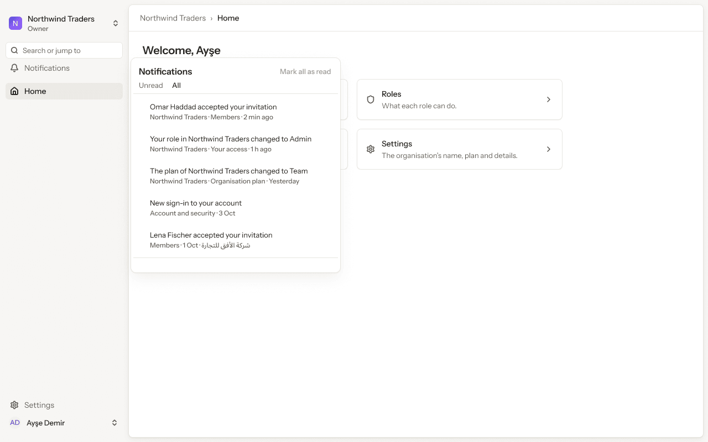

- **Who sees it:** Every signed-in member. Each person sees only their own notifications.
- **Device:** Desktop (1280 px and wider).
- **This state shows:** as the title says.
- **Values come from:** Our API notifications endpoints and the live stream (SSE). Texts: packages/ui notification categories.
- **Components:** Icon/activity, Icon/chevron-down ×4, Icon/settings, Icon/shield, Icon/users, Notifications popover, Sidebar, Top bar.
- **Actions:**
  - "Omar Haddad accepted your invitation": goes to [8.01 · Members · ideal](../08-settings-members/README.md#801--members--ideal).
  - "Home": goes to [4.01 · Home · Owner](../04-home/README.md#401--home--owner).
  - "Settings": goes to [7.01 · General · ideal](../07-settings-general/README.md#701--general--ideal).
- **Texts, word for word, top to bottom:**

  - N
  - Northwind Traders
  - Owner
  - Search or jump to
  - Notifications
  - Home
  - Settings
  - AD
  - Ayşe Demir
  - Northwind Traders
  - ›
  - Home
  - Welcome, Ayşe
  - Northwind Traders
  - Members
  - People in Northwind Traders and their roles.
  - Roles
  - What each role can do.
  - Activity log
  - Who changed what, and when.
  - Settings
  - The organisation’s name, plan and details.
  - Notifications
  - Mark all as read
  - Unread
  - All
  - Omar Haddad accepted your invitation
  - Northwind Traders · Members · 2 min ago
  - Your role in Northwind Traders changed to Admin
  - Northwind Traders · Your access · 1 h ago
  - The plan of Northwind Traders changed to Team
  - Northwind Traders · Organisation plan · Yesterday
  - New sign-in to your account
  - Account and security · 3 Oct
  - Lena Fischer accepted your invitation
  - شركة الأفق للتجارة · Members · 1 Oct

Figma: [62:10899](https://www.figma.com/design/3Ev111okX8xCBwR9B3hyBM/?node-id=62-10899)

### 3.10 · Mark all failed

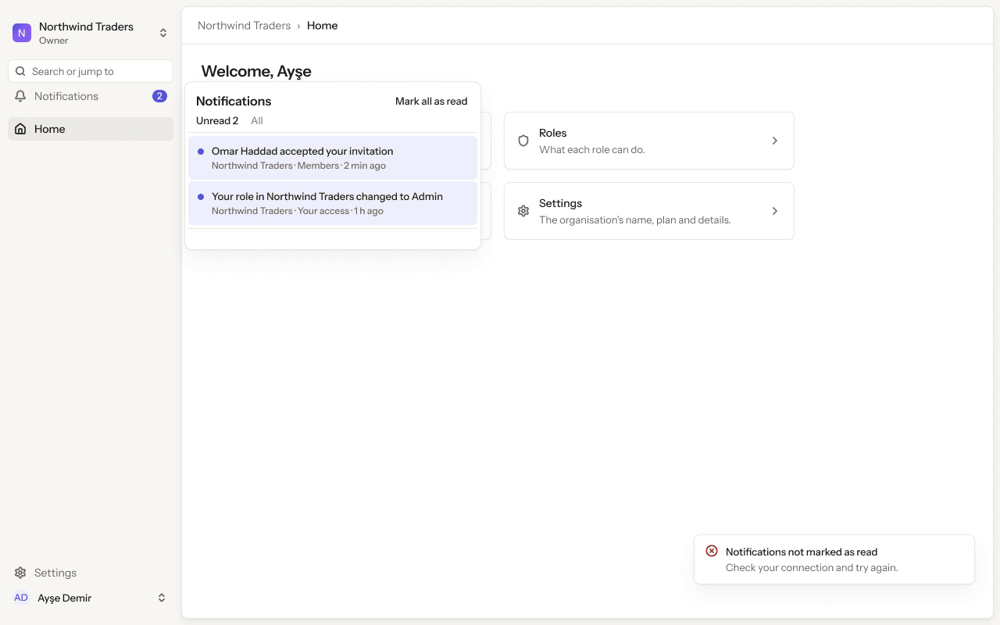

- **Who sees it:** Every signed-in member. Each person sees only their own notifications.
- **Device:** Desktop (1280 px and wider).
- **This state shows:** when the action fails.
- **Values come from:** Our API notifications endpoints and the live stream (SSE). Texts: packages/ui notification categories.
- **Components:** Icon/activity, Icon/chevron-down ×4, Icon/settings, Icon/shield, Icon/users, Notifications popover, Sidebar, Toast, Top bar.
- **Actions:**
  - "Home": goes to [4.01 · Home · Owner](../04-home/README.md#401--home--owner).
  - "Settings": goes to [7.01 · General · ideal](../07-settings-general/README.md#701--general--ideal).
- **Texts, word for word, top to bottom:**

  - N
  - Northwind Traders
  - Owner
  - Search or jump to
  - Notifications
  - 2
  - Home
  - Settings
  - AD
  - Ayşe Demir
  - Northwind Traders
  - ›
  - Home
  - Welcome, Ayşe
  - Northwind Traders
  - Members
  - People in Northwind Traders and their roles.
  - Roles
  - What each role can do.
  - Activity log
  - Who changed what, and when.
  - Settings
  - The organisation’s name, plan and details.
  - Notifications
  - Mark all as read
  - Unread 2
  - All
  - Omar Haddad accepted your invitation
  - Northwind Traders · Members · 2 min ago
  - Your role in Northwind Traders changed to Admin
  - Northwind Traders · Your access · 1 h ago
  - Notifications not marked as read
  - Check your connection and try again.

Figma: [62:11202](https://www.figma.com/design/3Ev111okX8xCBwR9B3hyBM/?node-id=62-11202)

### 3.11 · Item opened

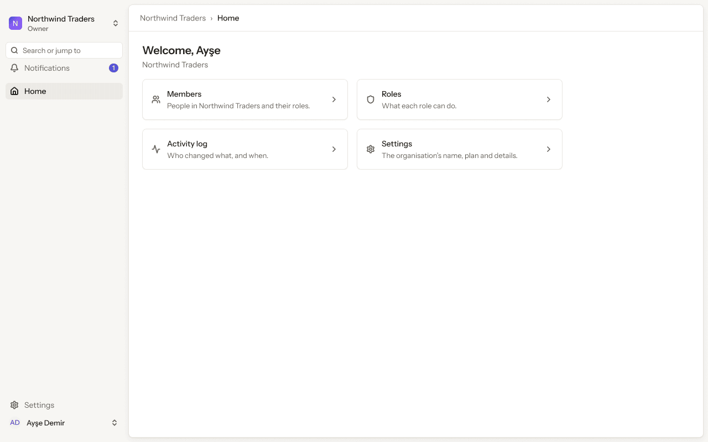

- **Who sees it:** Every signed-in member. Each person sees only their own notifications.
- **Device:** Desktop (1280 px and wider).
- **This state shows:** as the title says.
- **Values come from:** Our API notifications endpoints and the live stream (SSE). Texts: packages/ui notification categories.
- **Components:** Icon/activity, Icon/chevron-down ×4, Icon/settings, Icon/shield, Icon/users, Sidebar, Top bar.
- **Actions:**
  - "Home": goes to [4.01 · Home · Owner](../04-home/README.md#401--home--owner).
  - "Settings": goes to [7.01 · General · ideal](../07-settings-general/README.md#701--general--ideal).
- **Texts, word for word, top to bottom:**

  - N
  - Northwind Traders
  - Owner
  - Search or jump to
  - Notifications
  - 1
  - Home
  - Settings
  - AD
  - Ayşe Demir
  - Northwind Traders
  - ›
  - Home
  - Welcome, Ayşe
  - Northwind Traders
  - Members
  - People in Northwind Traders and their roles.
  - Roles
  - What each role can do.
  - Activity log
  - Who changed what, and when.
  - Settings
  - The organisation’s name, plan and details.

Figma: [62:11496](https://www.figma.com/design/3Ev111okX8xCBwR9B3hyBM/?node-id=62-11496)

### 3.12 · Keyboard focus

- **Who sees it:** Every signed-in member. Each person sees only their own notifications.
- **Device:** Desktop (1280 px and wider).
- **This state shows:** as the title says.
- **Values come from:** Our API notifications endpoints and the live stream (SSE). Texts: packages/ui notification categories.
- **Components:** Icon/activity, Icon/chevron-down ×4, Icon/settings, Icon/shield, Icon/users, Notifications popover, Sidebar, Top bar.
- **Actions:**
  - "Home": goes to [4.01 · Home · Owner](../04-home/README.md#401--home--owner).
  - "Settings": goes to [7.01 · General · ideal](../07-settings-general/README.md#701--general--ideal).
- **Texts, word for word, top to bottom:**

  - N
  - Northwind Traders
  - Owner
  - Search or jump to
  - Notifications
  - 2
  - Home
  - Settings
  - AD
  - Ayşe Demir
  - Northwind Traders
  - ›
  - Home
  - Welcome, Ayşe
  - Northwind Traders
  - Members
  - People in Northwind Traders and their roles.
  - Roles
  - What each role can do.
  - Activity log
  - Who changed what, and when.
  - Settings
  - The organisation’s name, plan and details.
  - Notifications
  - Mark all as read
  - Unread 2
  - All
  - Omar Haddad accepted your invitation
  - Northwind Traders · Members · 2 min ago
  - Your role in Northwind Traders changed to Admin
  - Northwind Traders · Your access · 1 h ago

Figma: [62:11753](https://www.figma.com/design/3Ev111okX8xCBwR9B3hyBM/?node-id=62-11753)

### 3.13 · Tablet

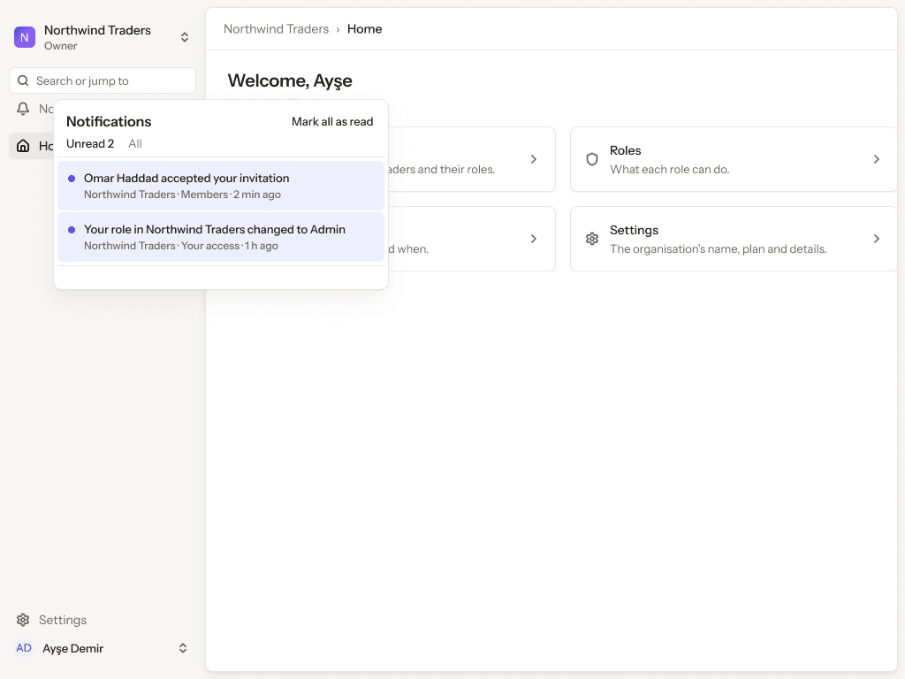

- **Who sees it:** Every signed-in member. Each person sees only their own notifications.
- **Device:** Tablet (768 to 1279 px).
- **This state shows:** as the title says.
- **Values come from:** Our API notifications endpoints and the live stream (SSE). Texts: packages/ui notification categories.
- **Components:** Icon/activity, Icon/chevron-down ×4, Icon/settings, Icon/shield, Icon/users, Notifications popover, Sidebar, Top bar.
- **Actions:**
  - "Home": goes to [4.01 · Home · Owner](../04-home/README.md#401--home--owner).
  - "Settings": goes to [7.01 · General · ideal](../07-settings-general/README.md#701--general--ideal).
- **Texts, word for word, top to bottom:**

  - N
  - Northwind Traders
  - Owner
  - Search or jump to
  - Notifications
  - 2
  - Home
  - Settings
  - AD
  - Ayşe Demir
  - Northwind Traders
  - ›
  - Home
  - Welcome, Ayşe
  - Northwind Traders
  - Members
  - People in Northwind Traders and their roles.
  - Roles
  - What each role can do.
  - Activity log
  - Who changed what, and when.
  - Settings
  - The organisation’s name, plan and details.
  - Notifications
  - Mark all as read
  - Unread 2
  - All
  - Omar Haddad accepted your invitation
  - Northwind Traders · Members · 2 min ago
  - Your role in Northwind Traders changed to Admin
  - Northwind Traders · Your access · 1 h ago

Figma: [62:12038](https://www.figma.com/design/3Ev111okX8xCBwR9B3hyBM/?node-id=62-12038)

### 3.14 · Phone · notifications

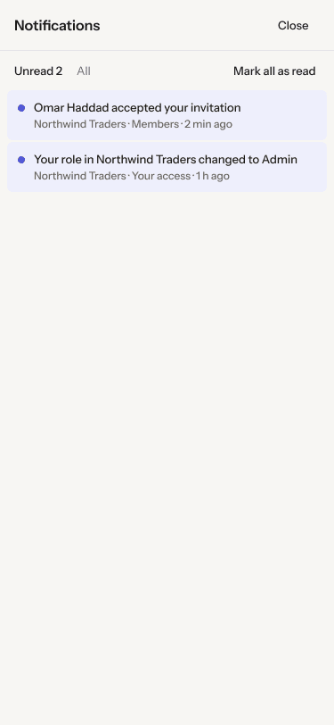

- **Who sees it:** Every signed-in member. Each person sees only their own notifications.
- **Device:** Phone (up to 767 px).
- **This state shows:** on a phone.
- **Values come from:** Our API notifications endpoints and the live stream (SSE). Texts: packages/ui notification categories.
- **Components:** Button ×2, Notification item ×2.
- **Actions:**
  - No prototype link on this screen. The buttons follow the section's other screens.
- **Texts, word for word, top to bottom:**

  - Notifications
  - Close
  - Unread 2
  - All
  - Mark all as read
  - Omar Haddad accepted your invitation
  - Northwind Traders · Members · 2 min ago
  - Your role in Northwind Traders changed to Admin
  - Northwind Traders · Your access · 1 h ago

Figma: [63:12205](https://www.figma.com/design/3Ev111okX8xCBwR9B3hyBM/?node-id=63-12205)

### 3.15 · Phone · notifications empty

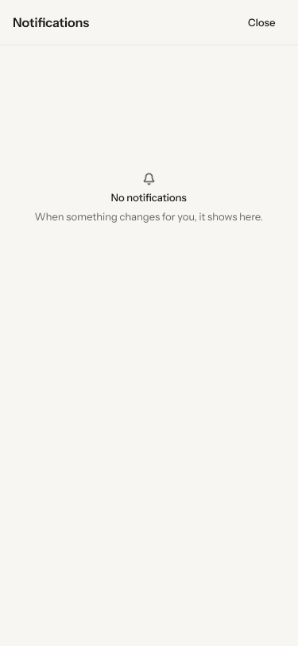

- **Who sees it:** Every signed-in member. Each person sees only their own notifications.
- **Device:** Phone (up to 767 px).
- **This state shows:** when there is nothing to list yet; on a phone.
- **Values come from:** Our API notifications endpoints and the live stream (SSE). Texts: packages/ui notification categories.
- **Components:** Button, Icon/bell.
- **Actions:**
  - No prototype link on this screen. The buttons follow the section's other screens.
- **Texts, word for word, top to bottom:**

  - Notifications
  - Close
  - No notifications
  - When something changes for you, it shows here.

Figma: [63:12237](https://www.figma.com/design/3Ev111okX8xCBwR9B3hyBM/?node-id=63-12237)

### 3.16 · Dark

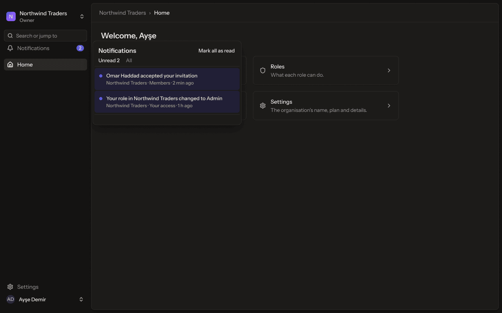

- **Who sees it:** Every signed-in member. Each person sees only their own notifications.
- **Device:** Desktop (1280 px and wider).
- **This state shows:** in the dark theme.
- **Values come from:** Our API notifications endpoints and the live stream (SSE). Texts: packages/ui notification categories.
- **Components:** Icon/activity, Icon/chevron-down ×4, Icon/settings, Icon/shield, Icon/users, Notifications popover, Sidebar, Top bar.
- **Actions:**
  - "Home": goes to [4.01 · Home · Owner](../04-home/README.md#401--home--owner).
  - "Settings": goes to [7.01 · General · ideal](../07-settings-general/README.md#701--general--ideal).
- **Texts, word for word, top to bottom:**

  - N
  - Northwind Traders
  - Owner
  - Search or jump to
  - Notifications
  - 2
  - Home
  - Settings
  - AD
  - Ayşe Demir
  - Northwind Traders
  - ›
  - Home
  - Welcome, Ayşe
  - Northwind Traders
  - Members
  - People in Northwind Traders and their roles.
  - Roles
  - What each role can do.
  - Activity log
  - Who changed what, and when.
  - Settings
  - The organisation’s name, plan and details.
  - Notifications
  - Mark all as read
  - Unread 2
  - All
  - Omar Haddad accepted your invitation
  - Northwind Traders · Members · 2 min ago
  - Your role in Northwind Traders changed to Admin
  - Northwind Traders · Your access · 1 h ago

Figma: [62:12299](https://www.figma.com/design/3Ev111okX8xCBwR9B3hyBM/?node-id=62-12299)

### 3.17 · Popover · billing

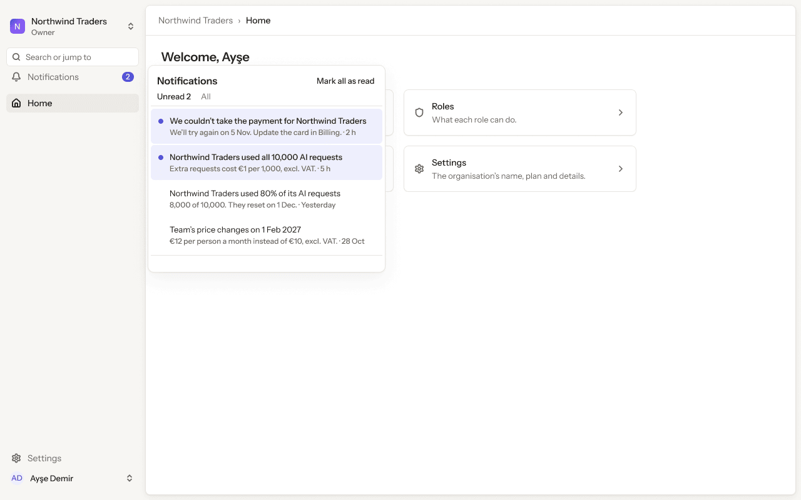

- **Who sees it:** Every signed-in member. Each person sees only their own notifications.
- **Device:** Desktop (1280 px and wider).
- **This state shows:** as the title says.
- **Values come from:** Our API notifications endpoints and the live stream (SSE). Texts: packages/ui notification categories.
- **Components:** Button, Icon/activity, Icon/chevron-down ×4, Icon/settings, Icon/shield, Icon/users, Notification item ×4, Sidebar, Top bar.
- **Actions:**
  - "All": goes to [3.02 · Popover · all](#302--popover--all).
  - "Mark all as read": goes to [3.09 · Popover · all read](#309--popover--all-read).
  - "We couldn’t take the payment for Northwind Traders": goes to [8.01 · Members · ideal](../08-settings-members/README.md#801--members--ideal).
  - "We couldn’t take the payment for Northwind Traders": goes to [3.11 · Item opened](#311--item-opened).
  - "Home": goes to [4.01 · Home · Owner](../04-home/README.md#401--home--owner).
  - "Settings": goes to [7.01 · General · ideal](../07-settings-general/README.md#701--general--ideal).
- **Texts, word for word, top to bottom:**

  - N
  - Northwind Traders
  - Owner
  - Search or jump to
  - Notifications
  - 2
  - Home
  - Settings
  - AD
  - Ayşe Demir
  - Northwind Traders
  - ›
  - Home
  - Welcome, Ayşe
  - Northwind Traders
  - Members
  - People in Northwind Traders and their roles.
  - Roles
  - What each role can do.
  - Activity log
  - Who changed what, and when.
  - Settings
  - The organisation’s name, plan and details.
  - Notifications
  - Mark all as read
  - Unread 2
  - All
  - We couldn’t take the payment for Northwind Traders
  - We’ll try again on 5 Nov. Update the card in Billing. · 2 h
  - Northwind Traders used all 10,000 AI requests
  - Extra requests cost €1 per 1,000, excl. VAT. · 5 h
  - Northwind Traders used 80% of its AI requests
  - 8,000 of 10,000. They reset on 1 Dec. · Yesterday
  - Team’s price changes on 1 Feb 2027
  - €12 per person a month instead of €10, excl. VAT. · 28 Oct

Figma: [244:22537](https://www.figma.com/design/3Ev111okX8xCBwR9B3hyBM/?node-id=244-22537)

### 3.18 · Popover · last warning and spending cap

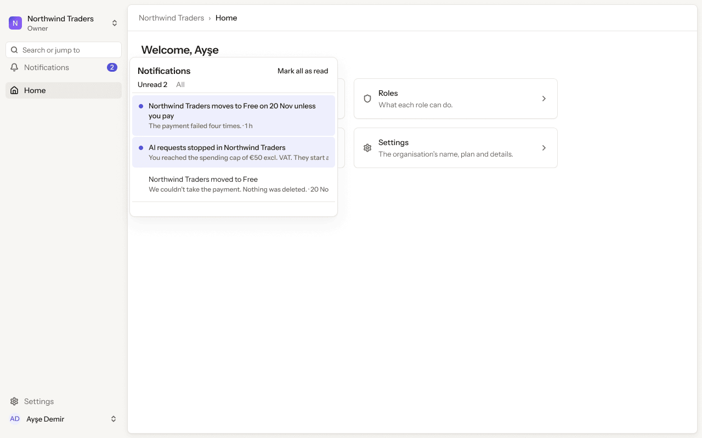

- **Who sees it:** Every signed-in member. Each person sees only their own notifications.
- **Device:** Desktop (1280 px and wider).
- **This state shows:** as the title says.
- **Values come from:** Our API notifications endpoints and the live stream (SSE). Texts: packages/ui notification categories.
- **Components:** Button, Icon/activity, Icon/chevron-down ×4, Icon/settings, Icon/shield, Icon/users, Notification item ×3, Sidebar, Top bar.
- **Actions:**
  - "All": goes to [3.02 · Popover · all](#302--popover--all).
  - "Mark all as read": goes to [3.09 · Popover · all read](#309--popover--all-read).
  - "Northwind Traders moves to Free on 20 Nov unless you pay": goes to [8.01 · Members · ideal](../08-settings-members/README.md#801--members--ideal).
  - "Northwind Traders moves to Free on 20 Nov unless you pay": goes to [3.11 · Item opened](#311--item-opened).
  - "Home": goes to [4.01 · Home · Owner](../04-home/README.md#401--home--owner).
  - "Settings": goes to [7.01 · General · ideal](../07-settings-general/README.md#701--general--ideal).
- **Texts, word for word, top to bottom:**

  - N
  - Northwind Traders
  - Owner
  - Search or jump to
  - Notifications
  - 2
  - Home
  - Settings
  - AD
  - Ayşe Demir
  - Northwind Traders
  - ›
  - Home
  - Welcome, Ayşe
  - Northwind Traders
  - Members
  - People in Northwind Traders and their roles.
  - Roles
  - What each role can do.
  - Activity log
  - Who changed what, and when.
  - Settings
  - The organisation’s name, plan and details.
  - Notifications
  - Mark all as read
  - Unread 2
  - All
  - Northwind Traders moves to Free on 20 Nov unless you pay
  - The payment failed four times. · 1 h
  - AI requests stopped in Northwind Traders
  - You reached the spending cap of €50 excl. VAT. They start again on 1 Dec. · 3 h
  - Northwind Traders moved to Free
  - We couldn’t take the payment. Nothing was deleted. · 20 Nov

Figma: [244:22719](https://www.figma.com/design/3Ev111okX8xCBwR9B3hyBM/?node-id=244-22719)

### 3.19 · Popover · trial

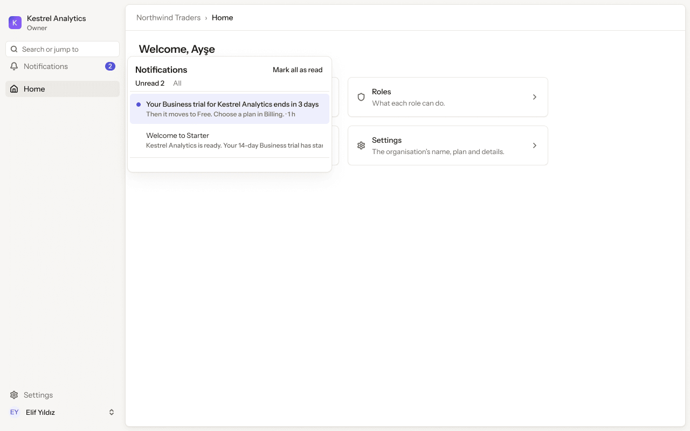

- **Who sees it:** Every signed-in member. Each person sees only their own notifications.
- **Device:** Desktop (1280 px and wider).
- **This state shows:** as the title says.
- **Values come from:** Our API notifications endpoints and the live stream (SSE). Texts: packages/ui notification categories.
- **Components:** Button, Icon/activity, Icon/chevron-down ×4, Icon/settings, Icon/shield, Icon/users, Notification item ×2, Sidebar, Top bar.
- **Actions:**
  - "All": goes to [3.02 · Popover · all](#302--popover--all).
  - "Mark all as read": goes to [3.09 · Popover · all read](#309--popover--all-read).
  - "Kestrel Analytics is ready. Your 14-day Business trial has started. · 11 days": goes to [8.01 · Members · ideal](../08-settings-members/README.md#801--members--ideal).
  - "Your Business trial for Kestrel Analytics ends in 3 days": goes to [3.11 · Item opened](#311--item-opened).
  - "Home": goes to [4.01 · Home · Owner](../04-home/README.md#401--home--owner).
  - "Settings": goes to [7.01 · General · ideal](../07-settings-general/README.md#701--general--ideal).
- **Texts, word for word, top to bottom:**

  - K
  - Kestrel Analytics
  - Owner
  - Search or jump to
  - Notifications
  - 2
  - Home
  - Settings
  - EY
  - Elif Yıldız
  - Northwind Traders
  - ›
  - Home
  - Welcome, Ayşe
  - Northwind Traders
  - Members
  - People in Northwind Traders and their roles.
  - Roles
  - What each role can do.
  - Activity log
  - Who changed what, and when.
  - Settings
  - The organisation’s name, plan and details.
  - Notifications
  - Mark all as read
  - Unread 2
  - All
  - Your Business trial for Kestrel Analytics ends in 3 days
  - Then it moves to Free. Choose a plan in Billing. · 1 h
  - Welcome to Starter
  - Kestrel Analytics is ready. Your 14-day Business trial has started. · 11 days

Figma: [244:22890](https://www.figma.com/design/3Ev111okX8xCBwR9B3hyBM/?node-id=244-22890)

### 3.20 · Popover · trial ended

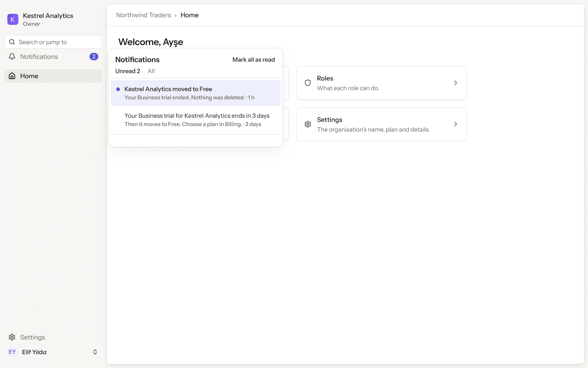

- **Who sees it:** Every signed-in member. Each person sees only their own notifications.
- **Device:** Desktop (1280 px and wider).
- **This state shows:** as the title says.
- **Values come from:** Our API notifications endpoints and the live stream (SSE). Texts: packages/ui notification categories.
- **Components:** Button, Icon/activity, Icon/chevron-down ×4, Icon/settings, Icon/shield, Icon/users, Notification item ×2, Sidebar, Top bar.
- **Actions:**
  - "All": goes to [3.02 · Popover · all](#302--popover--all).
  - "Mark all as read": goes to [3.09 · Popover · all read](#309--popover--all-read).
  - "Kestrel Analytics moved to Free": goes to [8.01 · Members · ideal](../08-settings-members/README.md#801--members--ideal).
  - "Kestrel Analytics moved to Free": goes to [3.11 · Item opened](#311--item-opened).
  - "Home": goes to [4.01 · Home · Owner](../04-home/README.md#401--home--owner).
  - "Settings": goes to [7.01 · General · ideal](../07-settings-general/README.md#701--general--ideal).
- **Texts, word for word, top to bottom:**

  - K
  - Kestrel Analytics
  - Owner
  - Search or jump to
  - Notifications
  - 2
  - Home
  - Settings
  - EY
  - Elif Yıldız
  - Northwind Traders
  - ›
  - Home
  - Welcome, Ayşe
  - Northwind Traders
  - Members
  - People in Northwind Traders and their roles.
  - Roles
  - What each role can do.
  - Activity log
  - Who changed what, and when.
  - Settings
  - The organisation’s name, plan and details.
  - Notifications
  - Mark all as read
  - Unread 2
  - All
  - Kestrel Analytics moved to Free
  - Your Business trial ended. Nothing was deleted. · 1 h
  - Your Business trial for Kestrel Analytics ends in 3 days
  - Then it moves to Free. Choose a plan in Billing. · 3 days

Figma: [244:23055](https://www.figma.com/design/3Ev111okX8xCBwR9B3hyBM/?node-id=244-23055)
