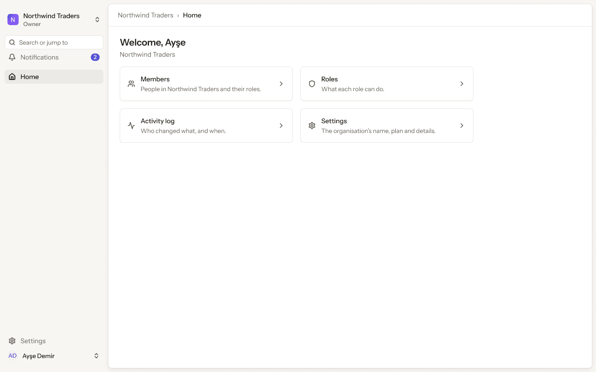
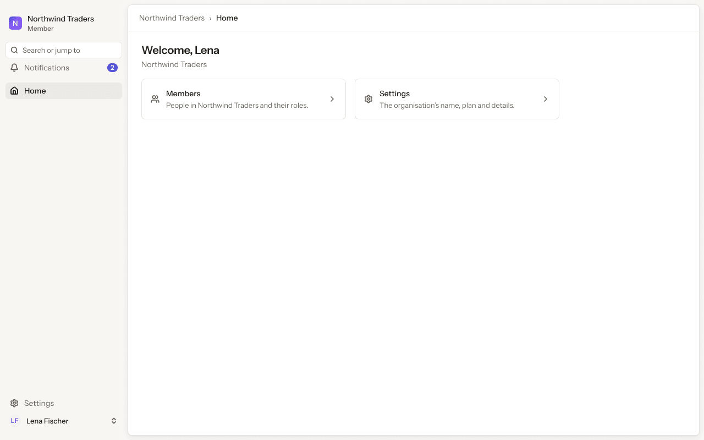
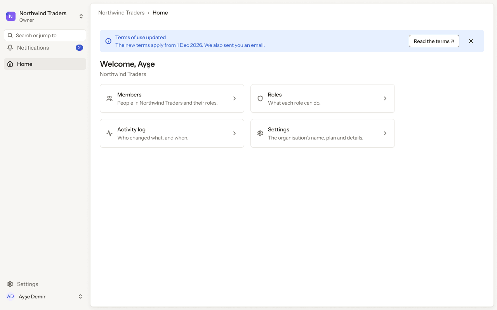

# Web app · 4 · Home

Who sees this section: Every member of the organisation. Cards show only what the person's role allows.

Where the values come from: Organisation and role: our API. Terms notice: the terms version in force from our API. Billing bar: the organisation's billing state from our API.

3 screens. Each part below is one screen and state. The PNG beside this file is the screen at scale 1.

| Screen | Device |
|---|---|
| [4.01 · Home · Owner](#401--home--owner) | Desktop |
| [4.02 · Home · as a Member](#402--home--as-a-member) | Desktop |
| [4.03 · Home · terms notice](#403--home--terms-notice) | Desktop |

### 4.01 · Home · Owner

- **Who sees it:** Every member of the organisation. Cards show only what the person's role allows.
- **Device:** Desktop (1280 px and wider).
- **This state shows:** as the title says.
- **Values come from:** Organisation and role: our API. Terms notice: the terms version in force from our API. Billing bar: the organisation's billing state from our API.
- **Components:** Icon/activity, Icon/chevron-down ×4, Icon/settings, Icon/shield, Icon/users, Sidebar, Top bar.
- **Actions:**
  - "People in Northwind Traders and their roles.": goes to [8.01 · Members · ideal](../08-settings-members/README.md#801--members--ideal).
  - "Settings": goes to [7.01 · General · ideal](../07-settings-general/README.md#701--general--ideal).
- **Texts, word for word, top to bottom:**

  - N
  - Northwind Traders
  - Owner
  - Search or jump to
  - Notifications
  - 2
  - Home
  - Settings
  - AD
  - Ayşe Demir
  - Northwind Traders
  - ›
  - Home
  - Welcome, Ayşe
  - Northwind Traders
  - Members
  - People in Northwind Traders and their roles.
  - Roles
  - What each role can do.
  - Activity log
  - Who changed what, and when.
  - Settings
  - The organisation’s name, plan and details.

Figma: [62:7475](https://www.figma.com/design/3Ev111okX8xCBwR9B3hyBM/?node-id=62-7475)

### 4.02 · Home · as a Member

- **Who sees it:** A person with the Member role. Every member of the organisation. Cards show only what the person's role allows.
- **Device:** Desktop (1280 px and wider).
- **This state shows:** for a person with the Member role.
- **Values come from:** Organisation and role: our API. Terms notice: the terms version in force from our API. Billing bar: the organisation's billing state from our API.
- **Components:** Icon/chevron-down ×2, Icon/settings, Icon/users, Sidebar, Top bar.
- **Actions:**
  - "People in Northwind Traders and their roles.": goes to [8.11 · Members · as a Member](../08-settings-members/README.md#811--members--as-a-member).
  - "Home": goes to [4.01 · Home · Owner](#401--home--owner).
  - "Settings": goes to [7.01 · General · ideal](../07-settings-general/README.md#701--general--ideal).
- **Texts, word for word, top to bottom:**

  - N
  - Northwind Traders
  - Member
  - Search or jump to
  - Notifications
  - 2
  - Home
  - Settings
  - LF
  - Lena Fischer
  - Northwind Traders
  - ›
  - Home
  - Welcome, Lena
  - Northwind Traders
  - Members
  - People in Northwind Traders and their roles.
  - Settings
  - The organisation’s name, plan and details.

Figma: [62:7858](https://www.figma.com/design/3Ev111okX8xCBwR9B3hyBM/?node-id=62-7858)

### 4.03 · Home · terms notice

- **Who sees it:** Every member of the organisation. Cards show only what the person's role allows.
- **Device:** Desktop (1280 px and wider).
- **This state shows:** as the title says.
- **Values come from:** Organisation and role: our API. Terms notice: the terms version in force from our API. Billing bar: the organisation's billing state from our API.
- **Components:** Banner, Icon/activity, Icon/chevron-down ×4, Icon/settings, Icon/shield, Icon/users, Sidebar, Top bar.
- **Actions:**
  - No prototype link on this screen. The buttons follow the section's other screens.
- **Texts, word for word, top to bottom:**

  - N
  - Northwind Traders
  - Owner
  - Search or jump to
  - Notifications
  - 2
  - Home
  - Settings
  - AD
  - Ayşe Demir
  - Northwind Traders
  - ›
  - Home
  - Terms of use updated
  - The new terms apply from 1 Dec 2026. We also sent you an email.
  - Read the terms ↗
  - Welcome, Ayşe
  - Northwind Traders
  - Members
  - People in Northwind Traders and their roles.
  - Roles
  - What each role can do.
  - Activity log
  - Who changed what, and when.
  - Settings
  - The organisation’s name, plan and details.

Figma: [158:16321](https://www.figma.com/design/3Ev111okX8xCBwR9B3hyBM/?node-id=158-16321)
