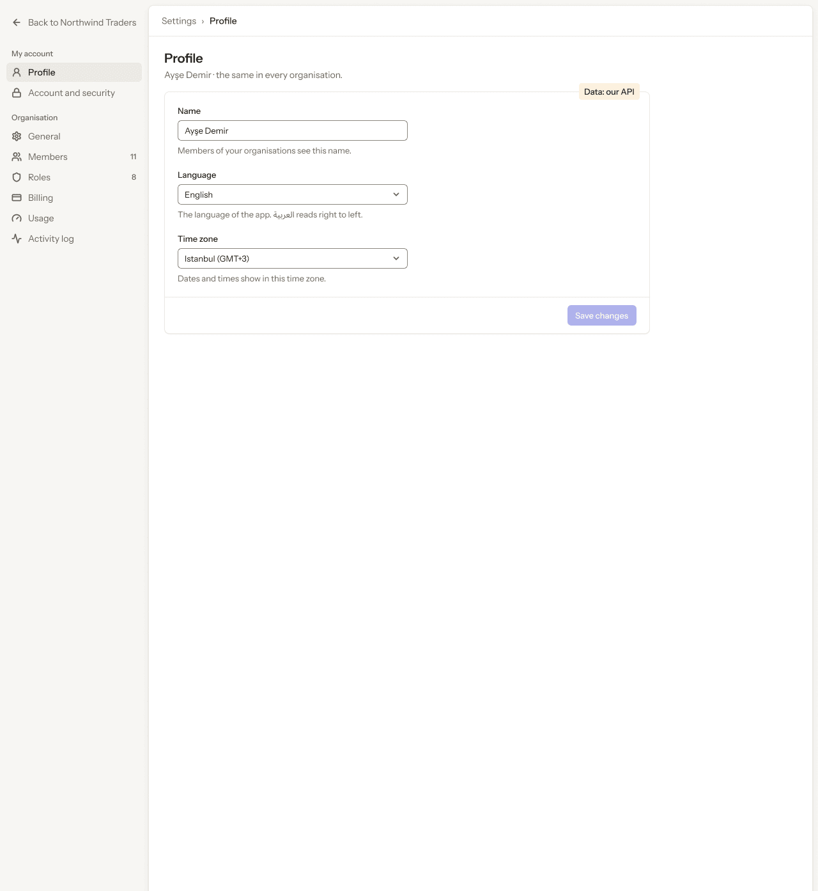
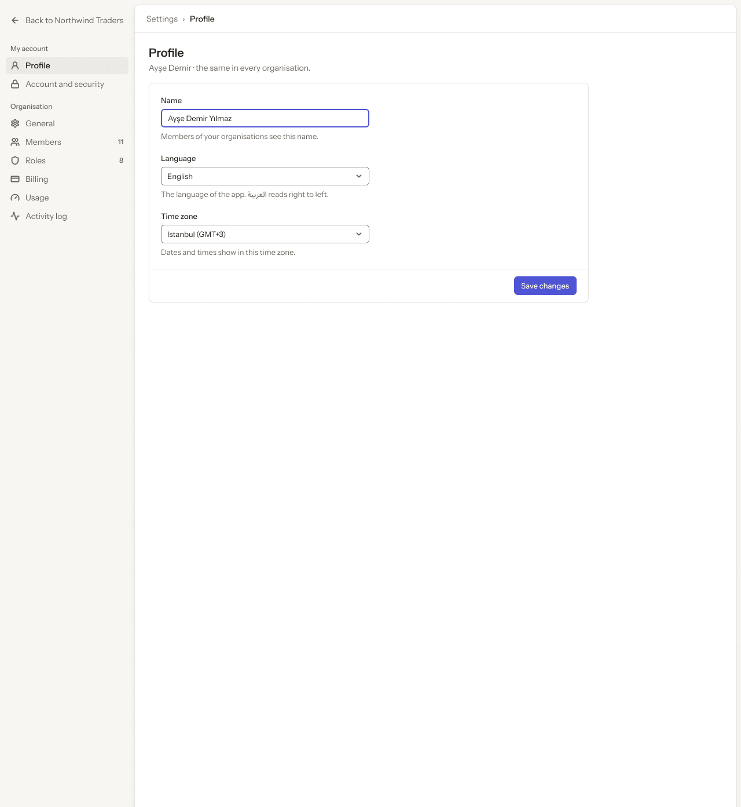
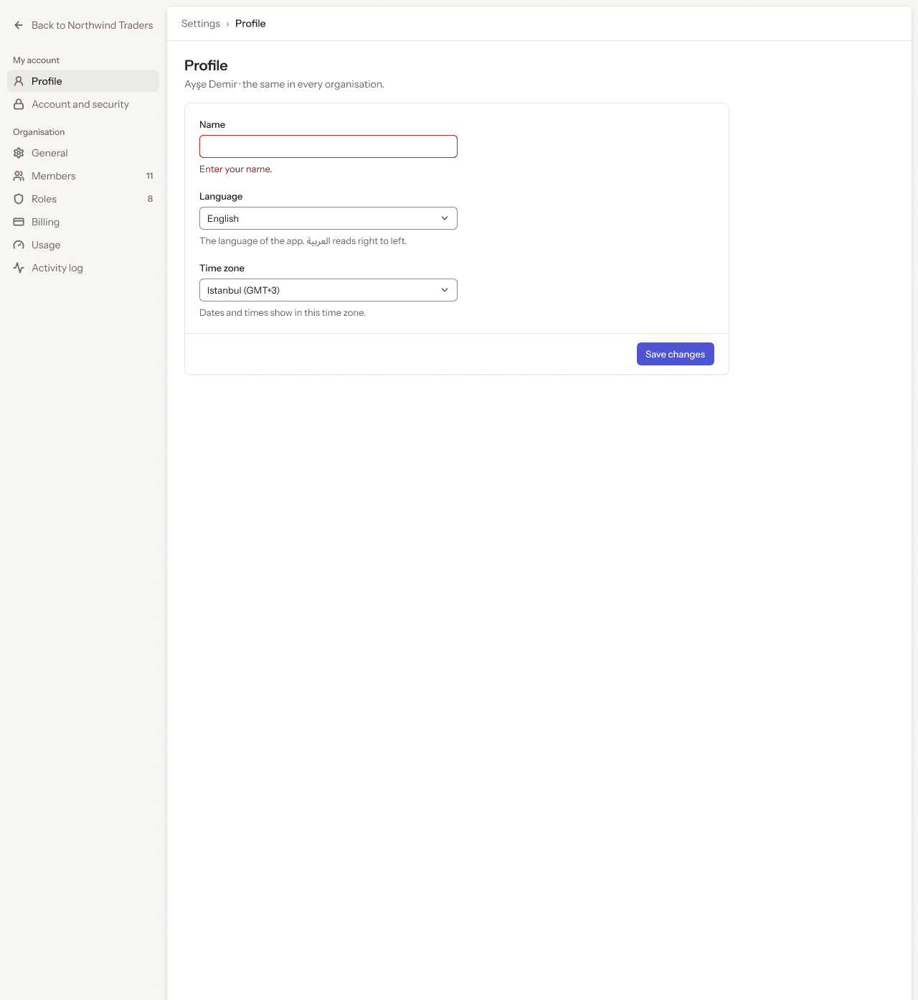
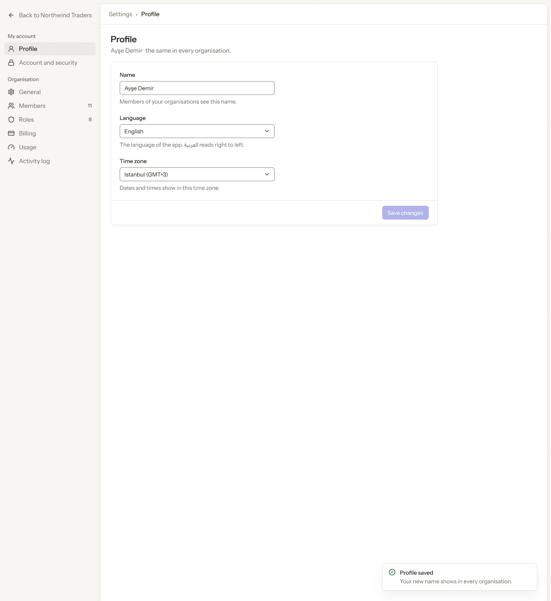
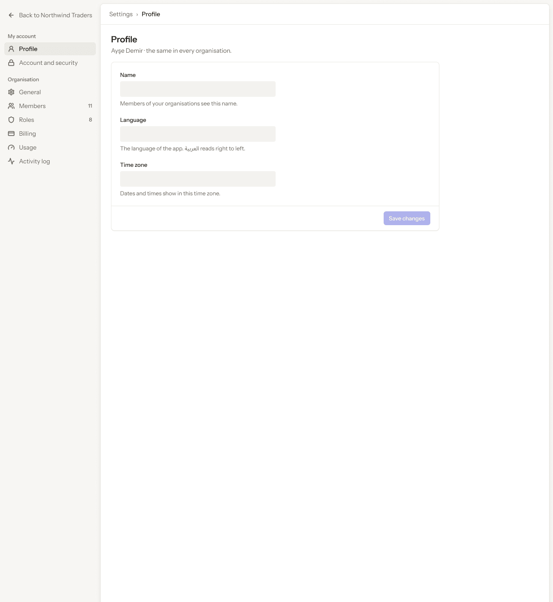
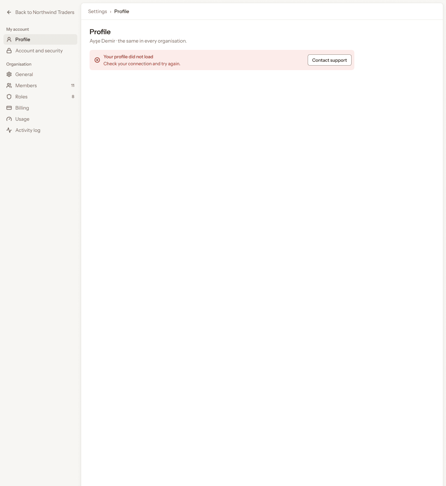
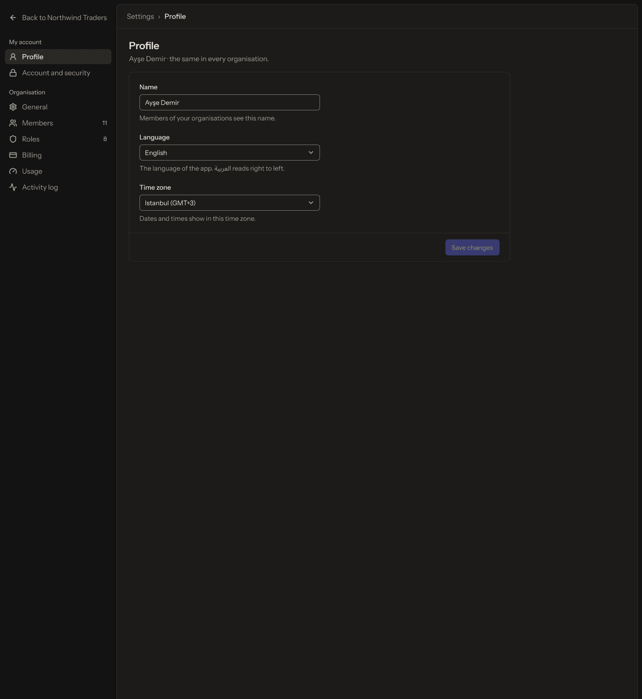

# Web app · 5 · Settings › Profile

Who sees this section: The signed-in person, about themselves.

Where the values come from: Name, picture and language: our API (profile). Email shown read-only from our API.

7 screens. Each part below is one screen and state. The PNG beside this file is the screen at scale 1.

| Screen | Device |
|---|---|
| [5.01 · Profile · ideal](#501--profile--ideal) | Desktop |
| [5.02 · Profile · edited](#502--profile--edited) | Desktop |
| [5.03 · Profile · name empty](#503--profile--name-empty) | Desktop |
| [5.04 · Profile · saved](#504--profile--saved) | Desktop |
| [5.05 · Profile · loading](#505--profile--loading) | Desktop |
| [5.06 · Profile · error](#506--profile--error) | Desktop |
| [5.07 · Profile · dark](#507--profile--dark) | Desktop |

### 5.01 · Profile · ideal

- **Who sees it:** The signed-in person, about themselves.
- **Device:** Desktop (1280 px and wider).
- **This state shows:** when the data loads and every value is present.
- **Values come from:** Name, picture and language: our API (profile). Email shown read-only from our API.
- **Components:** Button, Input, Select ×2, Sidebar, Top bar.
- **Actions:**
  - "Members of your organisations see this name.": goes to [5.02 · Profile · edited](#502--profile--edited).
  - "Back to Northwind Traders": goes to [4.01 · Home · Owner](../04-home/README.md#401--home--owner).
  - "Account and security": goes to [6.01 · Account and security · ideal](../06-settings-account-and-security/README.md#601--account-and-security--ideal).
  - "General": goes to [7.01 · General · ideal](../07-settings-general/README.md#701--general--ideal).
  - "Members": goes to [8.01 · Members · ideal](../08-settings-members/README.md#801--members--ideal).
  - "Roles": goes to [9.01 · Roles · ideal](../09-settings-roles/README.md#901--roles--ideal).
  - "Billing": goes to [10.01 · Billing · Team, monthly](../10-settings-billing/README.md#1001--billing--team-monthly).
  - "Usage": goes to [11.01 · Usage · Team](../11-settings-usage/README.md#1101--usage--team).
  - "Activity log": goes to [12.01 · Activity log · ideal](../12-settings-activity-log/README.md#1201--activity-log--ideal).
- **Texts, word for word, top to bottom:**

  - Back to Northwind Traders
  - My account
  - Profile
  - Account and security
  - Organisation
  - General
  - Members
  - 11
  - Roles
  - 8
  - Billing
  - Usage
  - Activity log
  - AD
  - Ayşe Demir
  - Settings
  - ›
  - Profile
  - Profile
  - Ayşe Demir · the same in every organisation.
  - Name
  - Ayşe Demir
  - Members of your organisations see this name.
  - Language
  - English
  - The language of the app. العربية reads right to left.
  - Time zone
  - Istanbul (GMT+3)
  - Dates and times show in this time zone.
  - Save changes
  - Data: our API

Figma: [92:12057](https://www.figma.com/design/3Ev111okX8xCBwR9B3hyBM/?node-id=92-12057)

### 5.02 · Profile · edited

- **Who sees it:** The signed-in person, about themselves.
- **Device:** Desktop (1280 px and wider).
- **This state shows:** after the person changes a value and before saving.
- **Values come from:** Name, picture and language: our API (profile). Email shown read-only from our API.
- **Components:** Button, Input, Select ×2, Sidebar, Top bar.
- **Actions:**
  - "Save changes": goes to [5.04 · Profile · saved](#504--profile--saved).
  - "Back to Northwind Traders": goes to [4.01 · Home · Owner](../04-home/README.md#401--home--owner).
  - "Profile": goes to [5.01 · Profile · ideal](#501--profile--ideal).
  - "Account and security": goes to [6.01 · Account and security · ideal](../06-settings-account-and-security/README.md#601--account-and-security--ideal).
  - "General": goes to [7.01 · General · ideal](../07-settings-general/README.md#701--general--ideal).
  - "Members": goes to [8.01 · Members · ideal](../08-settings-members/README.md#801--members--ideal).
  - "Roles": goes to [9.01 · Roles · ideal](../09-settings-roles/README.md#901--roles--ideal).
  - "Billing": goes to [10.01 · Billing · Team, monthly](../10-settings-billing/README.md#1001--billing--team-monthly).
  - "Usage": goes to [11.01 · Usage · Team](../11-settings-usage/README.md#1101--usage--team).
  - "Activity log": goes to [12.01 · Activity log · ideal](../12-settings-activity-log/README.md#1201--activity-log--ideal).
- **Texts, word for word, top to bottom:**

  - Back to Northwind Traders
  - My account
  - Profile
  - Account and security
  - Organisation
  - General
  - Members
  - 11
  - Roles
  - 8
  - Billing
  - Usage
  - Activity log
  - AD
  - Ayşe Demir
  - Settings
  - ›
  - Profile
  - Profile
  - Ayşe Demir · the same in every organisation.
  - Name
  - Ayşe Demir Yılmaz
  - Members of your organisations see this name.
  - Language
  - English
  - The language of the app. العربية reads right to left.
  - Time zone
  - Istanbul (GMT+3)
  - Dates and times show in this time zone.
  - Save changes

Figma: [92:12263](https://www.figma.com/design/3Ev111okX8xCBwR9B3hyBM/?node-id=92-12263)

### 5.03 · Profile · name empty

- **Who sees it:** The signed-in person, about themselves.
- **Device:** Desktop (1280 px and wider).
- **This state shows:** when there is nothing to list yet.
- **Values come from:** Name, picture and language: our API (profile). Email shown read-only from our API.
- **Components:** Button, Input, Select ×2, Sidebar, Top bar.
- **Actions:**
  - "Back to Northwind Traders": goes to [4.01 · Home · Owner](../04-home/README.md#401--home--owner).
  - "Profile": goes to [5.01 · Profile · ideal](#501--profile--ideal).
  - "Account and security": goes to [6.01 · Account and security · ideal](../06-settings-account-and-security/README.md#601--account-and-security--ideal).
  - "General": goes to [7.01 · General · ideal](../07-settings-general/README.md#701--general--ideal).
  - "Members": goes to [8.01 · Members · ideal](../08-settings-members/README.md#801--members--ideal).
  - "Roles": goes to [9.01 · Roles · ideal](../09-settings-roles/README.md#901--roles--ideal).
  - "Billing": goes to [10.01 · Billing · Team, monthly](../10-settings-billing/README.md#1001--billing--team-monthly).
  - "Usage": goes to [11.01 · Usage · Team](../11-settings-usage/README.md#1101--usage--team).
  - "Activity log": goes to [12.01 · Activity log · ideal](../12-settings-activity-log/README.md#1201--activity-log--ideal).
- **Texts, word for word, top to bottom:**

  - Back to Northwind Traders
  - My account
  - Profile
  - Account and security
  - Organisation
  - General
  - Members
  - 11
  - Roles
  - 8
  - Billing
  - Usage
  - Activity log
  - AD
  - Ayşe Demir
  - Settings
  - ›
  - Profile
  - Profile
  - Ayşe Demir · the same in every organisation.
  - Name
  - Enter your name.
  - Language
  - English
  - The language of the app. العربية reads right to left.
  - Time zone
  - Istanbul (GMT+3)
  - Dates and times show in this time zone.
  - Save changes

Figma: [92:12469](https://www.figma.com/design/3Ev111okX8xCBwR9B3hyBM/?node-id=92-12469)

### 5.04 · Profile · saved

- **Who sees it:** The signed-in person, about themselves.
- **Device:** Desktop (1280 px and wider).
- **This state shows:** right after a save succeeds.
- **Values come from:** Name, picture and language: our API (profile). Email shown read-only from our API.
- **Components:** Button, Input, Select ×2, Sidebar, Toast, Top bar.
- **Actions:**
  - "Back to Northwind Traders": goes to [4.01 · Home · Owner](../04-home/README.md#401--home--owner).
  - "Profile": goes to [5.01 · Profile · ideal](#501--profile--ideal).
  - "Account and security": goes to [6.01 · Account and security · ideal](../06-settings-account-and-security/README.md#601--account-and-security--ideal).
  - "General": goes to [7.01 · General · ideal](../07-settings-general/README.md#701--general--ideal).
  - "Members": goes to [8.01 · Members · ideal](../08-settings-members/README.md#801--members--ideal).
  - "Roles": goes to [9.01 · Roles · ideal](../09-settings-roles/README.md#901--roles--ideal).
  - "Billing": goes to [10.01 · Billing · Team, monthly](../10-settings-billing/README.md#1001--billing--team-monthly).
  - "Usage": goes to [11.01 · Usage · Team](../11-settings-usage/README.md#1101--usage--team).
  - "Activity log": goes to [12.01 · Activity log · ideal](../12-settings-activity-log/README.md#1201--activity-log--ideal).
- **Texts, word for word, top to bottom:**

  - Back to Northwind Traders
  - My account
  - Profile
  - Account and security
  - Organisation
  - General
  - Members
  - 11
  - Roles
  - 8
  - Billing
  - Usage
  - Activity log
  - AD
  - Ayşe Demir
  - Settings
  - ›
  - Profile
  - Profile
  - Ayşe Demir · the same in every organisation.
  - Name
  - Ayşe Demir
  - Members of your organisations see this name.
  - Language
  - English
  - The language of the app. العربية reads right to left.
  - Time zone
  - Istanbul (GMT+3)
  - Dates and times show in this time zone.
  - Save changes
  - Profile saved
  - Your new name shows in every organisation.

Figma: [92:12675](https://www.figma.com/design/3Ev111okX8xCBwR9B3hyBM/?node-id=92-12675)

### 5.05 · Profile · loading

- **Who sees it:** The signed-in person, about themselves.
- **Device:** Desktop (1280 px and wider).
- **This state shows:** while the request runs.
- **Values come from:** Name, picture and language: our API (profile). Email shown read-only from our API.
- **Components:** Button, Sidebar, Skeleton ×3, Top bar.
- **Actions:**
  - "Back to Northwind Traders": goes to [4.01 · Home · Owner](../04-home/README.md#401--home--owner).
  - "Profile": goes to [5.01 · Profile · ideal](#501--profile--ideal).
  - "Account and security": goes to [6.01 · Account and security · ideal](../06-settings-account-and-security/README.md#601--account-and-security--ideal).
  - "General": goes to [7.01 · General · ideal](../07-settings-general/README.md#701--general--ideal).
  - "Members": goes to [8.01 · Members · ideal](../08-settings-members/README.md#801--members--ideal).
  - "Roles": goes to [9.01 · Roles · ideal](../09-settings-roles/README.md#901--roles--ideal).
  - "Billing": goes to [10.01 · Billing · Team, monthly](../10-settings-billing/README.md#1001--billing--team-monthly).
  - "Usage": goes to [11.01 · Usage · Team](../11-settings-usage/README.md#1101--usage--team).
  - "Activity log": goes to [12.01 · Activity log · ideal](../12-settings-activity-log/README.md#1201--activity-log--ideal).
- **Texts, word for word, top to bottom:**

  - Back to Northwind Traders
  - My account
  - Profile
  - Account and security
  - Organisation
  - General
  - Members
  - 11
  - Roles
  - 8
  - Billing
  - Usage
  - Activity log
  - AD
  - Ayşe Demir
  - Settings
  - ›
  - Profile
  - Profile
  - Ayşe Demir · the same in every organisation.
  - Name
  - Members of your organisations see this name.
  - Language
  - The language of the app. العربية reads right to left.
  - Time zone
  - Dates and times show in this time zone.
  - Save changes

Figma: [92:12889](https://www.figma.com/design/3Ev111okX8xCBwR9B3hyBM/?node-id=92-12889)

### 5.06 · Profile · error

- **Who sees it:** The signed-in person, about themselves.
- **Device:** Desktop (1280 px and wider).
- **This state shows:** when the request fails.
- **Values come from:** Name, picture and language: our API (profile). Email shown read-only from our API.
- **Components:** Banner, Sidebar, Top bar.
- **Actions:**
  - "Back to Northwind Traders": goes to [4.01 · Home · Owner](../04-home/README.md#401--home--owner).
  - "Profile": goes to [5.01 · Profile · ideal](#501--profile--ideal).
  - "Account and security": goes to [6.01 · Account and security · ideal](../06-settings-account-and-security/README.md#601--account-and-security--ideal).
  - "General": goes to [7.01 · General · ideal](../07-settings-general/README.md#701--general--ideal).
  - "Members": goes to [8.01 · Members · ideal](../08-settings-members/README.md#801--members--ideal).
  - "Roles": goes to [9.01 · Roles · ideal](../09-settings-roles/README.md#901--roles--ideal).
  - "Billing": goes to [10.01 · Billing · Team, monthly](../10-settings-billing/README.md#1001--billing--team-monthly).
  - "Usage": goes to [11.01 · Usage · Team](../11-settings-usage/README.md#1101--usage--team).
  - "Activity log": goes to [12.01 · Activity log · ideal](../12-settings-activity-log/README.md#1201--activity-log--ideal).
- **Texts, word for word, top to bottom:**

  - Back to Northwind Traders
  - My account
  - Profile
  - Account and security
  - Organisation
  - General
  - Members
  - 11
  - Roles
  - 8
  - Billing
  - Usage
  - Activity log
  - AD
  - Ayşe Demir
  - Settings
  - ›
  - Profile
  - Profile
  - Ayşe Demir · the same in every organisation.
  - Your profile did not load
  - Check your connection and try again.
  - Contact support

Figma: [92:13082](https://www.figma.com/design/3Ev111okX8xCBwR9B3hyBM/?node-id=92-13082)

### 5.07 · Profile · dark

- **Who sees it:** The signed-in person, about themselves.
- **Device:** Desktop (1280 px and wider).
- **This state shows:** in the dark theme.
- **Values come from:** Name, picture and language: our API (profile). Email shown read-only from our API.
- **Components:** Button, Input, Select ×2, Sidebar, Top bar.
- **Actions:**
  - "Back to Northwind Traders": goes to [4.01 · Home · Owner](../04-home/README.md#401--home--owner).
  - "Profile": goes to [5.01 · Profile · ideal](#501--profile--ideal).
  - "Account and security": goes to [6.01 · Account and security · ideal](../06-settings-account-and-security/README.md#601--account-and-security--ideal).
  - "General": goes to [7.01 · General · ideal](../07-settings-general/README.md#701--general--ideal).
  - "Members": goes to [8.01 · Members · ideal](../08-settings-members/README.md#801--members--ideal).
  - "Roles": goes to [9.01 · Roles · ideal](../09-settings-roles/README.md#901--roles--ideal).
  - "Billing": goes to [10.01 · Billing · Team, monthly](../10-settings-billing/README.md#1001--billing--team-monthly).
  - "Usage": goes to [11.01 · Usage · Team](../11-settings-usage/README.md#1101--usage--team).
  - "Activity log": goes to [12.01 · Activity log · ideal](../12-settings-activity-log/README.md#1201--activity-log--ideal).
- **Texts, word for word, top to bottom:**

  - Back to Northwind Traders
  - My account
  - Profile
  - Account and security
  - Organisation
  - General
  - Members
  - 11
  - Roles
  - 8
  - Billing
  - Usage
  - Activity log
  - AD
  - Ayşe Demir
  - Settings
  - ›
  - Profile
  - Profile
  - Ayşe Demir · the same in every organisation.
  - Name
  - Ayşe Demir
  - Members of your organisations see this name.
  - Language
  - English
  - The language of the app. العربية reads right to left.
  - Time zone
  - Istanbul (GMT+3)
  - Dates and times show in this time zone.
  - Save changes

Figma: [92:13272](https://www.figma.com/design/3Ev111okX8xCBwR9B3hyBM/?node-id=92-13272)
