# Web app · 6 · Settings › Account and security

Who sees this section: The signed-in person, about themselves.

Where the values come from: Sign-in methods, sessions and two-step verification: Clerk. Email change, data export and account deletion: our API.

32 screens. Each part below is one screen and state. The PNG beside this file is the screen at scale 1.

| Screen | Device |
|---|---|
| [6.01 · Account and security · ideal](#601--account-and-security--ideal) | Desktop |
| [6.02 · Account and security · loading](#602--account-and-security--loading) | Desktop |
| [6.03 · Account and security · error](#603--account-and-security--error) | Desktop |
| [6.04 · Account and security · partial](#604--account-and-security--partial) | Desktop |
| [6.05 · Account and security · empty](#605--account-and-security--empty) | Desktop |
| [6.06 · Account and security · dark](#606--account-and-security--dark) | Desktop |
| [6.07 · Account and security · phone](#607--account-and-security--phone) | Phone |
| [6.08 · Change email](#608--change-email) | Desktop |
| [6.09 · Enter the code](#609--enter-the-code) | Desktop |
| [6.10 · Code wrong](#610--code-wrong) | Desktop |
| [6.11 · Email changed](#611--email-changed) | Desktop |
| [6.12 · Disconnect Google](#612--disconnect-google) | Desktop |
| [6.13 · Google disconnected](#613--google-disconnected) | Desktop |
| [6.14 · Microsoft connected](#614--microsoft-connected) | Desktop |
| [6.15 · Microsoft refused](#615--microsoft-refused) | Desktop |
| [6.16 · Session signed out](#616--session-signed-out) | Desktop |
| [6.17 · Sign out of other sessions](#617--sign-out-of-other-sessions) | Desktop |
| [6.18 · Other sessions signed out](#618--other-sessions-signed-out) | Desktop |
| [6.19 · Export my data](#619--export-my-data) | Desktop |
| [6.20 · Export requested](#620--export-requested) | Desktop |
| [6.21 · Export ready](#621--export-ready) | Desktop |
| [6.22 · Delete refused](#622--delete-refused) | Desktop |
| [6.23 · Delete my account](#623--delete-my-account) | Desktop |
| [6.24 · Account deleted](#624--account-deleted) | Desktop |
| [6.25 · Two-step · set up](#625--two-step--set-up) | Desktop |
| [6.26 · Two-step · backup codes](#626--two-step--backup-codes) | Desktop |
| [6.27 · Two-step · on](#627--two-step--on) | Desktop |
| [6.28 · Two-step · turn off](#628--two-step--turn-off) | Desktop |
| [6.29 · Two-step · turned off](#629--two-step--turned-off) | Desktop |
| [6.30 · Export · email](#630--export--email) | Email |
| [6.31 · Export · notification](#631--export--notification) | Desktop |
| [6.32 · Export · file deleted](#632--export--file-deleted) | Desktop |

### 6.01 · Account and security · ideal

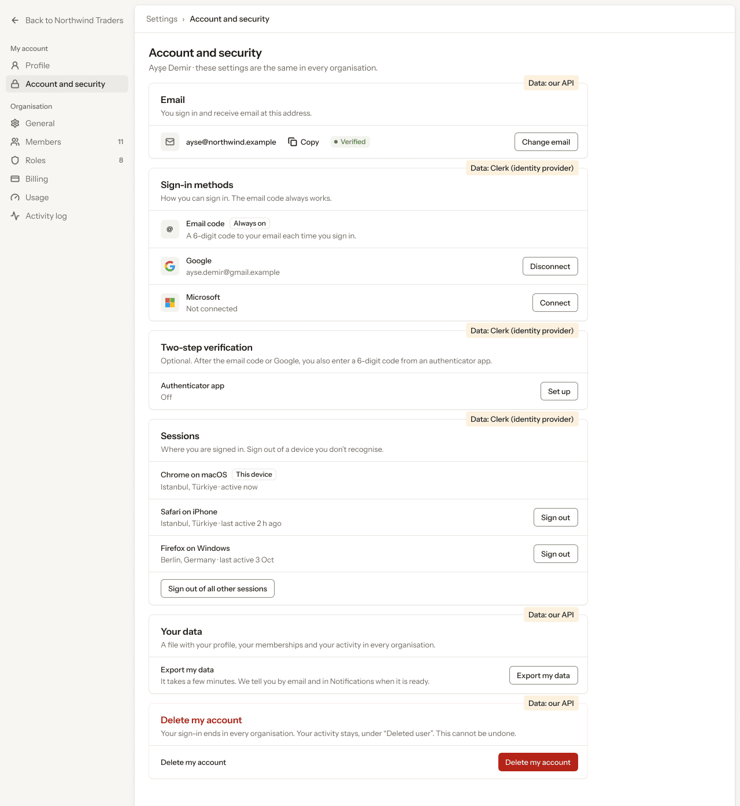

- **Who sees it:** The signed-in person, about themselves.
- **Device:** Desktop (1280 px and wider).
- **This state shows:** when the data loads and every value is present.
- **Values come from:** Sign-in methods, sessions and two-step verification: Clerk. Email change, data export and account deletion: our API.
- **Components:** Button ×10, Icon/mail, Label ×2, Logo/Google, Logo/Microsoft, Pill, Sidebar, Top bar.
- **Actions:**
  - "Change email": goes to [6.08 · Change email](#608--change-email).
  - "Disconnect": goes to [6.12 · Disconnect Google](#612--disconnect-google).
  - "Connect": goes to [6.14 · Microsoft connected](#614--microsoft-connected).
  - "Sign out": goes to [6.16 · Session signed out](#616--session-signed-out).
  - "Sign out of all other sessions": goes to [6.17 · Sign out of other sessions](#617--sign-out-of-other-sessions).
  - "Export my data": goes to [6.19 · Export my data](#619--export-my-data).
  - "Delete my account": goes to [6.22 · Delete refused](#622--delete-refused).
  - "Area": goes to [6.25 · Two-step · set up](#625--two-step--set-up).
  - "Back to Northwind Traders": goes to [4.01 · Home · Owner](../04-home/README.md#401--home--owner).
  - "Profile": goes to [5.01 · Profile · ideal](../05-settings-profile/README.md#501--profile--ideal).
  - "General": goes to [7.01 · General · ideal](../07-settings-general/README.md#701--general--ideal).
  - "Members": goes to [8.01 · Members · ideal](../08-settings-members/README.md#801--members--ideal).
  - "Roles": goes to [9.01 · Roles · ideal](../09-settings-roles/README.md#901--roles--ideal).
  - "Billing": goes to [10.01 · Billing · Team, monthly](../10-settings-billing/README.md#1001--billing--team-monthly).
  - "Usage": goes to [11.01 · Usage · Team](../11-settings-usage/README.md#1101--usage--team).
  - "Activity log": goes to [12.01 · Activity log · ideal](../12-settings-activity-log/README.md#1201--activity-log--ideal).
- **Texts, word for word, top to bottom:**

  - Back to Northwind Traders
  - My account
  - Profile
  - Account and security
  - Organisation
  - General
  - Members
  - 11
  - Roles
  - 8
  - Billing
  - Usage
  - Activity log
  - AD
  - Ayşe Demir
  - Settings
  - ›
  - Account and security
  - Account and security
  - Ayşe Demir · these settings are the same in every organisation.
  - Email
  - You sign in and receive email at this address.
  - ayse@northwind.example
  - Copy
  - Verified
  - Change email
  - Sign-in methods
  - How you can sign in. The email code always works.
  - @
  - Email code
  - Always on
  - A 6-digit code to your email each time you sign in.
  - Google
  - ayse.demir@gmail.example
  - Disconnect
  - Microsoft
  - Not connected
  - Connect
  - Two-step verification
  - Optional. After the email code or Google, you also enter a 6-digit code from an authenticator app.
  - Authenticator app
  - Off
  - Set up
  - Sessions
  - Where you are signed in. Sign out of a device you don’t recognise.
  - Chrome on macOS
  - This device
  - Istanbul, Türkiye · active now
  - Safari on iPhone
  - Istanbul, Türkiye · last active 2 h ago
  - Sign out
  - Firefox on Windows
  - Berlin, Germany · last active 3 Oct
  - Sign out
  - Sign out of all other sessions
  - Your data
  - A file with your profile, your memberships and your activity in every organisation.
  - Export my data
  - It takes a few minutes. We tell you by email and in Notifications when it is ready.
  - Export my data
  - Delete my account
  - Your sign-in ends in every organisation. Your activity stays, under “Deleted user”. This cannot be undone.
  - Delete my account
  - Delete my account
  - Data: our API
  - Data: Clerk (identity provider)
  - Data: Clerk (identity provider)
  - Data: Clerk (identity provider)
  - Data: our API
  - Data: our API

Figma: [73:10472](https://www.figma.com/design/3Ev111okX8xCBwR9B3hyBM/?node-id=73-10472)

### 6.02 · Account and security · loading

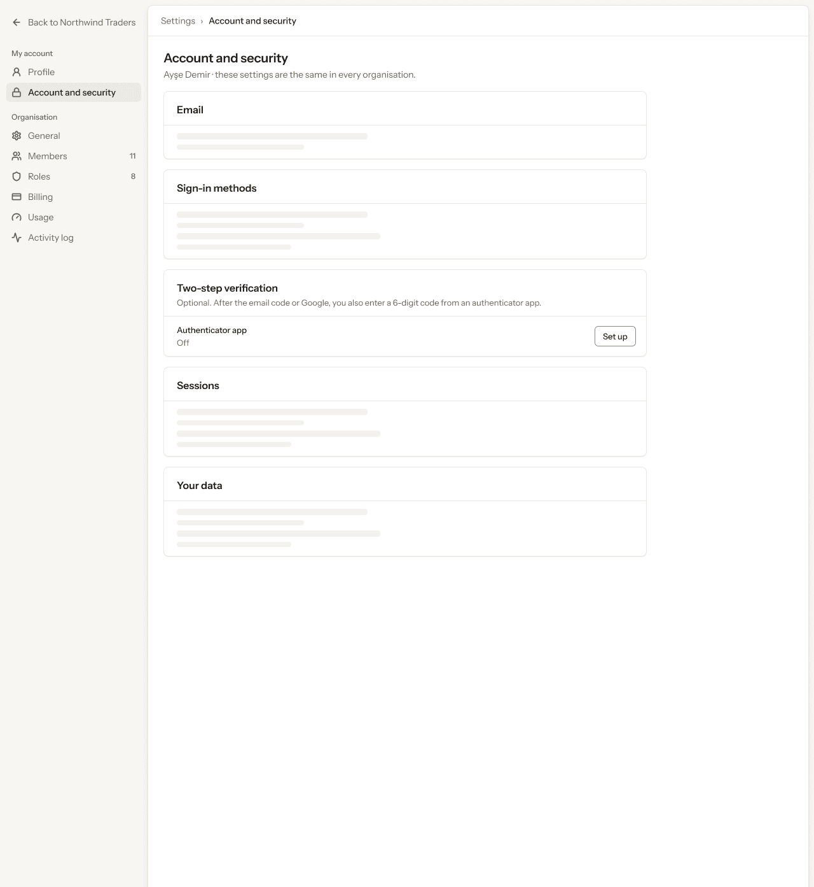

- **Who sees it:** The signed-in person, about themselves.
- **Device:** Desktop (1280 px and wider).
- **This state shows:** while the request runs.
- **Values come from:** Sign-in methods, sessions and two-step verification: Clerk. Email change, data export and account deletion: our API.
- **Components:** Button, Sidebar, Skeleton ×14, Top bar.
- **Actions:**
  - "Back to Northwind Traders": goes to [4.01 · Home · Owner](../04-home/README.md#401--home--owner).
  - "Profile": goes to [5.01 · Profile · ideal](../05-settings-profile/README.md#501--profile--ideal).
  - "Account and security": goes to [6.01 · Account and security · ideal](#601--account-and-security--ideal).
  - "General": goes to [7.01 · General · ideal](../07-settings-general/README.md#701--general--ideal).
  - "Members": goes to [8.01 · Members · ideal](../08-settings-members/README.md#801--members--ideal).
  - "Roles": goes to [9.01 · Roles · ideal](../09-settings-roles/README.md#901--roles--ideal).
  - "Billing": goes to [10.01 · Billing · Team, monthly](../10-settings-billing/README.md#1001--billing--team-monthly).
  - "Usage": goes to [11.01 · Usage · Team](../11-settings-usage/README.md#1101--usage--team).
  - "Activity log": goes to [12.01 · Activity log · ideal](../12-settings-activity-log/README.md#1201--activity-log--ideal).
- **Texts, word for word, top to bottom:**

  - Back to Northwind Traders
  - My account
  - Profile
  - Account and security
  - Organisation
  - General
  - Members
  - 11
  - Roles
  - 8
  - Billing
  - Usage
  - Activity log
  - AD
  - Ayşe Demir
  - Settings
  - ›
  - Account and security
  - Account and security
  - Ayşe Demir · these settings are the same in every organisation.
  - Email
  - Sign-in methods
  - Two-step verification
  - Optional. After the email code or Google, you also enter a 6-digit code from an authenticator app.
  - Authenticator app
  - Off
  - Set up
  - Sessions
  - Your data

Figma: [73:11016](https://www.figma.com/design/3Ev111okX8xCBwR9B3hyBM/?node-id=73-11016)

### 6.03 · Account and security · error

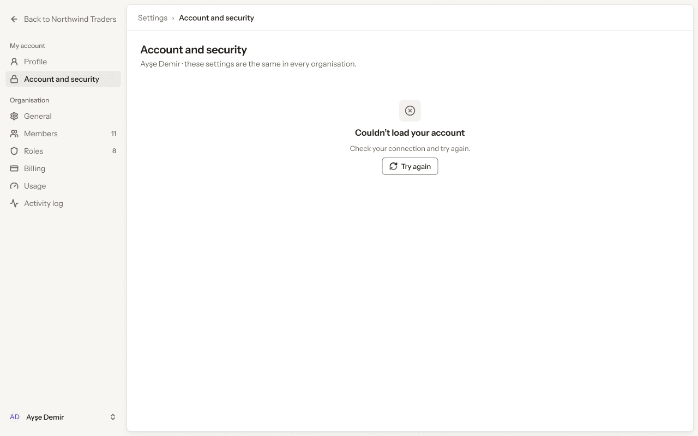

- **Who sees it:** The signed-in person, about themselves.
- **Device:** Desktop (1280 px and wider).
- **This state shows:** when the request fails.
- **Values come from:** Sign-in methods, sessions and two-step verification: Clerk. Email change, data export and account deletion: our API.
- **Components:** Empty state, Sidebar, Top bar.
- **Actions:**
  - "Back to Northwind Traders": goes to [4.01 · Home · Owner](../04-home/README.md#401--home--owner).
  - "Profile": goes to [5.01 · Profile · ideal](../05-settings-profile/README.md#501--profile--ideal).
  - "Account and security": goes to [6.01 · Account and security · ideal](#601--account-and-security--ideal).
  - "General": goes to [7.01 · General · ideal](../07-settings-general/README.md#701--general--ideal).
  - "Members": goes to [8.01 · Members · ideal](../08-settings-members/README.md#801--members--ideal).
  - "Roles": goes to [9.01 · Roles · ideal](../09-settings-roles/README.md#901--roles--ideal).
  - "Billing": goes to [10.01 · Billing · Team, monthly](../10-settings-billing/README.md#1001--billing--team-monthly).
  - "Usage": goes to [11.01 · Usage · Team](../11-settings-usage/README.md#1101--usage--team).
  - "Activity log": goes to [12.01 · Activity log · ideal](../12-settings-activity-log/README.md#1201--activity-log--ideal).
- **Texts, word for word, top to bottom:**

  - Back to Northwind Traders
  - My account
  - Profile
  - Account and security
  - Organisation
  - General
  - Members
  - 11
  - Roles
  - 8
  - Billing
  - Usage
  - Activity log
  - AD
  - Ayşe Demir
  - Settings
  - ›
  - Account and security
  - Account and security
  - Ayşe Demir · these settings are the same in every organisation.
  - Couldn’t load your account
  - Check your connection and try again.
  - Try again

Figma: [73:11398](https://www.figma.com/design/3Ev111okX8xCBwR9B3hyBM/?node-id=73-11398)

### 6.04 · Account and security · partial

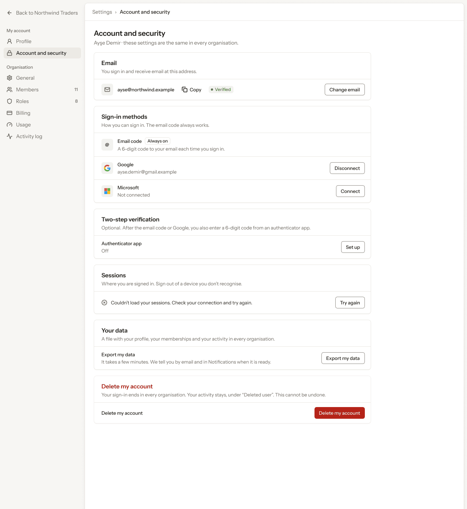

- **Who sees it:** The signed-in person, about themselves.
- **Device:** Desktop (1280 px and wider).
- **This state shows:** as the title says.
- **Values come from:** Sign-in methods, sessions and two-step verification: Clerk. Email change, data export and account deletion: our API.
- **Components:** Button ×8, Icon/circle-x, Icon/mail, Label, Logo/Google, Logo/Microsoft, Pill, Sidebar, Top bar.
- **Actions:**
  - "Back to Northwind Traders": goes to [4.01 · Home · Owner](../04-home/README.md#401--home--owner).
  - "Profile": goes to [5.01 · Profile · ideal](../05-settings-profile/README.md#501--profile--ideal).
  - "Account and security": goes to [6.01 · Account and security · ideal](#601--account-and-security--ideal).
  - "General": goes to [7.01 · General · ideal](../07-settings-general/README.md#701--general--ideal).
  - "Members": goes to [8.01 · Members · ideal](../08-settings-members/README.md#801--members--ideal).
  - "Roles": goes to [9.01 · Roles · ideal](../09-settings-roles/README.md#901--roles--ideal).
  - "Billing": goes to [10.01 · Billing · Team, monthly](../10-settings-billing/README.md#1001--billing--team-monthly).
  - "Usage": goes to [11.01 · Usage · Team](../11-settings-usage/README.md#1101--usage--team).
  - "Activity log": goes to [12.01 · Activity log · ideal](../12-settings-activity-log/README.md#1201--activity-log--ideal).
- **Texts, word for word, top to bottom:**

  - Back to Northwind Traders
  - My account
  - Profile
  - Account and security
  - Organisation
  - General
  - Members
  - 11
  - Roles
  - 8
  - Billing
  - Usage
  - Activity log
  - AD
  - Ayşe Demir
  - Settings
  - ›
  - Account and security
  - Account and security
  - Ayşe Demir · these settings are the same in every organisation.
  - Email
  - You sign in and receive email at this address.
  - ayse@northwind.example
  - Copy
  - Verified
  - Change email
  - Sign-in methods
  - How you can sign in. The email code always works.
  - @
  - Email code
  - Always on
  - A 6-digit code to your email each time you sign in.
  - Google
  - ayse.demir@gmail.example
  - Disconnect
  - Microsoft
  - Not connected
  - Connect
  - Two-step verification
  - Optional. After the email code or Google, you also enter a 6-digit code from an authenticator app.
  - Authenticator app
  - Off
  - Set up
  - Sessions
  - Where you are signed in. Sign out of a device you don’t recognise.
  - Couldn’t load your sessions. Check your connection and try again.
  - Try again
  - Your data
  - A file with your profile, your memberships and your activity in every organisation.
  - Export my data
  - It takes a few minutes. We tell you by email and in Notifications when it is ready.
  - Export my data
  - Delete my account
  - Your sign-in ends in every organisation. Your activity stays, under “Deleted user”. This cannot be undone.
  - Delete my account
  - Delete my account

Figma: [73:11801](https://www.figma.com/design/3Ev111okX8xCBwR9B3hyBM/?node-id=73-11801)

### 6.05 · Account and security · empty

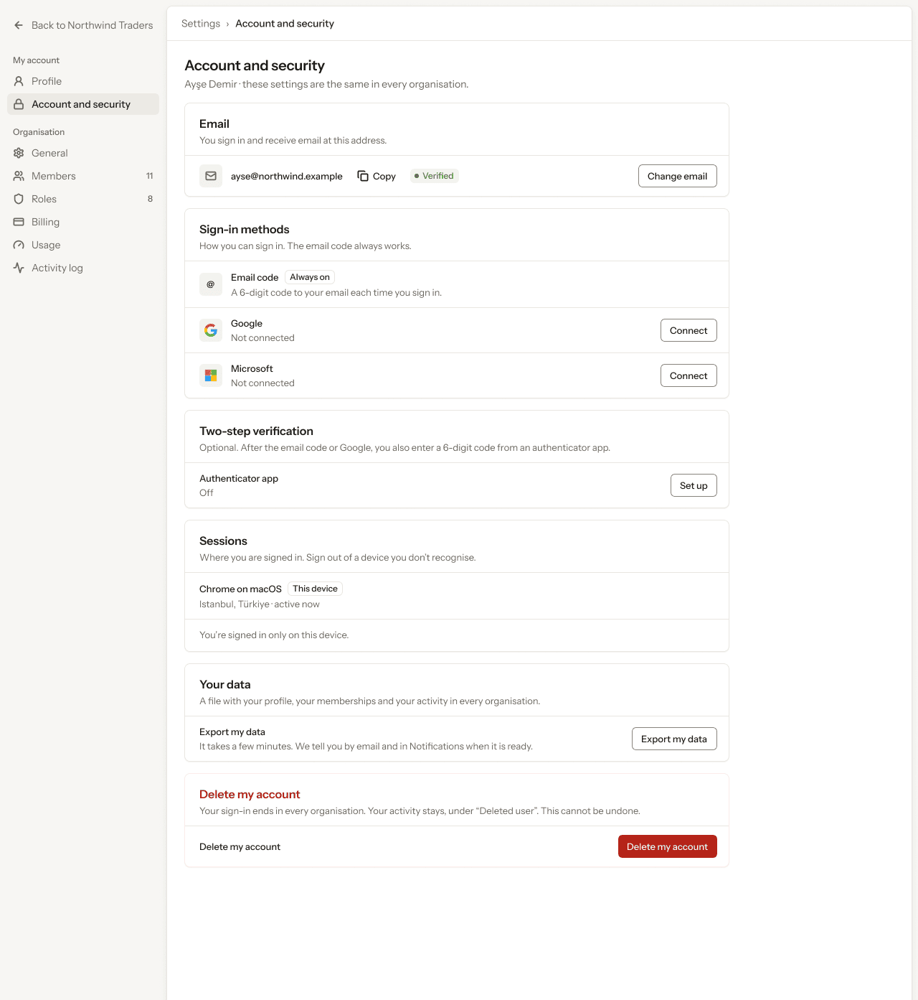

- **Who sees it:** The signed-in person, about themselves.
- **Device:** Desktop (1280 px and wider).
- **This state shows:** when there is nothing to list yet.
- **Values come from:** Sign-in methods, sessions and two-step verification: Clerk. Email change, data export and account deletion: our API.
- **Components:** Button ×7, Icon/mail, Label ×2, Logo/Google, Logo/Microsoft, Pill, Sidebar, Top bar.
- **Actions:**
  - "Back to Northwind Traders": goes to [4.01 · Home · Owner](../04-home/README.md#401--home--owner).
  - "Profile": goes to [5.01 · Profile · ideal](../05-settings-profile/README.md#501--profile--ideal).
  - "Account and security": goes to [6.01 · Account and security · ideal](#601--account-and-security--ideal).
  - "General": goes to [7.01 · General · ideal](../07-settings-general/README.md#701--general--ideal).
  - "Members": goes to [8.01 · Members · ideal](../08-settings-members/README.md#801--members--ideal).
  - "Roles": goes to [9.01 · Roles · ideal](../09-settings-roles/README.md#901--roles--ideal).
  - "Billing": goes to [10.01 · Billing · Team, monthly](../10-settings-billing/README.md#1001--billing--team-monthly).
  - "Usage": goes to [11.01 · Usage · Team](../11-settings-usage/README.md#1101--usage--team).
  - "Activity log": goes to [12.01 · Activity log · ideal](../12-settings-activity-log/README.md#1201--activity-log--ideal).
- **Texts, word for word, top to bottom:**

  - Back to Northwind Traders
  - My account
  - Profile
  - Account and security
  - Organisation
  - General
  - Members
  - 11
  - Roles
  - 8
  - Billing
  - Usage
  - Activity log
  - AD
  - Ayşe Demir
  - Settings
  - ›
  - Account and security
  - Account and security
  - Ayşe Demir · these settings are the same in every organisation.
  - Email
  - You sign in and receive email at this address.
  - ayse@northwind.example
  - Copy
  - Verified
  - Change email
  - Sign-in methods
  - How you can sign in. The email code always works.
  - @
  - Email code
  - Always on
  - A 6-digit code to your email each time you sign in.
  - Google
  - Not connected
  - Connect
  - Microsoft
  - Not connected
  - Connect
  - Two-step verification
  - Optional. After the email code or Google, you also enter a 6-digit code from an authenticator app.
  - Authenticator app
  - Off
  - Set up
  - Sessions
  - Where you are signed in. Sign out of a device you don’t recognise.
  - Chrome on macOS
  - This device
  - Istanbul, Türkiye · active now
  - You’re signed in only on this device.
  - Your data
  - A file with your profile, your memberships and your activity in every organisation.
  - Export my data
  - It takes a few minutes. We tell you by email and in Notifications when it is ready.
  - Export my data
  - Delete my account
  - Your sign-in ends in every organisation. Your activity stays, under “Deleted user”. This cannot be undone.
  - Delete my account
  - Delete my account

Figma: [73:12291](https://www.figma.com/design/3Ev111okX8xCBwR9B3hyBM/?node-id=73-12291)

### 6.06 · Account and security · dark

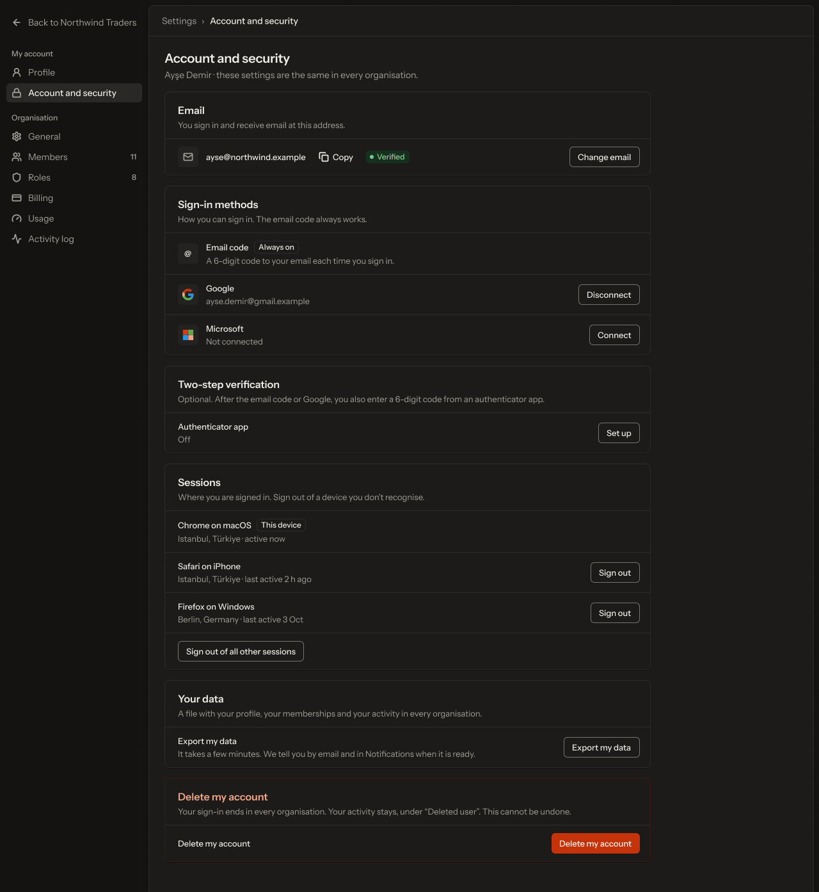

- **Who sees it:** The signed-in person, about themselves.
- **Device:** Desktop (1280 px and wider).
- **This state shows:** in the dark theme.
- **Values come from:** Sign-in methods, sessions and two-step verification: Clerk. Email change, data export and account deletion: our API.
- **Components:** Button ×10, Icon/mail, Label ×2, Logo/Google, Logo/Microsoft, Pill, Sidebar, Top bar.
- **Actions:**
  - "Back to Northwind Traders": goes to [4.01 · Home · Owner](../04-home/README.md#401--home--owner).
  - "Profile": goes to [5.01 · Profile · ideal](../05-settings-profile/README.md#501--profile--ideal).
  - "Account and security": goes to [6.01 · Account and security · ideal](#601--account-and-security--ideal).
  - "General": goes to [7.01 · General · ideal](../07-settings-general/README.md#701--general--ideal).
  - "Members": goes to [8.01 · Members · ideal](../08-settings-members/README.md#801--members--ideal).
  - "Roles": goes to [9.01 · Roles · ideal](../09-settings-roles/README.md#901--roles--ideal).
  - "Billing": goes to [10.01 · Billing · Team, monthly](../10-settings-billing/README.md#1001--billing--team-monthly).
  - "Usage": goes to [11.01 · Usage · Team](../11-settings-usage/README.md#1101--usage--team).
  - "Activity log": goes to [12.01 · Activity log · ideal](../12-settings-activity-log/README.md#1201--activity-log--ideal).
- **Texts, word for word, top to bottom:**

  - Back to Northwind Traders
  - My account
  - Profile
  - Account and security
  - Organisation
  - General
  - Members
  - 11
  - Roles
  - 8
  - Billing
  - Usage
  - Activity log
  - AD
  - Ayşe Demir
  - Settings
  - ›
  - Account and security
  - Account and security
  - Ayşe Demir · these settings are the same in every organisation.
  - Email
  - You sign in and receive email at this address.
  - ayse@northwind.example
  - Copy
  - Verified
  - Change email
  - Sign-in methods
  - How you can sign in. The email code always works.
  - @
  - Email code
  - Always on
  - A 6-digit code to your email each time you sign in.
  - Google
  - ayse.demir@gmail.example
  - Disconnect
  - Microsoft
  - Not connected
  - Connect
  - Two-step verification
  - Optional. After the email code or Google, you also enter a 6-digit code from an authenticator app.
  - Authenticator app
  - Off
  - Set up
  - Sessions
  - Where you are signed in. Sign out of a device you don’t recognise.
  - Chrome on macOS
  - This device
  - Istanbul, Türkiye · active now
  - Safari on iPhone
  - Istanbul, Türkiye · last active 2 h ago
  - Sign out
  - Firefox on Windows
  - Berlin, Germany · last active 3 Oct
  - Sign out
  - Sign out of all other sessions
  - Your data
  - A file with your profile, your memberships and your activity in every organisation.
  - Export my data
  - It takes a few minutes. We tell you by email and in Notifications when it is ready.
  - Export my data
  - Delete my account
  - Your sign-in ends in every organisation. Your activity stays, under “Deleted user”. This cannot be undone.
  - Delete my account
  - Delete my account

Figma: [73:12778](https://www.figma.com/design/3Ev111okX8xCBwR9B3hyBM/?node-id=73-12778)

### 6.07 · Account and security · phone

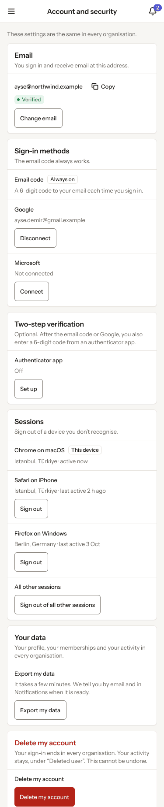

- **Who sees it:** The signed-in person, about themselves.
- **Device:** Phone (up to 767 px).
- **This state shows:** on a phone.
- **Values come from:** Sign-in methods, sessions and two-step verification: Clerk. Email change, data export and account deletion: our API.
- **Components:** Button ×10, Label ×2, Phone top bar, Pill.
- **Actions:**
  - "Area": goes to [2.30 · Phone · settings menu open](../02-shell/README.md#230--phone--settings-menu-open).
  - "2": goes to [3.14 · Phone · notifications](../03-notifications/README.md#314--phone--notifications).
- **Texts, word for word, top to bottom:**

  - Account and security
  - 2
  - These settings are the same in every organisation.
  - Email
  - You sign in and receive email at this address.
  - ayse@northwind.example
  - Copy
  - Verified
  - Change email
  - Sign-in methods
  - The email code always works.
  - Email code
  - Always on
  - A 6-digit code to your email each time you sign in.
  - Google
  - ayse.demir@gmail.example
  - Disconnect
  - Microsoft
  - Not connected
  - Connect
  - Two-step verification
  - Optional. After the email code or Google, you also enter a 6-digit code from an authenticator app.
  - Authenticator app
  - Off
  - Set up
  - Sessions
  - Sign out of a device you don’t recognise.
  - Chrome on macOS
  - This device
  - Istanbul, Türkiye · active now
  - Safari on iPhone
  - Istanbul, Türkiye · last active 2 h ago
  - Sign out
  - Firefox on Windows
  - Berlin, Germany · last active 3 Oct
  - Sign out
  - All other sessions
  - Sign out of all other sessions
  - Your data
  - Your profile, your memberships and your activity in every organisation.
  - Export my data
  - It takes a few minutes. We tell you by email and in Notifications when it is ready.
  - Export my data
  - Delete my account
  - Your sign-in ends in every organisation. Your activity stays, under “Deleted user”. This cannot be undone.
  - Delete my account
  - Delete my account

Figma: [75:14506](https://www.figma.com/design/3Ev111okX8xCBwR9B3hyBM/?node-id=75-14506)

### 6.08 · Change email

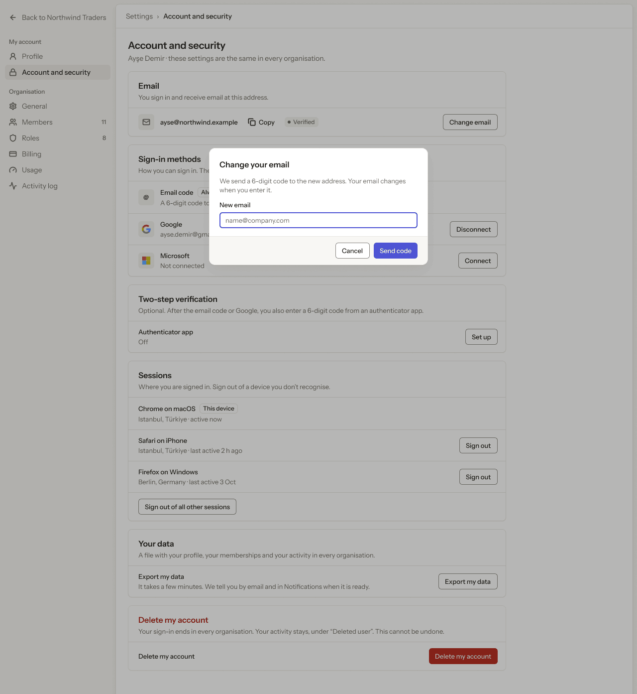

- **Who sees it:** The signed-in person, about themselves.
- **Device:** Desktop (1280 px and wider).
- **This state shows:** as the title says.
- **Values come from:** Sign-in methods, sessions and two-step verification: Clerk. Email change, data export and account deletion: our API.
- **Components:** Button ×12, Icon/mail, Input, Label ×2, Logo/Google, Logo/Microsoft, Pill, Sidebar, Top bar.
- **Actions:**
  - "Area": goes to [6.01 · Account and security · ideal](#601--account-and-security--ideal).
  - "Area": goes to [6.09 · Enter the code](#609--enter-the-code).
  - "Back to Northwind Traders": goes to [4.01 · Home · Owner](../04-home/README.md#401--home--owner).
  - "Profile": goes to [5.01 · Profile · ideal](../05-settings-profile/README.md#501--profile--ideal).
  - "Account and security": goes to [6.01 · Account and security · ideal](#601--account-and-security--ideal).
  - "General": goes to [7.01 · General · ideal](../07-settings-general/README.md#701--general--ideal).
  - "Members": goes to [8.01 · Members · ideal](../08-settings-members/README.md#801--members--ideal).
  - "Roles": goes to [9.01 · Roles · ideal](../09-settings-roles/README.md#901--roles--ideal).
  - "Billing": goes to [10.01 · Billing · Team, monthly](../10-settings-billing/README.md#1001--billing--team-monthly).
  - "Usage": goes to [11.01 · Usage · Team](../11-settings-usage/README.md#1101--usage--team).
  - "Activity log": goes to [12.01 · Activity log · ideal](../12-settings-activity-log/README.md#1201--activity-log--ideal).
- **Texts, word for word, top to bottom:**

  - Back to Northwind Traders
  - My account
  - Profile
  - Account and security
  - Organisation
  - General
  - Members
  - 11
  - Roles
  - 8
  - Billing
  - Usage
  - Activity log
  - AD
  - Ayşe Demir
  - Settings
  - ›
  - Account and security
  - Account and security
  - Ayşe Demir · these settings are the same in every organisation.
  - Email
  - You sign in and receive email at this address.
  - ayse@northwind.example
  - Copy
  - Verified
  - Change email
  - Sign-in methods
  - How you can sign in. The email code always works.
  - @
  - Email code
  - Always on
  - A 6-digit code to your email each time you sign in.
  - Google
  - ayse.demir@gmail.example
  - Disconnect
  - Microsoft
  - Not connected
  - Connect
  - Two-step verification
  - Optional. After the email code or Google, you also enter a 6-digit code from an authenticator app.
  - Authenticator app
  - Off
  - Set up
  - Sessions
  - Where you are signed in. Sign out of a device you don’t recognise.
  - Chrome on macOS
  - This device
  - Istanbul, Türkiye · active now
  - Safari on iPhone
  - Istanbul, Türkiye · last active 2 h ago
  - Sign out
  - Firefox on Windows
  - Berlin, Germany · last active 3 Oct
  - Sign out
  - Sign out of all other sessions
  - Your data
  - A file with your profile, your memberships and your activity in every organisation.
  - Export my data
  - It takes a few minutes. We tell you by email and in Notifications when it is ready.
  - Export my data
  - Delete my account
  - Your sign-in ends in every organisation. Your activity stays, under “Deleted user”. This cannot be undone.
  - Delete my account
  - Delete my account
  - Change your email
  - We send a 6-digit code to the new address. Your email changes when you enter it.
  - New email
  - name@company.com
  - Cancel
  - Send code

Figma: [75:11055](https://www.figma.com/design/3Ev111okX8xCBwR9B3hyBM/?node-id=75-11055)

### 6.09 · Enter the code

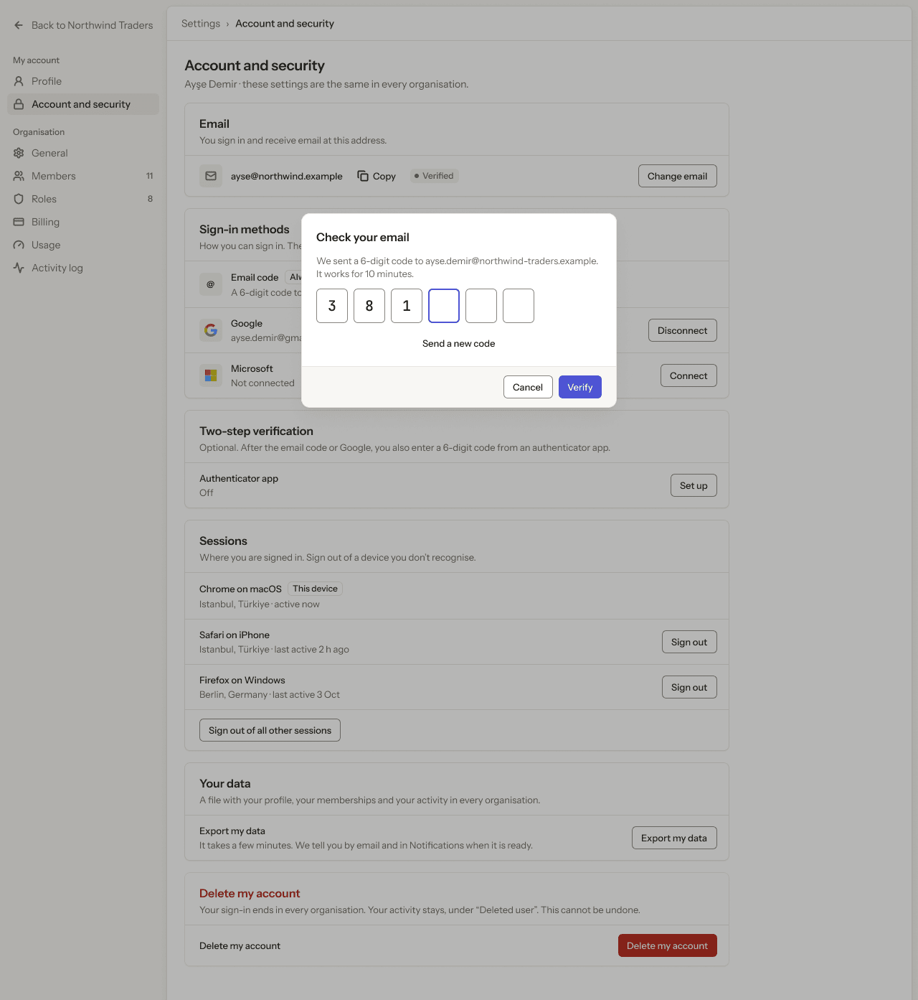

- **Who sees it:** The signed-in person, about themselves.
- **Device:** Desktop (1280 px and wider).
- **This state shows:** as the title says.
- **Values come from:** Sign-in methods, sessions and two-step verification: Clerk. Email change, data export and account deletion: our API.
- **Components:** Button ×13, Icon/mail, Label ×2, Logo/Google, Logo/Microsoft, Pill, Sidebar, Top bar.
- **Actions:**
  - "Area": goes to [6.01 · Account and security · ideal](#601--account-and-security--ideal).
  - "Area": goes to [6.10 · Code wrong](#610--code-wrong).
  - "Back to Northwind Traders": goes to [4.01 · Home · Owner](../04-home/README.md#401--home--owner).
  - "Profile": goes to [5.01 · Profile · ideal](../05-settings-profile/README.md#501--profile--ideal).
  - "Account and security": goes to [6.01 · Account and security · ideal](#601--account-and-security--ideal).
  - "General": goes to [7.01 · General · ideal](../07-settings-general/README.md#701--general--ideal).
  - "Members": goes to [8.01 · Members · ideal](../08-settings-members/README.md#801--members--ideal).
  - "Roles": goes to [9.01 · Roles · ideal](../09-settings-roles/README.md#901--roles--ideal).
  - "Billing": goes to [10.01 · Billing · Team, monthly](../10-settings-billing/README.md#1001--billing--team-monthly).
  - "Usage": goes to [11.01 · Usage · Team](../11-settings-usage/README.md#1101--usage--team).
  - "Activity log": goes to [12.01 · Activity log · ideal](../12-settings-activity-log/README.md#1201--activity-log--ideal).
- **Texts, word for word, top to bottom:**

  - Back to Northwind Traders
  - My account
  - Profile
  - Account and security
  - Organisation
  - General
  - Members
  - 11
  - Roles
  - 8
  - Billing
  - Usage
  - Activity log
  - AD
  - Ayşe Demir
  - Settings
  - ›
  - Account and security
  - Account and security
  - Ayşe Demir · these settings are the same in every organisation.
  - Email
  - You sign in and receive email at this address.
  - ayse@northwind.example
  - Copy
  - Verified
  - Change email
  - Sign-in methods
  - How you can sign in. The email code always works.
  - @
  - Email code
  - Always on
  - A 6-digit code to your email each time you sign in.
  - Google
  - ayse.demir@gmail.example
  - Disconnect
  - Microsoft
  - Not connected
  - Connect
  - Two-step verification
  - Optional. After the email code or Google, you also enter a 6-digit code from an authenticator app.
  - Authenticator app
  - Off
  - Set up
  - Sessions
  - Where you are signed in. Sign out of a device you don’t recognise.
  - Chrome on macOS
  - This device
  - Istanbul, Türkiye · active now
  - Safari on iPhone
  - Istanbul, Türkiye · last active 2 h ago
  - Sign out
  - Firefox on Windows
  - Berlin, Germany · last active 3 Oct
  - Sign out
  - Sign out of all other sessions
  - Your data
  - A file with your profile, your memberships and your activity in every organisation.
  - Export my data
  - It takes a few minutes. We tell you by email and in Notifications when it is ready.
  - Export my data
  - Delete my account
  - Your sign-in ends in every organisation. Your activity stays, under “Deleted user”. This cannot be undone.
  - Delete my account
  - Delete my account
  - Check your email
  - We sent a 6-digit code to ayse.demir@northwind-traders.example. It works for 10 minutes.
  - 3
  - 8
  - 1
  - Send a new code
  - Cancel
  - Verify

Figma: [75:11271](https://www.figma.com/design/3Ev111okX8xCBwR9B3hyBM/?node-id=75-11271)

### 6.10 · Code wrong

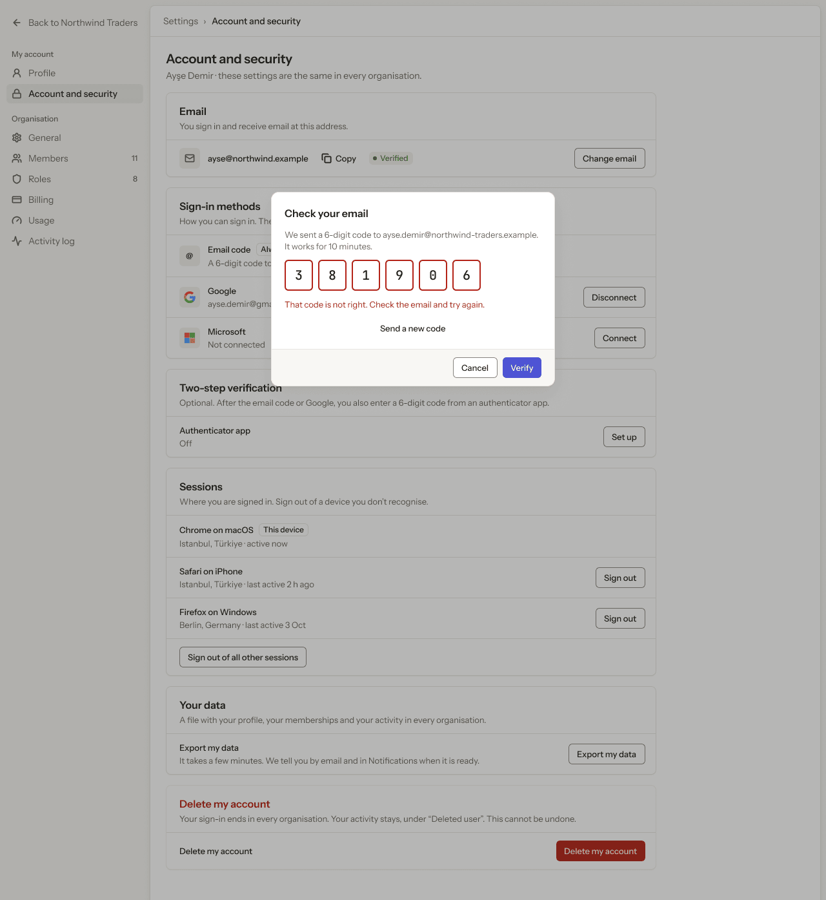

- **Who sees it:** The signed-in person, about themselves.
- **Device:** Desktop (1280 px and wider).
- **This state shows:** as the title says.
- **Values come from:** Sign-in methods, sessions and two-step verification: Clerk. Email change, data export and account deletion: our API.
- **Components:** Button ×13, Icon/mail, Label ×2, Logo/Google, Logo/Microsoft, Pill, Sidebar, Top bar.
- **Actions:**
  - "Area": goes to [6.01 · Account and security · ideal](#601--account-and-security--ideal).
  - "Area": goes to [6.11 · Email changed](#611--email-changed).
  - "Back to Northwind Traders": goes to [4.01 · Home · Owner](../04-home/README.md#401--home--owner).
  - "Profile": goes to [5.01 · Profile · ideal](../05-settings-profile/README.md#501--profile--ideal).
  - "Account and security": goes to [6.01 · Account and security · ideal](#601--account-and-security--ideal).
  - "General": goes to [7.01 · General · ideal](../07-settings-general/README.md#701--general--ideal).
  - "Members": goes to [8.01 · Members · ideal](../08-settings-members/README.md#801--members--ideal).
  - "Roles": goes to [9.01 · Roles · ideal](../09-settings-roles/README.md#901--roles--ideal).
  - "Billing": goes to [10.01 · Billing · Team, monthly](../10-settings-billing/README.md#1001--billing--team-monthly).
  - "Usage": goes to [11.01 · Usage · Team](../11-settings-usage/README.md#1101--usage--team).
  - "Activity log": goes to [12.01 · Activity log · ideal](../12-settings-activity-log/README.md#1201--activity-log--ideal).
- **Texts, word for word, top to bottom:**

  - Back to Northwind Traders
  - My account
  - Profile
  - Account and security
  - Organisation
  - General
  - Members
  - 11
  - Roles
  - 8
  - Billing
  - Usage
  - Activity log
  - AD
  - Ayşe Demir
  - Settings
  - ›
  - Account and security
  - Account and security
  - Ayşe Demir · these settings are the same in every organisation.
  - Email
  - You sign in and receive email at this address.
  - ayse@northwind.example
  - Copy
  - Verified
  - Change email
  - Sign-in methods
  - How you can sign in. The email code always works.
  - @
  - Email code
  - Always on
  - A 6-digit code to your email each time you sign in.
  - Google
  - ayse.demir@gmail.example
  - Disconnect
  - Microsoft
  - Not connected
  - Connect
  - Two-step verification
  - Optional. After the email code or Google, you also enter a 6-digit code from an authenticator app.
  - Authenticator app
  - Off
  - Set up
  - Sessions
  - Where you are signed in. Sign out of a device you don’t recognise.
  - Chrome on macOS
  - This device
  - Istanbul, Türkiye · active now
  - Safari on iPhone
  - Istanbul, Türkiye · last active 2 h ago
  - Sign out
  - Firefox on Windows
  - Berlin, Germany · last active 3 Oct
  - Sign out
  - Sign out of all other sessions
  - Your data
  - A file with your profile, your memberships and your activity in every organisation.
  - Export my data
  - It takes a few minutes. We tell you by email and in Notifications when it is ready.
  - Export my data
  - Delete my account
  - Your sign-in ends in every organisation. Your activity stays, under “Deleted user”. This cannot be undone.
  - Delete my account
  - Delete my account
  - Check your email
  - We sent a 6-digit code to ayse.demir@northwind-traders.example. It works for 10 minutes.
  - 3
  - 8
  - 1
  - 9
  - 0
  - 6
  - That code is not right. Check the email and try again.
  - Send a new code
  - Cancel
  - Verify

Figma: [75:11495](https://www.figma.com/design/3Ev111okX8xCBwR9B3hyBM/?node-id=75-11495)

### 6.11 · Email changed

- **Who sees it:** The signed-in person, about themselves.
- **Device:** Desktop (1280 px and wider).
- **This state shows:** as the title says.
- **Values come from:** Sign-in methods, sessions and two-step verification: Clerk. Email change, data export and account deletion: our API.
- **Components:** Button ×9, Icon/mail, Label ×2, Logo/Google, Logo/Microsoft, Pill, Sidebar, Toast, Top bar.
- **Actions:**
  - "You sign in with ayse.demir@northwind-traders.example from now on. We told your old address too.": goes to [6.01 · Account and security · ideal](#601--account-and-security--ideal).
  - "Back to Northwind Traders": goes to [4.01 · Home · Owner](../04-home/README.md#401--home--owner).
  - "Profile": goes to [5.01 · Profile · ideal](../05-settings-profile/README.md#501--profile--ideal).
  - "Account and security": goes to [6.01 · Account and security · ideal](#601--account-and-security--ideal).
  - "General": goes to [7.01 · General · ideal](../07-settings-general/README.md#701--general--ideal).
  - "Members": goes to [8.01 · Members · ideal](../08-settings-members/README.md#801--members--ideal).
  - "Roles": goes to [9.01 · Roles · ideal](../09-settings-roles/README.md#901--roles--ideal).
  - "Billing": goes to [10.01 · Billing · Team, monthly](../10-settings-billing/README.md#1001--billing--team-monthly).
  - "Usage": goes to [11.01 · Usage · Team](../11-settings-usage/README.md#1101--usage--team).
  - "Activity log": goes to [12.01 · Activity log · ideal](../12-settings-activity-log/README.md#1201--activity-log--ideal).
- **Texts, word for word, top to bottom:**

  - Back to Northwind Traders
  - My account
  - Profile
  - Account and security
  - Organisation
  - General
  - Members
  - 11
  - Roles
  - 8
  - Billing
  - Usage
  - Activity log
  - AD
  - Ayşe Demir
  - Settings
  - ›
  - Account and security
  - Account and security
  - Ayşe Demir · these settings are the same in every organisation.
  - Email
  - You sign in and receive email at this address.
  - ayse.demir@northwind-traders.example
  - Verified
  - Change email
  - Sign-in methods
  - How you can sign in. The email code always works.
  - @
  - Email code
  - Always on
  - A 6-digit code to your email each time you sign in.
  - Google
  - ayse.demir@gmail.example
  - Disconnect
  - Microsoft
  - Not connected
  - Connect
  - Two-step verification
  - Optional. After the email code or Google, you also enter a 6-digit code from an authenticator app.
  - Authenticator app
  - Off
  - Set up
  - Sessions
  - Where you are signed in. Sign out of a device you don’t recognise.
  - Chrome on macOS
  - This device
  - Istanbul, Türkiye · active now
  - Safari on iPhone
  - Istanbul, Türkiye · last active 2 h ago
  - Sign out
  - Firefox on Windows
  - Berlin, Germany · last active 3 Oct
  - Sign out
  - Sign out of all other sessions
  - Your data
  - A file with your profile, your memberships and your activity in every organisation.
  - Export my data
  - It takes a few minutes. We tell you by email and in Notifications when it is ready.
  - Export my data
  - Delete my account
  - Your sign-in ends in every organisation. Your activity stays, under “Deleted user”. This cannot be undone.
  - Delete my account
  - Delete my account
  - Email changed
  - You sign in with ayse.demir@northwind-traders.example from now on. We told your old address too.

Figma: [75:11723](https://www.figma.com/design/3Ev111okX8xCBwR9B3hyBM/?node-id=75-11723)

### 6.12 · Disconnect Google

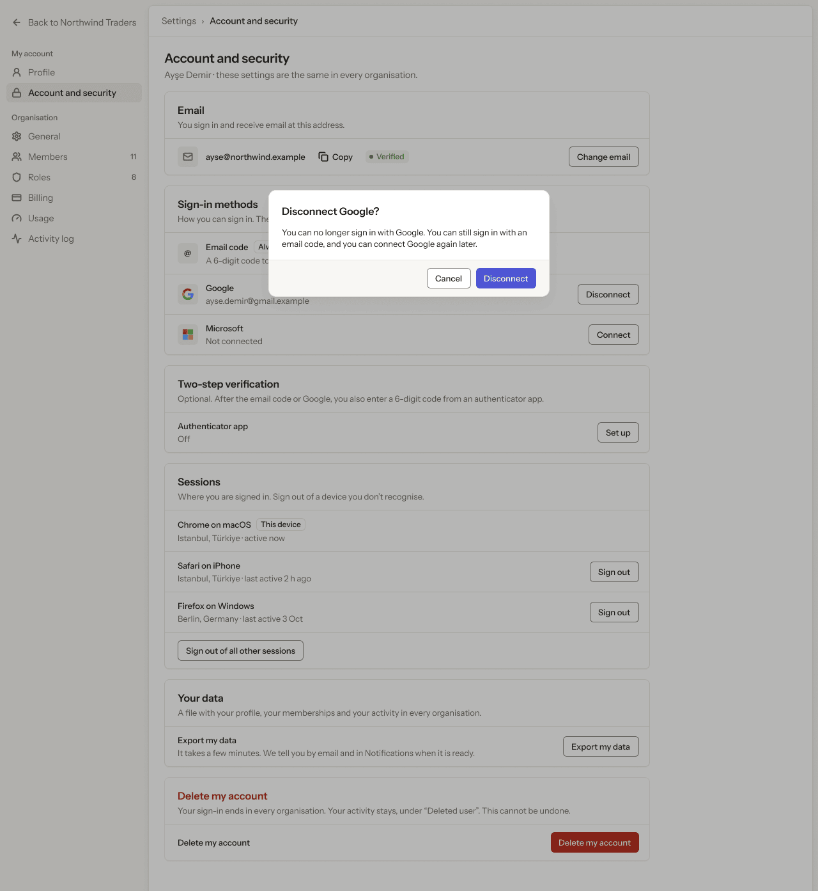

- **Who sees it:** The signed-in person, about themselves.
- **Device:** Desktop (1280 px and wider).
- **This state shows:** as the title says.
- **Values come from:** Sign-in methods, sessions and two-step verification: Clerk. Email change, data export and account deletion: our API.
- **Components:** Button ×12, Icon/mail, Label ×2, Logo/Google, Logo/Microsoft, Pill, Sidebar, Top bar.
- **Actions:**
  - "Area": goes to [6.01 · Account and security · ideal](#601--account-and-security--ideal).
  - "Area": goes to [6.13 · Google disconnected](#613--google-disconnected).
  - "Back to Northwind Traders": goes to [4.01 · Home · Owner](../04-home/README.md#401--home--owner).
  - "Profile": goes to [5.01 · Profile · ideal](../05-settings-profile/README.md#501--profile--ideal).
  - "Account and security": goes to [6.01 · Account and security · ideal](#601--account-and-security--ideal).
  - "General": goes to [7.01 · General · ideal](../07-settings-general/README.md#701--general--ideal).
  - "Members": goes to [8.01 · Members · ideal](../08-settings-members/README.md#801--members--ideal).
  - "Roles": goes to [9.01 · Roles · ideal](../09-settings-roles/README.md#901--roles--ideal).
  - "Billing": goes to [10.01 · Billing · Team, monthly](../10-settings-billing/README.md#1001--billing--team-monthly).
  - "Usage": goes to [11.01 · Usage · Team](../11-settings-usage/README.md#1101--usage--team).
  - "Activity log": goes to [12.01 · Activity log · ideal](../12-settings-activity-log/README.md#1201--activity-log--ideal).
- **Texts, word for word, top to bottom:**

  - Back to Northwind Traders
  - My account
  - Profile
  - Account and security
  - Organisation
  - General
  - Members
  - 11
  - Roles
  - 8
  - Billing
  - Usage
  - Activity log
  - AD
  - Ayşe Demir
  - Settings
  - ›
  - Account and security
  - Account and security
  - Ayşe Demir · these settings are the same in every organisation.
  - Email
  - You sign in and receive email at this address.
  - ayse@northwind.example
  - Copy
  - Verified
  - Change email
  - Sign-in methods
  - How you can sign in. The email code always works.
  - @
  - Email code
  - Always on
  - A 6-digit code to your email each time you sign in.
  - Google
  - ayse.demir@gmail.example
  - Disconnect
  - Microsoft
  - Not connected
  - Connect
  - Two-step verification
  - Optional. After the email code or Google, you also enter a 6-digit code from an authenticator app.
  - Authenticator app
  - Off
  - Set up
  - Sessions
  - Where you are signed in. Sign out of a device you don’t recognise.
  - Chrome on macOS
  - This device
  - Istanbul, Türkiye · active now
  - Safari on iPhone
  - Istanbul, Türkiye · last active 2 h ago
  - Sign out
  - Firefox on Windows
  - Berlin, Germany · last active 3 Oct
  - Sign out
  - Sign out of all other sessions
  - Your data
  - A file with your profile, your memberships and your activity in every organisation.
  - Export my data
  - It takes a few minutes. We tell you by email and in Notifications when it is ready.
  - Export my data
  - Delete my account
  - Your sign-in ends in every organisation. Your activity stays, under “Deleted user”. This cannot be undone.
  - Delete my account
  - Delete my account
  - Disconnect Google?
  - You can no longer sign in with Google. You can still sign in with an email code, and you can connect Google again later.
  - Cancel
  - Disconnect

Figma: [75:11921](https://www.figma.com/design/3Ev111okX8xCBwR9B3hyBM/?node-id=75-11921)

### 6.13 · Google disconnected

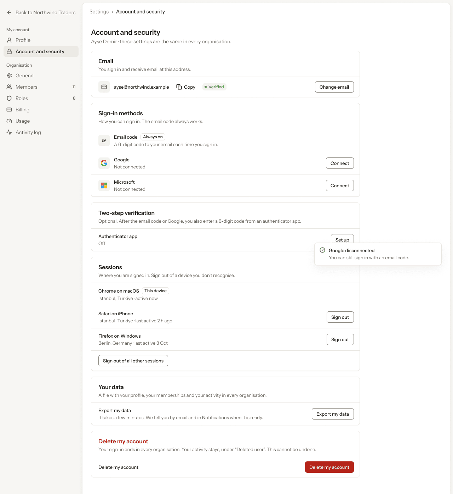

- **Who sees it:** The signed-in person, about themselves.
- **Device:** Desktop (1280 px and wider).
- **This state shows:** as the title says.
- **Values come from:** Sign-in methods, sessions and two-step verification: Clerk. Email change, data export and account deletion: our API.
- **Components:** Button ×10, Icon/mail, Label ×2, Logo/Google, Logo/Microsoft, Pill, Sidebar, Toast, Top bar.
- **Actions:**
  - "You sign in and receive email at this address.": goes to [6.01 · Account and security · ideal](#601--account-and-security--ideal).
  - "Back to Northwind Traders": goes to [4.01 · Home · Owner](../04-home/README.md#401--home--owner).
  - "Profile": goes to [5.01 · Profile · ideal](../05-settings-profile/README.md#501--profile--ideal).
  - "Account and security": goes to [6.01 · Account and security · ideal](#601--account-and-security--ideal).
  - "General": goes to [7.01 · General · ideal](../07-settings-general/README.md#701--general--ideal).
  - "Members": goes to [8.01 · Members · ideal](../08-settings-members/README.md#801--members--ideal).
  - "Roles": goes to [9.01 · Roles · ideal](../09-settings-roles/README.md#901--roles--ideal).
  - "Billing": goes to [10.01 · Billing · Team, monthly](../10-settings-billing/README.md#1001--billing--team-monthly).
  - "Usage": goes to [11.01 · Usage · Team](../11-settings-usage/README.md#1101--usage--team).
  - "Activity log": goes to [12.01 · Activity log · ideal](../12-settings-activity-log/README.md#1201--activity-log--ideal).
- **Texts, word for word, top to bottom:**

  - Back to Northwind Traders
  - My account
  - Profile
  - Account and security
  - Organisation
  - General
  - Members
  - 11
  - Roles
  - 8
  - Billing
  - Usage
  - Activity log
  - AD
  - Ayşe Demir
  - Settings
  - ›
  - Account and security
  - Account and security
  - Ayşe Demir · these settings are the same in every organisation.
  - Email
  - You sign in and receive email at this address.
  - ayse@northwind.example
  - Copy
  - Verified
  - Change email
  - Sign-in methods
  - How you can sign in. The email code always works.
  - @
  - Email code
  - Always on
  - A 6-digit code to your email each time you sign in.
  - Google
  - Not connected
  - Connect
  - Microsoft
  - Not connected
  - Connect
  - Two-step verification
  - Optional. After the email code or Google, you also enter a 6-digit code from an authenticator app.
  - Authenticator app
  - Off
  - Set up
  - Sessions
  - Where you are signed in. Sign out of a device you don’t recognise.
  - Chrome on macOS
  - This device
  - Istanbul, Türkiye · active now
  - Safari on iPhone
  - Istanbul, Türkiye · last active 2 h ago
  - Sign out
  - Firefox on Windows
  - Berlin, Germany · last active 3 Oct
  - Sign out
  - Sign out of all other sessions
  - Your data
  - A file with your profile, your memberships and your activity in every organisation.
  - Export my data
  - It takes a few minutes. We tell you by email and in Notifications when it is ready.
  - Export my data
  - Delete my account
  - Your sign-in ends in every organisation. Your activity stays, under “Deleted user”. This cannot be undone.
  - Delete my account
  - Delete my account
  - Google disconnected
  - You can still sign in with an email code.

Figma: [75:12129](https://www.figma.com/design/3Ev111okX8xCBwR9B3hyBM/?node-id=75-12129)

### 6.14 · Microsoft connected

- **Who sees it:** The signed-in person, about themselves.
- **Device:** Desktop (1280 px and wider).
- **This state shows:** as the title says.
- **Values come from:** Sign-in methods, sessions and two-step verification: Clerk. Email change, data export and account deletion: our API.
- **Components:** Button ×10, Icon/mail, Label ×2, Logo/Google, Logo/Microsoft, Pill, Sidebar, Toast, Top bar.
- **Actions:**
  - "You sign in and receive email at this address.": goes to [6.01 · Account and security · ideal](#601--account-and-security--ideal).
  - "Back to Northwind Traders": goes to [4.01 · Home · Owner](../04-home/README.md#401--home--owner).
  - "Profile": goes to [5.01 · Profile · ideal](../05-settings-profile/README.md#501--profile--ideal).
  - "Account and security": goes to [6.01 · Account and security · ideal](#601--account-and-security--ideal).
  - "General": goes to [7.01 · General · ideal](../07-settings-general/README.md#701--general--ideal).
  - "Members": goes to [8.01 · Members · ideal](../08-settings-members/README.md#801--members--ideal).
  - "Roles": goes to [9.01 · Roles · ideal](../09-settings-roles/README.md#901--roles--ideal).
  - "Billing": goes to [10.01 · Billing · Team, monthly](../10-settings-billing/README.md#1001--billing--team-monthly).
  - "Usage": goes to [11.01 · Usage · Team](../11-settings-usage/README.md#1101--usage--team).
  - "Activity log": goes to [12.01 · Activity log · ideal](../12-settings-activity-log/README.md#1201--activity-log--ideal).
- **Texts, word for word, top to bottom:**

  - Back to Northwind Traders
  - My account
  - Profile
  - Account and security
  - Organisation
  - General
  - Members
  - 11
  - Roles
  - 8
  - Billing
  - Usage
  - Activity log
  - AD
  - Ayşe Demir
  - Settings
  - ›
  - Account and security
  - Account and security
  - Ayşe Demir · these settings are the same in every organisation.
  - Email
  - You sign in and receive email at this address.
  - ayse@northwind.example
  - Copy
  - Verified
  - Change email
  - Sign-in methods
  - How you can sign in. The email code always works.
  - @
  - Email code
  - Always on
  - A 6-digit code to your email each time you sign in.
  - Google
  - ayse.demir@gmail.example
  - Disconnect
  - Microsoft
  - ayse.demir@outlook.example
  - Disconnect
  - Two-step verification
  - Optional. After the email code or Google, you also enter a 6-digit code from an authenticator app.
  - Authenticator app
  - Off
  - Set up
  - Sessions
  - Where you are signed in. Sign out of a device you don’t recognise.
  - Chrome on macOS
  - This device
  - Istanbul, Türkiye · active now
  - Safari on iPhone
  - Istanbul, Türkiye · last active 2 h ago
  - Sign out
  - Firefox on Windows
  - Berlin, Germany · last active 3 Oct
  - Sign out
  - Sign out of all other sessions
  - Your data
  - A file with your profile, your memberships and your activity in every organisation.
  - Export my data
  - It takes a few minutes. We tell you by email and in Notifications when it is ready.
  - Export my data
  - Delete my account
  - Your sign-in ends in every organisation. Your activity stays, under “Deleted user”. This cannot be undone.
  - Delete my account
  - Delete my account
  - Microsoft connected
  - You can sign in with Microsoft now.

Figma: [75:12333](https://www.figma.com/design/3Ev111okX8xCBwR9B3hyBM/?node-id=75-12333)

### 6.15 · Microsoft refused

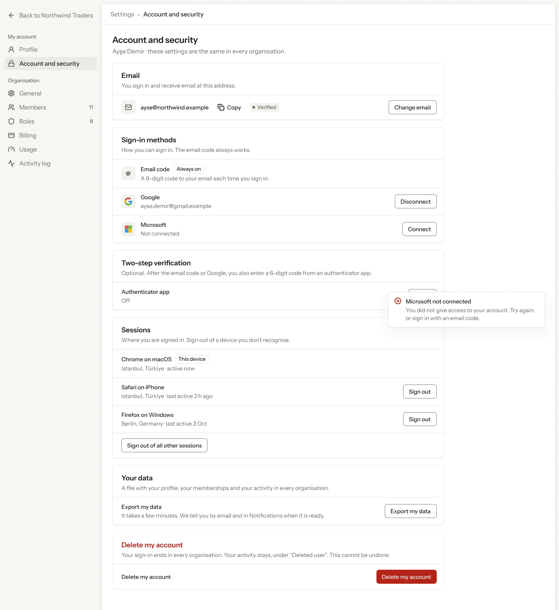

- **Who sees it:** The signed-in person, about themselves.
- **Device:** Desktop (1280 px and wider).
- **This state shows:** as the title says.
- **Values come from:** Sign-in methods, sessions and two-step verification: Clerk. Email change, data export and account deletion: our API.
- **Components:** Button ×10, Icon/mail, Label ×2, Logo/Google, Logo/Microsoft, Pill, Sidebar, Toast, Top bar.
- **Actions:**
  - "You sign in and receive email at this address.": goes to [6.01 · Account and security · ideal](#601--account-and-security--ideal).
  - "Back to Northwind Traders": goes to [4.01 · Home · Owner](../04-home/README.md#401--home--owner).
  - "Profile": goes to [5.01 · Profile · ideal](../05-settings-profile/README.md#501--profile--ideal).
  - "Account and security": goes to [6.01 · Account and security · ideal](#601--account-and-security--ideal).
  - "General": goes to [7.01 · General · ideal](../07-settings-general/README.md#701--general--ideal).
  - "Members": goes to [8.01 · Members · ideal](../08-settings-members/README.md#801--members--ideal).
  - "Roles": goes to [9.01 · Roles · ideal](../09-settings-roles/README.md#901--roles--ideal).
  - "Billing": goes to [10.01 · Billing · Team, monthly](../10-settings-billing/README.md#1001--billing--team-monthly).
  - "Usage": goes to [11.01 · Usage · Team](../11-settings-usage/README.md#1101--usage--team).
  - "Activity log": goes to [12.01 · Activity log · ideal](../12-settings-activity-log/README.md#1201--activity-log--ideal).
- **Texts, word for word, top to bottom:**

  - Back to Northwind Traders
  - My account
  - Profile
  - Account and security
  - Organisation
  - General
  - Members
  - 11
  - Roles
  - 8
  - Billing
  - Usage
  - Activity log
  - AD
  - Ayşe Demir
  - Settings
  - ›
  - Account and security
  - Account and security
  - Ayşe Demir · these settings are the same in every organisation.
  - Email
  - You sign in and receive email at this address.
  - ayse@northwind.example
  - Copy
  - Verified
  - Change email
  - Sign-in methods
  - How you can sign in. The email code always works.
  - @
  - Email code
  - Always on
  - A 6-digit code to your email each time you sign in.
  - Google
  - ayse.demir@gmail.example
  - Disconnect
  - Microsoft
  - Not connected
  - Connect
  - Two-step verification
  - Optional. After the email code or Google, you also enter a 6-digit code from an authenticator app.
  - Authenticator app
  - Off
  - Set up
  - Sessions
  - Where you are signed in. Sign out of a device you don’t recognise.
  - Chrome on macOS
  - This device
  - Istanbul, Türkiye · active now
  - Safari on iPhone
  - Istanbul, Türkiye · last active 2 h ago
  - Sign out
  - Firefox on Windows
  - Berlin, Germany · last active 3 Oct
  - Sign out
  - Sign out of all other sessions
  - Your data
  - A file with your profile, your memberships and your activity in every organisation.
  - Export my data
  - It takes a few minutes. We tell you by email and in Notifications when it is ready.
  - Export my data
  - Delete my account
  - Your sign-in ends in every organisation. Your activity stays, under “Deleted user”. This cannot be undone.
  - Delete my account
  - Delete my account
  - Microsoft not connected
  - You did not give access to your account. Try again, or sign in with an email code.

Figma: [75:12537](https://www.figma.com/design/3Ev111okX8xCBwR9B3hyBM/?node-id=75-12537)

### 6.16 · Session signed out

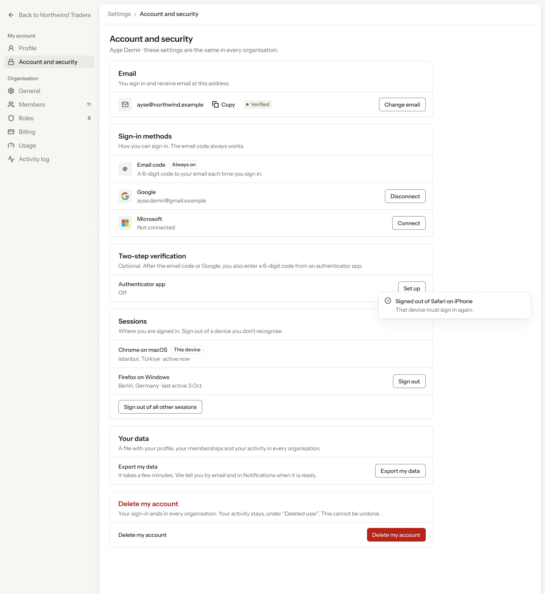

- **Who sees it:** The signed-in person, about themselves.
- **Device:** Desktop (1280 px and wider).
- **This state shows:** as the title says.
- **Values come from:** Sign-in methods, sessions and two-step verification: Clerk. Email change, data export and account deletion: our API.
- **Components:** Button ×9, Icon/mail, Label ×2, Logo/Google, Logo/Microsoft, Pill, Sidebar, Toast, Top bar.
- **Actions:**
  - "You sign in and receive email at this address.": goes to [6.01 · Account and security · ideal](#601--account-and-security--ideal).
  - "Back to Northwind Traders": goes to [4.01 · Home · Owner](../04-home/README.md#401--home--owner).
  - "Profile": goes to [5.01 · Profile · ideal](../05-settings-profile/README.md#501--profile--ideal).
  - "Account and security": goes to [6.01 · Account and security · ideal](#601--account-and-security--ideal).
  - "General": goes to [7.01 · General · ideal](../07-settings-general/README.md#701--general--ideal).
  - "Members": goes to [8.01 · Members · ideal](../08-settings-members/README.md#801--members--ideal).
  - "Roles": goes to [9.01 · Roles · ideal](../09-settings-roles/README.md#901--roles--ideal).
  - "Billing": goes to [10.01 · Billing · Team, monthly](../10-settings-billing/README.md#1001--billing--team-monthly).
  - "Usage": goes to [11.01 · Usage · Team](../11-settings-usage/README.md#1101--usage--team).
  - "Activity log": goes to [12.01 · Activity log · ideal](../12-settings-activity-log/README.md#1201--activity-log--ideal).
- **Texts, word for word, top to bottom:**

  - Back to Northwind Traders
  - My account
  - Profile
  - Account and security
  - Organisation
  - General
  - Members
  - 11
  - Roles
  - 8
  - Billing
  - Usage
  - Activity log
  - AD
  - Ayşe Demir
  - Settings
  - ›
  - Account and security
  - Account and security
  - Ayşe Demir · these settings are the same in every organisation.
  - Email
  - You sign in and receive email at this address.
  - ayse@northwind.example
  - Copy
  - Verified
  - Change email
  - Sign-in methods
  - How you can sign in. The email code always works.
  - @
  - Email code
  - Always on
  - A 6-digit code to your email each time you sign in.
  - Google
  - ayse.demir@gmail.example
  - Disconnect
  - Microsoft
  - Not connected
  - Connect
  - Two-step verification
  - Optional. After the email code or Google, you also enter a 6-digit code from an authenticator app.
  - Authenticator app
  - Off
  - Set up
  - Sessions
  - Where you are signed in. Sign out of a device you don’t recognise.
  - Chrome on macOS
  - This device
  - Istanbul, Türkiye · active now
  - Firefox on Windows
  - Berlin, Germany · last active 3 Oct
  - Sign out
  - Sign out of all other sessions
  - Your data
  - A file with your profile, your memberships and your activity in every organisation.
  - Export my data
  - It takes a few minutes. We tell you by email and in Notifications when it is ready.
  - Export my data
  - Delete my account
  - Your sign-in ends in every organisation. Your activity stays, under “Deleted user”. This cannot be undone.
  - Delete my account
  - Delete my account
  - Signed out of Safari on iPhone
  - That device must sign in again.

Figma: [75:12736](https://www.figma.com/design/3Ev111okX8xCBwR9B3hyBM/?node-id=75-12736)

### 6.17 · Sign out of other sessions

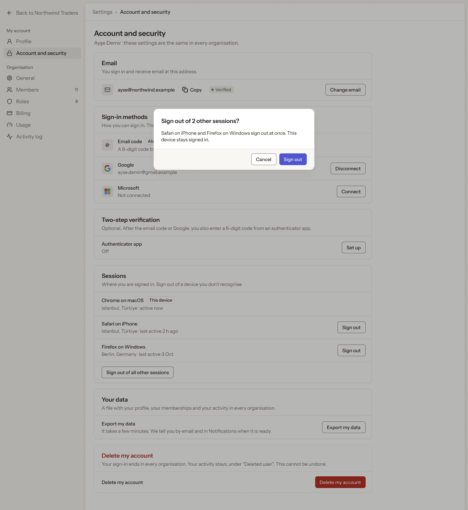

- **Who sees it:** The signed-in person, about themselves.
- **Device:** Desktop (1280 px and wider).
- **This state shows:** as the title says.
- **Values come from:** Sign-in methods, sessions and two-step verification: Clerk. Email change, data export and account deletion: our API.
- **Components:** Button ×12, Icon/mail, Label ×2, Logo/Google, Logo/Microsoft, Pill, Sidebar, Top bar.
- **Actions:**
  - "Area": goes to [6.01 · Account and security · ideal](#601--account-and-security--ideal).
  - "Area": goes to [6.18 · Other sessions signed out](#618--other-sessions-signed-out).
  - "Back to Northwind Traders": goes to [4.01 · Home · Owner](../04-home/README.md#401--home--owner).
  - "Profile": goes to [5.01 · Profile · ideal](../05-settings-profile/README.md#501--profile--ideal).
  - "Account and security": goes to [6.01 · Account and security · ideal](#601--account-and-security--ideal).
  - "General": goes to [7.01 · General · ideal](../07-settings-general/README.md#701--general--ideal).
  - "Members": goes to [8.01 · Members · ideal](../08-settings-members/README.md#801--members--ideal).
  - "Roles": goes to [9.01 · Roles · ideal](../09-settings-roles/README.md#901--roles--ideal).
  - "Billing": goes to [10.01 · Billing · Team, monthly](../10-settings-billing/README.md#1001--billing--team-monthly).
  - "Usage": goes to [11.01 · Usage · Team](../11-settings-usage/README.md#1101--usage--team).
  - "Activity log": goes to [12.01 · Activity log · ideal](../12-settings-activity-log/README.md#1201--activity-log--ideal).
- **Texts, word for word, top to bottom:**

  - Back to Northwind Traders
  - My account
  - Profile
  - Account and security
  - Organisation
  - General
  - Members
  - 11
  - Roles
  - 8
  - Billing
  - Usage
  - Activity log
  - AD
  - Ayşe Demir
  - Settings
  - ›
  - Account and security
  - Account and security
  - Ayşe Demir · these settings are the same in every organisation.
  - Email
  - You sign in and receive email at this address.
  - ayse@northwind.example
  - Copy
  - Verified
  - Change email
  - Sign-in methods
  - How you can sign in. The email code always works.
  - @
  - Email code
  - Always on
  - A 6-digit code to your email each time you sign in.
  - Google
  - ayse.demir@gmail.example
  - Disconnect
  - Microsoft
  - Not connected
  - Connect
  - Two-step verification
  - Optional. After the email code or Google, you also enter a 6-digit code from an authenticator app.
  - Authenticator app
  - Off
  - Set up
  - Sessions
  - Where you are signed in. Sign out of a device you don’t recognise.
  - Chrome on macOS
  - This device
  - Istanbul, Türkiye · active now
  - Safari on iPhone
  - Istanbul, Türkiye · last active 2 h ago
  - Sign out
  - Firefox on Windows
  - Berlin, Germany · last active 3 Oct
  - Sign out
  - Sign out of all other sessions
  - Your data
  - A file with your profile, your memberships and your activity in every organisation.
  - Export my data
  - It takes a few minutes. We tell you by email and in Notifications when it is ready.
  - Export my data
  - Delete my account
  - Your sign-in ends in every organisation. Your activity stays, under “Deleted user”. This cannot be undone.
  - Delete my account
  - Delete my account
  - Sign out of 2 other sessions?
  - Safari on iPhone and Firefox on Windows sign out at once. This device stays signed in.
  - Cancel
  - Sign out

Figma: [75:12934](https://www.figma.com/design/3Ev111okX8xCBwR9B3hyBM/?node-id=75-12934)

### 6.18 · Other sessions signed out

- **Who sees it:** The signed-in person, about themselves.
- **Device:** Desktop (1280 px and wider).
- **This state shows:** as the title says.
- **Values come from:** Sign-in methods, sessions and two-step verification: Clerk. Email change, data export and account deletion: our API.
- **Components:** Button ×7, Icon/mail, Label ×2, Logo/Google, Logo/Microsoft, Pill, Sidebar, Toast, Top bar.
- **Actions:**
  - "You sign in and receive email at this address.": goes to [6.01 · Account and security · ideal](#601--account-and-security--ideal).
  - "Back to Northwind Traders": goes to [4.01 · Home · Owner](../04-home/README.md#401--home--owner).
  - "Profile": goes to [5.01 · Profile · ideal](../05-settings-profile/README.md#501--profile--ideal).
  - "Account and security": goes to [6.01 · Account and security · ideal](#601--account-and-security--ideal).
  - "General": goes to [7.01 · General · ideal](../07-settings-general/README.md#701--general--ideal).
  - "Members": goes to [8.01 · Members · ideal](../08-settings-members/README.md#801--members--ideal).
  - "Roles": goes to [9.01 · Roles · ideal](../09-settings-roles/README.md#901--roles--ideal).
  - "Billing": goes to [10.01 · Billing · Team, monthly](../10-settings-billing/README.md#1001--billing--team-monthly).
  - "Usage": goes to [11.01 · Usage · Team](../11-settings-usage/README.md#1101--usage--team).
  - "Activity log": goes to [12.01 · Activity log · ideal](../12-settings-activity-log/README.md#1201--activity-log--ideal).
- **Texts, word for word, top to bottom:**

  - Back to Northwind Traders
  - My account
  - Profile
  - Account and security
  - Organisation
  - General
  - Members
  - 11
  - Roles
  - 8
  - Billing
  - Usage
  - Activity log
  - AD
  - Ayşe Demir
  - Settings
  - ›
  - Account and security
  - Account and security
  - Ayşe Demir · these settings are the same in every organisation.
  - Email
  - You sign in and receive email at this address.
  - ayse@northwind.example
  - Copy
  - Verified
  - Change email
  - Sign-in methods
  - How you can sign in. The email code always works.
  - @
  - Email code
  - Always on
  - A 6-digit code to your email each time you sign in.
  - Google
  - ayse.demir@gmail.example
  - Disconnect
  - Microsoft
  - Not connected
  - Connect
  - Two-step verification
  - Optional. After the email code or Google, you also enter a 6-digit code from an authenticator app.
  - Authenticator app
  - Off
  - Set up
  - Sessions
  - Where you are signed in. Sign out of a device you don’t recognise.
  - Chrome on macOS
  - This device
  - Istanbul, Türkiye · active now
  - Your data
  - A file with your profile, your memberships and your activity in every organisation.
  - Export my data
  - It takes a few minutes. We tell you by email and in Notifications when it is ready.
  - Export my data
  - Delete my account
  - Your sign-in ends in every organisation. Your activity stays, under “Deleted user”. This cannot be undone.
  - Delete my account
  - Delete my account
  - Signed out of 2 other sessions
  - Only this device is signed in.

Figma: [75:13142](https://www.figma.com/design/3Ev111okX8xCBwR9B3hyBM/?node-id=75-13142)

### 6.19 · Export my data

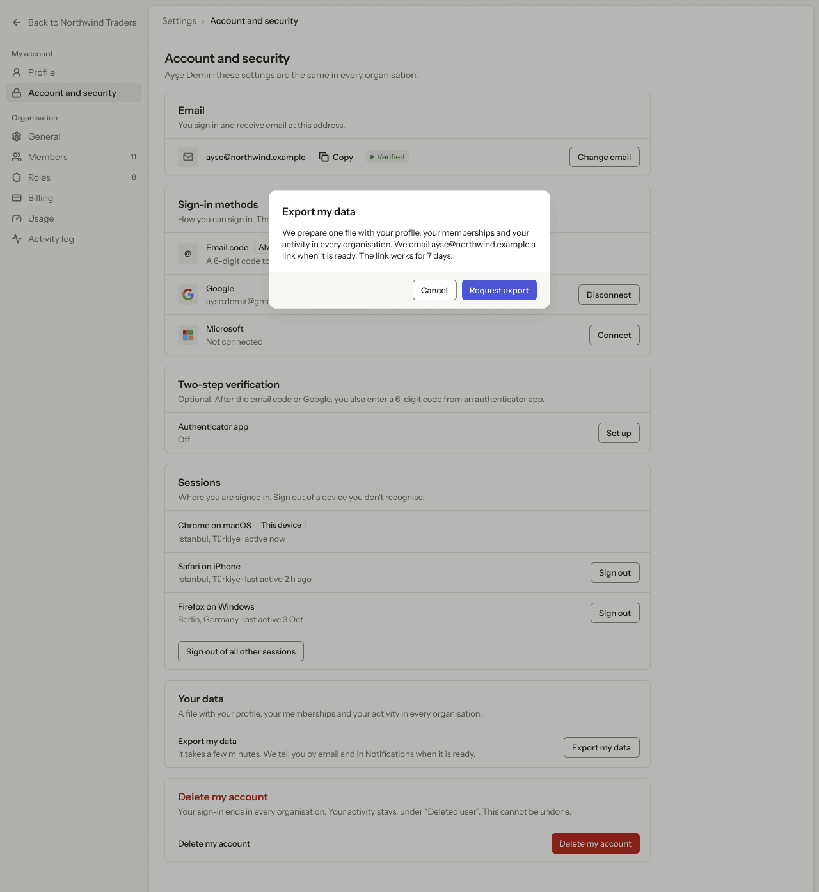

- **Who sees it:** The signed-in person, about themselves.
- **Device:** Desktop (1280 px and wider).
- **This state shows:** as the title says.
- **Values come from:** Sign-in methods, sessions and two-step verification: Clerk. Email change, data export and account deletion: our API.
- **Components:** Button ×12, Icon/mail, Label ×2, Logo/Google, Logo/Microsoft, Pill, Sidebar, Top bar.
- **Actions:**
  - "Area": goes to [6.01 · Account and security · ideal](#601--account-and-security--ideal).
  - "Area": goes to [6.20 · Export requested](#620--export-requested).
  - "Back to Northwind Traders": goes to [4.01 · Home · Owner](../04-home/README.md#401--home--owner).
  - "Profile": goes to [5.01 · Profile · ideal](../05-settings-profile/README.md#501--profile--ideal).
  - "Account and security": goes to [6.01 · Account and security · ideal](#601--account-and-security--ideal).
  - "General": goes to [7.01 · General · ideal](../07-settings-general/README.md#701--general--ideal).
  - "Members": goes to [8.01 · Members · ideal](../08-settings-members/README.md#801--members--ideal).
  - "Roles": goes to [9.01 · Roles · ideal](../09-settings-roles/README.md#901--roles--ideal).
  - "Billing": goes to [10.01 · Billing · Team, monthly](../10-settings-billing/README.md#1001--billing--team-monthly).
  - "Usage": goes to [11.01 · Usage · Team](../11-settings-usage/README.md#1101--usage--team).
  - "Activity log": goes to [12.01 · Activity log · ideal](../12-settings-activity-log/README.md#1201--activity-log--ideal).
- **Texts, word for word, top to bottom:**

  - Back to Northwind Traders
  - My account
  - Profile
  - Account and security
  - Organisation
  - General
  - Members
  - 11
  - Roles
  - 8
  - Billing
  - Usage
  - Activity log
  - AD
  - Ayşe Demir
  - Settings
  - ›
  - Account and security
  - Account and security
  - Ayşe Demir · these settings are the same in every organisation.
  - Email
  - You sign in and receive email at this address.
  - ayse@northwind.example
  - Copy
  - Verified
  - Change email
  - Sign-in methods
  - How you can sign in. The email code always works.
  - @
  - Email code
  - Always on
  - A 6-digit code to your email each time you sign in.
  - Google
  - ayse.demir@gmail.example
  - Disconnect
  - Microsoft
  - Not connected
  - Connect
  - Two-step verification
  - Optional. After the email code or Google, you also enter a 6-digit code from an authenticator app.
  - Authenticator app
  - Off
  - Set up
  - Sessions
  - Where you are signed in. Sign out of a device you don’t recognise.
  - Chrome on macOS
  - This device
  - Istanbul, Türkiye · active now
  - Safari on iPhone
  - Istanbul, Türkiye · last active 2 h ago
  - Sign out
  - Firefox on Windows
  - Berlin, Germany · last active 3 Oct
  - Sign out
  - Sign out of all other sessions
  - Your data
  - A file with your profile, your memberships and your activity in every organisation.
  - Export my data
  - It takes a few minutes. We tell you by email and in Notifications when it is ready.
  - Export my data
  - Delete my account
  - Your sign-in ends in every organisation. Your activity stays, under “Deleted user”. This cannot be undone.
  - Delete my account
  - Delete my account
  - Export my data
  - We prepare one file with your profile, your memberships and your activity in every organisation. We email ayse@northwind.example a link when it is ready. The link works for 7 days.
  - Cancel
  - Request export

Figma: [75:13340](https://www.figma.com/design/3Ev111okX8xCBwR9B3hyBM/?node-id=75-13340)

### 6.20 · Export requested

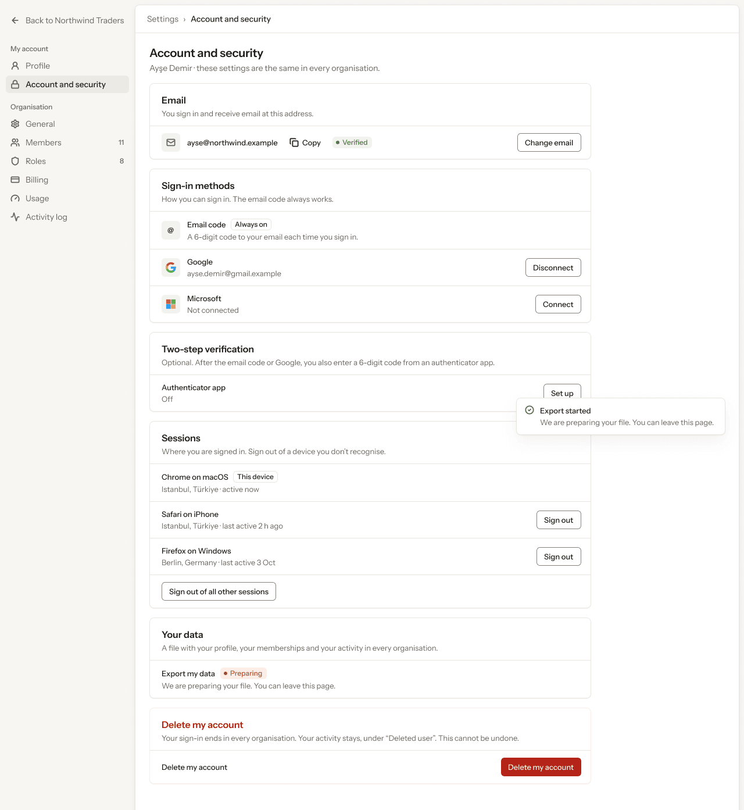

- **Who sees it:** The signed-in person, about themselves.
- **Device:** Desktop (1280 px and wider).
- **This state shows:** as the title says.
- **Values come from:** Sign-in methods, sessions and two-step verification: Clerk. Email change, data export and account deletion: our API.
- **Components:** Button ×9, Icon/mail, Label ×2, Logo/Google, Logo/Microsoft, Pill ×2, Sidebar, Toast, Top bar.
- **Actions:**
  - "We are preparing your file. You can leave this page.": goes to [6.21 · Export ready](#621--export-ready).
  - "Back to Northwind Traders": goes to [4.01 · Home · Owner](../04-home/README.md#401--home--owner).
  - "Profile": goes to [5.01 · Profile · ideal](../05-settings-profile/README.md#501--profile--ideal).
  - "Account and security": goes to [6.01 · Account and security · ideal](#601--account-and-security--ideal).
  - "General": goes to [7.01 · General · ideal](../07-settings-general/README.md#701--general--ideal).
  - "Members": goes to [8.01 · Members · ideal](../08-settings-members/README.md#801--members--ideal).
  - "Roles": goes to [9.01 · Roles · ideal](../09-settings-roles/README.md#901--roles--ideal).
  - "Billing": goes to [10.01 · Billing · Team, monthly](../10-settings-billing/README.md#1001--billing--team-monthly).
  - "Usage": goes to [11.01 · Usage · Team](../11-settings-usage/README.md#1101--usage--team).
  - "Activity log": goes to [12.01 · Activity log · ideal](../12-settings-activity-log/README.md#1201--activity-log--ideal).
- **Texts, word for word, top to bottom:**

  - Back to Northwind Traders
  - My account
  - Profile
  - Account and security
  - Organisation
  - General
  - Members
  - 11
  - Roles
  - 8
  - Billing
  - Usage
  - Activity log
  - AD
  - Ayşe Demir
  - Settings
  - ›
  - Account and security
  - Account and security
  - Ayşe Demir · these settings are the same in every organisation.
  - Email
  - You sign in and receive email at this address.
  - ayse@northwind.example
  - Copy
  - Verified
  - Change email
  - Sign-in methods
  - How you can sign in. The email code always works.
  - @
  - Email code
  - Always on
  - A 6-digit code to your email each time you sign in.
  - Google
  - ayse.demir@gmail.example
  - Disconnect
  - Microsoft
  - Not connected
  - Connect
  - Two-step verification
  - Optional. After the email code or Google, you also enter a 6-digit code from an authenticator app.
  - Authenticator app
  - Off
  - Set up
  - Sessions
  - Where you are signed in. Sign out of a device you don’t recognise.
  - Chrome on macOS
  - This device
  - Istanbul, Türkiye · active now
  - Safari on iPhone
  - Istanbul, Türkiye · last active 2 h ago
  - Sign out
  - Firefox on Windows
  - Berlin, Germany · last active 3 Oct
  - Sign out
  - Sign out of all other sessions
  - Your data
  - A file with your profile, your memberships and your activity in every organisation.
  - Export my data
  - Preparing
  - We are preparing your file. You can leave this page.
  - Delete my account
  - Your sign-in ends in every organisation. Your activity stays, under “Deleted user”. This cannot be undone.
  - Delete my account
  - Delete my account
  - Export started
  - We are preparing your file. You can leave this page.

Figma: [75:13548](https://www.figma.com/design/3Ev111okX8xCBwR9B3hyBM/?node-id=75-13548)

### 6.21 · Export ready

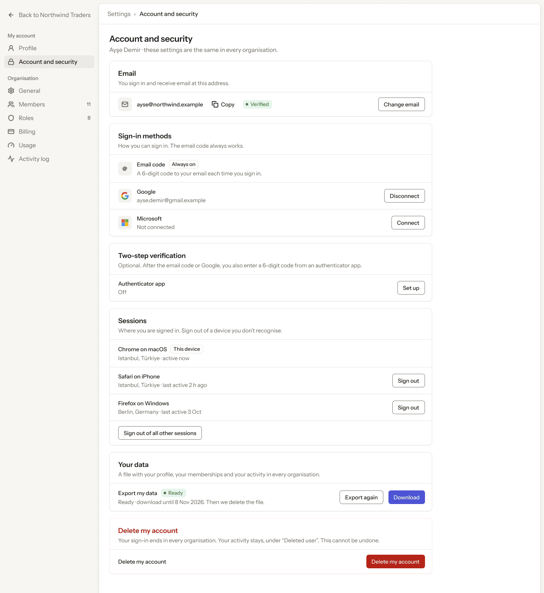

- **Who sees it:** The signed-in person, about themselves.
- **Device:** Desktop (1280 px and wider).
- **This state shows:** as the title says.
- **Values come from:** Sign-in methods, sessions and two-step verification: Clerk. Email change, data export and account deletion: our API.
- **Components:** Button ×11, Icon/mail, Label ×2, Logo/Google, Logo/Microsoft, Pill ×2, Sidebar, Top bar.
- **Actions:**
  - "You sign in and receive email at this address.": goes to [6.01 · Account and security · ideal](#601--account-and-security--ideal).
  - "Back to Northwind Traders": goes to [4.01 · Home · Owner](../04-home/README.md#401--home--owner).
  - "Profile": goes to [5.01 · Profile · ideal](../05-settings-profile/README.md#501--profile--ideal).
  - "Account and security": goes to [6.01 · Account and security · ideal](#601--account-and-security--ideal).
  - "General": goes to [7.01 · General · ideal](../07-settings-general/README.md#701--general--ideal).
  - "Members": goes to [8.01 · Members · ideal](../08-settings-members/README.md#801--members--ideal).
  - "Roles": goes to [9.01 · Roles · ideal](../09-settings-roles/README.md#901--roles--ideal).
  - "Billing": goes to [10.01 · Billing · Team, monthly](../10-settings-billing/README.md#1001--billing--team-monthly).
  - "Usage": goes to [11.01 · Usage · Team](../11-settings-usage/README.md#1101--usage--team).
  - "Activity log": goes to [12.01 · Activity log · ideal](../12-settings-activity-log/README.md#1201--activity-log--ideal).
- **Texts, word for word, top to bottom:**

  - Back to Northwind Traders
  - My account
  - Profile
  - Account and security
  - Organisation
  - General
  - Members
  - 11
  - Roles
  - 8
  - Billing
  - Usage
  - Activity log
  - AD
  - Ayşe Demir
  - Settings
  - ›
  - Account and security
  - Account and security
  - Ayşe Demir · these settings are the same in every organisation.
  - Email
  - You sign in and receive email at this address.
  - ayse@northwind.example
  - Copy
  - Verified
  - Change email
  - Sign-in methods
  - How you can sign in. The email code always works.
  - @
  - Email code
  - Always on
  - A 6-digit code to your email each time you sign in.
  - Google
  - ayse.demir@gmail.example
  - Disconnect
  - Microsoft
  - Not connected
  - Connect
  - Two-step verification
  - Optional. After the email code or Google, you also enter a 6-digit code from an authenticator app.
  - Authenticator app
  - Off
  - Set up
  - Sessions
  - Where you are signed in. Sign out of a device you don’t recognise.
  - Chrome on macOS
  - This device
  - Istanbul, Türkiye · active now
  - Safari on iPhone
  - Istanbul, Türkiye · last active 2 h ago
  - Sign out
  - Firefox on Windows
  - Berlin, Germany · last active 3 Oct
  - Sign out
  - Sign out of all other sessions
  - Your data
  - A file with your profile, your memberships and your activity in every organisation.
  - Export my data
  - Ready
  - Ready · download until 8 Nov 2026. Then we delete the file.
  - Export again
  - Download
  - Delete my account
  - Your sign-in ends in every organisation. Your activity stays, under “Deleted user”. This cannot be undone.
  - Delete my account
  - Delete my account

Figma: [75:13749](https://www.figma.com/design/3Ev111okX8xCBwR9B3hyBM/?node-id=75-13749)

### 6.22 · Delete refused

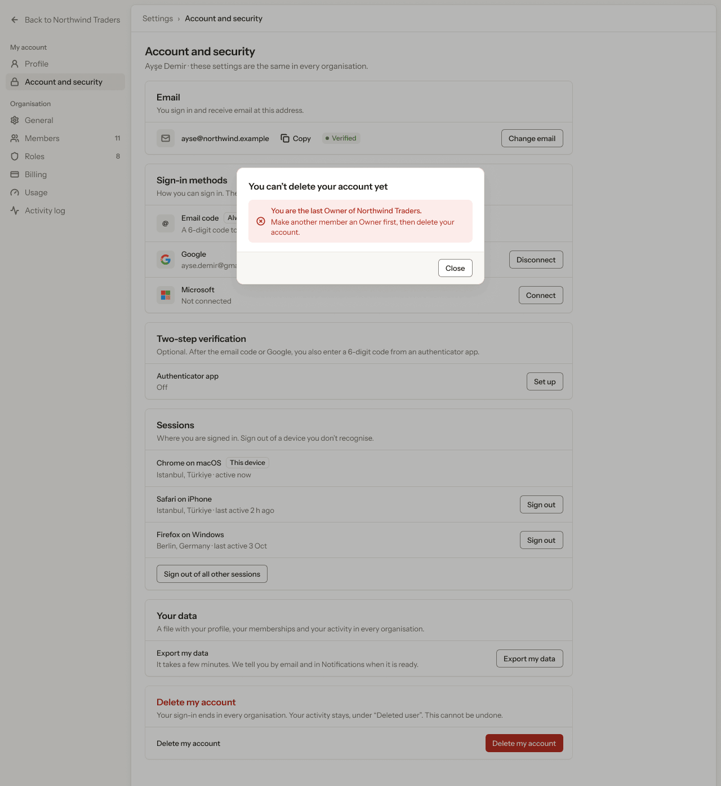

- **Who sees it:** The signed-in person, about themselves.
- **Device:** Desktop (1280 px and wider).
- **This state shows:** as the title says.
- **Values come from:** Sign-in methods, sessions and two-step verification: Clerk. Email change, data export and account deletion: our API.
- **Components:** Banner, Button ×11, Icon/mail, Label ×2, Logo/Google, Logo/Microsoft, Pill, Sidebar, Top bar.
- **Actions:**
  - "Area": goes to [6.01 · Account and security · ideal](#601--account-and-security--ideal).
  - "Back to Northwind Traders": goes to [4.01 · Home · Owner](../04-home/README.md#401--home--owner).
  - "Profile": goes to [5.01 · Profile · ideal](../05-settings-profile/README.md#501--profile--ideal).
  - "Account and security": goes to [6.01 · Account and security · ideal](#601--account-and-security--ideal).
  - "General": goes to [7.01 · General · ideal](../07-settings-general/README.md#701--general--ideal).
  - "Members": goes to [8.01 · Members · ideal](../08-settings-members/README.md#801--members--ideal).
  - "Roles": goes to [9.01 · Roles · ideal](../09-settings-roles/README.md#901--roles--ideal).
  - "Billing": goes to [10.01 · Billing · Team, monthly](../10-settings-billing/README.md#1001--billing--team-monthly).
  - "Usage": goes to [11.01 · Usage · Team](../11-settings-usage/README.md#1101--usage--team).
  - "Activity log": goes to [12.01 · Activity log · ideal](../12-settings-activity-log/README.md#1201--activity-log--ideal).
- **Texts, word for word, top to bottom:**

  - Back to Northwind Traders
  - My account
  - Profile
  - Account and security
  - Organisation
  - General
  - Members
  - 11
  - Roles
  - 8
  - Billing
  - Usage
  - Activity log
  - AD
  - Ayşe Demir
  - Settings
  - ›
  - Account and security
  - Account and security
  - Ayşe Demir · these settings are the same in every organisation.
  - Email
  - You sign in and receive email at this address.
  - ayse@northwind.example
  - Copy
  - Verified
  - Change email
  - Sign-in methods
  - How you can sign in. The email code always works.
  - @
  - Email code
  - Always on
  - A 6-digit code to your email each time you sign in.
  - Google
  - ayse.demir@gmail.example
  - Disconnect
  - Microsoft
  - Not connected
  - Connect
  - Two-step verification
  - Optional. After the email code or Google, you also enter a 6-digit code from an authenticator app.
  - Authenticator app
  - Off
  - Set up
  - Sessions
  - Where you are signed in. Sign out of a device you don’t recognise.
  - Chrome on macOS
  - This device
  - Istanbul, Türkiye · active now
  - Safari on iPhone
  - Istanbul, Türkiye · last active 2 h ago
  - Sign out
  - Firefox on Windows
  - Berlin, Germany · last active 3 Oct
  - Sign out
  - Sign out of all other sessions
  - Your data
  - A file with your profile, your memberships and your activity in every organisation.
  - Export my data
  - It takes a few minutes. We tell you by email and in Notifications when it is ready.
  - Export my data
  - Delete my account
  - Your sign-in ends in every organisation. Your activity stays, under “Deleted user”. This cannot be undone.
  - Delete my account
  - Delete my account
  - You can’t delete your account yet
  - You are the last Owner of Northwind Traders.
  - Make another member an Owner first, then delete your account.
  - Close

Figma: [75:13954](https://www.figma.com/design/3Ev111okX8xCBwR9B3hyBM/?node-id=75-13954)

### 6.23 · Delete my account

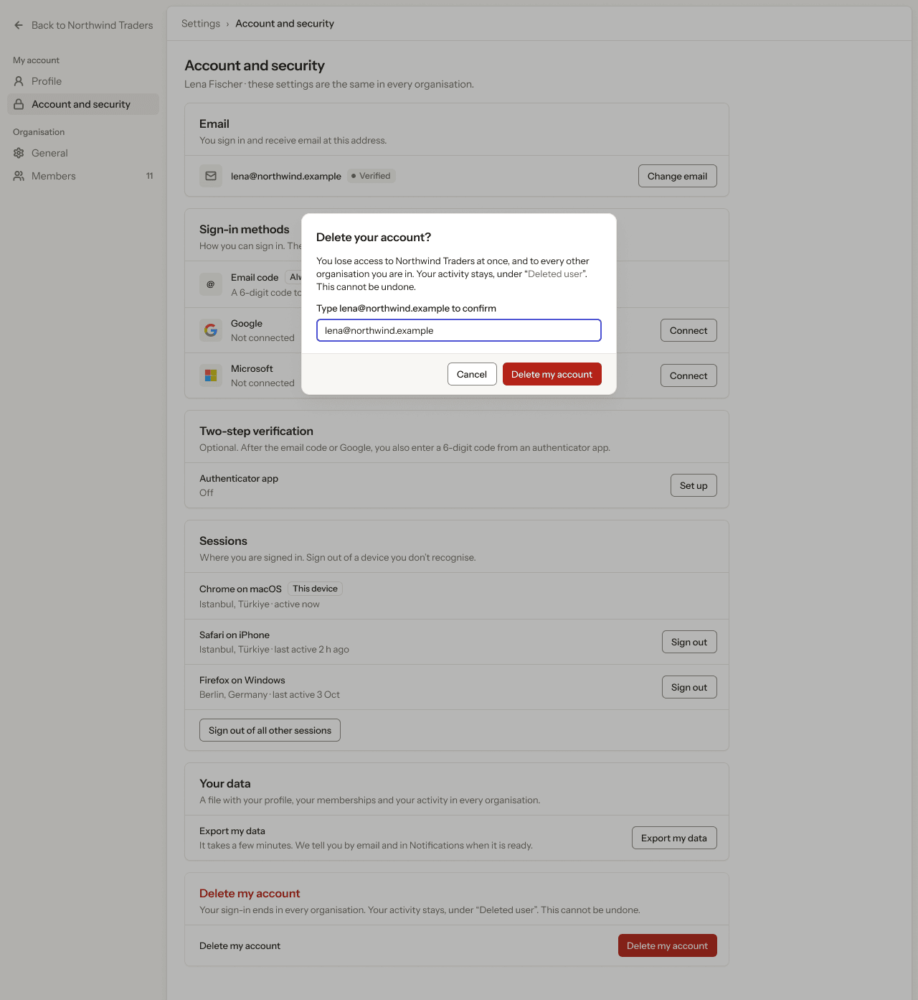

- **Who sees it:** The signed-in person, about themselves.
- **Device:** Desktop (1280 px and wider).
- **This state shows:** as the title says.
- **Values come from:** Sign-in methods, sessions and two-step verification: Clerk. Email change, data export and account deletion: our API.
- **Components:** Button ×11, Icon/mail, Input, Label ×2, Logo/Google, Logo/Microsoft, Pill, Sidebar, Top bar.
- **Actions:**
  - "Area": goes to [6.01 · Account and security · ideal](#601--account-and-security--ideal).
  - "Area": goes to [6.24 · Account deleted](#624--account-deleted).
  - "Back to Northwind Traders": goes to [4.01 · Home · Owner](../04-home/README.md#401--home--owner).
  - "Profile": goes to [5.01 · Profile · ideal](../05-settings-profile/README.md#501--profile--ideal).
  - "Account and security": goes to [6.01 · Account and security · ideal](#601--account-and-security--ideal).
  - "General": goes to [7.01 · General · ideal](../07-settings-general/README.md#701--general--ideal).
  - "Members": goes to [8.01 · Members · ideal](../08-settings-members/README.md#801--members--ideal).
- **Texts, word for word, top to bottom:**

  - Back to Northwind Traders
  - My account
  - Profile
  - Account and security
  - Organisation
  - General
  - Members
  - 11
  - LF
  - Lena Fischer
  - Settings
  - ›
  - Account and security
  - Account and security
  - Lena Fischer · these settings are the same in every organisation.
  - Email
  - You sign in and receive email at this address.
  - lena@northwind.example
  - Verified
  - Change email
  - Sign-in methods
  - How you can sign in. The email code always works.
  - @
  - Email code
  - Always on
  - A 6-digit code to your email each time you sign in.
  - Google
  - Not connected
  - Connect
  - Microsoft
  - Not connected
  - Connect
  - Two-step verification
  - Optional. After the email code or Google, you also enter a 6-digit code from an authenticator app.
  - Authenticator app
  - Off
  - Set up
  - Sessions
  - Where you are signed in. Sign out of a device you don’t recognise.
  - Chrome on macOS
  - This device
  - Istanbul, Türkiye · active now
  - Safari on iPhone
  - Istanbul, Türkiye · last active 2 h ago
  - Sign out
  - Firefox on Windows
  - Berlin, Germany · last active 3 Oct
  - Sign out
  - Sign out of all other sessions
  - Your data
  - A file with your profile, your memberships and your activity in every organisation.
  - Export my data
  - It takes a few minutes. We tell you by email and in Notifications when it is ready.
  - Export my data
  - Delete my account
  - Your sign-in ends in every organisation. Your activity stays, under “Deleted user”. This cannot be undone.
  - Delete my account
  - Delete my account
  - Delete your account?
  - You lose access to Northwind Traders at once, and to every other organisation you are in. Your activity stays, under “Deleted user”. This cannot be undone.
  - Type lena@northwind.example to confirm
  - lena@northwind.example
  - Cancel
  - Delete my account

Figma: [75:14173](https://www.figma.com/design/3Ev111okX8xCBwR9B3hyBM/?node-id=75-14173)

### 6.24 · Account deleted

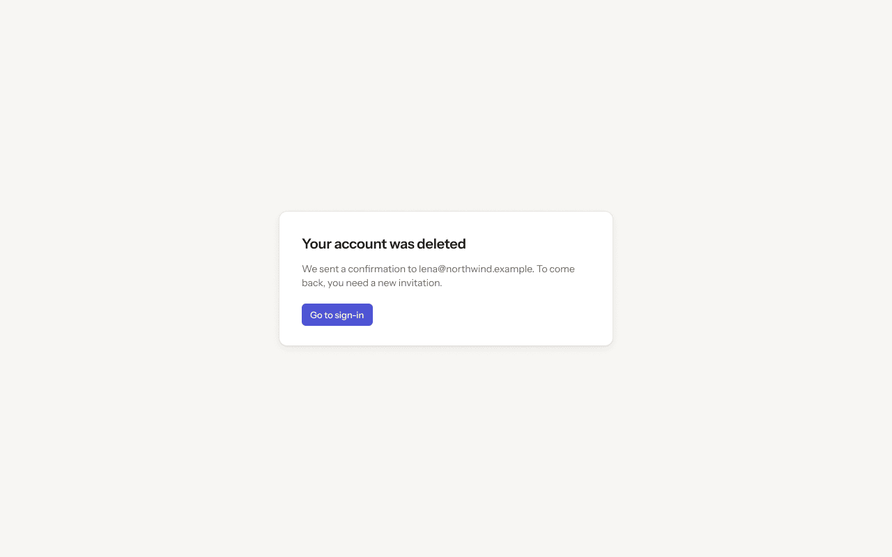

- **Who sees it:** The signed-in person, about themselves.
- **Device:** Desktop (1280 px and wider).
- **This state shows:** as the title says.
- **Values come from:** Sign-in methods, sessions and two-step verification: Clerk. Email change, data export and account deletion: our API.
- **Components:** Button.
- **Actions:**
  - No prototype link on this screen. The buttons follow the section's other screens.
- **Texts, word for word, top to bottom:**

  - Your account was deleted
  - We sent a confirmation to lena@northwind.example. To come back, you need a new invitation.
  - Go to sign-in

Figma: [75:14395](https://www.figma.com/design/3Ev111okX8xCBwR9B3hyBM/?node-id=75-14395)

### 6.25 · Two-step · set up

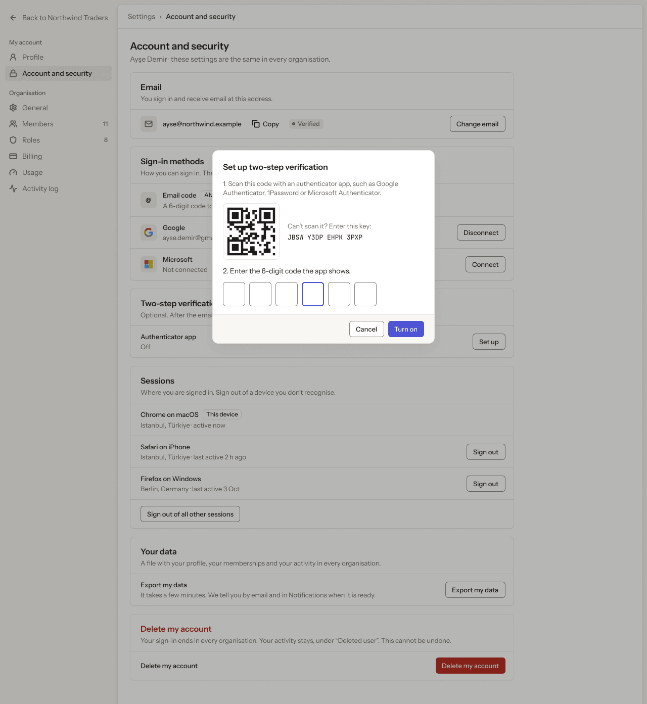

- **Who sees it:** The signed-in person, about themselves.
- **Device:** Desktop (1280 px and wider).
- **This state shows:** as the title says.
- **Values come from:** Sign-in methods, sessions and two-step verification: Clerk. Email change, data export and account deletion: our API.
- **Components:** Button ×12, Icon/mail, Label ×2, Logo/Google, Logo/Microsoft, Pill, Sidebar, Top bar.
- **Actions:**
  - "Turn on": goes to [6.26 · Two-step · backup codes](#626--two-step--backup-codes).
  - "Cancel": goes to [6.01 · Account and security · ideal](#601--account-and-security--ideal).
  - "Back to Northwind Traders": goes to [4.01 · Home · Owner](../04-home/README.md#401--home--owner).
  - "Profile": goes to [5.01 · Profile · ideal](../05-settings-profile/README.md#501--profile--ideal).
  - "Account and security": goes to [6.01 · Account and security · ideal](#601--account-and-security--ideal).
  - "General": goes to [7.01 · General · ideal](../07-settings-general/README.md#701--general--ideal).
  - "Members": goes to [8.01 · Members · ideal](../08-settings-members/README.md#801--members--ideal).
  - "Roles": goes to [9.01 · Roles · ideal](../09-settings-roles/README.md#901--roles--ideal).
  - "Billing": goes to [10.01 · Billing · Team, monthly](../10-settings-billing/README.md#1001--billing--team-monthly).
  - "Usage": goes to [11.01 · Usage · Team](../11-settings-usage/README.md#1101--usage--team).
  - "Activity log": goes to [12.01 · Activity log · ideal](../12-settings-activity-log/README.md#1201--activity-log--ideal).
- **Texts, word for word, top to bottom:**

  - Back to Northwind Traders
  - My account
  - Profile
  - Account and security
  - Organisation
  - General
  - Members
  - 11
  - Roles
  - 8
  - Billing
  - Usage
  - Activity log
  - AD
  - Ayşe Demir
  - Settings
  - ›
  - Account and security
  - Account and security
  - Ayşe Demir · these settings are the same in every organisation.
  - Email
  - You sign in and receive email at this address.
  - ayse@northwind.example
  - Copy
  - Verified
  - Change email
  - Sign-in methods
  - How you can sign in. The email code always works.
  - @
  - Email code
  - Always on
  - A 6-digit code to your email each time you sign in.
  - Google
  - ayse.demir@gmail.example
  - Disconnect
  - Microsoft
  - Not connected
  - Connect
  - Two-step verification
  - Optional. After the email code or Google, you also enter a 6-digit code from an authenticator app.
  - Authenticator app
  - Off
  - Set up
  - Sessions
  - Where you are signed in. Sign out of a device you don’t recognise.
  - Chrome on macOS
  - This device
  - Istanbul, Türkiye · active now
  - Safari on iPhone
  - Istanbul, Türkiye · last active 2 h ago
  - Sign out
  - Firefox on Windows
  - Berlin, Germany · last active 3 Oct
  - Sign out
  - Sign out of all other sessions
  - Your data
  - A file with your profile, your memberships and your activity in every organisation.
  - Export my data
  - It takes a few minutes. We tell you by email and in Notifications when it is ready.
  - Export my data
  - Delete my account
  - Your sign-in ends in every organisation. Your activity stays, under “Deleted user”. This cannot be undone.
  - Delete my account
  - Delete my account
  - Set up two-step verification
  - 1. Scan this code with an authenticator app, such as Google Authenticator, 1Password or Microsoft Authenticator.
  - Can’t scan it? Enter this key:
  - JBSW Y3DP EHPK 3PXP
  - 2. Enter the 6-digit code the app shows.
  - Cancel
  - Turn on

Figma: [89:11630](https://www.figma.com/design/3Ev111okX8xCBwR9B3hyBM/?node-id=89-11630)

### 6.26 · Two-step · backup codes

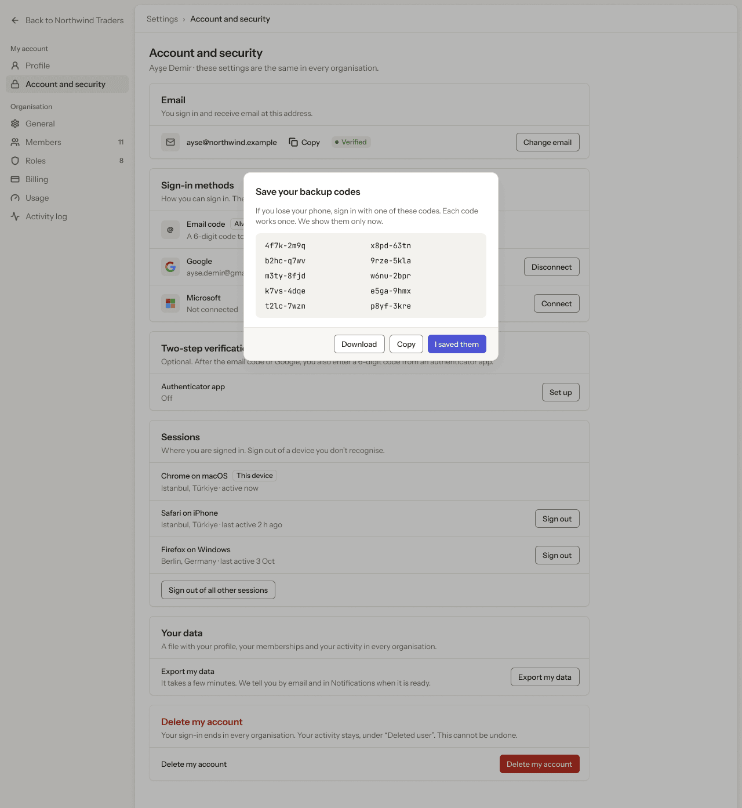

- **Who sees it:** The signed-in person, about themselves.
- **Device:** Desktop (1280 px and wider).
- **This state shows:** as the title says.
- **Values come from:** Sign-in methods, sessions and two-step verification: Clerk. Email change, data export and account deletion: our API.
- **Components:** Button ×13, Icon/mail, Label ×2, Logo/Google, Logo/Microsoft, Pill, Sidebar, Top bar.
- **Actions:**
  - "I saved them": goes to [6.27 · Two-step · on](#627--two-step--on).
  - "Back to Northwind Traders": goes to [4.01 · Home · Owner](../04-home/README.md#401--home--owner).
  - "Profile": goes to [5.01 · Profile · ideal](../05-settings-profile/README.md#501--profile--ideal).
  - "Account and security": goes to [6.01 · Account and security · ideal](#601--account-and-security--ideal).
  - "General": goes to [7.01 · General · ideal](../07-settings-general/README.md#701--general--ideal).
  - "Members": goes to [8.01 · Members · ideal](../08-settings-members/README.md#801--members--ideal).
  - "Roles": goes to [9.01 · Roles · ideal](../09-settings-roles/README.md#901--roles--ideal).
  - "Billing": goes to [10.01 · Billing · Team, monthly](../10-settings-billing/README.md#1001--billing--team-monthly).
  - "Usage": goes to [11.01 · Usage · Team](../11-settings-usage/README.md#1101--usage--team).
  - "Activity log": goes to [12.01 · Activity log · ideal](../12-settings-activity-log/README.md#1201--activity-log--ideal).
- **Texts, word for word, top to bottom:**

  - Back to Northwind Traders
  - My account
  - Profile
  - Account and security
  - Organisation
  - General
  - Members
  - 11
  - Roles
  - 8
  - Billing
  - Usage
  - Activity log
  - AD
  - Ayşe Demir
  - Settings
  - ›
  - Account and security
  - Account and security
  - Ayşe Demir · these settings are the same in every organisation.
  - Email
  - You sign in and receive email at this address.
  - ayse@northwind.example
  - Copy
  - Verified
  - Change email
  - Sign-in methods
  - How you can sign in. The email code always works.
  - @
  - Email code
  - Always on
  - A 6-digit code to your email each time you sign in.
  - Google
  - ayse.demir@gmail.example
  - Disconnect
  - Microsoft
  - Not connected
  - Connect
  - Two-step verification
  - Optional. After the email code or Google, you also enter a 6-digit code from an authenticator app.
  - Authenticator app
  - Off
  - Set up
  - Sessions
  - Where you are signed in. Sign out of a device you don’t recognise.
  - Chrome on macOS
  - This device
  - Istanbul, Türkiye · active now
  - Safari on iPhone
  - Istanbul, Türkiye · last active 2 h ago
  - Sign out
  - Firefox on Windows
  - Berlin, Germany · last active 3 Oct
  - Sign out
  - Sign out of all other sessions
  - Your data
  - A file with your profile, your memberships and your activity in every organisation.
  - Export my data
  - It takes a few minutes. We tell you by email and in Notifications when it is ready.
  - Export my data
  - Delete my account
  - Your sign-in ends in every organisation. Your activity stays, under “Deleted user”. This cannot be undone.
  - Delete my account
  - Delete my account
  - Save your backup codes
  - If you lose your phone, sign in with one of these codes. Each code works once. We show them only now.
  - 4f7k-2m9q
  - x8pd-63tn
  - b2hc-q7wv
  - 9rze-5kla
  - m3ty-8fjd
  - w6nu-2bpr
  - k7vs-4dqe
  - e5ga-9hmx
  - t2lc-7wzn
  - p8yf-3kre
  - Download
  - Copy
  - I saved them

Figma: [89:12041](https://www.figma.com/design/3Ev111okX8xCBwR9B3hyBM/?node-id=89-12041)

### 6.27 · Two-step · on

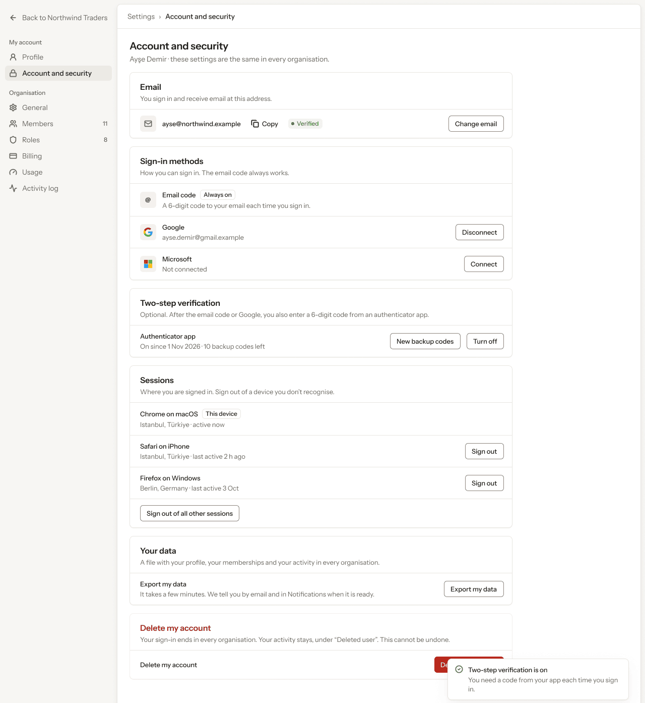

- **Who sees it:** The signed-in person, about themselves.
- **Device:** Desktop (1280 px and wider).
- **This state shows:** as the title says.
- **Values come from:** Sign-in methods, sessions and two-step verification: Clerk. Email change, data export and account deletion: our API.
- **Components:** Button ×11, Icon/mail, Label ×2, Logo/Google, Logo/Microsoft, Pill, Sidebar, Toast, Top bar.
- **Actions:**
  - "Area": goes to [6.28 · Two-step · turn off](#628--two-step--turn-off).
  - "Back to Northwind Traders": goes to [4.01 · Home · Owner](../04-home/README.md#401--home--owner).
  - "Profile": goes to [5.01 · Profile · ideal](../05-settings-profile/README.md#501--profile--ideal).
  - "Account and security": goes to [6.01 · Account and security · ideal](#601--account-and-security--ideal).
  - "General": goes to [7.01 · General · ideal](../07-settings-general/README.md#701--general--ideal).
  - "Members": goes to [8.01 · Members · ideal](../08-settings-members/README.md#801--members--ideal).
  - "Roles": goes to [9.01 · Roles · ideal](../09-settings-roles/README.md#901--roles--ideal).
  - "Billing": goes to [10.01 · Billing · Team, monthly](../10-settings-billing/README.md#1001--billing--team-monthly).
  - "Usage": goes to [11.01 · Usage · Team](../11-settings-usage/README.md#1101--usage--team).
  - "Activity log": goes to [12.01 · Activity log · ideal](../12-settings-activity-log/README.md#1201--activity-log--ideal).
- **Texts, word for word, top to bottom:**

  - Back to Northwind Traders
  - My account
  - Profile
  - Account and security
  - Organisation
  - General
  - Members
  - 11
  - Roles
  - 8
  - Billing
  - Usage
  - Activity log
  - AD
  - Ayşe Demir
  - Settings
  - ›
  - Account and security
  - Account and security
  - Ayşe Demir · these settings are the same in every organisation.
  - Email
  - You sign in and receive email at this address.
  - ayse@northwind.example
  - Copy
  - Verified
  - Change email
  - Sign-in methods
  - How you can sign in. The email code always works.
  - @
  - Email code
  - Always on
  - A 6-digit code to your email each time you sign in.
  - Google
  - ayse.demir@gmail.example
  - Disconnect
  - Microsoft
  - Not connected
  - Connect
  - Two-step verification
  - Optional. After the email code or Google, you also enter a 6-digit code from an authenticator app.
  - Authenticator app
  - On since 1 Nov 2026 · 10 backup codes left
  - New backup codes
  - Turn off
  - Sessions
  - Where you are signed in. Sign out of a device you don’t recognise.
  - Chrome on macOS
  - This device
  - Istanbul, Türkiye · active now
  - Safari on iPhone
  - Istanbul, Türkiye · last active 2 h ago
  - Sign out
  - Firefox on Windows
  - Berlin, Germany · last active 3 Oct
  - Sign out
  - Sign out of all other sessions
  - Your data
  - A file with your profile, your memberships and your activity in every organisation.
  - Export my data
  - It takes a few minutes. We tell you by email and in Notifications when it is ready.
  - Export my data
  - Delete my account
  - Your sign-in ends in every organisation. Your activity stays, under “Deleted user”. This cannot be undone.
  - Delete my account
  - Delete my account
  - Two-step verification is on
  - You need a code from your app each time you sign in.

Figma: [89:12251](https://www.figma.com/design/3Ev111okX8xCBwR9B3hyBM/?node-id=89-12251)

### 6.28 · Two-step · turn off

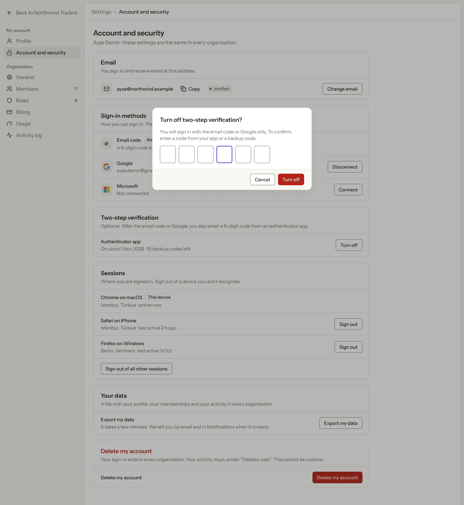

- **Who sees it:** The signed-in person, about themselves.
- **Device:** Desktop (1280 px and wider).
- **This state shows:** as the title says.
- **Values come from:** Sign-in methods, sessions and two-step verification: Clerk. Email change, data export and account deletion: our API.
- **Components:** Button ×12, Icon/mail, Label ×2, Logo/Google, Logo/Microsoft, Pill, Sidebar, Top bar.
- **Actions:**
  - "Turn off": goes to [6.29 · Two-step · turned off](#629--two-step--turned-off).
  - "Cancel": goes to [6.27 · Two-step · on](#627--two-step--on).
  - "Back to Northwind Traders": goes to [4.01 · Home · Owner](../04-home/README.md#401--home--owner).
  - "Profile": goes to [5.01 · Profile · ideal](../05-settings-profile/README.md#501--profile--ideal).
  - "Account and security": goes to [6.01 · Account and security · ideal](#601--account-and-security--ideal).
  - "General": goes to [7.01 · General · ideal](../07-settings-general/README.md#701--general--ideal).
  - "Members": goes to [8.01 · Members · ideal](../08-settings-members/README.md#801--members--ideal).
  - "Roles": goes to [9.01 · Roles · ideal](../09-settings-roles/README.md#901--roles--ideal).
  - "Billing": goes to [10.01 · Billing · Team, monthly](../10-settings-billing/README.md#1001--billing--team-monthly).
  - "Usage": goes to [11.01 · Usage · Team](../11-settings-usage/README.md#1101--usage--team).
  - "Activity log": goes to [12.01 · Activity log · ideal](../12-settings-activity-log/README.md#1201--activity-log--ideal).
- **Texts, word for word, top to bottom:**

  - Back to Northwind Traders
  - My account
  - Profile
  - Account and security
  - Organisation
  - General
  - Members
  - 11
  - Roles
  - 8
  - Billing
  - Usage
  - Activity log
  - AD
  - Ayşe Demir
  - Settings
  - ›
  - Account and security
  - Account and security
  - Ayşe Demir · these settings are the same in every organisation.
  - Email
  - You sign in and receive email at this address.
  - ayse@northwind.example
  - Copy
  - Verified
  - Change email
  - Sign-in methods
  - How you can sign in. The email code always works.
  - @
  - Email code
  - Always on
  - A 6-digit code to your email each time you sign in.
  - Google
  - ayse.demir@gmail.example
  - Disconnect
  - Microsoft
  - Not connected
  - Connect
  - Two-step verification
  - Optional. After the email code or Google, you also enter a 6-digit code from an authenticator app.
  - Authenticator app
  - On since 1 Nov 2026 · 10 backup codes left
  - Turn off
  - Sessions
  - Where you are signed in. Sign out of a device you don’t recognise.
  - Chrome on macOS
  - This device
  - Istanbul, Türkiye · active now
  - Safari on iPhone
  - Istanbul, Türkiye · last active 2 h ago
  - Sign out
  - Firefox on Windows
  - Berlin, Germany · last active 3 Oct
  - Sign out
  - Sign out of all other sessions
  - Your data
  - A file with your profile, your memberships and your activity in every organisation.
  - Export my data
  - It takes a few minutes. We tell you by email and in Notifications when it is ready.
  - Export my data
  - Delete my account
  - Your sign-in ends in every organisation. Your activity stays, under “Deleted user”. This cannot be undone.
  - Delete my account
  - Delete my account
  - Turn off two-step verification?
  - You will sign in with the email code or Google only. To confirm, enter a code from your app or a backup code.
  - Cancel
  - Turn off

Figma: [89:12423](https://www.figma.com/design/3Ev111okX8xCBwR9B3hyBM/?node-id=89-12423)

### 6.29 · Two-step · turned off

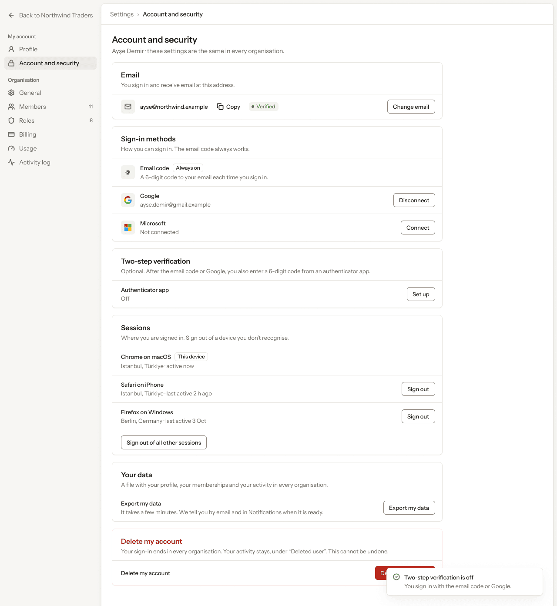

- **Who sees it:** The signed-in person, about themselves.
- **Device:** Desktop (1280 px and wider).
- **This state shows:** as the title says.
- **Values come from:** Sign-in methods, sessions and two-step verification: Clerk. Email change, data export and account deletion: our API.
- **Components:** Button ×10, Icon/mail, Label ×2, Logo/Google, Logo/Microsoft, Pill, Sidebar, Toast, Top bar.
- **Actions:**
  - "Back to Northwind Traders": goes to [4.01 · Home · Owner](../04-home/README.md#401--home--owner).
  - "Profile": goes to [5.01 · Profile · ideal](../05-settings-profile/README.md#501--profile--ideal).
  - "Account and security": goes to [6.01 · Account and security · ideal](#601--account-and-security--ideal).
  - "General": goes to [7.01 · General · ideal](../07-settings-general/README.md#701--general--ideal).
  - "Members": goes to [8.01 · Members · ideal](../08-settings-members/README.md#801--members--ideal).
  - "Roles": goes to [9.01 · Roles · ideal](../09-settings-roles/README.md#901--roles--ideal).
  - "Billing": goes to [10.01 · Billing · Team, monthly](../10-settings-billing/README.md#1001--billing--team-monthly).
  - "Usage": goes to [11.01 · Usage · Team](../11-settings-usage/README.md#1101--usage--team).
  - "Activity log": goes to [12.01 · Activity log · ideal](../12-settings-activity-log/README.md#1201--activity-log--ideal).
- **Texts, word for word, top to bottom:**

  - Back to Northwind Traders
  - My account
  - Profile
  - Account and security
  - Organisation
  - General
  - Members
  - 11
  - Roles
  - 8
  - Billing
  - Usage
  - Activity log
  - AD
  - Ayşe Demir
  - Settings
  - ›
  - Account and security
  - Account and security
  - Ayşe Demir · these settings are the same in every organisation.
  - Email
  - You sign in and receive email at this address.
  - ayse@northwind.example
  - Copy
  - Verified
  - Change email
  - Sign-in methods
  - How you can sign in. The email code always works.
  - @
  - Email code
  - Always on
  - A 6-digit code to your email each time you sign in.
  - Google
  - ayse.demir@gmail.example
  - Disconnect
  - Microsoft
  - Not connected
  - Connect
  - Two-step verification
  - Optional. After the email code or Google, you also enter a 6-digit code from an authenticator app.
  - Authenticator app
  - Off
  - Set up
  - Sessions
  - Where you are signed in. Sign out of a device you don’t recognise.
  - Chrome on macOS
  - This device
  - Istanbul, Türkiye · active now
  - Safari on iPhone
  - Istanbul, Türkiye · last active 2 h ago
  - Sign out
  - Firefox on Windows
  - Berlin, Germany · last active 3 Oct
  - Sign out
  - Sign out of all other sessions
  - Your data
  - A file with your profile, your memberships and your activity in every organisation.
  - Export my data
  - It takes a few minutes. We tell you by email and in Notifications when it is ready.
  - Export my data
  - Delete my account
  - Your sign-in ends in every organisation. Your activity stays, under “Deleted user”. This cannot be undone.
  - Delete my account
  - Delete my account
  - Two-step verification is off
  - You sign in with the email code or Google.

Figma: [89:12618](https://www.figma.com/design/3Ev111okX8xCBwR9B3hyBM/?node-id=89-12618)

### 6.30 · Export · email

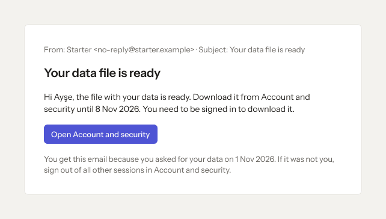

- **Who sees it:** The signed-in person, about themselves.
- **Device:** Email (642 px).
- **This state shows:** as the title says.
- **Values come from:** Sign-in methods, sessions and two-step verification: Clerk. Email change, data export and account deletion: our API.
- **Components:** Button.
- **Actions:**
  - "Open Account and security": goes to [6.21 · Export ready](#621--export-ready).
- **Texts, word for word, top to bottom:**

  - From: Starter \<no-reply@starter.example\> · Subject: Your data file is ready
  - Your data file is ready
  - Hi Ayşe, the file with your data is ready. Download it from Account and security until 8 Nov 2026. You need to be signed in to download it.
  - Open Account and security
  - You get this email because you asked for your data on 1 Nov 2026. If it was not you, sign out of all other sessions in Account and security.

Figma: [89:12761](https://www.figma.com/design/3Ev111okX8xCBwR9B3hyBM/?node-id=89-12761)

### 6.31 · Export · notification

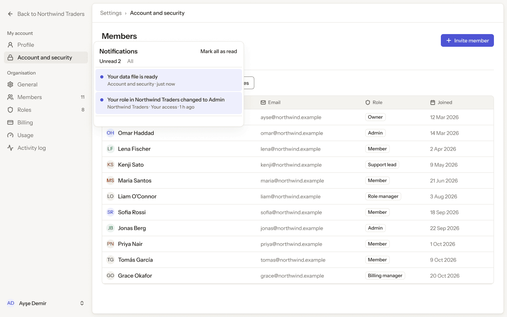

- **Who sees it:** The signed-in person, about themselves.
- **Device:** Desktop (1280 px and wider).
- **This state shows:** as the title says.
- **Values come from:** Sign-in methods, sessions and two-step verification: Clerk. Email change, data export and account deletion: our API.
- **Components:** Avatar ×11, Button ×2, Icon/calendar, Icon/mail, Icon/shield, Icon/user, Input, Label ×11, Notifications popover, Sidebar, Tab ×2, Top bar.
- **Actions:**
  - "Back to Northwind Traders": goes to [4.01 · Home · Owner](../04-home/README.md#401--home--owner).
  - "Profile": goes to [5.01 · Profile · ideal](../05-settings-profile/README.md#501--profile--ideal).
  - "Account and security": goes to [6.01 · Account and security · ideal](#601--account-and-security--ideal).
  - "General": goes to [7.01 · General · ideal](../07-settings-general/README.md#701--general--ideal).
  - "Members": goes to [8.01 · Members · ideal](../08-settings-members/README.md#801--members--ideal).
  - "Roles": goes to [9.01 · Roles · ideal](../09-settings-roles/README.md#901--roles--ideal).
  - "Billing": goes to [10.01 · Billing · Team, monthly](../10-settings-billing/README.md#1001--billing--team-monthly).
  - "Usage": goes to [11.01 · Usage · Team](../11-settings-usage/README.md#1101--usage--team).
  - "Activity log": goes to [12.01 · Activity log · ideal](../12-settings-activity-log/README.md#1201--activity-log--ideal).
- **Texts, word for word, top to bottom:**

  - Back to Northwind Traders
  - My account
  - Profile
  - Account and security
  - Organisation
  - General
  - Members
  - 11
  - Roles
  - 8
  - Billing
  - Usage
  - Activity log
  - AD
  - Ayşe Demir
  - Settings
  - ›
  - Account and security
  - Members
  - People in Northwind Traders and what they can do.
  - Invite member
  - Members
  - 11
  - Invitations
  - 2
  - Search by name or email
  - All roles
  - Name
  - Email
  - Role
  - Joined
  - AD
  - Ayşe Demir
  - (you)
  - ayse@northwind.example
  - Owner
  - 12 Mar 2026
  - OH
  - Omar Haddad
  - omar@northwind.example
  - Admin
  - 14 Mar 2026
  - LF
  - Lena Fischer
  - lena@northwind.example
  - Member
  - 2 Apr 2026
  - KS
  - Kenji Sato
  - kenji@northwind.example
  - Support lead
  - 9 May 2026
  - MS
  - Maria Santos
  - maria@northwind.example
  - Member
  - 21 Jun 2026
  - LO
  - Liam O’Connor
  - liam@northwind.example
  - Role manager
  - 3 Aug 2026
  - SR
  - Sofia Rossi
  - sofia@northwind.example
  - Member
  - 18 Sep 2026
  - JB
  - Jonas Berg
  - jonas@northwind.example
  - Admin
  - 22 Sep 2026
  - PN
  - Priya Nair
  - priya@northwind.example
  - Member
  - 1 Oct 2026
  - TG
  - Tomás García
  - tomas@northwind.example
  - Member
  - 9 Oct 2026
  - GO
  - Grace Okafor
  - grace@northwind.example
  - Billing manager
  - 20 Oct 2026
  - Notifications
  - Mark all as read
  - Unread 2
  - All
  - Your data file is ready
  - Account and security · just now
  - Your role in Northwind Traders changed to Admin
  - Northwind Traders · Your access · 1 h ago

Figma: [89:12773](https://www.figma.com/design/3Ev111okX8xCBwR9B3hyBM/?node-id=89-12773)

### 6.32 · Export · file deleted

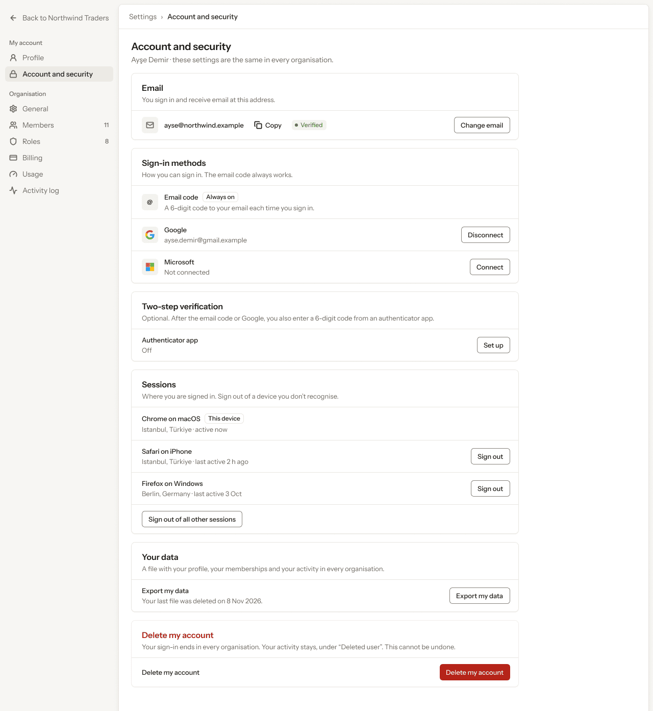

- **Who sees it:** The signed-in person, about themselves.
- **Device:** Desktop (1280 px and wider).
- **This state shows:** as the title says.
- **Values come from:** Sign-in methods, sessions and two-step verification: Clerk. Email change, data export and account deletion: our API.
- **Components:** Button ×10, Icon/mail, Label ×2, Logo/Google, Logo/Microsoft, Pill, Sidebar, Top bar.
- **Actions:**
  - "Back to Northwind Traders": goes to [4.01 · Home · Owner](../04-home/README.md#401--home--owner).
  - "Profile": goes to [5.01 · Profile · ideal](../05-settings-profile/README.md#501--profile--ideal).
  - "Account and security": goes to [6.01 · Account and security · ideal](#601--account-and-security--ideal).
  - "General": goes to [7.01 · General · ideal](../07-settings-general/README.md#701--general--ideal).
  - "Members": goes to [8.01 · Members · ideal](../08-settings-members/README.md#801--members--ideal).
  - "Roles": goes to [9.01 · Roles · ideal](../09-settings-roles/README.md#901--roles--ideal).
  - "Billing": goes to [10.01 · Billing · Team, monthly](../10-settings-billing/README.md#1001--billing--team-monthly).
  - "Usage": goes to [11.01 · Usage · Team](../11-settings-usage/README.md#1101--usage--team).
  - "Activity log": goes to [12.01 · Activity log · ideal](../12-settings-activity-log/README.md#1201--activity-log--ideal).
- **Texts, word for word, top to bottom:**

  - Back to Northwind Traders
  - My account
  - Profile
  - Account and security
  - Organisation
  - General
  - Members
  - 11
  - Roles
  - 8
  - Billing
  - Usage
  - Activity log
  - AD
  - Ayşe Demir
  - Settings
  - ›
  - Account and security
  - Account and security
  - Ayşe Demir · these settings are the same in every organisation.
  - Email
  - You sign in and receive email at this address.
  - ayse@northwind.example
  - Copy
  - Verified
  - Change email
  - Sign-in methods
  - How you can sign in. The email code always works.
  - @
  - Email code
  - Always on
  - A 6-digit code to your email each time you sign in.
  - Google
  - ayse.demir@gmail.example
  - Disconnect
  - Microsoft
  - Not connected
  - Connect
  - Two-step verification
  - Optional. After the email code or Google, you also enter a 6-digit code from an authenticator app.
  - Authenticator app
  - Off
  - Set up
  - Sessions
  - Where you are signed in. Sign out of a device you don’t recognise.
  - Chrome on macOS
  - This device
  - Istanbul, Türkiye · active now
  - Safari on iPhone
  - Istanbul, Türkiye · last active 2 h ago
  - Sign out
  - Firefox on Windows
  - Berlin, Germany · last active 3 Oct
  - Sign out
  - Sign out of all other sessions
  - Your data
  - A file with your profile, your memberships and your activity in every organisation.
  - Export my data
  - Your last file was deleted on 8 Nov 2026.
  - Export my data
  - Delete my account
  - Your sign-in ends in every organisation. Your activity stays, under “Deleted user”. This cannot be undone.
  - Delete my account
  - Delete my account

Figma: [89:13108](https://www.figma.com/design/3Ev111okX8xCBwR9B3hyBM/?node-id=89-13108)
