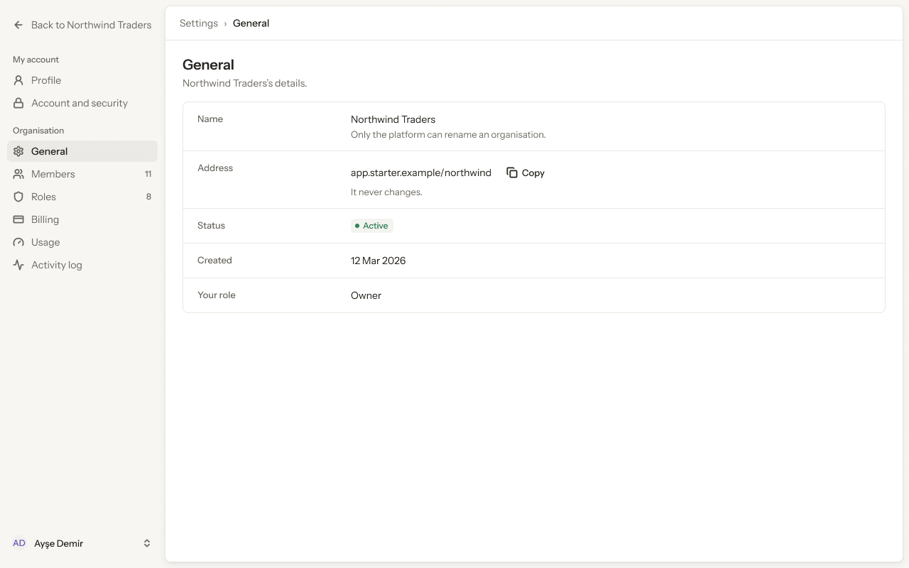
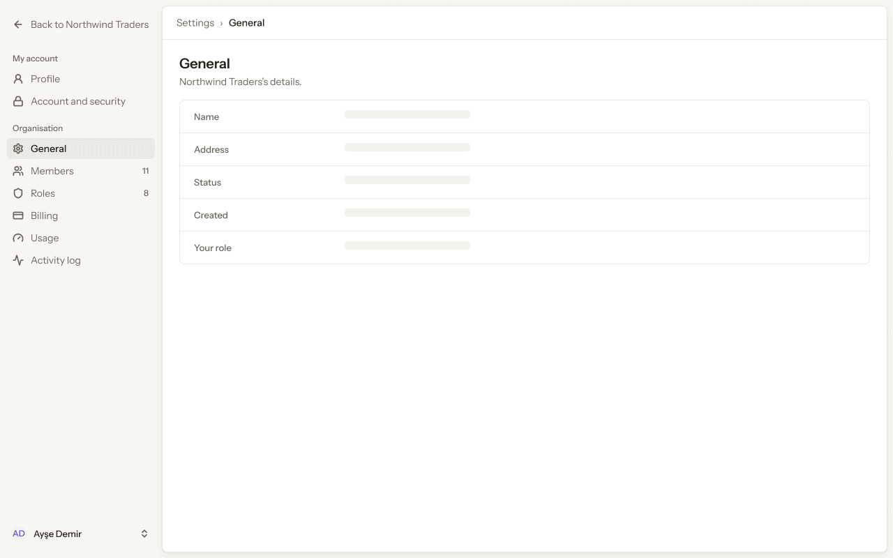
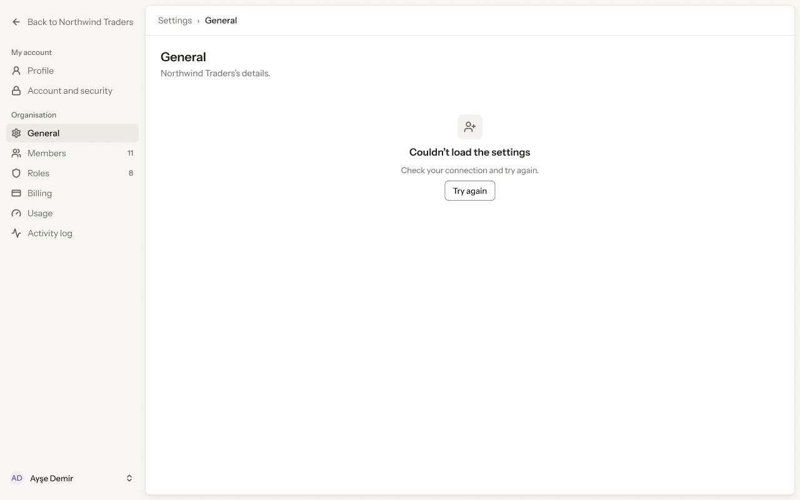
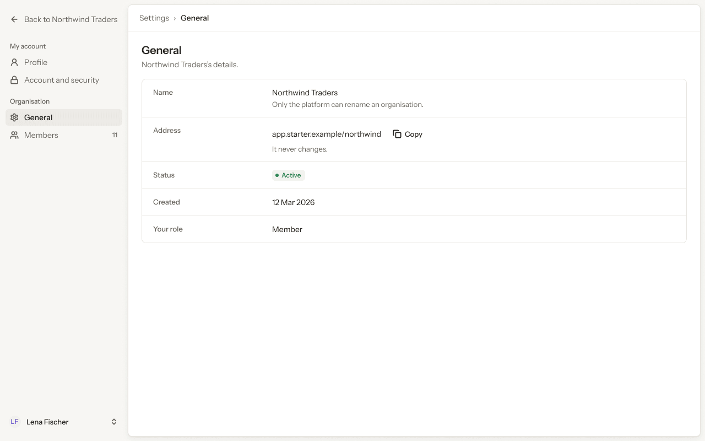
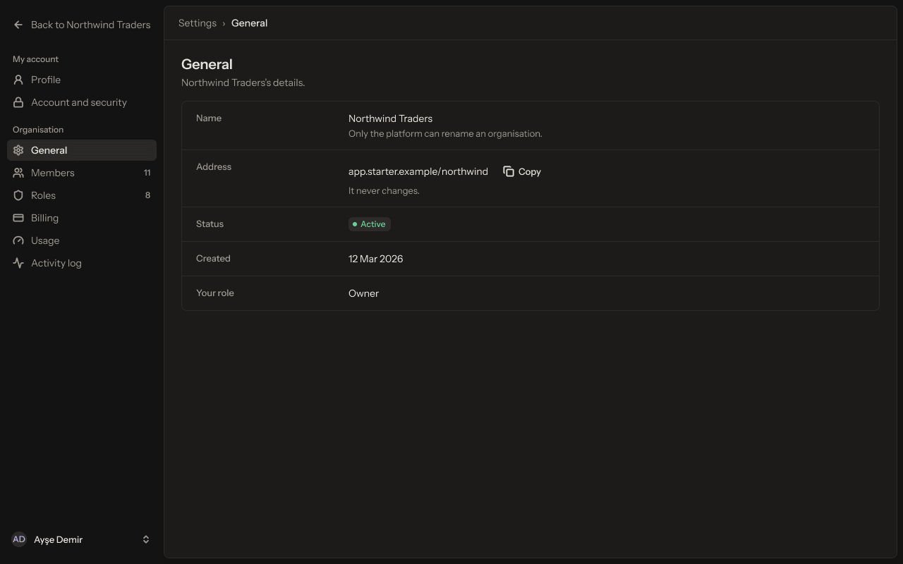

# Web app · 7 · Settings › General

Who sees this section: Every member can open it. People with tenant.profile.update edit; others read.

Where the values come from: Organisation name, address and language: our API (tenant.profile.read, tenant.profile.update).

5 screens. Each part below is one screen and state. The PNG beside this file is the screen at scale 1.

| Screen | Device |
|---|---|
| [7.01 · General · ideal](#701--general--ideal) | Desktop |
| [7.02 · General · loading](#702--general--loading) | Desktop |
| [7.03 · General · error](#703--general--error) | Desktop |
| [7.04 · General · as a Member](#704--general--as-a-member) | Desktop |
| [7.05 · General · dark](#705--general--dark) | Desktop |

### 7.01 · General · ideal

- **Who sees it:** Every member can open it. People with tenant.profile.update edit; others read.
- **Device:** Desktop (1280 px and wider).
- **This state shows:** when the data loads and every value is present.
- **Values come from:** Organisation name, address and language: our API (tenant.profile.read, tenant.profile.update).
- **Components:** Button, Pill, Sidebar, Top bar.
- **Actions:**
  - "Back to Northwind Traders": goes to [4.01 · Home · Owner](../04-home/README.md#401--home--owner).
  - "Profile": goes to [5.01 · Profile · ideal](../05-settings-profile/README.md#501--profile--ideal).
  - "Account and security": goes to [6.01 · Account and security · ideal](../06-settings-account-and-security/README.md#601--account-and-security--ideal).
  - "Members": goes to [8.01 · Members · ideal](../08-settings-members/README.md#801--members--ideal).
  - "Roles": goes to [9.01 · Roles · ideal](../09-settings-roles/README.md#901--roles--ideal).
  - "Billing": goes to [10.01 · Billing · Team, monthly](../10-settings-billing/README.md#1001--billing--team-monthly).
  - "Usage": goes to [11.01 · Usage · Team](../11-settings-usage/README.md#1101--usage--team).
  - "Activity log": goes to [12.01 · Activity log · ideal](../12-settings-activity-log/README.md#1201--activity-log--ideal).
- **Texts, word for word, top to bottom:**

  - Back to Northwind Traders
  - My account
  - Profile
  - Account and security
  - Organisation
  - General
  - Members
  - 11
  - Roles
  - 8
  - Billing
  - Usage
  - Activity log
  - AD
  - Ayşe Demir
  - Settings
  - ›
  - General
  - General
  - Northwind Traders’s details.
  - Name
  - Northwind Traders
  - Only the platform can rename an organisation.
  - Address
  - app.starter.example/northwind
  - Copy
  - It never changes.
  - Status
  - Active
  - Created
  - 12 Mar 2026
  - Your role
  - Owner

Figma: [125:14397](https://www.figma.com/design/3Ev111okX8xCBwR9B3hyBM/?node-id=125-14397)

### 7.02 · General · loading

- **Who sees it:** Every member can open it. People with tenant.profile.update edit; others read.
- **Device:** Desktop (1280 px and wider).
- **This state shows:** while the request runs.
- **Values come from:** Organisation name, address and language: our API (tenant.profile.read, tenant.profile.update).
- **Components:** Sidebar, Skeleton ×5, Top bar.
- **Actions:**
  - "Back to Northwind Traders": goes to [4.01 · Home · Owner](../04-home/README.md#401--home--owner).
  - "Profile": goes to [5.01 · Profile · ideal](../05-settings-profile/README.md#501--profile--ideal).
  - "Account and security": goes to [6.01 · Account and security · ideal](../06-settings-account-and-security/README.md#601--account-and-security--ideal).
  - "General": goes to [7.01 · General · ideal](#701--general--ideal).
  - "Members": goes to [8.01 · Members · ideal](../08-settings-members/README.md#801--members--ideal).
  - "Roles": goes to [9.01 · Roles · ideal](../09-settings-roles/README.md#901--roles--ideal).
  - "Billing": goes to [10.01 · Billing · Team, monthly](../10-settings-billing/README.md#1001--billing--team-monthly).
  - "Usage": goes to [11.01 · Usage · Team](../11-settings-usage/README.md#1101--usage--team).
  - "Activity log": goes to [12.01 · Activity log · ideal](../12-settings-activity-log/README.md#1201--activity-log--ideal).
- **Texts, word for word, top to bottom:**

  - Back to Northwind Traders
  - My account
  - Profile
  - Account and security
  - Organisation
  - General
  - Members
  - 11
  - Roles
  - 8
  - Billing
  - Usage
  - Activity log
  - AD
  - Ayşe Demir
  - Settings
  - ›
  - General
  - General
  - Northwind Traders’s details.
  - Name
  - Address
  - Status
  - Created
  - Your role

Figma: [125:14969](https://www.figma.com/design/3Ev111okX8xCBwR9B3hyBM/?node-id=125-14969)

### 7.03 · General · error

- **Who sees it:** Every member can open it. People with tenant.profile.update edit; others read.
- **Device:** Desktop (1280 px and wider).
- **This state shows:** when the request fails.
- **Values come from:** Organisation name, address and language: our API (tenant.profile.read, tenant.profile.update).
- **Components:** Empty state, Sidebar, Top bar.
- **Actions:**
  - "Back to Northwind Traders": goes to [4.01 · Home · Owner](../04-home/README.md#401--home--owner).
  - "Profile": goes to [5.01 · Profile · ideal](../05-settings-profile/README.md#501--profile--ideal).
  - "Account and security": goes to [6.01 · Account and security · ideal](../06-settings-account-and-security/README.md#601--account-and-security--ideal).
  - "General": goes to [7.01 · General · ideal](#701--general--ideal).
  - "Members": goes to [8.01 · Members · ideal](../08-settings-members/README.md#801--members--ideal).
  - "Roles": goes to [9.01 · Roles · ideal](../09-settings-roles/README.md#901--roles--ideal).
  - "Billing": goes to [10.01 · Billing · Team, monthly](../10-settings-billing/README.md#1001--billing--team-monthly).
  - "Usage": goes to [11.01 · Usage · Team](../11-settings-usage/README.md#1101--usage--team).
  - "Activity log": goes to [12.01 · Activity log · ideal](../12-settings-activity-log/README.md#1201--activity-log--ideal).
- **Texts, word for word, top to bottom:**

  - Back to Northwind Traders
  - My account
  - Profile
  - Account and security
  - Organisation
  - General
  - Members
  - 11
  - Roles
  - 8
  - Billing
  - Usage
  - Activity log
  - AD
  - Ayşe Demir
  - Settings
  - ›
  - General
  - General
  - Northwind Traders’s details.
  - Couldn’t load the settings
  - Check your connection and try again.
  - Try again

Figma: [125:15101](https://www.figma.com/design/3Ev111okX8xCBwR9B3hyBM/?node-id=125-15101)

### 7.04 · General · as a Member

- **Who sees it:** A person with the Member role. Every member can open it. People with tenant.profile.update edit; others read.
- **Device:** Desktop (1280 px and wider).
- **This state shows:** for a person with the Member role.
- **Values come from:** Organisation name, address and language: our API (tenant.profile.read, tenant.profile.update).
- **Components:** Button, Pill, Sidebar, Top bar.
- **Actions:**
  - "Back to Northwind Traders": goes to [4.01 · Home · Owner](../04-home/README.md#401--home--owner).
  - "Profile": goes to [5.01 · Profile · ideal](../05-settings-profile/README.md#501--profile--ideal).
  - "Account and security": goes to [6.01 · Account and security · ideal](../06-settings-account-and-security/README.md#601--account-and-security--ideal).
  - "General": goes to [7.01 · General · ideal](#701--general--ideal).
  - "Members": goes to [8.01 · Members · ideal](../08-settings-members/README.md#801--members--ideal).
- **Texts, word for word, top to bottom:**

  - Back to Northwind Traders
  - My account
  - Profile
  - Account and security
  - Organisation
  - General
  - Members
  - 11
  - LF
  - Lena Fischer
  - Settings
  - ›
  - General
  - General
  - Northwind Traders’s details.
  - Name
  - Northwind Traders
  - Only the platform can rename an organisation.
  - Address
  - app.starter.example/northwind
  - Copy
  - It never changes.
  - Status
  - Active
  - Created
  - 12 Mar 2026
  - Your role
  - Member

Figma: [125:15228](https://www.figma.com/design/3Ev111okX8xCBwR9B3hyBM/?node-id=125-15228)

### 7.05 · General · dark

- **Who sees it:** Every member can open it. People with tenant.profile.update edit; others read.
- **Device:** Desktop (1280 px and wider).
- **This state shows:** in the dark theme.
- **Values come from:** Organisation name, address and language: our API (tenant.profile.read, tenant.profile.update).
- **Components:** Button, Pill, Sidebar, Top bar.
- **Actions:**
  - "Back to Northwind Traders": goes to [4.01 · Home · Owner](../04-home/README.md#401--home--owner).
  - "Profile": goes to [5.01 · Profile · ideal](../05-settings-profile/README.md#501--profile--ideal).
  - "Account and security": goes to [6.01 · Account and security · ideal](../06-settings-account-and-security/README.md#601--account-and-security--ideal).
  - "General": goes to [7.01 · General · ideal](#701--general--ideal).
  - "Members": goes to [8.01 · Members · ideal](../08-settings-members/README.md#801--members--ideal).
  - "Roles": goes to [9.01 · Roles · ideal](../09-settings-roles/README.md#901--roles--ideal).
  - "Billing": goes to [10.01 · Billing · Team, monthly](../10-settings-billing/README.md#1001--billing--team-monthly).
  - "Usage": goes to [11.01 · Usage · Team](../11-settings-usage/README.md#1101--usage--team).
  - "Activity log": goes to [12.01 · Activity log · ideal](../12-settings-activity-log/README.md#1201--activity-log--ideal).
- **Texts, word for word, top to bottom:**

  - Back to Northwind Traders
  - My account
  - Profile
  - Account and security
  - Organisation
  - General
  - Members
  - 11
  - Roles
  - 8
  - Billing
  - Usage
  - Activity log
  - AD
  - Ayşe Demir
  - Settings
  - ›
  - General
  - General
  - Northwind Traders’s details.
  - Name
  - Northwind Traders
  - Only the platform can rename an organisation.
  - Address
  - app.starter.example/northwind
  - Copy
  - It never changes.
  - Status
  - Active
  - Created
  - 12 Mar 2026
  - Your role
  - Owner

Figma: [125:15364](https://www.figma.com/design/3Ev111okX8xCBwR9B3hyBM/?node-id=125-15364)
