# Web app · 8 · Settings › Members

Who sees this section: People with tenant.members.read. Invite needs tenant.invitations.create; change role and remove need tenant.members.update and tenant.members.delete; Owner changes need tenant.owners.manage.

Where the values come from: Members, invitations and roles: our API. Seats used and the seat limit: the plan's entitlements from our API. Prices in dialogs: the plan's prices from our API.

46 screens. Each part below is one screen and state. The PNG beside this file is the screen at scale 1.

| Screen | Device |
|---|---|
| [8.01 · Members · ideal](#801--members--ideal) | Desktop |
| [8.02 · Members · loading](#802--members--loading) | Desktop |
| [8.03 · Members · error](#803--members--error) | Desktop |
| [8.04 · Members · only you](#804--members--only-you) | Desktop |
| [8.05 · Members · 500, loading more](#805--members--500-loading-more) | Desktop |
| [8.06 · Members · no match](#806--members--no-match) | Desktop |
| [8.07 · Filter by role](#807--filter-by-role) | Desktop |
| [8.08 · Export members](#808--export-members) | Desktop |
| [8.09 · Members · over the limit](#809--members--over-the-limit) | Desktop |
| [8.10 · Export members · filtered](#810--export-members--filtered) | Desktop |
| [8.11 · Members · as a Member](#811--members--as-a-member) | Desktop |
| [8.12 · Export members · downloaded](#812--export-members--downloaded) | Desktop |
| [8.13 · Members · dark](#813--members--dark) | Desktop |
| [8.14 · Export members · nothing to export](#814--export-members--nothing-to-export) | Desktop |
| [8.15 · Members · focus and hover](#815--members--focus-and-hover) | Desktop |
| [8.16 · Export members · error](#816--export-members--error) | Desktop |
| [8.17 · Row actions](#817--row-actions) | Desktop |
| [8.18 · Own row actions](#818--own-row-actions) | Desktop |
| [8.19 · Change role](#819--change-role) | Desktop |
| [8.20 · Change role · last Owner](#820--change-role--last-owner) | Desktop |
| [8.21 · Remove member](#821--remove-member) | Desktop |
| [8.22 · Member removed](#822--member-removed) | Desktop |
| [8.23 · Leave organisation](#823--leave-organisation) | Desktop |
| [8.24 · Left · no access yet](#824--left--no-access-yet) | Desktop |
| [8.25 · Leave · last Owner](#825--leave--last-owner) | Desktop |
| [8.26 · Invite member](#826--invite-member) | Desktop |
| [8.27 · Invite · invalid email](#827--invite--invalid-email) | Desktop |
| [8.28 · Invite · already a member](#828--invite--already-a-member) | Desktop |
| [8.29 · Invitations](#829--invitations) | Desktop |
| [8.30 · Invitation sent](#830--invitation-sent) | Desktop |
| [8.31 · Invitations · empty](#831--invitations--empty) | Desktop |
| [8.32 · Revoke invitation](#832--revoke-invitation) | Desktop |
| [8.33 · Members · tablet 1024](#833--members--tablet-1024) | Tablet |
| [8.34 · Members · phone](#834--members--phone) | Phone |
| [8.35 · Invite member · phone](#835--invite-member--phone) | Phone |
| [8.36 · Members · Arabic](#836--members--arabic) | Desktop |
| [8.36 · Remove member · phone sheet](#836--remove-member--phone-sheet) | Phone |
| [8.37 · Invite member · Arabic](#837--invite-member--arabic) | Desktop |
| [8.38 · Change role · by an Admin](#838--change-role--by-an-admin) | Desktop |
| [8.39 · No free seat](#839--no-free-seat) | Desktop |
| [8.40 · No free seat · over the limit](#840--no-free-seat--over-the-limit) | Desktop |
| [8.41 · Members · more menu](#841--members--more-menu) | Desktop |
| [8.42 · No free seat · without billing](#842--no-free-seat--without-billing) | Desktop |
| [8.43 · No free seat · Contract](#843--no-free-seat--contract) | Desktop |
| [8.44 · No free seat · over the limit · without billing](#844--no-free-seat--over-the-limit--without-billing) | Desktop |
| [8.45 · No free seat · over the limit · Contract](#845--no-free-seat--over-the-limit--contract) | Desktop |

### 8.01 · Members · ideal

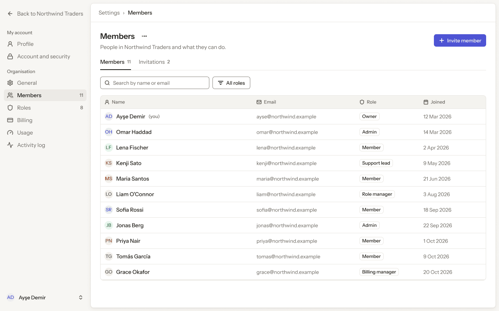

- **Who sees it:** People with tenant.members.read. Invite needs tenant.invitations.create; change role and remove need tenant.members.update and tenant.members.delete; Owner changes need tenant.owners.manage.
- **Device:** Desktop (1280 px and wider).
- **This state shows:** when the data loads and every value is present.
- **Values come from:** Members, invitations and roles: our API. Seats used and the seat limit: the plan's entitlements from our API. Prices in dialogs: the plan's prices from our API.
- **Components:** Avatar ×11, Button ×3, Icon/calendar, Icon/mail, Icon/shield, Icon/user, Input, Label ×11, Sidebar, Tab ×2, Top bar.
- **Actions:**
  - "Invite member": goes to [8.26 · Invite member](#826--invite-member).
  - "Invitations": goes to [8.29 · Invitations](#829--invitations).
  - "Search by name or email": goes to [8.06 · Members · no match](#806--members--no-match).
  - "All roles": goes to [8.07 · Filter by role](#807--filter-by-role).
  - "omar@northwind.example": goes to [8.17 · Row actions](#817--row-actions).
  - "ayse@northwind.example": goes to [8.18 · Own row actions](#818--own-row-actions).
  - "Back to Northwind Traders": goes to [4.01 · Home · Owner](../04-home/README.md#401--home--owner).
  - "Profile": goes to [5.01 · Profile · ideal](../05-settings-profile/README.md#501--profile--ideal).
  - "Account and security": goes to [6.01 · Account and security · ideal](../06-settings-account-and-security/README.md#601--account-and-security--ideal).
  - "General": goes to [7.01 · General · ideal](../07-settings-general/README.md#701--general--ideal).
  - "Roles": goes to [9.01 · Roles · ideal](../09-settings-roles/README.md#901--roles--ideal).
  - "Billing": goes to [10.01 · Billing · Team, monthly](../10-settings-billing/README.md#1001--billing--team-monthly).
  - "Usage": goes to [11.01 · Usage · Team](../11-settings-usage/README.md#1101--usage--team).
  - "Activity log": goes to [12.01 · Activity log · ideal](../12-settings-activity-log/README.md#1201--activity-log--ideal).
  - "grace@northwind.example": goes to [14.07 · Change role · from Billing manager](../14-settings-billing-manager/README.md#1407--change-role--from-billing-manager).
- **Texts, word for word, top to bottom:**

  - Back to Northwind Traders
  - My account
  - Profile
  - Account and security
  - Organisation
  - General
  - Members
  - 11
  - Roles
  - 8
  - Billing
  - Usage
  - Activity log
  - AD
  - Ayşe Demir
  - Settings
  - ›
  - Members
  - Members
  - People in Northwind Traders and what they can do.
  - Invite member
  - Members
  - 11
  - Invitations
  - 2
  - Search by name or email
  - All roles
  - Name
  - Email
  - Role
  - Joined
  - AD
  - Ayşe Demir
  - (you)
  - ayse@northwind.example
  - Owner
  - 12 Mar 2026
  - OH
  - Omar Haddad
  - omar@northwind.example
  - Admin
  - 14 Mar 2026
  - LF
  - Lena Fischer
  - lena@northwind.example
  - Member
  - 2 Apr 2026
  - KS
  - Kenji Sato
  - kenji@northwind.example
  - Support lead
  - 9 May 2026
  - MS
  - Maria Santos
  - maria@northwind.example
  - Member
  - 21 Jun 2026
  - LO
  - Liam O’Connor
  - liam@northwind.example
  - Role manager
  - 3 Aug 2026
  - SR
  - Sofia Rossi
  - sofia@northwind.example
  - Member
  - 18 Sep 2026
  - JB
  - Jonas Berg
  - jonas@northwind.example
  - Admin
  - 22 Sep 2026
  - PN
  - Priya Nair
  - priya@northwind.example
  - Member
  - 1 Oct 2026
  - TG
  - Tomás García
  - tomas@northwind.example
  - Member
  - 9 Oct 2026
  - GO
  - Grace Okafor
  - grace@northwind.example
  - Billing manager
  - 20 Oct 2026

Figma: [59:4300](https://www.figma.com/design/3Ev111okX8xCBwR9B3hyBM/?node-id=59-4300)

### 8.02 · Members · loading

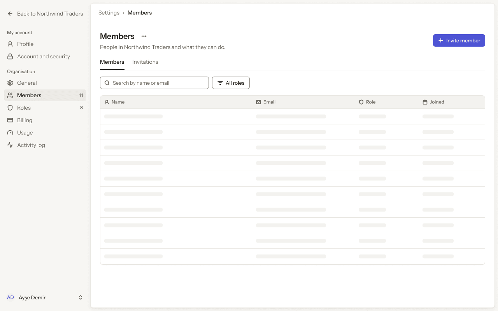

- **Who sees it:** People with tenant.members.read. Invite needs tenant.invitations.create; change role and remove need tenant.members.update and tenant.members.delete; Owner changes need tenant.owners.manage.
- **Device:** Desktop (1280 px and wider).
- **This state shows:** while the request runs.
- **Values come from:** Members, invitations and roles: our API. Seats used and the seat limit: the plan's entitlements from our API. Prices in dialogs: the plan's prices from our API.
- **Components:** Button ×3, Icon/calendar, Icon/mail, Icon/shield, Icon/user, Input, Sidebar, Skeleton ×40, Tab ×2, Top bar.
- **Actions:**
  - "Back to Northwind Traders": goes to [4.01 · Home · Owner](../04-home/README.md#401--home--owner).
  - "Profile": goes to [5.01 · Profile · ideal](../05-settings-profile/README.md#501--profile--ideal).
  - "Account and security": goes to [6.01 · Account and security · ideal](../06-settings-account-and-security/README.md#601--account-and-security--ideal).
  - "General": goes to [7.01 · General · ideal](../07-settings-general/README.md#701--general--ideal).
  - "Members": goes to [8.01 · Members · ideal](#801--members--ideal).
  - "Roles": goes to [9.01 · Roles · ideal](../09-settings-roles/README.md#901--roles--ideal).
  - "Billing": goes to [10.01 · Billing · Team, monthly](../10-settings-billing/README.md#1001--billing--team-monthly).
  - "Usage": goes to [11.01 · Usage · Team](../11-settings-usage/README.md#1101--usage--team).
  - "Activity log": goes to [12.01 · Activity log · ideal](../12-settings-activity-log/README.md#1201--activity-log--ideal).
- **Texts, word for word, top to bottom:**

  - Back to Northwind Traders
  - My account
  - Profile
  - Account and security
  - Organisation
  - General
  - Members
  - 11
  - Roles
  - 8
  - Billing
  - Usage
  - Activity log
  - AD
  - Ayşe Demir
  - Settings
  - ›
  - Members
  - Members
  - People in Northwind Traders and what they can do.
  - Invite member
  - Members
  - Invitations
  - Search by name or email
  - All roles
  - Name
  - Email
  - Role
  - Joined

Figma: [60:3012](https://www.figma.com/design/3Ev111okX8xCBwR9B3hyBM/?node-id=60-3012)

### 8.03 · Members · error

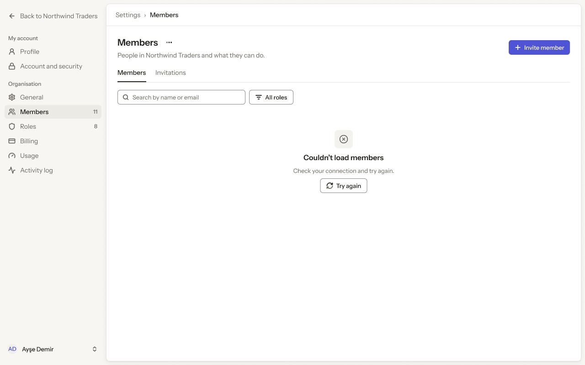

- **Who sees it:** People with tenant.members.read. Invite needs tenant.invitations.create; change role and remove need tenant.members.update and tenant.members.delete; Owner changes need tenant.owners.manage.
- **Device:** Desktop (1280 px and wider).
- **This state shows:** when the request fails.
- **Values come from:** Members, invitations and roles: our API. Seats used and the seat limit: the plan's entitlements from our API. Prices in dialogs: the plan's prices from our API.
- **Components:** Button ×3, Empty state, Input, Sidebar, Tab ×2, Top bar.
- **Actions:**
  - "Back to Northwind Traders": goes to [4.01 · Home · Owner](../04-home/README.md#401--home--owner).
  - "Profile": goes to [5.01 · Profile · ideal](../05-settings-profile/README.md#501--profile--ideal).
  - "Account and security": goes to [6.01 · Account and security · ideal](../06-settings-account-and-security/README.md#601--account-and-security--ideal).
  - "General": goes to [7.01 · General · ideal](../07-settings-general/README.md#701--general--ideal).
  - "Members": goes to [8.01 · Members · ideal](#801--members--ideal).
  - "Roles": goes to [9.01 · Roles · ideal](../09-settings-roles/README.md#901--roles--ideal).
  - "Billing": goes to [10.01 · Billing · Team, monthly](../10-settings-billing/README.md#1001--billing--team-monthly).
  - "Usage": goes to [11.01 · Usage · Team](../11-settings-usage/README.md#1101--usage--team).
  - "Activity log": goes to [12.01 · Activity log · ideal](../12-settings-activity-log/README.md#1201--activity-log--ideal).
- **Texts, word for word, top to bottom:**

  - Back to Northwind Traders
  - My account
  - Profile
  - Account and security
  - Organisation
  - General
  - Members
  - 11
  - Roles
  - 8
  - Billing
  - Usage
  - Activity log
  - AD
  - Ayşe Demir
  - Settings
  - ›
  - Members
  - Members
  - People in Northwind Traders and what they can do.
  - Invite member
  - Members
  - Invitations
  - Search by name or email
  - All roles
  - Couldn’t load members
  - Check your connection and try again.
  - Try again

Figma: [60:3364](https://www.figma.com/design/3Ev111okX8xCBwR9B3hyBM/?node-id=60-3364)

### 8.04 · Members · only you

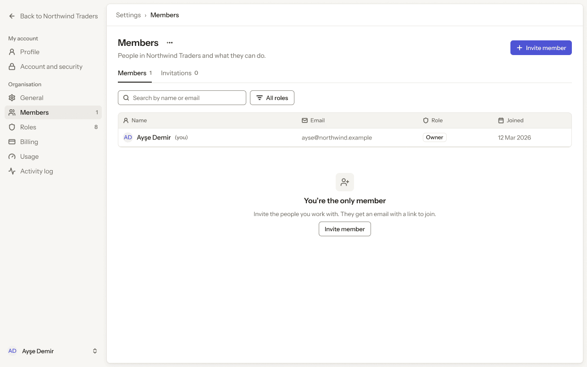

- **Who sees it:** People with tenant.members.read. Invite needs tenant.invitations.create; change role and remove need tenant.members.update and tenant.members.delete; Owner changes need tenant.owners.manage.
- **Device:** Desktop (1280 px and wider).
- **This state shows:** as the title says.
- **Values come from:** Members, invitations and roles: our API. Seats used and the seat limit: the plan's entitlements from our API. Prices in dialogs: the plan's prices from our API.
- **Components:** Avatar, Button ×3, Empty state, Icon/calendar, Icon/mail, Icon/shield, Icon/user, Input, Label, Sidebar, Tab ×2, Top bar.
- **Actions:**
  - "Back to Northwind Traders": goes to [4.01 · Home · Owner](../04-home/README.md#401--home--owner).
  - "Profile": goes to [5.01 · Profile · ideal](../05-settings-profile/README.md#501--profile--ideal).
  - "Account and security": goes to [6.01 · Account and security · ideal](../06-settings-account-and-security/README.md#601--account-and-security--ideal).
  - "General": goes to [7.01 · General · ideal](../07-settings-general/README.md#701--general--ideal).
  - "Members": goes to [8.01 · Members · ideal](#801--members--ideal).
  - "Roles": goes to [9.01 · Roles · ideal](../09-settings-roles/README.md#901--roles--ideal).
  - "Billing": goes to [10.01 · Billing · Team, monthly](../10-settings-billing/README.md#1001--billing--team-monthly).
  - "Usage": goes to [11.01 · Usage · Team](../11-settings-usage/README.md#1101--usage--team).
  - "Activity log": goes to [12.01 · Activity log · ideal](../12-settings-activity-log/README.md#1201--activity-log--ideal).
- **Texts, word for word, top to bottom:**

  - Back to Northwind Traders
  - My account
  - Profile
  - Account and security
  - Organisation
  - General
  - Members
  - 1
  - Roles
  - 8
  - Billing
  - Usage
  - Activity log
  - AD
  - Ayşe Demir
  - Settings
  - ›
  - Members
  - Members
  - People in Northwind Traders and what they can do.
  - Invite member
  - Members
  - 1
  - Invitations
  - 0
  - Search by name or email
  - All roles
  - Name
  - Email
  - Role
  - Joined
  - AD
  - Ayşe Demir
  - (you)
  - ayse@northwind.example
  - Owner
  - 12 Mar 2026
  - You’re the only member
  - Invite the people you work with. They get an email with a link to join.
  - Invite member

Figma: [60:3667](https://www.figma.com/design/3Ev111okX8xCBwR9B3hyBM/?node-id=60-3667)

### 8.05 · Members · 500, loading more

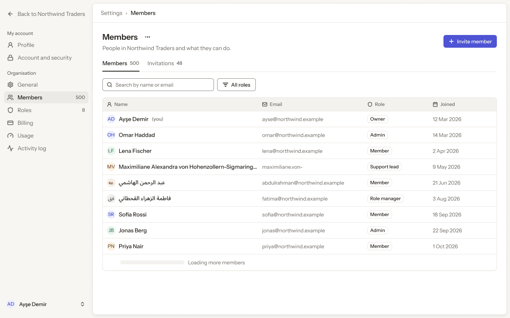

- **Who sees it:** People with tenant.members.read. Invite needs tenant.invitations.create; change role and remove need tenant.members.update and tenant.members.delete; Owner changes need tenant.owners.manage.
- **Device:** Desktop (1280 px and wider).
- **This state shows:** while the next page of rows loads; while the request runs.
- **Values come from:** Members, invitations and roles: our API. Seats used and the seat limit: the plan's entitlements from our API. Prices in dialogs: the plan's prices from our API.
- **Components:** Avatar ×9, Button ×3, Icon/calendar, Icon/mail, Icon/shield, Icon/user, Input, Label ×9, Sidebar, Skeleton, Tab ×2, Top bar.
- **Actions:**
  - "Back to Northwind Traders": goes to [4.01 · Home · Owner](../04-home/README.md#401--home--owner).
  - "Profile": goes to [5.01 · Profile · ideal](../05-settings-profile/README.md#501--profile--ideal).
  - "Account and security": goes to [6.01 · Account and security · ideal](../06-settings-account-and-security/README.md#601--account-and-security--ideal).
  - "General": goes to [7.01 · General · ideal](../07-settings-general/README.md#701--general--ideal).
  - "Members": goes to [8.01 · Members · ideal](#801--members--ideal).
  - "Roles": goes to [9.01 · Roles · ideal](../09-settings-roles/README.md#901--roles--ideal).
  - "Billing": goes to [10.01 · Billing · Team, monthly](../10-settings-billing/README.md#1001--billing--team-monthly).
  - "Usage": goes to [11.01 · Usage · Team](../11-settings-usage/README.md#1101--usage--team).
  - "Activity log": goes to [12.01 · Activity log · ideal](../12-settings-activity-log/README.md#1201--activity-log--ideal).
- **Texts, word for word, top to bottom:**

  - Back to Northwind Traders
  - My account
  - Profile
  - Account and security
  - Organisation
  - General
  - Members
  - 500
  - Roles
  - 8
  - Billing
  - Usage
  - Activity log
  - AD
  - Ayşe Demir
  - Settings
  - ›
  - Members
  - Members
  - People in Northwind Traders and what they can do.
  - Invite member
  - Members
  - 500
  - Invitations
  - 48
  - Search by name or email
  - All roles
  - Name
  - Email
  - Role
  - Joined
  - AD
  - Ayşe Demir
  - (you)
  - ayse@northwind.example
  - Owner
  - 12 Mar 2026
  - OH
  - Omar Haddad
  - omar@northwind.example
  - Admin
  - 14 Mar 2026
  - LF
  - Lena Fischer
  - lena@northwind.example
  - Member
  - 2 Apr 2026
  - MV
  - Maximiliane Alexandra von Hohenzollern-Sigmaringen
  - maximiliane.von-hohenzollern@internationale-handelsgesellschaft.example
  - Support lead
  - 9 May 2026
  - عه
  - عبد الرحمن الهاشمي
  - abdulrahman@northwind.example
  - Member
  - 21 Jun 2026
  - فق
  - فاطمة الزهراء القحطاني
  - fatima@northwind.example
  - Role manager
  - 3 Aug 2026
  - SR
  - Sofia Rossi
  - sofia@northwind.example
  - Member
  - 18 Sep 2026
  - JB
  - Jonas Berg
  - jonas@northwind.example
  - Admin
  - 22 Sep 2026
  - PN
  - Priya Nair
  - priya@northwind.example
  - Member
  - 1 Oct 2026
  - Loading more members

Figma: [60:3965](https://www.figma.com/design/3Ev111okX8xCBwR9B3hyBM/?node-id=60-3965)

### 8.06 · Members · no match

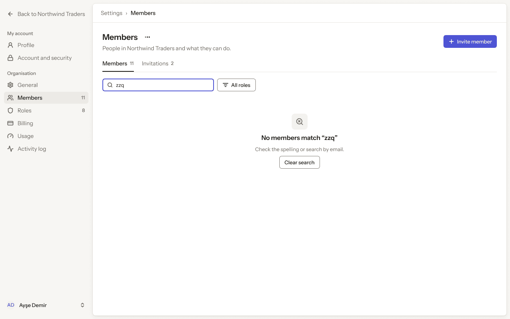

- **Who sees it:** People with tenant.members.read. Invite needs tenant.invitations.create; change role and remove need tenant.members.update and tenant.members.delete; Owner changes need tenant.owners.manage.
- **Device:** Desktop (1280 px and wider).
- **This state shows:** when a search matches nothing.
- **Values come from:** Members, invitations and roles: our API. Seats used and the seat limit: the plan's entitlements from our API. Prices in dialogs: the plan's prices from our API.
- **Components:** Button ×3, Empty state, Input, Sidebar, Tab ×2, Top bar.
- **Actions:**
  - "Clear search": goes to [8.01 · Members · ideal](#801--members--ideal).
  - "Back to Northwind Traders": goes to [4.01 · Home · Owner](../04-home/README.md#401--home--owner).
  - "Profile": goes to [5.01 · Profile · ideal](../05-settings-profile/README.md#501--profile--ideal).
  - "Account and security": goes to [6.01 · Account and security · ideal](../06-settings-account-and-security/README.md#601--account-and-security--ideal).
  - "General": goes to [7.01 · General · ideal](../07-settings-general/README.md#701--general--ideal).
  - "Members": goes to [8.01 · Members · ideal](#801--members--ideal).
  - "Roles": goes to [9.01 · Roles · ideal](../09-settings-roles/README.md#901--roles--ideal).
  - "Billing": goes to [10.01 · Billing · Team, monthly](../10-settings-billing/README.md#1001--billing--team-monthly).
  - "Usage": goes to [11.01 · Usage · Team](../11-settings-usage/README.md#1101--usage--team).
  - "Activity log": goes to [12.01 · Activity log · ideal](../12-settings-activity-log/README.md#1201--activity-log--ideal).
- **Texts, word for word, top to bottom:**

  - Back to Northwind Traders
  - My account
  - Profile
  - Account and security
  - Organisation
  - General
  - Members
  - 11
  - Roles
  - 8
  - Billing
  - Usage
  - Activity log
  - AD
  - Ayşe Demir
  - Settings
  - ›
  - Members
  - Members
  - People in Northwind Traders and what they can do.
  - Invite member
  - Members
  - 11
  - Invitations
  - 2
  - zzq
  - All roles
  - No members match “zzq”
  - Check the spelling or search by email.
  - Clear search

Figma: [60:4256](https://www.figma.com/design/3Ev111okX8xCBwR9B3hyBM/?node-id=60-4256)

### 8.07 · Filter by role

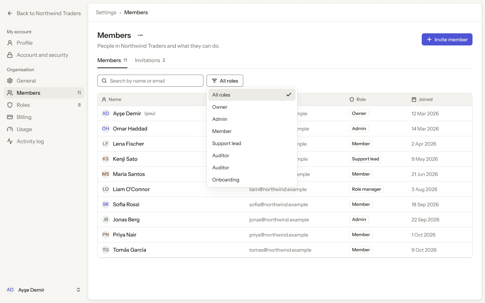

- **Who sees it:** People with tenant.members.read. Invite needs tenant.invitations.create; change role and remove need tenant.members.update and tenant.members.delete; Owner changes need tenant.owners.manage.
- **Device:** Desktop (1280 px and wider).
- **This state shows:** as the title says.
- **Values come from:** Members, invitations and roles: our API. Seats used and the seat limit: the plan's entitlements from our API. Prices in dialogs: the plan's prices from our API.
- **Components:** Avatar ×10, Button ×3, Icon/calendar, Icon/check, Icon/mail, Icon/shield, Icon/user, Input, Label ×10, Sidebar, Tab ×2, Top bar.
- **Actions:**
  - "All roles": goes to [8.01 · Members · ideal](#801--members--ideal).
  - "Back to Northwind Traders": goes to [4.01 · Home · Owner](../04-home/README.md#401--home--owner).
  - "Profile": goes to [5.01 · Profile · ideal](../05-settings-profile/README.md#501--profile--ideal).
  - "Account and security": goes to [6.01 · Account and security · ideal](../06-settings-account-and-security/README.md#601--account-and-security--ideal).
  - "General": goes to [7.01 · General · ideal](../07-settings-general/README.md#701--general--ideal).
  - "Members": goes to [8.01 · Members · ideal](#801--members--ideal).
  - "Roles": goes to [9.01 · Roles · ideal](../09-settings-roles/README.md#901--roles--ideal).
  - "Billing": goes to [10.01 · Billing · Team, monthly](../10-settings-billing/README.md#1001--billing--team-monthly).
  - "Usage": goes to [11.01 · Usage · Team](../11-settings-usage/README.md#1101--usage--team).
  - "Activity log": goes to [12.01 · Activity log · ideal](../12-settings-activity-log/README.md#1201--activity-log--ideal).
- **Texts, word for word, top to bottom:**

  - Back to Northwind Traders
  - My account
  - Profile
  - Account and security
  - Organisation
  - General
  - Members
  - 11
  - Roles
  - 8
  - Billing
  - Usage
  - Activity log
  - AD
  - Ayşe Demir
  - Settings
  - ›
  - Members
  - Members
  - People in Northwind Traders and what they can do.
  - Invite member
  - Members
  - 11
  - Invitations
  - 2
  - Search by name or email
  - All roles
  - Name
  - Email
  - Role
  - Joined
  - AD
  - Ayşe Demir
  - (you)
  - ayse@northwind.example
  - Owner
  - 12 Mar 2026
  - OH
  - Omar Haddad
  - omar@northwind.example
  - Admin
  - 14 Mar 2026
  - LF
  - Lena Fischer
  - lena@northwind.example
  - Member
  - 2 Apr 2026
  - KS
  - Kenji Sato
  - kenji@northwind.example
  - Support lead
  - 9 May 2026
  - MS
  - Maria Santos
  - maria@northwind.example
  - Member
  - 21 Jun 2026
  - LO
  - Liam O’Connor
  - liam@northwind.example
  - Role manager
  - 3 Aug 2026
  - SR
  - Sofia Rossi
  - sofia@northwind.example
  - Member
  - 18 Sep 2026
  - JB
  - Jonas Berg
  - jonas@northwind.example
  - Admin
  - 22 Sep 2026
  - PN
  - Priya Nair
  - priya@northwind.example
  - Member
  - 1 Oct 2026
  - TG
  - Tomás García
  - tomas@northwind.example
  - Member
  - 9 Oct 2026
  - All roles
  - Owner
  - Admin
  - Member
  - Support lead
  - Auditor
  - Auditor
  - Onboarding

Figma: [60:4559](https://www.figma.com/design/3Ev111okX8xCBwR9B3hyBM/?node-id=60-4559)

### 8.08 · Export members

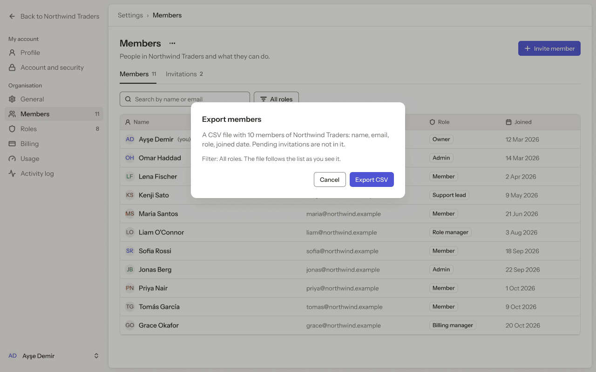

- **Who sees it:** People with tenant.members.read. Invite needs tenant.invitations.create; change role and remove need tenant.members.update and tenant.members.delete; Owner changes need tenant.owners.manage.
- **Device:** Desktop (1280 px and wider).
- **This state shows:** as the title says.
- **Values come from:** Members, invitations and roles: our API. Seats used and the seat limit: the plan's entitlements from our API. Prices in dialogs: the plan's prices from our API.
- **Components:** Avatar ×11, Button ×5, Icon/calendar, Icon/mail, Icon/shield, Icon/user, Input, Label ×11, Sidebar, Tab ×2, Top bar.
- **Actions:**
  - "lena@northwind.example": goes to [8.01 · Members · ideal](#801--members--ideal).
  - "Export CSV": goes to [8.12 · Export members · downloaded](#812--export-members--downloaded).
  - "Back to Northwind Traders": goes to [4.01 · Home · Owner](../04-home/README.md#401--home--owner).
  - "Profile": goes to [5.01 · Profile · ideal](../05-settings-profile/README.md#501--profile--ideal).
  - "Account and security": goes to [6.01 · Account and security · ideal](../06-settings-account-and-security/README.md#601--account-and-security--ideal).
  - "General": goes to [7.01 · General · ideal](../07-settings-general/README.md#701--general--ideal).
  - "Members": goes to [8.01 · Members · ideal](#801--members--ideal).
  - "Roles": goes to [9.01 · Roles · ideal](../09-settings-roles/README.md#901--roles--ideal).
  - "Billing": goes to [10.01 · Billing · Team, monthly](../10-settings-billing/README.md#1001--billing--team-monthly).
  - "Usage": goes to [11.01 · Usage · Team](../11-settings-usage/README.md#1101--usage--team).
  - "Activity log": goes to [12.01 · Activity log · ideal](../12-settings-activity-log/README.md#1201--activity-log--ideal).
- **Texts, word for word, top to bottom:**

  - Back to Northwind Traders
  - My account
  - Profile
  - Account and security
  - Organisation
  - General
  - Members
  - 11
  - Roles
  - 8
  - Billing
  - Usage
  - Activity log
  - AD
  - Ayşe Demir
  - Settings
  - ›
  - Members
  - Members
  - People in Northwind Traders and what they can do.
  - Invite member
  - Members
  - 11
  - Invitations
  - 2
  - Search by name or email
  - All roles
  - Name
  - Email
  - Role
  - Joined
  - AD
  - Ayşe Demir
  - (you)
  - ayse@northwind.example
  - Owner
  - 12 Mar 2026
  - OH
  - Omar Haddad
  - omar@northwind.example
  - Admin
  - 14 Mar 2026
  - LF
  - Lena Fischer
  - lena@northwind.example
  - Member
  - 2 Apr 2026
  - KS
  - Kenji Sato
  - kenji@northwind.example
  - Support lead
  - 9 May 2026
  - MS
  - Maria Santos
  - maria@northwind.example
  - Member
  - 21 Jun 2026
  - LO
  - Liam O’Connor
  - liam@northwind.example
  - Role manager
  - 3 Aug 2026
  - SR
  - Sofia Rossi
  - sofia@northwind.example
  - Member
  - 18 Sep 2026
  - JB
  - Jonas Berg
  - jonas@northwind.example
  - Admin
  - 22 Sep 2026
  - PN
  - Priya Nair
  - priya@northwind.example
  - Member
  - 1 Oct 2026
  - TG
  - Tomás García
  - tomas@northwind.example
  - Member
  - 9 Oct 2026
  - GO
  - Grace Okafor
  - grace@northwind.example
  - Billing manager
  - 20 Oct 2026
  - Export members
  - A CSV file with 10 members of Northwind Traders: name, email, role, joined date. Pending invitations are not in it.
  - Filter: All roles. The file follows the list as you see it.
  - Cancel
  - Export CSV

Figma: [154:15212](https://www.figma.com/design/3Ev111okX8xCBwR9B3hyBM/?node-id=154-15212)

### 8.09 · Members · over the limit

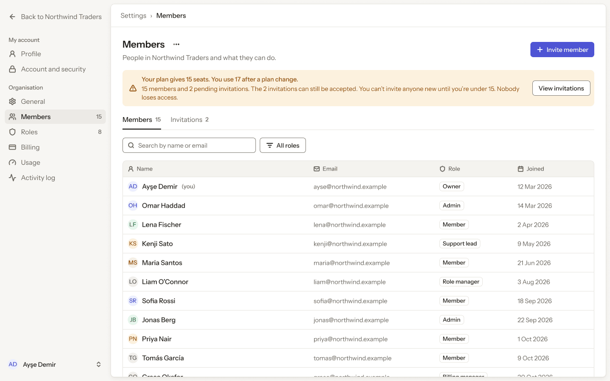

- **Who sees it:** People with tenant.members.read. Invite needs tenant.invitations.create; change role and remove need tenant.members.update and tenant.members.delete; Owner changes need tenant.owners.manage.
- **Device:** Desktop (1280 px and wider).
- **This state shows:** as the title says.
- **Values come from:** Members, invitations and roles: our API. Seats used and the seat limit: the plan's entitlements from our API. Prices in dialogs: the plan's prices from our API.
- **Components:** Avatar ×13, Banner, Button ×3, Icon/calendar, Icon/mail, Icon/shield, Icon/user, Input, Label ×13, Sidebar, Tab ×2, Top bar.
- **Actions:**
  - "Invite member": goes to [8.40 · No free seat · over the limit](#840--no-free-seat--over-the-limit).
  - "Area": goes to [8.29 · Invitations](#829--invitations).
  - "Back to Northwind Traders": goes to [4.01 · Home · Owner](../04-home/README.md#401--home--owner).
  - "Profile": goes to [5.01 · Profile · ideal](../05-settings-profile/README.md#501--profile--ideal).
  - "Account and security": goes to [6.01 · Account and security · ideal](../06-settings-account-and-security/README.md#601--account-and-security--ideal).
  - "General": goes to [7.01 · General · ideal](../07-settings-general/README.md#701--general--ideal).
  - "Members": goes to [8.01 · Members · ideal](#801--members--ideal).
  - "Roles": goes to [9.01 · Roles · ideal](../09-settings-roles/README.md#901--roles--ideal).
  - "Billing": goes to [10.01 · Billing · Team, monthly](../10-settings-billing/README.md#1001--billing--team-monthly).
  - "Usage": goes to [11.01 · Usage · Team](../11-settings-usage/README.md#1101--usage--team).
  - "Activity log": goes to [12.01 · Activity log · ideal](../12-settings-activity-log/README.md#1201--activity-log--ideal).
- **Texts, word for word, top to bottom:**

  - Back to Northwind Traders
  - My account
  - Profile
  - Account and security
  - Organisation
  - General
  - Members
  - 15
  - Roles
  - 8
  - Billing
  - Usage
  - Activity log
  - AD
  - Ayşe Demir
  - Settings
  - ›
  - Members
  - Members
  - People in Northwind Traders and what they can do.
  - Invite member
  - Your plan gives 15 seats. You use 17 after a plan change.
  - 15 members and 2 pending invitations. The 2 invitations can still be accepted. You can’t invite anyone new until you’re under 15. Nobody loses access.
  - View invitations
  - Members
  - 15
  - Invitations
  - 2
  - Search by name or email
  - All roles
  - Name
  - Email
  - Role
  - Joined
  - AD
  - Ayşe Demir
  - (you)
  - ayse@northwind.example
  - Owner
  - 12 Mar 2026
  - OH
  - Omar Haddad
  - omar@northwind.example
  - Admin
  - 14 Mar 2026
  - LF
  - Lena Fischer
  - lena@northwind.example
  - Member
  - 2 Apr 2026
  - KS
  - Kenji Sato
  - kenji@northwind.example
  - Support lead
  - 9 May 2026
  - MS
  - Maria Santos
  - maria@northwind.example
  - Member
  - 21 Jun 2026
  - LO
  - Liam O’Connor
  - liam@northwind.example
  - Role manager
  - 3 Aug 2026
  - SR
  - Sofia Rossi
  - sofia@northwind.example
  - Member
  - 18 Sep 2026
  - JB
  - Jonas Berg
  - jonas@northwind.example
  - Admin
  - 22 Sep 2026
  - PN
  - Priya Nair
  - priya@northwind.example
  - Member
  - 1 Oct 2026
  - TG
  - Tomás García
  - tomas@northwind.example
  - Member
  - 9 Oct 2026
  - GO
  - Grace Okafor
  - grace@northwind.example
  - Billing manager
  - 20 Oct 2026
  - HK
  - Hana Kobayashi
  - hana@northwind.example
  - Member
  - 2 Apr 2026
  - NW
  - Noah Williams
  - noah@northwind.example
  - Member
  - 2 Apr 2026

Figma: [60:5206](https://www.figma.com/design/3Ev111okX8xCBwR9B3hyBM/?node-id=60-5206)

### 8.10 · Export members · filtered

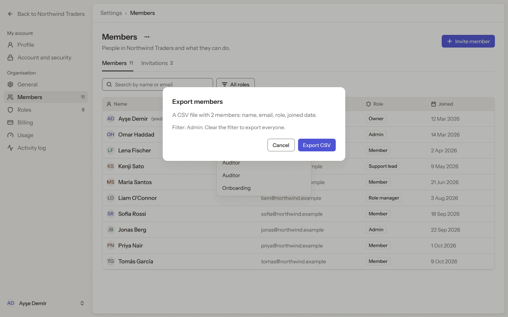

- **Who sees it:** People with tenant.members.read. Invite needs tenant.invitations.create; change role and remove need tenant.members.update and tenant.members.delete; Owner changes need tenant.owners.manage.
- **Device:** Desktop (1280 px and wider).
- **This state shows:** as the title says.
- **Values come from:** Members, invitations and roles: our API. Seats used and the seat limit: the plan's entitlements from our API. Prices in dialogs: the plan's prices from our API.
- **Components:** Avatar ×10, Button ×5, Icon/calendar, Icon/check, Icon/mail, Icon/shield, Icon/user, Input, Label ×10, Sidebar, Tab ×2, Top bar.
- **Actions:**
  - "Back to Northwind Traders": goes to [4.01 · Home · Owner](../04-home/README.md#401--home--owner).
  - "Profile": goes to [5.01 · Profile · ideal](../05-settings-profile/README.md#501--profile--ideal).
  - "Account and security": goes to [6.01 · Account and security · ideal](../06-settings-account-and-security/README.md#601--account-and-security--ideal).
  - "General": goes to [7.01 · General · ideal](../07-settings-general/README.md#701--general--ideal).
  - "Members": goes to [8.01 · Members · ideal](#801--members--ideal).
  - "Roles": goes to [9.01 · Roles · ideal](../09-settings-roles/README.md#901--roles--ideal).
  - "Billing": goes to [10.01 · Billing · Team, monthly](../10-settings-billing/README.md#1001--billing--team-monthly).
  - "Usage": goes to [11.01 · Usage · Team](../11-settings-usage/README.md#1101--usage--team).
  - "Activity log": goes to [12.01 · Activity log · ideal](../12-settings-activity-log/README.md#1201--activity-log--ideal).
- **Texts, word for word, top to bottom:**

  - Back to Northwind Traders
  - My account
  - Profile
  - Account and security
  - Organisation
  - General
  - Members
  - 11
  - Roles
  - 8
  - Billing
  - Usage
  - Activity log
  - AD
  - Ayşe Demir
  - Settings
  - ›
  - Members
  - Members
  - People in Northwind Traders and what they can do.
  - Invite member
  - Members
  - 11
  - Invitations
  - 2
  - Search by name or email
  - All roles
  - Name
  - Email
  - Role
  - Joined
  - AD
  - Ayşe Demir
  - (you)
  - ayse@northwind.example
  - Owner
  - 12 Mar 2026
  - OH
  - Omar Haddad
  - omar@northwind.example
  - Admin
  - 14 Mar 2026
  - LF
  - Lena Fischer
  - lena@northwind.example
  - Member
  - 2 Apr 2026
  - KS
  - Kenji Sato
  - kenji@northwind.example
  - Support lead
  - 9 May 2026
  - MS
  - Maria Santos
  - maria@northwind.example
  - Member
  - 21 Jun 2026
  - LO
  - Liam O’Connor
  - liam@northwind.example
  - Role manager
  - 3 Aug 2026
  - SR
  - Sofia Rossi
  - sofia@northwind.example
  - Member
  - 18 Sep 2026
  - JB
  - Jonas Berg
  - jonas@northwind.example
  - Admin
  - 22 Sep 2026
  - PN
  - Priya Nair
  - priya@northwind.example
  - Member
  - 1 Oct 2026
  - TG
  - Tomás García
  - tomas@northwind.example
  - Member
  - 9 Oct 2026
  - All roles
  - Owner
  - Admin
  - Member
  - Support lead
  - Auditor
  - Auditor
  - Onboarding
  - Export members
  - A CSV file with 2 members: name, email, role, joined date.
  - Filter: Admin. Clear the filter to export everyone.
  - Cancel
  - Export CSV

Figma: [154:15545](https://www.figma.com/design/3Ev111okX8xCBwR9B3hyBM/?node-id=154-15545)

### 8.11 · Members · as a Member

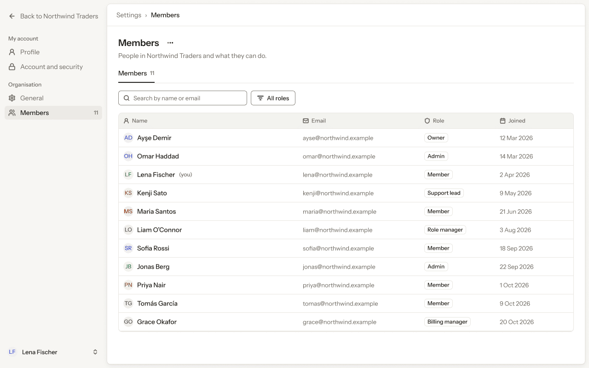

- **Who sees it:** A person with the Member role. People with tenant.members.read. Invite needs tenant.invitations.create; change role and remove need tenant.members.update and tenant.members.delete; Owner changes need tenant.owners.manage.
- **Device:** Desktop (1280 px and wider).
- **This state shows:** for a person with the Member role.
- **Values come from:** Members, invitations and roles: our API. Seats used and the seat limit: the plan's entitlements from our API. Prices in dialogs: the plan's prices from our API.
- **Components:** Avatar ×11, Button ×2, Icon/calendar, Icon/mail, Icon/shield, Icon/user, Input, Label ×11, Sidebar, Tab, Top bar.
- **Actions:**
  - "lena@northwind.example": goes to [8.23 · Leave organisation](#823--leave-organisation).
  - "Back to Northwind Traders": goes to [4.01 · Home · Owner](../04-home/README.md#401--home--owner).
  - "Profile": goes to [5.01 · Profile · ideal](../05-settings-profile/README.md#501--profile--ideal).
  - "Account and security": goes to [6.01 · Account and security · ideal](../06-settings-account-and-security/README.md#601--account-and-security--ideal).
  - "General": goes to [7.01 · General · ideal](../07-settings-general/README.md#701--general--ideal).
  - "Members": goes to [8.01 · Members · ideal](#801--members--ideal).
- **Texts, word for word, top to bottom:**

  - Back to Northwind Traders
  - My account
  - Profile
  - Account and security
  - Organisation
  - General
  - Members
  - 11
  - LF
  - Lena Fischer
  - Settings
  - ›
  - Members
  - Members
  - People in Northwind Traders and what they can do.
  - Members
  - 11
  - Search by name or email
  - All roles
  - Name
  - Email
  - Role
  - Joined
  - AD
  - Ayşe Demir
  - ayse@northwind.example
  - Owner
  - 12 Mar 2026
  - OH
  - Omar Haddad
  - omar@northwind.example
  - Admin
  - 14 Mar 2026
  - LF
  - Lena Fischer
  - (you)
  - lena@northwind.example
  - Member
  - 2 Apr 2026
  - KS
  - Kenji Sato
  - kenji@northwind.example
  - Support lead
  - 9 May 2026
  - MS
  - Maria Santos
  - maria@northwind.example
  - Member
  - 21 Jun 2026
  - LO
  - Liam O’Connor
  - liam@northwind.example
  - Role manager
  - 3 Aug 2026
  - SR
  - Sofia Rossi
  - sofia@northwind.example
  - Member
  - 18 Sep 2026
  - JB
  - Jonas Berg
  - jonas@northwind.example
  - Admin
  - 22 Sep 2026
  - PN
  - Priya Nair
  - priya@northwind.example
  - Member
  - 1 Oct 2026
  - TG
  - Tomás García
  - tomas@northwind.example
  - Member
  - 9 Oct 2026
  - GO
  - Grace Okafor
  - grace@northwind.example
  - Billing manager
  - 20 Oct 2026

Figma: [60:5537](https://www.figma.com/design/3Ev111okX8xCBwR9B3hyBM/?node-id=60-5537)

### 8.12 · Export members · downloaded

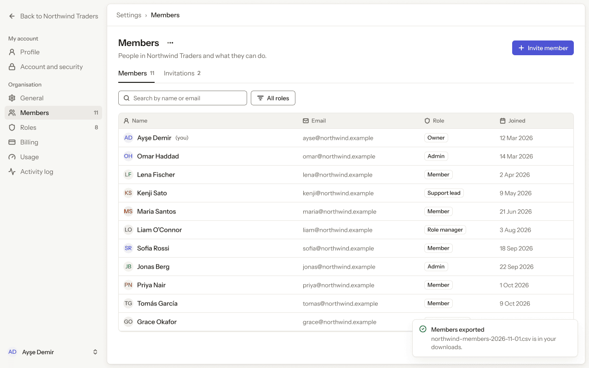

- **Who sees it:** People with tenant.members.read. Invite needs tenant.invitations.create; change role and remove need tenant.members.update and tenant.members.delete; Owner changes need tenant.owners.manage.
- **Device:** Desktop (1280 px and wider).
- **This state shows:** as the title says.
- **Values come from:** Members, invitations and roles: our API. Seats used and the seat limit: the plan's entitlements from our API. Prices in dialogs: the plan's prices from our API.
- **Components:** Avatar ×11, Button ×3, Icon/calendar, Icon/mail, Icon/shield, Icon/user, Input, Label ×11, Sidebar, Tab ×2, Toast, Top bar.
- **Actions:**
  - "Back to Northwind Traders": goes to [4.01 · Home · Owner](../04-home/README.md#401--home--owner).
  - "Profile": goes to [5.01 · Profile · ideal](../05-settings-profile/README.md#501--profile--ideal).
  - "Account and security": goes to [6.01 · Account and security · ideal](../06-settings-account-and-security/README.md#601--account-and-security--ideal).
  - "General": goes to [7.01 · General · ideal](../07-settings-general/README.md#701--general--ideal).
  - "Members": goes to [8.01 · Members · ideal](#801--members--ideal).
  - "Roles": goes to [9.01 · Roles · ideal](../09-settings-roles/README.md#901--roles--ideal).
  - "Billing": goes to [10.01 · Billing · Team, monthly](../10-settings-billing/README.md#1001--billing--team-monthly).
  - "Usage": goes to [11.01 · Usage · Team](../11-settings-usage/README.md#1101--usage--team).
  - "Activity log": goes to [12.01 · Activity log · ideal](../12-settings-activity-log/README.md#1201--activity-log--ideal).
- **Texts, word for word, top to bottom:**

  - Back to Northwind Traders
  - My account
  - Profile
  - Account and security
  - Organisation
  - General
  - Members
  - 11
  - Roles
  - 8
  - Billing
  - Usage
  - Activity log
  - AD
  - Ayşe Demir
  - Settings
  - ›
  - Members
  - Members
  - People in Northwind Traders and what they can do.
  - Invite member
  - Members
  - 11
  - Invitations
  - 2
  - Search by name or email
  - All roles
  - Name
  - Email
  - Role
  - Joined
  - AD
  - Ayşe Demir
  - (you)
  - ayse@northwind.example
  - Owner
  - 12 Mar 2026
  - OH
  - Omar Haddad
  - omar@northwind.example
  - Admin
  - 14 Mar 2026
  - LF
  - Lena Fischer
  - lena@northwind.example
  - Member
  - 2 Apr 2026
  - KS
  - Kenji Sato
  - kenji@northwind.example
  - Support lead
  - 9 May 2026
  - MS
  - Maria Santos
  - maria@northwind.example
  - Member
  - 21 Jun 2026
  - LO
  - Liam O’Connor
  - liam@northwind.example
  - Role manager
  - 3 Aug 2026
  - SR
  - Sofia Rossi
  - sofia@northwind.example
  - Member
  - 18 Sep 2026
  - JB
  - Jonas Berg
  - jonas@northwind.example
  - Admin
  - 22 Sep 2026
  - PN
  - Priya Nair
  - priya@northwind.example
  - Member
  - 1 Oct 2026
  - TG
  - Tomás García
  - tomas@northwind.example
  - Member
  - 9 Oct 2026
  - GO
  - Grace Okafor
  - grace@northwind.example
  - Billing manager
  - 20 Oct 2026
  - Members exported
  - northwind-members-2026-11-01.csv is in your downloads.

Figma: [154:15894](https://www.figma.com/design/3Ev111okX8xCBwR9B3hyBM/?node-id=154-15894)

### 8.13 · Members · dark

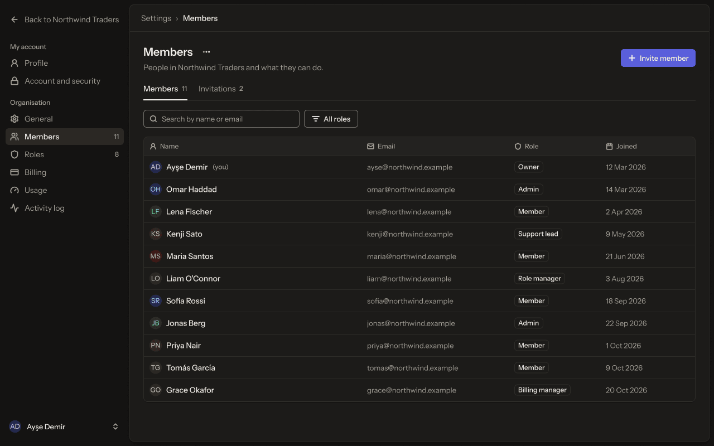

- **Who sees it:** People with tenant.members.read. Invite needs tenant.invitations.create; change role and remove need tenant.members.update and tenant.members.delete; Owner changes need tenant.owners.manage.
- **Device:** Desktop (1280 px and wider).
- **This state shows:** in the dark theme.
- **Values come from:** Members, invitations and roles: our API. Seats used and the seat limit: the plan's entitlements from our API. Prices in dialogs: the plan's prices from our API.
- **Components:** Avatar ×11, Button ×3, Icon/calendar, Icon/mail, Icon/shield, Icon/user, Input, Label ×11, Sidebar, Tab ×2, Top bar.
- **Actions:**
  - "Back to Northwind Traders": goes to [4.01 · Home · Owner](../04-home/README.md#401--home--owner).
  - "Profile": goes to [5.01 · Profile · ideal](../05-settings-profile/README.md#501--profile--ideal).
  - "Account and security": goes to [6.01 · Account and security · ideal](../06-settings-account-and-security/README.md#601--account-and-security--ideal).
  - "General": goes to [7.01 · General · ideal](../07-settings-general/README.md#701--general--ideal).
  - "Members": goes to [8.01 · Members · ideal](#801--members--ideal).
  - "Roles": goes to [9.01 · Roles · ideal](../09-settings-roles/README.md#901--roles--ideal).
  - "Billing": goes to [10.01 · Billing · Team, monthly](../10-settings-billing/README.md#1001--billing--team-monthly).
  - "Usage": goes to [11.01 · Usage · Team](../11-settings-usage/README.md#1101--usage--team).
  - "Activity log": goes to [12.01 · Activity log · ideal](../12-settings-activity-log/README.md#1201--activity-log--ideal).
- **Texts, word for word, top to bottom:**

  - Back to Northwind Traders
  - My account
  - Profile
  - Account and security
  - Organisation
  - General
  - Members
  - 11
  - Roles
  - 8
  - Billing
  - Usage
  - Activity log
  - AD
  - Ayşe Demir
  - Settings
  - ›
  - Members
  - Members
  - People in Northwind Traders and what they can do.
  - Invite member
  - Members
  - 11
  - Invitations
  - 2
  - Search by name or email
  - All roles
  - Name
  - Email
  - Role
  - Joined
  - AD
  - Ayşe Demir
  - (you)
  - ayse@northwind.example
  - Owner
  - 12 Mar 2026
  - OH
  - Omar Haddad
  - omar@northwind.example
  - Admin
  - 14 Mar 2026
  - LF
  - Lena Fischer
  - lena@northwind.example
  - Member
  - 2 Apr 2026
  - KS
  - Kenji Sato
  - kenji@northwind.example
  - Support lead
  - 9 May 2026
  - MS
  - Maria Santos
  - maria@northwind.example
  - Member
  - 21 Jun 2026
  - LO
  - Liam O’Connor
  - liam@northwind.example
  - Role manager
  - 3 Aug 2026
  - SR
  - Sofia Rossi
  - sofia@northwind.example
  - Member
  - 18 Sep 2026
  - JB
  - Jonas Berg
  - jonas@northwind.example
  - Admin
  - 22 Sep 2026
  - PN
  - Priya Nair
  - priya@northwind.example
  - Member
  - 1 Oct 2026
  - TG
  - Tomás García
  - tomas@northwind.example
  - Member
  - 9 Oct 2026
  - GO
  - Grace Okafor
  - grace@northwind.example
  - Billing manager
  - 20 Oct 2026

Figma: [60:5821](https://www.figma.com/design/3Ev111okX8xCBwR9B3hyBM/?node-id=60-5821)

### 8.14 · Export members · nothing to export

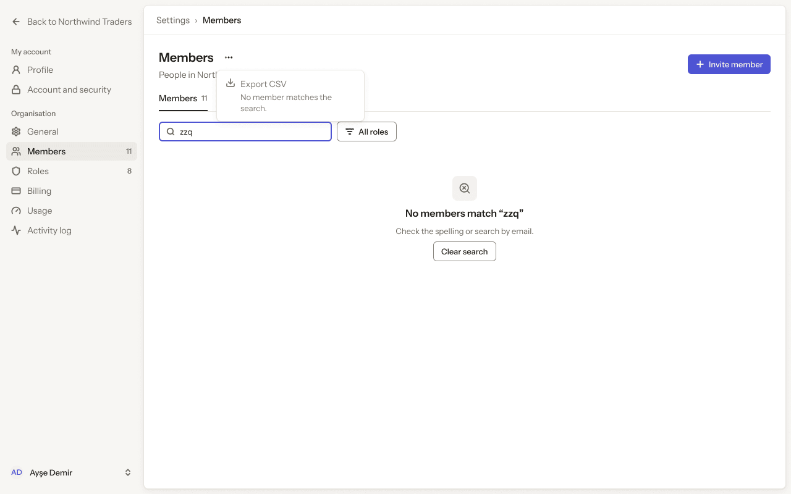

- **Who sees it:** People with tenant.members.read. Invite needs tenant.invitations.create; change role and remove need tenant.members.update and tenant.members.delete; Owner changes need tenant.owners.manage.
- **Device:** Desktop (1280 px and wider).
- **This state shows:** as the title says.
- **Values come from:** Members, invitations and roles: our API. Seats used and the seat limit: the plan's entitlements from our API. Prices in dialogs: the plan's prices from our API.
- **Components:** Button ×3, Empty state, Icon/download, Input, Sidebar, Tab ×2, Top bar.
- **Actions:**
  - "Back to Northwind Traders": goes to [4.01 · Home · Owner](../04-home/README.md#401--home--owner).
  - "Profile": goes to [5.01 · Profile · ideal](../05-settings-profile/README.md#501--profile--ideal).
  - "Account and security": goes to [6.01 · Account and security · ideal](../06-settings-account-and-security/README.md#601--account-and-security--ideal).
  - "General": goes to [7.01 · General · ideal](../07-settings-general/README.md#701--general--ideal).
  - "Members": goes to [8.01 · Members · ideal](#801--members--ideal).
  - "Roles": goes to [9.01 · Roles · ideal](../09-settings-roles/README.md#901--roles--ideal).
  - "Billing": goes to [10.01 · Billing · Team, monthly](../10-settings-billing/README.md#1001--billing--team-monthly).
  - "Usage": goes to [11.01 · Usage · Team](../11-settings-usage/README.md#1101--usage--team).
  - "Activity log": goes to [12.01 · Activity log · ideal](../12-settings-activity-log/README.md#1201--activity-log--ideal).
- **Texts, word for word, top to bottom:**

  - Back to Northwind Traders
  - My account
  - Profile
  - Account and security
  - Organisation
  - General
  - Members
  - 11
  - Roles
  - 8
  - Billing
  - Usage
  - Activity log
  - AD
  - Ayşe Demir
  - Settings
  - ›
  - Members
  - Members
  - People in Northwind Traders and what they can do.
  - Invite member
  - Members
  - 11
  - Invitations
  - 2
  - zzq
  - All roles
  - No members match “zzq”
  - Check the spelling or search by email.
  - Clear search
  - Export CSV
  - No member matches the search.

Figma: [154:16217](https://www.figma.com/design/3Ev111okX8xCBwR9B3hyBM/?node-id=154-16217)

### 8.15 · Members · focus and hover

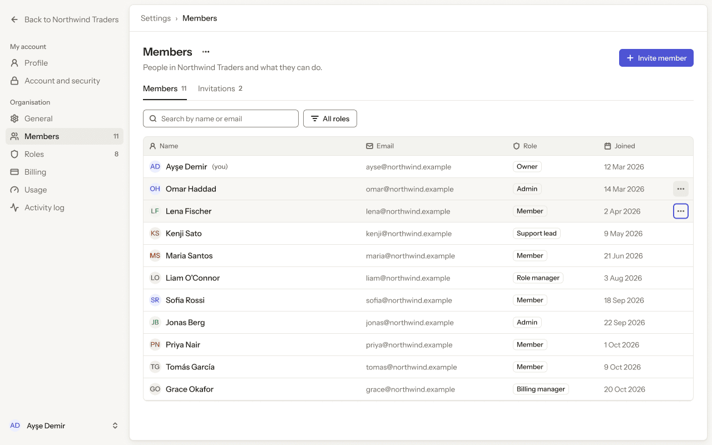

- **Who sees it:** People with tenant.members.read. Invite needs tenant.invitations.create; change role and remove need tenant.members.update and tenant.members.delete; Owner changes need tenant.owners.manage.
- **Device:** Desktop (1280 px and wider).
- **This state shows:** as the title says.
- **Values come from:** Members, invitations and roles: our API. Seats used and the seat limit: the plan's entitlements from our API. Prices in dialogs: the plan's prices from our API.
- **Components:** Avatar ×11, Button ×3, Icon/calendar, Icon/ellipsis ×2, Icon/mail, Icon/shield, Icon/user, Input, Label ×11, Sidebar, Tab ×2, Top bar.
- **Actions:**
  - "Back to Northwind Traders": goes to [4.01 · Home · Owner](../04-home/README.md#401--home--owner).
  - "Profile": goes to [5.01 · Profile · ideal](../05-settings-profile/README.md#501--profile--ideal).
  - "Account and security": goes to [6.01 · Account and security · ideal](../06-settings-account-and-security/README.md#601--account-and-security--ideal).
  - "General": goes to [7.01 · General · ideal](../07-settings-general/README.md#701--general--ideal).
  - "Members": goes to [8.01 · Members · ideal](#801--members--ideal).
  - "Roles": goes to [9.01 · Roles · ideal](../09-settings-roles/README.md#901--roles--ideal).
  - "Billing": goes to [10.01 · Billing · Team, monthly](../10-settings-billing/README.md#1001--billing--team-monthly).
  - "Usage": goes to [11.01 · Usage · Team](../11-settings-usage/README.md#1101--usage--team).
  - "Activity log": goes to [12.01 · Activity log · ideal](../12-settings-activity-log/README.md#1201--activity-log--ideal).
- **Texts, word for word, top to bottom:**

  - Back to Northwind Traders
  - My account
  - Profile
  - Account and security
  - Organisation
  - General
  - Members
  - 11
  - Roles
  - 8
  - Billing
  - Usage
  - Activity log
  - AD
  - Ayşe Demir
  - Settings
  - ›
  - Members
  - Members
  - People in Northwind Traders and what they can do.
  - Invite member
  - Members
  - 11
  - Invitations
  - 2
  - Search by name or email
  - All roles
  - Name
  - Email
  - Role
  - Joined
  - AD
  - Ayşe Demir
  - (you)
  - ayse@northwind.example
  - Owner
  - 12 Mar 2026
  - OH
  - Omar Haddad
  - omar@northwind.example
  - Admin
  - 14 Mar 2026
  - LF
  - Lena Fischer
  - lena@northwind.example
  - Member
  - 2 Apr 2026
  - KS
  - Kenji Sato
  - kenji@northwind.example
  - Support lead
  - 9 May 2026
  - MS
  - Maria Santos
  - maria@northwind.example
  - Member
  - 21 Jun 2026
  - LO
  - Liam O’Connor
  - liam@northwind.example
  - Role manager
  - 3 Aug 2026
  - SR
  - Sofia Rossi
  - sofia@northwind.example
  - Member
  - 18 Sep 2026
  - JB
  - Jonas Berg
  - jonas@northwind.example
  - Admin
  - 22 Sep 2026
  - PN
  - Priya Nair
  - priya@northwind.example
  - Member
  - 1 Oct 2026
  - TG
  - Tomás García
  - tomas@northwind.example
  - Member
  - 9 Oct 2026
  - GO
  - Grace Okafor
  - grace@northwind.example
  - Billing manager
  - 20 Oct 2026

Figma: [60:6010](https://www.figma.com/design/3Ev111okX8xCBwR9B3hyBM/?node-id=60-6010)

### 8.16 · Export members · error

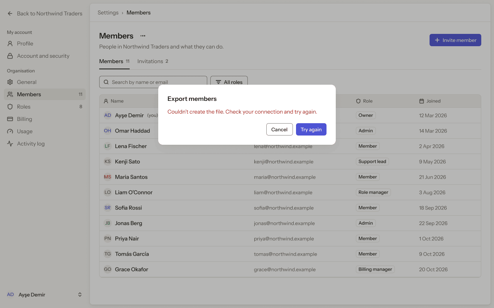

- **Who sees it:** People with tenant.members.read. Invite needs tenant.invitations.create; change role and remove need tenant.members.update and tenant.members.delete; Owner changes need tenant.owners.manage.
- **Device:** Desktop (1280 px and wider).
- **This state shows:** when the request fails.
- **Values come from:** Members, invitations and roles: our API. Seats used and the seat limit: the plan's entitlements from our API. Prices in dialogs: the plan's prices from our API.
- **Components:** Avatar ×11, Button ×5, Icon/calendar, Icon/mail, Icon/shield, Icon/user, Input, Label ×11, Sidebar, Tab ×2, Top bar.
- **Actions:**
  - "Back to Northwind Traders": goes to [4.01 · Home · Owner](../04-home/README.md#401--home--owner).
  - "Profile": goes to [5.01 · Profile · ideal](../05-settings-profile/README.md#501--profile--ideal).
  - "Account and security": goes to [6.01 · Account and security · ideal](../06-settings-account-and-security/README.md#601--account-and-security--ideal).
  - "General": goes to [7.01 · General · ideal](../07-settings-general/README.md#701--general--ideal).
  - "Members": goes to [8.01 · Members · ideal](#801--members--ideal).
  - "Roles": goes to [9.01 · Roles · ideal](../09-settings-roles/README.md#901--roles--ideal).
  - "Billing": goes to [10.01 · Billing · Team, monthly](../10-settings-billing/README.md#1001--billing--team-monthly).
  - "Usage": goes to [11.01 · Usage · Team](../11-settings-usage/README.md#1101--usage--team).
  - "Activity log": goes to [12.01 · Activity log · ideal](../12-settings-activity-log/README.md#1201--activity-log--ideal).
- **Texts, word for word, top to bottom:**

  - Back to Northwind Traders
  - My account
  - Profile
  - Account and security
  - Organisation
  - General
  - Members
  - 11
  - Roles
  - 8
  - Billing
  - Usage
  - Activity log
  - AD
  - Ayşe Demir
  - Settings
  - ›
  - Members
  - Members
  - People in Northwind Traders and what they can do.
  - Invite member
  - Members
  - 11
  - Invitations
  - 2
  - Search by name or email
  - All roles
  - Name
  - Email
  - Role
  - Joined
  - AD
  - Ayşe Demir
  - (you)
  - ayse@northwind.example
  - Owner
  - 12 Mar 2026
  - OH
  - Omar Haddad
  - omar@northwind.example
  - Admin
  - 14 Mar 2026
  - LF
  - Lena Fischer
  - lena@northwind.example
  - Member
  - 2 Apr 2026
  - KS
  - Kenji Sato
  - kenji@northwind.example
  - Support lead
  - 9 May 2026
  - MS
  - Maria Santos
  - maria@northwind.example
  - Member
  - 21 Jun 2026
  - LO
  - Liam O’Connor
  - liam@northwind.example
  - Role manager
  - 3 Aug 2026
  - SR
  - Sofia Rossi
  - sofia@northwind.example
  - Member
  - 18 Sep 2026
  - JB
  - Jonas Berg
  - jonas@northwind.example
  - Admin
  - 22 Sep 2026
  - PN
  - Priya Nair
  - priya@northwind.example
  - Member
  - 1 Oct 2026
  - TG
  - Tomás García
  - tomas@northwind.example
  - Member
  - 9 Oct 2026
  - GO
  - Grace Okafor
  - grace@northwind.example
  - Billing manager
  - 20 Oct 2026
  - Export members
  - Couldn’t create the file. Check your connection and try again.
  - Cancel
  - Try again

Figma: [154:16353](https://www.figma.com/design/3Ev111okX8xCBwR9B3hyBM/?node-id=154-16353)

### 8.17 · Row actions

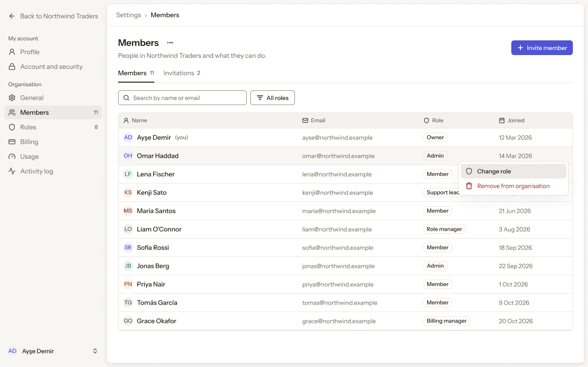

- **Who sees it:** People with tenant.members.read. Invite needs tenant.invitations.create; change role and remove need tenant.members.update and tenant.members.delete; Owner changes need tenant.owners.manage.
- **Device:** Desktop (1280 px and wider).
- **This state shows:** as the title says.
- **Values come from:** Members, invitations and roles: our API. Seats used and the seat limit: the plan's entitlements from our API. Prices in dialogs: the plan's prices from our API.
- **Components:** Avatar ×11, Button ×3, Icon/calendar, Icon/mail, Icon/shield, Icon/user, Input, Label ×11, Menu item ×2, Sidebar, Tab ×2, Top bar.
- **Actions:**
  - "Change role": goes to [8.19 · Change role](#819--change-role).
  - "Remove from organisation": goes to [8.21 · Remove member](#821--remove-member).
  - "Back to Northwind Traders": goes to [4.01 · Home · Owner](../04-home/README.md#401--home--owner).
  - "Profile": goes to [5.01 · Profile · ideal](../05-settings-profile/README.md#501--profile--ideal).
  - "Account and security": goes to [6.01 · Account and security · ideal](../06-settings-account-and-security/README.md#601--account-and-security--ideal).
  - "General": goes to [7.01 · General · ideal](../07-settings-general/README.md#701--general--ideal).
  - "Members": goes to [8.01 · Members · ideal](#801--members--ideal).
  - "Roles": goes to [9.01 · Roles · ideal](../09-settings-roles/README.md#901--roles--ideal).
  - "Billing": goes to [10.01 · Billing · Team, monthly](../10-settings-billing/README.md#1001--billing--team-monthly).
  - "Usage": goes to [11.01 · Usage · Team](../11-settings-usage/README.md#1101--usage--team).
  - "Activity log": goes to [12.01 · Activity log · ideal](../12-settings-activity-log/README.md#1201--activity-log--ideal).
- **Texts, word for word, top to bottom:**

  - Back to Northwind Traders
  - My account
  - Profile
  - Account and security
  - Organisation
  - General
  - Members
  - 11
  - Roles
  - 8
  - Billing
  - Usage
  - Activity log
  - AD
  - Ayşe Demir
  - Settings
  - ›
  - Members
  - Members
  - People in Northwind Traders and what they can do.
  - Invite member
  - Members
  - 11
  - Invitations
  - 2
  - Search by name or email
  - All roles
  - Name
  - Email
  - Role
  - Joined
  - AD
  - Ayşe Demir
  - (you)
  - ayse@northwind.example
  - Owner
  - 12 Mar 2026
  - OH
  - Omar Haddad
  - omar@northwind.example
  - Admin
  - 14 Mar 2026
  - LF
  - Lena Fischer
  - lena@northwind.example
  - Member
  - 2 Apr 2026
  - KS
  - Kenji Sato
  - kenji@northwind.example
  - Support lead
  - 9 May 2026
  - MS
  - Maria Santos
  - maria@northwind.example
  - Member
  - 21 Jun 2026
  - LO
  - Liam O’Connor
  - liam@northwind.example
  - Role manager
  - 3 Aug 2026
  - SR
  - Sofia Rossi
  - sofia@northwind.example
  - Member
  - 18 Sep 2026
  - JB
  - Jonas Berg
  - jonas@northwind.example
  - Admin
  - 22 Sep 2026
  - PN
  - Priya Nair
  - priya@northwind.example
  - Member
  - 1 Oct 2026
  - TG
  - Tomás García
  - tomas@northwind.example
  - Member
  - 9 Oct 2026
  - GO
  - Grace Okafor
  - grace@northwind.example
  - Billing manager
  - 20 Oct 2026
  - Change role
  - Remove from organisation

Figma: [60:6304](https://www.figma.com/design/3Ev111okX8xCBwR9B3hyBM/?node-id=60-6304)

### 8.18 · Own row actions

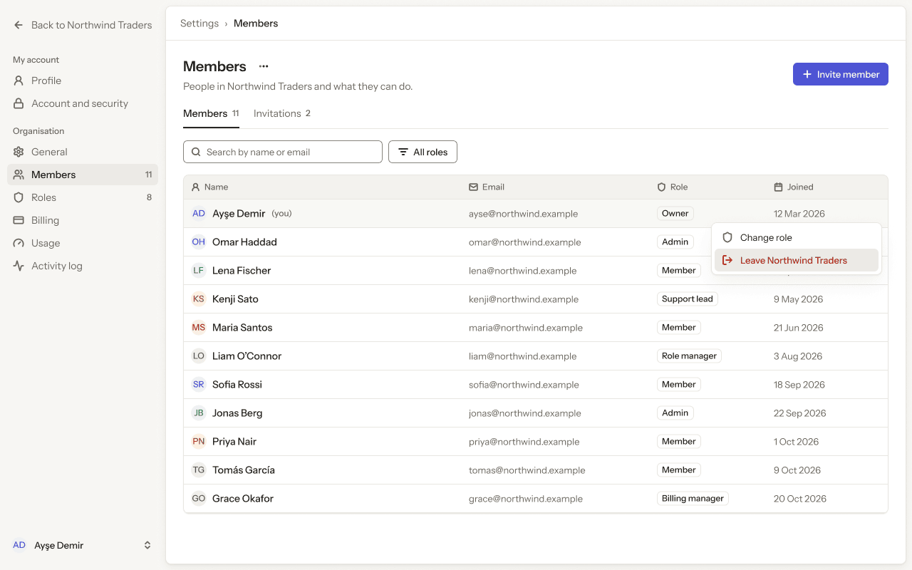

- **Who sees it:** People with tenant.members.read. Invite needs tenant.invitations.create; change role and remove need tenant.members.update and tenant.members.delete; Owner changes need tenant.owners.manage.
- **Device:** Desktop (1280 px and wider).
- **This state shows:** as the title says.
- **Values come from:** Members, invitations and roles: our API. Seats used and the seat limit: the plan's entitlements from our API. Prices in dialogs: the plan's prices from our API.
- **Components:** Avatar ×11, Button ×3, Icon/calendar, Icon/mail, Icon/shield, Icon/user, Input, Label ×11, Menu item ×2, Sidebar, Tab ×2, Top bar.
- **Actions:**
  - "Leave Northwind Traders": goes to [8.25 · Leave · last Owner](#825--leave--last-owner).
  - "Change role": goes to [8.20 · Change role · last Owner](#820--change-role--last-owner).
  - "Back to Northwind Traders": goes to [4.01 · Home · Owner](../04-home/README.md#401--home--owner).
  - "Profile": goes to [5.01 · Profile · ideal](../05-settings-profile/README.md#501--profile--ideal).
  - "Account and security": goes to [6.01 · Account and security · ideal](../06-settings-account-and-security/README.md#601--account-and-security--ideal).
  - "General": goes to [7.01 · General · ideal](../07-settings-general/README.md#701--general--ideal).
  - "Members": goes to [8.01 · Members · ideal](#801--members--ideal).
  - "Roles": goes to [9.01 · Roles · ideal](../09-settings-roles/README.md#901--roles--ideal).
  - "Billing": goes to [10.01 · Billing · Team, monthly](../10-settings-billing/README.md#1001--billing--team-monthly).
  - "Usage": goes to [11.01 · Usage · Team](../11-settings-usage/README.md#1101--usage--team).
  - "Activity log": goes to [12.01 · Activity log · ideal](../12-settings-activity-log/README.md#1201--activity-log--ideal).
- **Texts, word for word, top to bottom:**

  - Back to Northwind Traders
  - My account
  - Profile
  - Account and security
  - Organisation
  - General
  - Members
  - 11
  - Roles
  - 8
  - Billing
  - Usage
  - Activity log
  - AD
  - Ayşe Demir
  - Settings
  - ›
  - Members
  - Members
  - People in Northwind Traders and what they can do.
  - Invite member
  - Members
  - 11
  - Invitations
  - 2
  - Search by name or email
  - All roles
  - Name
  - Email
  - Role
  - Joined
  - AD
  - Ayşe Demir
  - (you)
  - ayse@northwind.example
  - Owner
  - 12 Mar 2026
  - OH
  - Omar Haddad
  - omar@northwind.example
  - Admin
  - 14 Mar 2026
  - LF
  - Lena Fischer
  - lena@northwind.example
  - Member
  - 2 Apr 2026
  - KS
  - Kenji Sato
  - kenji@northwind.example
  - Support lead
  - 9 May 2026
  - MS
  - Maria Santos
  - maria@northwind.example
  - Member
  - 21 Jun 2026
  - LO
  - Liam O’Connor
  - liam@northwind.example
  - Role manager
  - 3 Aug 2026
  - SR
  - Sofia Rossi
  - sofia@northwind.example
  - Member
  - 18 Sep 2026
  - JB
  - Jonas Berg
  - jonas@northwind.example
  - Admin
  - 22 Sep 2026
  - PN
  - Priya Nair
  - priya@northwind.example
  - Member
  - 1 Oct 2026
  - TG
  - Tomás García
  - tomas@northwind.example
  - Member
  - 9 Oct 2026
  - GO
  - Grace Okafor
  - grace@northwind.example
  - Billing manager
  - 20 Oct 2026
  - Change role
  - Leave Northwind Traders

Figma: [60:6623](https://www.figma.com/design/3Ev111okX8xCBwR9B3hyBM/?node-id=60-6623)

### 8.19 · Change role

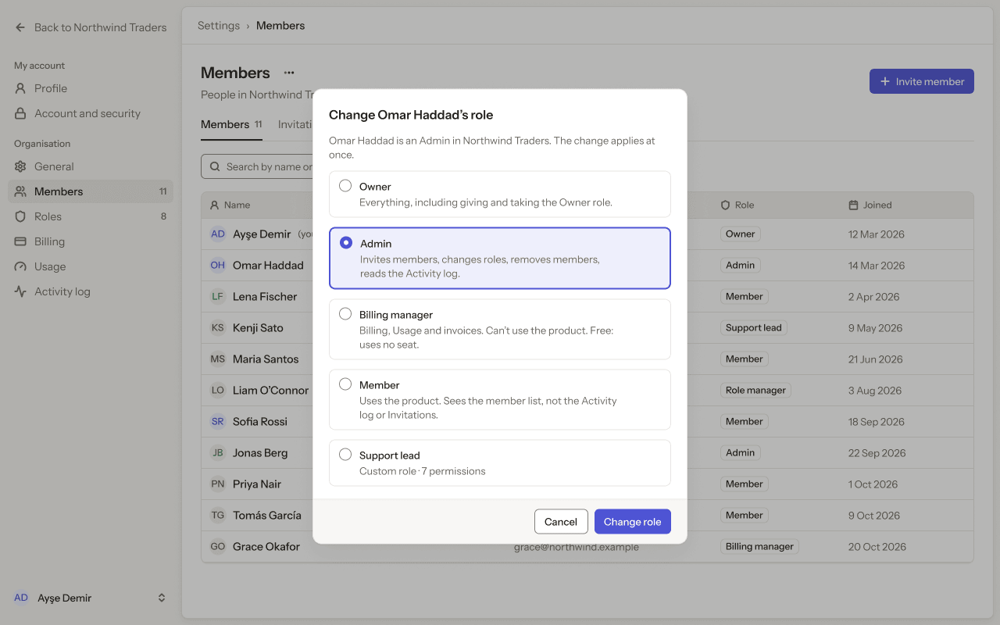

- **Who sees it:** People with tenant.members.read. Invite needs tenant.invitations.create; change role and remove need tenant.members.update and tenant.members.delete; Owner changes need tenant.owners.manage.
- **Device:** Desktop (1280 px and wider).
- **This state shows:** as the title says.
- **Values come from:** Members, invitations and roles: our API. Seats used and the seat limit: the plan's entitlements from our API. Prices in dialogs: the plan's prices from our API.
- **Components:** Avatar ×11, Button ×5, Icon/calendar, Icon/mail, Icon/shield, Icon/user, Input, Label ×11, Sidebar, Tab ×2, Top bar.
- **Actions:**
  - "jonas@northwind.example": goes to [8.01 · Members · ideal](#801--members--ideal).
  - "Back to Northwind Traders": goes to [4.01 · Home · Owner](../04-home/README.md#401--home--owner).
  - "Profile": goes to [5.01 · Profile · ideal](../05-settings-profile/README.md#501--profile--ideal).
  - "Account and security": goes to [6.01 · Account and security · ideal](../06-settings-account-and-security/README.md#601--account-and-security--ideal).
  - "General": goes to [7.01 · General · ideal](../07-settings-general/README.md#701--general--ideal).
  - "Members": goes to [8.01 · Members · ideal](#801--members--ideal).
  - "Roles": goes to [9.01 · Roles · ideal](../09-settings-roles/README.md#901--roles--ideal).
  - "Billing": goes to [10.01 · Billing · Team, monthly](../10-settings-billing/README.md#1001--billing--team-monthly).
  - "Usage": goes to [11.01 · Usage · Team](../11-settings-usage/README.md#1101--usage--team).
  - "Activity log": goes to [12.01 · Activity log · ideal](../12-settings-activity-log/README.md#1201--activity-log--ideal).
  - "Billing, Usage and invoices. Can’t use the product. Free: uses no seat.": goes to [14.06 · Change role · to Billing manager](../14-settings-billing-manager/README.md#1406--change-role--to-billing-manager).
- **Texts, word for word, top to bottom:**

  - Back to Northwind Traders
  - My account
  - Profile
  - Account and security
  - Organisation
  - General
  - Members
  - 11
  - Roles
  - 8
  - Billing
  - Usage
  - Activity log
  - AD
  - Ayşe Demir
  - Settings
  - ›
  - Members
  - Members
  - People in Northwind Traders and what they can do.
  - Invite member
  - Members
  - 11
  - Invitations
  - 2
  - Search by name or email
  - All roles
  - Name
  - Email
  - Role
  - Joined
  - AD
  - Ayşe Demir
  - (you)
  - ayse@northwind.example
  - Owner
  - 12 Mar 2026
  - OH
  - Omar Haddad
  - omar@northwind.example
  - Admin
  - 14 Mar 2026
  - LF
  - Lena Fischer
  - lena@northwind.example
  - Member
  - 2 Apr 2026
  - KS
  - Kenji Sato
  - kenji@northwind.example
  - Support lead
  - 9 May 2026
  - MS
  - Maria Santos
  - maria@northwind.example
  - Member
  - 21 Jun 2026
  - LO
  - Liam O’Connor
  - liam@northwind.example
  - Role manager
  - 3 Aug 2026
  - SR
  - Sofia Rossi
  - sofia@northwind.example
  - Member
  - 18 Sep 2026
  - JB
  - Jonas Berg
  - jonas@northwind.example
  - Admin
  - 22 Sep 2026
  - PN
  - Priya Nair
  - priya@northwind.example
  - Member
  - 1 Oct 2026
  - TG
  - Tomás García
  - tomas@northwind.example
  - Member
  - 9 Oct 2026
  - GO
  - Grace Okafor
  - grace@northwind.example
  - Billing manager
  - 20 Oct 2026
  - Change Omar Haddad’s role
  - Omar Haddad is an Admin in Northwind Traders. The change applies at once.
  - Owner
  - Everything, including giving and taking the Owner role.
  - Admin
  - Invites members, changes roles, removes members, reads the Activity log.
  - Billing manager
  - Billing, Usage and invoices. Can’t use the product. Free: uses no seat.
  - Member
  - Uses the product. Sees the member list, not the Activity log or Invitations.
  - Support lead
  - Custom role · 7 permissions
  - Cancel
  - Change role

Figma: [60:6938](https://www.figma.com/design/3Ev111okX8xCBwR9B3hyBM/?node-id=60-6938)

### 8.20 · Change role · last Owner

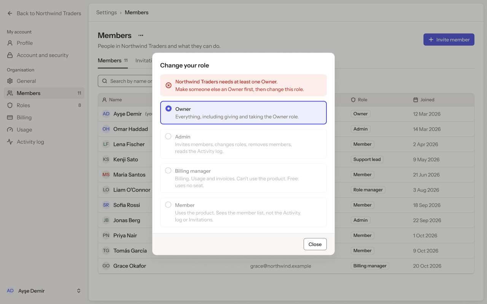

- **Who sees it:** People with tenant.members.read. Invite needs tenant.invitations.create; change role and remove need tenant.members.update and tenant.members.delete; Owner changes need tenant.owners.manage.
- **Device:** Desktop (1280 px and wider).
- **This state shows:** as the title says.
- **Values come from:** Members, invitations and roles: our API. Seats used and the seat limit: the plan's entitlements from our API. Prices in dialogs: the plan's prices from our API.
- **Components:** Avatar ×11, Banner, Button ×4, Icon/calendar, Icon/mail, Icon/shield, Icon/user, Input, Label ×11, Sidebar, Tab ×2, Top bar.
- **Actions:**
  - "Area": goes to [8.01 · Members · ideal](#801--members--ideal).
  - "Back to Northwind Traders": goes to [4.01 · Home · Owner](../04-home/README.md#401--home--owner).
  - "Profile": goes to [5.01 · Profile · ideal](../05-settings-profile/README.md#501--profile--ideal).
  - "Account and security": goes to [6.01 · Account and security · ideal](../06-settings-account-and-security/README.md#601--account-and-security--ideal).
  - "General": goes to [7.01 · General · ideal](../07-settings-general/README.md#701--general--ideal).
  - "Members": goes to [8.01 · Members · ideal](#801--members--ideal).
  - "Roles": goes to [9.01 · Roles · ideal](../09-settings-roles/README.md#901--roles--ideal).
  - "Billing": goes to [10.01 · Billing · Team, monthly](../10-settings-billing/README.md#1001--billing--team-monthly).
  - "Usage": goes to [11.01 · Usage · Team](../11-settings-usage/README.md#1101--usage--team).
  - "Activity log": goes to [12.01 · Activity log · ideal](../12-settings-activity-log/README.md#1201--activity-log--ideal).
- **Texts, word for word, top to bottom:**

  - Back to Northwind Traders
  - My account
  - Profile
  - Account and security
  - Organisation
  - General
  - Members
  - 11
  - Roles
  - 8
  - Billing
  - Usage
  - Activity log
  - AD
  - Ayşe Demir
  - Settings
  - ›
  - Members
  - Members
  - People in Northwind Traders and what they can do.
  - Invite member
  - Members
  - 11
  - Invitations
  - 2
  - Search by name or email
  - All roles
  - Name
  - Email
  - Role
  - Joined
  - AD
  - Ayşe Demir
  - (you)
  - ayse@northwind.example
  - Owner
  - 12 Mar 2026
  - OH
  - Omar Haddad
  - omar@northwind.example
  - Admin
  - 14 Mar 2026
  - LF
  - Lena Fischer
  - lena@northwind.example
  - Member
  - 2 Apr 2026
  - KS
  - Kenji Sato
  - kenji@northwind.example
  - Support lead
  - 9 May 2026
  - MS
  - Maria Santos
  - maria@northwind.example
  - Member
  - 21 Jun 2026
  - LO
  - Liam O’Connor
  - liam@northwind.example
  - Role manager
  - 3 Aug 2026
  - SR
  - Sofia Rossi
  - sofia@northwind.example
  - Member
  - 18 Sep 2026
  - JB
  - Jonas Berg
  - jonas@northwind.example
  - Admin
  - 22 Sep 2026
  - PN
  - Priya Nair
  - priya@northwind.example
  - Member
  - 1 Oct 2026
  - TG
  - Tomás García
  - tomas@northwind.example
  - Member
  - 9 Oct 2026
  - GO
  - Grace Okafor
  - grace@northwind.example
  - Billing manager
  - 20 Oct 2026
  - Change your role
  - Northwind Traders needs at least one Owner.
  - Make someone else an Owner first, then change this role.
  - Owner
  - Everything, including giving and taking the Owner role.
  - Admin
  - Invites members, changes roles, removes members, reads the Activity log.
  - Billing manager
  - Billing, Usage and invoices. Can’t use the product. Free: uses no seat.
  - Member
  - Uses the product. Sees the member list, not the Activity log or Invitations.
  - Close

Figma: [60:7165](https://www.figma.com/design/3Ev111okX8xCBwR9B3hyBM/?node-id=60-7165)

### 8.21 · Remove member

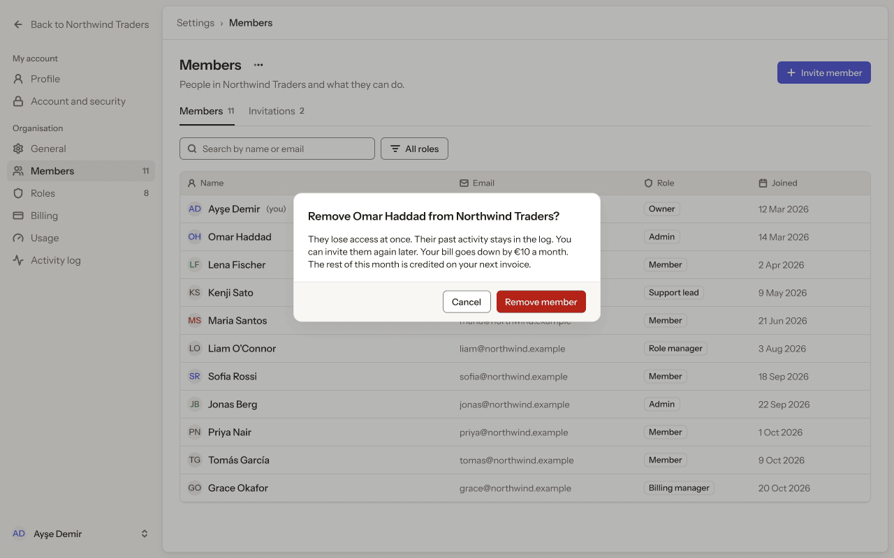

- **Who sees it:** People with tenant.members.read. Invite needs tenant.invitations.create; change role and remove need tenant.members.update and tenant.members.delete; Owner changes need tenant.owners.manage.
- **Device:** Desktop (1280 px and wider).
- **This state shows:** as the title says.
- **Values come from:** Members, invitations and roles: our API. Seats used and the seat limit: the plan's entitlements from our API. Prices in dialogs: the plan's prices from our API.
- **Components:** Avatar ×11, Button ×5, Icon/calendar, Icon/mail, Icon/shield, Icon/user, Input, Label ×11, Sidebar, Tab ×2, Top bar.
- **Actions:**
  - "Cancel": goes to [8.01 · Members · ideal](#801--members--ideal).
  - "kenji@northwind.example": goes to [8.22 · Member removed](#822--member-removed).
  - "Back to Northwind Traders": goes to [4.01 · Home · Owner](../04-home/README.md#401--home--owner).
  - "Profile": goes to [5.01 · Profile · ideal](../05-settings-profile/README.md#501--profile--ideal).
  - "Account and security": goes to [6.01 · Account and security · ideal](../06-settings-account-and-security/README.md#601--account-and-security--ideal).
  - "General": goes to [7.01 · General · ideal](../07-settings-general/README.md#701--general--ideal).
  - "Members": goes to [8.01 · Members · ideal](#801--members--ideal).
  - "Roles": goes to [9.01 · Roles · ideal](../09-settings-roles/README.md#901--roles--ideal).
  - "Billing": goes to [10.01 · Billing · Team, monthly](../10-settings-billing/README.md#1001--billing--team-monthly).
  - "Usage": goes to [11.01 · Usage · Team](../11-settings-usage/README.md#1101--usage--team).
  - "Activity log": goes to [12.01 · Activity log · ideal](../12-settings-activity-log/README.md#1201--activity-log--ideal).
- **Texts, word for word, top to bottom:**

  - Back to Northwind Traders
  - My account
  - Profile
  - Account and security
  - Organisation
  - General
  - Members
  - 11
  - Roles
  - 8
  - Billing
  - Usage
  - Activity log
  - AD
  - Ayşe Demir
  - Settings
  - ›
  - Members
  - Members
  - People in Northwind Traders and what they can do.
  - Invite member
  - Members
  - 11
  - Invitations
  - 2
  - Search by name or email
  - All roles
  - Name
  - Email
  - Role
  - Joined
  - AD
  - Ayşe Demir
  - (you)
  - ayse@northwind.example
  - Owner
  - 12 Mar 2026
  - OH
  - Omar Haddad
  - omar@northwind.example
  - Admin
  - 14 Mar 2026
  - LF
  - Lena Fischer
  - lena@northwind.example
  - Member
  - 2 Apr 2026
  - KS
  - Kenji Sato
  - kenji@northwind.example
  - Support lead
  - 9 May 2026
  - MS
  - Maria Santos
  - maria@northwind.example
  - Member
  - 21 Jun 2026
  - LO
  - Liam O’Connor
  - liam@northwind.example
  - Role manager
  - 3 Aug 2026
  - SR
  - Sofia Rossi
  - sofia@northwind.example
  - Member
  - 18 Sep 2026
  - JB
  - Jonas Berg
  - jonas@northwind.example
  - Admin
  - 22 Sep 2026
  - PN
  - Priya Nair
  - priya@northwind.example
  - Member
  - 1 Oct 2026
  - TG
  - Tomás García
  - tomas@northwind.example
  - Member
  - 9 Oct 2026
  - GO
  - Grace Okafor
  - grace@northwind.example
  - Billing manager
  - 20 Oct 2026
  - Remove Omar Haddad from Northwind Traders?
  - They lose access at once. Their past activity stays in the log. You can invite them again later. Your bill goes down by €10 a month. The rest of this month is credited on your next invoice.
  - Cancel
  - Remove member

Figma: [60:7398](https://www.figma.com/design/3Ev111okX8xCBwR9B3hyBM/?node-id=60-7398)

### 8.22 · Member removed

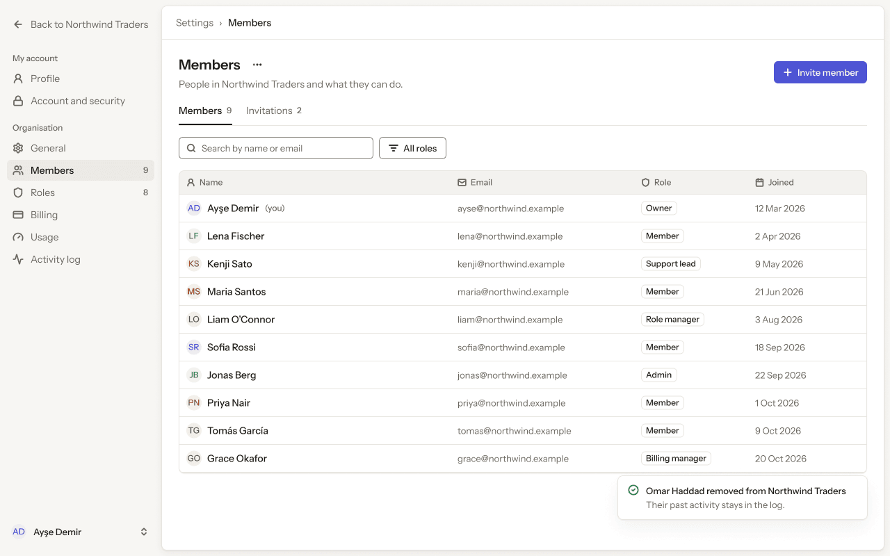

- **Who sees it:** People with tenant.members.read. Invite needs tenant.invitations.create; change role and remove need tenant.members.update and tenant.members.delete; Owner changes need tenant.owners.manage.
- **Device:** Desktop (1280 px and wider).
- **This state shows:** as the title says.
- **Values come from:** Members, invitations and roles: our API. Seats used and the seat limit: the plan's entitlements from our API. Prices in dialogs: the plan's prices from our API.
- **Components:** Avatar ×10, Button ×3, Icon/calendar, Icon/mail, Icon/shield, Icon/user, Input, Label ×10, Sidebar, Tab ×2, Toast, Top bar.
- **Actions:**
  - "Back to Northwind Traders": goes to [4.01 · Home · Owner](../04-home/README.md#401--home--owner).
  - "Profile": goes to [5.01 · Profile · ideal](../05-settings-profile/README.md#501--profile--ideal).
  - "Account and security": goes to [6.01 · Account and security · ideal](../06-settings-account-and-security/README.md#601--account-and-security--ideal).
  - "General": goes to [7.01 · General · ideal](../07-settings-general/README.md#701--general--ideal).
  - "Members": goes to [8.01 · Members · ideal](#801--members--ideal).
  - "Roles": goes to [9.01 · Roles · ideal](../09-settings-roles/README.md#901--roles--ideal).
  - "Billing": goes to [10.01 · Billing · Team, monthly](../10-settings-billing/README.md#1001--billing--team-monthly).
  - "Usage": goes to [11.01 · Usage · Team](../11-settings-usage/README.md#1101--usage--team).
  - "Activity log": goes to [12.01 · Activity log · ideal](../12-settings-activity-log/README.md#1201--activity-log--ideal).
- **Texts, word for word, top to bottom:**

  - Back to Northwind Traders
  - My account
  - Profile
  - Account and security
  - Organisation
  - General
  - Members
  - 9
  - Roles
  - 8
  - Billing
  - Usage
  - Activity log
  - AD
  - Ayşe Demir
  - Settings
  - ›
  - Members
  - Members
  - People in Northwind Traders and what they can do.
  - Invite member
  - Members
  - 9
  - Invitations
  - 2
  - Search by name or email
  - All roles
  - Name
  - Email
  - Role
  - Joined
  - AD
  - Ayşe Demir
  - (you)
  - ayse@northwind.example
  - Owner
  - 12 Mar 2026
  - LF
  - Lena Fischer
  - lena@northwind.example
  - Member
  - 2 Apr 2026
  - KS
  - Kenji Sato
  - kenji@northwind.example
  - Support lead
  - 9 May 2026
  - MS
  - Maria Santos
  - maria@northwind.example
  - Member
  - 21 Jun 2026
  - LO
  - Liam O’Connor
  - liam@northwind.example
  - Role manager
  - 3 Aug 2026
  - SR
  - Sofia Rossi
  - sofia@northwind.example
  - Member
  - 18 Sep 2026
  - JB
  - Jonas Berg
  - jonas@northwind.example
  - Admin
  - 22 Sep 2026
  - PN
  - Priya Nair
  - priya@northwind.example
  - Member
  - 1 Oct 2026
  - TG
  - Tomás García
  - tomas@northwind.example
  - Member
  - 9 Oct 2026
  - GO
  - Grace Okafor
  - grace@northwind.example
  - Billing manager
  - 20 Oct 2026
  - Omar Haddad removed from Northwind Traders
  - Their past activity stays in the log.

Figma: [60:7605](https://www.figma.com/design/3Ev111okX8xCBwR9B3hyBM/?node-id=60-7605)

### 8.23 · Leave organisation

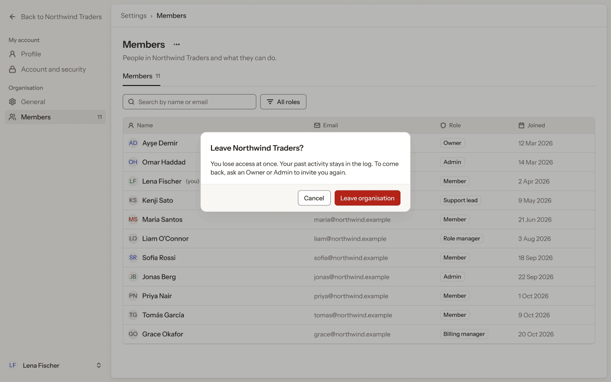

- **Who sees it:** People with tenant.members.read. Invite needs tenant.invitations.create; change role and remove need tenant.members.update and tenant.members.delete; Owner changes need tenant.owners.manage.
- **Device:** Desktop (1280 px and wider).
- **This state shows:** as the title says.
- **Values come from:** Members, invitations and roles: our API. Seats used and the seat limit: the plan's entitlements from our API. Prices in dialogs: the plan's prices from our API.
- **Components:** Avatar ×11, Button ×4, Icon/calendar, Icon/mail, Icon/shield, Icon/user, Input, Label ×11, Sidebar, Tab, Top bar.
- **Actions:**
  - "Cancel": goes to [8.11 · Members · as a Member](#811--members--as-a-member).
  - "Leave organisation": goes to [8.24 · Left · no access yet](#824--left--no-access-yet).
  - "Back to Northwind Traders": goes to [4.01 · Home · Owner](../04-home/README.md#401--home--owner).
  - "Profile": goes to [5.01 · Profile · ideal](../05-settings-profile/README.md#501--profile--ideal).
  - "Account and security": goes to [6.01 · Account and security · ideal](../06-settings-account-and-security/README.md#601--account-and-security--ideal).
  - "General": goes to [7.01 · General · ideal](../07-settings-general/README.md#701--general--ideal).
  - "Members": goes to [8.01 · Members · ideal](#801--members--ideal).
- **Texts, word for word, top to bottom:**

  - Back to Northwind Traders
  - My account
  - Profile
  - Account and security
  - Organisation
  - General
  - Members
  - 11
  - LF
  - Lena Fischer
  - Settings
  - ›
  - Members
  - Members
  - People in Northwind Traders and what they can do.
  - Members
  - 11
  - Search by name or email
  - All roles
  - Name
  - Email
  - Role
  - Joined
  - AD
  - Ayşe Demir
  - ayse@northwind.example
  - Owner
  - 12 Mar 2026
  - OH
  - Omar Haddad
  - omar@northwind.example
  - Admin
  - 14 Mar 2026
  - LF
  - Lena Fischer
  - (you)
  - lena@northwind.example
  - Member
  - 2 Apr 2026
  - KS
  - Kenji Sato
  - kenji@northwind.example
  - Support lead
  - 9 May 2026
  - MS
  - Maria Santos
  - maria@northwind.example
  - Member
  - 21 Jun 2026
  - LO
  - Liam O’Connor
  - liam@northwind.example
  - Role manager
  - 3 Aug 2026
  - SR
  - Sofia Rossi
  - sofia@northwind.example
  - Member
  - 18 Sep 2026
  - JB
  - Jonas Berg
  - jonas@northwind.example
  - Admin
  - 22 Sep 2026
  - PN
  - Priya Nair
  - priya@northwind.example
  - Member
  - 1 Oct 2026
  - TG
  - Tomás García
  - tomas@northwind.example
  - Member
  - 9 Oct 2026
  - GO
  - Grace Okafor
  - grace@northwind.example
  - Billing manager
  - 20 Oct 2026
  - Leave Northwind Traders?
  - You lose access at once. Your past activity stays in the log. To come back, ask an Owner or Admin to invite you again.
  - Cancel
  - Leave organisation

Figma: [60:7913](https://www.figma.com/design/3Ev111okX8xCBwR9B3hyBM/?node-id=60-7913)

### 8.24 · Left · no access yet

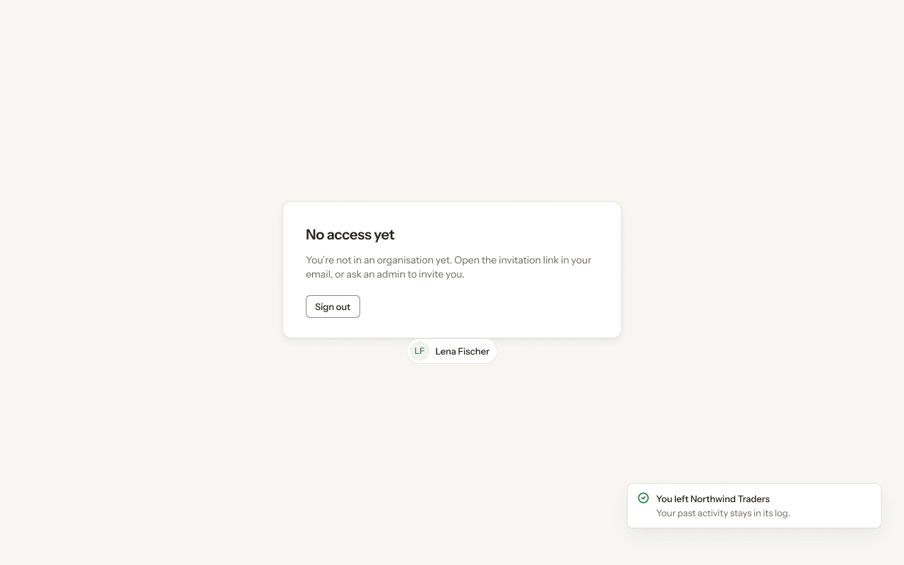

- **Who sees it:** People with tenant.members.read. Invite needs tenant.invitations.create; change role and remove need tenant.members.update and tenant.members.delete; Owner changes need tenant.owners.manage.
- **Device:** Desktop (1280 px and wider).
- **This state shows:** as the title says.
- **Values come from:** Members, invitations and roles: our API. Seats used and the seat limit: the plan's entitlements from our API. Prices in dialogs: the plan's prices from our API.
- **Components:** Button, Toast.
- **Actions:**
  - No prototype link on this screen. The buttons follow the section's other screens.
- **Texts, word for word, top to bottom:**

  - No access yet
  - You’re not in an organisation yet. Open the invitation link in your email, or ask an admin to invite you.
  - Sign out
  - You left Northwind Traders
  - Your past activity stays in its log.
  - LF
  - Lena Fischer

Figma: [60:8119](https://www.figma.com/design/3Ev111okX8xCBwR9B3hyBM/?node-id=60-8119)

### 8.25 · Leave · last Owner

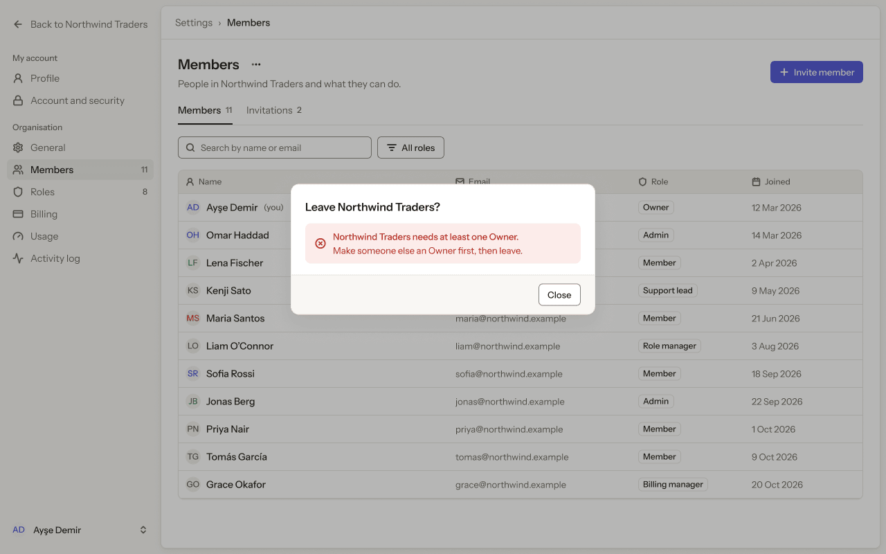

- **Who sees it:** People with tenant.members.read. Invite needs tenant.invitations.create; change role and remove need tenant.members.update and tenant.members.delete; Owner changes need tenant.owners.manage.
- **Device:** Desktop (1280 px and wider).
- **This state shows:** as the title says.
- **Values come from:** Members, invitations and roles: our API. Seats used and the seat limit: the plan's entitlements from our API. Prices in dialogs: the plan's prices from our API.
- **Components:** Avatar ×11, Banner, Button ×4, Icon/calendar, Icon/mail, Icon/shield, Icon/user, Input, Label ×11, Sidebar, Tab ×2, Top bar.
- **Actions:**
  - "Close": goes to [8.01 · Members · ideal](#801--members--ideal).
  - "Back to Northwind Traders": goes to [4.01 · Home · Owner](../04-home/README.md#401--home--owner).
  - "Profile": goes to [5.01 · Profile · ideal](../05-settings-profile/README.md#501--profile--ideal).
  - "Account and security": goes to [6.01 · Account and security · ideal](../06-settings-account-and-security/README.md#601--account-and-security--ideal).
  - "General": goes to [7.01 · General · ideal](../07-settings-general/README.md#701--general--ideal).
  - "Members": goes to [8.01 · Members · ideal](#801--members--ideal).
  - "Roles": goes to [9.01 · Roles · ideal](../09-settings-roles/README.md#901--roles--ideal).
  - "Billing": goes to [10.01 · Billing · Team, monthly](../10-settings-billing/README.md#1001--billing--team-monthly).
  - "Usage": goes to [11.01 · Usage · Team](../11-settings-usage/README.md#1101--usage--team).
  - "Activity log": goes to [12.01 · Activity log · ideal](../12-settings-activity-log/README.md#1201--activity-log--ideal).
- **Texts, word for word, top to bottom:**

  - Back to Northwind Traders
  - My account
  - Profile
  - Account and security
  - Organisation
  - General
  - Members
  - 11
  - Roles
  - 8
  - Billing
  - Usage
  - Activity log
  - AD
  - Ayşe Demir
  - Settings
  - ›
  - Members
  - Members
  - People in Northwind Traders and what they can do.
  - Invite member
  - Members
  - 11
  - Invitations
  - 2
  - Search by name or email
  - All roles
  - Name
  - Email
  - Role
  - Joined
  - AD
  - Ayşe Demir
  - (you)
  - ayse@northwind.example
  - Owner
  - 12 Mar 2026
  - OH
  - Omar Haddad
  - omar@northwind.example
  - Admin
  - 14 Mar 2026
  - LF
  - Lena Fischer
  - lena@northwind.example
  - Member
  - 2 Apr 2026
  - KS
  - Kenji Sato
  - kenji@northwind.example
  - Support lead
  - 9 May 2026
  - MS
  - Maria Santos
  - maria@northwind.example
  - Member
  - 21 Jun 2026
  - LO
  - Liam O’Connor
  - liam@northwind.example
  - Role manager
  - 3 Aug 2026
  - SR
  - Sofia Rossi
  - sofia@northwind.example
  - Member
  - 18 Sep 2026
  - JB
  - Jonas Berg
  - jonas@northwind.example
  - Admin
  - 22 Sep 2026
  - PN
  - Priya Nair
  - priya@northwind.example
  - Member
  - 1 Oct 2026
  - TG
  - Tomás García
  - tomas@northwind.example
  - Member
  - 9 Oct 2026
  - GO
  - Grace Okafor
  - grace@northwind.example
  - Billing manager
  - 20 Oct 2026
  - Leave Northwind Traders?
  - Northwind Traders needs at least one Owner.
  - Make someone else an Owner first, then leave.
  - Close

Figma: [60:8139](https://www.figma.com/design/3Ev111okX8xCBwR9B3hyBM/?node-id=60-8139)

### 8.26 · Invite member

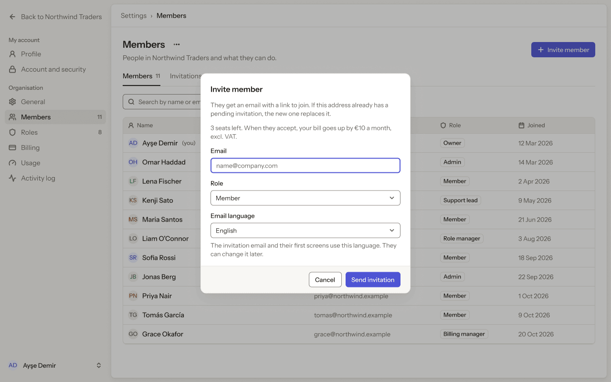

- **Who sees it:** People with tenant.members.read. Invite needs tenant.invitations.create; change role and remove need tenant.members.update and tenant.members.delete; Owner changes need tenant.owners.manage.
- **Device:** Desktop (1280 px and wider).
- **This state shows:** as the title says.
- **Values come from:** Members, invitations and roles: our API. Seats used and the seat limit: the plan's entitlements from our API. Prices in dialogs: the plan's prices from our API.
- **Components:** Avatar ×11, Button ×5, Icon/calendar, Icon/mail, Icon/shield, Icon/user, Input ×2, Label ×11, Select ×2, Sidebar, Tab ×2, Top bar.
- **Actions:**
  - "sofia@northwind.example": goes to [8.01 · Members · ideal](#801--members--ideal).
  - "sofia@northwind.example": goes to [8.27 · Invite · invalid email](#827--invite--invalid-email).
  - "Back to Northwind Traders": goes to [4.01 · Home · Owner](../04-home/README.md#401--home--owner).
  - "Profile": goes to [5.01 · Profile · ideal](../05-settings-profile/README.md#501--profile--ideal).
  - "Account and security": goes to [6.01 · Account and security · ideal](../06-settings-account-and-security/README.md#601--account-and-security--ideal).
  - "General": goes to [7.01 · General · ideal](../07-settings-general/README.md#701--general--ideal).
  - "Members": goes to [8.01 · Members · ideal](#801--members--ideal).
  - "Roles": goes to [9.01 · Roles · ideal](../09-settings-roles/README.md#901--roles--ideal).
  - "Billing": goes to [10.01 · Billing · Team, monthly](../10-settings-billing/README.md#1001--billing--team-monthly).
  - "Usage": goes to [11.01 · Usage · Team](../11-settings-usage/README.md#1101--usage--team).
  - "Activity log": goes to [12.01 · Activity log · ideal](../12-settings-activity-log/README.md#1201--activity-log--ideal).
  - "Member": goes to [14.02 · Invite member · role list](../14-settings-billing-manager/README.md#1402--invite-member--role-list).
- **Texts, word for word, top to bottom:**

  - Back to Northwind Traders
  - My account
  - Profile
  - Account and security
  - Organisation
  - General
  - Members
  - 11
  - Roles
  - 8
  - Billing
  - Usage
  - Activity log
  - AD
  - Ayşe Demir
  - Settings
  - ›
  - Members
  - Members
  - People in Northwind Traders and what they can do.
  - Invite member
  - Members
  - 11
  - Invitations
  - 2
  - Search by name or email
  - All roles
  - Name
  - Email
  - Role
  - Joined
  - AD
  - Ayşe Demir
  - (you)
  - ayse@northwind.example
  - Owner
  - 12 Mar 2026
  - OH
  - Omar Haddad
  - omar@northwind.example
  - Admin
  - 14 Mar 2026
  - LF
  - Lena Fischer
  - lena@northwind.example
  - Member
  - 2 Apr 2026
  - KS
  - Kenji Sato
  - kenji@northwind.example
  - Support lead
  - 9 May 2026
  - MS
  - Maria Santos
  - maria@northwind.example
  - Member
  - 21 Jun 2026
  - LO
  - Liam O’Connor
  - liam@northwind.example
  - Role manager
  - 3 Aug 2026
  - SR
  - Sofia Rossi
  - sofia@northwind.example
  - Member
  - 18 Sep 2026
  - JB
  - Jonas Berg
  - jonas@northwind.example
  - Admin
  - 22 Sep 2026
  - PN
  - Priya Nair
  - priya@northwind.example
  - Member
  - 1 Oct 2026
  - TG
  - Tomás García
  - tomas@northwind.example
  - Member
  - 9 Oct 2026
  - GO
  - Grace Okafor
  - grace@northwind.example
  - Billing manager
  - 20 Oct 2026
  - Invite member
  - They get an email with a link to join. If this address already has a pending invitation, the new one replaces it.
  - 3 seats left. When they accept, your bill goes up by €10 a month, excl. VAT.
  - Email
  - name@company.com
  - Role
  - Member
  - Email language
  - English
  - The invitation email and their first screens use this language. They can change it later.
  - Cancel
  - Send invitation

Figma: [60:8354](https://www.figma.com/design/3Ev111okX8xCBwR9B3hyBM/?node-id=60-8354)

### 8.27 · Invite · invalid email

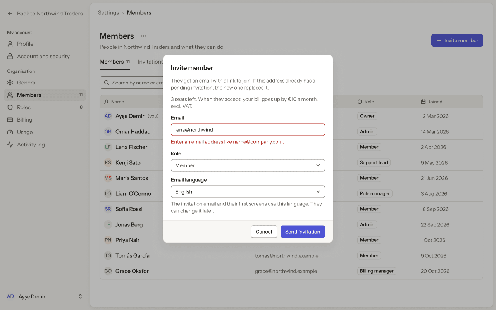

- **Who sees it:** People with tenant.members.read. Invite needs tenant.invitations.create; change role and remove need tenant.members.update and tenant.members.delete; Owner changes need tenant.owners.manage.
- **Device:** Desktop (1280 px and wider).
- **This state shows:** as the title says.
- **Values come from:** Members, invitations and roles: our API. Seats used and the seat limit: the plan's entitlements from our API. Prices in dialogs: the plan's prices from our API.
- **Components:** Avatar ×11, Button ×5, Icon/calendar, Icon/mail, Icon/shield, Icon/user, Input ×2, Label ×11, Select ×2, Sidebar, Tab ×2, Top bar.
- **Actions:**
  - "sofia@northwind.example": goes to [8.01 · Members · ideal](#801--members--ideal).
  - "sofia@northwind.example": goes to [8.30 · Invitation sent](#830--invitation-sent).
  - "Back to Northwind Traders": goes to [4.01 · Home · Owner](../04-home/README.md#401--home--owner).
  - "Profile": goes to [5.01 · Profile · ideal](../05-settings-profile/README.md#501--profile--ideal).
  - "Account and security": goes to [6.01 · Account and security · ideal](../06-settings-account-and-security/README.md#601--account-and-security--ideal).
  - "General": goes to [7.01 · General · ideal](../07-settings-general/README.md#701--general--ideal).
  - "Members": goes to [8.01 · Members · ideal](#801--members--ideal).
  - "Roles": goes to [9.01 · Roles · ideal](../09-settings-roles/README.md#901--roles--ideal).
  - "Billing": goes to [10.01 · Billing · Team, monthly](../10-settings-billing/README.md#1001--billing--team-monthly).
  - "Usage": goes to [11.01 · Usage · Team](../11-settings-usage/README.md#1101--usage--team).
  - "Activity log": goes to [12.01 · Activity log · ideal](../12-settings-activity-log/README.md#1201--activity-log--ideal).
- **Texts, word for word, top to bottom:**

  - Back to Northwind Traders
  - My account
  - Profile
  - Account and security
  - Organisation
  - General
  - Members
  - 11
  - Roles
  - 8
  - Billing
  - Usage
  - Activity log
  - AD
  - Ayşe Demir
  - Settings
  - ›
  - Members
  - Members
  - People in Northwind Traders and what they can do.
  - Invite member
  - Members
  - 11
  - Invitations
  - 2
  - Search by name or email
  - All roles
  - Name
  - Email
  - Role
  - Joined
  - AD
  - Ayşe Demir
  - (you)
  - ayse@northwind.example
  - Owner
  - 12 Mar 2026
  - OH
  - Omar Haddad
  - omar@northwind.example
  - Admin
  - 14 Mar 2026
  - LF
  - Lena Fischer
  - lena@northwind.example
  - Member
  - 2 Apr 2026
  - KS
  - Kenji Sato
  - kenji@northwind.example
  - Support lead
  - 9 May 2026
  - MS
  - Maria Santos
  - maria@northwind.example
  - Member
  - 21 Jun 2026
  - LO
  - Liam O’Connor
  - liam@northwind.example
  - Role manager
  - 3 Aug 2026
  - SR
  - Sofia Rossi
  - sofia@northwind.example
  - Member
  - 18 Sep 2026
  - JB
  - Jonas Berg
  - jonas@northwind.example
  - Admin
  - 22 Sep 2026
  - PN
  - Priya Nair
  - priya@northwind.example
  - Member
  - 1 Oct 2026
  - TG
  - Tomás García
  - tomas@northwind.example
  - Member
  - 9 Oct 2026
  - GO
  - Grace Okafor
  - grace@northwind.example
  - Billing manager
  - 20 Oct 2026
  - Invite member
  - They get an email with a link to join. If this address already has a pending invitation, the new one replaces it.
  - 3 seats left. When they accept, your bill goes up by €10 a month, excl. VAT.
  - Email
  - lena@northwind
  - Enter an email address like name@company.com.
  - Role
  - Member
  - Email language
  - English
  - The invitation email and their first screens use this language. They can change it later.
  - Cancel
  - Send invitation

Figma: [60:8584](https://www.figma.com/design/3Ev111okX8xCBwR9B3hyBM/?node-id=60-8584)

### 8.28 · Invite · already a member

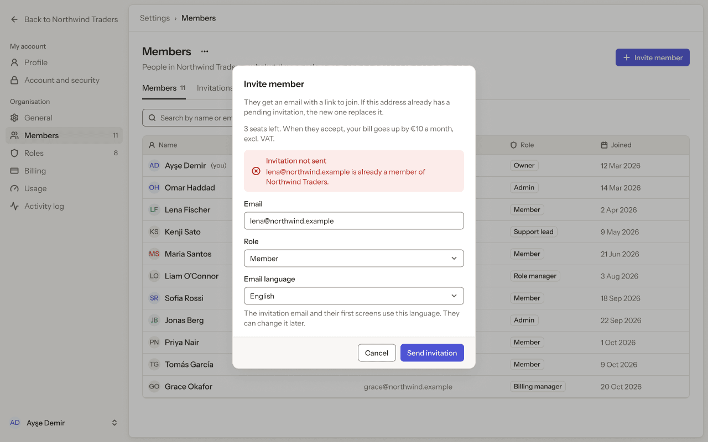

- **Who sees it:** People with tenant.members.read. Invite needs tenant.invitations.create; change role and remove need tenant.members.update and tenant.members.delete; Owner changes need tenant.owners.manage.
- **Device:** Desktop (1280 px and wider).
- **This state shows:** as the title says.
- **Values come from:** Members, invitations and roles: our API. Seats used and the seat limit: the plan's entitlements from our API. Prices in dialogs: the plan's prices from our API.
- **Components:** Avatar ×11, Banner, Button ×5, Icon/calendar, Icon/mail, Icon/shield, Icon/user, Input ×2, Label ×11, Select ×2, Sidebar, Tab ×2, Top bar.
- **Actions:**
  - "jonas@northwind.example": goes to [8.01 · Members · ideal](#801--members--ideal).
  - "Back to Northwind Traders": goes to [4.01 · Home · Owner](../04-home/README.md#401--home--owner).
  - "Profile": goes to [5.01 · Profile · ideal](../05-settings-profile/README.md#501--profile--ideal).
  - "Account and security": goes to [6.01 · Account and security · ideal](../06-settings-account-and-security/README.md#601--account-and-security--ideal).
  - "General": goes to [7.01 · General · ideal](../07-settings-general/README.md#701--general--ideal).
  - "Members": goes to [8.01 · Members · ideal](#801--members--ideal).
  - "Roles": goes to [9.01 · Roles · ideal](../09-settings-roles/README.md#901--roles--ideal).
  - "Billing": goes to [10.01 · Billing · Team, monthly](../10-settings-billing/README.md#1001--billing--team-monthly).
  - "Usage": goes to [11.01 · Usage · Team](../11-settings-usage/README.md#1101--usage--team).
  - "Activity log": goes to [12.01 · Activity log · ideal](../12-settings-activity-log/README.md#1201--activity-log--ideal).
- **Texts, word for word, top to bottom:**

  - Back to Northwind Traders
  - My account
  - Profile
  - Account and security
  - Organisation
  - General
  - Members
  - 11
  - Roles
  - 8
  - Billing
  - Usage
  - Activity log
  - AD
  - Ayşe Demir
  - Settings
  - ›
  - Members
  - Members
  - People in Northwind Traders and what they can do.
  - Invite member
  - Members
  - 11
  - Invitations
  - 2
  - Search by name or email
  - All roles
  - Name
  - Email
  - Role
  - Joined
  - AD
  - Ayşe Demir
  - (you)
  - ayse@northwind.example
  - Owner
  - 12 Mar 2026
  - OH
  - Omar Haddad
  - omar@northwind.example
  - Admin
  - 14 Mar 2026
  - LF
  - Lena Fischer
  - lena@northwind.example
  - Member
  - 2 Apr 2026
  - KS
  - Kenji Sato
  - kenji@northwind.example
  - Support lead
  - 9 May 2026
  - MS
  - Maria Santos
  - maria@northwind.example
  - Member
  - 21 Jun 2026
  - LO
  - Liam O’Connor
  - liam@northwind.example
  - Role manager
  - 3 Aug 2026
  - SR
  - Sofia Rossi
  - sofia@northwind.example
  - Member
  - 18 Sep 2026
  - JB
  - Jonas Berg
  - jonas@northwind.example
  - Admin
  - 22 Sep 2026
  - PN
  - Priya Nair
  - priya@northwind.example
  - Member
  - 1 Oct 2026
  - TG
  - Tomás García
  - tomas@northwind.example
  - Member
  - 9 Oct 2026
  - GO
  - Grace Okafor
  - grace@northwind.example
  - Billing manager
  - 20 Oct 2026
  - Invite member
  - They get an email with a link to join. If this address already has a pending invitation, the new one replaces it.
  - 3 seats left. When they accept, your bill goes up by €10 a month, excl. VAT.
  - Invitation not sent
  - lena@northwind.example is already a member of Northwind Traders.
  - Email
  - lena@northwind.example
  - Role
  - Member
  - Email language
  - English
  - The invitation email and their first screens use this language. They can change it later.
  - Cancel
  - Send invitation

Figma: [60:8815](https://www.figma.com/design/3Ev111okX8xCBwR9B3hyBM/?node-id=60-8815)

### 8.29 · Invitations

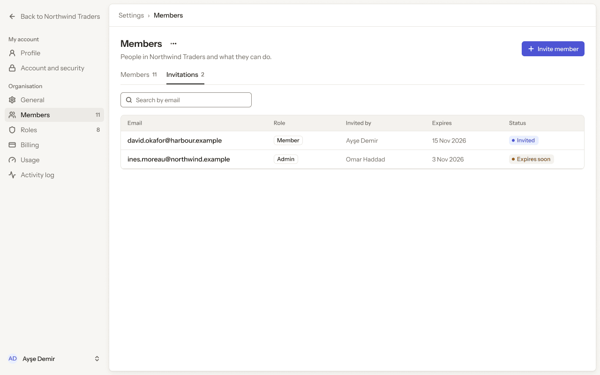

- **Who sees it:** People with tenant.members.read. Invite needs tenant.invitations.create; change role and remove need tenant.members.update and tenant.members.delete; Owner changes need tenant.owners.manage.
- **Device:** Desktop (1280 px and wider).
- **This state shows:** as the title says.
- **Values come from:** Members, invitations and roles: our API. Seats used and the seat limit: the plan's entitlements from our API. Prices in dialogs: the plan's prices from our API.
- **Components:** Button ×2, Input, Label ×2, Pill ×2, Sidebar, Tab ×2, Top bar.
- **Actions:**
  - "Members": goes to [8.01 · Members · ideal](#801--members--ideal).
  - "david.okafor@harbour.example": goes to [8.32 · Revoke invitation](#832--revoke-invitation).
  - "Back to Northwind Traders": goes to [4.01 · Home · Owner](../04-home/README.md#401--home--owner).
  - "Profile": goes to [5.01 · Profile · ideal](../05-settings-profile/README.md#501--profile--ideal).
  - "Account and security": goes to [6.01 · Account and security · ideal](../06-settings-account-and-security/README.md#601--account-and-security--ideal).
  - "General": goes to [7.01 · General · ideal](../07-settings-general/README.md#701--general--ideal).
  - "Roles": goes to [9.01 · Roles · ideal](../09-settings-roles/README.md#901--roles--ideal).
  - "Billing": goes to [10.01 · Billing · Team, monthly](../10-settings-billing/README.md#1001--billing--team-monthly).
  - "Usage": goes to [11.01 · Usage · Team](../11-settings-usage/README.md#1101--usage--team).
  - "Activity log": goes to [12.01 · Activity log · ideal](../12-settings-activity-log/README.md#1201--activity-log--ideal).
- **Texts, word for word, top to bottom:**

  - Back to Northwind Traders
  - My account
  - Profile
  - Account and security
  - Organisation
  - General
  - Members
  - 11
  - Roles
  - 8
  - Billing
  - Usage
  - Activity log
  - AD
  - Ayşe Demir
  - Settings
  - ›
  - Members
  - Members
  - People in Northwind Traders and what they can do.
  - Invite member
  - Members
  - 11
  - Invitations
  - 2
  - Search by email
  - Email
  - Role
  - Invited by
  - Expires
  - Status
  - david.okafor@harbour.example
  - Member
  - Ayşe Demir
  - 15 Nov 2026
  - Invited
  - ines.moreau@northwind.example
  - Admin
  - Omar Haddad
  - 3 Nov 2026
  - Expires soon

Figma: [60:9060](https://www.figma.com/design/3Ev111okX8xCBwR9B3hyBM/?node-id=60-9060)

### 8.30 · Invitation sent

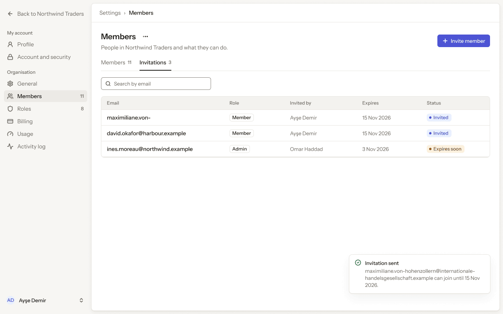

- **Who sees it:** People with tenant.members.read. Invite needs tenant.invitations.create; change role and remove need tenant.members.update and tenant.members.delete; Owner changes need tenant.owners.manage.
- **Device:** Desktop (1280 px and wider).
- **This state shows:** as the title says.
- **Values come from:** Members, invitations and roles: our API. Seats used and the seat limit: the plan's entitlements from our API. Prices in dialogs: the plan's prices from our API.
- **Components:** Button ×2, Input, Label ×3, Pill ×3, Sidebar, Tab ×2, Toast, Top bar.
- **Actions:**
  - "Members": goes to [8.01 · Members · ideal](#801--members--ideal).
  - "david.okafor@harbour.example": goes to [8.32 · Revoke invitation](#832--revoke-invitation).
  - "Back to Northwind Traders": goes to [4.01 · Home · Owner](../04-home/README.md#401--home--owner).
  - "Profile": goes to [5.01 · Profile · ideal](../05-settings-profile/README.md#501--profile--ideal).
  - "Account and security": goes to [6.01 · Account and security · ideal](../06-settings-account-and-security/README.md#601--account-and-security--ideal).
  - "General": goes to [7.01 · General · ideal](../07-settings-general/README.md#701--general--ideal).
  - "Roles": goes to [9.01 · Roles · ideal](../09-settings-roles/README.md#901--roles--ideal).
  - "Billing": goes to [10.01 · Billing · Team, monthly](../10-settings-billing/README.md#1001--billing--team-monthly).
  - "Usage": goes to [11.01 · Usage · Team](../11-settings-usage/README.md#1101--usage--team).
  - "Activity log": goes to [12.01 · Activity log · ideal](../12-settings-activity-log/README.md#1201--activity-log--ideal).
- **Texts, word for word, top to bottom:**

  - Back to Northwind Traders
  - My account
  - Profile
  - Account and security
  - Organisation
  - General
  - Members
  - 11
  - Roles
  - 8
  - Billing
  - Usage
  - Activity log
  - AD
  - Ayşe Demir
  - Settings
  - ›
  - Members
  - Members
  - People in Northwind Traders and what they can do.
  - Invite member
  - Members
  - 11
  - Invitations
  - 3
  - Search by email
  - Email
  - Role
  - Invited by
  - Expires
  - Status
  - maximiliane.von-hohenzollern@internationale-handelsgesellschaft.example
  - Member
  - Ayşe Demir
  - 15 Nov 2026
  - Invited
  - david.okafor@harbour.example
  - Member
  - Ayşe Demir
  - 15 Nov 2026
  - Invited
  - ines.moreau@northwind.example
  - Admin
  - Omar Haddad
  - 3 Nov 2026
  - Expires soon
  - Invitation sent
  - maximiliane.von-hohenzollern@internationale-handelsgesellschaft.example can join until 15 Nov 2026.

Figma: [60:9391](https://www.figma.com/design/3Ev111okX8xCBwR9B3hyBM/?node-id=60-9391)

### 8.31 · Invitations · empty

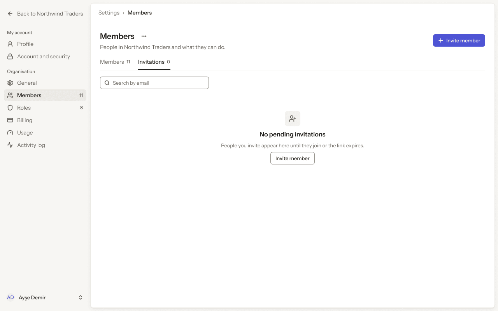

- **Who sees it:** People with tenant.members.read. Invite needs tenant.invitations.create; change role and remove need tenant.members.update and tenant.members.delete; Owner changes need tenant.owners.manage.
- **Device:** Desktop (1280 px and wider).
- **This state shows:** when there is nothing to list yet.
- **Values come from:** Members, invitations and roles: our API. Seats used and the seat limit: the plan's entitlements from our API. Prices in dialogs: the plan's prices from our API.
- **Components:** Button ×2, Empty state, Input, Sidebar, Tab ×2, Top bar.
- **Actions:**
  - "Back to Northwind Traders": goes to [4.01 · Home · Owner](../04-home/README.md#401--home--owner).
  - "Profile": goes to [5.01 · Profile · ideal](../05-settings-profile/README.md#501--profile--ideal).
  - "Account and security": goes to [6.01 · Account and security · ideal](../06-settings-account-and-security/README.md#601--account-and-security--ideal).
  - "General": goes to [7.01 · General · ideal](../07-settings-general/README.md#701--general--ideal).
  - "Members": goes to [8.01 · Members · ideal](#801--members--ideal).
  - "Roles": goes to [9.01 · Roles · ideal](../09-settings-roles/README.md#901--roles--ideal).
  - "Billing": goes to [10.01 · Billing · Team, monthly](../10-settings-billing/README.md#1001--billing--team-monthly).
  - "Usage": goes to [11.01 · Usage · Team](../11-settings-usage/README.md#1101--usage--team).
  - "Activity log": goes to [12.01 · Activity log · ideal](../12-settings-activity-log/README.md#1201--activity-log--ideal).
- **Texts, word for word, top to bottom:**

  - Back to Northwind Traders
  - My account
  - Profile
  - Account and security
  - Organisation
  - General
  - Members
  - 11
  - Roles
  - 8
  - Billing
  - Usage
  - Activity log
  - AD
  - Ayşe Demir
  - Settings
  - ›
  - Members
  - Members
  - People in Northwind Traders and what they can do.
  - Invite member
  - Members
  - 11
  - Invitations
  - 0
  - Search by email
  - No pending invitations
  - People you invite appear here until they join or the link expires.
  - Invite member

Figma: [60:9746](https://www.figma.com/design/3Ev111okX8xCBwR9B3hyBM/?node-id=60-9746)

### 8.32 · Revoke invitation

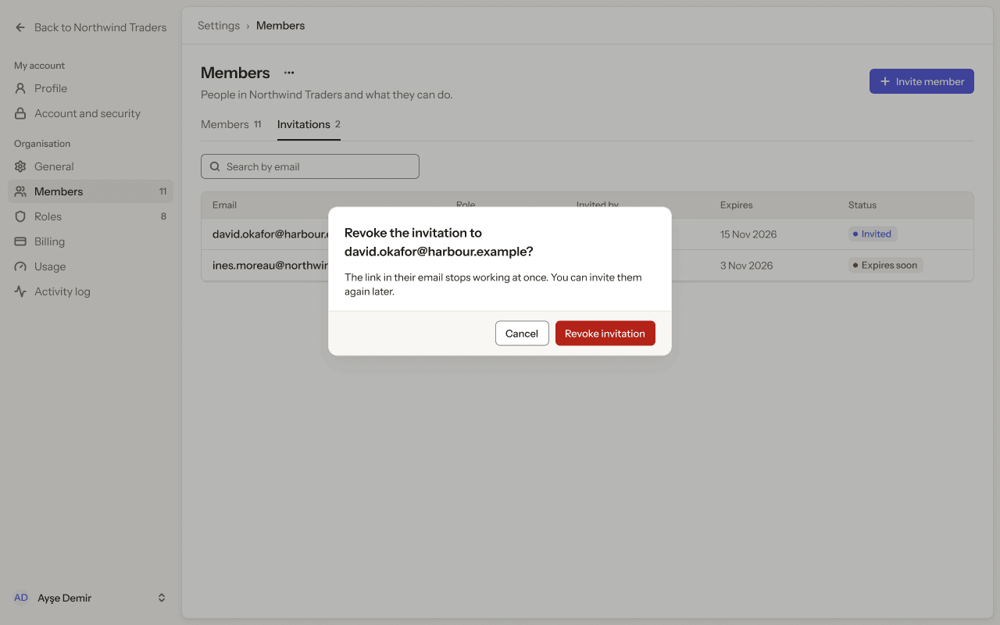

- **Who sees it:** People with tenant.members.read. Invite needs tenant.invitations.create; change role and remove need tenant.members.update and tenant.members.delete; Owner changes need tenant.owners.manage.
- **Device:** Desktop (1280 px and wider).
- **This state shows:** as the title says.
- **Values come from:** Members, invitations and roles: our API. Seats used and the seat limit: the plan's entitlements from our API. Prices in dialogs: the plan's prices from our API.
- **Components:** Button ×4, Input, Label ×2, Pill ×2, Sidebar, Tab ×2, Top bar.
- **Actions:**
  - "Cancel": goes to [8.29 · Invitations](#829--invitations).
  - "Revoke invitation": goes to [8.29 · Invitations](#829--invitations).
  - "Back to Northwind Traders": goes to [4.01 · Home · Owner](../04-home/README.md#401--home--owner).
  - "Profile": goes to [5.01 · Profile · ideal](../05-settings-profile/README.md#501--profile--ideal).
  - "Account and security": goes to [6.01 · Account and security · ideal](../06-settings-account-and-security/README.md#601--account-and-security--ideal).
  - "General": goes to [7.01 · General · ideal](../07-settings-general/README.md#701--general--ideal).
  - "Members": goes to [8.01 · Members · ideal](#801--members--ideal).
  - "Roles": goes to [9.01 · Roles · ideal](../09-settings-roles/README.md#901--roles--ideal).
  - "Billing": goes to [10.01 · Billing · Team, monthly](../10-settings-billing/README.md#1001--billing--team-monthly).
  - "Usage": goes to [11.01 · Usage · Team](../11-settings-usage/README.md#1101--usage--team).
  - "Activity log": goes to [12.01 · Activity log · ideal](../12-settings-activity-log/README.md#1201--activity-log--ideal).
- **Texts, word for word, top to bottom:**

  - Back to Northwind Traders
  - My account
  - Profile
  - Account and security
  - Organisation
  - General
  - Members
  - 11
  - Roles
  - 8
  - Billing
  - Usage
  - Activity log
  - AD
  - Ayşe Demir
  - Settings
  - ›
  - Members
  - Members
  - People in Northwind Traders and what they can do.
  - Invite member
  - Members
  - 11
  - Invitations
  - 2
  - Search by email
  - Email
  - Role
  - Invited by
  - Expires
  - Status
  - david.okafor@harbour.example
  - Member
  - Ayşe Demir
  - 15 Nov 2026
  - Invited
  - ines.moreau@northwind.example
  - Admin
  - Omar Haddad
  - 3 Nov 2026
  - Expires soon
  - Revoke the invitation to david.okafor@harbour.example?
  - The link in their email stops working at once. You can invite them again later.
  - Cancel
  - Revoke invitation

Figma: [60:10048](https://www.figma.com/design/3Ev111okX8xCBwR9B3hyBM/?node-id=60-10048)

### 8.33 · Members · tablet 1024

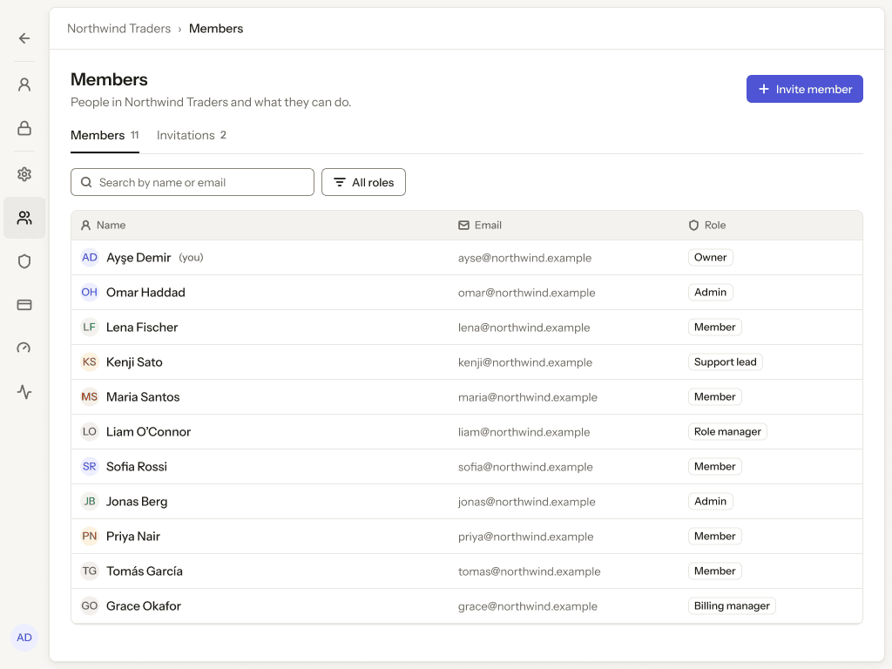

- **Who sees it:** People with tenant.members.read. Invite needs tenant.invitations.create; change role and remove need tenant.members.update and tenant.members.delete; Owner changes need tenant.owners.manage.
- **Device:** Tablet (768 to 1279 px).
- **This state shows:** as the title says.
- **Values come from:** Members, invitations and roles: our API. Seats used and the seat limit: the plan's entitlements from our API. Prices in dialogs: the plan's prices from our API.
- **Components:** Avatar ×11, Button ×2, Icon/mail, Icon/shield, Icon/user, Input, Label ×11, Sidebar, Tab ×2, Top bar.
- **Actions:**
  - "Area": goes to [4.01 · Home · Owner](../04-home/README.md#401--home--owner).
  - "Area": goes to [5.01 · Profile · ideal](../05-settings-profile/README.md#501--profile--ideal).
  - "Area": goes to [6.01 · Account and security · ideal](../06-settings-account-and-security/README.md#601--account-and-security--ideal).
  - "Area": goes to [7.01 · General · ideal](../07-settings-general/README.md#701--general--ideal).
  - "Area": goes to [8.01 · Members · ideal](#801--members--ideal).
  - "Area": goes to [9.01 · Roles · ideal](../09-settings-roles/README.md#901--roles--ideal).
  - "Area": goes to [10.01 · Billing · Team, monthly](../10-settings-billing/README.md#1001--billing--team-monthly).
  - "Area": goes to [11.01 · Usage · Team](../11-settings-usage/README.md#1101--usage--team).
  - "Area": goes to [12.01 · Activity log · ideal](../12-settings-activity-log/README.md#1201--activity-log--ideal).
- **Texts, word for word, top to bottom:**

  - AD
  - Northwind Traders
  - ›
  - Members
  - Members
  - People in Northwind Traders and what they can do.
  - Invite member
  - Members
  - 11
  - Invitations
  - 2
  - Search by name or email
  - All roles
  - Name
  - Email
  - Role
  - AD
  - Ayşe Demir
  - (you)
  - ayse@northwind.example
  - Owner
  - OH
  - Omar Haddad
  - omar@northwind.example
  - Admin
  - LF
  - Lena Fischer
  - lena@northwind.example
  - Member
  - KS
  - Kenji Sato
  - kenji@northwind.example
  - Support lead
  - MS
  - Maria Santos
  - maria@northwind.example
  - Member
  - LO
  - Liam O’Connor
  - liam@northwind.example
  - Role manager
  - SR
  - Sofia Rossi
  - sofia@northwind.example
  - Member
  - JB
  - Jonas Berg
  - jonas@northwind.example
  - Admin
  - PN
  - Priya Nair
  - priya@northwind.example
  - Member
  - TG
  - Tomás García
  - tomas@northwind.example
  - Member
  - GO
  - Grace Okafor
  - grace@northwind.example
  - Billing manager

Figma: [61:6684](https://www.figma.com/design/3Ev111okX8xCBwR9B3hyBM/?node-id=61-6684)

### 8.34 · Members · phone

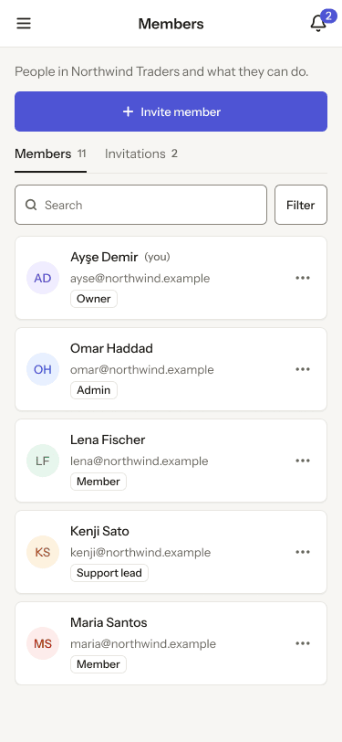

- **Who sees it:** People with tenant.members.read. Invite needs tenant.invitations.create; change role and remove need tenant.members.update and tenant.members.delete; Owner changes need tenant.owners.manage.
- **Device:** Phone (up to 767 px).
- **This state shows:** on a phone.
- **Values come from:** Members, invitations and roles: our API. Seats used and the seat limit: the plan's entitlements from our API. Prices in dialogs: the plan's prices from our API.
- **Components:** Button ×2, Input, Member card ×5, Phone top bar, Tab ×2.
- **Actions:**
  - "Area": goes to [2.30 · Phone · settings menu open](../02-shell/README.md#230--phone--settings-menu-open).
  - "2": goes to [3.14 · Phone · notifications](../03-notifications/README.md#314--phone--notifications).
  - "Invite member": goes to [8.35 · Invite member · phone](#835--invite-member--phone).
  - "omar@northwind.example": goes to [8.36 · Remove member · phone sheet](#836--remove-member--phone-sheet).
- **Texts, word for word, top to bottom:**

  - Members
  - 2
  - People in Northwind Traders and what they can do.
  - Invite member
  - Members
  - 11
  - Invitations
  - 2
  - Search
  - Filter
  - AD
  - Ayşe Demir
  - (you)
  - ayse@northwind.example
  - Owner
  - OH
  - Omar Haddad
  - omar@northwind.example
  - Admin
  - LF
  - Lena Fischer
  - lena@northwind.example
  - Member
  - KS
  - Kenji Sato
  - kenji@northwind.example
  - Support lead
  - MS
  - Maria Santos
  - maria@northwind.example
  - Member

Figma: [61:7010](https://www.figma.com/design/3Ev111okX8xCBwR9B3hyBM/?node-id=61-7010)

### 8.35 · Invite member · phone

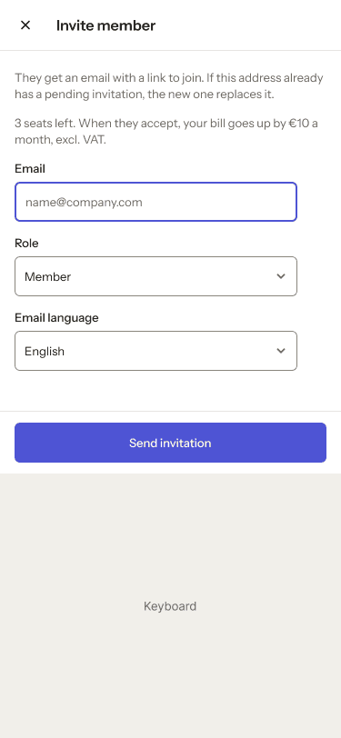

- **Who sees it:** People with tenant.members.read. Invite needs tenant.invitations.create; change role and remove need tenant.members.update and tenant.members.delete; Owner changes need tenant.owners.manage.
- **Device:** Phone (up to 767 px).
- **This state shows:** on a phone.
- **Values come from:** Members, invitations and roles: our API. Seats used and the seat limit: the plan's entitlements from our API. Prices in dialogs: the plan's prices from our API.
- **Components:** Button ×2, Input, Select ×2.
- **Actions:**
  - "Area": goes to [8.34 · Members · phone](#834--members--phone).
- **Texts, word for word, top to bottom:**

  - Invite member
  - They get an email with a link to join. If this address already has a pending invitation, the new one replaces it.
  - 3 seats left. When they accept, your bill goes up by €10 a month, excl. VAT.
  - Email
  - name@company.com
  - Role
  - Member
  - Email language
  - English
  - Send invitation
  - Keyboard

Figma: [61:7150](https://www.figma.com/design/3Ev111okX8xCBwR9B3hyBM/?node-id=61-7150)

### 8.36 · Members · Arabic

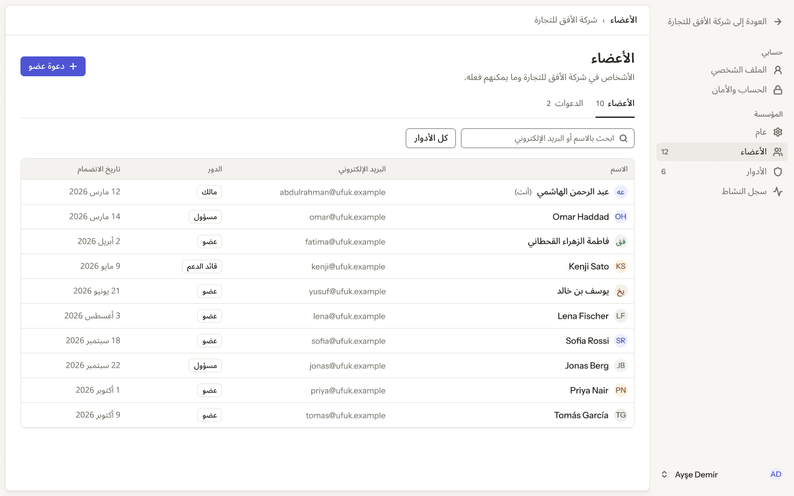

- **Who sees it:** People with tenant.members.read. Invite needs tenant.invitations.create; change role and remove need tenant.members.update and tenant.members.delete; Owner changes need tenant.owners.manage.
- **Device:** Desktop (1280 px and wider).
- **This state shows:** with the language set to Arabic (right to left).
- **Values come from:** Members, invitations and roles: our API. Seats used and the seat limit: the plan's entitlements from our API. Prices in dialogs: the plan's prices from our API.
- **Components:** Avatar ×10, Button ×2, Input, Label ×10, Sidebar, Tab ×2, Top bar.
- **Actions:**
  - "العودة إلى شركة الأفق للتجارة": goes to [4.01 · Home · Owner](../04-home/README.md#401--home--owner).
  - "الملف الشخصي": goes to [5.01 · Profile · ideal](../05-settings-profile/README.md#501--profile--ideal).
  - "الحساب والأمان": goes to [6.01 · Account and security · ideal](../06-settings-account-and-security/README.md#601--account-and-security--ideal).
  - "عام": goes to [7.01 · General · ideal](../07-settings-general/README.md#701--general--ideal).
  - "الأعضاء": goes to [8.01 · Members · ideal](#801--members--ideal).
  - "الأدوار": goes to [9.01 · Roles · ideal](../09-settings-roles/README.md#901--roles--ideal).
  - "سجل النشاط": goes to [12.01 · Activity log · ideal](../12-settings-activity-log/README.md#1201--activity-log--ideal).
- **Texts, word for word, top to bottom:**

  - شركة الأفق للتجارة
  - ‹
  - الأعضاء
  - دعوة عضو
  - الأعضاء
  - الأشخاص في شركة الأفق للتجارة وما يمكنهم فعله.
  - 2
  - الدعوات
  - 10
  - الأعضاء
  - كل الأدوار
  - ابحث بالاسم أو البريد الإلكتروني
  - تاريخ الانضمام
  - الدور
  - البريد الإلكتروني
  - الاسم
  - 12 مارس 2026
  - مالك
  - abdulrahman@ufuk.example
  - (أنت)
  - عبد الرحمن الهاشمي
  - عه
  - 14 مارس 2026
  - مسؤول
  - omar@ufuk.example
  - Omar Haddad
  - OH
  - 2 أبريل 2026
  - عضو
  - fatima@ufuk.example
  - فاطمة الزهراء القحطاني
  - فق
  - 9 مايو 2026
  - قائد الدعم
  - kenji@ufuk.example
  - Kenji Sato
  - KS
  - 21 يونيو 2026
  - عضو
  - yusuf@ufuk.example
  - يوسف بن خالد
  - يخ
  - 3 أغسطس 2026
  - عضو
  - lena@ufuk.example
  - Lena Fischer
  - LF
  - 18 سبتمبر 2026
  - عضو
  - sofia@ufuk.example
  - Sofia Rossi
  - SR
  - 22 سبتمبر 2026
  - مسؤول
  - jonas@ufuk.example
  - Jonas Berg
  - JB
  - 1 أكتوبر 2026
  - عضو
  - priya@ufuk.example
  - Priya Nair
  - PN
  - 9 أكتوبر 2026
  - عضو
  - tomas@ufuk.example
  - Tomás García
  - TG
  - العودة إلى شركة الأفق للتجارة
  - حسابي
  - الملف الشخصي
  - الحساب والأمان
  - المؤسسة
  - عام
  - 12
  - الأعضاء
  - 6
  - الأدوار
  - سجل النشاط
  - Ayşe Demir
  - AD

Figma: [61:7190](https://www.figma.com/design/3Ev111okX8xCBwR9B3hyBM/?node-id=61-7190)

### 8.36 · Remove member · phone sheet

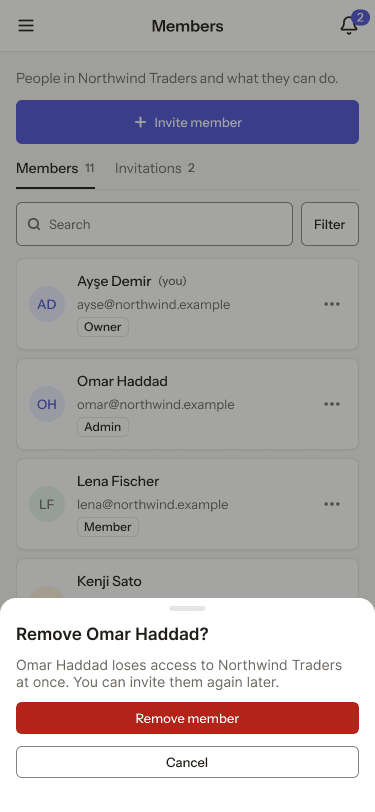

- **Who sees it:** People with tenant.members.read. Invite needs tenant.invitations.create; change role and remove need tenant.members.update and tenant.members.delete; Owner changes need tenant.owners.manage.
- **Device:** Phone (up to 767 px).
- **This state shows:** on a phone; on a phone, as a bottom sheet.
- **Values come from:** Members, invitations and roles: our API. Seats used and the seat limit: the plan's entitlements from our API. Prices in dialogs: the plan's prices from our API.
- **Components:** Button ×4, Input, Member card ×5, Phone top bar, Tab ×2.
- **Actions:**
  - "Cancel": goes to [8.34 · Members · phone](#834--members--phone).
  - "maria@northwind.example": goes to [8.34 · Members · phone](#834--members--phone).
- **Texts, word for word, top to bottom:**

  - Members
  - 2
  - People in Northwind Traders and what they can do.
  - Invite member
  - Members
  - 11
  - Invitations
  - 2
  - Search
  - Filter
  - AD
  - Ayşe Demir
  - (you)
  - ayse@northwind.example
  - Owner
  - OH
  - Omar Haddad
  - omar@northwind.example
  - Admin
  - LF
  - Lena Fischer
  - lena@northwind.example
  - Member
  - KS
  - Kenji Sato
  - kenji@northwind.example
  - Support lead
  - MS
  - Maria Santos
  - maria@northwind.example
  - Member
  - Remove Omar Haddad?
  - Omar Haddad loses access to Northwind Traders at once. You can invite them again later.
  - Remove member
  - Cancel

Figma: [209:17266](https://www.figma.com/design/3Ev111okX8xCBwR9B3hyBM/?node-id=209-17266)

### 8.37 · Invite member · Arabic

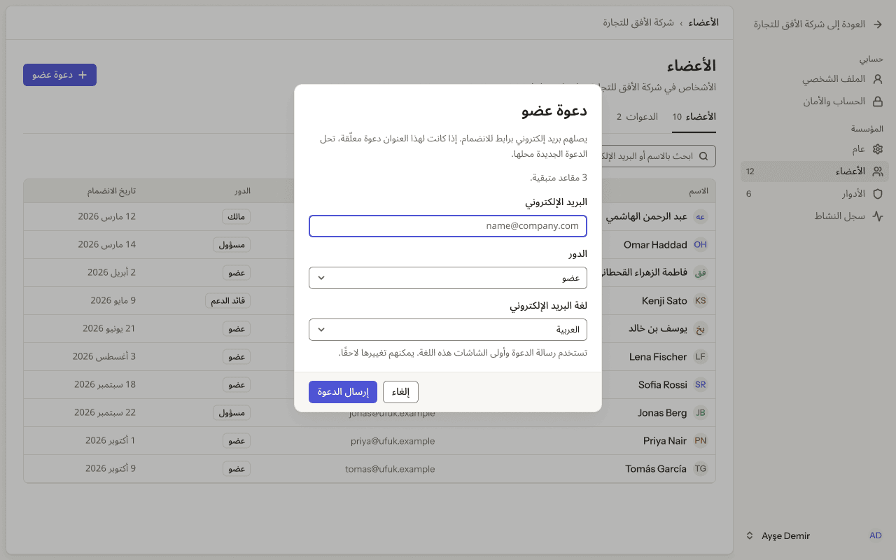

- **Who sees it:** People with tenant.members.read. Invite needs tenant.invitations.create; change role and remove need tenant.members.update and tenant.members.delete; Owner changes need tenant.owners.manage.
- **Device:** Desktop (1280 px and wider).
- **This state shows:** with the language set to Arabic (right to left).
- **Values come from:** Members, invitations and roles: our API. Seats used and the seat limit: the plan's entitlements from our API. Prices in dialogs: the plan's prices from our API.
- **Components:** Avatar ×10, Button ×4, Input ×2, Label ×10, Select ×2, Sidebar, Tab ×2, Top bar.
- **Actions:**
  - "العودة إلى شركة الأفق للتجارة": goes to [4.01 · Home · Owner](../04-home/README.md#401--home--owner).
  - "الملف الشخصي": goes to [5.01 · Profile · ideal](../05-settings-profile/README.md#501--profile--ideal).
  - "الحساب والأمان": goes to [6.01 · Account and security · ideal](../06-settings-account-and-security/README.md#601--account-and-security--ideal).
  - "عام": goes to [7.01 · General · ideal](../07-settings-general/README.md#701--general--ideal).
  - "الأعضاء": goes to [8.01 · Members · ideal](#801--members--ideal).
  - "الأدوار": goes to [9.01 · Roles · ideal](../09-settings-roles/README.md#901--roles--ideal).
  - "سجل النشاط": goes to [12.01 · Activity log · ideal](../12-settings-activity-log/README.md#1201--activity-log--ideal).
- **Texts, word for word, top to bottom:**

  - شركة الأفق للتجارة
  - ‹
  - الأعضاء
  - دعوة عضو
  - الأعضاء
  - الأشخاص في شركة الأفق للتجارة وما يمكنهم فعله.
  - 2
  - الدعوات
  - 10
  - الأعضاء
  - كل الأدوار
  - ابحث بالاسم أو البريد الإلكتروني
  - تاريخ الانضمام
  - الدور
  - البريد الإلكتروني
  - الاسم
  - 12 مارس 2026
  - مالك
  - abdulrahman@ufuk.example
  - (أنت)
  - عبد الرحمن الهاشمي
  - عه
  - 14 مارس 2026
  - مسؤول
  - omar@ufuk.example
  - Omar Haddad
  - OH
  - 2 أبريل 2026
  - عضو
  - fatima@ufuk.example
  - فاطمة الزهراء القحطاني
  - فق
  - 9 مايو 2026
  - قائد الدعم
  - kenji@ufuk.example
  - Kenji Sato
  - KS
  - 21 يونيو 2026
  - عضو
  - yusuf@ufuk.example
  - يوسف بن خالد
  - يخ
  - 3 أغسطس 2026
  - عضو
  - lena@ufuk.example
  - Lena Fischer
  - LF
  - 18 سبتمبر 2026
  - عضو
  - sofia@ufuk.example
  - Sofia Rossi
  - SR
  - 22 سبتمبر 2026
  - مسؤول
  - jonas@ufuk.example
  - Jonas Berg
  - JB
  - 1 أكتوبر 2026
  - عضو
  - priya@ufuk.example
  - Priya Nair
  - PN
  - 9 أكتوبر 2026
  - عضو
  - tomas@ufuk.example
  - Tomás García
  - TG
  - العودة إلى شركة الأفق للتجارة
  - حسابي
  - الملف الشخصي
  - الحساب والأمان
  - المؤسسة
  - عام
  - 12
  - الأعضاء
  - 6
  - الأدوار
  - سجل النشاط
  - Ayşe Demir
  - AD
  - دعوة عضو
  - يصلهم بريد إلكتروني برابط للانضمام. إذا كانت لهذا العنوان دعوة معلّقة، تحل الدعوة الجديدة محلها.
  - 3 مقاعد متبقية.
  - البريد الإلكتروني
  - name@company.com
  - الدور
  - عضو
  - لغة البريد الإلكتروني
  - العربية
  - تستخدم رسالة الدعوة وأولى الشاشات هذه اللغة. يمكنهم تغييرها لاحقًا.
  - إرسال الدعوة
  - إلغاء

Figma: [61:7504](https://www.figma.com/design/3Ev111okX8xCBwR9B3hyBM/?node-id=61-7504)

### 8.38 · Change role · by an Admin

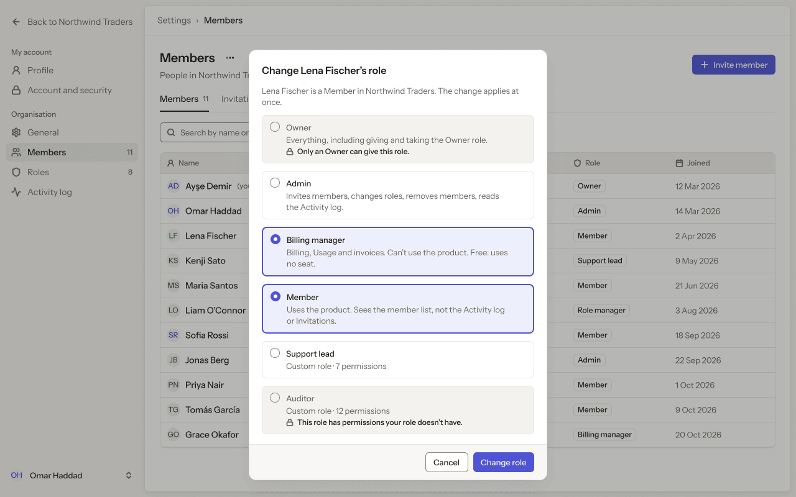

- **Who sees it:** People with tenant.members.read. Invite needs tenant.invitations.create; change role and remove need tenant.members.update and tenant.members.delete; Owner changes need tenant.owners.manage.
- **Device:** Desktop (1280 px and wider).
- **This state shows:** as the title says.
- **Values come from:** Members, invitations and roles: our API. Seats used and the seat limit: the plan's entitlements from our API. Prices in dialogs: the plan's prices from our API.
- **Components:** Avatar ×11, Button ×5, Icon/calendar, Icon/lock ×2, Icon/mail, Icon/shield, Icon/user, Input, Label ×11, Sidebar, Tab ×2, Top bar.
- **Actions:**
  - "Area": goes to [8.01 · Members · ideal](#801--members--ideal).
  - "Back to Northwind Traders": goes to [4.01 · Home · Owner](../04-home/README.md#401--home--owner).
  - "Profile": goes to [5.01 · Profile · ideal](../05-settings-profile/README.md#501--profile--ideal).
  - "Account and security": goes to [6.01 · Account and security · ideal](../06-settings-account-and-security/README.md#601--account-and-security--ideal).
  - "General": goes to [7.01 · General · ideal](../07-settings-general/README.md#701--general--ideal).
  - "Members": goes to [8.01 · Members · ideal](#801--members--ideal).
  - "Roles": goes to [9.01 · Roles · ideal](../09-settings-roles/README.md#901--roles--ideal).
  - "Activity log": goes to [12.01 · Activity log · ideal](../12-settings-activity-log/README.md#1201--activity-log--ideal).
- **Texts, word for word, top to bottom:**

  - Back to Northwind Traders
  - My account
  - Profile
  - Account and security
  - Organisation
  - General
  - Members
  - 11
  - Roles
  - 8
  - Activity log
  - OH
  - Omar Haddad
  - Settings
  - ›
  - Members
  - Members
  - People in Northwind Traders and what they can do.
  - Invite member
  - Members
  - 11
  - Invitations
  - 2
  - Search by name or email
  - All roles
  - Name
  - Email
  - Role
  - Joined
  - AD
  - Ayşe Demir
  - (you)
  - ayse@northwind.example
  - Owner
  - 12 Mar 2026
  - OH
  - Omar Haddad
  - omar@northwind.example
  - Admin
  - 14 Mar 2026
  - LF
  - Lena Fischer
  - lena@northwind.example
  - Member
  - 2 Apr 2026
  - KS
  - Kenji Sato
  - kenji@northwind.example
  - Support lead
  - 9 May 2026
  - MS
  - Maria Santos
  - maria@northwind.example
  - Member
  - 21 Jun 2026
  - LO
  - Liam O’Connor
  - liam@northwind.example
  - Role manager
  - 3 Aug 2026
  - SR
  - Sofia Rossi
  - sofia@northwind.example
  - Member
  - 18 Sep 2026
  - JB
  - Jonas Berg
  - jonas@northwind.example
  - Admin
  - 22 Sep 2026
  - PN
  - Priya Nair
  - priya@northwind.example
  - Member
  - 1 Oct 2026
  - TG
  - Tomás García
  - tomas@northwind.example
  - Member
  - 9 Oct 2026
  - GO
  - Grace Okafor
  - grace@northwind.example
  - Billing manager
  - 20 Oct 2026
  - Change Lena Fischer’s role
  - Lena Fischer is a Member in Northwind Traders. The change applies at once.
  - Owner
  - Everything, including giving and taking the Owner role.
  - Only an Owner can give this role.
  - Admin
  - Invites members, changes roles, removes members, reads the Activity log.
  - Billing manager
  - Billing, Usage and invoices. Can’t use the product. Free: uses no seat.
  - Member
  - Uses the product. Sees the member list, not the Activity log or Invitations.
  - Support lead
  - Custom role · 7 permissions
  - Auditor
  - Custom role · 12 permissions
  - This role has permissions your role doesn’t have.
  - Cancel
  - Change role

Figma: [72:10490](https://www.figma.com/design/3Ev111okX8xCBwR9B3hyBM/?node-id=72-10490)

### 8.39 · No free seat

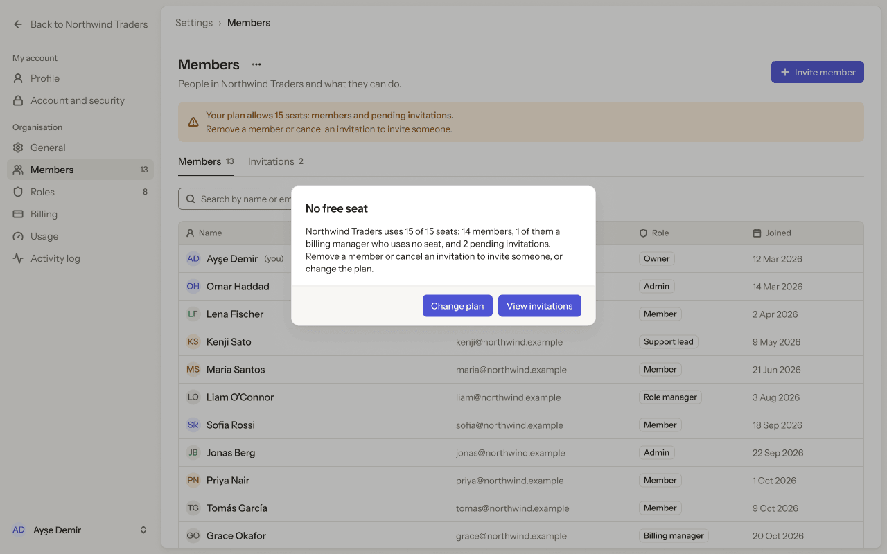

- **Who sees it:** People with tenant.members.read. Invite needs tenant.invitations.create; change role and remove need tenant.members.update and tenant.members.delete; Owner changes need tenant.owners.manage.
- **Device:** Desktop (1280 px and wider).
- **This state shows:** as the title says.
- **Values come from:** Members, invitations and roles: our API. Seats used and the seat limit: the plan's entitlements from our API. Prices in dialogs: the plan's prices from our API.
- **Components:** Avatar ×14, Banner, Button ×5, Icon/calendar, Icon/mail, Icon/shield, Icon/user, Input, Label ×14, Sidebar, Tab ×2, Top bar.
- **Actions:**
  - "omar@northwind.example": goes to [8.29 · Invitations](#829--invitations).
  - "Back to Northwind Traders": goes to [4.01 · Home · Owner](../04-home/README.md#401--home--owner).
  - "Profile": goes to [5.01 · Profile · ideal](../05-settings-profile/README.md#501--profile--ideal).
  - "Account and security": goes to [6.01 · Account and security · ideal](../06-settings-account-and-security/README.md#601--account-and-security--ideal).
  - "General": goes to [7.01 · General · ideal](../07-settings-general/README.md#701--general--ideal).
  - "Members": goes to [8.01 · Members · ideal](#801--members--ideal).
  - "Roles": goes to [9.01 · Roles · ideal](../09-settings-roles/README.md#901--roles--ideal).
  - "Billing": goes to [10.01 · Billing · Team, monthly](../10-settings-billing/README.md#1001--billing--team-monthly).
  - "Usage": goes to [11.01 · Usage · Team](../11-settings-usage/README.md#1101--usage--team).
  - "Activity log": goes to [12.01 · Activity log · ideal](../12-settings-activity-log/README.md#1201--activity-log--ideal).
  - "Change plan": goes to [10.02 · Change plan · monthly](../10-settings-billing/README.md#1002--change-plan--monthly).
- **Texts, word for word, top to bottom:**

  - Back to Northwind Traders
  - My account
  - Profile
  - Account and security
  - Organisation
  - General
  - Members
  - 13
  - Roles
  - 8
  - Billing
  - Usage
  - Activity log
  - AD
  - Ayşe Demir
  - Settings
  - ›
  - Members
  - Members
  - People in Northwind Traders and what they can do.
  - Invite member
  - Your plan allows 15 seats: members and pending invitations.
  - Remove a member or cancel an invitation to invite someone.
  - Members
  - 13
  - Invitations
  - 2
  - Search by name or email
  - All roles
  - Name
  - Email
  - Role
  - Joined
  - AD
  - Ayşe Demir
  - (you)
  - ayse@northwind.example
  - Owner
  - 12 Mar 2026
  - OH
  - Omar Haddad
  - omar@northwind.example
  - Admin
  - 14 Mar 2026
  - LF
  - Lena Fischer
  - lena@northwind.example
  - Member
  - 2 Apr 2026
  - KS
  - Kenji Sato
  - kenji@northwind.example
  - Support lead
  - 9 May 2026
  - MS
  - Maria Santos
  - maria@northwind.example
  - Member
  - 21 Jun 2026
  - LO
  - Liam O’Connor
  - liam@northwind.example
  - Role manager
  - 3 Aug 2026
  - SR
  - Sofia Rossi
  - sofia@northwind.example
  - Member
  - 18 Sep 2026
  - JB
  - Jonas Berg
  - jonas@northwind.example
  - Admin
  - 22 Sep 2026
  - PN
  - Priya Nair
  - priya@northwind.example
  - Member
  - 1 Oct 2026
  - TG
  - Tomás García
  - tomas@northwind.example
  - Member
  - 9 Oct 2026
  - GO
  - Grace Okafor
  - grace@northwind.example
  - Billing manager
  - 20 Oct 2026
  - HK
  - Hana Kobayashi
  - hana@northwind.example
  - Member
  - 2 Apr 2026
  - NW
  - Noah Williams
  - noah@northwind.example
  - Member
  - 2 Apr 2026
  - AA
  - Ahmed Al-Sayed
  - ahmed@northwind.example
  - Member
  - 2 Apr 2026
  - No free seat
  - Northwind Traders uses 15 of 15 seats: 14 members, 1 of them a billing manager who uses no seat, and 2 pending invitations. Remove a member or cancel an invitation to invite someone, or change the plan.
  - Change plan
  - View invitations

Figma: [72:10883](https://www.figma.com/design/3Ev111okX8xCBwR9B3hyBM/?node-id=72-10883)

### 8.40 · No free seat · over the limit

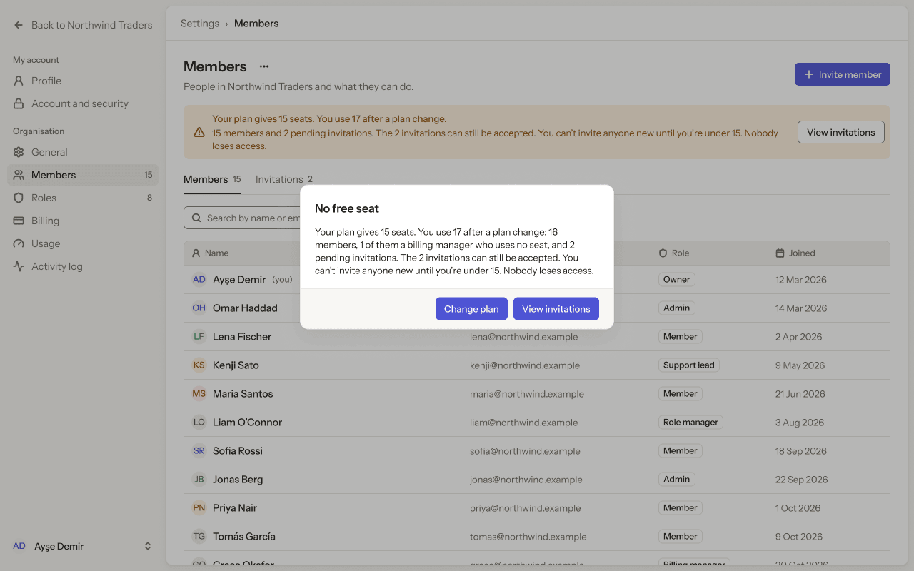

- **Who sees it:** People with tenant.members.read. Invite needs tenant.invitations.create; change role and remove need tenant.members.update and tenant.members.delete; Owner changes need tenant.owners.manage.
- **Device:** Desktop (1280 px and wider).
- **This state shows:** as the title says.
- **Values come from:** Members, invitations and roles: our API. Seats used and the seat limit: the plan's entitlements from our API. Prices in dialogs: the plan's prices from our API.
- **Components:** Avatar ×13, Banner, Button ×5, Icon/calendar, Icon/mail, Icon/shield, Icon/user, Input, Label ×13, Sidebar, Tab ×2, Top bar.
- **Actions:**
  - "Area": goes to [8.29 · Invitations](#829--invitations).
  - "Back to Northwind Traders": goes to [4.01 · Home · Owner](../04-home/README.md#401--home--owner).
  - "Profile": goes to [5.01 · Profile · ideal](../05-settings-profile/README.md#501--profile--ideal).
  - "Account and security": goes to [6.01 · Account and security · ideal](../06-settings-account-and-security/README.md#601--account-and-security--ideal).
  - "General": goes to [7.01 · General · ideal](../07-settings-general/README.md#701--general--ideal).
  - "Members": goes to [8.01 · Members · ideal](#801--members--ideal).
  - "Roles": goes to [9.01 · Roles · ideal](../09-settings-roles/README.md#901--roles--ideal).
  - "Billing": goes to [10.01 · Billing · Team, monthly](../10-settings-billing/README.md#1001--billing--team-monthly).
  - "Usage": goes to [11.01 · Usage · Team](../11-settings-usage/README.md#1101--usage--team).
  - "Activity log": goes to [12.01 · Activity log · ideal](../12-settings-activity-log/README.md#1201--activity-log--ideal).
  - "Change plan": goes to [10.02 · Change plan · monthly](../10-settings-billing/README.md#1002--change-plan--monthly).
- **Texts, word for word, top to bottom:**

  - Back to Northwind Traders
  - My account
  - Profile
  - Account and security
  - Organisation
  - General
  - Members
  - 15
  - Roles
  - 8
  - Billing
  - Usage
  - Activity log
  - AD
  - Ayşe Demir
  - Settings
  - ›
  - Members
  - Members
  - People in Northwind Traders and what they can do.
  - Invite member
  - Your plan gives 15 seats. You use 17 after a plan change.
  - 15 members and 2 pending invitations. The 2 invitations can still be accepted. You can’t invite anyone new until you’re under 15. Nobody loses access.
  - View invitations
  - Members
  - 15
  - Invitations
  - 2
  - Search by name or email
  - All roles
  - Name
  - Email
  - Role
  - Joined
  - AD
  - Ayşe Demir
  - (you)
  - ayse@northwind.example
  - Owner
  - 12 Mar 2026
  - OH
  - Omar Haddad
  - omar@northwind.example
  - Admin
  - 14 Mar 2026
  - LF
  - Lena Fischer
  - lena@northwind.example
  - Member
  - 2 Apr 2026
  - KS
  - Kenji Sato
  - kenji@northwind.example
  - Support lead
  - 9 May 2026
  - MS
  - Maria Santos
  - maria@northwind.example
  - Member
  - 21 Jun 2026
  - LO
  - Liam O’Connor
  - liam@northwind.example
  - Role manager
  - 3 Aug 2026
  - SR
  - Sofia Rossi
  - sofia@northwind.example
  - Member
  - 18 Sep 2026
  - JB
  - Jonas Berg
  - jonas@northwind.example
  - Admin
  - 22 Sep 2026
  - PN
  - Priya Nair
  - priya@northwind.example
  - Member
  - 1 Oct 2026
  - TG
  - Tomás García
  - tomas@northwind.example
  - Member
  - 9 Oct 2026
  - GO
  - Grace Okafor
  - grace@northwind.example
  - Billing manager
  - 20 Oct 2026
  - HK
  - Hana Kobayashi
  - hana@northwind.example
  - Member
  - 2 Apr 2026
  - NW
  - Noah Williams
  - noah@northwind.example
  - Member
  - 2 Apr 2026
  - No free seat
  - Your plan gives 15 seats. You use 17 after a plan change: 16 members, 1 of them a billing manager who uses no seat, and 2 pending invitations. The 2 invitations can still be accepted. You can’t invite anyone new until you’re under 15. Nobody loses access.
  - Change plan
  - View invitations

Figma: [72:11304](https://www.figma.com/design/3Ev111okX8xCBwR9B3hyBM/?node-id=72-11304)

### 8.41 · Members · more menu

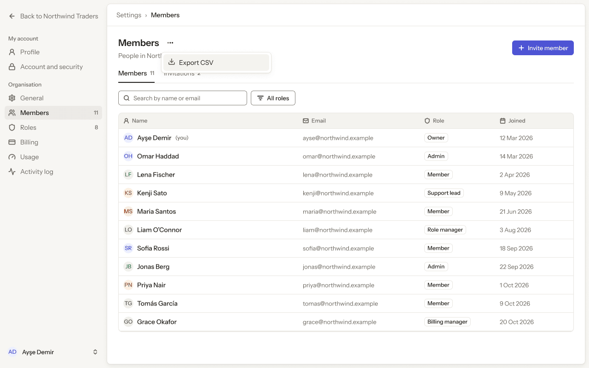

- **Who sees it:** People with tenant.members.read. Invite needs tenant.invitations.create; change role and remove need tenant.members.update and tenant.members.delete; Owner changes need tenant.owners.manage.
- **Device:** Desktop (1280 px and wider).
- **This state shows:** as the title says.
- **Values come from:** Members, invitations and roles: our API. Seats used and the seat limit: the plan's entitlements from our API. Prices in dialogs: the plan's prices from our API.
- **Components:** Avatar ×11, Button ×3, Icon/calendar, Icon/download, Icon/mail, Icon/shield, Icon/user, Input, Label ×11, Sidebar, Tab ×2, Top bar.
- **Actions:**
  - "Back to Northwind Traders": goes to [4.01 · Home · Owner](../04-home/README.md#401--home--owner).
  - "Profile": goes to [5.01 · Profile · ideal](../05-settings-profile/README.md#501--profile--ideal).
  - "Account and security": goes to [6.01 · Account and security · ideal](../06-settings-account-and-security/README.md#601--account-and-security--ideal).
  - "General": goes to [7.01 · General · ideal](../07-settings-general/README.md#701--general--ideal).
  - "Members": goes to [8.01 · Members · ideal](#801--members--ideal).
  - "Roles": goes to [9.01 · Roles · ideal](../09-settings-roles/README.md#901--roles--ideal).
  - "Billing": goes to [10.01 · Billing · Team, monthly](../10-settings-billing/README.md#1001--billing--team-monthly).
  - "Usage": goes to [11.01 · Usage · Team](../11-settings-usage/README.md#1101--usage--team).
  - "Activity log": goes to [12.01 · Activity log · ideal](../12-settings-activity-log/README.md#1201--activity-log--ideal).
- **Texts, word for word, top to bottom:**

  - Back to Northwind Traders
  - My account
  - Profile
  - Account and security
  - Organisation
  - General
  - Members
  - 11
  - Roles
  - 8
  - Billing
  - Usage
  - Activity log
  - AD
  - Ayşe Demir
  - Settings
  - ›
  - Members
  - Members
  - People in Northwind Traders and what they can do.
  - Invite member
  - Members
  - 11
  - Invitations
  - 2
  - Search by name or email
  - All roles
  - Name
  - Email
  - Role
  - Joined
  - AD
  - Ayşe Demir
  - (you)
  - ayse@northwind.example
  - Owner
  - 12 Mar 2026
  - OH
  - Omar Haddad
  - omar@northwind.example
  - Admin
  - 14 Mar 2026
  - LF
  - Lena Fischer
  - lena@northwind.example
  - Member
  - 2 Apr 2026
  - KS
  - Kenji Sato
  - kenji@northwind.example
  - Support lead
  - 9 May 2026
  - MS
  - Maria Santos
  - maria@northwind.example
  - Member
  - 21 Jun 2026
  - LO
  - Liam O’Connor
  - liam@northwind.example
  - Role manager
  - 3 Aug 2026
  - SR
  - Sofia Rossi
  - sofia@northwind.example
  - Member
  - 18 Sep 2026
  - JB
  - Jonas Berg
  - jonas@northwind.example
  - Admin
  - 22 Sep 2026
  - PN
  - Priya Nair
  - priya@northwind.example
  - Member
  - 1 Oct 2026
  - TG
  - Tomás García
  - tomas@northwind.example
  - Member
  - 9 Oct 2026
  - GO
  - Grace Okafor
  - grace@northwind.example
  - Billing manager
  - 20 Oct 2026
  - Export CSV

Figma: [159:16102](https://www.figma.com/design/3Ev111okX8xCBwR9B3hyBM/?node-id=159-16102)

### 8.42 · No free seat · without billing

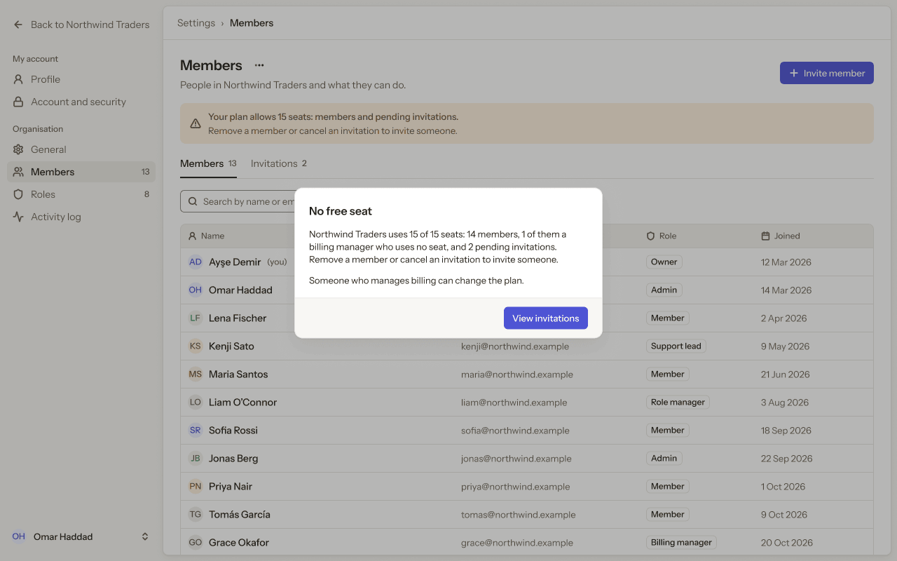

- **Who sees it:** People with tenant.members.read. Invite needs tenant.invitations.create; change role and remove need tenant.members.update and tenant.members.delete; Owner changes need tenant.owners.manage.
- **Device:** Desktop (1280 px and wider).
- **This state shows:** as the title says.
- **Values come from:** Members, invitations and roles: our API. Seats used and the seat limit: the plan's entitlements from our API. Prices in dialogs: the plan's prices from our API.
- **Components:** Avatar ×14, Banner, Button ×4, Icon/calendar, Icon/mail, Icon/shield, Icon/user, Input, Label ×14, Sidebar, Tab ×2, Top bar.
- **Actions:**
  - "omar@northwind.example": goes to [8.29 · Invitations](#829--invitations).
  - "Back to Northwind Traders": goes to [4.01 · Home · Owner](../04-home/README.md#401--home--owner).
  - "Profile": goes to [5.01 · Profile · ideal](../05-settings-profile/README.md#501--profile--ideal).
  - "Account and security": goes to [6.01 · Account and security · ideal](../06-settings-account-and-security/README.md#601--account-and-security--ideal).
  - "General": goes to [7.01 · General · ideal](../07-settings-general/README.md#701--general--ideal).
  - "Members": goes to [8.01 · Members · ideal](#801--members--ideal).
  - "Roles": goes to [9.01 · Roles · ideal](../09-settings-roles/README.md#901--roles--ideal).
  - "Activity log": goes to [12.01 · Activity log · ideal](../12-settings-activity-log/README.md#1201--activity-log--ideal).
- **Texts, word for word, top to bottom:**

  - Back to Northwind Traders
  - My account
  - Profile
  - Account and security
  - Organisation
  - General
  - Members
  - 13
  - Roles
  - 8
  - Activity log
  - OH
  - Omar Haddad
  - Settings
  - ›
  - Members
  - Members
  - People in Northwind Traders and what they can do.
  - Invite member
  - Your plan allows 15 seats: members and pending invitations.
  - Remove a member or cancel an invitation to invite someone.
  - Members
  - 13
  - Invitations
  - 2
  - Search by name or email
  - All roles
  - Name
  - Email
  - Role
  - Joined
  - AD
  - Ayşe Demir
  - (you)
  - ayse@northwind.example
  - Owner
  - 12 Mar 2026
  - OH
  - Omar Haddad
  - omar@northwind.example
  - Admin
  - 14 Mar 2026
  - LF
  - Lena Fischer
  - lena@northwind.example
  - Member
  - 2 Apr 2026
  - KS
  - Kenji Sato
  - kenji@northwind.example
  - Support lead
  - 9 May 2026
  - MS
  - Maria Santos
  - maria@northwind.example
  - Member
  - 21 Jun 2026
  - LO
  - Liam O’Connor
  - liam@northwind.example
  - Role manager
  - 3 Aug 2026
  - SR
  - Sofia Rossi
  - sofia@northwind.example
  - Member
  - 18 Sep 2026
  - JB
  - Jonas Berg
  - jonas@northwind.example
  - Admin
  - 22 Sep 2026
  - PN
  - Priya Nair
  - priya@northwind.example
  - Member
  - 1 Oct 2026
  - TG
  - Tomás García
  - tomas@northwind.example
  - Member
  - 9 Oct 2026
  - GO
  - Grace Okafor
  - grace@northwind.example
  - Billing manager
  - 20 Oct 2026
  - HK
  - Hana Kobayashi
  - hana@northwind.example
  - Member
  - 2 Apr 2026
  - NW
  - Noah Williams
  - noah@northwind.example
  - Member
  - 2 Apr 2026
  - AA
  - Ahmed Al-Sayed
  - ahmed@northwind.example
  - Member
  - 2 Apr 2026
  - No free seat
  - Northwind Traders uses 15 of 15 seats: 14 members, 1 of them a billing manager who uses no seat, and 2 pending invitations. Remove a member or cancel an invitation to invite someone.
  - Someone who manages billing can change the plan.
  - View invitations

Figma: [241:22741](https://www.figma.com/design/3Ev111okX8xCBwR9B3hyBM/?node-id=241-22741)

### 8.43 · No free seat · Contract

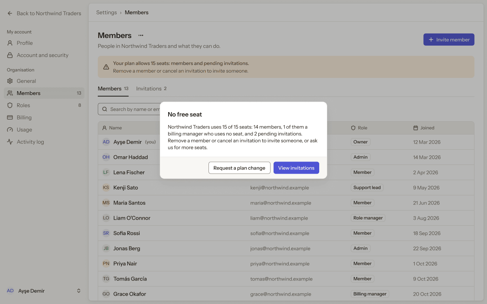

- **Who sees it:** People with tenant.members.read. Invite needs tenant.invitations.create; change role and remove need tenant.members.update and tenant.members.delete; Owner changes need tenant.owners.manage.
- **Device:** Desktop (1280 px and wider).
- **This state shows:** as the title says.
- **Values come from:** Members, invitations and roles: our API. Seats used and the seat limit: the plan's entitlements from our API. Prices in dialogs: the plan's prices from our API.
- **Components:** Avatar ×14, Banner, Button ×5, Icon/calendar, Icon/mail, Icon/shield, Icon/user, Input, Label ×14, Sidebar, Tab ×2, Top bar.
- **Actions:**
  - "omar@northwind.example": goes to [8.29 · Invitations](#829--invitations).
  - "Back to Northwind Traders": goes to [4.01 · Home · Owner](../04-home/README.md#401--home--owner).
  - "Profile": goes to [5.01 · Profile · ideal](../05-settings-profile/README.md#501--profile--ideal).
  - "Account and security": goes to [6.01 · Account and security · ideal](../06-settings-account-and-security/README.md#601--account-and-security--ideal).
  - "General": goes to [7.01 · General · ideal](../07-settings-general/README.md#701--general--ideal).
  - "Members": goes to [8.01 · Members · ideal](#801--members--ideal).
  - "Roles": goes to [9.01 · Roles · ideal](../09-settings-roles/README.md#901--roles--ideal).
  - "Billing": goes to [10.01 · Billing · Team, monthly](../10-settings-billing/README.md#1001--billing--team-monthly).
  - "Usage": goes to [11.01 · Usage · Team](../11-settings-usage/README.md#1101--usage--team).
  - "Activity log": goes to [12.01 · Activity log · ideal](../12-settings-activity-log/README.md#1201--activity-log--ideal).
- **Texts, word for word, top to bottom:**

  - Back to Northwind Traders
  - My account
  - Profile
  - Account and security
  - Organisation
  - General
  - Members
  - 13
  - Roles
  - 8
  - Billing
  - Usage
  - Activity log
  - AD
  - Ayşe Demir
  - Settings
  - ›
  - Members
  - Members
  - People in Northwind Traders and what they can do.
  - Invite member
  - Your plan allows 15 seats: members and pending invitations.
  - Remove a member or cancel an invitation to invite someone.
  - Members
  - 13
  - Invitations
  - 2
  - Search by name or email
  - All roles
  - Name
  - Email
  - Role
  - Joined
  - AD
  - Ayşe Demir
  - (you)
  - ayse@northwind.example
  - Owner
  - 12 Mar 2026
  - OH
  - Omar Haddad
  - omar@northwind.example
  - Admin
  - 14 Mar 2026
  - LF
  - Lena Fischer
  - lena@northwind.example
  - Member
  - 2 Apr 2026
  - KS
  - Kenji Sato
  - kenji@northwind.example
  - Support lead
  - 9 May 2026
  - MS
  - Maria Santos
  - maria@northwind.example
  - Member
  - 21 Jun 2026
  - LO
  - Liam O’Connor
  - liam@northwind.example
  - Role manager
  - 3 Aug 2026
  - SR
  - Sofia Rossi
  - sofia@northwind.example
  - Member
  - 18 Sep 2026
  - JB
  - Jonas Berg
  - jonas@northwind.example
  - Admin
  - 22 Sep 2026
  - PN
  - Priya Nair
  - priya@northwind.example
  - Member
  - 1 Oct 2026
  - TG
  - Tomás García
  - tomas@northwind.example
  - Member
  - 9 Oct 2026
  - GO
  - Grace Okafor
  - grace@northwind.example
  - Billing manager
  - 20 Oct 2026
  - HK
  - Hana Kobayashi
  - hana@northwind.example
  - Member
  - 2 Apr 2026
  - NW
  - Noah Williams
  - noah@northwind.example
  - Member
  - 2 Apr 2026
  - AA
  - Ahmed Al-Sayed
  - ahmed@northwind.example
  - Member
  - 2 Apr 2026
  - No free seat
  - Northwind Traders uses 15 of 15 seats: 14 members, 1 of them a billing manager who uses no seat, and 2 pending invitations. Remove a member or cancel an invitation to invite someone, or ask us for more seats.
  - Request a plan change
  - View invitations

Figma: [241:22966](https://www.figma.com/design/3Ev111okX8xCBwR9B3hyBM/?node-id=241-22966)

### 8.44 · No free seat · over the limit · without billing

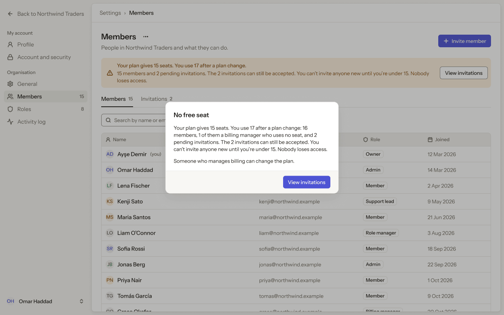

- **Who sees it:** People with tenant.members.read. Invite needs tenant.invitations.create; change role and remove need tenant.members.update and tenant.members.delete; Owner changes need tenant.owners.manage.
- **Device:** Desktop (1280 px and wider).
- **This state shows:** as the title says.
- **Values come from:** Members, invitations and roles: our API. Seats used and the seat limit: the plan's entitlements from our API. Prices in dialogs: the plan's prices from our API.
- **Components:** Avatar ×13, Banner, Button ×4, Icon/calendar, Icon/mail, Icon/shield, Icon/user, Input, Label ×13, Sidebar, Tab ×2, Top bar.
- **Actions:**
  - "Area": goes to [8.29 · Invitations](#829--invitations).
  - "Back to Northwind Traders": goes to [4.01 · Home · Owner](../04-home/README.md#401--home--owner).
  - "Profile": goes to [5.01 · Profile · ideal](../05-settings-profile/README.md#501--profile--ideal).
  - "Account and security": goes to [6.01 · Account and security · ideal](../06-settings-account-and-security/README.md#601--account-and-security--ideal).
  - "General": goes to [7.01 · General · ideal](../07-settings-general/README.md#701--general--ideal).
  - "Members": goes to [8.01 · Members · ideal](#801--members--ideal).
  - "Roles": goes to [9.01 · Roles · ideal](../09-settings-roles/README.md#901--roles--ideal).
  - "Activity log": goes to [12.01 · Activity log · ideal](../12-settings-activity-log/README.md#1201--activity-log--ideal).
- **Texts, word for word, top to bottom:**

  - Back to Northwind Traders
  - My account
  - Profile
  - Account and security
  - Organisation
  - General
  - Members
  - 15
  - Roles
  - 8
  - Activity log
  - OH
  - Omar Haddad
  - Settings
  - ›
  - Members
  - Members
  - People in Northwind Traders and what they can do.
  - Invite member
  - Your plan gives 15 seats. You use 17 after a plan change.
  - 15 members and 2 pending invitations. The 2 invitations can still be accepted. You can’t invite anyone new until you’re under 15. Nobody loses access.
  - View invitations
  - Members
  - 15
  - Invitations
  - 2
  - Search by name or email
  - All roles
  - Name
  - Email
  - Role
  - Joined
  - AD
  - Ayşe Demir
  - (you)
  - ayse@northwind.example
  - Owner
  - 12 Mar 2026
  - OH
  - Omar Haddad
  - omar@northwind.example
  - Admin
  - 14 Mar 2026
  - LF
  - Lena Fischer
  - lena@northwind.example
  - Member
  - 2 Apr 2026
  - KS
  - Kenji Sato
  - kenji@northwind.example
  - Support lead
  - 9 May 2026
  - MS
  - Maria Santos
  - maria@northwind.example
  - Member
  - 21 Jun 2026
  - LO
  - Liam O’Connor
  - liam@northwind.example
  - Role manager
  - 3 Aug 2026
  - SR
  - Sofia Rossi
  - sofia@northwind.example
  - Member
  - 18 Sep 2026
  - JB
  - Jonas Berg
  - jonas@northwind.example
  - Admin
  - 22 Sep 2026
  - PN
  - Priya Nair
  - priya@northwind.example
  - Member
  - 1 Oct 2026
  - TG
  - Tomás García
  - tomas@northwind.example
  - Member
  - 9 Oct 2026
  - GO
  - Grace Okafor
  - grace@northwind.example
  - Billing manager
  - 20 Oct 2026
  - HK
  - Hana Kobayashi
  - hana@northwind.example
  - Member
  - 2 Apr 2026
  - NW
  - Noah Williams
  - noah@northwind.example
  - Member
  - 2 Apr 2026
  - No free seat
  - Your plan gives 15 seats. You use 17 after a plan change: 16 members, 1 of them a billing manager who uses no seat, and 2 pending invitations. The 2 invitations can still be accepted. You can’t invite anyone new until you’re under 15. Nobody loses access.
  - Someone who manages billing can change the plan.
  - View invitations

Figma: [241:23350](https://www.figma.com/design/3Ev111okX8xCBwR9B3hyBM/?node-id=241-23350)

### 8.45 · No free seat · over the limit · Contract

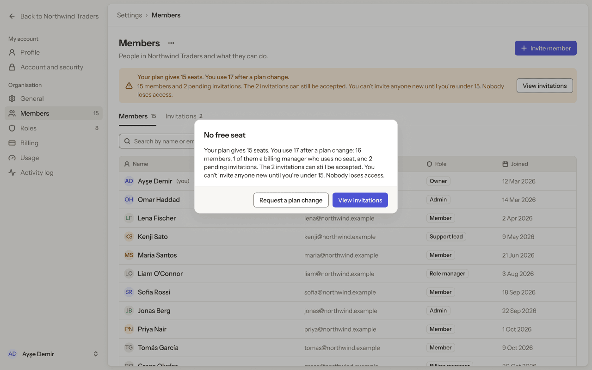

- **Who sees it:** People with tenant.members.read. Invite needs tenant.invitations.create; change role and remove need tenant.members.update and tenant.members.delete; Owner changes need tenant.owners.manage.
- **Device:** Desktop (1280 px and wider).
- **This state shows:** as the title says.
- **Values come from:** Members, invitations and roles: our API. Seats used and the seat limit: the plan's entitlements from our API. Prices in dialogs: the plan's prices from our API.
- **Components:** Avatar ×13, Banner, Button ×5, Icon/calendar, Icon/mail, Icon/shield, Icon/user, Input, Label ×13, Sidebar, Tab ×2, Top bar.
- **Actions:**
  - "Area": goes to [8.29 · Invitations](#829--invitations).
  - "Back to Northwind Traders": goes to [4.01 · Home · Owner](../04-home/README.md#401--home--owner).
  - "Profile": goes to [5.01 · Profile · ideal](../05-settings-profile/README.md#501--profile--ideal).
  - "Account and security": goes to [6.01 · Account and security · ideal](../06-settings-account-and-security/README.md#601--account-and-security--ideal).
  - "General": goes to [7.01 · General · ideal](../07-settings-general/README.md#701--general--ideal).
  - "Members": goes to [8.01 · Members · ideal](#801--members--ideal).
  - "Roles": goes to [9.01 · Roles · ideal](../09-settings-roles/README.md#901--roles--ideal).
  - "Billing": goes to [10.01 · Billing · Team, monthly](../10-settings-billing/README.md#1001--billing--team-monthly).
  - "Usage": goes to [11.01 · Usage · Team](../11-settings-usage/README.md#1101--usage--team).
  - "Activity log": goes to [12.01 · Activity log · ideal](../12-settings-activity-log/README.md#1201--activity-log--ideal).
- **Texts, word for word, top to bottom:**

  - Back to Northwind Traders
  - My account
  - Profile
  - Account and security
  - Organisation
  - General
  - Members
  - 15
  - Roles
  - 8
  - Billing
  - Usage
  - Activity log
  - AD
  - Ayşe Demir
  - Settings
  - ›
  - Members
  - Members
  - People in Northwind Traders and what they can do.
  - Invite member
  - Your plan gives 15 seats. You use 17 after a plan change.
  - 15 members and 2 pending invitations. The 2 invitations can still be accepted. You can’t invite anyone new until you’re under 15. Nobody loses access.
  - View invitations
  - Members
  - 15
  - Invitations
  - 2
  - Search by name or email
  - All roles
  - Name
  - Email
  - Role
  - Joined
  - AD
  - Ayşe Demir
  - (you)
  - ayse@northwind.example
  - Owner
  - 12 Mar 2026
  - OH
  - Omar Haddad
  - omar@northwind.example
  - Admin
  - 14 Mar 2026
  - LF
  - Lena Fischer
  - lena@northwind.example
  - Member
  - 2 Apr 2026
  - KS
  - Kenji Sato
  - kenji@northwind.example
  - Support lead
  - 9 May 2026
  - MS
  - Maria Santos
  - maria@northwind.example
  - Member
  - 21 Jun 2026
  - LO
  - Liam O’Connor
  - liam@northwind.example
  - Role manager
  - 3 Aug 2026
  - SR
  - Sofia Rossi
  - sofia@northwind.example
  - Member
  - 18 Sep 2026
  - JB
  - Jonas Berg
  - jonas@northwind.example
  - Admin
  - 22 Sep 2026
  - PN
  - Priya Nair
  - priya@northwind.example
  - Member
  - 1 Oct 2026
  - TG
  - Tomás García
  - tomas@northwind.example
  - Member
  - 9 Oct 2026
  - GO
  - Grace Okafor
  - grace@northwind.example
  - Billing manager
  - 20 Oct 2026
  - HK
  - Hana Kobayashi
  - hana@northwind.example
  - Member
  - 2 Apr 2026
  - NW
  - Noah Williams
  - noah@northwind.example
  - Member
  - 2 Apr 2026
  - No free seat
  - Your plan gives 15 seats. You use 17 after a plan change: 16 members, 1 of them a billing manager who uses no seat, and 2 pending invitations. The 2 invitations can still be accepted. You can’t invite anyone new until you’re under 15. Nobody loses access.
  - Request a plan change
  - View invitations

Figma: [241:23562](https://www.figma.com/design/3Ev111okX8xCBwR9B3hyBM/?node-id=241-23562)
