# Web app · 9 · Settings › Roles

Who sees this section: People with tenant.roles.read. Create, edit and delete need tenant.roles.create, tenant.roles.update and tenant.roles.delete.

Where the values come from: Roles and the permission catalogue: our API. The custom role limit: the plan's entitlements from our API.

20 screens. Each part below is one screen and state. The PNG beside this file is the screen at scale 1.

| Screen | Device |
|---|---|
| [9.01 · Roles · ideal](#901--roles--ideal) | Desktop |
| [9.02 · Roles · loading](#902--roles--loading) | Desktop |
| [9.03 · Roles · error](#903--roles--error) | Desktop |
| [9.04 · Roles · no custom roles](#904--roles--no-custom-roles) | Desktop |
| [9.05 · Roles · role created](#905--roles--role-created) | Desktop |
| [9.06 · Roles · not in the plan](#906--roles--not-in-the-plan) | Desktop |
| [9.07 · Roles · over the limit](#907--roles--over-the-limit) | Desktop |
| [9.08 · New role](#908--new-role) | Desktop |
| [9.09 · New role · name taken](#909--new-role--name-taken) | Desktop |
| [9.10 · Role · built in](#910--role--built-in) | Desktop |
| [9.11 · Role · edit](#911--role--edit) | Desktop |
| [9.12 · Delete role](#912--delete-role) | Desktop |
| [9.13 · Delete role · in use](#913--delete-role--in-use) | Desktop |
| [9.14 · No custom role left](#914--no-custom-role-left) | Desktop |
| [9.15 · Discard changes](#915--discard-changes) | Desktop |
| [9.16 · Role · saved](#916--role--saved) | Desktop |
| [9.r16 · Role · out of reach](#9r16--role--out-of-reach) | Desktop |
| [9.17 · Roles · dark](#917--roles--dark) | Desktop |
| [9.18 · No custom role left · without billing](#918--no-custom-role-left--without-billing) | Desktop |
| [9.19 · No custom role left · Contract](#919--no-custom-role-left--contract) | Desktop |

### 9.01 · Roles · ideal

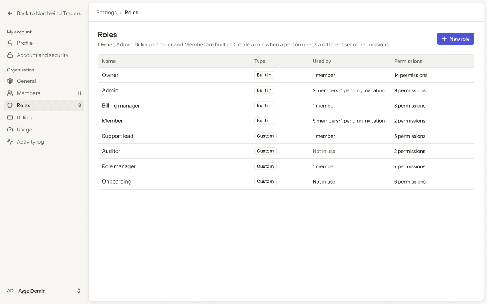

- **Who sees it:** People with tenant.roles.read. Create, edit and delete need tenant.roles.create, tenant.roles.update and tenant.roles.delete.
- **Device:** Desktop (1280 px and wider).
- **This state shows:** when the data loads and every value is present.
- **Values come from:** Roles and the permission catalogue: our API. The custom role limit: the plan's entitlements from our API.
- **Components:** Button, Label ×8, Sidebar, Top bar.
- **Actions:**
  - "5 members · 1 pending invitation": goes to [9.11 · Role · edit](#911--role--edit).
  - "New role": goes to [9.08 · New role](#908--new-role).
  - "Back to Northwind Traders": goes to [4.01 · Home · Owner](../04-home/README.md#401--home--owner).
  - "Profile": goes to [5.01 · Profile · ideal](../05-settings-profile/README.md#501--profile--ideal).
  - "Account and security": goes to [6.01 · Account and security · ideal](../06-settings-account-and-security/README.md#601--account-and-security--ideal).
  - "General": goes to [7.01 · General · ideal](../07-settings-general/README.md#701--general--ideal).
  - "Members": goes to [8.01 · Members · ideal](../08-settings-members/README.md#801--members--ideal).
  - "Billing": goes to [10.01 · Billing · Team, monthly](../10-settings-billing/README.md#1001--billing--team-monthly).
  - "Usage": goes to [11.01 · Usage · Team](../11-settings-usage/README.md#1101--usage--team).
  - "Activity log": goes to [12.01 · Activity log · ideal](../12-settings-activity-log/README.md#1201--activity-log--ideal).
  - "Billing manager": goes to [14.01 · Role · Billing manager](../14-settings-billing-manager/README.md#1401--role--billing-manager).
- **Texts, word for word, top to bottom:**

  - Back to Northwind Traders
  - My account
  - Profile
  - Account and security
  - Organisation
  - General
  - Members
  - 11
  - Roles
  - 8
  - Billing
  - Usage
  - Activity log
  - AD
  - Ayşe Demir
  - Settings
  - ›
  - Roles
  - Roles
  - Owner, Admin, Billing manager and Member are built in. Create a role when a person needs a different set of permissions.
  - New role
  - Name
  - Type
  - Used by
  - Permissions
  - Owner
  - Built in
  - 1 member
  - 14 permissions
  - Admin
  - Built in
  - 2 members · 1 pending invitation
  - 9 permissions
  - Billing manager
  - Built in
  - 1 member
  - 3 permissions
  - Member
  - Built in
  - 5 members · 1 pending invitation
  - 2 permissions
  - Support lead
  - Custom
  - 1 member
  - 5 permissions
  - Auditor
  - Custom
  - Not in use
  - 2 permissions
  - Role manager
  - Custom
  - 1 member
  - 7 permissions
  - Onboarding
  - Custom
  - Not in use
  - 6 permissions

Figma: [122:12104](https://www.figma.com/design/3Ev111okX8xCBwR9B3hyBM/?node-id=122-12104)

### 9.02 · Roles · loading

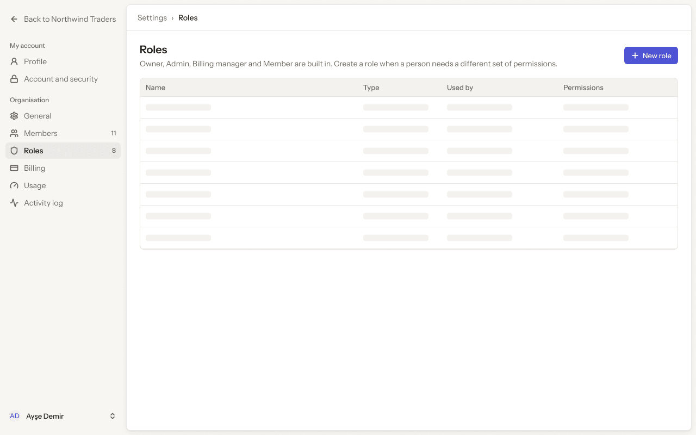

- **Who sees it:** People with tenant.roles.read. Create, edit and delete need tenant.roles.create, tenant.roles.update and tenant.roles.delete.
- **Device:** Desktop (1280 px and wider).
- **This state shows:** while the request runs.
- **Values come from:** Roles and the permission catalogue: our API. The custom role limit: the plan's entitlements from our API.
- **Components:** Button, Sidebar, Skeleton ×28, Top bar.
- **Actions:**
  - "Back to Northwind Traders": goes to [4.01 · Home · Owner](../04-home/README.md#401--home--owner).
  - "Profile": goes to [5.01 · Profile · ideal](../05-settings-profile/README.md#501--profile--ideal).
  - "Account and security": goes to [6.01 · Account and security · ideal](../06-settings-account-and-security/README.md#601--account-and-security--ideal).
  - "General": goes to [7.01 · General · ideal](../07-settings-general/README.md#701--general--ideal).
  - "Members": goes to [8.01 · Members · ideal](../08-settings-members/README.md#801--members--ideal).
  - "Roles": goes to [9.01 · Roles · ideal](#901--roles--ideal).
  - "Billing": goes to [10.01 · Billing · Team, monthly](../10-settings-billing/README.md#1001--billing--team-monthly).
  - "Usage": goes to [11.01 · Usage · Team](../11-settings-usage/README.md#1101--usage--team).
  - "Activity log": goes to [12.01 · Activity log · ideal](../12-settings-activity-log/README.md#1201--activity-log--ideal).
- **Texts, word for word, top to bottom:**

  - Back to Northwind Traders
  - My account
  - Profile
  - Account and security
  - Organisation
  - General
  - Members
  - 11
  - Roles
  - 8
  - Billing
  - Usage
  - Activity log
  - AD
  - Ayşe Demir
  - Settings
  - ›
  - Roles
  - Roles
  - Owner, Admin, Billing manager and Member are built in. Create a role when a person needs a different set of permissions.
  - New role
  - Name
  - Type
  - Used by
  - Permissions

Figma: [122:12724](https://www.figma.com/design/3Ev111okX8xCBwR9B3hyBM/?node-id=122-12724)

### 9.03 · Roles · error

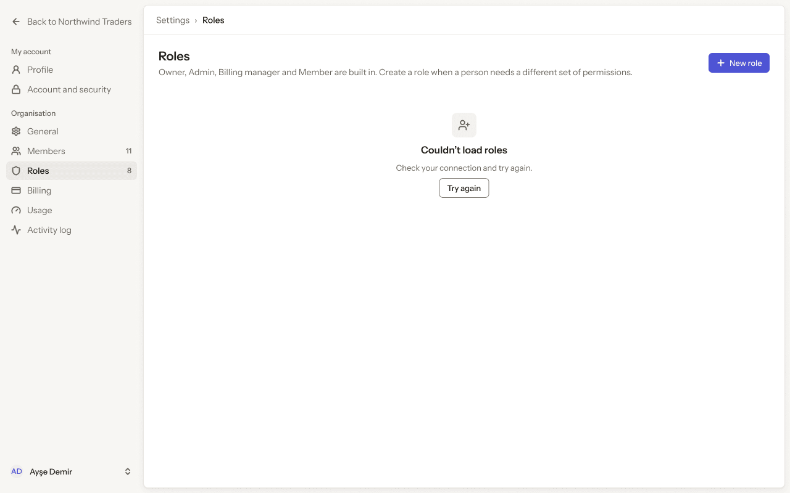

- **Who sees it:** People with tenant.roles.read. Create, edit and delete need tenant.roles.create, tenant.roles.update and tenant.roles.delete.
- **Device:** Desktop (1280 px and wider).
- **This state shows:** when the request fails.
- **Values come from:** Roles and the permission catalogue: our API. The custom role limit: the plan's entitlements from our API.
- **Components:** Button, Empty state, Sidebar, Top bar.
- **Actions:**
  - "Back to Northwind Traders": goes to [4.01 · Home · Owner](../04-home/README.md#401--home--owner).
  - "Profile": goes to [5.01 · Profile · ideal](../05-settings-profile/README.md#501--profile--ideal).
  - "Account and security": goes to [6.01 · Account and security · ideal](../06-settings-account-and-security/README.md#601--account-and-security--ideal).
  - "General": goes to [7.01 · General · ideal](../07-settings-general/README.md#701--general--ideal).
  - "Members": goes to [8.01 · Members · ideal](../08-settings-members/README.md#801--members--ideal).
  - "Roles": goes to [9.01 · Roles · ideal](#901--roles--ideal).
  - "Billing": goes to [10.01 · Billing · Team, monthly](../10-settings-billing/README.md#1001--billing--team-monthly).
  - "Usage": goes to [11.01 · Usage · Team](../11-settings-usage/README.md#1101--usage--team).
  - "Activity log": goes to [12.01 · Activity log · ideal](../12-settings-activity-log/README.md#1201--activity-log--ideal).
- **Texts, word for word, top to bottom:**

  - Back to Northwind Traders
  - My account
  - Profile
  - Account and security
  - Organisation
  - General
  - Members
  - 11
  - Roles
  - 8
  - Billing
  - Usage
  - Activity log
  - AD
  - Ayşe Demir
  - Settings
  - ›
  - Roles
  - Roles
  - Owner, Admin, Billing manager and Member are built in. Create a role when a person needs a different set of permissions.
  - New role
  - Couldn’t load roles
  - Check your connection and try again.
  - Try again

Figma: [122:12938](https://www.figma.com/design/3Ev111okX8xCBwR9B3hyBM/?node-id=122-12938)

### 9.04 · Roles · no custom roles

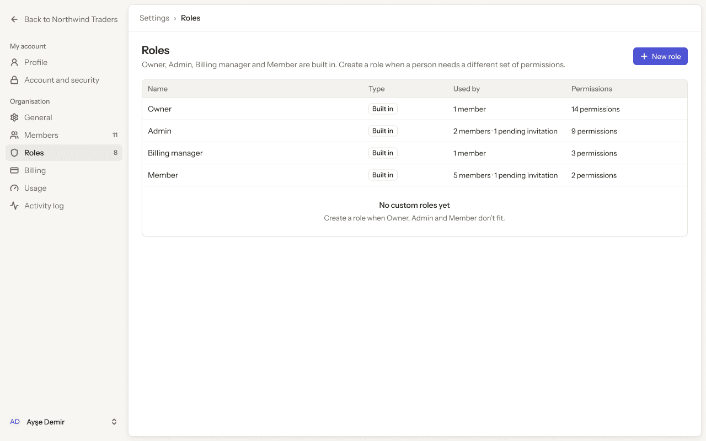

- **Who sees it:** People with tenant.roles.read. Create, edit and delete need tenant.roles.create, tenant.roles.update and tenant.roles.delete.
- **Device:** Desktop (1280 px and wider).
- **This state shows:** as the title says.
- **Values come from:** Roles and the permission catalogue: our API. The custom role limit: the plan's entitlements from our API.
- **Components:** Button, Label ×4, Sidebar, Top bar.
- **Actions:**
  - "Back to Northwind Traders": goes to [4.01 · Home · Owner](../04-home/README.md#401--home--owner).
  - "Profile": goes to [5.01 · Profile · ideal](../05-settings-profile/README.md#501--profile--ideal).
  - "Account and security": goes to [6.01 · Account and security · ideal](../06-settings-account-and-security/README.md#601--account-and-security--ideal).
  - "General": goes to [7.01 · General · ideal](../07-settings-general/README.md#701--general--ideal).
  - "Members": goes to [8.01 · Members · ideal](../08-settings-members/README.md#801--members--ideal).
  - "Roles": goes to [9.01 · Roles · ideal](#901--roles--ideal).
  - "Billing": goes to [10.01 · Billing · Team, monthly](../10-settings-billing/README.md#1001--billing--team-monthly).
  - "Usage": goes to [11.01 · Usage · Team](../11-settings-usage/README.md#1101--usage--team).
  - "Activity log": goes to [12.01 · Activity log · ideal](../12-settings-activity-log/README.md#1201--activity-log--ideal).
- **Texts, word for word, top to bottom:**

  - Back to Northwind Traders
  - My account
  - Profile
  - Account and security
  - Organisation
  - General
  - Members
  - 11
  - Roles
  - 8
  - Billing
  - Usage
  - Activity log
  - AD
  - Ayşe Demir
  - Settings
  - ›
  - Roles
  - Roles
  - Owner, Admin, Billing manager and Member are built in. Create a role when a person needs a different set of permissions.
  - New role
  - Name
  - Type
  - Used by
  - Permissions
  - Owner
  - Built in
  - 1 member
  - 14 permissions
  - Admin
  - Built in
  - 2 members · 1 pending invitation
  - 9 permissions
  - Billing manager
  - Built in
  - 1 member
  - 3 permissions
  - Member
  - Built in
  - 5 members · 1 pending invitation
  - 2 permissions
  - No custom roles yet
  - Create a role when Owner, Admin and Member don’t fit.

Figma: [122:13126](https://www.figma.com/design/3Ev111okX8xCBwR9B3hyBM/?node-id=122-13126)

### 9.05 · Roles · role created

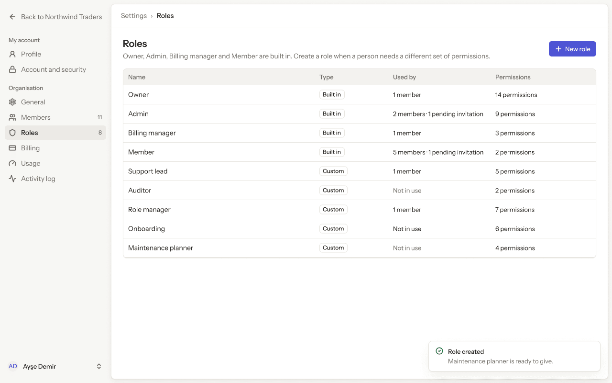

- **Who sees it:** People with tenant.roles.read. Create, edit and delete need tenant.roles.create, tenant.roles.update and tenant.roles.delete.
- **Device:** Desktop (1280 px and wider).
- **This state shows:** as the title says.
- **Values come from:** Roles and the permission catalogue: our API. The custom role limit: the plan's entitlements from our API.
- **Components:** Button, Label ×9, Sidebar, Toast, Top bar.
- **Actions:**
  - "Back to Northwind Traders": goes to [4.01 · Home · Owner](../04-home/README.md#401--home--owner).
  - "Profile": goes to [5.01 · Profile · ideal](../05-settings-profile/README.md#501--profile--ideal).
  - "Account and security": goes to [6.01 · Account and security · ideal](../06-settings-account-and-security/README.md#601--account-and-security--ideal).
  - "General": goes to [7.01 · General · ideal](../07-settings-general/README.md#701--general--ideal).
  - "Members": goes to [8.01 · Members · ideal](../08-settings-members/README.md#801--members--ideal).
  - "Roles": goes to [9.01 · Roles · ideal](#901--roles--ideal).
  - "Billing": goes to [10.01 · Billing · Team, monthly](../10-settings-billing/README.md#1001--billing--team-monthly).
  - "Usage": goes to [11.01 · Usage · Team](../11-settings-usage/README.md#1101--usage--team).
  - "Activity log": goes to [12.01 · Activity log · ideal](../12-settings-activity-log/README.md#1201--activity-log--ideal).
- **Texts, word for word, top to bottom:**

  - Back to Northwind Traders
  - My account
  - Profile
  - Account and security
  - Organisation
  - General
  - Members
  - 11
  - Roles
  - 8
  - Billing
  - Usage
  - Activity log
  - AD
  - Ayşe Demir
  - Settings
  - ›
  - Roles
  - Roles
  - Owner, Admin, Billing manager and Member are built in. Create a role when a person needs a different set of permissions.
  - New role
  - Name
  - Type
  - Used by
  - Permissions
  - Owner
  - Built in
  - 1 member
  - 14 permissions
  - Admin
  - Built in
  - 2 members · 1 pending invitation
  - 9 permissions
  - Billing manager
  - Built in
  - 1 member
  - 3 permissions
  - Member
  - Built in
  - 5 members · 1 pending invitation
  - 2 permissions
  - Support lead
  - Custom
  - 1 member
  - 5 permissions
  - Auditor
  - Custom
  - Not in use
  - 2 permissions
  - Role manager
  - Custom
  - 1 member
  - 7 permissions
  - Onboarding
  - Custom
  - Not in use
  - 6 permissions
  - Maintenance planner
  - Custom
  - Not in use
  - 4 permissions
  - Role created
  - Maintenance planner is ready to give.

Figma: [122:13301](https://www.figma.com/design/3Ev111okX8xCBwR9B3hyBM/?node-id=122-13301)

### 9.06 · Roles · not in the plan

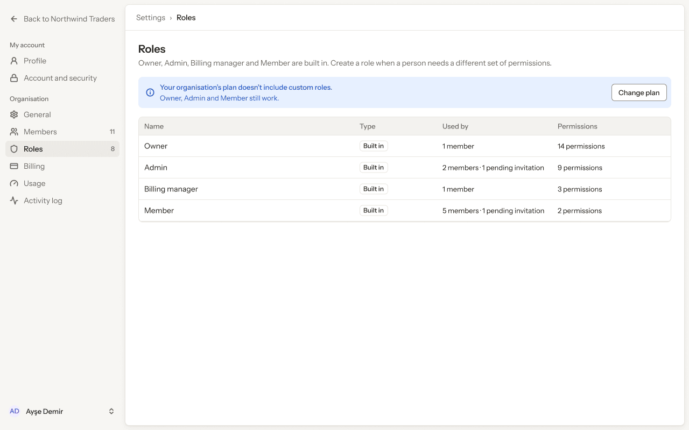

- **Who sees it:** People with tenant.roles.read. Create, edit and delete need tenant.roles.create, tenant.roles.update and tenant.roles.delete.
- **Device:** Desktop (1280 px and wider).
- **This state shows:** as the title says.
- **Values come from:** Roles and the permission catalogue: our API. The custom role limit: the plan's entitlements from our API.
- **Components:** Banner, Label ×4, Sidebar, Top bar.
- **Actions:**
  - "Back to Northwind Traders": goes to [4.01 · Home · Owner](../04-home/README.md#401--home--owner).
  - "Profile": goes to [5.01 · Profile · ideal](../05-settings-profile/README.md#501--profile--ideal).
  - "Account and security": goes to [6.01 · Account and security · ideal](../06-settings-account-and-security/README.md#601--account-and-security--ideal).
  - "General": goes to [7.01 · General · ideal](../07-settings-general/README.md#701--general--ideal).
  - "Members": goes to [8.01 · Members · ideal](../08-settings-members/README.md#801--members--ideal).
  - "Roles": goes to [9.01 · Roles · ideal](#901--roles--ideal).
  - "Billing": goes to [10.01 · Billing · Team, monthly](../10-settings-billing/README.md#1001--billing--team-monthly).
  - "Usage": goes to [11.01 · Usage · Team](../11-settings-usage/README.md#1101--usage--team).
  - "Activity log": goes to [12.01 · Activity log · ideal](../12-settings-activity-log/README.md#1201--activity-log--ideal).
  - "Change plan": goes to [10.02 · Change plan · monthly](../10-settings-billing/README.md#1002--change-plan--monthly).
- **Texts, word for word, top to bottom:**

  - Back to Northwind Traders
  - My account
  - Profile
  - Account and security
  - Organisation
  - General
  - Members
  - 11
  - Roles
  - 8
  - Billing
  - Usage
  - Activity log
  - AD
  - Ayşe Demir
  - Settings
  - ›
  - Roles
  - Roles
  - Owner, Admin, Billing manager and Member are built in. Create a role when a person needs a different set of permissions.
  - Your organisation’s plan doesn’t include custom roles.
  - Owner, Admin and Member still work.
  - Change plan
  - Name
  - Type
  - Used by
  - Permissions
  - Owner
  - Built in
  - 1 member
  - 14 permissions
  - Admin
  - Built in
  - 2 members · 1 pending invitation
  - 9 permissions
  - Billing manager
  - Built in
  - 1 member
  - 3 permissions
  - Member
  - Built in
  - 5 members · 1 pending invitation
  - 2 permissions

Figma: [122:13507](https://www.figma.com/design/3Ev111okX8xCBwR9B3hyBM/?node-id=122-13507)

### 9.07 · Roles · over the limit

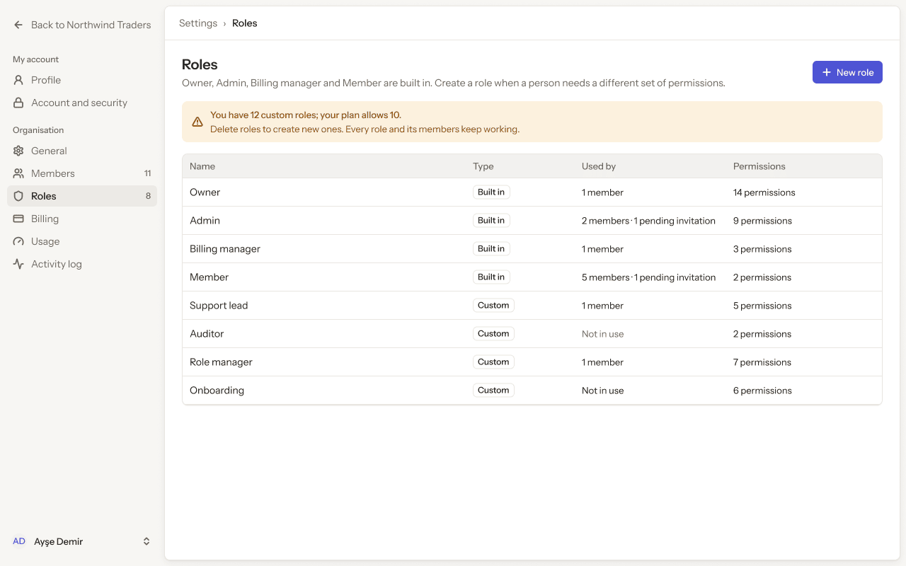

- **Who sees it:** People with tenant.roles.read. Create, edit and delete need tenant.roles.create, tenant.roles.update and tenant.roles.delete.
- **Device:** Desktop (1280 px and wider).
- **This state shows:** as the title says.
- **Values come from:** Roles and the permission catalogue: our API. The custom role limit: the plan's entitlements from our API.
- **Components:** Banner, Button, Label ×8, Sidebar, Top bar.
- **Actions:**
  - "Back to Northwind Traders": goes to [4.01 · Home · Owner](../04-home/README.md#401--home--owner).
  - "Profile": goes to [5.01 · Profile · ideal](../05-settings-profile/README.md#501--profile--ideal).
  - "Account and security": goes to [6.01 · Account and security · ideal](../06-settings-account-and-security/README.md#601--account-and-security--ideal).
  - "General": goes to [7.01 · General · ideal](../07-settings-general/README.md#701--general--ideal).
  - "Members": goes to [8.01 · Members · ideal](../08-settings-members/README.md#801--members--ideal).
  - "Roles": goes to [9.01 · Roles · ideal](#901--roles--ideal).
  - "Billing": goes to [10.01 · Billing · Team, monthly](../10-settings-billing/README.md#1001--billing--team-monthly).
  - "Usage": goes to [11.01 · Usage · Team](../11-settings-usage/README.md#1101--usage--team).
  - "Activity log": goes to [12.01 · Activity log · ideal](../12-settings-activity-log/README.md#1201--activity-log--ideal).
- **Texts, word for word, top to bottom:**

  - Back to Northwind Traders
  - My account
  - Profile
  - Account and security
  - Organisation
  - General
  - Members
  - 11
  - Roles
  - 8
  - Billing
  - Usage
  - Activity log
  - AD
  - Ayşe Demir
  - Settings
  - ›
  - Roles
  - Roles
  - Owner, Admin, Billing manager and Member are built in. Create a role when a person needs a different set of permissions.
  - New role
  - You have 12 custom roles; your plan allows 10.
  - Delete roles to create new ones. Every role and its members keep working.
  - Name
  - Type
  - Used by
  - Permissions
  - Owner
  - Built in
  - 1 member
  - 14 permissions
  - Admin
  - Built in
  - 2 members · 1 pending invitation
  - 9 permissions
  - Billing manager
  - Built in
  - 1 member
  - 3 permissions
  - Member
  - Built in
  - 5 members · 1 pending invitation
  - 2 permissions
  - Support lead
  - Custom
  - 1 member
  - 5 permissions
  - Auditor
  - Custom
  - Not in use
  - 2 permissions
  - Role manager
  - Custom
  - 1 member
  - 7 permissions
  - Onboarding
  - Custom
  - Not in use
  - 6 permissions

Figma: [122:13697](https://www.figma.com/design/3Ev111okX8xCBwR9B3hyBM/?node-id=122-13697)

### 9.08 · New role

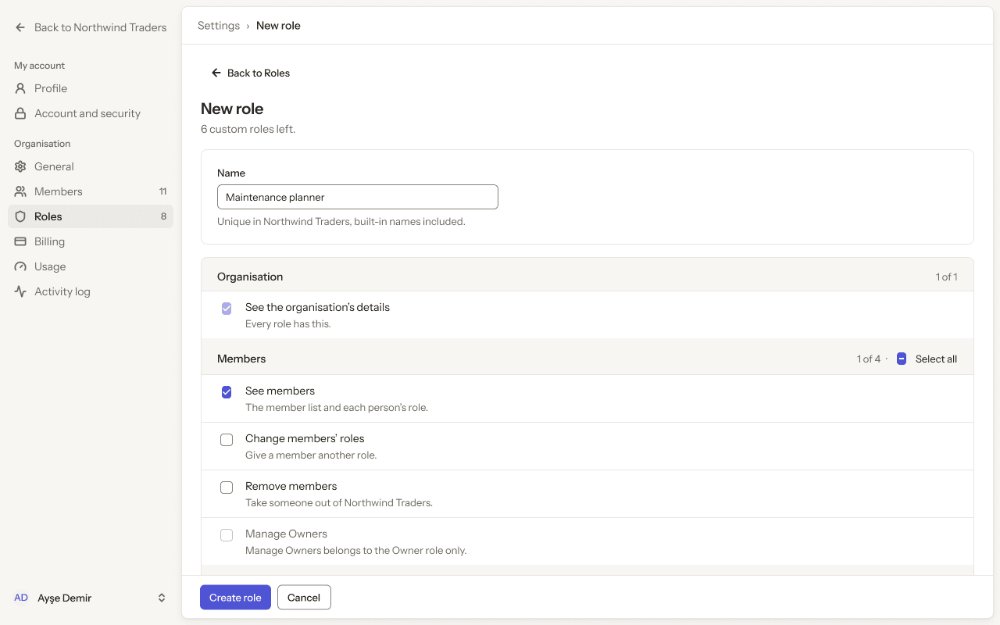

- **Who sees it:** People with tenant.roles.read. Create, edit and delete need tenant.roles.create, tenant.roles.update and tenant.roles.delete.
- **Device:** Desktop (1280 px and wider).
- **This state shows:** as the title says.
- **Values come from:** Roles and the permission catalogue: our API. The custom role limit: the plan's entitlements from our API.
- **Components:** Button ×3, Checkbox ×18, Input, Sidebar, Top bar.
- **Actions:**
  - "Back to Roles": goes to [9.01 · Roles · ideal](#901--roles--ideal).
  - "Back to Northwind Traders": goes to [4.01 · Home · Owner](../04-home/README.md#401--home--owner).
  - "Profile": goes to [5.01 · Profile · ideal](../05-settings-profile/README.md#501--profile--ideal).
  - "Account and security": goes to [6.01 · Account and security · ideal](../06-settings-account-and-security/README.md#601--account-and-security--ideal).
  - "General": goes to [7.01 · General · ideal](../07-settings-general/README.md#701--general--ideal).
  - "Members": goes to [8.01 · Members · ideal](../08-settings-members/README.md#801--members--ideal).
  - "Roles": goes to [9.01 · Roles · ideal](#901--roles--ideal).
  - "Billing": goes to [10.01 · Billing · Team, monthly](../10-settings-billing/README.md#1001--billing--team-monthly).
  - "Usage": goes to [11.01 · Usage · Team](../11-settings-usage/README.md#1101--usage--team).
  - "Activity log": goes to [12.01 · Activity log · ideal](../12-settings-activity-log/README.md#1201--activity-log--ideal).
- **Texts, word for word, top to bottom:**

  - Back to Northwind Traders
  - My account
  - Profile
  - Account and security
  - Organisation
  - General
  - Members
  - 11
  - Roles
  - 8
  - Billing
  - Usage
  - Activity log
  - AD
  - Ayşe Demir
  - Settings
  - ›
  - New role
  - Back to Roles
  - New role
  - 6 custom roles left.
  - Name
  - Maintenance planner
  - Unique in Northwind Traders, built-in names included.
  - Organisation
  - 1 of 1
  - See the organisation’s details
  - Every role has this.
  - Members
  - 1 of 4
  - ·
  - Select all
  - See members
  - The member list and each person’s role.
  - Change members’ roles
  - Give a member another role.
  - Remove members
  - Take someone out of Northwind Traders.
  - Manage Owners
  - Manage Owners belongs to the Owner role only.
  - Invitations
  - 0 of 3
  - ·
  - Select all
  - See invitations
  - Pending invitations and who sent them.
  - Invite people
  - Send an invitation by email.
  - Revoke and cancel invitations
  - Stop an invitation before it is accepted.
  - Roles
  - 1 of 4
  - ·
  - Select all
  - See roles
  - Needed to invite people, change roles, remove members and revoke invitations.
  - Create roles
  - Add a custom role.
  - Edit roles
  - Change a custom role’s name and permissions.
  - Delete roles
  - Remove a custom role nobody uses.
  - Activity log
  - 1 of 1
  - ·
  - Select all
  - See the activity log
  - Who changed what, and when.
  - Billing
  - 0 of 1
  - Manage billing
  - Change the plan, the payment details and the billing email. See invoices and usage.
  - Create role
  - Cancel

Figma: [132:14714](https://www.figma.com/design/3Ev111okX8xCBwR9B3hyBM/?node-id=132-14714)

### 9.09 · New role · name taken

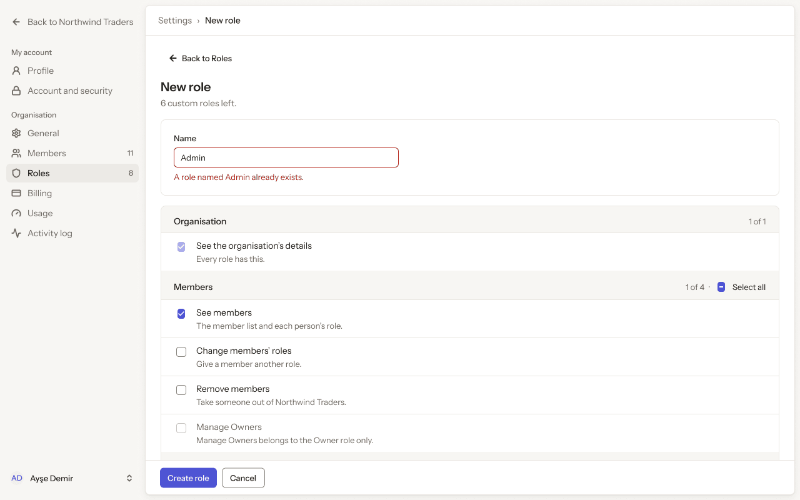

- **Who sees it:** People with tenant.roles.read. Create, edit and delete need tenant.roles.create, tenant.roles.update and tenant.roles.delete.
- **Device:** Desktop (1280 px and wider).
- **This state shows:** as the title says.
- **Values come from:** Roles and the permission catalogue: our API. The custom role limit: the plan's entitlements from our API.
- **Components:** Button ×3, Checkbox ×18, Input, Sidebar, Top bar.
- **Actions:**
  - "Back to Northwind Traders": goes to [4.01 · Home · Owner](../04-home/README.md#401--home--owner).
  - "Profile": goes to [5.01 · Profile · ideal](../05-settings-profile/README.md#501--profile--ideal).
  - "Account and security": goes to [6.01 · Account and security · ideal](../06-settings-account-and-security/README.md#601--account-and-security--ideal).
  - "General": goes to [7.01 · General · ideal](../07-settings-general/README.md#701--general--ideal).
  - "Members": goes to [8.01 · Members · ideal](../08-settings-members/README.md#801--members--ideal).
  - "Roles": goes to [9.01 · Roles · ideal](#901--roles--ideal).
  - "Billing": goes to [10.01 · Billing · Team, monthly](../10-settings-billing/README.md#1001--billing--team-monthly).
  - "Usage": goes to [11.01 · Usage · Team](../11-settings-usage/README.md#1101--usage--team).
  - "Activity log": goes to [12.01 · Activity log · ideal](../12-settings-activity-log/README.md#1201--activity-log--ideal).
- **Texts, word for word, top to bottom:**

  - Back to Northwind Traders
  - My account
  - Profile
  - Account and security
  - Organisation
  - General
  - Members
  - 11
  - Roles
  - 8
  - Billing
  - Usage
  - Activity log
  - AD
  - Ayşe Demir
  - Settings
  - ›
  - New role
  - Back to Roles
  - New role
  - 6 custom roles left.
  - Name
  - Admin
  - A role named Admin already exists.
  - Organisation
  - 1 of 1
  - See the organisation’s details
  - Every role has this.
  - Members
  - 1 of 4
  - ·
  - Select all
  - See members
  - The member list and each person’s role.
  - Change members’ roles
  - Give a member another role.
  - Remove members
  - Take someone out of Northwind Traders.
  - Manage Owners
  - Manage Owners belongs to the Owner role only.
  - Invitations
  - 0 of 3
  - ·
  - Select all
  - See invitations
  - Pending invitations and who sent them.
  - Invite people
  - Send an invitation by email.
  - Revoke and cancel invitations
  - Stop an invitation before it is accepted.
  - Roles
  - 1 of 4
  - ·
  - Select all
  - See roles
  - Needed to invite people, change roles, remove members and revoke invitations.
  - Create roles
  - Add a custom role.
  - Edit roles
  - Change a custom role’s name and permissions.
  - Delete roles
  - Remove a custom role nobody uses.
  - Activity log
  - 1 of 1
  - ·
  - Select all
  - See the activity log
  - Who changed what, and when.
  - Billing
  - 0 of 1
  - Manage billing
  - Change the plan, the payment details and the billing email. See invoices and usage.
  - Create role
  - Cancel

Figma: [132:15032](https://www.figma.com/design/3Ev111okX8xCBwR9B3hyBM/?node-id=132-15032)

### 9.10 · Role · built in

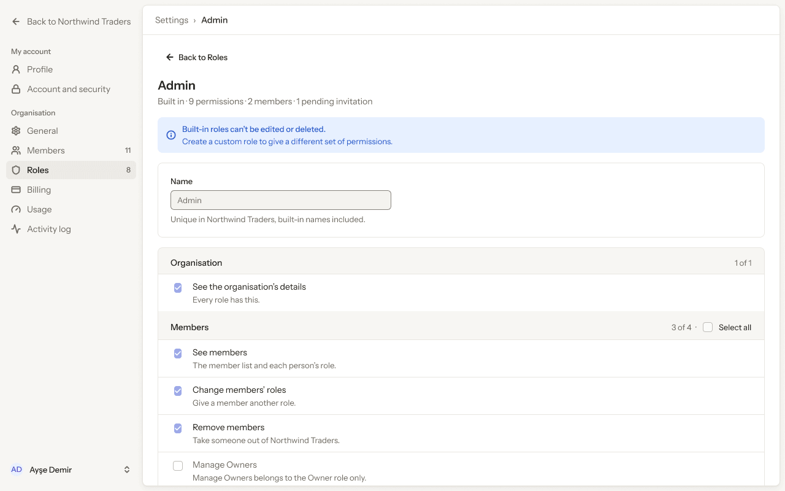

- **Who sees it:** People with tenant.roles.read. Create, edit and delete need tenant.roles.create, tenant.roles.update and tenant.roles.delete.
- **Device:** Desktop (1280 px and wider).
- **This state shows:** as the title says.
- **Values come from:** Roles and the permission catalogue: our API. The custom role limit: the plan's entitlements from our API.
- **Components:** Banner, Button, Checkbox ×15, Input, Sidebar, Top bar.
- **Actions:**
  - "Back to Roles": goes to [9.01 · Roles · ideal](#901--roles--ideal).
  - "Back to Northwind Traders": goes to [4.01 · Home · Owner](../04-home/README.md#401--home--owner).
  - "Profile": goes to [5.01 · Profile · ideal](../05-settings-profile/README.md#501--profile--ideal).
  - "Account and security": goes to [6.01 · Account and security · ideal](../06-settings-account-and-security/README.md#601--account-and-security--ideal).
  - "General": goes to [7.01 · General · ideal](../07-settings-general/README.md#701--general--ideal).
  - "Members": goes to [8.01 · Members · ideal](../08-settings-members/README.md#801--members--ideal).
  - "Roles": goes to [9.01 · Roles · ideal](#901--roles--ideal).
  - "Billing": goes to [10.01 · Billing · Team, monthly](../10-settings-billing/README.md#1001--billing--team-monthly).
  - "Usage": goes to [11.01 · Usage · Team](../11-settings-usage/README.md#1101--usage--team).
  - "Activity log": goes to [12.01 · Activity log · ideal](../12-settings-activity-log/README.md#1201--activity-log--ideal).
- **Texts, word for word, top to bottom:**

  - Back to Northwind Traders
  - My account
  - Profile
  - Account and security
  - Organisation
  - General
  - Members
  - 11
  - Roles
  - 8
  - Billing
  - Usage
  - Activity log
  - AD
  - Ayşe Demir
  - Settings
  - ›
  - Admin
  - Back to Roles
  - Admin
  - Built in · 9 permissions · 2 members · 1 pending invitation
  - Built-in roles can’t be edited or deleted.
  - Create a custom role to give a different set of permissions.
  - Name
  - Admin
  - Unique in Northwind Traders, built-in names included.
  - Organisation
  - 1 of 1
  - See the organisation’s details
  - Every role has this.
  - Members
  - 3 of 4
  - ·
  - Select all
  - See members
  - The member list and each person’s role.
  - Change members’ roles
  - Give a member another role.
  - Remove members
  - Take someone out of Northwind Traders.
  - Manage Owners
  - Manage Owners belongs to the Owner role only.
  - Invitations
  - 3 of 3
  - See invitations
  - Pending invitations and who sent them.
  - Invite people
  - Send an invitation by email.
  - Revoke and cancel invitations
  - Stop an invitation before it is accepted.
  - Roles
  - 1 of 4
  - See roles
  - Needed to invite people, change roles, remove members and revoke invitations.
  - Create roles
  - Add a custom role.
  - Edit roles
  - Change a custom role’s name and permissions.
  - Delete roles
  - Remove a custom role nobody uses.
  - Activity log
  - 1 of 1
  - See the activity log
  - Who changed what, and when.
  - Billing
  - 0 of 1
  - Manage billing
  - The Owner and Billing manager roles have this.

Figma: [132:15350](https://www.figma.com/design/3Ev111okX8xCBwR9B3hyBM/?node-id=132-15350)

### 9.11 · Role · edit

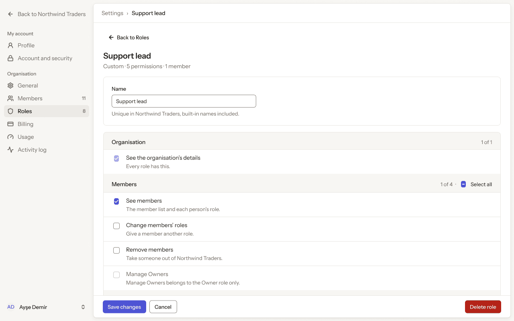

- **Who sees it:** People with tenant.roles.read. Create, edit and delete need tenant.roles.create, tenant.roles.update and tenant.roles.delete.
- **Device:** Desktop (1280 px and wider).
- **This state shows:** as the title says.
- **Values come from:** Roles and the permission catalogue: our API. The custom role limit: the plan's entitlements from our API.
- **Components:** Button ×4, Checkbox ×18, Input, Sidebar, Top bar.
- **Actions:**
  - "Back to Roles": goes to [9.01 · Roles · ideal](#901--roles--ideal).
  - "Cancel": goes to [9.15 · Discard changes](#915--discard-changes).
  - "Back to Northwind Traders": goes to [4.01 · Home · Owner](../04-home/README.md#401--home--owner).
  - "Profile": goes to [5.01 · Profile · ideal](../05-settings-profile/README.md#501--profile--ideal).
  - "Account and security": goes to [6.01 · Account and security · ideal](../06-settings-account-and-security/README.md#601--account-and-security--ideal).
  - "General": goes to [7.01 · General · ideal](../07-settings-general/README.md#701--general--ideal).
  - "Members": goes to [8.01 · Members · ideal](../08-settings-members/README.md#801--members--ideal).
  - "Roles": goes to [9.01 · Roles · ideal](#901--roles--ideal).
  - "Billing": goes to [10.01 · Billing · Team, monthly](../10-settings-billing/README.md#1001--billing--team-monthly).
  - "Usage": goes to [11.01 · Usage · Team](../11-settings-usage/README.md#1101--usage--team).
  - "Activity log": goes to [12.01 · Activity log · ideal](../12-settings-activity-log/README.md#1201--activity-log--ideal).
- **Texts, word for word, top to bottom:**

  - Back to Northwind Traders
  - My account
  - Profile
  - Account and security
  - Organisation
  - General
  - Members
  - 11
  - Roles
  - 8
  - Billing
  - Usage
  - Activity log
  - AD
  - Ayşe Demir
  - Settings
  - ›
  - Support lead
  - Back to Roles
  - Support lead
  - Custom · 5 permissions · 1 member
  - Name
  - Support lead
  - Unique in Northwind Traders, built-in names included.
  - Organisation
  - 1 of 1
  - See the organisation’s details
  - Every role has this.
  - Members
  - 1 of 4
  - ·
  - Select all
  - See members
  - The member list and each person’s role.
  - Change members’ roles
  - Give a member another role.
  - Remove members
  - Take someone out of Northwind Traders.
  - Manage Owners
  - Manage Owners belongs to the Owner role only.
  - Invitations
  - 3 of 3
  - ·
  - Select all
  - See invitations
  - Pending invitations and who sent them.
  - Invite people
  - Send an invitation by email.
  - Revoke and cancel invitations
  - Stop an invitation before it is accepted.
  - Roles
  - 1 of 4
  - ·
  - Select all
  - See roles
  - Needed to invite people, change roles, remove members and revoke invitations.
  - Create roles
  - Add a custom role.
  - Edit roles
  - Change a custom role’s name and permissions.
  - Delete roles
  - Remove a custom role nobody uses.
  - Activity log
  - 0 of 1
  - ·
  - Select all
  - See the activity log
  - Who changed what, and when.
  - Billing
  - 0 of 1
  - Manage billing
  - Change the plan, the payment details and the billing email. See invoices and usage.
  - Save changes
  - Cancel
  - Delete role

Figma: [132:15678](https://www.figma.com/design/3Ev111okX8xCBwR9B3hyBM/?node-id=132-15678)

### 9.12 · Delete role

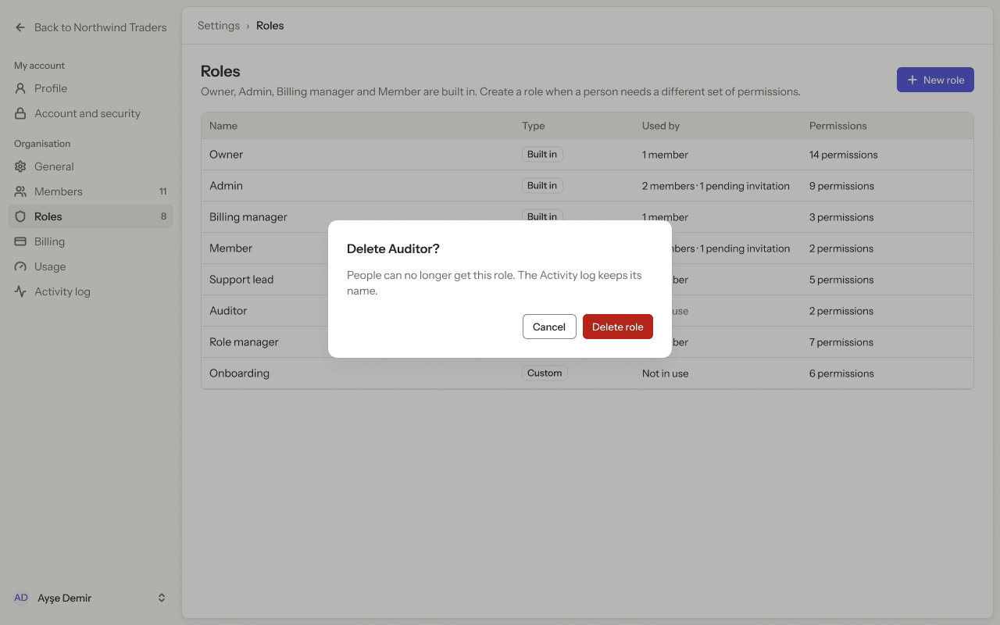

- **Who sees it:** People with tenant.roles.read. Create, edit and delete need tenant.roles.create, tenant.roles.update and tenant.roles.delete.
- **Device:** Desktop (1280 px and wider).
- **This state shows:** as the title says.
- **Values come from:** Roles and the permission catalogue: our API. The custom role limit: the plan's entitlements from our API.
- **Components:** Button ×3, Label ×8, Sidebar, Top bar.
- **Actions:**
  - "Back to Northwind Traders": goes to [4.01 · Home · Owner](../04-home/README.md#401--home--owner).
  - "Profile": goes to [5.01 · Profile · ideal](../05-settings-profile/README.md#501--profile--ideal).
  - "Account and security": goes to [6.01 · Account and security · ideal](../06-settings-account-and-security/README.md#601--account-and-security--ideal).
  - "General": goes to [7.01 · General · ideal](../07-settings-general/README.md#701--general--ideal).
  - "Members": goes to [8.01 · Members · ideal](../08-settings-members/README.md#801--members--ideal).
  - "Roles": goes to [9.01 · Roles · ideal](#901--roles--ideal).
  - "Billing": goes to [10.01 · Billing · Team, monthly](../10-settings-billing/README.md#1001--billing--team-monthly).
  - "Usage": goes to [11.01 · Usage · Team](../11-settings-usage/README.md#1101--usage--team).
  - "Activity log": goes to [12.01 · Activity log · ideal](../12-settings-activity-log/README.md#1201--activity-log--ideal).
- **Texts, word for word, top to bottom:**

  - Back to Northwind Traders
  - My account
  - Profile
  - Account and security
  - Organisation
  - General
  - Members
  - 11
  - Roles
  - 8
  - Billing
  - Usage
  - Activity log
  - AD
  - Ayşe Demir
  - Settings
  - ›
  - Roles
  - Roles
  - Owner, Admin, Billing manager and Member are built in. Create a role when a person needs a different set of permissions.
  - New role
  - Name
  - Type
  - Used by
  - Permissions
  - Owner
  - Built in
  - 1 member
  - 14 permissions
  - Admin
  - Built in
  - 2 members · 1 pending invitation
  - 9 permissions
  - Billing manager
  - Built in
  - 1 member
  - 3 permissions
  - Member
  - Built in
  - 5 members · 1 pending invitation
  - 2 permissions
  - Support lead
  - Custom
  - 1 member
  - 5 permissions
  - Auditor
  - Custom
  - Not in use
  - 2 permissions
  - Role manager
  - Custom
  - 1 member
  - 7 permissions
  - Onboarding
  - Custom
  - Not in use
  - 6 permissions
  - Delete Auditor?
  - People can no longer get this role. The Activity log keeps its name.
  - Cancel
  - Delete role

Figma: [122:13887](https://www.figma.com/design/3Ev111okX8xCBwR9B3hyBM/?node-id=122-13887)

### 9.13 · Delete role · in use

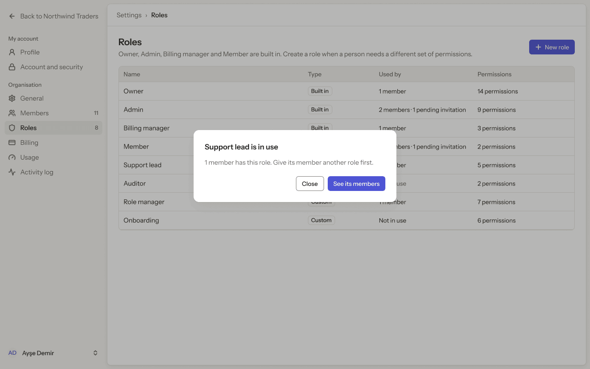

- **Who sees it:** People with tenant.roles.read. Create, edit and delete need tenant.roles.create, tenant.roles.update and tenant.roles.delete.
- **Device:** Desktop (1280 px and wider).
- **This state shows:** as the title says.
- **Values come from:** Roles and the permission catalogue: our API. The custom role limit: the plan's entitlements from our API.
- **Components:** Button ×3, Label ×8, Sidebar, Top bar.
- **Actions:**
  - "Back to Northwind Traders": goes to [4.01 · Home · Owner](../04-home/README.md#401--home--owner).
  - "Profile": goes to [5.01 · Profile · ideal](../05-settings-profile/README.md#501--profile--ideal).
  - "Account and security": goes to [6.01 · Account and security · ideal](../06-settings-account-and-security/README.md#601--account-and-security--ideal).
  - "General": goes to [7.01 · General · ideal](../07-settings-general/README.md#701--general--ideal).
  - "Members": goes to [8.01 · Members · ideal](../08-settings-members/README.md#801--members--ideal).
  - "Roles": goes to [9.01 · Roles · ideal](#901--roles--ideal).
  - "Billing": goes to [10.01 · Billing · Team, monthly](../10-settings-billing/README.md#1001--billing--team-monthly).
  - "Usage": goes to [11.01 · Usage · Team](../11-settings-usage/README.md#1101--usage--team).
  - "Activity log": goes to [12.01 · Activity log · ideal](../12-settings-activity-log/README.md#1201--activity-log--ideal).
- **Texts, word for word, top to bottom:**

  - Back to Northwind Traders
  - My account
  - Profile
  - Account and security
  - Organisation
  - General
  - Members
  - 11
  - Roles
  - 8
  - Billing
  - Usage
  - Activity log
  - AD
  - Ayşe Demir
  - Settings
  - ›
  - Roles
  - Roles
  - Owner, Admin, Billing manager and Member are built in. Create a role when a person needs a different set of permissions.
  - New role
  - Name
  - Type
  - Used by
  - Permissions
  - Owner
  - Built in
  - 1 member
  - 14 permissions
  - Admin
  - Built in
  - 2 members · 1 pending invitation
  - 9 permissions
  - Billing manager
  - Built in
  - 1 member
  - 3 permissions
  - Member
  - Built in
  - 5 members · 1 pending invitation
  - 2 permissions
  - Support lead
  - Custom
  - 1 member
  - 5 permissions
  - Auditor
  - Custom
  - Not in use
  - 2 permissions
  - Role manager
  - Custom
  - 1 member
  - 7 permissions
  - Onboarding
  - Custom
  - Not in use
  - 6 permissions
  - Support lead is in use
  - 1 member has this role. Give its member another role first.
  - Close
  - See its members

Figma: [122:14076](https://www.figma.com/design/3Ev111okX8xCBwR9B3hyBM/?node-id=122-14076)

### 9.14 · No custom role left

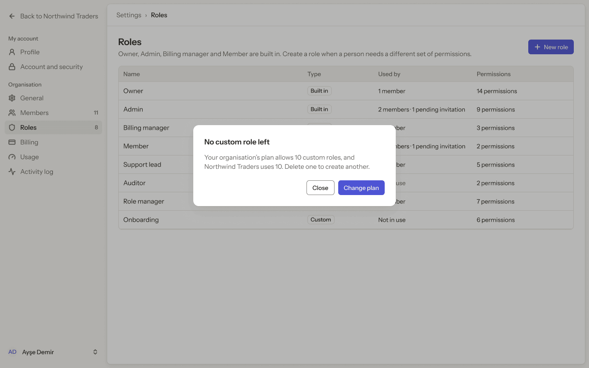

- **Who sees it:** People with tenant.roles.read. Create, edit and delete need tenant.roles.create, tenant.roles.update and tenant.roles.delete.
- **Device:** Desktop (1280 px and wider).
- **This state shows:** as the title says.
- **Values come from:** Roles and the permission catalogue: our API. The custom role limit: the plan's entitlements from our API.
- **Components:** Button ×3, Label ×8, Sidebar, Top bar.
- **Actions:**
  - "Back to Northwind Traders": goes to [4.01 · Home · Owner](../04-home/README.md#401--home--owner).
  - "Profile": goes to [5.01 · Profile · ideal](../05-settings-profile/README.md#501--profile--ideal).
  - "Account and security": goes to [6.01 · Account and security · ideal](../06-settings-account-and-security/README.md#601--account-and-security--ideal).
  - "General": goes to [7.01 · General · ideal](../07-settings-general/README.md#701--general--ideal).
  - "Members": goes to [8.01 · Members · ideal](../08-settings-members/README.md#801--members--ideal).
  - "Roles": goes to [9.01 · Roles · ideal](#901--roles--ideal).
  - "Billing": goes to [10.01 · Billing · Team, monthly](../10-settings-billing/README.md#1001--billing--team-monthly).
  - "Usage": goes to [11.01 · Usage · Team](../11-settings-usage/README.md#1101--usage--team).
  - "Activity log": goes to [12.01 · Activity log · ideal](../12-settings-activity-log/README.md#1201--activity-log--ideal).
  - "Change plan": goes to [10.02 · Change plan · monthly](../10-settings-billing/README.md#1002--change-plan--monthly).
- **Texts, word for word, top to bottom:**

  - Back to Northwind Traders
  - My account
  - Profile
  - Account and security
  - Organisation
  - General
  - Members
  - 11
  - Roles
  - 8
  - Billing
  - Usage
  - Activity log
  - AD
  - Ayşe Demir
  - Settings
  - ›
  - Roles
  - Roles
  - Owner, Admin, Billing manager and Member are built in. Create a role when a person needs a different set of permissions.
  - New role
  - Name
  - Type
  - Used by
  - Permissions
  - Owner
  - Built in
  - 1 member
  - 14 permissions
  - Admin
  - Built in
  - 2 members · 1 pending invitation
  - 9 permissions
  - Billing manager
  - Built in
  - 1 member
  - 3 permissions
  - Member
  - Built in
  - 5 members · 1 pending invitation
  - 2 permissions
  - Support lead
  - Custom
  - 1 member
  - 5 permissions
  - Auditor
  - Custom
  - Not in use
  - 2 permissions
  - Role manager
  - Custom
  - 1 member
  - 7 permissions
  - Onboarding
  - Custom
  - Not in use
  - 6 permissions
  - No custom role left
  - Your organisation’s plan allows 10 custom roles, and Northwind Traders uses 10. Delete one to create another.
  - Close
  - Change plan

Figma: [122:14265](https://www.figma.com/design/3Ev111okX8xCBwR9B3hyBM/?node-id=122-14265)

### 9.15 · Discard changes

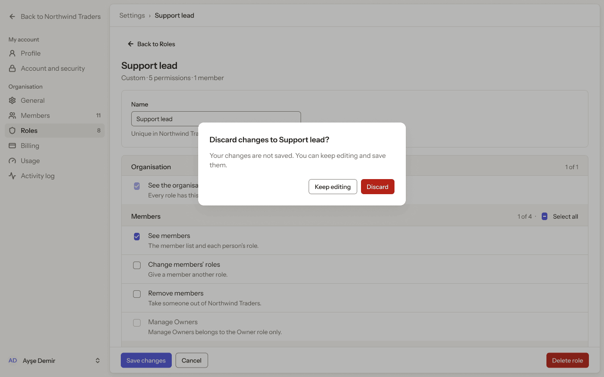

- **Who sees it:** People with tenant.roles.read. Create, edit and delete need tenant.roles.create, tenant.roles.update and tenant.roles.delete.
- **Device:** Desktop (1280 px and wider).
- **This state shows:** as the title says.
- **Values come from:** Roles and the permission catalogue: our API. The custom role limit: the plan's entitlements from our API.
- **Components:** Button ×6, Checkbox ×18, Input, Sidebar, Top bar.
- **Actions:**
  - "Back to Northwind Traders": goes to [4.01 · Home · Owner](../04-home/README.md#401--home--owner).
  - "Profile": goes to [5.01 · Profile · ideal](../05-settings-profile/README.md#501--profile--ideal).
  - "Account and security": goes to [6.01 · Account and security · ideal](../06-settings-account-and-security/README.md#601--account-and-security--ideal).
  - "General": goes to [7.01 · General · ideal](../07-settings-general/README.md#701--general--ideal).
  - "Members": goes to [8.01 · Members · ideal](../08-settings-members/README.md#801--members--ideal).
  - "Roles": goes to [9.01 · Roles · ideal](#901--roles--ideal).
  - "Billing": goes to [10.01 · Billing · Team, monthly](../10-settings-billing/README.md#1001--billing--team-monthly).
  - "Usage": goes to [11.01 · Usage · Team](../11-settings-usage/README.md#1101--usage--team).
  - "Activity log": goes to [12.01 · Activity log · ideal](../12-settings-activity-log/README.md#1201--activity-log--ideal).
- **Texts, word for word, top to bottom:**

  - Back to Northwind Traders
  - My account
  - Profile
  - Account and security
  - Organisation
  - General
  - Members
  - 11
  - Roles
  - 8
  - Billing
  - Usage
  - Activity log
  - AD
  - Ayşe Demir
  - Settings
  - ›
  - Support lead
  - Back to Roles
  - Support lead
  - Custom · 5 permissions · 1 member
  - Name
  - Support lead
  - Unique in Northwind Traders, built-in names included.
  - Organisation
  - 1 of 1
  - See the organisation’s details
  - Every role has this.
  - Members
  - 1 of 4
  - ·
  - Select all
  - See members
  - The member list and each person’s role.
  - Change members’ roles
  - Give a member another role.
  - Remove members
  - Take someone out of Northwind Traders.
  - Manage Owners
  - Manage Owners belongs to the Owner role only.
  - Invitations
  - 3 of 3
  - ·
  - Select all
  - See invitations
  - Pending invitations and who sent them.
  - Invite people
  - Send an invitation by email.
  - Revoke and cancel invitations
  - Stop an invitation before it is accepted.
  - Roles
  - 1 of 4
  - ·
  - Select all
  - See roles
  - Needed to invite people, change roles, remove members and revoke invitations.
  - Create roles
  - Add a custom role.
  - Edit roles
  - Change a custom role’s name and permissions.
  - Delete roles
  - Remove a custom role nobody uses.
  - Activity log
  - 0 of 1
  - ·
  - Select all
  - See the activity log
  - Who changed what, and when.
  - Billing
  - 0 of 1
  - Manage billing
  - Change the plan, the payment details and the billing email. See invoices and usage.
  - Save changes
  - Cancel
  - Delete role
  - Discard changes to Support lead?
  - Your changes are not saved. You can keep editing and save them.
  - Keep editing
  - Discard

Figma: [132:16003](https://www.figma.com/design/3Ev111okX8xCBwR9B3hyBM/?node-id=132-16003)

### 9.16 · Role · saved

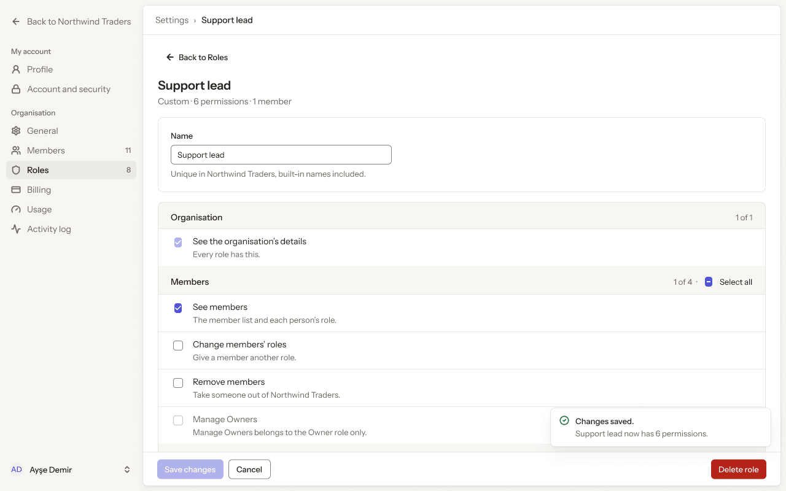

- **Who sees it:** People with tenant.roles.read. Create, edit and delete need tenant.roles.create, tenant.roles.update and tenant.roles.delete.
- **Device:** Desktop (1280 px and wider).
- **This state shows:** right after a save succeeds.
- **Values come from:** Roles and the permission catalogue: our API. The custom role limit: the plan's entitlements from our API.
- **Components:** Button ×4, Checkbox ×18, Input, Sidebar, Toast, Top bar.
- **Actions:**
  - "Back to Northwind Traders": goes to [4.01 · Home · Owner](../04-home/README.md#401--home--owner).
  - "Profile": goes to [5.01 · Profile · ideal](../05-settings-profile/README.md#501--profile--ideal).
  - "Account and security": goes to [6.01 · Account and security · ideal](../06-settings-account-and-security/README.md#601--account-and-security--ideal).
  - "General": goes to [7.01 · General · ideal](../07-settings-general/README.md#701--general--ideal).
  - "Members": goes to [8.01 · Members · ideal](../08-settings-members/README.md#801--members--ideal).
  - "Roles": goes to [9.01 · Roles · ideal](#901--roles--ideal).
  - "Billing": goes to [10.01 · Billing · Team, monthly](../10-settings-billing/README.md#1001--billing--team-monthly).
  - "Usage": goes to [11.01 · Usage · Team](../11-settings-usage/README.md#1101--usage--team).
  - "Activity log": goes to [12.01 · Activity log · ideal](../12-settings-activity-log/README.md#1201--activity-log--ideal).
- **Texts, word for word, top to bottom:**

  - Back to Northwind Traders
  - My account
  - Profile
  - Account and security
  - Organisation
  - General
  - Members
  - 11
  - Roles
  - 8
  - Billing
  - Usage
  - Activity log
  - AD
  - Ayşe Demir
  - Settings
  - ›
  - Support lead
  - Back to Roles
  - Support lead
  - Custom · 6 permissions · 1 member
  - Name
  - Support lead
  - Unique in Northwind Traders, built-in names included.
  - Organisation
  - 1 of 1
  - See the organisation’s details
  - Every role has this.
  - Members
  - 1 of 4
  - ·
  - Select all
  - See members
  - The member list and each person’s role.
  - Change members’ roles
  - Give a member another role.
  - Remove members
  - Take someone out of Northwind Traders.
  - Manage Owners
  - Manage Owners belongs to the Owner role only.
  - Invitations
  - 3 of 3
  - ·
  - Select all
  - See invitations
  - Pending invitations and who sent them.
  - Invite people
  - Send an invitation by email.
  - Revoke and cancel invitations
  - Stop an invitation before it is accepted.
  - Roles
  - 1 of 4
  - ·
  - Select all
  - See roles
  - Needed to invite people, change roles, remove members and revoke invitations.
  - Create roles
  - Add a custom role.
  - Edit roles
  - Change a custom role’s name and permissions.
  - Delete roles
  - Remove a custom role nobody uses.
  - Activity log
  - 0 of 1
  - ·
  - Select all
  - See the activity log
  - Who changed what, and when.
  - Billing
  - 0 of 1
  - Manage billing
  - Change the plan, the payment details and the billing email. See invoices and usage.
  - Save changes
  - Cancel
  - Delete role
  - Changes saved.
  - Support lead now has 6 permissions.

Figma: [132:16125](https://www.figma.com/design/3Ev111okX8xCBwR9B3hyBM/?node-id=132-16125)

### 9.r16 · Role · out of reach

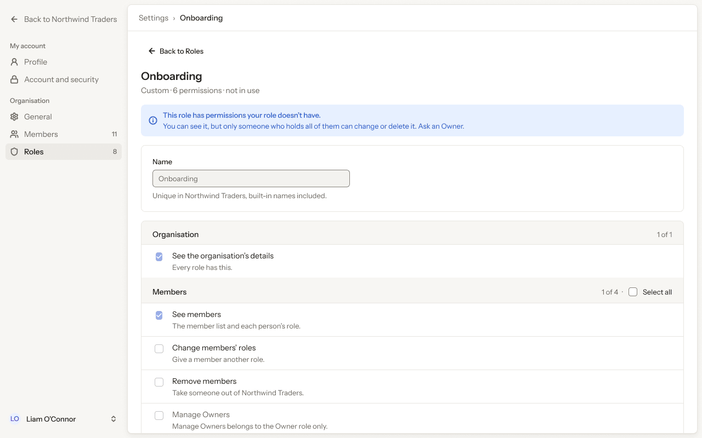

- **Who sees it:** People with tenant.roles.read. Create, edit and delete need tenant.roles.create, tenant.roles.update and tenant.roles.delete.
- **Device:** Desktop (1280 px and wider).
- **This state shows:** as the title says.
- **Values come from:** Roles and the permission catalogue: our API. The custom role limit: the plan's entitlements from our API.
- **Components:** Banner, Button, Checkbox ×15, Input, Sidebar, Top bar.
- **Actions:**
  - "Back to Roles": goes to [9.01 · Roles · ideal](#901--roles--ideal).
  - "Back to Northwind Traders": goes to [4.01 · Home · Owner](../04-home/README.md#401--home--owner).
  - "Profile": goes to [5.01 · Profile · ideal](../05-settings-profile/README.md#501--profile--ideal).
  - "Account and security": goes to [6.01 · Account and security · ideal](../06-settings-account-and-security/README.md#601--account-and-security--ideal).
  - "General": goes to [7.01 · General · ideal](../07-settings-general/README.md#701--general--ideal).
  - "Members": goes to [8.01 · Members · ideal](../08-settings-members/README.md#801--members--ideal).
  - "Roles": goes to [9.01 · Roles · ideal](#901--roles--ideal).
- **Texts, word for word, top to bottom:**

  - Back to Northwind Traders
  - My account
  - Profile
  - Account and security
  - Organisation
  - General
  - Members
  - 11
  - Roles
  - 8
  - LO
  - Liam O’Connor
  - Settings
  - ›
  - Onboarding
  - Back to Roles
  - Onboarding
  - Custom · 6 permissions · not in use
  - This role has permissions your role doesn’t have.
  - You can see it, but only someone who holds all of them can change or delete it. Ask an Owner.
  - Name
  - Onboarding
  - Unique in Northwind Traders, built-in names included.
  - Organisation
  - 1 of 1
  - See the organisation’s details
  - Every role has this.
  - Members
  - 1 of 4
  - ·
  - Select all
  - See members
  - The member list and each person’s role.
  - Change members’ roles
  - Give a member another role.
  - Remove members
  - Take someone out of Northwind Traders.
  - Manage Owners
  - Manage Owners belongs to the Owner role only.
  - Invitations
  - 3 of 3
  - See invitations
  - Pending invitations and who sent them.
  - Invite people
  - Your role doesn’t have this permission.
  - Revoke and cancel invitations
  - Your role doesn’t have this permission.
  - Roles
  - 1 of 4
  - See roles
  - Needed to invite people, change roles, remove members and revoke invitations.
  - Create roles
  - Add a custom role.
  - Edit roles
  - Change a custom role’s name and permissions.
  - Delete roles
  - Remove a custom role nobody uses.
  - Activity log
  - 0 of 1
  - See the activity log
  - Who changed what, and when.
  - Billing
  - 0 of 1
  - Manage billing
  - Change the plan, the payment details and the billing email. See invoices and usage.

Figma: [144:15285](https://www.figma.com/design/3Ev111okX8xCBwR9B3hyBM/?node-id=144-15285)

### 9.17 · Roles · dark

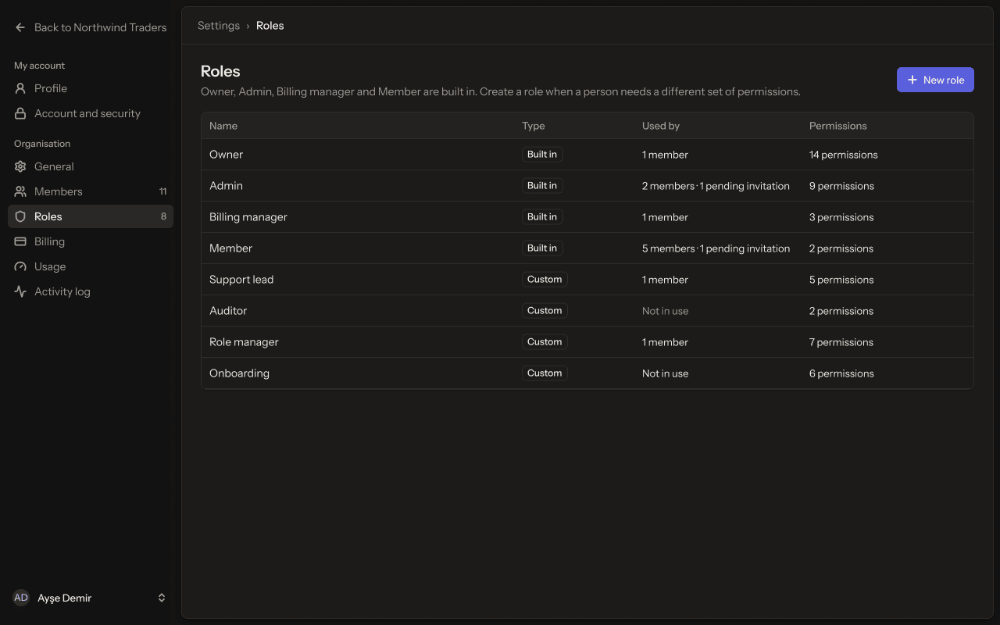

- **Who sees it:** People with tenant.roles.read. Create, edit and delete need tenant.roles.create, tenant.roles.update and tenant.roles.delete.
- **Device:** Desktop (1280 px and wider).
- **This state shows:** in the dark theme.
- **Values come from:** Roles and the permission catalogue: our API. The custom role limit: the plan's entitlements from our API.
- **Components:** Button, Label ×8, Sidebar, Top bar.
- **Actions:**
  - "Back to Northwind Traders": goes to [4.01 · Home · Owner](../04-home/README.md#401--home--owner).
  - "Profile": goes to [5.01 · Profile · ideal](../05-settings-profile/README.md#501--profile--ideal).
  - "Account and security": goes to [6.01 · Account and security · ideal](../06-settings-account-and-security/README.md#601--account-and-security--ideal).
  - "General": goes to [7.01 · General · ideal](../07-settings-general/README.md#701--general--ideal).
  - "Members": goes to [8.01 · Members · ideal](../08-settings-members/README.md#801--members--ideal).
  - "Roles": goes to [9.01 · Roles · ideal](#901--roles--ideal).
  - "Billing": goes to [10.01 · Billing · Team, monthly](../10-settings-billing/README.md#1001--billing--team-monthly).
  - "Usage": goes to [11.01 · Usage · Team](../11-settings-usage/README.md#1101--usage--team).
  - "Activity log": goes to [12.01 · Activity log · ideal](../12-settings-activity-log/README.md#1201--activity-log--ideal).
- **Texts, word for word, top to bottom:**

  - Back to Northwind Traders
  - My account
  - Profile
  - Account and security
  - Organisation
  - General
  - Members
  - 11
  - Roles
  - 8
  - Billing
  - Usage
  - Activity log
  - AD
  - Ayşe Demir
  - Settings
  - ›
  - Roles
  - Roles
  - Owner, Admin, Billing manager and Member are built in. Create a role when a person needs a different set of permissions.
  - New role
  - Name
  - Type
  - Used by
  - Permissions
  - Owner
  - Built in
  - 1 member
  - 14 permissions
  - Admin
  - Built in
  - 2 members · 1 pending invitation
  - 9 permissions
  - Billing manager
  - Built in
  - 1 member
  - 3 permissions
  - Member
  - Built in
  - 5 members · 1 pending invitation
  - 2 permissions
  - Support lead
  - Custom
  - 1 member
  - 5 permissions
  - Auditor
  - Custom
  - Not in use
  - 2 permissions
  - Role manager
  - Custom
  - 1 member
  - 7 permissions
  - Onboarding
  - Custom
  - Not in use
  - 6 permissions

Figma: [122:14454](https://www.figma.com/design/3Ev111okX8xCBwR9B3hyBM/?node-id=122-14454)

### 9.18 · No custom role left · without billing

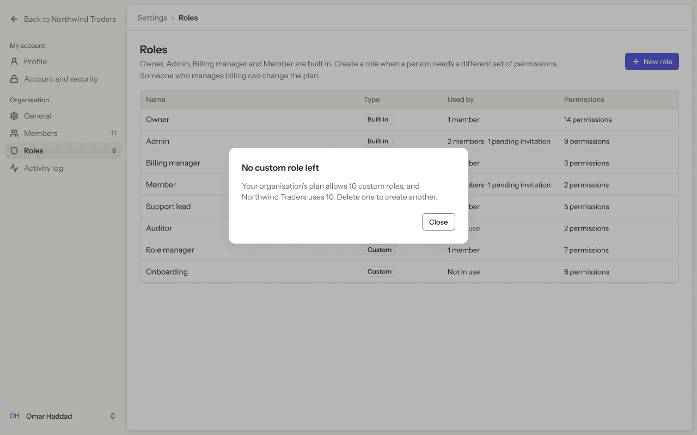

- **Who sees it:** People with tenant.roles.read. Create, edit and delete need tenant.roles.create, tenant.roles.update and tenant.roles.delete.
- **Device:** Desktop (1280 px and wider).
- **This state shows:** as the title says.
- **Values come from:** Roles and the permission catalogue: our API. The custom role limit: the plan's entitlements from our API.
- **Components:** Button ×2, Label ×8, Sidebar, Top bar.
- **Actions:**
  - "Back to Northwind Traders": goes to [4.01 · Home · Owner](../04-home/README.md#401--home--owner).
  - "Profile": goes to [5.01 · Profile · ideal](../05-settings-profile/README.md#501--profile--ideal).
  - "Account and security": goes to [6.01 · Account and security · ideal](../06-settings-account-and-security/README.md#601--account-and-security--ideal).
  - "General": goes to [7.01 · General · ideal](../07-settings-general/README.md#701--general--ideal).
  - "Members": goes to [8.01 · Members · ideal](../08-settings-members/README.md#801--members--ideal).
  - "Roles": goes to [9.01 · Roles · ideal](#901--roles--ideal).
  - "Activity log": goes to [12.01 · Activity log · ideal](../12-settings-activity-log/README.md#1201--activity-log--ideal).
- **Texts, word for word, top to bottom:**

  - Back to Northwind Traders
  - My account
  - Profile
  - Account and security
  - Organisation
  - General
  - Members
  - 11
  - Roles
  - 8
  - Activity log
  - OH
  - Omar Haddad
  - Settings
  - ›
  - Roles
  - Roles
  - Owner, Admin, Billing manager and Member are built in. Create a role when a person needs a different set of permissions.
  - Someone who manages billing can change the plan.
  - New role
  - Name
  - Type
  - Used by
  - Permissions
  - Owner
  - Built in
  - 1 member
  - 14 permissions
  - Admin
  - Built in
  - 2 members · 1 pending invitation
  - 9 permissions
  - Billing manager
  - Built in
  - 1 member
  - 3 permissions
  - Member
  - Built in
  - 5 members · 1 pending invitation
  - 2 permissions
  - Support lead
  - Custom
  - 1 member
  - 5 permissions
  - Auditor
  - Custom
  - Not in use
  - 2 permissions
  - Role manager
  - Custom
  - 1 member
  - 7 permissions
  - Onboarding
  - Custom
  - Not in use
  - 6 permissions
  - No custom role left
  - Your organisation’s plan allows 10 custom roles, and Northwind Traders uses 10. Delete one to create another.
  - Close

Figma: [241:23933](https://www.figma.com/design/3Ev111okX8xCBwR9B3hyBM/?node-id=241-23933)

### 9.19 · No custom role left · Contract

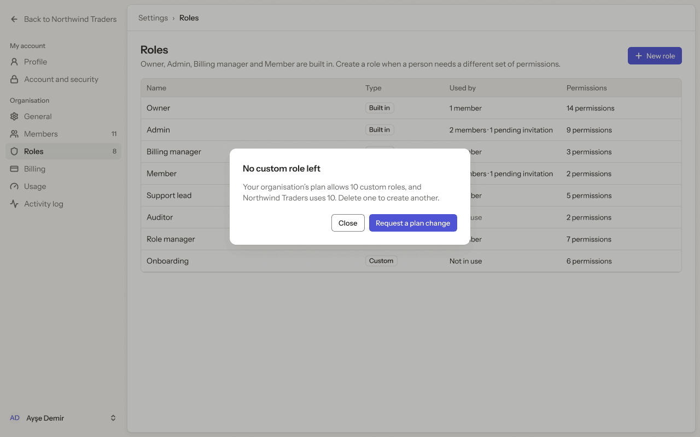

- **Who sees it:** People with tenant.roles.read. Create, edit and delete need tenant.roles.create, tenant.roles.update and tenant.roles.delete.
- **Device:** Desktop (1280 px and wider).
- **This state shows:** as the title says.
- **Values come from:** Roles and the permission catalogue: our API. The custom role limit: the plan's entitlements from our API.
- **Components:** Button ×3, Label ×8, Sidebar, Top bar.
- **Actions:**
  - "Back to Northwind Traders": goes to [4.01 · Home · Owner](../04-home/README.md#401--home--owner).
  - "Profile": goes to [5.01 · Profile · ideal](../05-settings-profile/README.md#501--profile--ideal).
  - "Account and security": goes to [6.01 · Account and security · ideal](../06-settings-account-and-security/README.md#601--account-and-security--ideal).
  - "General": goes to [7.01 · General · ideal](../07-settings-general/README.md#701--general--ideal).
  - "Members": goes to [8.01 · Members · ideal](../08-settings-members/README.md#801--members--ideal).
  - "Roles": goes to [9.01 · Roles · ideal](#901--roles--ideal).
  - "Billing": goes to [10.01 · Billing · Team, monthly](../10-settings-billing/README.md#1001--billing--team-monthly).
  - "Usage": goes to [11.01 · Usage · Team](../11-settings-usage/README.md#1101--usage--team).
  - "Activity log": goes to [12.01 · Activity log · ideal](../12-settings-activity-log/README.md#1201--activity-log--ideal).
- **Texts, word for word, top to bottom:**

  - Back to Northwind Traders
  - My account
  - Profile
  - Account and security
  - Organisation
  - General
  - Members
  - 11
  - Roles
  - 8
  - Billing
  - Usage
  - Activity log
  - AD
  - Ayşe Demir
  - Settings
  - ›
  - Roles
  - Roles
  - Owner, Admin, Billing manager and Member are built in. Create a role when a person needs a different set of permissions.
  - New role
  - Name
  - Type
  - Used by
  - Permissions
  - Owner
  - Built in
  - 1 member
  - 14 permissions
  - Admin
  - Built in
  - 2 members · 1 pending invitation
  - 9 permissions
  - Billing manager
  - Built in
  - 1 member
  - 3 permissions
  - Member
  - Built in
  - 5 members · 1 pending invitation
  - 2 permissions
  - Support lead
  - Custom
  - 1 member
  - 5 permissions
  - Auditor
  - Custom
  - Not in use
  - 2 permissions
  - Role manager
  - Custom
  - 1 member
  - 7 permissions
  - Onboarding
  - Custom
  - Not in use
  - 6 permissions
  - No custom role left
  - Your organisation’s plan allows 10 custom roles, and Northwind Traders uses 10. Delete one to create another.
  - Close
  - Request a plan change

Figma: [241:24043](https://www.figma.com/design/3Ev111okX8xCBwR9B3hyBM/?node-id=241-24043)
