# Web app · 10 · Settings › Billing

Who sees this section: People who manage billing: the Owner and the Billing manager.

Where the values come from: Plan, prices, invoices, payment method and trial: our API (billing, step 36). Amounts in euro, VAT shown apart.

24 screens. Each part below is one screen and state. The PNG beside this file is the screen at scale 1.

| Screen | Device |
|---|---|
| [10.01 · Billing · Team, monthly](#1001--billing--team-monthly) | Desktop |
| [10.02 · Change plan · monthly](#1002--change-plan--monthly) | Desktop |
| [10.03 · Change plan · yearly](#1003--change-plan--yearly) | Desktop |
| [10.04 · Upgrade · preview](#1004--upgrade--preview) | Desktop |
| [10.05 · Upgrade · done](#1005--upgrade--done) | Desktop |
| [10.06 · Cancel plan](#1006--cancel-plan) | Desktop |
| [10.07 · Cancellation scheduled](#1007--cancellation-scheduled) | Desktop |
| [10.08 · Billing · in trial](#1008--billing--in-trial) | Desktop |
| [10.09 · Change plan · from a trial](#1009--change-plan--from-a-trial) | Desktop |
| [10.10 · Continue to payment · opening Stripe](#1010--continue-to-payment--opening-stripe) | Desktop |
| [10.11 · Payment successful](#1011--payment-successful) | Desktop |
| [10.12 · Payment not completed](#1012--payment-not-completed) | Desktop |
| [10.13 · Card declined](#1013--card-declined) | Desktop |
| [10.14 · Trial ended · over the seat limit](#1014--trial-ended--over-the-seat-limit) | Desktop |
| [10.15 · Payment failed · retrying](#1015--payment-failed--retrying) | Desktop |
| [10.16 · Payment failed · grace](#1016--payment-failed--grace) | Desktop |
| [10.17 · Payment failed · moved to Free](#1017--payment-failed--moved-to-free) | Desktop |
| [10.18 · Price change coming](#1018--price-change-coming) | Desktop |
| [10.19 · Contract](#1019--contract) | Desktop |
| [10.20 · Billing · loading](#1020--billing--loading) | Desktop |
| [10.21 · Billing · error](#1021--billing--error) | Desktop |
| [10.22 · Billing · phone](#1022--billing--phone) | Phone |
| [10.23 · Billing · dark](#1023--billing--dark) | Desktop |
| [10.24 · Billing · Arabic](#1024--billing--arabic) | Desktop |

### 10.01 · Billing · Team, monthly

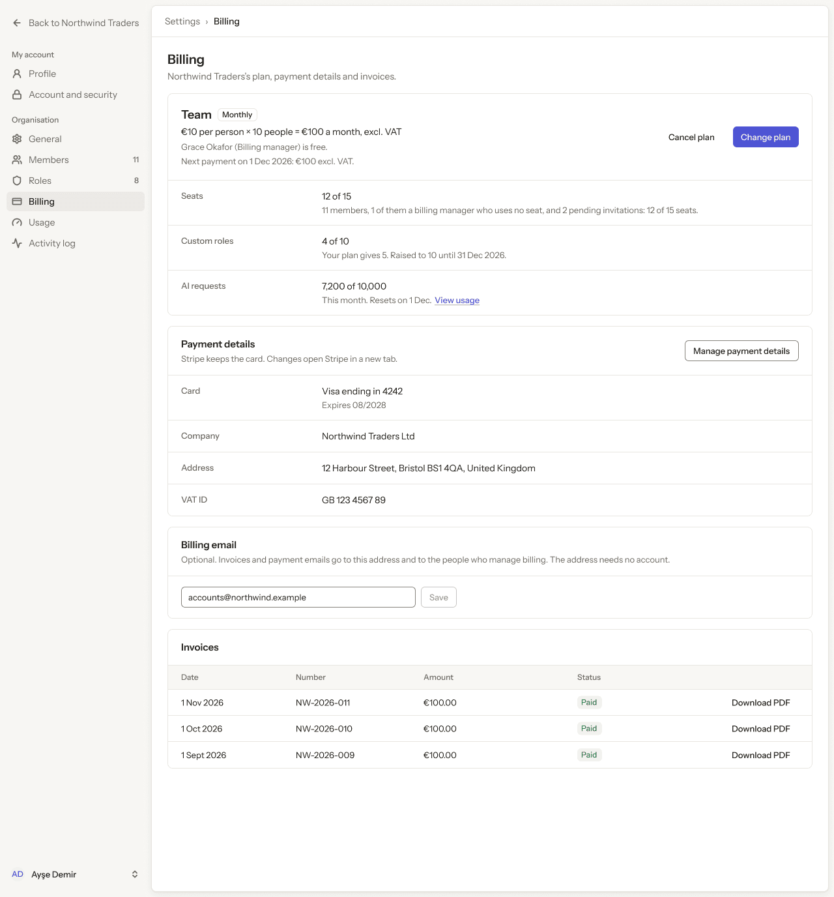

- **Who sees it:** People who manage billing: the Owner and the Billing manager.
- **Device:** Desktop (1280 px and wider).
- **This state shows:** as the title says.
- **Values come from:** Plan, prices, invoices, payment method and trial: our API (billing, step 36). Amounts in euro, VAT shown apart.
- **Components:** Button ×7, Input, Label, Pill ×3, Sidebar, Top bar.
- **Actions:**
  - "Back to Northwind Traders": goes to [4.01 · Home · Owner](../04-home/README.md#401--home--owner).
  - "Profile": goes to [5.01 · Profile · ideal](../05-settings-profile/README.md#501--profile--ideal).
  - "Account and security": goes to [6.01 · Account and security · ideal](../06-settings-account-and-security/README.md#601--account-and-security--ideal).
  - "General": goes to [7.01 · General · ideal](../07-settings-general/README.md#701--general--ideal).
  - "Members": goes to [8.01 · Members · ideal](../08-settings-members/README.md#801--members--ideal).
  - "Roles": goes to [9.01 · Roles · ideal](../09-settings-roles/README.md#901--roles--ideal).
  - "Usage": goes to [11.01 · Usage · Team](../11-settings-usage/README.md#1101--usage--team).
  - "Activity log": goes to [12.01 · Activity log · ideal](../12-settings-activity-log/README.md#1201--activity-log--ideal).
  - "Change plan": goes to [10.02 · Change plan · monthly](#1002--change-plan--monthly).
  - "Cancel plan": goes to [10.06 · Cancel plan](#1006--cancel-plan).
  - "Area": goes to [11.01 · Usage · Team](../11-settings-usage/README.md#1101--usage--team).
- **Texts, word for word, top to bottom:**

  - Back to Northwind Traders
  - My account
  - Profile
  - Account and security
  - Organisation
  - General
  - Members
  - 11
  - Roles
  - 8
  - Billing
  - Usage
  - Activity log
  - AD
  - Ayşe Demir
  - Settings
  - ›
  - Billing
  - Billing
  - Northwind Traders’s plan, payment details and invoices.
  - Team
  - Monthly
  - €10 per person × 10 people = €100 a month, excl. VAT
  - Grace Okafor (Billing manager) is free.
  - Next payment on 1 Dec 2026: €100 excl. VAT.
  - Cancel plan
  - Change plan
  - Seats
  - 12 of 15
  - 11 members, 1 of them a billing manager who uses no seat, and 2 pending invitations: 12 of 15 seats.
  - Custom roles
  - 4 of 10
  - Your plan gives 5. Raised to 10 until 31 Dec 2026.
  - AI requests
  - 7,200 of 10,000
  - This month. Resets on 1 Dec.
  - View usage
  - Payment details
  - Stripe keeps the card. Changes open Stripe in a new tab.
  - Manage payment details
  - Card
  - Visa ending in 4242
  - Expires 08/2028
  - Company
  - Northwind Traders Ltd
  - Address
  - 12 Harbour Street, Bristol BS1 4QA, United Kingdom
  - VAT ID
  - GB 123 4567 89
  - Billing email
  - Optional. Invoices and payment emails go to this address and to the people who manage billing. The address needs no account.
  - accounts@northwind.example
  - Save
  - Invoices
  - Date
  - Number
  - Amount
  - Status
  - 1 Nov 2026
  - NW-2026-011
  - €100.00
  - Paid
  - Download PDF
  - 1 Oct 2026
  - NW-2026-010
  - €100.00
  - Paid
  - Download PDF
  - 1 Sept 2026
  - NW-2026-009
  - €100.00
  - Paid
  - Download PDF

Figma: [125:14669](https://www.figma.com/design/3Ev111okX8xCBwR9B3hyBM/?node-id=125-14669)

### 10.02 · Change plan · monthly

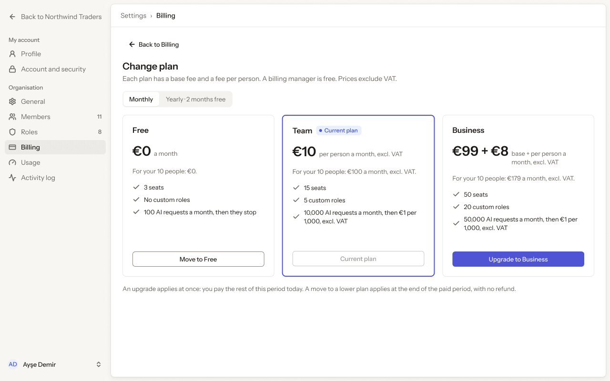

- **Who sees it:** People who manage billing: the Owner and the Billing manager.
- **Device:** Desktop (1280 px and wider).
- **This state shows:** as the title says.
- **Values come from:** Plan, prices, invoices, payment method and trial: our API (billing, step 36). Amounts in euro, VAT shown apart.
- **Components:** Button ×4, Icon/check ×9, Pill, Sidebar, Top bar.
- **Actions:**
  - "Back to Northwind Traders": goes to [4.01 · Home · Owner](../04-home/README.md#401--home--owner).
  - "Profile": goes to [5.01 · Profile · ideal](../05-settings-profile/README.md#501--profile--ideal).
  - "Account and security": goes to [6.01 · Account and security · ideal](../06-settings-account-and-security/README.md#601--account-and-security--ideal).
  - "General": goes to [7.01 · General · ideal](../07-settings-general/README.md#701--general--ideal).
  - "Members": goes to [8.01 · Members · ideal](../08-settings-members/README.md#801--members--ideal).
  - "Roles": goes to [9.01 · Roles · ideal](../09-settings-roles/README.md#901--roles--ideal).
  - "Billing": goes to [10.01 · Billing · Team, monthly](#1001--billing--team-monthly).
  - "Usage": goes to [11.01 · Usage · Team](../11-settings-usage/README.md#1101--usage--team).
  - "Activity log": goes to [12.01 · Activity log · ideal](../12-settings-activity-log/README.md#1201--activity-log--ideal).
  - "Area": goes to [10.04 · Upgrade · preview](#1004--upgrade--preview).
  - "Yearly · 2 months free": goes to [10.03 · Change plan · yearly](#1003--change-plan--yearly).
  - "Back to Billing": goes to [10.01 · Billing · Team, monthly](#1001--billing--team-monthly).
  - "Area": goes to [10.06 · Cancel plan](#1006--cancel-plan).
- **Texts, word for word, top to bottom:**

  - Back to Northwind Traders
  - My account
  - Profile
  - Account and security
  - Organisation
  - General
  - Members
  - 11
  - Roles
  - 8
  - Billing
  - Usage
  - Activity log
  - AD
  - Ayşe Demir
  - Settings
  - ›
  - Billing
  - Back to Billing
  - Change plan
  - Each plan has a base fee and a fee per person. A billing manager is free. Prices exclude VAT.
  - Monthly
  - Yearly · 2 months free
  - Free
  - €0
  - a month
  - For your 10 people: €0.
  - 3 seats
  - No custom roles
  - 100 AI requests a month, then they stop
  - Move to Free
  - Team
  - Current plan
  - €10
  - per person a month, excl. VAT
  - For your 10 people: €100 a month, excl. VAT.
  - 15 seats
  - 5 custom roles
  - 10,000 AI requests a month, then €1 per 1,000, excl. VAT
  - Current plan
  - Business
  - €99 + €8
  - base + per person a month, excl. VAT
  - For your 10 people: €179 a month, excl. VAT.
  - 50 seats
  - 20 custom roles
  - 50,000 AI requests a month, then €1 per 1,000, excl. VAT
  - Upgrade to Business
  - An upgrade applies at once: you pay the rest of this period today. A move to a lower plan applies at the end of the paid period, with no refund.

Figma: [232:17620](https://www.figma.com/design/3Ev111okX8xCBwR9B3hyBM/?node-id=232-17620)

### 10.03 · Change plan · yearly

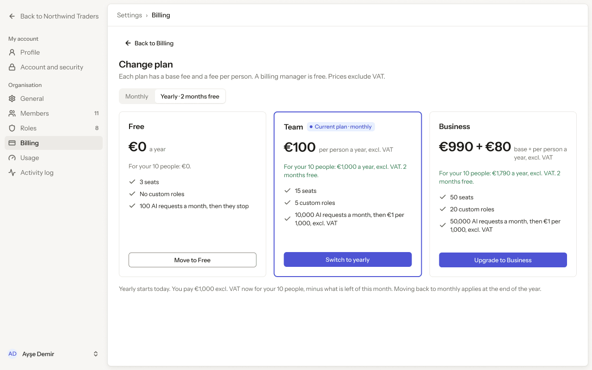

- **Who sees it:** People who manage billing: the Owner and the Billing manager.
- **Device:** Desktop (1280 px and wider).
- **This state shows:** as the title says.
- **Values come from:** Plan, prices, invoices, payment method and trial: our API (billing, step 36). Amounts in euro, VAT shown apart.
- **Components:** Button ×4, Icon/check ×9, Pill, Sidebar, Top bar.
- **Actions:**
  - "Back to Northwind Traders": goes to [4.01 · Home · Owner](../04-home/README.md#401--home--owner).
  - "Profile": goes to [5.01 · Profile · ideal](../05-settings-profile/README.md#501--profile--ideal).
  - "Account and security": goes to [6.01 · Account and security · ideal](../06-settings-account-and-security/README.md#601--account-and-security--ideal).
  - "General": goes to [7.01 · General · ideal](../07-settings-general/README.md#701--general--ideal).
  - "Members": goes to [8.01 · Members · ideal](../08-settings-members/README.md#801--members--ideal).
  - "Roles": goes to [9.01 · Roles · ideal](../09-settings-roles/README.md#901--roles--ideal).
  - "Billing": goes to [10.01 · Billing · Team, monthly](#1001--billing--team-monthly).
  - "Usage": goes to [11.01 · Usage · Team](../11-settings-usage/README.md#1101--usage--team).
  - "Activity log": goes to [12.01 · Activity log · ideal](../12-settings-activity-log/README.md#1201--activity-log--ideal).
  - "Monthly": goes to [10.02 · Change plan · monthly](#1002--change-plan--monthly).
  - "Back to Billing": goes to [10.01 · Billing · Team, monthly](#1001--billing--team-monthly).
- **Texts, word for word, top to bottom:**

  - Back to Northwind Traders
  - My account
  - Profile
  - Account and security
  - Organisation
  - General
  - Members
  - 11
  - Roles
  - 8
  - Billing
  - Usage
  - Activity log
  - AD
  - Ayşe Demir
  - Settings
  - ›
  - Billing
  - Back to Billing
  - Change plan
  - Each plan has a base fee and a fee per person. A billing manager is free. Prices exclude VAT.
  - Monthly
  - Yearly · 2 months free
  - Free
  - €0
  - a year
  - For your 10 people: €0.
  - 3 seats
  - No custom roles
  - 100 AI requests a month, then they stop
  - Move to Free
  - Team
  - Current plan · monthly
  - €100
  - per person a year, excl. VAT
  - For your 10 people: €1,000 a year, excl. VAT. 2 months free.
  - 15 seats
  - 5 custom roles
  - 10,000 AI requests a month, then €1 per 1,000, excl. VAT
  - Switch to yearly
  - Business
  - €990 + €80
  - base + per person a year, excl. VAT
  - For your 10 people: €1,790 a year, excl. VAT. 2 months free.
  - 50 seats
  - 20 custom roles
  - 50,000 AI requests a month, then €1 per 1,000, excl. VAT
  - Upgrade to Business
  - Yearly starts today. You pay €1,000 excl. VAT now for your 10 people, minus what is left of this month. Moving back to monthly applies at the end of the year.

Figma: [232:17910](https://www.figma.com/design/3Ev111okX8xCBwR9B3hyBM/?node-id=232-17910)

### 10.04 · Upgrade · preview

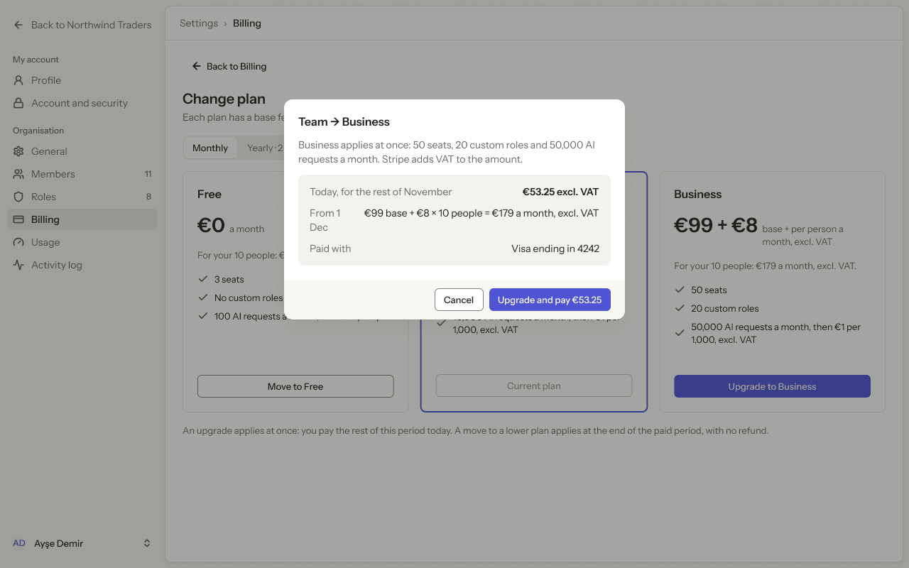

- **Who sees it:** People who manage billing: the Owner and the Billing manager.
- **Device:** Desktop (1280 px and wider).
- **This state shows:** as the title says.
- **Values come from:** Plan, prices, invoices, payment method and trial: our API (billing, step 36). Amounts in euro, VAT shown apart.
- **Components:** Button ×6, Icon/check ×9, Pill, Sidebar, Top bar.
- **Actions:**
  - "Back to Northwind Traders": goes to [4.01 · Home · Owner](../04-home/README.md#401--home--owner).
  - "Profile": goes to [5.01 · Profile · ideal](../05-settings-profile/README.md#501--profile--ideal).
  - "Account and security": goes to [6.01 · Account and security · ideal](../06-settings-account-and-security/README.md#601--account-and-security--ideal).
  - "General": goes to [7.01 · General · ideal](../07-settings-general/README.md#701--general--ideal).
  - "Members": goes to [8.01 · Members · ideal](../08-settings-members/README.md#801--members--ideal).
  - "Roles": goes to [9.01 · Roles · ideal](../09-settings-roles/README.md#901--roles--ideal).
  - "Billing": goes to [10.01 · Billing · Team, monthly](#1001--billing--team-monthly).
  - "Usage": goes to [11.01 · Usage · Team](../11-settings-usage/README.md#1101--usage--team).
  - "Activity log": goes to [12.01 · Activity log · ideal](../12-settings-activity-log/README.md#1201--activity-log--ideal).
  - "Area": goes to [10.02 · Change plan · monthly](#1002--change-plan--monthly).
  - "15 seats": goes to [10.05 · Upgrade · done](#1005--upgrade--done).
- **Texts, word for word, top to bottom:**

  - Back to Northwind Traders
  - My account
  - Profile
  - Account and security
  - Organisation
  - General
  - Members
  - 11
  - Roles
  - 8
  - Billing
  - Usage
  - Activity log
  - AD
  - Ayşe Demir
  - Settings
  - ›
  - Billing
  - Back to Billing
  - Change plan
  - Each plan has a base fee and a fee per person. A billing manager is free. Prices exclude VAT.
  - Monthly
  - Yearly · 2 months free
  - Free
  - €0
  - a month
  - For your 10 people: €0.
  - 3 seats
  - No custom roles
  - 100 AI requests a month, then they stop
  - Move to Free
  - Team
  - Current plan
  - €10
  - per person a month, excl. VAT
  - For your 10 people: €100 a month, excl. VAT.
  - 15 seats
  - 5 custom roles
  - 10,000 AI requests a month, then €1 per 1,000, excl. VAT
  - Current plan
  - Business
  - €99 + €8
  - base + per person a month, excl. VAT
  - For your 10 people: €179 a month, excl. VAT.
  - 50 seats
  - 20 custom roles
  - 50,000 AI requests a month, then €1 per 1,000, excl. VAT
  - Upgrade to Business
  - An upgrade applies at once: you pay the rest of this period today. A move to a lower plan applies at the end of the paid period, with no refund.
  - Team → Business
  - Business applies at once: 50 seats, 20 custom roles and 50,000 AI requests a month. Stripe adds VAT to the amount.
  - Today, for the rest of November
  - €53.25 excl. VAT
  - From 1 Dec
  - €99 base + €8 × 10 people = €179 a month, excl. VAT
  - Paid with
  - Visa ending in 4242
  - Cancel
  - Upgrade and pay €53.25

Figma: [233:17822](https://www.figma.com/design/3Ev111okX8xCBwR9B3hyBM/?node-id=233-17822)

### 10.05 · Upgrade · done

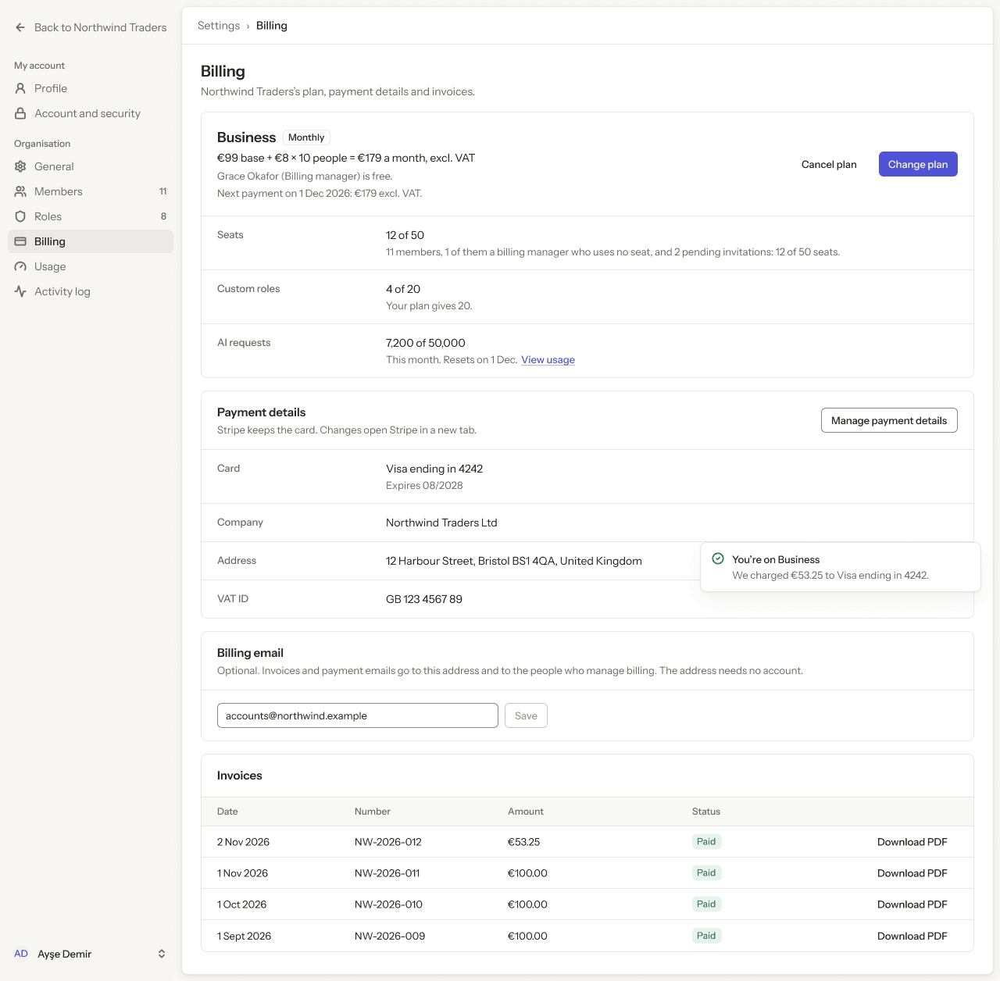

- **Who sees it:** People who manage billing: the Owner and the Billing manager.
- **Device:** Desktop (1280 px and wider).
- **This state shows:** as the title says.
- **Values come from:** Plan, prices, invoices, payment method and trial: our API (billing, step 36). Amounts in euro, VAT shown apart.
- **Components:** Button ×8, Input, Label, Pill ×4, Sidebar, Toast, Top bar.
- **Actions:**
  - "Back to Northwind Traders": goes to [4.01 · Home · Owner](../04-home/README.md#401--home--owner).
  - "Profile": goes to [5.01 · Profile · ideal](../05-settings-profile/README.md#501--profile--ideal).
  - "Account and security": goes to [6.01 · Account and security · ideal](../06-settings-account-and-security/README.md#601--account-and-security--ideal).
  - "General": goes to [7.01 · General · ideal](../07-settings-general/README.md#701--general--ideal).
  - "Members": goes to [8.01 · Members · ideal](../08-settings-members/README.md#801--members--ideal).
  - "Roles": goes to [9.01 · Roles · ideal](../09-settings-roles/README.md#901--roles--ideal).
  - "Billing": goes to [10.01 · Billing · Team, monthly](#1001--billing--team-monthly).
  - "Usage": goes to [11.01 · Usage · Team](../11-settings-usage/README.md#1101--usage--team).
  - "Activity log": goes to [12.01 · Activity log · ideal](../12-settings-activity-log/README.md#1201--activity-log--ideal).
- **Texts, word for word, top to bottom:**

  - Back to Northwind Traders
  - My account
  - Profile
  - Account and security
  - Organisation
  - General
  - Members
  - 11
  - Roles
  - 8
  - Billing
  - Usage
  - Activity log
  - AD
  - Ayşe Demir
  - Settings
  - ›
  - Billing
  - Billing
  - Northwind Traders’s plan, payment details and invoices.
  - Business
  - Monthly
  - €99 base + €8 × 10 people = €179 a month, excl. VAT
  - Grace Okafor (Billing manager) is free.
  - Next payment on 1 Dec 2026: €179 excl. VAT.
  - Cancel plan
  - Change plan
  - Seats
  - 12 of 50
  - 11 members, 1 of them a billing manager who uses no seat, and 2 pending invitations: 12 of 50 seats.
  - Custom roles
  - 4 of 20
  - Your plan gives 20.
  - AI requests
  - 7,200 of 50,000
  - This month. Resets on 1 Dec.
  - View usage
  - Payment details
  - Stripe keeps the card. Changes open Stripe in a new tab.
  - Manage payment details
  - Card
  - Visa ending in 4242
  - Expires 08/2028
  - Company
  - Northwind Traders Ltd
  - Address
  - 12 Harbour Street, Bristol BS1 4QA, United Kingdom
  - VAT ID
  - GB 123 4567 89
  - Billing email
  - Optional. Invoices and payment emails go to this address and to the people who manage billing. The address needs no account.
  - accounts@northwind.example
  - Save
  - Invoices
  - Date
  - Number
  - Amount
  - Status
  - 2 Nov 2026
  - NW-2026-012
  - €53.25
  - Paid
  - Download PDF
  - 1 Nov 2026
  - NW-2026-011
  - €100.00
  - Paid
  - Download PDF
  - 1 Oct 2026
  - NW-2026-010
  - €100.00
  - Paid
  - Download PDF
  - 1 Sept 2026
  - NW-2026-009
  - €100.00
  - Paid
  - Download PDF
  - You’re on Business
  - We charged €53.25 to Visa ending in 4242.

Figma: [233:17929](https://www.figma.com/design/3Ev111okX8xCBwR9B3hyBM/?node-id=233-17929)

### 10.06 · Cancel plan

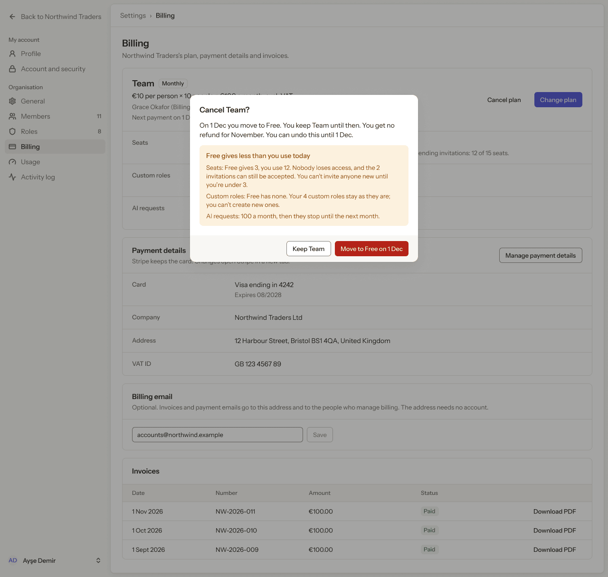

- **Who sees it:** People who manage billing: the Owner and the Billing manager.
- **Device:** Desktop (1280 px and wider).
- **This state shows:** as the title says.
- **Values come from:** Plan, prices, invoices, payment method and trial: our API (billing, step 36). Amounts in euro, VAT shown apart.
- **Components:** Button ×9, Input, Label, Pill ×3, Sidebar, Top bar.
- **Actions:**
  - "Back to Northwind Traders": goes to [4.01 · Home · Owner](../04-home/README.md#401--home--owner).
  - "Profile": goes to [5.01 · Profile · ideal](../05-settings-profile/README.md#501--profile--ideal).
  - "Account and security": goes to [6.01 · Account and security · ideal](../06-settings-account-and-security/README.md#601--account-and-security--ideal).
  - "General": goes to [7.01 · General · ideal](../07-settings-general/README.md#701--general--ideal).
  - "Members": goes to [8.01 · Members · ideal](../08-settings-members/README.md#801--members--ideal).
  - "Roles": goes to [9.01 · Roles · ideal](../09-settings-roles/README.md#901--roles--ideal).
  - "Billing": goes to [10.01 · Billing · Team, monthly](#1001--billing--team-monthly).
  - "Usage": goes to [11.01 · Usage · Team](../11-settings-usage/README.md#1101--usage--team).
  - "Activity log": goes to [12.01 · Activity log · ideal](../12-settings-activity-log/README.md#1201--activity-log--ideal).
  - "Keep Team": goes to [10.01 · Billing · Team, monthly](#1001--billing--team-monthly).
  - "Move to Free on 1 Dec": goes to [10.07 · Cancellation scheduled](#1007--cancellation-scheduled).
- **Texts, word for word, top to bottom:**

  - Back to Northwind Traders
  - My account
  - Profile
  - Account and security
  - Organisation
  - General
  - Members
  - 11
  - Roles
  - 8
  - Billing
  - Usage
  - Activity log
  - AD
  - Ayşe Demir
  - Settings
  - ›
  - Billing
  - Billing
  - Northwind Traders’s plan, payment details and invoices.
  - Team
  - Monthly
  - €10 per person × 10 people = €100 a month, excl. VAT
  - Grace Okafor (Billing manager) is free.
  - Next payment on 1 Dec 2026: €100 excl. VAT.
  - Cancel plan
  - Change plan
  - Seats
  - 12 of 15
  - 11 members, 1 of them a billing manager who uses no seat, and 2 pending invitations: 12 of 15 seats.
  - Custom roles
  - 4 of 10
  - Your plan gives 5. Raised to 10 until 31 Dec 2026.
  - AI requests
  - 7,200 of 10,000
  - This month. Resets on 1 Dec.
  - View usage
  - Payment details
  - Stripe keeps the card. Changes open Stripe in a new tab.
  - Manage payment details
  - Card
  - Visa ending in 4242
  - Expires 08/2028
  - Company
  - Northwind Traders Ltd
  - Address
  - 12 Harbour Street, Bristol BS1 4QA, United Kingdom
  - VAT ID
  - GB 123 4567 89
  - Billing email
  - Optional. Invoices and payment emails go to this address and to the people who manage billing. The address needs no account.
  - accounts@northwind.example
  - Save
  - Invoices
  - Date
  - Number
  - Amount
  - Status
  - 1 Nov 2026
  - NW-2026-011
  - €100.00
  - Paid
  - Download PDF
  - 1 Oct 2026
  - NW-2026-010
  - €100.00
  - Paid
  - Download PDF
  - 1 Sept 2026
  - NW-2026-009
  - €100.00
  - Paid
  - Download PDF
  - Cancel Team?
  - On 1 Dec you move to Free. You keep Team until then. You get no refund for November. You can undo this until 1 Dec.
  - Free gives less than you use today
  - Seats: Free gives 3, you use 12. Nobody loses access, and the 2 invitations can still be accepted. You can’t invite anyone new until you’re under 3.
  - Custom roles: Free has none. Your 4 custom roles stay as they are; you can’t create new ones.
  - AI requests: 100 a month, then they stop until the next month.
  - Keep Team
  - Move to Free on 1 Dec

Figma: [233:18153](https://www.figma.com/design/3Ev111okX8xCBwR9B3hyBM/?node-id=233-18153)

### 10.07 · Cancellation scheduled

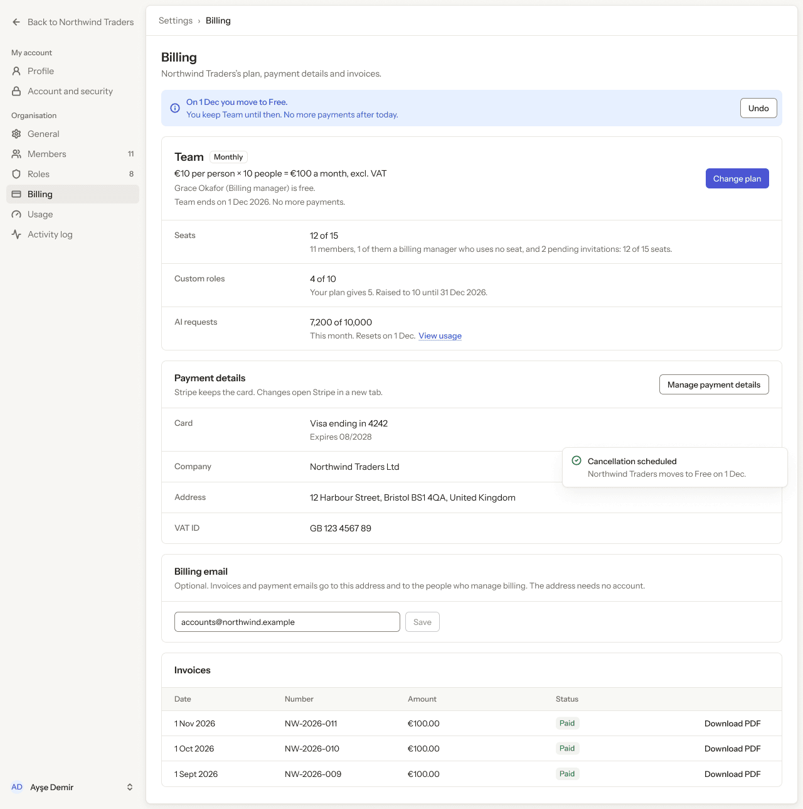

- **Who sees it:** People who manage billing: the Owner and the Billing manager.
- **Device:** Desktop (1280 px and wider).
- **This state shows:** as the title says.
- **Values come from:** Plan, prices, invoices, payment method and trial: our API (billing, step 36). Amounts in euro, VAT shown apart.
- **Components:** Banner, Button ×6, Input, Label, Pill ×3, Sidebar, Toast, Top bar.
- **Actions:**
  - "Back to Northwind Traders": goes to [4.01 · Home · Owner](../04-home/README.md#401--home--owner).
  - "Profile": goes to [5.01 · Profile · ideal](../05-settings-profile/README.md#501--profile--ideal).
  - "Account and security": goes to [6.01 · Account and security · ideal](../06-settings-account-and-security/README.md#601--account-and-security--ideal).
  - "General": goes to [7.01 · General · ideal](../07-settings-general/README.md#701--general--ideal).
  - "Members": goes to [8.01 · Members · ideal](../08-settings-members/README.md#801--members--ideal).
  - "Roles": goes to [9.01 · Roles · ideal](../09-settings-roles/README.md#901--roles--ideal).
  - "Billing": goes to [10.01 · Billing · Team, monthly](#1001--billing--team-monthly).
  - "Usage": goes to [11.01 · Usage · Team](../11-settings-usage/README.md#1101--usage--team).
  - "Activity log": goes to [12.01 · Activity log · ideal](../12-settings-activity-log/README.md#1201--activity-log--ideal).
  - "Undo": goes to [10.01 · Billing · Team, monthly](#1001--billing--team-monthly).
- **Texts, word for word, top to bottom:**

  - Back to Northwind Traders
  - My account
  - Profile
  - Account and security
  - Organisation
  - General
  - Members
  - 11
  - Roles
  - 8
  - Billing
  - Usage
  - Activity log
  - AD
  - Ayşe Demir
  - Settings
  - ›
  - Billing
  - Billing
  - Northwind Traders’s plan, payment details and invoices.
  - On 1 Dec you move to Free.
  - You keep Team until then. No more payments after today.
  - Undo
  - Team
  - Monthly
  - €10 per person × 10 people = €100 a month, excl. VAT
  - Grace Okafor (Billing manager) is free.
  - Team ends on 1 Dec 2026. No more payments.
  - Change plan
  - Seats
  - 12 of 15
  - 11 members, 1 of them a billing manager who uses no seat, and 2 pending invitations: 12 of 15 seats.
  - Custom roles
  - 4 of 10
  - Your plan gives 5. Raised to 10 until 31 Dec 2026.
  - AI requests
  - 7,200 of 10,000
  - This month. Resets on 1 Dec.
  - View usage
  - Payment details
  - Stripe keeps the card. Changes open Stripe in a new tab.
  - Manage payment details
  - Card
  - Visa ending in 4242
  - Expires 08/2028
  - Company
  - Northwind Traders Ltd
  - Address
  - 12 Harbour Street, Bristol BS1 4QA, United Kingdom
  - VAT ID
  - GB 123 4567 89
  - Billing email
  - Optional. Invoices and payment emails go to this address and to the people who manage billing. The address needs no account.
  - accounts@northwind.example
  - Save
  - Invoices
  - Date
  - Number
  - Amount
  - Status
  - 1 Nov 2026
  - NW-2026-011
  - €100.00
  - Paid
  - Download PDF
  - 1 Oct 2026
  - NW-2026-010
  - €100.00
  - Paid
  - Download PDF
  - 1 Sept 2026
  - NW-2026-009
  - €100.00
  - Paid
  - Download PDF
  - Cancellation scheduled
  - Northwind Traders moves to Free on 1 Dec.

Figma: [233:18287](https://www.figma.com/design/3Ev111okX8xCBwR9B3hyBM/?node-id=233-18287)

### 10.08 · Billing · in trial

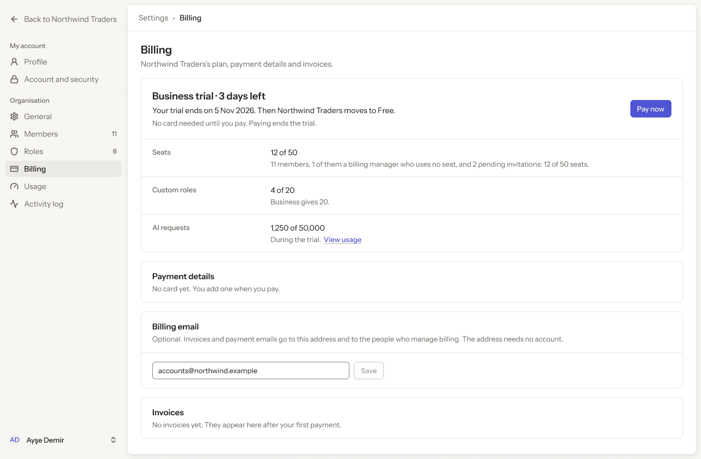

- **Who sees it:** People who manage billing: the Owner and the Billing manager.
- **Device:** Desktop (1280 px and wider).
- **This state shows:** as the title says.
- **Values come from:** Plan, prices, invoices, payment method and trial: our API (billing, step 36). Amounts in euro, VAT shown apart.
- **Components:** Button ×2, Input, Sidebar, Top bar.
- **Actions:**
  - "Back to Northwind Traders": goes to [4.01 · Home · Owner](../04-home/README.md#401--home--owner).
  - "Profile": goes to [5.01 · Profile · ideal](../05-settings-profile/README.md#501--profile--ideal).
  - "Account and security": goes to [6.01 · Account and security · ideal](../06-settings-account-and-security/README.md#601--account-and-security--ideal).
  - "General": goes to [7.01 · General · ideal](../07-settings-general/README.md#701--general--ideal).
  - "Members": goes to [8.01 · Members · ideal](../08-settings-members/README.md#801--members--ideal).
  - "Roles": goes to [9.01 · Roles · ideal](../09-settings-roles/README.md#901--roles--ideal).
  - "Billing": goes to [10.01 · Billing · Team, monthly](#1001--billing--team-monthly).
  - "Usage": goes to [11.01 · Usage · Team](../11-settings-usage/README.md#1101--usage--team).
  - "Activity log": goes to [12.01 · Activity log · ideal](../12-settings-activity-log/README.md#1201--activity-log--ideal).
  - "Pay now": goes to [10.09 · Change plan · from a trial](#1009--change-plan--from-a-trial).
- **Texts, word for word, top to bottom:**

  - Back to Northwind Traders
  - My account
  - Profile
  - Account and security
  - Organisation
  - General
  - Members
  - 11
  - Roles
  - 8
  - Billing
  - Usage
  - Activity log
  - AD
  - Ayşe Demir
  - Settings
  - ›
  - Billing
  - Billing
  - Northwind Traders’s plan, payment details and invoices.
  - Business trial · 3 days left
  - Your trial ends on 5 Nov 2026. Then Northwind Traders moves to Free.
  - No card needed until you pay. Paying ends the trial.
  - Pay now
  - Seats
  - 12 of 50
  - 11 members, 1 of them a billing manager who uses no seat, and 2 pending invitations: 12 of 50 seats.
  - Custom roles
  - 4 of 20
  - Business gives 20.
  - AI requests
  - 1,250 of 50,000
  - During the trial.
  - View usage
  - Payment details
  - No card yet. You add one when you pay.
  - Billing email
  - Optional. Invoices and payment emails go to this address and to the people who manage billing. The address needs no account.
  - accounts@northwind.example
  - Save
  - Invoices
  - No invoices yet. They appear here after your first payment.

Figma: [234:18248](https://www.figma.com/design/3Ev111okX8xCBwR9B3hyBM/?node-id=234-18248)

### 10.09 · Change plan · from a trial

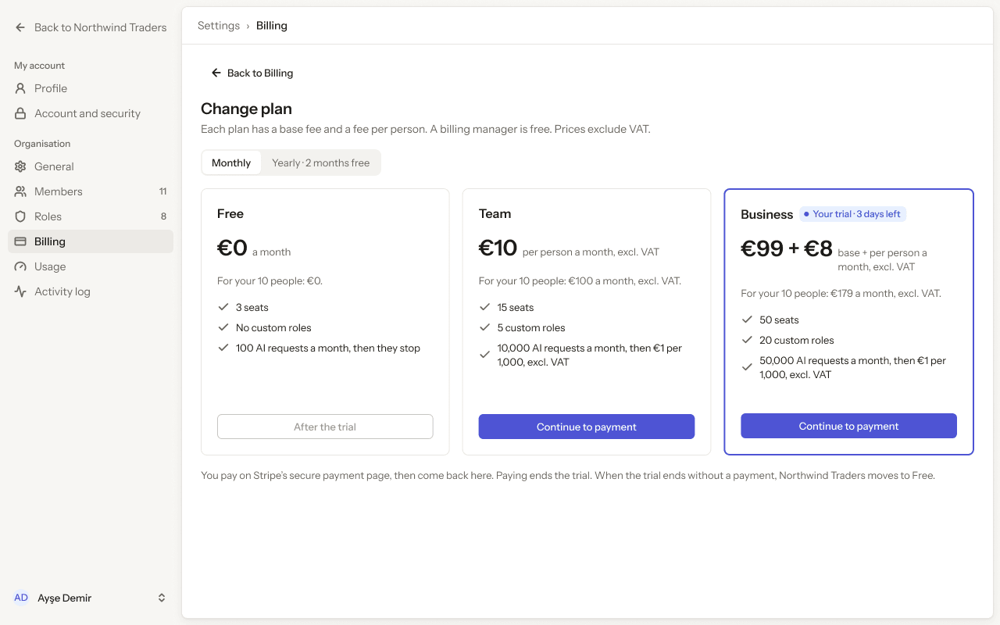

- **Who sees it:** People who manage billing: the Owner and the Billing manager.
- **Device:** Desktop (1280 px and wider).
- **This state shows:** as the title says.
- **Values come from:** Plan, prices, invoices, payment method and trial: our API (billing, step 36). Amounts in euro, VAT shown apart.
- **Components:** Button ×4, Icon/check ×9, Pill, Sidebar, Top bar.
- **Actions:**
  - "Back to Northwind Traders": goes to [4.01 · Home · Owner](../04-home/README.md#401--home--owner).
  - "Profile": goes to [5.01 · Profile · ideal](../05-settings-profile/README.md#501--profile--ideal).
  - "Account and security": goes to [6.01 · Account and security · ideal](../06-settings-account-and-security/README.md#601--account-and-security--ideal).
  - "General": goes to [7.01 · General · ideal](../07-settings-general/README.md#701--general--ideal).
  - "Members": goes to [8.01 · Members · ideal](../08-settings-members/README.md#801--members--ideal).
  - "Roles": goes to [9.01 · Roles · ideal](../09-settings-roles/README.md#901--roles--ideal).
  - "Billing": goes to [10.01 · Billing · Team, monthly](#1001--billing--team-monthly).
  - "Usage": goes to [11.01 · Usage · Team](../11-settings-usage/README.md#1101--usage--team).
  - "Activity log": goes to [12.01 · Activity log · ideal](../12-settings-activity-log/README.md#1201--activity-log--ideal).
  - "Area": goes to [10.10 · Continue to payment · opening Stripe](#1010--continue-to-payment--opening-stripe).
  - "Back to Billing": goes to [10.08 · Billing · in trial](#1008--billing--in-trial).
- **Texts, word for word, top to bottom:**

  - Back to Northwind Traders
  - My account
  - Profile
  - Account and security
  - Organisation
  - General
  - Members
  - 11
  - Roles
  - 8
  - Billing
  - Usage
  - Activity log
  - AD
  - Ayşe Demir
  - Settings
  - ›
  - Billing
  - Back to Billing
  - Change plan
  - Each plan has a base fee and a fee per person. A billing manager is free. Prices exclude VAT.
  - Monthly
  - Yearly · 2 months free
  - Free
  - €0
  - a month
  - For your 10 people: €0.
  - 3 seats
  - No custom roles
  - 100 AI requests a month, then they stop
  - After the trial
  - Team
  - €10
  - per person a month, excl. VAT
  - For your 10 people: €100 a month, excl. VAT.
  - 15 seats
  - 5 custom roles
  - 10,000 AI requests a month, then €1 per 1,000, excl. VAT
  - Continue to payment
  - Business
  - Your trial · 3 days left
  - €99 + €8
  - base + per person a month, excl. VAT
  - For your 10 people: €179 a month, excl. VAT.
  - 50 seats
  - 20 custom roles
  - 50,000 AI requests a month, then €1 per 1,000, excl. VAT
  - Continue to payment
  - You pay on Stripe’s secure payment page, then come back here. Paying ends the trial. When the trial ends without a payment, Northwind Traders moves to Free.

Figma: [234:18812](https://www.figma.com/design/3Ev111okX8xCBwR9B3hyBM/?node-id=234-18812)

### 10.10 · Continue to payment · opening Stripe

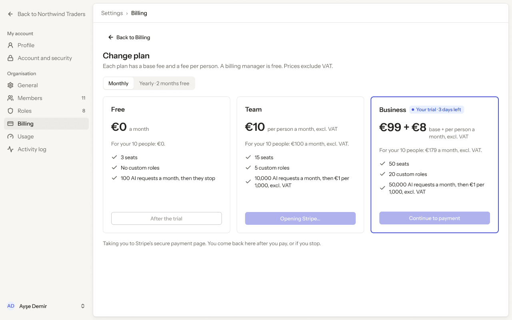

- **Who sees it:** People who manage billing: the Owner and the Billing manager.
- **Device:** Desktop (1280 px and wider).
- **This state shows:** as the title says.
- **Values come from:** Plan, prices, invoices, payment method and trial: our API (billing, step 36). Amounts in euro, VAT shown apart.
- **Components:** Button ×4, Icon/check ×9, Pill, Sidebar, Top bar.
- **Actions:**
  - "Back to Northwind Traders": goes to [4.01 · Home · Owner](../04-home/README.md#401--home--owner).
  - "Profile": goes to [5.01 · Profile · ideal](../05-settings-profile/README.md#501--profile--ideal).
  - "Account and security": goes to [6.01 · Account and security · ideal](../06-settings-account-and-security/README.md#601--account-and-security--ideal).
  - "General": goes to [7.01 · General · ideal](../07-settings-general/README.md#701--general--ideal).
  - "Members": goes to [8.01 · Members · ideal](../08-settings-members/README.md#801--members--ideal).
  - "Roles": goes to [9.01 · Roles · ideal](../09-settings-roles/README.md#901--roles--ideal).
  - "Billing": goes to [10.01 · Billing · Team, monthly](#1001--billing--team-monthly).
  - "Usage": goes to [11.01 · Usage · Team](../11-settings-usage/README.md#1101--usage--team).
  - "Activity log": goes to [12.01 · Activity log · ideal](../12-settings-activity-log/README.md#1201--activity-log--ideal).
  - "Area": goes to [10.11 · Payment successful](#1011--payment-successful).
- **Texts, word for word, top to bottom:**

  - Back to Northwind Traders
  - My account
  - Profile
  - Account and security
  - Organisation
  - General
  - Members
  - 11
  - Roles
  - 8
  - Billing
  - Usage
  - Activity log
  - AD
  - Ayşe Demir
  - Settings
  - ›
  - Billing
  - Back to Billing
  - Change plan
  - Each plan has a base fee and a fee per person. A billing manager is free. Prices exclude VAT.
  - Monthly
  - Yearly · 2 months free
  - Free
  - €0
  - a month
  - For your 10 people: €0.
  - 3 seats
  - No custom roles
  - 100 AI requests a month, then they stop
  - After the trial
  - Team
  - €10
  - per person a month, excl. VAT
  - For your 10 people: €100 a month, excl. VAT.
  - 15 seats
  - 5 custom roles
  - 10,000 AI requests a month, then €1 per 1,000, excl. VAT
  - Opening Stripe…
  - Business
  - Your trial · 3 days left
  - €99 + €8
  - base + per person a month, excl. VAT
  - For your 10 people: €179 a month, excl. VAT.
  - 50 seats
  - 20 custom roles
  - 50,000 AI requests a month, then €1 per 1,000, excl. VAT
  - Continue to payment
  - Taking you to Stripe’s secure payment page. You come back here after you pay, or if you stop.

Figma: [234:19013](https://www.figma.com/design/3Ev111okX8xCBwR9B3hyBM/?node-id=234-19013)

### 10.11 · Payment successful

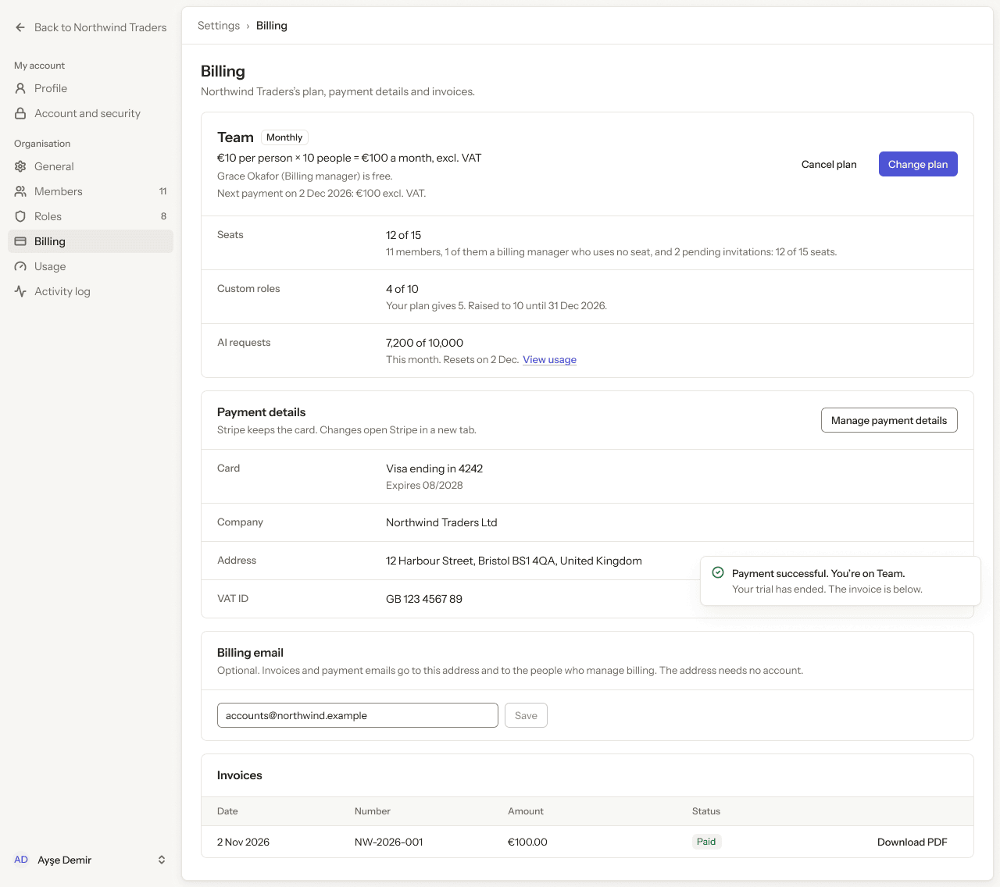

- **Who sees it:** People who manage billing: the Owner and the Billing manager.
- **Device:** Desktop (1280 px and wider).
- **This state shows:** as the title says.
- **Values come from:** Plan, prices, invoices, payment method and trial: our API (billing, step 36). Amounts in euro, VAT shown apart.
- **Components:** Button ×5, Input, Label, Pill, Sidebar, Toast, Top bar.
- **Actions:**
  - "Back to Northwind Traders": goes to [4.01 · Home · Owner](../04-home/README.md#401--home--owner).
  - "Profile": goes to [5.01 · Profile · ideal](../05-settings-profile/README.md#501--profile--ideal).
  - "Account and security": goes to [6.01 · Account and security · ideal](../06-settings-account-and-security/README.md#601--account-and-security--ideal).
  - "General": goes to [7.01 · General · ideal](../07-settings-general/README.md#701--general--ideal).
  - "Members": goes to [8.01 · Members · ideal](../08-settings-members/README.md#801--members--ideal).
  - "Roles": goes to [9.01 · Roles · ideal](../09-settings-roles/README.md#901--roles--ideal).
  - "Billing": goes to [10.01 · Billing · Team, monthly](#1001--billing--team-monthly).
  - "Usage": goes to [11.01 · Usage · Team](../11-settings-usage/README.md#1101--usage--team).
  - "Activity log": goes to [12.01 · Activity log · ideal](../12-settings-activity-log/README.md#1201--activity-log--ideal).
- **Texts, word for word, top to bottom:**

  - Back to Northwind Traders
  - My account
  - Profile
  - Account and security
  - Organisation
  - General
  - Members
  - 11
  - Roles
  - 8
  - Billing
  - Usage
  - Activity log
  - AD
  - Ayşe Demir
  - Settings
  - ›
  - Billing
  - Billing
  - Northwind Traders’s plan, payment details and invoices.
  - Team
  - Monthly
  - €10 per person × 10 people = €100 a month, excl. VAT
  - Grace Okafor (Billing manager) is free.
  - Next payment on 2 Dec 2026: €100 excl. VAT.
  - Cancel plan
  - Change plan
  - Seats
  - 12 of 15
  - 11 members, 1 of them a billing manager who uses no seat, and 2 pending invitations: 12 of 15 seats.
  - Custom roles
  - 4 of 10
  - Your plan gives 5. Raised to 10 until 31 Dec 2026.
  - AI requests
  - 7,200 of 10,000
  - This month. Resets on 2 Dec.
  - View usage
  - Payment details
  - Stripe keeps the card. Changes open Stripe in a new tab.
  - Manage payment details
  - Card
  - Visa ending in 4242
  - Expires 08/2028
  - Company
  - Northwind Traders Ltd
  - Address
  - 12 Harbour Street, Bristol BS1 4QA, United Kingdom
  - VAT ID
  - GB 123 4567 89
  - Billing email
  - Optional. Invoices and payment emails go to this address and to the people who manage billing. The address needs no account.
  - accounts@northwind.example
  - Save
  - Invoices
  - Date
  - Number
  - Amount
  - Status
  - 2 Nov 2026
  - NW-2026-001
  - €100.00
  - Paid
  - Download PDF
  - Payment successful. You’re on Team.
  - Your trial has ended. The invoice is below.

Figma: [234:19214](https://www.figma.com/design/3Ev111okX8xCBwR9B3hyBM/?node-id=234-19214)

### 10.12 · Payment not completed

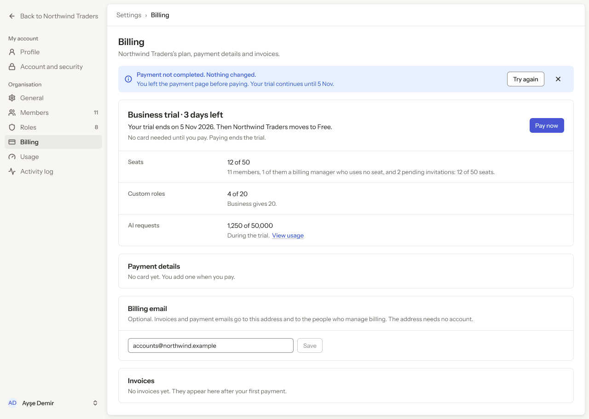

- **Who sees it:** People who manage billing: the Owner and the Billing manager.
- **Device:** Desktop (1280 px and wider).
- **This state shows:** as the title says.
- **Values come from:** Plan, prices, invoices, payment method and trial: our API (billing, step 36). Amounts in euro, VAT shown apart.
- **Components:** Banner, Button ×2, Input, Sidebar, Top bar.
- **Actions:**
  - "Back to Northwind Traders": goes to [4.01 · Home · Owner](../04-home/README.md#401--home--owner).
  - "Profile": goes to [5.01 · Profile · ideal](../05-settings-profile/README.md#501--profile--ideal).
  - "Account and security": goes to [6.01 · Account and security · ideal](../06-settings-account-and-security/README.md#601--account-and-security--ideal).
  - "General": goes to [7.01 · General · ideal](../07-settings-general/README.md#701--general--ideal).
  - "Members": goes to [8.01 · Members · ideal](../08-settings-members/README.md#801--members--ideal).
  - "Roles": goes to [9.01 · Roles · ideal](../09-settings-roles/README.md#901--roles--ideal).
  - "Billing": goes to [10.01 · Billing · Team, monthly](#1001--billing--team-monthly).
  - "Usage": goes to [11.01 · Usage · Team](../11-settings-usage/README.md#1101--usage--team).
  - "Activity log": goes to [12.01 · Activity log · ideal](../12-settings-activity-log/README.md#1201--activity-log--ideal).
  - "Try again": goes to [10.09 · Change plan · from a trial](#1009--change-plan--from-a-trial).
- **Texts, word for word, top to bottom:**

  - Back to Northwind Traders
  - My account
  - Profile
  - Account and security
  - Organisation
  - General
  - Members
  - 11
  - Roles
  - 8
  - Billing
  - Usage
  - Activity log
  - AD
  - Ayşe Demir
  - Settings
  - ›
  - Billing
  - Billing
  - Northwind Traders’s plan, payment details and invoices.
  - Payment not completed. Nothing changed.
  - You left the payment page before paying. Your trial continues until 5 Nov.
  - Try again
  - Business trial · 3 days left
  - Your trial ends on 5 Nov 2026. Then Northwind Traders moves to Free.
  - No card needed until you pay. Paying ends the trial.
  - Pay now
  - Seats
  - 12 of 50
  - 11 members, 1 of them a billing manager who uses no seat, and 2 pending invitations: 12 of 50 seats.
  - Custom roles
  - 4 of 20
  - Business gives 20.
  - AI requests
  - 1,250 of 50,000
  - During the trial.
  - View usage
  - Payment details
  - No card yet. You add one when you pay.
  - Billing email
  - Optional. Invoices and payment emails go to this address and to the people who manage billing. The address needs no account.
  - accounts@northwind.example
  - Save
  - Invoices
  - No invoices yet. They appear here after your first payment.

Figma: [234:18456](https://www.figma.com/design/3Ev111okX8xCBwR9B3hyBM/?node-id=234-18456)

### 10.13 · Card declined

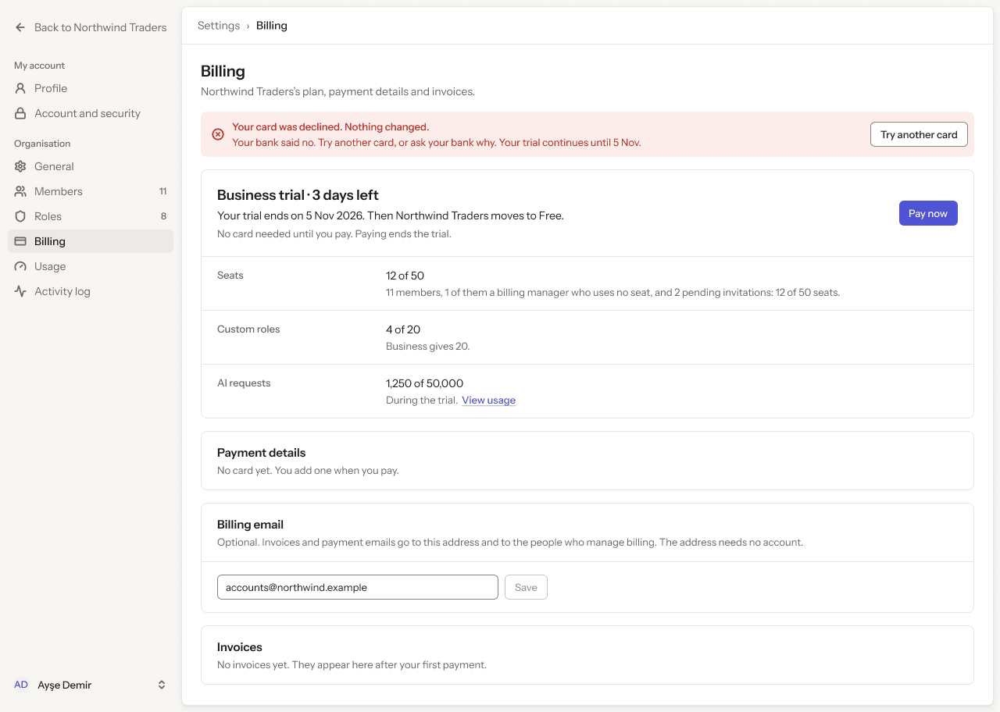

- **Who sees it:** People who manage billing: the Owner and the Billing manager.
- **Device:** Desktop (1280 px and wider).
- **This state shows:** as the title says.
- **Values come from:** Plan, prices, invoices, payment method and trial: our API (billing, step 36). Amounts in euro, VAT shown apart.
- **Components:** Banner, Button ×2, Input, Sidebar, Top bar.
- **Actions:**
  - "Back to Northwind Traders": goes to [4.01 · Home · Owner](../04-home/README.md#401--home--owner).
  - "Profile": goes to [5.01 · Profile · ideal](../05-settings-profile/README.md#501--profile--ideal).
  - "Account and security": goes to [6.01 · Account and security · ideal](../06-settings-account-and-security/README.md#601--account-and-security--ideal).
  - "General": goes to [7.01 · General · ideal](../07-settings-general/README.md#701--general--ideal).
  - "Members": goes to [8.01 · Members · ideal](../08-settings-members/README.md#801--members--ideal).
  - "Roles": goes to [9.01 · Roles · ideal](../09-settings-roles/README.md#901--roles--ideal).
  - "Billing": goes to [10.01 · Billing · Team, monthly](#1001--billing--team-monthly).
  - "Usage": goes to [11.01 · Usage · Team](../11-settings-usage/README.md#1101--usage--team).
  - "Activity log": goes to [12.01 · Activity log · ideal](../12-settings-activity-log/README.md#1201--activity-log--ideal).
  - "Try another card": goes to [10.09 · Change plan · from a trial](#1009--change-plan--from-a-trial).
- **Texts, word for word, top to bottom:**

  - Back to Northwind Traders
  - My account
  - Profile
  - Account and security
  - Organisation
  - General
  - Members
  - 11
  - Roles
  - 8
  - Billing
  - Usage
  - Activity log
  - AD
  - Ayşe Demir
  - Settings
  - ›
  - Billing
  - Billing
  - Northwind Traders’s plan, payment details and invoices.
  - Your card was declined. Nothing changed.
  - Your bank said no. Try another card, or ask your bank why. Your trial continues until 5 Nov.
  - Try another card
  - Business trial · 3 days left
  - Your trial ends on 5 Nov 2026. Then Northwind Traders moves to Free.
  - No card needed until you pay. Paying ends the trial.
  - Pay now
  - Seats
  - 12 of 50
  - 11 members, 1 of them a billing manager who uses no seat, and 2 pending invitations: 12 of 50 seats.
  - Custom roles
  - 4 of 20
  - Business gives 20.
  - AI requests
  - 1,250 of 50,000
  - During the trial.
  - View usage
  - Payment details
  - No card yet. You add one when you pay.
  - Billing email
  - Optional. Invoices and payment emails go to this address and to the people who manage billing. The address needs no account.
  - accounts@northwind.example
  - Save
  - Invoices
  - No invoices yet. They appear here after your first payment.

Figma: [234:18624](https://www.figma.com/design/3Ev111okX8xCBwR9B3hyBM/?node-id=234-18624)

### 10.14 · Trial ended · over the seat limit

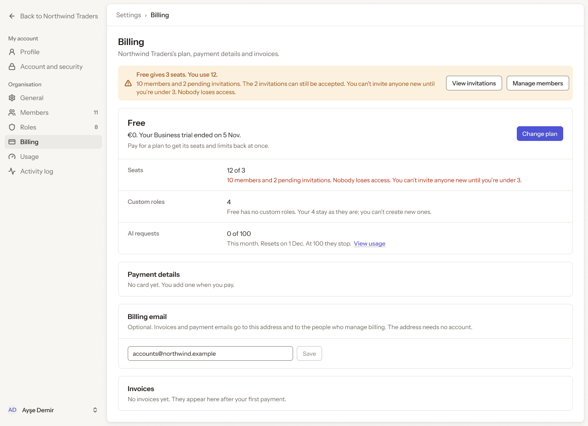

- **Who sees it:** People who manage billing: the Owner and the Billing manager.
- **Device:** Desktop (1280 px and wider).
- **This state shows:** as the title says.
- **Values come from:** Plan, prices, invoices, payment method and trial: our API (billing, step 36). Amounts in euro, VAT shown apart.
- **Components:** Banner, Button ×2, Input, Sidebar, Top bar.
- **Actions:**
  - "View invitations": goes to [8.29 · Invitations](../08-settings-members/README.md#829--invitations).
  - "Manage members": goes to [8.09 · Members · over the limit](../08-settings-members/README.md#809--members--over-the-limit).
  - "Back to Northwind Traders": goes to [4.01 · Home · Owner](../04-home/README.md#401--home--owner).
  - "Profile": goes to [5.01 · Profile · ideal](../05-settings-profile/README.md#501--profile--ideal).
  - "Account and security": goes to [6.01 · Account and security · ideal](../06-settings-account-and-security/README.md#601--account-and-security--ideal).
  - "General": goes to [7.01 · General · ideal](../07-settings-general/README.md#701--general--ideal).
  - "Members": goes to [8.01 · Members · ideal](../08-settings-members/README.md#801--members--ideal).
  - "Roles": goes to [9.01 · Roles · ideal](../09-settings-roles/README.md#901--roles--ideal).
  - "Billing": goes to [10.01 · Billing · Team, monthly](#1001--billing--team-monthly).
  - "Usage": goes to [11.01 · Usage · Team](../11-settings-usage/README.md#1101--usage--team).
  - "Activity log": goes to [12.01 · Activity log · ideal](../12-settings-activity-log/README.md#1201--activity-log--ideal).
  - "Change plan": goes to [10.02 · Change plan · monthly](#1002--change-plan--monthly).
- **Texts, word for word, top to bottom:**

  - Back to Northwind Traders
  - My account
  - Profile
  - Account and security
  - Organisation
  - General
  - Members
  - 11
  - Roles
  - 8
  - Billing
  - Usage
  - Activity log
  - AD
  - Ayşe Demir
  - Settings
  - ›
  - Billing
  - Billing
  - Northwind Traders’s plan, payment details and invoices.
  - Free gives 3 seats. You use 12.
  - 10 members and 2 pending invitations. The 2 invitations can still be accepted. You can’t invite anyone new until you’re under 3. Nobody loses access.
  - View invitations
  - Manage members
  - Free
  - €0. Your Business trial ended on 5 Nov.
  - Pay for a plan to get its seats and limits back at once.
  - Change plan
  - Seats
  - 12 of 3
  - 10 members and 2 pending invitations. Nobody loses access. You can’t invite anyone new until you’re under 3.
  - Custom roles
  - 4
  - Free has no custom roles. Your 4 stay as they are; you can’t create new ones.
  - AI requests
  - 0 of 100
  - This month. Resets on 1 Dec. At 100 they stop.
  - View usage
  - Payment details
  - No card yet. You add one when you pay.
  - Billing email
  - Optional. Invoices and payment emails go to this address and to the people who manage billing. The address needs no account.
  - accounts@northwind.example
  - Save
  - Invoices
  - No invoices yet. They appear here after your first payment.

Figma: [125:14810](https://www.figma.com/design/3Ev111okX8xCBwR9B3hyBM/?node-id=125-14810)

### 10.15 · Payment failed · retrying

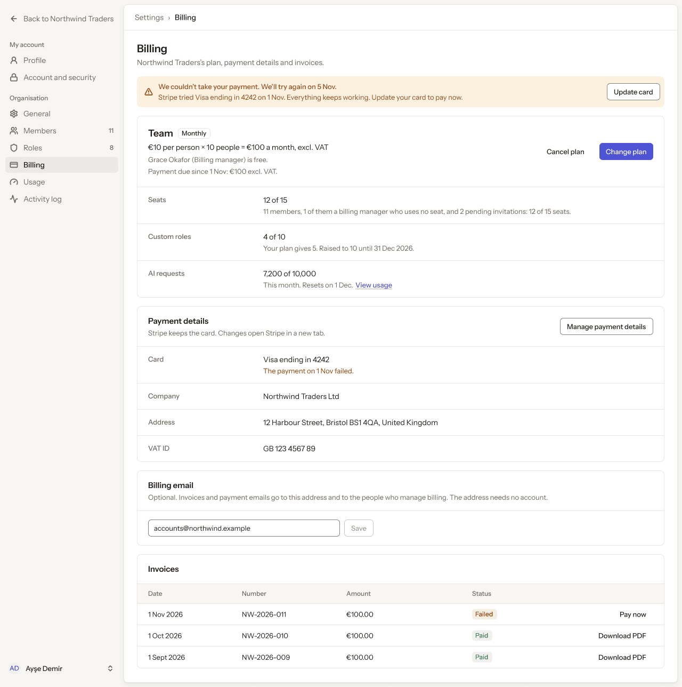

- **Who sees it:** People who manage billing: the Owner and the Billing manager.
- **Device:** Desktop (1280 px and wider).
- **This state shows:** when the action fails.
- **Values come from:** Plan, prices, invoices, payment method and trial: our API (billing, step 36). Amounts in euro, VAT shown apart.
- **Components:** Banner, Button ×7, Input, Label, Pill ×3, Sidebar, Top bar.
- **Actions:**
  - "Back to Northwind Traders": goes to [4.01 · Home · Owner](../04-home/README.md#401--home--owner).
  - "Profile": goes to [5.01 · Profile · ideal](../05-settings-profile/README.md#501--profile--ideal).
  - "Account and security": goes to [6.01 · Account and security · ideal](../06-settings-account-and-security/README.md#601--account-and-security--ideal).
  - "General": goes to [7.01 · General · ideal](../07-settings-general/README.md#701--general--ideal).
  - "Members": goes to [8.01 · Members · ideal](../08-settings-members/README.md#801--members--ideal).
  - "Roles": goes to [9.01 · Roles · ideal](../09-settings-roles/README.md#901--roles--ideal).
  - "Billing": goes to [10.01 · Billing · Team, monthly](#1001--billing--team-monthly).
  - "Usage": goes to [11.01 · Usage · Team](../11-settings-usage/README.md#1101--usage--team).
  - "Activity log": goes to [12.01 · Activity log · ideal](../12-settings-activity-log/README.md#1201--activity-log--ideal).
  - "Update card": goes to [10.11 · Payment successful](#1011--payment-successful).
- **Texts, word for word, top to bottom:**

  - Back to Northwind Traders
  - My account
  - Profile
  - Account and security
  - Organisation
  - General
  - Members
  - 11
  - Roles
  - 8
  - Billing
  - Usage
  - Activity log
  - AD
  - Ayşe Demir
  - Settings
  - ›
  - Billing
  - Billing
  - Northwind Traders’s plan, payment details and invoices.
  - We couldn’t take your payment. We’ll try again on 5 Nov.
  - Stripe tried Visa ending in 4242 on 1 Nov. Everything keeps working. Update your card to pay now.
  - Update card
  - Team
  - Monthly
  - €10 per person × 10 people = €100 a month, excl. VAT
  - Grace Okafor (Billing manager) is free.
  - Payment due since 1 Nov: €100 excl. VAT.
  - Cancel plan
  - Change plan
  - Seats
  - 12 of 15
  - 11 members, 1 of them a billing manager who uses no seat, and 2 pending invitations: 12 of 15 seats.
  - Custom roles
  - 4 of 10
  - Your plan gives 5. Raised to 10 until 31 Dec 2026.
  - AI requests
  - 7,200 of 10,000
  - This month. Resets on 1 Dec.
  - View usage
  - Payment details
  - Stripe keeps the card. Changes open Stripe in a new tab.
  - Manage payment details
  - Card
  - Visa ending in 4242
  - The payment on 1 Nov failed.
  - Company
  - Northwind Traders Ltd
  - Address
  - 12 Harbour Street, Bristol BS1 4QA, United Kingdom
  - VAT ID
  - GB 123 4567 89
  - Billing email
  - Optional. Invoices and payment emails go to this address and to the people who manage billing. The address needs no account.
  - accounts@northwind.example
  - Save
  - Invoices
  - Date
  - Number
  - Amount
  - Status
  - 1 Nov 2026
  - NW-2026-011
  - €100.00
  - Failed
  - Pay now
  - 1 Oct 2026
  - NW-2026-010
  - €100.00
  - Paid
  - Download PDF
  - 1 Sept 2026
  - NW-2026-009
  - €100.00
  - Paid
  - Download PDF

Figma: [235:18993](https://www.figma.com/design/3Ev111okX8xCBwR9B3hyBM/?node-id=235-18993)

### 10.16 · Payment failed · grace

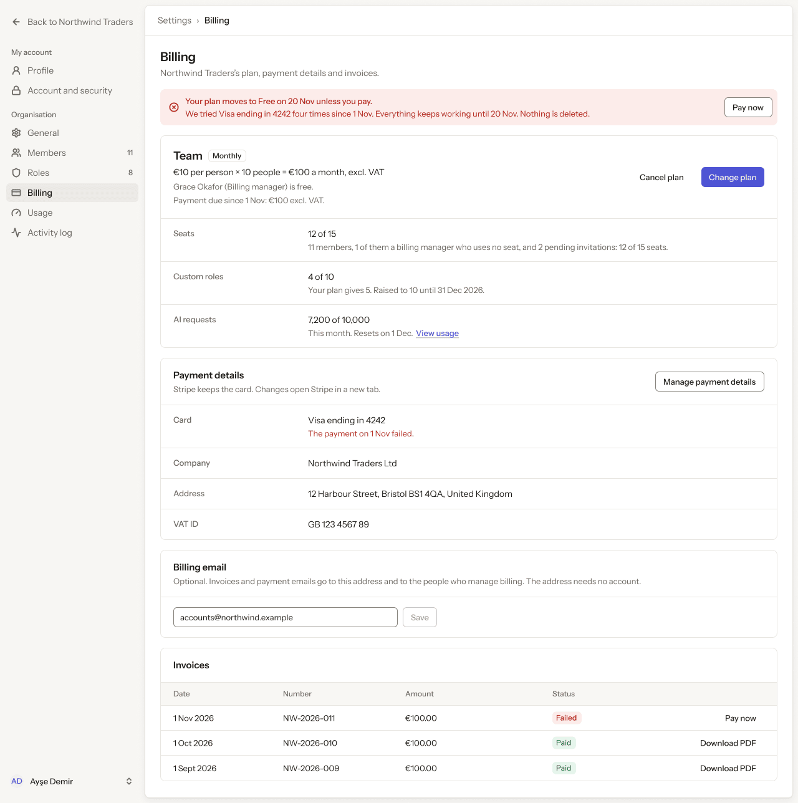

- **Who sees it:** People who manage billing: the Owner and the Billing manager.
- **Device:** Desktop (1280 px and wider).
- **This state shows:** when the action fails.
- **Values come from:** Plan, prices, invoices, payment method and trial: our API (billing, step 36). Amounts in euro, VAT shown apart.
- **Components:** Banner, Button ×7, Input, Label, Pill ×3, Sidebar, Top bar.
- **Actions:**
  - "Back to Northwind Traders": goes to [4.01 · Home · Owner](../04-home/README.md#401--home--owner).
  - "Profile": goes to [5.01 · Profile · ideal](../05-settings-profile/README.md#501--profile--ideal).
  - "Account and security": goes to [6.01 · Account and security · ideal](../06-settings-account-and-security/README.md#601--account-and-security--ideal).
  - "General": goes to [7.01 · General · ideal](../07-settings-general/README.md#701--general--ideal).
  - "Members": goes to [8.01 · Members · ideal](../08-settings-members/README.md#801--members--ideal).
  - "Roles": goes to [9.01 · Roles · ideal](../09-settings-roles/README.md#901--roles--ideal).
  - "Billing": goes to [10.01 · Billing · Team, monthly](#1001--billing--team-monthly).
  - "Usage": goes to [11.01 · Usage · Team](../11-settings-usage/README.md#1101--usage--team).
  - "Activity log": goes to [12.01 · Activity log · ideal](../12-settings-activity-log/README.md#1201--activity-log--ideal).
  - "Pay now": goes to [10.11 · Payment successful](#1011--payment-successful).
- **Texts, word for word, top to bottom:**

  - Back to Northwind Traders
  - My account
  - Profile
  - Account and security
  - Organisation
  - General
  - Members
  - 11
  - Roles
  - 8
  - Billing
  - Usage
  - Activity log
  - AD
  - Ayşe Demir
  - Settings
  - ›
  - Billing
  - Billing
  - Northwind Traders’s plan, payment details and invoices.
  - Your plan moves to Free on 20 Nov unless you pay.
  - We tried Visa ending in 4242 four times since 1 Nov. Everything keeps working until 20 Nov. Nothing is deleted.
  - Pay now
  - Team
  - Monthly
  - €10 per person × 10 people = €100 a month, excl. VAT
  - Grace Okafor (Billing manager) is free.
  - Payment due since 1 Nov: €100 excl. VAT.
  - Cancel plan
  - Change plan
  - Seats
  - 12 of 15
  - 11 members, 1 of them a billing manager who uses no seat, and 2 pending invitations: 12 of 15 seats.
  - Custom roles
  - 4 of 10
  - Your plan gives 5. Raised to 10 until 31 Dec 2026.
  - AI requests
  - 7,200 of 10,000
  - This month. Resets on 1 Dec.
  - View usage
  - Payment details
  - Stripe keeps the card. Changes open Stripe in a new tab.
  - Manage payment details
  - Card
  - Visa ending in 4242
  - The payment on 1 Nov failed.
  - Company
  - Northwind Traders Ltd
  - Address
  - 12 Harbour Street, Bristol BS1 4QA, United Kingdom
  - VAT ID
  - GB 123 4567 89
  - Billing email
  - Optional. Invoices and payment emails go to this address and to the people who manage billing. The address needs no account.
  - accounts@northwind.example
  - Save
  - Invoices
  - Date
  - Number
  - Amount
  - Status
  - 1 Nov 2026
  - NW-2026-011
  - €100.00
  - Failed
  - Pay now
  - 1 Oct 2026
  - NW-2026-010
  - €100.00
  - Paid
  - Download PDF
  - 1 Sept 2026
  - NW-2026-009
  - €100.00
  - Paid
  - Download PDF

Figma: [235:19232](https://www.figma.com/design/3Ev111okX8xCBwR9B3hyBM/?node-id=235-19232)

### 10.17 · Payment failed · moved to Free

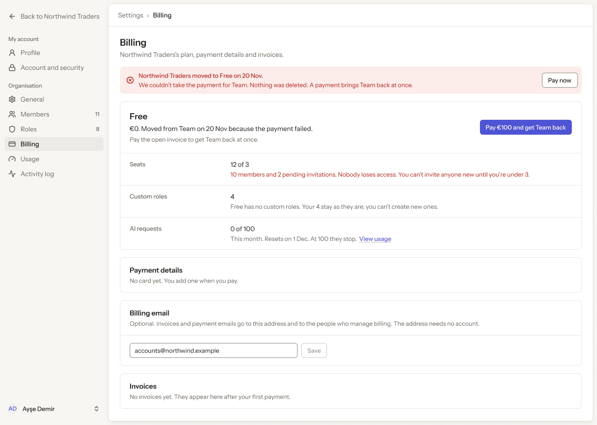

- **Who sees it:** People who manage billing: the Owner and the Billing manager.
- **Device:** Desktop (1280 px and wider).
- **This state shows:** when the action fails.
- **Values come from:** Plan, prices, invoices, payment method and trial: our API (billing, step 36). Amounts in euro, VAT shown apart.
- **Components:** Banner, Button ×2, Input, Sidebar, Top bar.
- **Actions:**
  - "Back to Northwind Traders": goes to [4.01 · Home · Owner](../04-home/README.md#401--home--owner).
  - "Profile": goes to [5.01 · Profile · ideal](../05-settings-profile/README.md#501--profile--ideal).
  - "Account and security": goes to [6.01 · Account and security · ideal](../06-settings-account-and-security/README.md#601--account-and-security--ideal).
  - "General": goes to [7.01 · General · ideal](../07-settings-general/README.md#701--general--ideal).
  - "Members": goes to [8.01 · Members · ideal](../08-settings-members/README.md#801--members--ideal).
  - "Roles": goes to [9.01 · Roles · ideal](../09-settings-roles/README.md#901--roles--ideal).
  - "Billing": goes to [10.01 · Billing · Team, monthly](#1001--billing--team-monthly).
  - "Usage": goes to [11.01 · Usage · Team](../11-settings-usage/README.md#1101--usage--team).
  - "Activity log": goes to [12.01 · Activity log · ideal](../12-settings-activity-log/README.md#1201--activity-log--ideal).
  - "Pay now": goes to [10.11 · Payment successful](#1011--payment-successful).
- **Texts, word for word, top to bottom:**

  - Back to Northwind Traders
  - My account
  - Profile
  - Account and security
  - Organisation
  - General
  - Members
  - 11
  - Roles
  - 8
  - Billing
  - Usage
  - Activity log
  - AD
  - Ayşe Demir
  - Settings
  - ›
  - Billing
  - Billing
  - Northwind Traders’s plan, payment details and invoices.
  - Northwind Traders moved to Free on 20 Nov.
  - We couldn’t take the payment for Team. Nothing was deleted. A payment brings Team back at once.
  - Pay now
  - Free
  - €0. Moved from Team on 20 Nov because the payment failed.
  - Pay the open invoice to get Team back at once.
  - Pay €100 and get Team back
  - Seats
  - 12 of 3
  - 10 members and 2 pending invitations. Nobody loses access. You can’t invite anyone new until you’re under 3.
  - Custom roles
  - 4
  - Free has no custom roles. Your 4 stay as they are; you can’t create new ones.
  - AI requests
  - 0 of 100
  - This month. Resets on 1 Dec. At 100 they stop.
  - View usage
  - Payment details
  - No card yet. You add one when you pay.
  - Billing email
  - Optional. Invoices and payment emails go to this address and to the people who manage billing. The address needs no account.
  - accounts@northwind.example
  - Save
  - Invoices
  - No invoices yet. They appear here after your first payment.

Figma: [235:19467](https://www.figma.com/design/3Ev111okX8xCBwR9B3hyBM/?node-id=235-19467)

### 10.18 · Price change coming

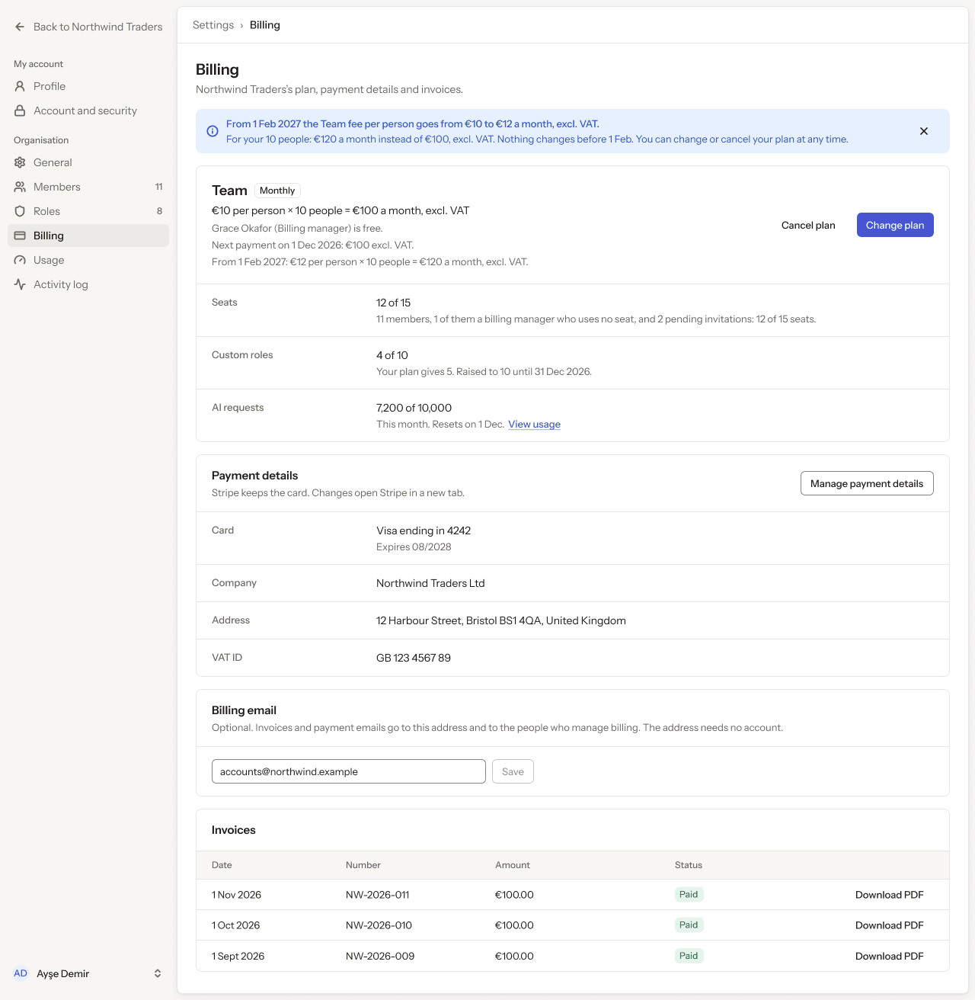

- **Who sees it:** People who manage billing: the Owner and the Billing manager.
- **Device:** Desktop (1280 px and wider).
- **This state shows:** as the title says.
- **Values come from:** Plan, prices, invoices, payment method and trial: our API (billing, step 36). Amounts in euro, VAT shown apart.
- **Components:** Banner, Button ×7, Input, Label, Pill ×3, Sidebar, Top bar.
- **Actions:**
  - "Back to Northwind Traders": goes to [4.01 · Home · Owner](../04-home/README.md#401--home--owner).
  - "Profile": goes to [5.01 · Profile · ideal](../05-settings-profile/README.md#501--profile--ideal).
  - "Account and security": goes to [6.01 · Account and security · ideal](../06-settings-account-and-security/README.md#601--account-and-security--ideal).
  - "General": goes to [7.01 · General · ideal](../07-settings-general/README.md#701--general--ideal).
  - "Members": goes to [8.01 · Members · ideal](../08-settings-members/README.md#801--members--ideal).
  - "Roles": goes to [9.01 · Roles · ideal](../09-settings-roles/README.md#901--roles--ideal).
  - "Billing": goes to [10.01 · Billing · Team, monthly](#1001--billing--team-monthly).
  - "Usage": goes to [11.01 · Usage · Team](../11-settings-usage/README.md#1101--usage--team).
  - "Activity log": goes to [12.01 · Activity log · ideal](../12-settings-activity-log/README.md#1201--activity-log--ideal).
- **Texts, word for word, top to bottom:**

  - Back to Northwind Traders
  - My account
  - Profile
  - Account and security
  - Organisation
  - General
  - Members
  - 11
  - Roles
  - 8
  - Billing
  - Usage
  - Activity log
  - AD
  - Ayşe Demir
  - Settings
  - ›
  - Billing
  - Billing
  - Northwind Traders’s plan, payment details and invoices.
  - From 1 Feb 2027 the Team fee per person goes from €10 to €12 a month, excl. VAT.
  - For your 10 people: €120 a month instead of €100, excl. VAT. Nothing changes before 1 Feb. You can change or cancel your plan at any time.
  - Team
  - Monthly
  - €10 per person × 10 people = €100 a month, excl. VAT
  - Grace Okafor (Billing manager) is free.
  - Next payment on 1 Dec 2026: €100 excl. VAT.
  - From 1 Feb 2027: €12 per person × 10 people = €120 a month, excl. VAT.
  - Cancel plan
  - Change plan
  - Seats
  - 12 of 15
  - 11 members, 1 of them a billing manager who uses no seat, and 2 pending invitations: 12 of 15 seats.
  - Custom roles
  - 4 of 10
  - Your plan gives 5. Raised to 10 until 31 Dec 2026.
  - AI requests
  - 7,200 of 10,000
  - This month. Resets on 1 Dec.
  - View usage
  - Payment details
  - Stripe keeps the card. Changes open Stripe in a new tab.
  - Manage payment details
  - Card
  - Visa ending in 4242
  - Expires 08/2028
  - Company
  - Northwind Traders Ltd
  - Address
  - 12 Harbour Street, Bristol BS1 4QA, United Kingdom
  - VAT ID
  - GB 123 4567 89
  - Billing email
  - Optional. Invoices and payment emails go to this address and to the people who manage billing. The address needs no account.
  - accounts@northwind.example
  - Save
  - Invoices
  - Date
  - Number
  - Amount
  - Status
  - 1 Nov 2026
  - NW-2026-011
  - €100.00
  - Paid
  - Download PDF
  - 1 Oct 2026
  - NW-2026-010
  - €100.00
  - Paid
  - Download PDF
  - 1 Sept 2026
  - NW-2026-009
  - €100.00
  - Paid
  - Download PDF

Figma: [236:19127](https://www.figma.com/design/3Ev111okX8xCBwR9B3hyBM/?node-id=236-19127)

### 10.19 · Contract

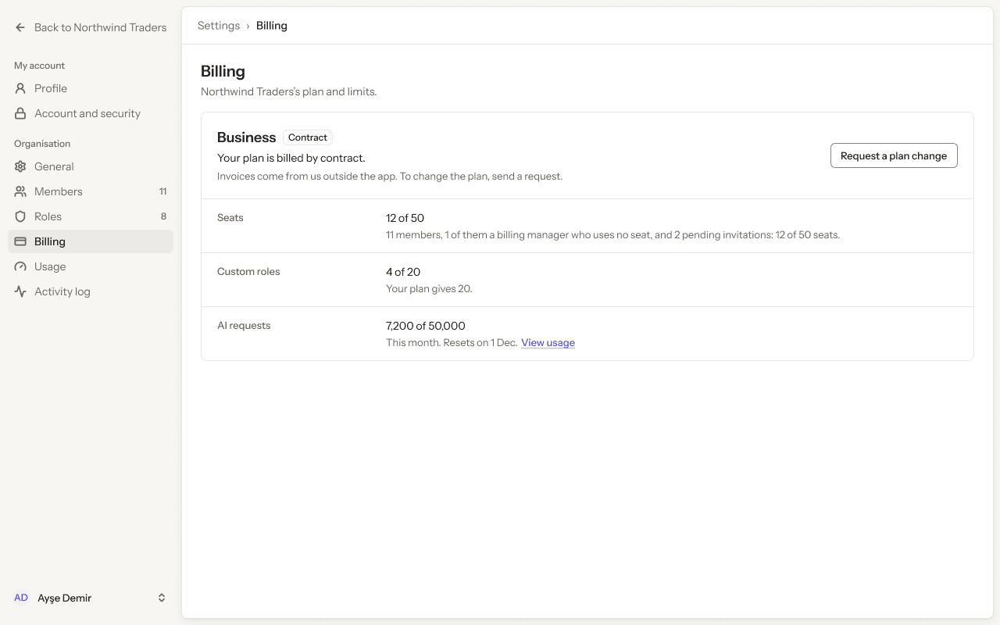

- **Who sees it:** People who manage billing: the Owner and the Billing manager.
- **Device:** Desktop (1280 px and wider).
- **This state shows:** as the title says.
- **Values come from:** Plan, prices, invoices, payment method and trial: our API (billing, step 36). Amounts in euro, VAT shown apart.
- **Components:** Button, Label, Sidebar, Top bar.
- **Actions:**
  - "Back to Northwind Traders": goes to [4.01 · Home · Owner](../04-home/README.md#401--home--owner).
  - "Profile": goes to [5.01 · Profile · ideal](../05-settings-profile/README.md#501--profile--ideal).
  - "Account and security": goes to [6.01 · Account and security · ideal](../06-settings-account-and-security/README.md#601--account-and-security--ideal).
  - "General": goes to [7.01 · General · ideal](../07-settings-general/README.md#701--general--ideal).
  - "Members": goes to [8.01 · Members · ideal](../08-settings-members/README.md#801--members--ideal).
  - "Roles": goes to [9.01 · Roles · ideal](../09-settings-roles/README.md#901--roles--ideal).
  - "Billing": goes to [10.01 · Billing · Team, monthly](#1001--billing--team-monthly).
  - "Usage": goes to [11.01 · Usage · Team](../11-settings-usage/README.md#1101--usage--team).
  - "Activity log": goes to [12.01 · Activity log · ideal](../12-settings-activity-log/README.md#1201--activity-log--ideal).
- **Texts, word for word, top to bottom:**

  - Back to Northwind Traders
  - My account
  - Profile
  - Account and security
  - Organisation
  - General
  - Members
  - 11
  - Roles
  - 8
  - Billing
  - Usage
  - Activity log
  - AD
  - Ayşe Demir
  - Settings
  - ›
  - Billing
  - Billing
  - Northwind Traders’s plan and limits.
  - Business
  - Contract
  - Your plan is billed by contract.
  - Invoices come from us outside the app. To change the plan, send a request.
  - Request a plan change
  - Seats
  - 12 of 50
  - 11 members, 1 of them a billing manager who uses no seat, and 2 pending invitations: 12 of 50 seats.
  - Custom roles
  - 4 of 20
  - Your plan gives 20.
  - AI requests
  - 7,200 of 50,000
  - This month. Resets on 1 Dec.
  - View usage

Figma: [236:19348](https://www.figma.com/design/3Ev111okX8xCBwR9B3hyBM/?node-id=236-19348)

### 10.20 · Billing · loading

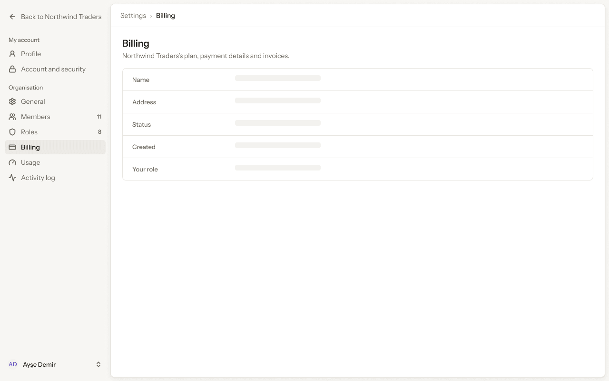

- **Who sees it:** People who manage billing: the Owner and the Billing manager.
- **Device:** Desktop (1280 px and wider).
- **This state shows:** while the request runs.
- **Values come from:** Plan, prices, invoices, payment method and trial: our API (billing, step 36). Amounts in euro, VAT shown apart.
- **Components:** Sidebar, Skeleton ×5, Top bar.
- **Actions:**
  - "Back to Northwind Traders": goes to [4.01 · Home · Owner](../04-home/README.md#401--home--owner).
  - "Profile": goes to [5.01 · Profile · ideal](../05-settings-profile/README.md#501--profile--ideal).
  - "Account and security": goes to [6.01 · Account and security · ideal](../06-settings-account-and-security/README.md#601--account-and-security--ideal).
  - "General": goes to [7.01 · General · ideal](../07-settings-general/README.md#701--general--ideal).
  - "Members": goes to [8.01 · Members · ideal](../08-settings-members/README.md#801--members--ideal).
  - "Roles": goes to [9.01 · Roles · ideal](../09-settings-roles/README.md#901--roles--ideal).
  - "Billing": goes to [10.01 · Billing · Team, monthly](#1001--billing--team-monthly).
  - "Usage": goes to [11.01 · Usage · Team](../11-settings-usage/README.md#1101--usage--team).
  - "Activity log": goes to [12.01 · Activity log · ideal](../12-settings-activity-log/README.md#1201--activity-log--ideal).
- **Texts, word for word, top to bottom:**

  - Back to Northwind Traders
  - My account
  - Profile
  - Account and security
  - Organisation
  - General
  - Members
  - 11
  - Roles
  - 8
  - Billing
  - Usage
  - Activity log
  - AD
  - Ayşe Demir
  - Settings
  - ›
  - Billing
  - Billing
  - Northwind Traders’s plan, payment details and invoices.
  - Name
  - Address
  - Status
  - Created
  - Your role

Figma: [236:19576](https://www.figma.com/design/3Ev111okX8xCBwR9B3hyBM/?node-id=236-19576)

### 10.21 · Billing · error

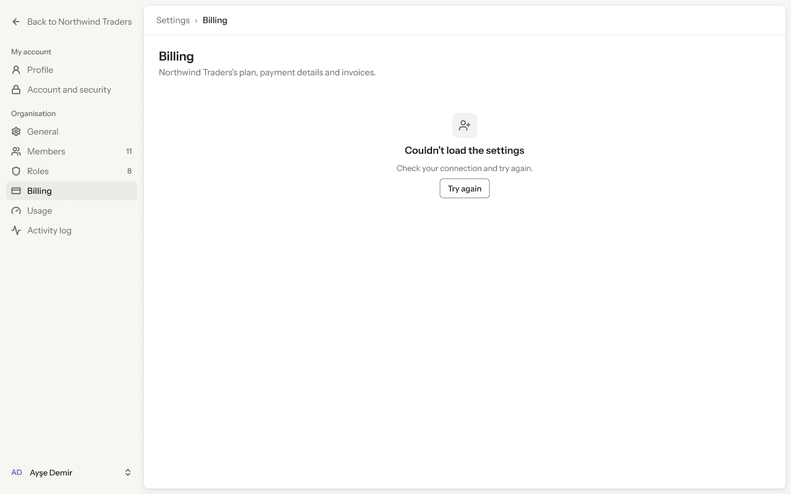

- **Who sees it:** People who manage billing: the Owner and the Billing manager.
- **Device:** Desktop (1280 px and wider).
- **This state shows:** when the request fails.
- **Values come from:** Plan, prices, invoices, payment method and trial: our API (billing, step 36). Amounts in euro, VAT shown apart.
- **Components:** Empty state, Sidebar, Top bar.
- **Actions:**
  - "Back to Northwind Traders": goes to [4.01 · Home · Owner](../04-home/README.md#401--home--owner).
  - "Profile": goes to [5.01 · Profile · ideal](../05-settings-profile/README.md#501--profile--ideal).
  - "Account and security": goes to [6.01 · Account and security · ideal](../06-settings-account-and-security/README.md#601--account-and-security--ideal).
  - "General": goes to [7.01 · General · ideal](../07-settings-general/README.md#701--general--ideal).
  - "Members": goes to [8.01 · Members · ideal](../08-settings-members/README.md#801--members--ideal).
  - "Roles": goes to [9.01 · Roles · ideal](../09-settings-roles/README.md#901--roles--ideal).
  - "Billing": goes to [10.01 · Billing · Team, monthly](#1001--billing--team-monthly).
  - "Usage": goes to [11.01 · Usage · Team](../11-settings-usage/README.md#1101--usage--team).
  - "Activity log": goes to [12.01 · Activity log · ideal](../12-settings-activity-log/README.md#1201--activity-log--ideal).
- **Texts, word for word, top to bottom:**

  - Back to Northwind Traders
  - My account
  - Profile
  - Account and security
  - Organisation
  - General
  - Members
  - 11
  - Roles
  - 8
  - Billing
  - Usage
  - Activity log
  - AD
  - Ayşe Demir
  - Settings
  - ›
  - Billing
  - Billing
  - Northwind Traders’s plan, payment details and invoices.
  - Couldn’t load the settings
  - Check your connection and try again.
  - Try again

Figma: [236:19778](https://www.figma.com/design/3Ev111okX8xCBwR9B3hyBM/?node-id=236-19778)

### 10.22 · Billing · phone

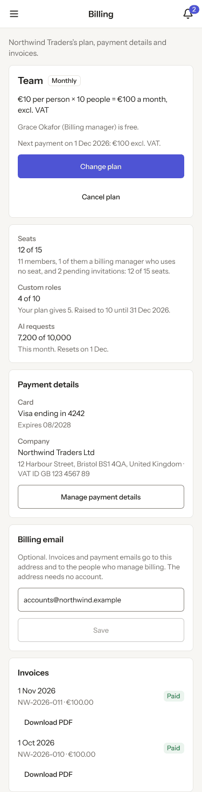

- **Who sees it:** People who manage billing: the Owner and the Billing manager.
- **Device:** Phone (up to 767 px).
- **This state shows:** on a phone.
- **Values come from:** Plan, prices, invoices, payment method and trial: our API (billing, step 36). Amounts in euro, VAT shown apart.
- **Components:** Button ×6, Input, Label, Phone top bar, Pill ×2.
- **Actions:**
  - "Area": goes to [2.30 · Phone · settings menu open](../02-shell/README.md#230--phone--settings-menu-open).
  - "2": goes to [3.14 · Phone · notifications](../03-notifications/README.md#314--phone--notifications).
- **Texts, word for word, top to bottom:**

  - Billing
  - 2
  - Northwind Traders’s plan, payment details and invoices.
  - Team
  - Monthly
  - €10 per person × 10 people = €100 a month, excl. VAT
  - Grace Okafor (Billing manager) is free.
  - Next payment on 1 Dec 2026: €100 excl. VAT.
  - Change plan
  - Cancel plan
  - Seats
  - 12 of 15
  - 11 members, 1 of them a billing manager who uses no seat, and 2 pending invitations: 12 of 15 seats.
  - Custom roles
  - 4 of 10
  - Your plan gives 5. Raised to 10 until 31 Dec 2026.
  - AI requests
  - 7,200 of 10,000
  - This month. Resets on 1 Dec.
  - Payment details
  - Card
  - Visa ending in 4242
  - Expires 08/2028
  - Company
  - Northwind Traders Ltd
  - 12 Harbour Street, Bristol BS1 4QA, United Kingdom · VAT ID GB 123 4567 89
  - Manage payment details
  - Billing email
  - Optional. Invoices and payment emails go to this address and to the people who manage billing. The address needs no account.
  - accounts@northwind.example
  - Save
  - Invoices
  - 1 Nov 2026
  - NW-2026-011 · €100.00
  - Paid
  - Download PDF
  - 1 Oct 2026
  - NW-2026-010 · €100.00
  - Paid
  - Download PDF

Figma: [237:19677](https://www.figma.com/design/3Ev111okX8xCBwR9B3hyBM/?node-id=237-19677)

### 10.23 · Billing · dark

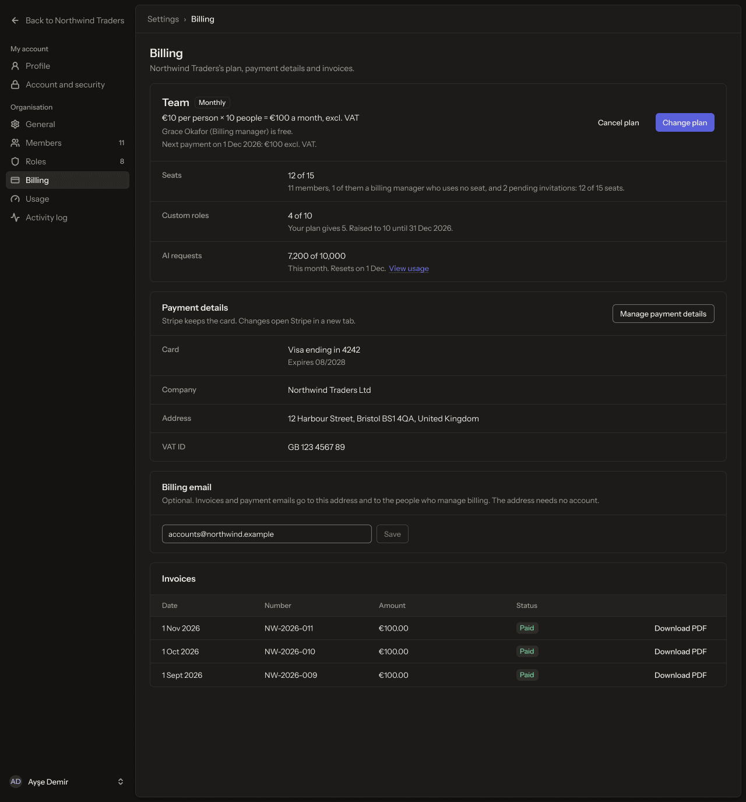

- **Who sees it:** People who manage billing: the Owner and the Billing manager.
- **Device:** Desktop (1280 px and wider).
- **This state shows:** in the dark theme.
- **Values come from:** Plan, prices, invoices, payment method and trial: our API (billing, step 36). Amounts in euro, VAT shown apart.
- **Components:** Button ×7, Input, Label, Pill ×3, Sidebar, Top bar.
- **Actions:**
  - "Back to Northwind Traders": goes to [4.01 · Home · Owner](../04-home/README.md#401--home--owner).
  - "Profile": goes to [5.01 · Profile · ideal](../05-settings-profile/README.md#501--profile--ideal).
  - "Account and security": goes to [6.01 · Account and security · ideal](../06-settings-account-and-security/README.md#601--account-and-security--ideal).
  - "General": goes to [7.01 · General · ideal](../07-settings-general/README.md#701--general--ideal).
  - "Members": goes to [8.01 · Members · ideal](../08-settings-members/README.md#801--members--ideal).
  - "Roles": goes to [9.01 · Roles · ideal](../09-settings-roles/README.md#901--roles--ideal).
  - "Billing": goes to [10.01 · Billing · Team, monthly](#1001--billing--team-monthly).
  - "Usage": goes to [11.01 · Usage · Team](../11-settings-usage/README.md#1101--usage--team).
  - "Activity log": goes to [12.01 · Activity log · ideal](../12-settings-activity-log/README.md#1201--activity-log--ideal).
- **Texts, word for word, top to bottom:**

  - Back to Northwind Traders
  - My account
  - Profile
  - Account and security
  - Organisation
  - General
  - Members
  - 11
  - Roles
  - 8
  - Billing
  - Usage
  - Activity log
  - AD
  - Ayşe Demir
  - Settings
  - ›
  - Billing
  - Billing
  - Northwind Traders’s plan, payment details and invoices.
  - Team
  - Monthly
  - €10 per person × 10 people = €100 a month, excl. VAT
  - Grace Okafor (Billing manager) is free.
  - Next payment on 1 Dec 2026: €100 excl. VAT.
  - Cancel plan
  - Change plan
  - Seats
  - 12 of 15
  - 11 members, 1 of them a billing manager who uses no seat, and 2 pending invitations: 12 of 15 seats.
  - Custom roles
  - 4 of 10
  - Your plan gives 5. Raised to 10 until 31 Dec 2026.
  - AI requests
  - 7,200 of 10,000
  - This month. Resets on 1 Dec.
  - View usage
  - Payment details
  - Stripe keeps the card. Changes open Stripe in a new tab.
  - Manage payment details
  - Card
  - Visa ending in 4242
  - Expires 08/2028
  - Company
  - Northwind Traders Ltd
  - Address
  - 12 Harbour Street, Bristol BS1 4QA, United Kingdom
  - VAT ID
  - GB 123 4567 89
  - Billing email
  - Optional. Invoices and payment emails go to this address and to the people who manage billing. The address needs no account.
  - accounts@northwind.example
  - Save
  - Invoices
  - Date
  - Number
  - Amount
  - Status
  - 1 Nov 2026
  - NW-2026-011
  - €100.00
  - Paid
  - Download PDF
  - 1 Oct 2026
  - NW-2026-010
  - €100.00
  - Paid
  - Download PDF
  - 1 Sept 2026
  - NW-2026-009
  - €100.00
  - Paid
  - Download PDF

Figma: [236:20463](https://www.figma.com/design/3Ev111okX8xCBwR9B3hyBM/?node-id=236-20463)

### 10.24 · Billing · Arabic

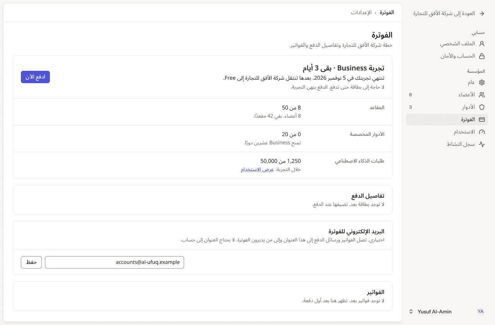

- **Who sees it:** People who manage billing: the Owner and the Billing manager.
- **Device:** Desktop (1280 px and wider).
- **This state shows:** with the language set to Arabic (right to left).
- **Values come from:** Plan, prices, invoices, payment method and trial: our API (billing, step 36). Amounts in euro, VAT shown apart.
- **Components:** Button ×2, Input, Sidebar, Top bar.
- **Actions:**
  - "العودة إلى شركة الأفق للتجارة": goes to [4.01 · Home · Owner](../04-home/README.md#401--home--owner).
  - "الملف الشخصي": goes to [5.01 · Profile · ideal](../05-settings-profile/README.md#501--profile--ideal).
  - "الحساب والأمان": goes to [6.01 · Account and security · ideal](../06-settings-account-and-security/README.md#601--account-and-security--ideal).
  - "عام": goes to [7.01 · General · ideal](../07-settings-general/README.md#701--general--ideal).
  - "الأعضاء": goes to [8.01 · Members · ideal](../08-settings-members/README.md#801--members--ideal).
  - "الأدوار": goes to [9.01 · Roles · ideal](../09-settings-roles/README.md#901--roles--ideal).
  - "الفوترة": goes to [10.01 · Billing · Team, monthly](#1001--billing--team-monthly).
  - "الاستخدام": goes to [11.01 · Usage · Team](../11-settings-usage/README.md#1101--usage--team).
  - "سجل النشاط": goes to [12.01 · Activity log · ideal](../12-settings-activity-log/README.md#1201--activity-log--ideal).
- **Texts, word for word, top to bottom:**

  - الإعدادات
  - ‹
  - الفوترة
  - الفوترة
  - خطة شركة الأفق للتجارة وتفاصيل الدفع والفواتير.
  - ادفع الآن
  - تجربة Business · بقي 3 أيام
  - تنتهي تجربتك في 5 نوفمبر 2026. بعدها تنتقل شركة الأفق للتجارة إلى Free.
  - لا حاجة إلى بطاقة حتى تدفع. الدفع ينهي التجربة.
  - 8 من 50
  - 8 أعضاء. بقي 42 مقعدًا.
  - المقاعد
  - 0 من 20
  - تمنح Business عشرين دورًا.
  - الأدوار المخصصة
  - 1,250 من 50,000
  - عرض الاستخدام
  - خلال التجربة.
  - طلبات الذكاء الاصطناعي
  - تفاصيل الدفع
  - لا توجد بطاقة بعد. تضيفها عند الدفع.
  - البريد الإلكتروني للفوترة
  - اختياري. تصل الفواتير ورسائل الدفع إلى هذا العنوان وإلى من يديرون الفوترة. لا يحتاج العنوان إلى حساب.
  - حفظ
  - accounts@al-ufuq.example
  - الفواتير
  - لا توجد فواتير بعد. تظهر هنا بعد أول دفعة.
  - العودة إلى شركة الأفق للتجارة
  - حسابي
  - الملف الشخصي
  - الحساب والأمان
  - المؤسسة
  - عام
  - 8
  - الأعضاء
  - 3
  - الأدوار
  - الفوترة
  - الاستخدام
  - سجل النشاط
  - Yusuf Al-Amin
  - YA

Figma: [236:20571](https://www.figma.com/design/3Ev111okX8xCBwR9B3hyBM/?node-id=236-20571)
