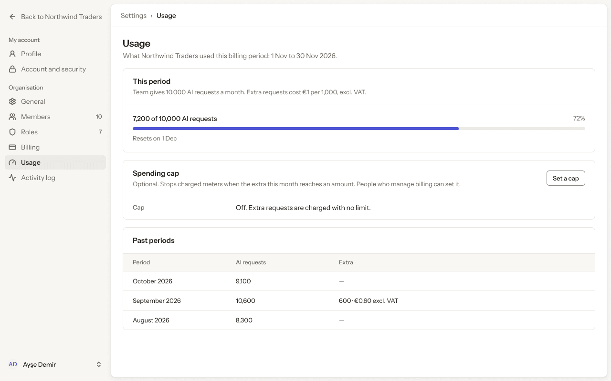
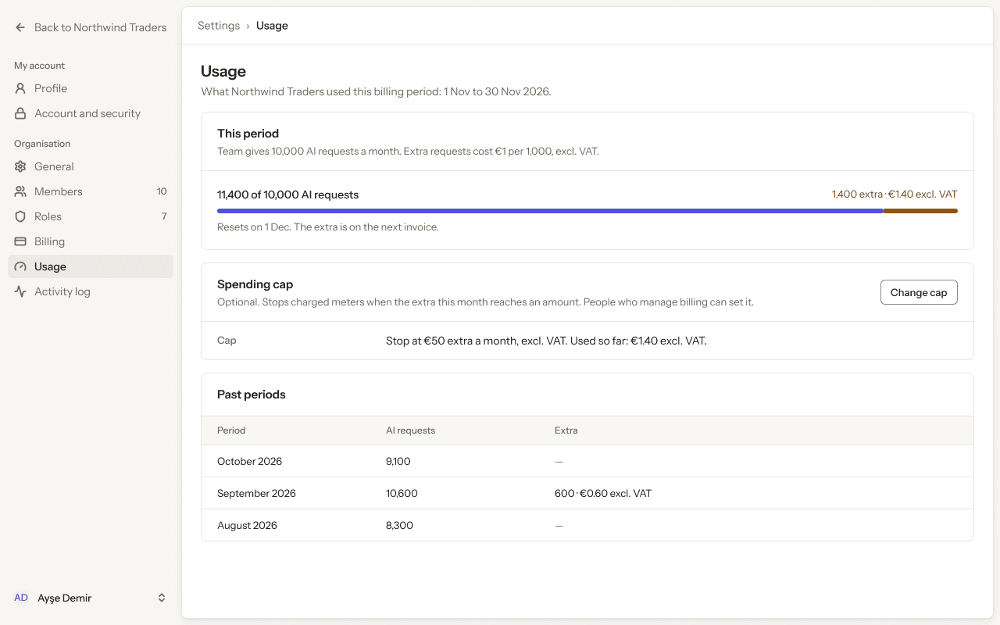
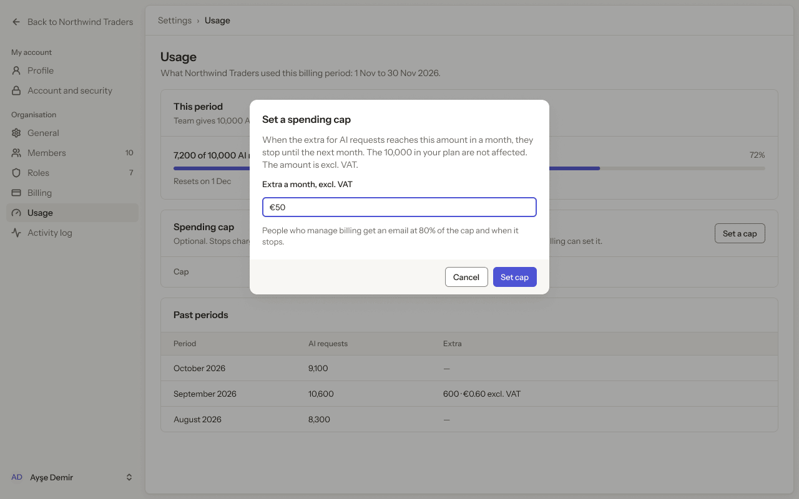
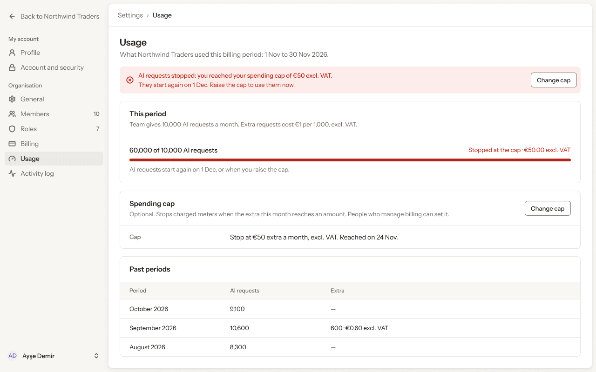
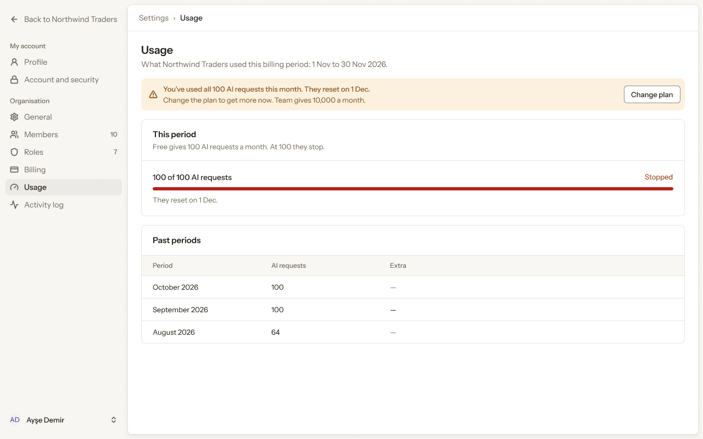
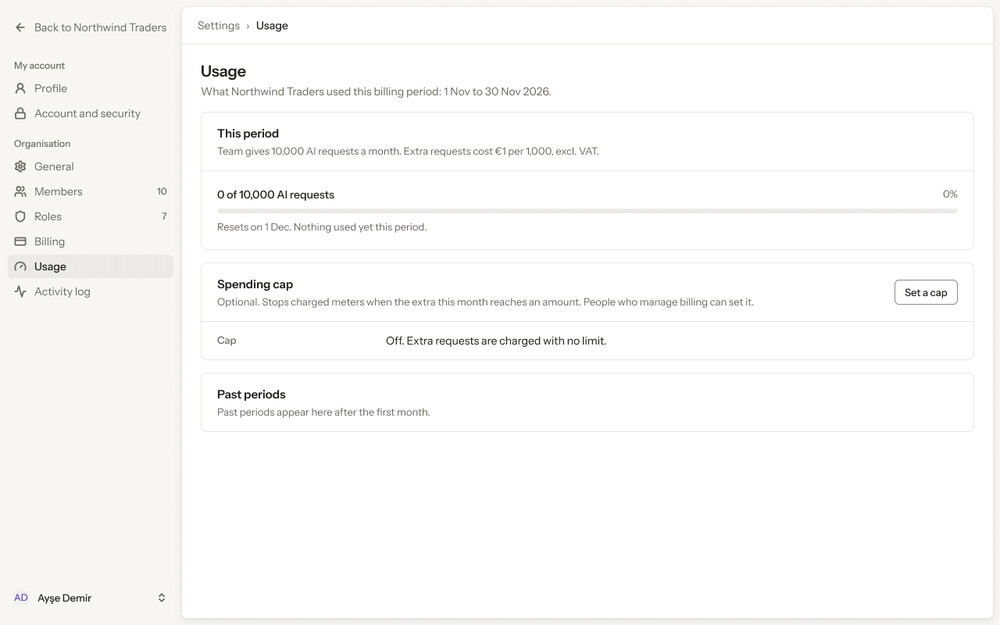
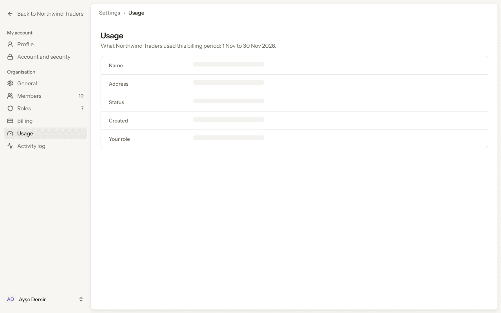
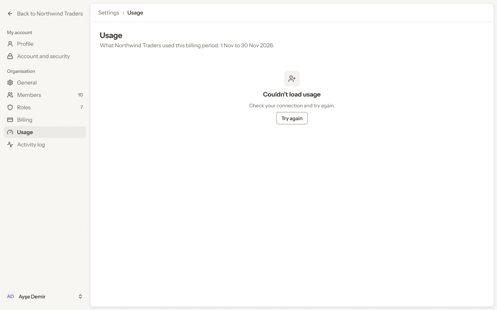
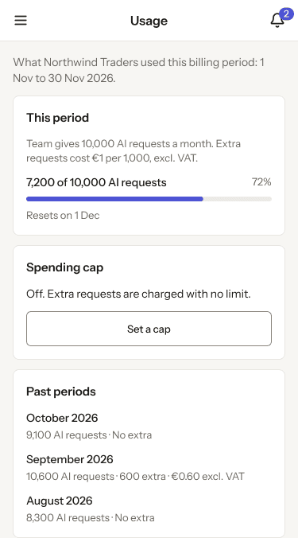

# Web app · 11 · Settings › Usage

Who sees this section: People who manage billing: the Owner and the Billing manager.

Where the values come from: Meters, quotas and the spending cap: our API (usage metering).

9 screens. Each part below is one screen and state. The PNG beside this file is the screen at scale 1.

| Screen | Device |
|---|---|
| [11.01 · Usage · Team](#1101--usage--team) | Desktop |
| [11.02 · Usage · over the quota, cap set](#1102--usage--over-the-quota-cap-set) | Desktop |
| [11.03 · Set a spending cap](#1103--set-a-spending-cap) | Desktop |
| [11.04 · Usage · cap reached](#1104--usage--cap-reached) | Desktop |
| [11.05 · Usage · Free, quota used](#1105--usage--free-quota-used) | Desktop |
| [11.06 · Usage · nothing used yet](#1106--usage--nothing-used-yet) | Desktop |
| [11.07 · Usage · loading](#1107--usage--loading) | Desktop |
| [11.08 · Usage · error](#1108--usage--error) | Desktop |
| [11.09 · Usage · phone](#1109--usage--phone) | Phone |

### 11.01 · Usage · Team

- **Who sees it:** People who manage billing: the Owner and the Billing manager.
- **Device:** Desktop (1280 px and wider).
- **This state shows:** as the title says.
- **Values come from:** Meters, quotas and the spending cap: our API (usage metering).
- **Components:** Button, Meter, Sidebar, Top bar.
- **Actions:**
  - "Back to Northwind Traders": goes to [4.01 · Home · Owner](../04-home/README.md#401--home--owner).
  - "Profile": goes to [5.01 · Profile · ideal](../05-settings-profile/README.md#501--profile--ideal).
  - "Account and security": goes to [6.01 · Account and security · ideal](../06-settings-account-and-security/README.md#601--account-and-security--ideal).
  - "General": goes to [7.01 · General · ideal](../07-settings-general/README.md#701--general--ideal).
  - "Members": goes to [8.01 · Members · ideal](../08-settings-members/README.md#801--members--ideal).
  - "Roles": goes to [9.01 · Roles · ideal](../09-settings-roles/README.md#901--roles--ideal).
  - "Billing": goes to [10.01 · Billing · Team, monthly](../10-settings-billing/README.md#1001--billing--team-monthly).
  - "Activity log": goes to [12.01 · Activity log · ideal](../12-settings-activity-log/README.md#1201--activity-log--ideal).
  - "Set a cap": goes to [11.03 · Set a spending cap](#1103--set-a-spending-cap).
- **Texts, word for word, top to bottom:**

  - Back to Northwind Traders
  - My account
  - Profile
  - Account and security
  - Organisation
  - General
  - Members
  - 10
  - Roles
  - 7
  - Billing
  - Usage
  - Activity log
  - AD
  - Ayşe Demir
  - Settings
  - ›
  - Usage
  - Usage
  - What Northwind Traders used this billing period: 1 Nov to 30 Nov 2026.
  - This period
  - Team gives 10,000 AI requests a month. Extra requests cost €1 per 1,000, excl. VAT.
  - 7,200 of 10,000 AI requests
  - 72%
  - Resets on 1 Dec
  - Spending cap
  - Optional. Stops charged meters when the extra this month reaches an amount. People who manage billing can set it.
  - Set a cap
  - Cap
  - Off. Extra requests are charged with no limit.
  - Past periods
  - Period
  - AI requests
  - Extra
  - October 2026
  - 9,100
  - —
  - September 2026
  - 10,600
  - 600 · €0.60 excl. VAT
  - August 2026
  - 8,300
  - —

Figma: [238:19708](https://www.figma.com/design/3Ev111okX8xCBwR9B3hyBM/?node-id=238-19708)

### 11.02 · Usage · over the quota, cap set

- **Who sees it:** People who manage billing: the Owner and the Billing manager.
- **Device:** Desktop (1280 px and wider).
- **This state shows:** as the title says.
- **Values come from:** Meters, quotas and the spending cap: our API (usage metering).
- **Components:** Button, Meter, Sidebar, Top bar.
- **Actions:**
  - "Back to Northwind Traders": goes to [4.01 · Home · Owner](../04-home/README.md#401--home--owner).
  - "Profile": goes to [5.01 · Profile · ideal](../05-settings-profile/README.md#501--profile--ideal).
  - "Account and security": goes to [6.01 · Account and security · ideal](../06-settings-account-and-security/README.md#601--account-and-security--ideal).
  - "General": goes to [7.01 · General · ideal](../07-settings-general/README.md#701--general--ideal).
  - "Members": goes to [8.01 · Members · ideal](../08-settings-members/README.md#801--members--ideal).
  - "Roles": goes to [9.01 · Roles · ideal](../09-settings-roles/README.md#901--roles--ideal).
  - "Billing": goes to [10.01 · Billing · Team, monthly](../10-settings-billing/README.md#1001--billing--team-monthly).
  - "Usage": goes to [11.01 · Usage · Team](#1101--usage--team).
  - "Activity log": goes to [12.01 · Activity log · ideal](../12-settings-activity-log/README.md#1201--activity-log--ideal).
- **Texts, word for word, top to bottom:**

  - Back to Northwind Traders
  - My account
  - Profile
  - Account and security
  - Organisation
  - General
  - Members
  - 10
  - Roles
  - 7
  - Billing
  - Usage
  - Activity log
  - AD
  - Ayşe Demir
  - Settings
  - ›
  - Usage
  - Usage
  - What Northwind Traders used this billing period: 1 Nov to 30 Nov 2026.
  - This period
  - Team gives 10,000 AI requests a month. Extra requests cost €1 per 1,000, excl. VAT.
  - 11,400 of 10,000 AI requests
  - 1,400 extra · €1.40 excl. VAT
  - Resets on 1 Dec. The extra is on the next invoice.
  - Spending cap
  - Optional. Stops charged meters when the extra this month reaches an amount. People who manage billing can set it.
  - Change cap
  - Cap
  - Stop at €50 extra a month, excl. VAT. Used so far: €1.40 excl. VAT.
  - Past periods
  - Period
  - AI requests
  - Extra
  - October 2026
  - 9,100
  - —
  - September 2026
  - 10,600
  - 600 · €0.60 excl. VAT
  - August 2026
  - 8,300
  - —

Figma: [240:19794](https://www.figma.com/design/3Ev111okX8xCBwR9B3hyBM/?node-id=240-19794)

### 11.03 · Set a spending cap

- **Who sees it:** People who manage billing: the Owner and the Billing manager.
- **Device:** Desktop (1280 px and wider).
- **This state shows:** as the title says.
- **Values come from:** Meters, quotas and the spending cap: our API (usage metering).
- **Components:** Button ×3, Input, Meter, Sidebar, Top bar.
- **Actions:**
  - "Back to Northwind Traders": goes to [4.01 · Home · Owner](../04-home/README.md#401--home--owner).
  - "Profile": goes to [5.01 · Profile · ideal](../05-settings-profile/README.md#501--profile--ideal).
  - "Account and security": goes to [6.01 · Account and security · ideal](../06-settings-account-and-security/README.md#601--account-and-security--ideal).
  - "General": goes to [7.01 · General · ideal](../07-settings-general/README.md#701--general--ideal).
  - "Members": goes to [8.01 · Members · ideal](../08-settings-members/README.md#801--members--ideal).
  - "Roles": goes to [9.01 · Roles · ideal](../09-settings-roles/README.md#901--roles--ideal).
  - "Billing": goes to [10.01 · Billing · Team, monthly](../10-settings-billing/README.md#1001--billing--team-monthly).
  - "Usage": goes to [11.01 · Usage · Team](#1101--usage--team).
  - "Activity log": goes to [12.01 · Activity log · ideal](../12-settings-activity-log/README.md#1201--activity-log--ideal).
  - "Area": goes to [11.01 · Usage · Team](#1101--usage--team).
  - "Area": goes to [11.02 · Usage · over the quota, cap set](#1102--usage--over-the-quota-cap-set).
- **Texts, word for word, top to bottom:**

  - Back to Northwind Traders
  - My account
  - Profile
  - Account and security
  - Organisation
  - General
  - Members
  - 10
  - Roles
  - 7
  - Billing
  - Usage
  - Activity log
  - AD
  - Ayşe Demir
  - Settings
  - ›
  - Usage
  - Usage
  - What Northwind Traders used this billing period: 1 Nov to 30 Nov 2026.
  - This period
  - Team gives 10,000 AI requests a month. Extra requests cost €1 per 1,000, excl. VAT.
  - 7,200 of 10,000 AI requests
  - 72%
  - Resets on 1 Dec
  - Spending cap
  - Optional. Stops charged meters when the extra this month reaches an amount. People who manage billing can set it.
  - Set a cap
  - Cap
  - Off. Extra requests are charged with no limit.
  - Past periods
  - Period
  - AI requests
  - Extra
  - October 2026
  - 9,100
  - —
  - September 2026
  - 10,600
  - 600 · €0.60 excl. VAT
  - August 2026
  - 8,300
  - —
  - Set a spending cap
  - When the extra for AI requests reaches this amount in a month, they stop until the next month. The 10,000 in your plan are not affected. The amount is excl. VAT.
  - Extra a month, excl. VAT
  - €50
  - People who manage billing get an email at 80% of the cap and when it stops.
  - Cancel
  - Set cap

Figma: [240:19938](https://www.figma.com/design/3Ev111okX8xCBwR9B3hyBM/?node-id=240-19938)

### 11.04 · Usage · cap reached

- **Who sees it:** People who manage billing: the Owner and the Billing manager.
- **Device:** Desktop (1280 px and wider).
- **This state shows:** as the title says.
- **Values come from:** Meters, quotas and the spending cap: our API (usage metering).
- **Components:** Banner, Button, Meter, Sidebar, Top bar.
- **Actions:**
  - "Back to Northwind Traders": goes to [4.01 · Home · Owner](../04-home/README.md#401--home--owner).
  - "Profile": goes to [5.01 · Profile · ideal](../05-settings-profile/README.md#501--profile--ideal).
  - "Account and security": goes to [6.01 · Account and security · ideal](../06-settings-account-and-security/README.md#601--account-and-security--ideal).
  - "General": goes to [7.01 · General · ideal](../07-settings-general/README.md#701--general--ideal).
  - "Members": goes to [8.01 · Members · ideal](../08-settings-members/README.md#801--members--ideal).
  - "Roles": goes to [9.01 · Roles · ideal](../09-settings-roles/README.md#901--roles--ideal).
  - "Billing": goes to [10.01 · Billing · Team, monthly](../10-settings-billing/README.md#1001--billing--team-monthly).
  - "Usage": goes to [11.01 · Usage · Team](#1101--usage--team).
  - "Activity log": goes to [12.01 · Activity log · ideal](../12-settings-activity-log/README.md#1201--activity-log--ideal).
  - "Change cap": goes to [11.03 · Set a spending cap](#1103--set-a-spending-cap).
- **Texts, word for word, top to bottom:**

  - Back to Northwind Traders
  - My account
  - Profile
  - Account and security
  - Organisation
  - General
  - Members
  - 10
  - Roles
  - 7
  - Billing
  - Usage
  - Activity log
  - AD
  - Ayşe Demir
  - Settings
  - ›
  - Usage
  - Usage
  - What Northwind Traders used this billing period: 1 Nov to 30 Nov 2026.
  - AI requests stopped: you reached your spending cap of €50 excl. VAT.
  - They start again on 1 Dec. Raise the cap to use them now.
  - Change cap
  - This period
  - Team gives 10,000 AI requests a month. Extra requests cost €1 per 1,000, excl. VAT.
  - 60,000 of 10,000 AI requests
  - Stopped at the cap · €50.00 excl. VAT
  - AI requests start again on 1 Dec, or when you raise the cap.
  - Spending cap
  - Optional. Stops charged meters when the extra this month reaches an amount. People who manage billing can set it.
  - Change cap
  - Cap
  - Stop at €50 extra a month, excl. VAT. Reached on 24 Nov.
  - Past periods
  - Period
  - AI requests
  - Extra
  - October 2026
  - 9,100
  - —
  - September 2026
  - 10,600
  - 600 · €0.60 excl. VAT
  - August 2026
  - 8,300
  - —

Figma: [240:20016](https://www.figma.com/design/3Ev111okX8xCBwR9B3hyBM/?node-id=240-20016)

### 11.05 · Usage · Free, quota used

- **Who sees it:** People who manage billing: the Owner and the Billing manager.
- **Device:** Desktop (1280 px and wider).
- **This state shows:** as the title says.
- **Values come from:** Meters, quotas and the spending cap: our API (usage metering).
- **Components:** Banner, Meter, Sidebar, Top bar.
- **Actions:**
  - "Back to Northwind Traders": goes to [4.01 · Home · Owner](../04-home/README.md#401--home--owner).
  - "Profile": goes to [5.01 · Profile · ideal](../05-settings-profile/README.md#501--profile--ideal).
  - "Account and security": goes to [6.01 · Account and security · ideal](../06-settings-account-and-security/README.md#601--account-and-security--ideal).
  - "General": goes to [7.01 · General · ideal](../07-settings-general/README.md#701--general--ideal).
  - "Members": goes to [8.01 · Members · ideal](../08-settings-members/README.md#801--members--ideal).
  - "Roles": goes to [9.01 · Roles · ideal](../09-settings-roles/README.md#901--roles--ideal).
  - "Billing": goes to [10.01 · Billing · Team, monthly](../10-settings-billing/README.md#1001--billing--team-monthly).
  - "Usage": goes to [11.01 · Usage · Team](#1101--usage--team).
  - "Activity log": goes to [12.01 · Activity log · ideal](../12-settings-activity-log/README.md#1201--activity-log--ideal).
  - "Change plan": goes to [10.02 · Change plan · monthly](../10-settings-billing/README.md#1002--change-plan--monthly).
- **Texts, word for word, top to bottom:**

  - Back to Northwind Traders
  - My account
  - Profile
  - Account and security
  - Organisation
  - General
  - Members
  - 10
  - Roles
  - 7
  - Billing
  - Usage
  - Activity log
  - AD
  - Ayşe Demir
  - Settings
  - ›
  - Usage
  - Usage
  - What Northwind Traders used this billing period: 1 Nov to 30 Nov 2026.
  - You’ve used all 100 AI requests this month. They reset on 1 Dec.
  - Change the plan to get more now. Team gives 10,000 a month.
  - Change plan
  - This period
  - Free gives 100 AI requests a month. At 100 they stop.
  - 100 of 100 AI requests
  - Stopped
  - They reset on 1 Dec.
  - Past periods
  - Period
  - AI requests
  - Extra
  - October 2026
  - 100
  - —
  - September 2026
  - 100
  - —
  - August 2026
  - 64
  - —

Figma: [240:20199](https://www.figma.com/design/3Ev111okX8xCBwR9B3hyBM/?node-id=240-20199)

### 11.06 · Usage · nothing used yet

- **Who sees it:** People who manage billing: the Owner and the Billing manager.
- **Device:** Desktop (1280 px and wider).
- **This state shows:** as the title says.
- **Values come from:** Meters, quotas and the spending cap: our API (usage metering).
- **Components:** Button, Meter, Sidebar, Top bar.
- **Actions:**
  - "Back to Northwind Traders": goes to [4.01 · Home · Owner](../04-home/README.md#401--home--owner).
  - "Profile": goes to [5.01 · Profile · ideal](../05-settings-profile/README.md#501--profile--ideal).
  - "Account and security": goes to [6.01 · Account and security · ideal](../06-settings-account-and-security/README.md#601--account-and-security--ideal).
  - "General": goes to [7.01 · General · ideal](../07-settings-general/README.md#701--general--ideal).
  - "Members": goes to [8.01 · Members · ideal](../08-settings-members/README.md#801--members--ideal).
  - "Roles": goes to [9.01 · Roles · ideal](../09-settings-roles/README.md#901--roles--ideal).
  - "Billing": goes to [10.01 · Billing · Team, monthly](../10-settings-billing/README.md#1001--billing--team-monthly).
  - "Usage": goes to [11.01 · Usage · Team](#1101--usage--team).
  - "Activity log": goes to [12.01 · Activity log · ideal](../12-settings-activity-log/README.md#1201--activity-log--ideal).
- **Texts, word for word, top to bottom:**

  - Back to Northwind Traders
  - My account
  - Profile
  - Account and security
  - Organisation
  - General
  - Members
  - 10
  - Roles
  - 7
  - Billing
  - Usage
  - Activity log
  - AD
  - Ayşe Demir
  - Settings
  - ›
  - Usage
  - Usage
  - What Northwind Traders used this billing period: 1 Nov to 30 Nov 2026.
  - This period
  - Team gives 10,000 AI requests a month. Extra requests cost €1 per 1,000, excl. VAT.
  - 0 of 10,000 AI requests
  - 0%
  - Resets on 1 Dec. Nothing used yet this period.
  - Spending cap
  - Optional. Stops charged meters when the extra this month reaches an amount. People who manage billing can set it.
  - Set a cap
  - Cap
  - Off. Extra requests are charged with no limit.
  - Past periods
  - Past periods appear here after the first month.

Figma: [240:20377](https://www.figma.com/design/3Ev111okX8xCBwR9B3hyBM/?node-id=240-20377)

### 11.07 · Usage · loading

- **Who sees it:** People who manage billing: the Owner and the Billing manager.
- **Device:** Desktop (1280 px and wider).
- **This state shows:** while the request runs.
- **Values come from:** Meters, quotas and the spending cap: our API (usage metering).
- **Components:** Sidebar, Skeleton ×5, Top bar.
- **Actions:**
  - "Back to Northwind Traders": goes to [4.01 · Home · Owner](../04-home/README.md#401--home--owner).
  - "Profile": goes to [5.01 · Profile · ideal](../05-settings-profile/README.md#501--profile--ideal).
  - "Account and security": goes to [6.01 · Account and security · ideal](../06-settings-account-and-security/README.md#601--account-and-security--ideal).
  - "General": goes to [7.01 · General · ideal](../07-settings-general/README.md#701--general--ideal).
  - "Members": goes to [8.01 · Members · ideal](../08-settings-members/README.md#801--members--ideal).
  - "Roles": goes to [9.01 · Roles · ideal](../09-settings-roles/README.md#901--roles--ideal).
  - "Billing": goes to [10.01 · Billing · Team, monthly](../10-settings-billing/README.md#1001--billing--team-monthly).
  - "Usage": goes to [11.01 · Usage · Team](#1101--usage--team).
  - "Activity log": goes to [12.01 · Activity log · ideal](../12-settings-activity-log/README.md#1201--activity-log--ideal).
- **Texts, word for word, top to bottom:**

  - Back to Northwind Traders
  - My account
  - Profile
  - Account and security
  - Organisation
  - General
  - Members
  - 10
  - Roles
  - 7
  - Billing
  - Usage
  - Activity log
  - AD
  - Ayşe Demir
  - Settings
  - ›
  - Usage
  - Usage
  - What Northwind Traders used this billing period: 1 Nov to 30 Nov 2026.
  - Name
  - Address
  - Status
  - Created
  - Your role

Figma: [241:20223](https://www.figma.com/design/3Ev111okX8xCBwR9B3hyBM/?node-id=241-20223)

### 11.08 · Usage · error

- **Who sees it:** People who manage billing: the Owner and the Billing manager.
- **Device:** Desktop (1280 px and wider).
- **This state shows:** when the request fails.
- **Values come from:** Meters, quotas and the spending cap: our API (usage metering).
- **Components:** Empty state, Sidebar, Top bar.
- **Actions:**
  - "Back to Northwind Traders": goes to [4.01 · Home · Owner](../04-home/README.md#401--home--owner).
  - "Profile": goes to [5.01 · Profile · ideal](../05-settings-profile/README.md#501--profile--ideal).
  - "Account and security": goes to [6.01 · Account and security · ideal](../06-settings-account-and-security/README.md#601--account-and-security--ideal).
  - "General": goes to [7.01 · General · ideal](../07-settings-general/README.md#701--general--ideal).
  - "Members": goes to [8.01 · Members · ideal](../08-settings-members/README.md#801--members--ideal).
  - "Roles": goes to [9.01 · Roles · ideal](../09-settings-roles/README.md#901--roles--ideal).
  - "Billing": goes to [10.01 · Billing · Team, monthly](../10-settings-billing/README.md#1001--billing--team-monthly).
  - "Usage": goes to [11.01 · Usage · Team](#1101--usage--team).
  - "Activity log": goes to [12.01 · Activity log · ideal](../12-settings-activity-log/README.md#1201--activity-log--ideal).
- **Texts, word for word, top to bottom:**

  - Back to Northwind Traders
  - My account
  - Profile
  - Account and security
  - Organisation
  - General
  - Members
  - 10
  - Roles
  - 7
  - Billing
  - Usage
  - Activity log
  - AD
  - Ayşe Demir
  - Settings
  - ›
  - Usage
  - Usage
  - What Northwind Traders used this billing period: 1 Nov to 30 Nov 2026.
  - Couldn’t load usage
  - Check your connection and try again.
  - Try again

Figma: [241:20369](https://www.figma.com/design/3Ev111okX8xCBwR9B3hyBM/?node-id=241-20369)

### 11.09 · Usage · phone

- **Who sees it:** People who manage billing: the Owner and the Billing manager.
- **Device:** Phone (up to 767 px).
- **This state shows:** on a phone.
- **Values come from:** Meters, quotas and the spending cap: our API (usage metering).
- **Components:** Button, Meter, Phone top bar.
- **Actions:**
  - "Area": goes to [2.30 · Phone · settings menu open](../02-shell/README.md#230--phone--settings-menu-open).
  - "2": goes to [3.14 · Phone · notifications](../03-notifications/README.md#314--phone--notifications).
- **Texts, word for word, top to bottom:**

  - Usage
  - 2
  - What Northwind Traders used this billing period: 1 Nov to 30 Nov 2026.
  - This period
  - Team gives 10,000 AI requests a month. Extra requests cost €1 per 1,000, excl. VAT.
  - 7,200 of 10,000 AI requests
  - 72%
  - Resets on 1 Dec
  - Spending cap
  - Off. Extra requests are charged with no limit.
  - Set a cap
  - Past periods
  - October 2026
  - 9,100 AI requests · No extra
  - September 2026
  - 10,600 AI requests · 600 extra · €0.60 excl. VAT
  - August 2026
  - 8,300 AI requests · No extra

Figma: [241:20510](https://www.figma.com/design/3Ev111okX8xCBwR9B3hyBM/?node-id=241-20510)
