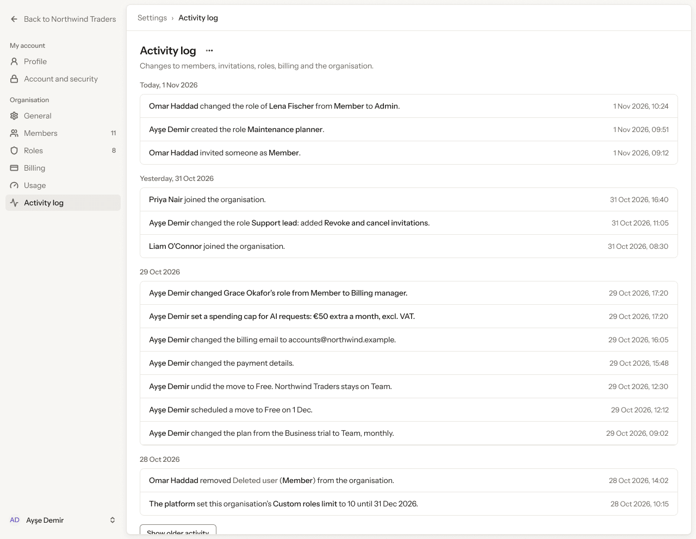
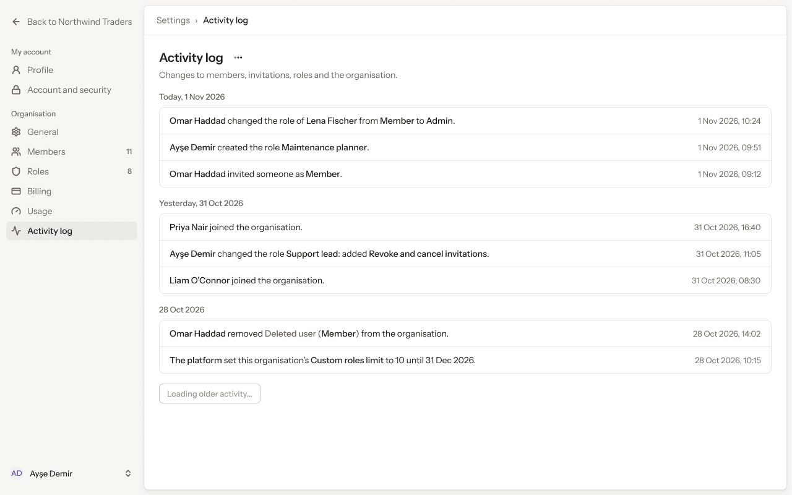
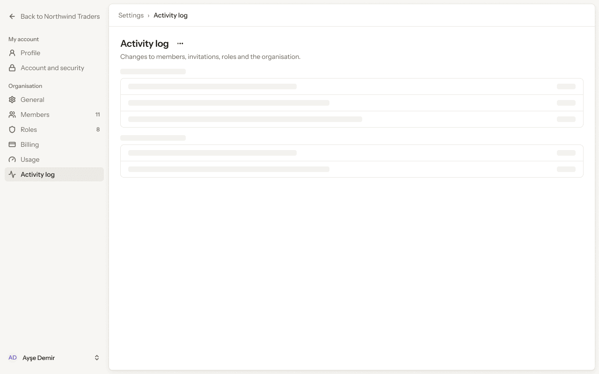
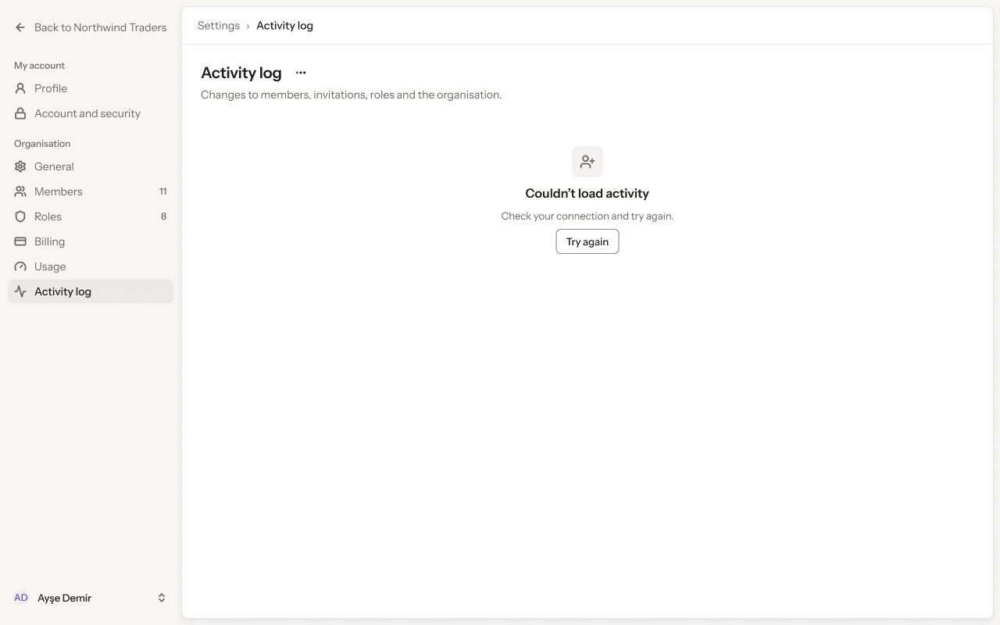
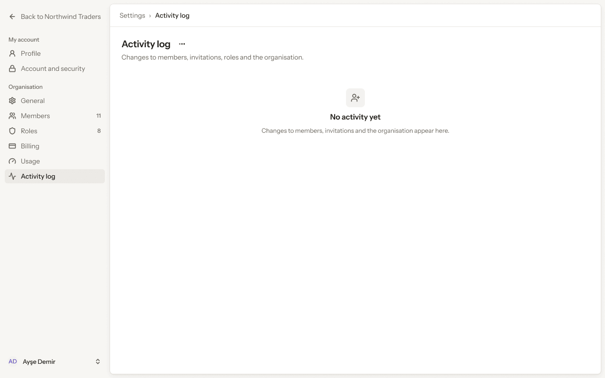
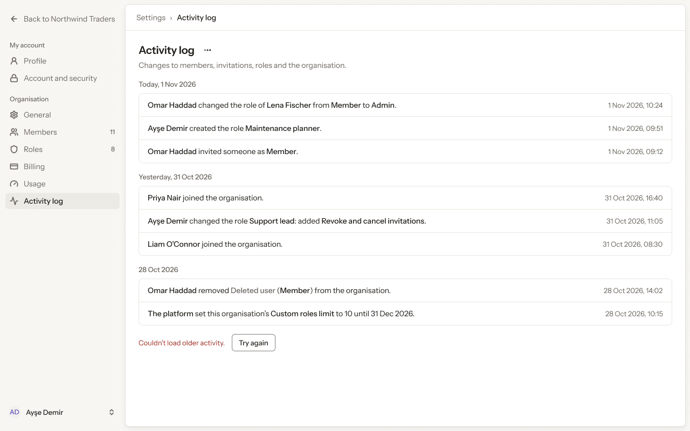
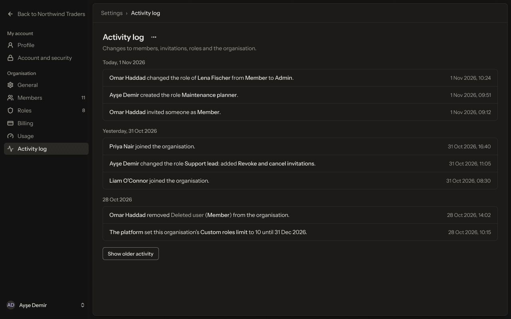
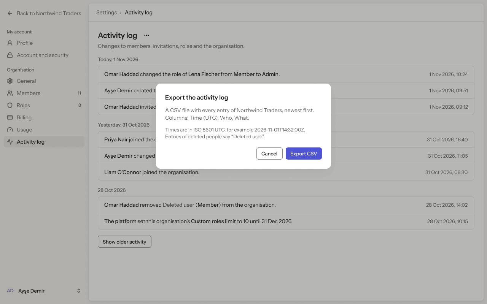

# Web app · 12 · Settings › Activity log

Who sees this section: People with tenant.audit.read.

Where the values come from: Activity log entries: our API (tenant.audit.read). Times in the person's time zone, CSV in UTC.

8 screens. Each part below is one screen and state. The PNG beside this file is the screen at scale 1.

| Screen | Device |
|---|---|
| [12.01 · Activity log · ideal](#1201--activity-log--ideal) | Desktop |
| [12.02 · Activity log · loading older](#1202--activity-log--loading-older) | Desktop |
| [12.03 · Activity log · loading](#1203--activity-log--loading) | Desktop |
| [12.04 · Activity log · error](#1204--activity-log--error) | Desktop |
| [12.05 · Activity log · empty](#1205--activity-log--empty) | Desktop |
| [12.06 · Activity log · older failed](#1206--activity-log--older-failed) | Desktop |
| [12.07 · Activity log · dark](#1207--activity-log--dark) | Desktop |
| [12.08 · Export activity log](#1208--export-activity-log) | Desktop |

### 12.01 · Activity log · ideal

- **Who sees it:** People with tenant.audit.read.
- **Device:** Desktop (1280 px and wider).
- **This state shows:** when the data loads and every value is present.
- **Values come from:** Activity log entries: our API (tenant.audit.read). Times in the person's time zone, CSV in UTC.
- **Components:** Button ×2, Sidebar, Top bar.
- **Actions:**
  - "Area": goes to [12.02 · Activity log · loading older](#1202--activity-log--loading-older).
  - "Back to Northwind Traders": goes to [4.01 · Home · Owner](../04-home/README.md#401--home--owner).
  - "Profile": goes to [5.01 · Profile · ideal](../05-settings-profile/README.md#501--profile--ideal).
  - "Account and security": goes to [6.01 · Account and security · ideal](../06-settings-account-and-security/README.md#601--account-and-security--ideal).
  - "General": goes to [7.01 · General · ideal](../07-settings-general/README.md#701--general--ideal).
  - "Members": goes to [8.01 · Members · ideal](../08-settings-members/README.md#801--members--ideal).
  - "Roles": goes to [9.01 · Roles · ideal](../09-settings-roles/README.md#901--roles--ideal).
  - "Billing": goes to [10.01 · Billing · Team, monthly](../10-settings-billing/README.md#1001--billing--team-monthly).
  - "Usage": goes to [11.01 · Usage · Team](../11-settings-usage/README.md#1101--usage--team).
- **Texts, word for word, top to bottom:**

  - Back to Northwind Traders
  - My account
  - Profile
  - Account and security
  - Organisation
  - General
  - Members
  - 11
  - Roles
  - 8
  - Billing
  - Usage
  - Activity log
  - AD
  - Ayşe Demir
  - Settings
  - ›
  - Activity log
  - Activity log
  - Changes to members, invitations, roles, billing and the organisation.
  - Today, 1 Nov 2026
  - Omar Haddad changed the role of Lena Fischer from Member to Admin.
  - 1 Nov 2026, 10:24
  - Ayşe Demir created the role Maintenance planner.
  - 1 Nov 2026, 09:51
  - Omar Haddad invited someone as Member.
  - 1 Nov 2026, 09:12
  - Yesterday, 31 Oct 2026
  - Priya Nair joined the organisation.
  - 31 Oct 2026, 16:40
  - Ayşe Demir changed the role Support lead: added Revoke and cancel invitations.
  - 31 Oct 2026, 11:05
  - Liam O’Connor joined the organisation.
  - 31 Oct 2026, 08:30
  - 29 Oct 2026
  - Ayşe Demir changed Grace Okafor’s role from Member to Billing manager.
  - 29 Oct 2026, 17:20
  - Ayşe Demir set a spending cap for AI requests: €50 extra a month, excl. VAT.
  - 29 Oct 2026, 17:20
  - Ayşe Demir changed the billing email to accounts@northwind.example.
  - 29 Oct 2026, 16:05
  - Ayşe Demir changed the payment details.
  - 29 Oct 2026, 15:48
  - Ayşe Demir undid the move to Free. Northwind Traders stays on Team.
  - 29 Oct 2026, 12:30
  - Ayşe Demir scheduled a move to Free on 1 Dec.
  - 29 Oct 2026, 12:12
  - Ayşe Demir changed the plan from the Business trial to Team, monthly.
  - 29 Oct 2026, 09:02
  - 28 Oct 2026
  - Omar Haddad removed Deleted user (Member) from the organisation.
  - 28 Oct 2026, 14:02
  - The platform set this organisation’s Custom roles limit to 10 until 31 Dec 2026.
  - 28 Oct 2026, 10:15
  - Show older activity

Figma: [124:13934](https://www.figma.com/design/3Ev111okX8xCBwR9B3hyBM/?node-id=124-13934)

### 12.02 · Activity log · loading older

- **Who sees it:** People with tenant.audit.read.
- **Device:** Desktop (1280 px and wider).
- **This state shows:** while the request runs.
- **Values come from:** Activity log entries: our API (tenant.audit.read). Times in the person's time zone, CSV in UTC.
- **Components:** Button ×2, Sidebar, Top bar.
- **Actions:**
  - "Back to Northwind Traders": goes to [4.01 · Home · Owner](../04-home/README.md#401--home--owner).
  - "Profile": goes to [5.01 · Profile · ideal](../05-settings-profile/README.md#501--profile--ideal).
  - "Account and security": goes to [6.01 · Account and security · ideal](../06-settings-account-and-security/README.md#601--account-and-security--ideal).
  - "General": goes to [7.01 · General · ideal](../07-settings-general/README.md#701--general--ideal).
  - "Members": goes to [8.01 · Members · ideal](../08-settings-members/README.md#801--members--ideal).
  - "Roles": goes to [9.01 · Roles · ideal](../09-settings-roles/README.md#901--roles--ideal).
  - "Billing": goes to [10.01 · Billing · Team, monthly](../10-settings-billing/README.md#1001--billing--team-monthly).
  - "Usage": goes to [11.01 · Usage · Team](../11-settings-usage/README.md#1101--usage--team).
  - "Activity log": goes to [12.01 · Activity log · ideal](#1201--activity-log--ideal).
- **Texts, word for word, top to bottom:**

  - Back to Northwind Traders
  - My account
  - Profile
  - Account and security
  - Organisation
  - General
  - Members
  - 11
  - Roles
  - 8
  - Billing
  - Usage
  - Activity log
  - AD
  - Ayşe Demir
  - Settings
  - ›
  - Activity log
  - Activity log
  - Changes to members, invitations, roles and the organisation.
  - Today, 1 Nov 2026
  - Omar Haddad changed the role of Lena Fischer from Member to Admin.
  - 1 Nov 2026, 10:24
  - Ayşe Demir created the role Maintenance planner.
  - 1 Nov 2026, 09:51
  - Omar Haddad invited someone as Member.
  - 1 Nov 2026, 09:12
  - Yesterday, 31 Oct 2026
  - Priya Nair joined the organisation.
  - 31 Oct 2026, 16:40
  - Ayşe Demir changed the role Support lead: added Revoke and cancel invitations.
  - 31 Oct 2026, 11:05
  - Liam O’Connor joined the organisation.
  - 31 Oct 2026, 08:30
  - 28 Oct 2026
  - Omar Haddad removed Deleted user (Member) from the organisation.
  - 28 Oct 2026, 14:02
  - The platform set this organisation’s Custom roles limit to 10 until 31 Dec 2026.
  - 28 Oct 2026, 10:15
  - Loading older activity…

Figma: [133:14450](https://www.figma.com/design/3Ev111okX8xCBwR9B3hyBM/?node-id=133-14450)

### 12.03 · Activity log · loading

- **Who sees it:** People with tenant.audit.read.
- **Device:** Desktop (1280 px and wider).
- **This state shows:** while the request runs.
- **Values come from:** Activity log entries: our API (tenant.audit.read). Times in the person's time zone, CSV in UTC.
- **Components:** Button, Sidebar, Skeleton ×12, Top bar.
- **Actions:**
  - "Back to Northwind Traders": goes to [4.01 · Home · Owner](../04-home/README.md#401--home--owner).
  - "Profile": goes to [5.01 · Profile · ideal](../05-settings-profile/README.md#501--profile--ideal).
  - "Account and security": goes to [6.01 · Account and security · ideal](../06-settings-account-and-security/README.md#601--account-and-security--ideal).
  - "General": goes to [7.01 · General · ideal](../07-settings-general/README.md#701--general--ideal).
  - "Members": goes to [8.01 · Members · ideal](../08-settings-members/README.md#801--members--ideal).
  - "Roles": goes to [9.01 · Roles · ideal](../09-settings-roles/README.md#901--roles--ideal).
  - "Billing": goes to [10.01 · Billing · Team, monthly](../10-settings-billing/README.md#1001--billing--team-monthly).
  - "Usage": goes to [11.01 · Usage · Team](../11-settings-usage/README.md#1101--usage--team).
  - "Activity log": goes to [12.01 · Activity log · ideal](#1201--activity-log--ideal).
- **Texts, word for word, top to bottom:**

  - Back to Northwind Traders
  - My account
  - Profile
  - Account and security
  - Organisation
  - General
  - Members
  - 11
  - Roles
  - 8
  - Billing
  - Usage
  - Activity log
  - AD
  - Ayşe Demir
  - Settings
  - ›
  - Activity log
  - Activity log
  - Changes to members, invitations, roles and the organisation.

Figma: [124:14213](https://www.figma.com/design/3Ev111okX8xCBwR9B3hyBM/?node-id=124-14213)

### 12.04 · Activity log · error

- **Who sees it:** People with tenant.audit.read.
- **Device:** Desktop (1280 px and wider).
- **This state shows:** when the request fails.
- **Values come from:** Activity log entries: our API (tenant.audit.read). Times in the person's time zone, CSV in UTC.
- **Components:** Button, Empty state, Sidebar, Top bar.
- **Actions:**
  - "Back to Northwind Traders": goes to [4.01 · Home · Owner](../04-home/README.md#401--home--owner).
  - "Profile": goes to [5.01 · Profile · ideal](../05-settings-profile/README.md#501--profile--ideal).
  - "Account and security": goes to [6.01 · Account and security · ideal](../06-settings-account-and-security/README.md#601--account-and-security--ideal).
  - "General": goes to [7.01 · General · ideal](../07-settings-general/README.md#701--general--ideal).
  - "Members": goes to [8.01 · Members · ideal](../08-settings-members/README.md#801--members--ideal).
  - "Roles": goes to [9.01 · Roles · ideal](../09-settings-roles/README.md#901--roles--ideal).
  - "Billing": goes to [10.01 · Billing · Team, monthly](../10-settings-billing/README.md#1001--billing--team-monthly).
  - "Usage": goes to [11.01 · Usage · Team](../11-settings-usage/README.md#1101--usage--team).
  - "Activity log": goes to [12.01 · Activity log · ideal](#1201--activity-log--ideal).
- **Texts, word for word, top to bottom:**

  - Back to Northwind Traders
  - My account
  - Profile
  - Account and security
  - Organisation
  - General
  - Members
  - 11
  - Roles
  - 8
  - Billing
  - Usage
  - Activity log
  - AD
  - Ayşe Demir
  - Settings
  - ›
  - Activity log
  - Activity log
  - Changes to members, invitations, roles and the organisation.
  - Couldn’t load activity
  - Check your connection and try again.
  - Try again

Figma: [124:14356](https://www.figma.com/design/3Ev111okX8xCBwR9B3hyBM/?node-id=124-14356)

### 12.05 · Activity log · empty

- **Who sees it:** People with tenant.audit.read.
- **Device:** Desktop (1280 px and wider).
- **This state shows:** when there is nothing to list yet.
- **Values come from:** Activity log entries: our API (tenant.audit.read). Times in the person's time zone, CSV in UTC.
- **Components:** Button, Empty state, Sidebar, Top bar.
- **Actions:**
  - "Back to Northwind Traders": goes to [4.01 · Home · Owner](../04-home/README.md#401--home--owner).
  - "Profile": goes to [5.01 · Profile · ideal](../05-settings-profile/README.md#501--profile--ideal).
  - "Account and security": goes to [6.01 · Account and security · ideal](../06-settings-account-and-security/README.md#601--account-and-security--ideal).
  - "General": goes to [7.01 · General · ideal](../07-settings-general/README.md#701--general--ideal).
  - "Members": goes to [8.01 · Members · ideal](../08-settings-members/README.md#801--members--ideal).
  - "Roles": goes to [9.01 · Roles · ideal](../09-settings-roles/README.md#901--roles--ideal).
  - "Billing": goes to [10.01 · Billing · Team, monthly](../10-settings-billing/README.md#1001--billing--team-monthly).
  - "Usage": goes to [11.01 · Usage · Team](../11-settings-usage/README.md#1101--usage--team).
  - "Activity log": goes to [12.01 · Activity log · ideal](#1201--activity-log--ideal).
- **Texts, word for word, top to bottom:**

  - Back to Northwind Traders
  - My account
  - Profile
  - Account and security
  - Organisation
  - General
  - Members
  - 11
  - Roles
  - 8
  - Billing
  - Usage
  - Activity log
  - AD
  - Ayşe Demir
  - Settings
  - ›
  - Activity log
  - Activity log
  - Changes to members, invitations, roles and the organisation.
  - No activity yet
  - Changes to members, invitations and the organisation appear here.

Figma: [124:14489](https://www.figma.com/design/3Ev111okX8xCBwR9B3hyBM/?node-id=124-14489)

### 12.06 · Activity log · older failed

- **Who sees it:** People with tenant.audit.read.
- **Device:** Desktop (1280 px and wider).
- **This state shows:** when the action fails.
- **Values come from:** Activity log entries: our API (tenant.audit.read). Times in the person's time zone, CSV in UTC.
- **Components:** Button ×2, Sidebar, Top bar.
- **Actions:**
  - "Back to Northwind Traders": goes to [4.01 · Home · Owner](../04-home/README.md#401--home--owner).
  - "Profile": goes to [5.01 · Profile · ideal](../05-settings-profile/README.md#501--profile--ideal).
  - "Account and security": goes to [6.01 · Account and security · ideal](../06-settings-account-and-security/README.md#601--account-and-security--ideal).
  - "General": goes to [7.01 · General · ideal](../07-settings-general/README.md#701--general--ideal).
  - "Members": goes to [8.01 · Members · ideal](../08-settings-members/README.md#801--members--ideal).
  - "Roles": goes to [9.01 · Roles · ideal](../09-settings-roles/README.md#901--roles--ideal).
  - "Billing": goes to [10.01 · Billing · Team, monthly](../10-settings-billing/README.md#1001--billing--team-monthly).
  - "Usage": goes to [11.01 · Usage · Team](../11-settings-usage/README.md#1101--usage--team).
  - "Activity log": goes to [12.01 · Activity log · ideal](#1201--activity-log--ideal).
- **Texts, word for word, top to bottom:**

  - Back to Northwind Traders
  - My account
  - Profile
  - Account and security
  - Organisation
  - General
  - Members
  - 11
  - Roles
  - 8
  - Billing
  - Usage
  - Activity log
  - AD
  - Ayşe Demir
  - Settings
  - ›
  - Activity log
  - Activity log
  - Changes to members, invitations, roles and the organisation.
  - Today, 1 Nov 2026
  - Omar Haddad changed the role of Lena Fischer from Member to Admin.
  - 1 Nov 2026, 10:24
  - Ayşe Demir created the role Maintenance planner.
  - 1 Nov 2026, 09:51
  - Omar Haddad invited someone as Member.
  - 1 Nov 2026, 09:12
  - Yesterday, 31 Oct 2026
  - Priya Nair joined the organisation.
  - 31 Oct 2026, 16:40
  - Ayşe Demir changed the role Support lead: added Revoke and cancel invitations.
  - 31 Oct 2026, 11:05
  - Liam O’Connor joined the organisation.
  - 31 Oct 2026, 08:30
  - 28 Oct 2026
  - Omar Haddad removed Deleted user (Member) from the organisation.
  - 28 Oct 2026, 14:02
  - The platform set this organisation’s Custom roles limit to 10 until 31 Dec 2026.
  - 28 Oct 2026, 10:15
  - Couldn’t load older activity.
  - Try again

Figma: [124:14622](https://www.figma.com/design/3Ev111okX8xCBwR9B3hyBM/?node-id=124-14622)

### 12.07 · Activity log · dark

- **Who sees it:** People with tenant.audit.read.
- **Device:** Desktop (1280 px and wider).
- **This state shows:** in the dark theme.
- **Values come from:** Activity log entries: our API (tenant.audit.read). Times in the person's time zone, CSV in UTC.
- **Components:** Button ×2, Sidebar, Top bar.
- **Actions:**
  - "Back to Northwind Traders": goes to [4.01 · Home · Owner](../04-home/README.md#401--home--owner).
  - "Profile": goes to [5.01 · Profile · ideal](../05-settings-profile/README.md#501--profile--ideal).
  - "Account and security": goes to [6.01 · Account and security · ideal](../06-settings-account-and-security/README.md#601--account-and-security--ideal).
  - "General": goes to [7.01 · General · ideal](../07-settings-general/README.md#701--general--ideal).
  - "Members": goes to [8.01 · Members · ideal](../08-settings-members/README.md#801--members--ideal).
  - "Roles": goes to [9.01 · Roles · ideal](../09-settings-roles/README.md#901--roles--ideal).
  - "Billing": goes to [10.01 · Billing · Team, monthly](../10-settings-billing/README.md#1001--billing--team-monthly).
  - "Usage": goes to [11.01 · Usage · Team](../11-settings-usage/README.md#1101--usage--team).
  - "Activity log": goes to [12.01 · Activity log · ideal](#1201--activity-log--ideal).
- **Texts, word for word, top to bottom:**

  - Back to Northwind Traders
  - My account
  - Profile
  - Account and security
  - Organisation
  - General
  - Members
  - 11
  - Roles
  - 8
  - Billing
  - Usage
  - Activity log
  - AD
  - Ayşe Demir
  - Settings
  - ›
  - Activity log
  - Activity log
  - Changes to members, invitations, roles and the organisation.
  - Today, 1 Nov 2026
  - Omar Haddad changed the role of Lena Fischer from Member to Admin.
  - 1 Nov 2026, 10:24
  - Ayşe Demir created the role Maintenance planner.
  - 1 Nov 2026, 09:51
  - Omar Haddad invited someone as Member.
  - 1 Nov 2026, 09:12
  - Yesterday, 31 Oct 2026
  - Priya Nair joined the organisation.
  - 31 Oct 2026, 16:40
  - Ayşe Demir changed the role Support lead: added Revoke and cancel invitations.
  - 31 Oct 2026, 11:05
  - Liam O’Connor joined the organisation.
  - 31 Oct 2026, 08:30
  - 28 Oct 2026
  - Omar Haddad removed Deleted user (Member) from the organisation.
  - 28 Oct 2026, 14:02
  - The platform set this organisation’s Custom roles limit to 10 until 31 Dec 2026.
  - 28 Oct 2026, 10:15
  - Show older activity

Figma: [124:14780](https://www.figma.com/design/3Ev111okX8xCBwR9B3hyBM/?node-id=124-14780)

### 12.08 · Export activity log

- **Who sees it:** People with tenant.audit.read.
- **Device:** Desktop (1280 px and wider).
- **This state shows:** as the title says.
- **Values come from:** Activity log entries: our API (tenant.audit.read). Times in the person's time zone, CSV in UTC.
- **Components:** Button ×4, Sidebar, Top bar.
- **Actions:**
  - "Back to Northwind Traders": goes to [4.01 · Home · Owner](../04-home/README.md#401--home--owner).
  - "Profile": goes to [5.01 · Profile · ideal](../05-settings-profile/README.md#501--profile--ideal).
  - "Account and security": goes to [6.01 · Account and security · ideal](../06-settings-account-and-security/README.md#601--account-and-security--ideal).
  - "General": goes to [7.01 · General · ideal](../07-settings-general/README.md#701--general--ideal).
  - "Members": goes to [8.01 · Members · ideal](../08-settings-members/README.md#801--members--ideal).
  - "Roles": goes to [9.01 · Roles · ideal](../09-settings-roles/README.md#901--roles--ideal).
  - "Billing": goes to [10.01 · Billing · Team, monthly](../10-settings-billing/README.md#1001--billing--team-monthly).
  - "Usage": goes to [11.01 · Usage · Team](../11-settings-usage/README.md#1101--usage--team).
  - "Activity log": goes to [12.01 · Activity log · ideal](#1201--activity-log--ideal).
- **Texts, word for word, top to bottom:**

  - Back to Northwind Traders
  - My account
  - Profile
  - Account and security
  - Organisation
  - General
  - Members
  - 11
  - Roles
  - 8
  - Billing
  - Usage
  - Activity log
  - AD
  - Ayşe Demir
  - Settings
  - ›
  - Activity log
  - Activity log
  - Changes to members, invitations, roles and the organisation.
  - Today, 1 Nov 2026
  - Omar Haddad changed the role of Lena Fischer from Member to Admin.
  - 1 Nov 2026, 10:24
  - Ayşe Demir created the role Maintenance planner.
  - 1 Nov 2026, 09:51
  - Omar Haddad invited someone as Member.
  - 1 Nov 2026, 09:12
  - Yesterday, 31 Oct 2026
  - Priya Nair joined the organisation.
  - 31 Oct 2026, 16:40
  - Ayşe Demir changed the role Support lead: added Revoke and cancel invitations.
  - 31 Oct 2026, 11:05
  - Liam O’Connor joined the organisation.
  - 31 Oct 2026, 08:30
  - 28 Oct 2026
  - Omar Haddad removed Deleted user (Member) from the organisation.
  - 28 Oct 2026, 14:02
  - The platform set this organisation’s Custom roles limit to 10 until 31 Dec 2026.
  - 28 Oct 2026, 10:15
  - Show older activity
  - Export the activity log
  - A CSV file with every entry of Northwind Traders, newest first. Columns: Time (UTC), Who, What.
  - Times are in ISO 8601 UTC, for example 2026-11-01T14:32:00Z. Entries of deleted people say “Deleted user”.
  - Cancel
  - Export CSV

Figma: [154:16685](https://www.figma.com/design/3Ev111okX8xCBwR9B3hyBM/?node-id=154-16685)
