# Web app · 13 · Emails

Who sees this section: The person the email is sent to.

Where the values come from: Templates: packages/emails. Sender and support address: packages/brand. Values in each email: the event that sent it.

36 screens. Each part below is one screen and state. The PNG beside this file is the screen at scale 1.

| Screen | Device |
|---|---|
| [13.01 · Invitation](#1301--invitation) | Email |
| [13.02 · Sign-in code](#1302--sign-in-code) | Email |
| [13.03 · Removed from an organisation](#1303--removed-from-an-organisation) | Email |
| [13.04 · Your data file is ready](#1304--your-data-file-is-ready) | Email |
| [13.05 · Notification](#1305--notification) | Email |
| [13.06 · Organisation closed](#1306--organisation-closed) | Email |
| [13.07 · Deletion warning](#1307--deletion-warning) | Email |
| [13.08 · Invitation · dark](#1308--invitation--dark) | Email |
| [13.09 · Sign-in code · dark](#1309--sign-in-code--dark) | Email |
| [13.10 · Removed from an organisation · dark](#1310--removed-from-an-organisation--dark) | Email |
| [13.11 · Your data file is ready · dark](#1311--your-data-file-is-ready--dark) | Email |
| [13.12 · Notification · dark](#1312--notification--dark) | Email |
| [13.13 · Organisation closed · dark](#1313--organisation-closed--dark) | Email |
| [13.14 · Deletion warning · dark](#1314--deletion-warning--dark) | Email |
| [13.15 · Invitation · Arabic](#1315--invitation--arabic) | Email |
| [13.16 · Trial ends in 3 days](#1316--trial-ends-in-3-days) | Email |
| [13.17 · Trial ended](#1317--trial-ended) | Email |
| [13.18 · Payment failed](#1318--payment-failed) | Email |
| [13.19 · Last warning](#1319--last-warning) | Email |
| [13.20 · Moved to Free](#1320--moved-to-free) | Email |
| [13.21 · Price is changing](#1321--price-is-changing) | Email |
| [13.22 · Usage at 80%](#1322--usage-at-80) | Email |
| [13.23 · Usage at 100%](#1323--usage-at-100) | Email |
| [13.24 · Spending cap reached](#1324--spending-cap-reached) | Email |
| [13.25 · Welcome](#1325--welcome) | Email |
| [13.26 · Trial ends in 3 days · dark](#1326--trial-ends-in-3-days--dark) | Email |
| [13.27 · Trial ended · dark](#1327--trial-ended--dark) | Email |
| [13.28 · Payment failed · dark](#1328--payment-failed--dark) | Email |
| [13.29 · Last warning · dark](#1329--last-warning--dark) | Email |
| [13.30 · Moved to Free · dark](#1330--moved-to-free--dark) | Email |
| [13.31 · Price is changing · dark](#1331--price-is-changing--dark) | Email |
| [13.32 · Usage at 80% · dark](#1332--usage-at-80--dark) | Email |
| [13.33 · Usage at 100% · dark](#1333--usage-at-100--dark) | Email |
| [13.34 · Spending cap reached · dark](#1334--spending-cap-reached--dark) | Email |
| [13.35 · Welcome · dark](#1335--welcome--dark) | Email |
| [13.36 · Trial ends in 3 days · Arabic](#1336--trial-ends-in-3-days--arabic) | Email |

### 13.01 · Invitation

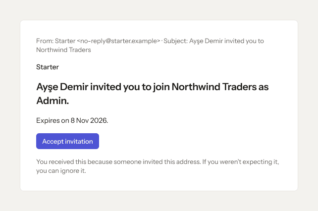

- **Who sees it:** The person the email is sent to.
- **Device:** Email (642 px).
- **This state shows:** as the title says.
- **Values come from:** Templates: packages/emails. Sender and support address: packages/brand. Values in each email: the event that sent it.
- **Components:** Button.
- **Actions:**
  - No prototype link on this screen. The buttons follow the section's other screens.
- **Texts, word for word, top to bottom:**

  - From: Starter \<no-reply@starter.example\> · Subject: Ayşe Demir invited you to Northwind Traders
  - Starter
  - Ayşe Demir invited you to join Northwind Traders as Admin.
  - Expires on 8 Nov 2026.
  - Accept invitation
  - You received this because someone invited this address. If you weren’t expecting it, you can ignore it.

Figma: [114:12176](https://www.figma.com/design/3Ev111okX8xCBwR9B3hyBM/?node-id=114-12176)

### 13.02 · Sign-in code

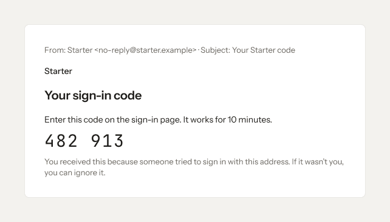

- **Who sees it:** The person the email is sent to.
- **Device:** Email (642 px).
- **This state shows:** as the title says.
- **Values come from:** Templates: packages/emails. Sender and support address: packages/brand. Values in each email: the event that sent it.
- **Components:** none (drawn without instances).
- **Actions:**
  - No prototype link on this screen. The buttons follow the section's other screens.
- **Texts, word for word, top to bottom:**

  - From: Starter \<no-reply@starter.example\> · Subject: Your Starter code
  - Starter
  - Your sign-in code
  - Enter this code on the sign-in page. It works for 10 minutes.
  - 482 913
  - You received this because someone tried to sign in with this address. If it wasn’t you, you can ignore it.

Figma: [114:12189](https://www.figma.com/design/3Ev111okX8xCBwR9B3hyBM/?node-id=114-12189)

### 13.03 · Removed from an organisation

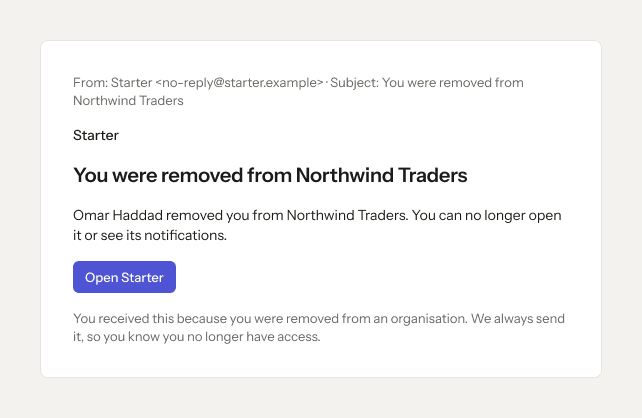

- **Who sees it:** The person the email is sent to.
- **Device:** Email (642 px).
- **This state shows:** as the title says.
- **Values come from:** Templates: packages/emails. Sender and support address: packages/brand. Values in each email: the event that sent it.
- **Components:** Button.
- **Actions:**
  - No prototype link on this screen. The buttons follow the section's other screens.
- **Texts, word for word, top to bottom:**

  - From: Starter \<no-reply@starter.example\> · Subject: You were removed from Northwind Traders
  - Starter
  - You were removed from Northwind Traders
  - Omar Haddad removed you from Northwind Traders. You can no longer open it or see its notifications.
  - Open Starter
  - You received this because you were removed from an organisation. We always send it, so you know you no longer have access.

Figma: [114:12203](https://www.figma.com/design/3Ev111okX8xCBwR9B3hyBM/?node-id=114-12203)

### 13.04 · Your data file is ready

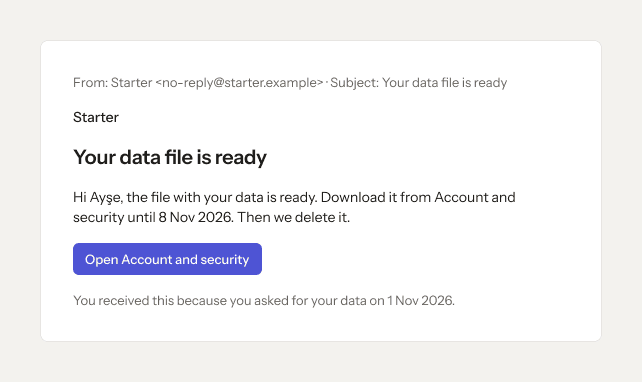

- **Who sees it:** The person the email is sent to.
- **Device:** Email (642 px).
- **This state shows:** as the title says.
- **Values come from:** Templates: packages/emails. Sender and support address: packages/brand. Values in each email: the event that sent it.
- **Components:** Button.
- **Actions:**
  - No prototype link on this screen. The buttons follow the section's other screens.
- **Texts, word for word, top to bottom:**

  - From: Starter \<no-reply@starter.example\> · Subject: Your data file is ready
  - Starter
  - Your data file is ready
  - Hi Ayşe, the file with your data is ready. Download it from Account and security until 8 Nov 2026. Then we delete it.
  - Open Account and security
  - You received this because you asked for your data on 1 Nov 2026.

Figma: [114:12216](https://www.figma.com/design/3Ev111okX8xCBwR9B3hyBM/?node-id=114-12216)

### 13.05 · Notification

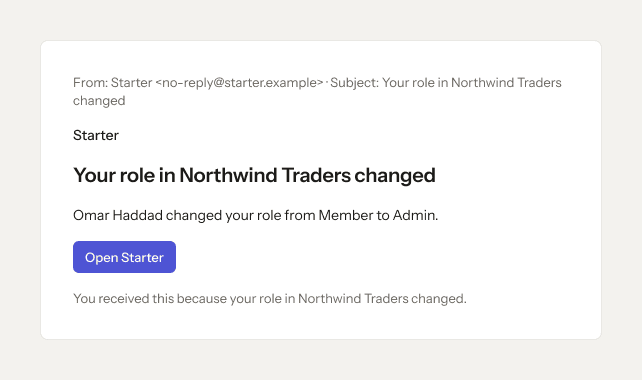

- **Who sees it:** The person the email is sent to.
- **Device:** Email (642 px).
- **This state shows:** as the title says.
- **Values come from:** Templates: packages/emails. Sender and support address: packages/brand. Values in each email: the event that sent it.
- **Components:** Button.
- **Actions:**
  - No prototype link on this screen. The buttons follow the section's other screens.
- **Texts, word for word, top to bottom:**

  - From: Starter \<no-reply@starter.example\> · Subject: Your role in Northwind Traders changed
  - Starter
  - Your role in Northwind Traders changed
  - Omar Haddad changed your role from Member to Admin.
  - Open Starter
  - You received this because your role in Northwind Traders changed.

Figma: [114:12229](https://www.figma.com/design/3Ev111okX8xCBwR9B3hyBM/?node-id=114-12229)

### 13.06 · Organisation closed

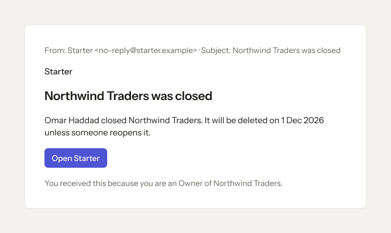

- **Who sees it:** The person the email is sent to.
- **Device:** Email (642 px).
- **This state shows:** as the title says.
- **Values come from:** Templates: packages/emails. Sender and support address: packages/brand. Values in each email: the event that sent it.
- **Components:** Button.
- **Actions:**
  - No prototype link on this screen. The buttons follow the section's other screens.
- **Texts, word for word, top to bottom:**

  - From: Starter \<no-reply@starter.example\> · Subject: Northwind Traders was closed
  - Starter
  - Northwind Traders was closed
  - Omar Haddad closed Northwind Traders. It will be deleted on 1 Dec 2026 unless someone reopens it.
  - Open Starter
  - You received this because you are an Owner of Northwind Traders.

Figma: [114:12242](https://www.figma.com/design/3Ev111okX8xCBwR9B3hyBM/?node-id=114-12242)

### 13.07 · Deletion warning

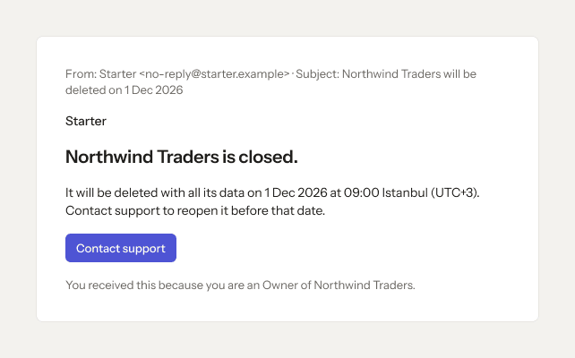

- **Who sees it:** The person the email is sent to.
- **Device:** Email (642 px).
- **This state shows:** as the title says.
- **Values come from:** Templates: packages/emails. Sender and support address: packages/brand. Values in each email: the event that sent it.
- **Components:** Button.
- **Actions:**
  - No prototype link on this screen. The buttons follow the section's other screens.
- **Texts, word for word, top to bottom:**

  - From: Starter \<no-reply@starter.example\> · Subject: Northwind Traders will be deleted on 1 Dec 2026
  - Starter
  - Northwind Traders is closed.
  - It will be deleted with all its data on 1 Dec 2026 at 09:00 Istanbul (UTC+3). Contact support to reopen it before that date.
  - Contact support
  - You received this because you are an Owner of Northwind Traders.

Figma: [114:12255](https://www.figma.com/design/3Ev111okX8xCBwR9B3hyBM/?node-id=114-12255)

### 13.08 · Invitation · dark

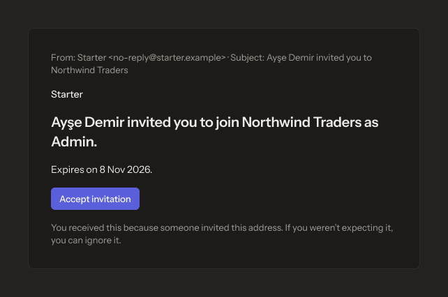

- **Who sees it:** The person the email is sent to.
- **Device:** Email (642 px).
- **This state shows:** in the dark theme.
- **Values come from:** Templates: packages/emails. Sender and support address: packages/brand. Values in each email: the event that sent it.
- **Components:** Button.
- **Actions:**
  - No prototype link on this screen. The buttons follow the section's other screens.
- **Texts, word for word, top to bottom:**

  - From: Starter \<no-reply@starter.example\> · Subject: Ayşe Demir invited you to Northwind Traders
  - Starter
  - Ayşe Demir invited you to join Northwind Traders as Admin.
  - Expires on 8 Nov 2026.
  - Accept invitation
  - You received this because someone invited this address. If you weren’t expecting it, you can ignore it.

Figma: [114:12268](https://www.figma.com/design/3Ev111okX8xCBwR9B3hyBM/?node-id=114-12268)

### 13.09 · Sign-in code · dark

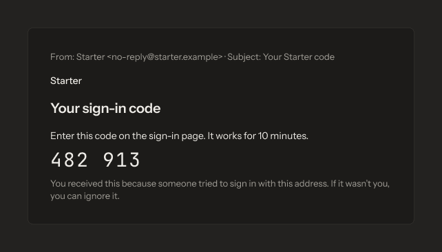

- **Who sees it:** The person the email is sent to.
- **Device:** Email (642 px).
- **This state shows:** in the dark theme.
- **Values come from:** Templates: packages/emails. Sender and support address: packages/brand. Values in each email: the event that sent it.
- **Components:** none (drawn without instances).
- **Actions:**
  - No prototype link on this screen. The buttons follow the section's other screens.
- **Texts, word for word, top to bottom:**

  - From: Starter \<no-reply@starter.example\> · Subject: Your Starter code
  - Starter
  - Your sign-in code
  - Enter this code on the sign-in page. It works for 10 minutes.
  - 482 913
  - You received this because someone tried to sign in with this address. If it wasn’t you, you can ignore it.

Figma: [114:12281](https://www.figma.com/design/3Ev111okX8xCBwR9B3hyBM/?node-id=114-12281)

### 13.10 · Removed from an organisation · dark

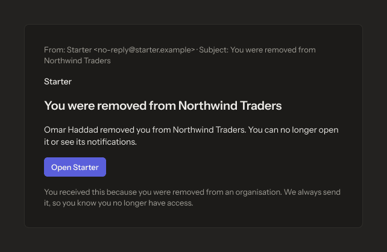

- **Who sees it:** The person the email is sent to.
- **Device:** Email (642 px).
- **This state shows:** in the dark theme.
- **Values come from:** Templates: packages/emails. Sender and support address: packages/brand. Values in each email: the event that sent it.
- **Components:** Button.
- **Actions:**
  - No prototype link on this screen. The buttons follow the section's other screens.
- **Texts, word for word, top to bottom:**

  - From: Starter \<no-reply@starter.example\> · Subject: You were removed from Northwind Traders
  - Starter
  - You were removed from Northwind Traders
  - Omar Haddad removed you from Northwind Traders. You can no longer open it or see its notifications.
  - Open Starter
  - You received this because you were removed from an organisation. We always send it, so you know you no longer have access.

Figma: [114:12295](https://www.figma.com/design/3Ev111okX8xCBwR9B3hyBM/?node-id=114-12295)

### 13.11 · Your data file is ready · dark

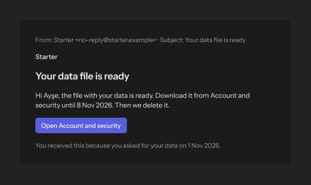

- **Who sees it:** The person the email is sent to.
- **Device:** Email (642 px).
- **This state shows:** in the dark theme.
- **Values come from:** Templates: packages/emails. Sender and support address: packages/brand. Values in each email: the event that sent it.
- **Components:** Button.
- **Actions:**
  - No prototype link on this screen. The buttons follow the section's other screens.
- **Texts, word for word, top to bottom:**

  - From: Starter \<no-reply@starter.example\> · Subject: Your data file is ready
  - Starter
  - Your data file is ready
  - Hi Ayşe, the file with your data is ready. Download it from Account and security until 8 Nov 2026. Then we delete it.
  - Open Account and security
  - You received this because you asked for your data on 1 Nov 2026.

Figma: [114:12308](https://www.figma.com/design/3Ev111okX8xCBwR9B3hyBM/?node-id=114-12308)

### 13.12 · Notification · dark

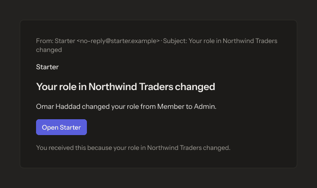

- **Who sees it:** The person the email is sent to.
- **Device:** Email (642 px).
- **This state shows:** in the dark theme.
- **Values come from:** Templates: packages/emails. Sender and support address: packages/brand. Values in each email: the event that sent it.
- **Components:** Button.
- **Actions:**
  - No prototype link on this screen. The buttons follow the section's other screens.
- **Texts, word for word, top to bottom:**

  - From: Starter \<no-reply@starter.example\> · Subject: Your role in Northwind Traders changed
  - Starter
  - Your role in Northwind Traders changed
  - Omar Haddad changed your role from Member to Admin.
  - Open Starter
  - You received this because your role in Northwind Traders changed.

Figma: [114:12321](https://www.figma.com/design/3Ev111okX8xCBwR9B3hyBM/?node-id=114-12321)

### 13.13 · Organisation closed · dark

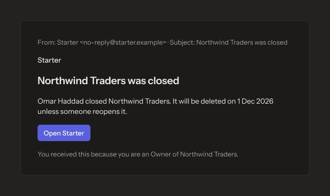

- **Who sees it:** The person the email is sent to.
- **Device:** Email (642 px).
- **This state shows:** in the dark theme.
- **Values come from:** Templates: packages/emails. Sender and support address: packages/brand. Values in each email: the event that sent it.
- **Components:** Button.
- **Actions:**
  - No prototype link on this screen. The buttons follow the section's other screens.
- **Texts, word for word, top to bottom:**

  - From: Starter \<no-reply@starter.example\> · Subject: Northwind Traders was closed
  - Starter
  - Northwind Traders was closed
  - Omar Haddad closed Northwind Traders. It will be deleted on 1 Dec 2026 unless someone reopens it.
  - Open Starter
  - You received this because you are an Owner of Northwind Traders.

Figma: [114:12334](https://www.figma.com/design/3Ev111okX8xCBwR9B3hyBM/?node-id=114-12334)

### 13.14 · Deletion warning · dark

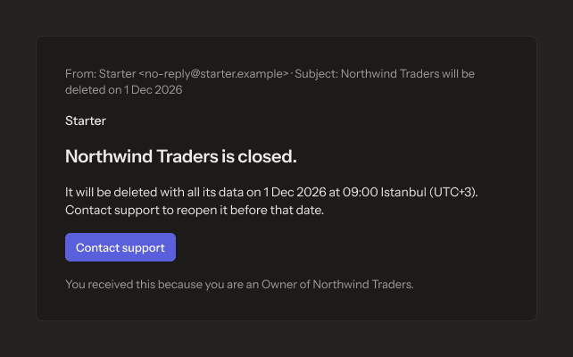

- **Who sees it:** The person the email is sent to.
- **Device:** Email (642 px).
- **This state shows:** in the dark theme.
- **Values come from:** Templates: packages/emails. Sender and support address: packages/brand. Values in each email: the event that sent it.
- **Components:** Button.
- **Actions:**
  - No prototype link on this screen. The buttons follow the section's other screens.
- **Texts, word for word, top to bottom:**

  - From: Starter \<no-reply@starter.example\> · Subject: Northwind Traders will be deleted on 1 Dec 2026
  - Starter
  - Northwind Traders is closed.
  - It will be deleted with all its data on 1 Dec 2026 at 09:00 Istanbul (UTC+3). Contact support to reopen it before that date.
  - Contact support
  - You received this because you are an Owner of Northwind Traders.

Figma: [114:12347](https://www.figma.com/design/3Ev111okX8xCBwR9B3hyBM/?node-id=114-12347)

### 13.15 · Invitation · Arabic

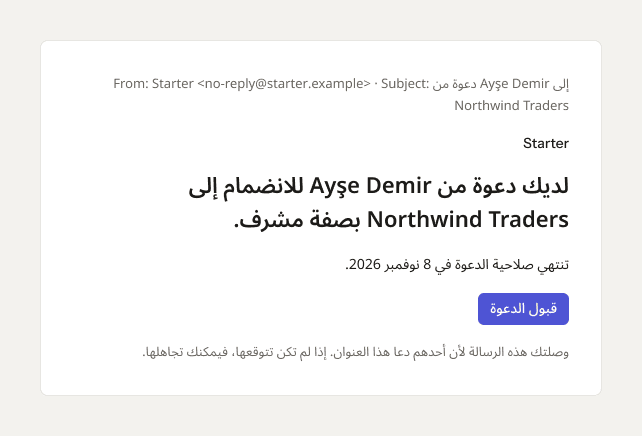

- **Who sees it:** The person the email is sent to.
- **Device:** Email (642 px).
- **This state shows:** with the language set to Arabic (right to left).
- **Values come from:** Templates: packages/emails. Sender and support address: packages/brand. Values in each email: the event that sent it.
- **Components:** Button.
- **Actions:**
  - No prototype link on this screen. The buttons follow the section's other screens.
- **Texts, word for word, top to bottom:**

  - From: Starter \<no-reply@starter.example\> · Subject: دعوة من Ayşe Demir إلى Northwind Traders
  - Starter
  - لديك دعوة من Ayşe Demir للانضمام إلى Northwind Traders بصفة مشرف.
  - تنتهي صلاحية الدعوة في 8 نوفمبر 2026.
  - قبول الدعوة
  - وصلتك هذه الرسالة لأن أحدهم دعا هذا العنوان. إذا لم تكن تتوقعها، فيمكنك تجاهلها.

Figma: [114:12360](https://www.figma.com/design/3Ev111okX8xCBwR9B3hyBM/?node-id=114-12360)

### 13.16 · Trial ends in 3 days

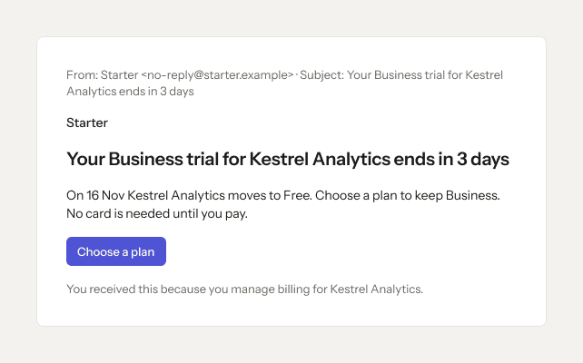

- **Who sees it:** The person the email is sent to.
- **Device:** Email (642 px).
- **This state shows:** as the title says.
- **Values come from:** Templates: packages/emails. Sender and support address: packages/brand. Values in each email: the event that sent it.
- **Components:** Button.
- **Actions:**
  - No prototype link on this screen. The buttons follow the section's other screens.
- **Texts, word for word, top to bottom:**

  - From: Starter \<no-reply@starter.example\> · Subject: Your Business trial for Kestrel Analytics ends in 3 days
  - Starter
  - Your Business trial for Kestrel Analytics ends in 3 days
  - On 16 Nov Kestrel Analytics moves to Free. Choose a plan to keep Business. No card is needed until you pay.
  - Choose a plan
  - You received this because you manage billing for Kestrel Analytics.

Figma: [245:22741](https://www.figma.com/design/3Ev111okX8xCBwR9B3hyBM/?node-id=245-22741)

### 13.17 · Trial ended

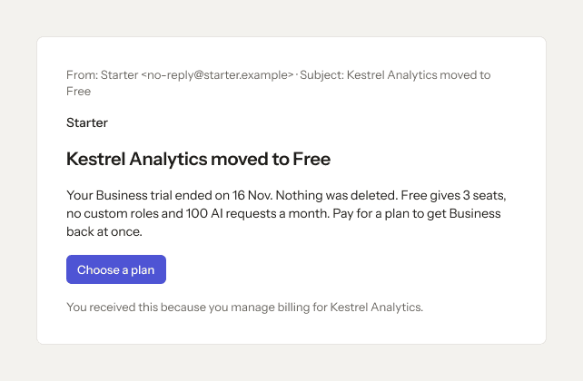

- **Who sees it:** The person the email is sent to.
- **Device:** Email (642 px).
- **This state shows:** as the title says.
- **Values come from:** Templates: packages/emails. Sender and support address: packages/brand. Values in each email: the event that sent it.
- **Components:** Button.
- **Actions:**
  - No prototype link on this screen. The buttons follow the section's other screens.
- **Texts, word for word, top to bottom:**

  - From: Starter \<no-reply@starter.example\> · Subject: Kestrel Analytics moved to Free
  - Starter
  - Kestrel Analytics moved to Free
  - Your Business trial ended on 16 Nov. Nothing was deleted. Free gives 3 seats, no custom roles and 100 AI requests a month. Pay for a plan to get Business back at once.
  - Choose a plan
  - You received this because you manage billing for Kestrel Analytics.

Figma: [245:22754](https://www.figma.com/design/3Ev111okX8xCBwR9B3hyBM/?node-id=245-22754)

### 13.18 · Payment failed

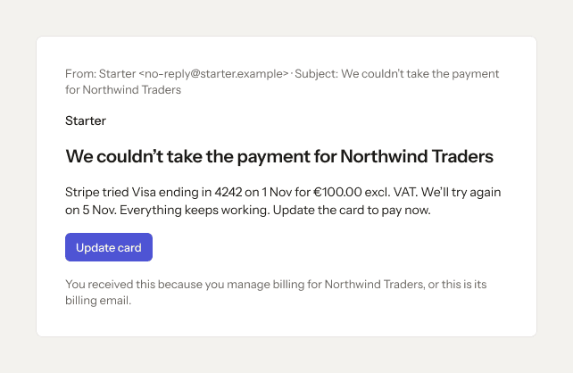

- **Who sees it:** The person the email is sent to.
- **Device:** Email (642 px).
- **This state shows:** when the action fails.
- **Values come from:** Templates: packages/emails. Sender and support address: packages/brand. Values in each email: the event that sent it.
- **Components:** Button.
- **Actions:**
  - No prototype link on this screen. The buttons follow the section's other screens.
- **Texts, word for word, top to bottom:**

  - From: Starter \<no-reply@starter.example\> · Subject: We couldn’t take the payment for Northwind Traders
  - Starter
  - We couldn’t take the payment for Northwind Traders
  - Stripe tried Visa ending in 4242 on 1 Nov for €100.00 excl. VAT. We’ll try again on 5 Nov. Everything keeps working. Update the card to pay now.
  - Update card
  - You received this because you manage billing for Northwind Traders, or this is its billing email.

Figma: [245:22767](https://www.figma.com/design/3Ev111okX8xCBwR9B3hyBM/?node-id=245-22767)

### 13.19 · Last warning

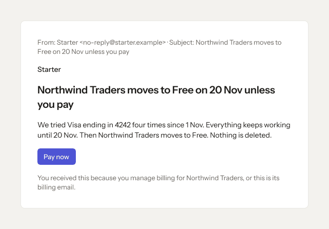

- **Who sees it:** The person the email is sent to.
- **Device:** Email (642 px).
- **This state shows:** as the title says.
- **Values come from:** Templates: packages/emails. Sender and support address: packages/brand. Values in each email: the event that sent it.
- **Components:** Button.
- **Actions:**
  - No prototype link on this screen. The buttons follow the section's other screens.
- **Texts, word for word, top to bottom:**

  - From: Starter \<no-reply@starter.example\> · Subject: Northwind Traders moves to Free on 20 Nov unless you pay
  - Starter
  - Northwind Traders moves to Free on 20 Nov unless you pay
  - We tried Visa ending in 4242 four times since 1 Nov. Everything keeps working until 20 Nov. Then Northwind Traders moves to Free. Nothing is deleted.
  - Pay now
  - You received this because you manage billing for Northwind Traders, or this is its billing email.

Figma: [245:22780](https://www.figma.com/design/3Ev111okX8xCBwR9B3hyBM/?node-id=245-22780)

### 13.20 · Moved to Free

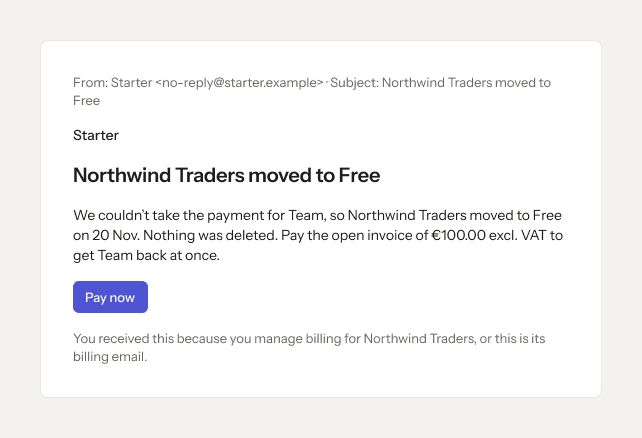

- **Who sees it:** The person the email is sent to.
- **Device:** Email (642 px).
- **This state shows:** as the title says.
- **Values come from:** Templates: packages/emails. Sender and support address: packages/brand. Values in each email: the event that sent it.
- **Components:** Button.
- **Actions:**
  - No prototype link on this screen. The buttons follow the section's other screens.
- **Texts, word for word, top to bottom:**

  - From: Starter \<no-reply@starter.example\> · Subject: Northwind Traders moved to Free
  - Starter
  - Northwind Traders moved to Free
  - We couldn’t take the payment for Team, so Northwind Traders moved to Free on 20 Nov. Nothing was deleted. Pay the open invoice of €100.00 excl. VAT to get Team back at once.
  - Pay now
  - You received this because you manage billing for Northwind Traders, or this is its billing email.

Figma: [245:22793](https://www.figma.com/design/3Ev111okX8xCBwR9B3hyBM/?node-id=245-22793)

### 13.21 · Price is changing

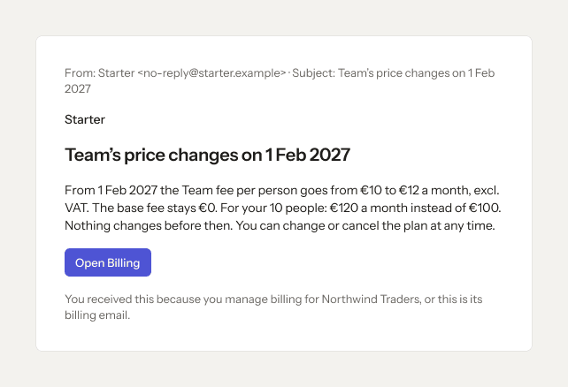

- **Who sees it:** The person the email is sent to.
- **Device:** Email (642 px).
- **This state shows:** as the title says.
- **Values come from:** Templates: packages/emails. Sender and support address: packages/brand. Values in each email: the event that sent it.
- **Components:** Button.
- **Actions:**
  - No prototype link on this screen. The buttons follow the section's other screens.
- **Texts, word for word, top to bottom:**

  - From: Starter \<no-reply@starter.example\> · Subject: Team’s price changes on 1 Feb 2027
  - Starter
  - Team’s price changes on 1 Feb 2027
  - From 1 Feb 2027 the Team fee per person goes from €10 to €12 a month, excl. VAT. The base fee stays €0. For your 10 people: €120 a month instead of €100. Nothing changes before then. You can change or cancel the plan at any time.
  - Open Billing
  - You received this because you manage billing for Northwind Traders, or this is its billing email.

Figma: [245:22806](https://www.figma.com/design/3Ev111okX8xCBwR9B3hyBM/?node-id=245-22806)

### 13.22 · Usage at 80%

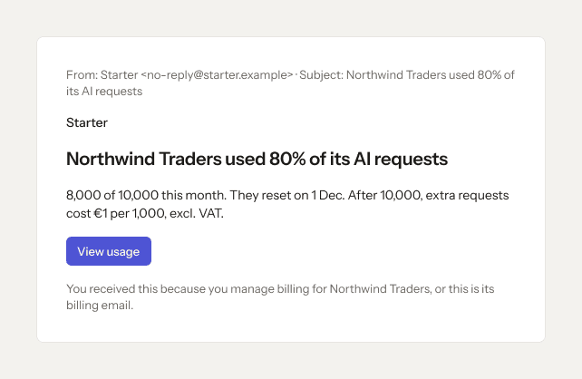

- **Who sees it:** The person the email is sent to.
- **Device:** Email (642 px).
- **This state shows:** as the title says.
- **Values come from:** Templates: packages/emails. Sender and support address: packages/brand. Values in each email: the event that sent it.
- **Components:** Button.
- **Actions:**
  - No prototype link on this screen. The buttons follow the section's other screens.
- **Texts, word for word, top to bottom:**

  - From: Starter \<no-reply@starter.example\> · Subject: Northwind Traders used 80% of its AI requests
  - Starter
  - Northwind Traders used 80% of its AI requests
  - 8,000 of 10,000 this month. They reset on 1 Dec. After 10,000, extra requests cost €1 per 1,000, excl. VAT.
  - View usage
  - You received this because you manage billing for Northwind Traders, or this is its billing email.

Figma: [245:22819](https://www.figma.com/design/3Ev111okX8xCBwR9B3hyBM/?node-id=245-22819)

### 13.23 · Usage at 100%

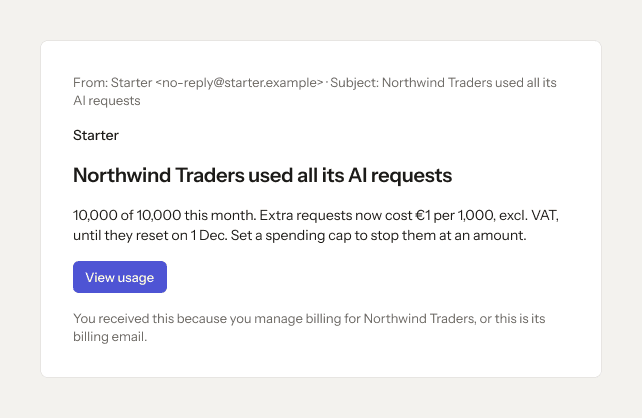

- **Who sees it:** The person the email is sent to.
- **Device:** Email (642 px).
- **This state shows:** as the title says.
- **Values come from:** Templates: packages/emails. Sender and support address: packages/brand. Values in each email: the event that sent it.
- **Components:** Button.
- **Actions:**
  - No prototype link on this screen. The buttons follow the section's other screens.
- **Texts, word for word, top to bottom:**

  - From: Starter \<no-reply@starter.example\> · Subject: Northwind Traders used all its AI requests
  - Starter
  - Northwind Traders used all its AI requests
  - 10,000 of 10,000 this month. Extra requests now cost €1 per 1,000, excl. VAT, until they reset on 1 Dec. Set a spending cap to stop them at an amount.
  - View usage
  - You received this because you manage billing for Northwind Traders, or this is its billing email.

Figma: [245:22832](https://www.figma.com/design/3Ev111okX8xCBwR9B3hyBM/?node-id=245-22832)

### 13.24 · Spending cap reached

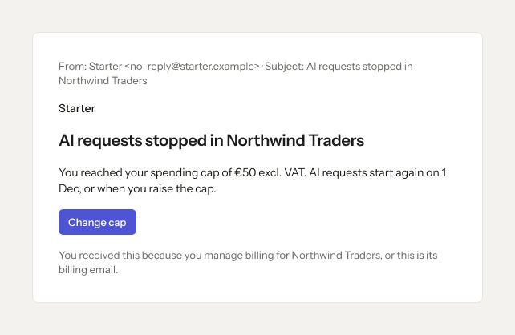

- **Who sees it:** The person the email is sent to.
- **Device:** Email (642 px).
- **This state shows:** as the title says.
- **Values come from:** Templates: packages/emails. Sender and support address: packages/brand. Values in each email: the event that sent it.
- **Components:** Button.
- **Actions:**
  - No prototype link on this screen. The buttons follow the section's other screens.
- **Texts, word for word, top to bottom:**

  - From: Starter \<no-reply@starter.example\> · Subject: AI requests stopped in Northwind Traders
  - Starter
  - AI requests stopped in Northwind Traders
  - You reached your spending cap of €50 excl. VAT. AI requests start again on 1 Dec, or when you raise the cap.
  - Change cap
  - You received this because you manage billing for Northwind Traders, or this is its billing email.

Figma: [245:22845](https://www.figma.com/design/3Ev111okX8xCBwR9B3hyBM/?node-id=245-22845)

### 13.25 · Welcome

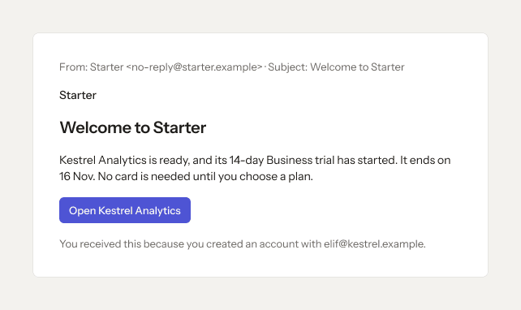

- **Who sees it:** The person the email is sent to.
- **Device:** Email (642 px).
- **This state shows:** as the title says.
- **Values come from:** Templates: packages/emails. Sender and support address: packages/brand. Values in each email: the event that sent it.
- **Components:** Button.
- **Actions:**
  - No prototype link on this screen. The buttons follow the section's other screens.
- **Texts, word for word, top to bottom:**

  - From: Starter \<no-reply@starter.example\> · Subject: Welcome to Starter
  - Starter
  - Welcome to Starter
  - Kestrel Analytics is ready, and its 14-day Business trial has started. It ends on 16 Nov. No card is needed until you choose a plan.
  - Open Kestrel Analytics
  - You received this because you created an account with elif@kestrel.example.

Figma: [245:22858](https://www.figma.com/design/3Ev111okX8xCBwR9B3hyBM/?node-id=245-22858)

### 13.26 · Trial ends in 3 days · dark

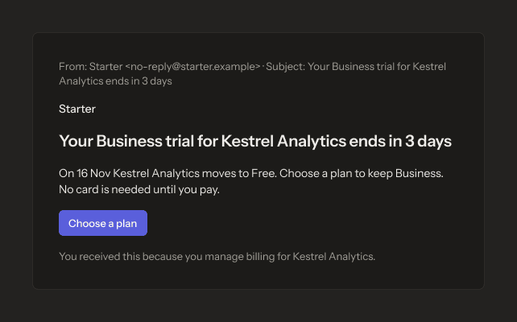

- **Who sees it:** The person the email is sent to.
- **Device:** Email (642 px).
- **This state shows:** in the dark theme.
- **Values come from:** Templates: packages/emails. Sender and support address: packages/brand. Values in each email: the event that sent it.
- **Components:** Button.
- **Actions:**
  - No prototype link on this screen. The buttons follow the section's other screens.
- **Texts, word for word, top to bottom:**

  - From: Starter \<no-reply@starter.example\> · Subject: Your Business trial for Kestrel Analytics ends in 3 days
  - Starter
  - Your Business trial for Kestrel Analytics ends in 3 days
  - On 16 Nov Kestrel Analytics moves to Free. Choose a plan to keep Business. No card is needed until you pay.
  - Choose a plan
  - You received this because you manage billing for Kestrel Analytics.

Figma: [245:22871](https://www.figma.com/design/3Ev111okX8xCBwR9B3hyBM/?node-id=245-22871)

### 13.27 · Trial ended · dark

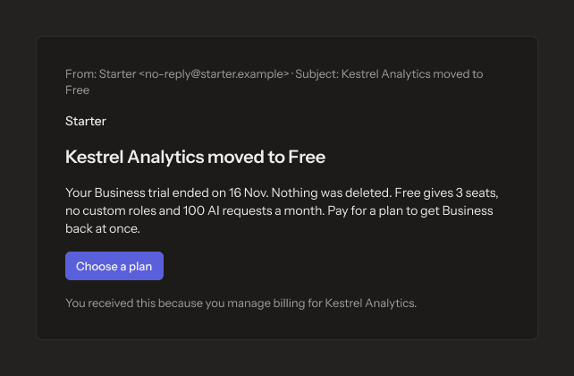

- **Who sees it:** The person the email is sent to.
- **Device:** Email (642 px).
- **This state shows:** in the dark theme.
- **Values come from:** Templates: packages/emails. Sender and support address: packages/brand. Values in each email: the event that sent it.
- **Components:** Button.
- **Actions:**
  - No prototype link on this screen. The buttons follow the section's other screens.
- **Texts, word for word, top to bottom:**

  - From: Starter \<no-reply@starter.example\> · Subject: Kestrel Analytics moved to Free
  - Starter
  - Kestrel Analytics moved to Free
  - Your Business trial ended on 16 Nov. Nothing was deleted. Free gives 3 seats, no custom roles and 100 AI requests a month. Pay for a plan to get Business back at once.
  - Choose a plan
  - You received this because you manage billing for Kestrel Analytics.

Figma: [245:22884](https://www.figma.com/design/3Ev111okX8xCBwR9B3hyBM/?node-id=245-22884)

### 13.28 · Payment failed · dark

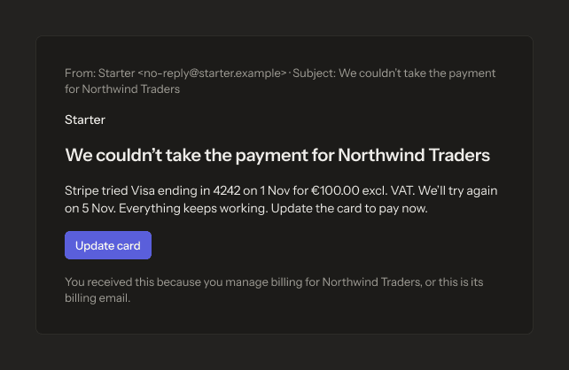

- **Who sees it:** The person the email is sent to.
- **Device:** Email (642 px).
- **This state shows:** when the action fails; in the dark theme.
- **Values come from:** Templates: packages/emails. Sender and support address: packages/brand. Values in each email: the event that sent it.
- **Components:** Button.
- **Actions:**
  - No prototype link on this screen. The buttons follow the section's other screens.
- **Texts, word for word, top to bottom:**

  - From: Starter \<no-reply@starter.example\> · Subject: We couldn’t take the payment for Northwind Traders
  - Starter
  - We couldn’t take the payment for Northwind Traders
  - Stripe tried Visa ending in 4242 on 1 Nov for €100.00 excl. VAT. We’ll try again on 5 Nov. Everything keeps working. Update the card to pay now.
  - Update card
  - You received this because you manage billing for Northwind Traders, or this is its billing email.

Figma: [245:22897](https://www.figma.com/design/3Ev111okX8xCBwR9B3hyBM/?node-id=245-22897)

### 13.29 · Last warning · dark

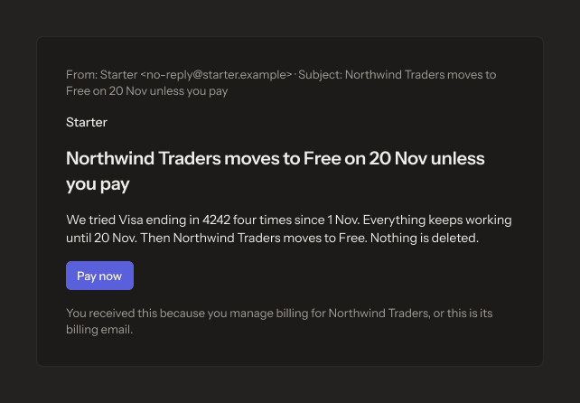

- **Who sees it:** The person the email is sent to.
- **Device:** Email (642 px).
- **This state shows:** in the dark theme.
- **Values come from:** Templates: packages/emails. Sender and support address: packages/brand. Values in each email: the event that sent it.
- **Components:** Button.
- **Actions:**
  - No prototype link on this screen. The buttons follow the section's other screens.
- **Texts, word for word, top to bottom:**

  - From: Starter \<no-reply@starter.example\> · Subject: Northwind Traders moves to Free on 20 Nov unless you pay
  - Starter
  - Northwind Traders moves to Free on 20 Nov unless you pay
  - We tried Visa ending in 4242 four times since 1 Nov. Everything keeps working until 20 Nov. Then Northwind Traders moves to Free. Nothing is deleted.
  - Pay now
  - You received this because you manage billing for Northwind Traders, or this is its billing email.

Figma: [245:22910](https://www.figma.com/design/3Ev111okX8xCBwR9B3hyBM/?node-id=245-22910)

### 13.30 · Moved to Free · dark

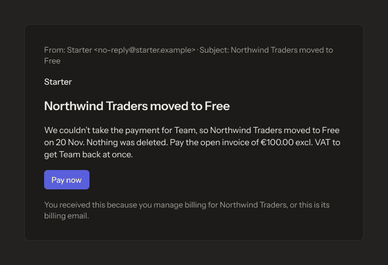

- **Who sees it:** The person the email is sent to.
- **Device:** Email (642 px).
- **This state shows:** in the dark theme.
- **Values come from:** Templates: packages/emails. Sender and support address: packages/brand. Values in each email: the event that sent it.
- **Components:** Button.
- **Actions:**
  - No prototype link on this screen. The buttons follow the section's other screens.
- **Texts, word for word, top to bottom:**

  - From: Starter \<no-reply@starter.example\> · Subject: Northwind Traders moved to Free
  - Starter
  - Northwind Traders moved to Free
  - We couldn’t take the payment for Team, so Northwind Traders moved to Free on 20 Nov. Nothing was deleted. Pay the open invoice of €100.00 excl. VAT to get Team back at once.
  - Pay now
  - You received this because you manage billing for Northwind Traders, or this is its billing email.

Figma: [245:22923](https://www.figma.com/design/3Ev111okX8xCBwR9B3hyBM/?node-id=245-22923)

### 13.31 · Price is changing · dark

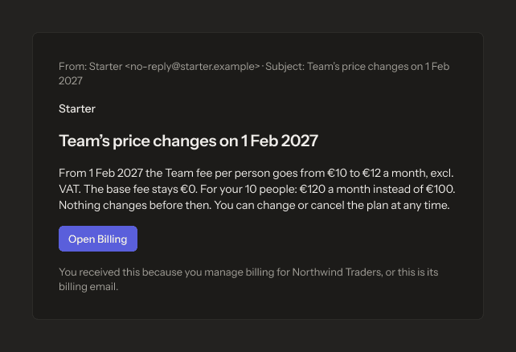

- **Who sees it:** The person the email is sent to.
- **Device:** Email (642 px).
- **This state shows:** in the dark theme.
- **Values come from:** Templates: packages/emails. Sender and support address: packages/brand. Values in each email: the event that sent it.
- **Components:** Button.
- **Actions:**
  - No prototype link on this screen. The buttons follow the section's other screens.
- **Texts, word for word, top to bottom:**

  - From: Starter \<no-reply@starter.example\> · Subject: Team’s price changes on 1 Feb 2027
  - Starter
  - Team’s price changes on 1 Feb 2027
  - From 1 Feb 2027 the Team fee per person goes from €10 to €12 a month, excl. VAT. The base fee stays €0. For your 10 people: €120 a month instead of €100. Nothing changes before then. You can change or cancel the plan at any time.
  - Open Billing
  - You received this because you manage billing for Northwind Traders, or this is its billing email.

Figma: [245:22936](https://www.figma.com/design/3Ev111okX8xCBwR9B3hyBM/?node-id=245-22936)

### 13.32 · Usage at 80% · dark

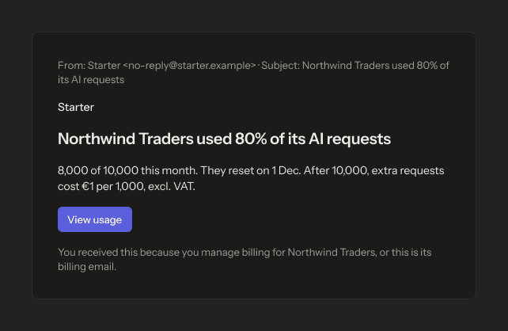

- **Who sees it:** The person the email is sent to.
- **Device:** Email (642 px).
- **This state shows:** in the dark theme.
- **Values come from:** Templates: packages/emails. Sender and support address: packages/brand. Values in each email: the event that sent it.
- **Components:** Button.
- **Actions:**
  - No prototype link on this screen. The buttons follow the section's other screens.
- **Texts, word for word, top to bottom:**

  - From: Starter \<no-reply@starter.example\> · Subject: Northwind Traders used 80% of its AI requests
  - Starter
  - Northwind Traders used 80% of its AI requests
  - 8,000 of 10,000 this month. They reset on 1 Dec. After 10,000, extra requests cost €1 per 1,000, excl. VAT.
  - View usage
  - You received this because you manage billing for Northwind Traders, or this is its billing email.

Figma: [245:22949](https://www.figma.com/design/3Ev111okX8xCBwR9B3hyBM/?node-id=245-22949)

### 13.33 · Usage at 100% · dark

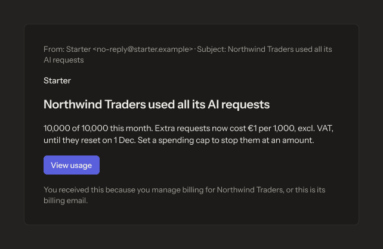

- **Who sees it:** The person the email is sent to.
- **Device:** Email (642 px).
- **This state shows:** in the dark theme.
- **Values come from:** Templates: packages/emails. Sender and support address: packages/brand. Values in each email: the event that sent it.
- **Components:** Button.
- **Actions:**
  - No prototype link on this screen. The buttons follow the section's other screens.
- **Texts, word for word, top to bottom:**

  - From: Starter \<no-reply@starter.example\> · Subject: Northwind Traders used all its AI requests
  - Starter
  - Northwind Traders used all its AI requests
  - 10,000 of 10,000 this month. Extra requests now cost €1 per 1,000, excl. VAT, until they reset on 1 Dec. Set a spending cap to stop them at an amount.
  - View usage
  - You received this because you manage billing for Northwind Traders, or this is its billing email.

Figma: [245:22962](https://www.figma.com/design/3Ev111okX8xCBwR9B3hyBM/?node-id=245-22962)

### 13.34 · Spending cap reached · dark

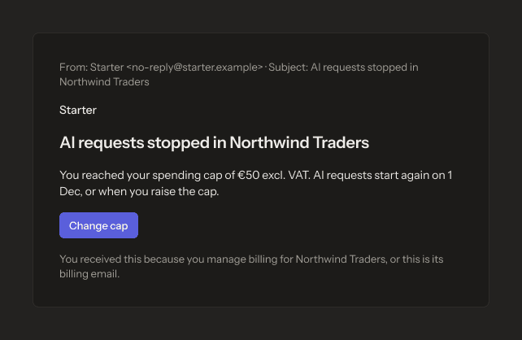

- **Who sees it:** The person the email is sent to.
- **Device:** Email (642 px).
- **This state shows:** in the dark theme.
- **Values come from:** Templates: packages/emails. Sender and support address: packages/brand. Values in each email: the event that sent it.
- **Components:** Button.
- **Actions:**
  - No prototype link on this screen. The buttons follow the section's other screens.
- **Texts, word for word, top to bottom:**

  - From: Starter \<no-reply@starter.example\> · Subject: AI requests stopped in Northwind Traders
  - Starter
  - AI requests stopped in Northwind Traders
  - You reached your spending cap of €50 excl. VAT. AI requests start again on 1 Dec, or when you raise the cap.
  - Change cap
  - You received this because you manage billing for Northwind Traders, or this is its billing email.

Figma: [245:22975](https://www.figma.com/design/3Ev111okX8xCBwR9B3hyBM/?node-id=245-22975)

### 13.35 · Welcome · dark

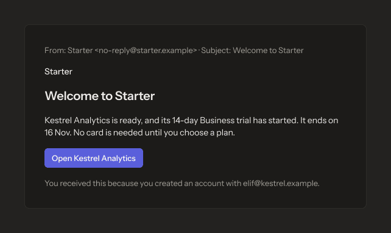

- **Who sees it:** The person the email is sent to.
- **Device:** Email (642 px).
- **This state shows:** in the dark theme.
- **Values come from:** Templates: packages/emails. Sender and support address: packages/brand. Values in each email: the event that sent it.
- **Components:** Button.
- **Actions:**
  - No prototype link on this screen. The buttons follow the section's other screens.
- **Texts, word for word, top to bottom:**

  - From: Starter \<no-reply@starter.example\> · Subject: Welcome to Starter
  - Starter
  - Welcome to Starter
  - Kestrel Analytics is ready, and its 14-day Business trial has started. It ends on 16 Nov. No card is needed until you choose a plan.
  - Open Kestrel Analytics
  - You received this because you created an account with elif@kestrel.example.

Figma: [245:22988](https://www.figma.com/design/3Ev111okX8xCBwR9B3hyBM/?node-id=245-22988)

### 13.36 · Trial ends in 3 days · Arabic

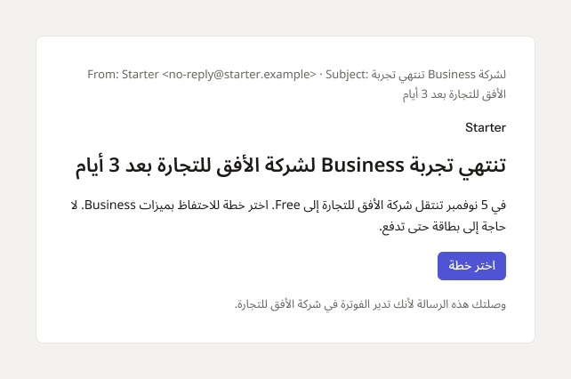

- **Who sees it:** The person the email is sent to.
- **Device:** Email (642 px).
- **This state shows:** with the language set to Arabic (right to left).
- **Values come from:** Templates: packages/emails. Sender and support address: packages/brand. Values in each email: the event that sent it.
- **Components:** Button.
- **Actions:**
  - No prototype link on this screen. The buttons follow the section's other screens.
- **Texts, word for word, top to bottom:**

  - From: Starter \<no-reply@starter.example\> · Subject: تنتهي تجربة Business لشركة الأفق للتجارة بعد 3 أيام
  - Starter
  - تنتهي تجربة Business لشركة الأفق للتجارة بعد 3 أيام
  - في 5 نوفمبر تنتقل شركة الأفق للتجارة إلى Free. اختر خطة للاحتفاظ بميزات Business. لا حاجة إلى بطاقة حتى تدفع.
  - اختر خطة
  - وصلتك هذه الرسالة لأنك تدير الفوترة في شركة الأفق للتجارة.

Figma: [245:23001](https://www.figma.com/design/3Ev111okX8xCBwR9B3hyBM/?node-id=245-23001)
