# Web app · 14 · Settings › Billing manager

Who sees this section: The Billing manager role, and the Owner or Admin who gives it.

Where the values come from: Role and permissions: our API. Seat and price lines: the plan's prices from our API. A Billing manager uses no seat.

15 screens. Each part below is one screen and state. The PNG beside this file is the screen at scale 1.

| Screen | Device |
|---|---|
| [14.01 · Role · Billing manager](#1401--role--billing-manager) | Desktop |
| [14.02 · Invite member · role list](#1402--invite-member--role-list) | Desktop |
| [14.03 · Invite member · Billing manager](#1403--invite-member--billing-manager) | Desktop |
| [14.04 · Invite member · yearly plan](#1404--invite-member--yearly-plan) | Desktop |
| [14.05 · Invite member · in a trial](#1405--invite-member--in-a-trial) | Desktop |
| [14.06 · Change role · to Billing manager](#1406--change-role--to-billing-manager) | Desktop |
| [14.07 · Change role · from Billing manager](#1407--change-role--from-billing-manager) | Desktop |
| [14.08 · Home · as a Billing manager](#1408--home--as-a-billing-manager) | Desktop |
| [14.09 · General · as a Billing manager](#1409--general--as-a-billing-manager) | Desktop |
| [14.10 · Members · as a Billing manager](#1410--members--as-a-billing-manager) | Desktop |
| [14.11 · Billing · as a Billing manager](#1411--billing--as-a-billing-manager) | Desktop |
| [14.12 · Usage · as a Billing manager](#1412--usage--as-a-billing-manager) | Desktop |
| [14.13 · Phone · settings menu · Billing manager](#1413--phone--settings-menu--billing-manager) | Phone |
| [14.14 · Phone · Billing · Billing manager](#1414--phone--billing--billing-manager) | Phone |
| [14.15 · Phone · Usage · Billing manager](#1415--phone--usage--billing-manager) | Phone |

### 14.01 · Role · Billing manager

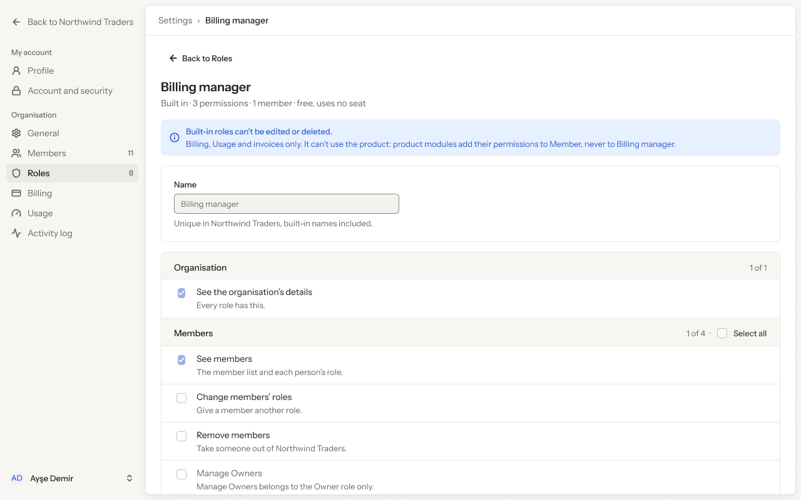

- **Who sees it:** The Billing manager role, and the Owner or Admin who gives it.
- **Device:** Desktop (1280 px and wider).
- **This state shows:** as the title says.
- **Values come from:** Role and permissions: our API. Seat and price lines: the plan's prices from our API. A Billing manager uses no seat.
- **Components:** Banner, Button, Checkbox ×15, Input, Sidebar, Top bar.
- **Actions:**
  - No prototype link on this screen. The buttons follow the section's other screens.
- **Texts, word for word, top to bottom:**

  - Back to Northwind Traders
  - My account
  - Profile
  - Account and security
  - Organisation
  - General
  - Members
  - 11
  - Roles
  - 8
  - Billing
  - Usage
  - Activity log
  - AD
  - Ayşe Demir
  - Settings
  - ›
  - Billing manager
  - Back to Roles
  - Billing manager
  - Built in · 3 permissions · 1 member · free, uses no seat
  - Built-in roles can’t be edited or deleted.
  - Billing, Usage and invoices only. It can’t use the product: product modules add their permissions to Member, never to Billing manager.
  - Name
  - Billing manager
  - Unique in Northwind Traders, built-in names included.
  - Organisation
  - 1 of 1
  - See the organisation’s details
  - Every role has this.
  - Members
  - 1 of 4
  - ·
  - Select all
  - See members
  - The member list and each person’s role.
  - Change members’ roles
  - Give a member another role.
  - Remove members
  - Take someone out of Northwind Traders.
  - Manage Owners
  - Manage Owners belongs to the Owner role only.
  - Invitations
  - 0 of 3
  - See invitations
  - Pending invitations and who sent them.
  - Invite people
  - Send an invitation by email.
  - Revoke and cancel invitations
  - Stop an invitation before it is accepted.
  - Roles
  - 0 of 4
  - See roles
  - Needed to invite people, change roles, remove members and revoke invitations.
  - Create roles
  - Add a custom role.
  - Edit roles
  - Change a custom role’s name and permissions.
  - Delete roles
  - Remove a custom role nobody uses.
  - Activity log
  - 0 of 1
  - See the activity log
  - Who changed what, and when.
  - Billing
  - 1 of 1
  - Manage billing
  - The Owner and Billing manager roles have this.

Figma: [287:22802](https://www.figma.com/design/3Ev111okX8xCBwR9B3hyBM/?node-id=287-22802)

### 14.02 · Invite member · role list

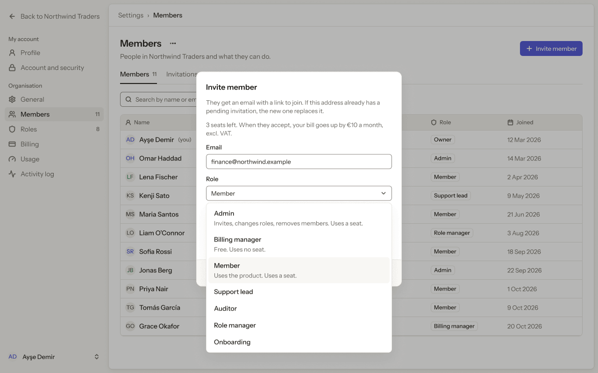

- **Who sees it:** The Billing manager role, and the Owner or Admin who gives it.
- **Device:** Desktop (1280 px and wider).
- **This state shows:** as the title says.
- **Values come from:** Role and permissions: our API. Seat and price lines: the plan's prices from our API. A Billing manager uses no seat.
- **Components:** Avatar ×11, Button ×5, Icon/calendar, Icon/mail, Icon/shield, Icon/user, Input ×2, Label ×11, Select ×2, Sidebar, Tab ×2, Top bar.
- **Actions:**
  - "The invitation email and their first screens use this language. They can change it later.": goes to [14.03 · Invite member · Billing manager](#1403--invite-member--billing-manager).
- **Texts, word for word, top to bottom:**

  - Back to Northwind Traders
  - My account
  - Profile
  - Account and security
  - Organisation
  - General
  - Members
  - 11
  - Roles
  - 8
  - Billing
  - Usage
  - Activity log
  - AD
  - Ayşe Demir
  - Settings
  - ›
  - Members
  - Members
  - People in Northwind Traders and what they can do.
  - Invite member
  - Members
  - 11
  - Invitations
  - 2
  - Search by name or email
  - All roles
  - Name
  - Email
  - Role
  - Joined
  - AD
  - Ayşe Demir
  - (you)
  - ayse@northwind.example
  - Owner
  - 12 Mar 2026
  - OH
  - Omar Haddad
  - omar@northwind.example
  - Admin
  - 14 Mar 2026
  - LF
  - Lena Fischer
  - lena@northwind.example
  - Member
  - 2 Apr 2026
  - KS
  - Kenji Sato
  - kenji@northwind.example
  - Support lead
  - 9 May 2026
  - MS
  - Maria Santos
  - maria@northwind.example
  - Member
  - 21 Jun 2026
  - LO
  - Liam O’Connor
  - liam@northwind.example
  - Role manager
  - 3 Aug 2026
  - SR
  - Sofia Rossi
  - sofia@northwind.example
  - Member
  - 18 Sep 2026
  - JB
  - Jonas Berg
  - jonas@northwind.example
  - Admin
  - 22 Sep 2026
  - PN
  - Priya Nair
  - priya@northwind.example
  - Member
  - 1 Oct 2026
  - TG
  - Tomás García
  - tomas@northwind.example
  - Member
  - 9 Oct 2026
  - GO
  - Grace Okafor
  - grace@northwind.example
  - Billing manager
  - 20 Oct 2026
  - Invite member
  - They get an email with a link to join. If this address already has a pending invitation, the new one replaces it.
  - 3 seats left. When they accept, your bill goes up by €10 a month, excl. VAT.
  - Email
  - finance@northwind.example
  - Role
  - Member
  - Email language
  - English
  - The invitation email and their first screens use this language. They can change it later.
  - Cancel
  - Send invitation
  - Admin
  - Invites, changes roles, removes members. Uses a seat.
  - Billing manager
  - Free. Uses no seat.
  - Member
  - Uses the product. Uses a seat.
  - Support lead
  - Auditor
  - Role manager
  - Onboarding

Figma: [287:23101](https://www.figma.com/design/3Ev111okX8xCBwR9B3hyBM/?node-id=287-23101)

### 14.03 · Invite member · Billing manager

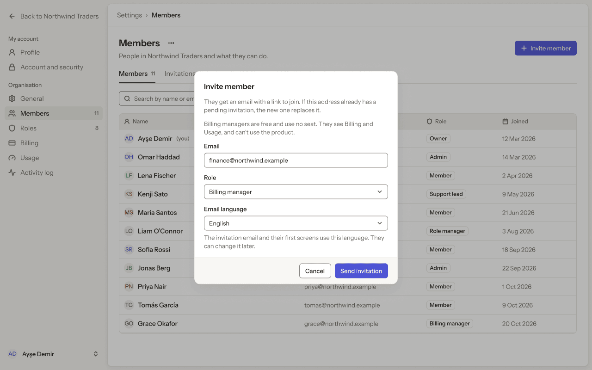

- **Who sees it:** The Billing manager role, and the Owner or Admin who gives it.
- **Device:** Desktop (1280 px and wider).
- **This state shows:** as the title says.
- **Values come from:** Role and permissions: our API. Seat and price lines: the plan's prices from our API. A Billing manager uses no seat.
- **Components:** Avatar ×11, Button ×5, Icon/calendar, Icon/mail, Icon/shield, Icon/user, Input ×2, Label ×11, Select ×2, Sidebar, Tab ×2, Top bar.
- **Actions:**
  - No prototype link on this screen. The buttons follow the section's other screens.
- **Texts, word for word, top to bottom:**

  - Back to Northwind Traders
  - My account
  - Profile
  - Account and security
  - Organisation
  - General
  - Members
  - 11
  - Roles
  - 8
  - Billing
  - Usage
  - Activity log
  - AD
  - Ayşe Demir
  - Settings
  - ›
  - Members
  - Members
  - People in Northwind Traders and what they can do.
  - Invite member
  - Members
  - 11
  - Invitations
  - 2
  - Search by name or email
  - All roles
  - Name
  - Email
  - Role
  - Joined
  - AD
  - Ayşe Demir
  - (you)
  - ayse@northwind.example
  - Owner
  - 12 Mar 2026
  - OH
  - Omar Haddad
  - omar@northwind.example
  - Admin
  - 14 Mar 2026
  - LF
  - Lena Fischer
  - lena@northwind.example
  - Member
  - 2 Apr 2026
  - KS
  - Kenji Sato
  - kenji@northwind.example
  - Support lead
  - 9 May 2026
  - MS
  - Maria Santos
  - maria@northwind.example
  - Member
  - 21 Jun 2026
  - LO
  - Liam O’Connor
  - liam@northwind.example
  - Role manager
  - 3 Aug 2026
  - SR
  - Sofia Rossi
  - sofia@northwind.example
  - Member
  - 18 Sep 2026
  - JB
  - Jonas Berg
  - jonas@northwind.example
  - Admin
  - 22 Sep 2026
  - PN
  - Priya Nair
  - priya@northwind.example
  - Member
  - 1 Oct 2026
  - TG
  - Tomás García
  - tomas@northwind.example
  - Member
  - 9 Oct 2026
  - GO
  - Grace Okafor
  - grace@northwind.example
  - Billing manager
  - 20 Oct 2026
  - Invite member
  - They get an email with a link to join. If this address already has a pending invitation, the new one replaces it.
  - Billing managers are free and use no seat. They see Billing and Usage, and can’t use the product.
  - Email
  - finance@northwind.example
  - Role
  - Billing manager
  - Email language
  - English
  - The invitation email and their first screens use this language. They can change it later.
  - Cancel
  - Send invitation

Figma: [287:23488](https://www.figma.com/design/3Ev111okX8xCBwR9B3hyBM/?node-id=287-23488)

### 14.04 · Invite member · yearly plan

- **Who sees it:** The Billing manager role, and the Owner or Admin who gives it.
- **Device:** Desktop (1280 px and wider).
- **This state shows:** as the title says.
- **Values come from:** Role and permissions: our API. Seat and price lines: the plan's prices from our API. A Billing manager uses no seat.
- **Components:** Avatar ×11, Button ×5, Icon/calendar, Icon/mail, Icon/shield, Icon/user, Input ×2, Label ×11, Select ×2, Sidebar, Tab ×2, Top bar.
- **Actions:**
  - No prototype link on this screen. The buttons follow the section's other screens.
- **Texts, word for word, top to bottom:**

  - Back to Northwind Traders
  - My account
  - Profile
  - Account and security
  - Organisation
  - General
  - Members
  - 11
  - Roles
  - 8
  - Billing
  - Usage
  - Activity log
  - AD
  - Ayşe Demir
  - Settings
  - ›
  - Members
  - Members
  - People in Northwind Traders and what they can do.
  - Invite member
  - Members
  - 11
  - Invitations
  - 2
  - Search by name or email
  - All roles
  - Name
  - Email
  - Role
  - Joined
  - AD
  - Ayşe Demir
  - (you)
  - ayse@northwind.example
  - Owner
  - 12 Mar 2026
  - OH
  - Omar Haddad
  - omar@northwind.example
  - Admin
  - 14 Mar 2026
  - LF
  - Lena Fischer
  - lena@northwind.example
  - Member
  - 2 Apr 2026
  - KS
  - Kenji Sato
  - kenji@northwind.example
  - Support lead
  - 9 May 2026
  - MS
  - Maria Santos
  - maria@northwind.example
  - Member
  - 21 Jun 2026
  - LO
  - Liam O’Connor
  - liam@northwind.example
  - Role manager
  - 3 Aug 2026
  - SR
  - Sofia Rossi
  - sofia@northwind.example
  - Member
  - 18 Sep 2026
  - JB
  - Jonas Berg
  - jonas@northwind.example
  - Admin
  - 22 Sep 2026
  - PN
  - Priya Nair
  - priya@northwind.example
  - Member
  - 1 Oct 2026
  - TG
  - Tomás García
  - tomas@northwind.example
  - Member
  - 9 Oct 2026
  - GO
  - Grace Okafor
  - grace@northwind.example
  - Billing manager
  - 20 Oct 2026
  - Invite member
  - They get an email with a link to join. If this address already has a pending invitation, the new one replaces it.
  - 3 seats left. When they accept, we charge €83.33 excl. VAT for the rest of the year.
  - Email
  - finance@northwind.example
  - Role
  - Member
  - Email language
  - English
  - The invitation email and their first screens use this language. They can change it later.
  - Cancel
  - Send invitation

Figma: [287:23853](https://www.figma.com/design/3Ev111okX8xCBwR9B3hyBM/?node-id=287-23853)

### 14.05 · Invite member · in a trial

- **Who sees it:** The Billing manager role, and the Owner or Admin who gives it.
- **Device:** Desktop (1280 px and wider).
- **This state shows:** as the title says.
- **Values come from:** Role and permissions: our API. Seat and price lines: the plan's prices from our API. A Billing manager uses no seat.
- **Components:** Avatar ×11, Button ×5, Icon/calendar, Icon/mail, Icon/shield, Icon/user, Input ×2, Label ×11, Select ×2, Sidebar, Tab ×2, Top bar.
- **Actions:**
  - No prototype link on this screen. The buttons follow the section's other screens.
- **Texts, word for word, top to bottom:**

  - Back to Northwind Traders
  - My account
  - Profile
  - Account and security
  - Organisation
  - General
  - Members
  - 11
  - Roles
  - 8
  - Billing
  - Usage
  - Activity log
  - AD
  - Ayşe Demir
  - Settings
  - ›
  - Members
  - Members
  - People in Northwind Traders and what they can do.
  - Invite member
  - Members
  - 11
  - Invitations
  - 2
  - Search by name or email
  - All roles
  - Name
  - Email
  - Role
  - Joined
  - AD
  - Ayşe Demir
  - (you)
  - ayse@northwind.example
  - Owner
  - 12 Mar 2026
  - OH
  - Omar Haddad
  - omar@northwind.example
  - Admin
  - 14 Mar 2026
  - LF
  - Lena Fischer
  - lena@northwind.example
  - Member
  - 2 Apr 2026
  - KS
  - Kenji Sato
  - kenji@northwind.example
  - Support lead
  - 9 May 2026
  - MS
  - Maria Santos
  - maria@northwind.example
  - Member
  - 21 Jun 2026
  - LO
  - Liam O’Connor
  - liam@northwind.example
  - Role manager
  - 3 Aug 2026
  - SR
  - Sofia Rossi
  - sofia@northwind.example
  - Member
  - 18 Sep 2026
  - JB
  - Jonas Berg
  - jonas@northwind.example
  - Admin
  - 22 Sep 2026
  - PN
  - Priya Nair
  - priya@northwind.example
  - Member
  - 1 Oct 2026
  - TG
  - Tomás García
  - tomas@northwind.example
  - Member
  - 9 Oct 2026
  - GO
  - Grace Okafor
  - grace@northwind.example
  - Billing manager
  - 20 Oct 2026
  - Invite member
  - They get an email with a link to join. If this address already has a pending invitation, the new one replaces it.
  - 38 seats left. Free during the trial. Then €8 a month per person, excl. VAT.
  - Email
  - finance@northwind.example
  - Role
  - Member
  - Email language
  - English
  - The invitation email and their first screens use this language. They can change it later.
  - Cancel
  - Send invitation

Figma: [287:24218](https://www.figma.com/design/3Ev111okX8xCBwR9B3hyBM/?node-id=287-24218)

### 14.06 · Change role · to Billing manager

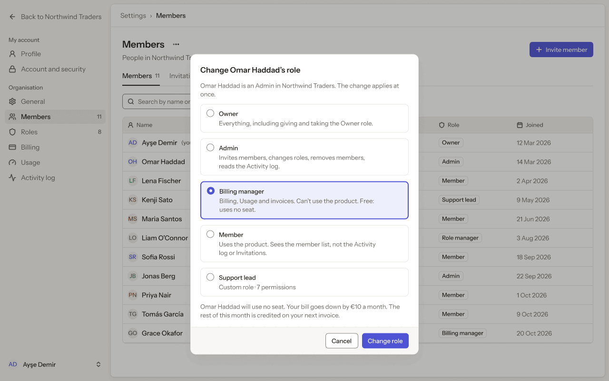

- **Who sees it:** The Billing manager role, and the Owner or Admin who gives it.
- **Device:** Desktop (1280 px and wider).
- **This state shows:** as the title says.
- **Values come from:** Role and permissions: our API. Seat and price lines: the plan's prices from our API. A Billing manager uses no seat.
- **Components:** Avatar ×11, Button ×5, Icon/calendar, Icon/mail, Icon/shield, Icon/user, Input, Label ×11, Sidebar, Tab ×2, Top bar.
- **Actions:**
  - No prototype link on this screen. The buttons follow the section's other screens.
- **Texts, word for word, top to bottom:**

  - Back to Northwind Traders
  - My account
  - Profile
  - Account and security
  - Organisation
  - General
  - Members
  - 11
  - Roles
  - 8
  - Billing
  - Usage
  - Activity log
  - AD
  - Ayşe Demir
  - Settings
  - ›
  - Members
  - Members
  - People in Northwind Traders and what they can do.
  - Invite member
  - Members
  - 11
  - Invitations
  - 2
  - Search by name or email
  - All roles
  - Name
  - Email
  - Role
  - Joined
  - AD
  - Ayşe Demir
  - (you)
  - ayse@northwind.example
  - Owner
  - 12 Mar 2026
  - OH
  - Omar Haddad
  - omar@northwind.example
  - Admin
  - 14 Mar 2026
  - LF
  - Lena Fischer
  - lena@northwind.example
  - Member
  - 2 Apr 2026
  - KS
  - Kenji Sato
  - kenji@northwind.example
  - Support lead
  - 9 May 2026
  - MS
  - Maria Santos
  - maria@northwind.example
  - Member
  - 21 Jun 2026
  - LO
  - Liam O’Connor
  - liam@northwind.example
  - Role manager
  - 3 Aug 2026
  - SR
  - Sofia Rossi
  - sofia@northwind.example
  - Member
  - 18 Sep 2026
  - JB
  - Jonas Berg
  - jonas@northwind.example
  - Admin
  - 22 Sep 2026
  - PN
  - Priya Nair
  - priya@northwind.example
  - Member
  - 1 Oct 2026
  - TG
  - Tomás García
  - tomas@northwind.example
  - Member
  - 9 Oct 2026
  - GO
  - Grace Okafor
  - grace@northwind.example
  - Billing manager
  - 20 Oct 2026
  - Change Omar Haddad’s role
  - Omar Haddad is an Admin in Northwind Traders. The change applies at once.
  - Owner
  - Everything, including giving and taking the Owner role.
  - Admin
  - Invites members, changes roles, removes members, reads the Activity log.
  - Billing manager
  - Billing, Usage and invoices. Can’t use the product. Free: uses no seat.
  - Member
  - Uses the product. Sees the member list, not the Activity log or Invitations.
  - Support lead
  - Custom role · 7 permissions
  - Omar Haddad will use no seat. Your bill goes down by €10 a month. The rest of this month is credited on your next invoice.
  - Cancel
  - Change role

Figma: [287:24583](https://www.figma.com/design/3Ev111okX8xCBwR9B3hyBM/?node-id=287-24583)

### 14.07 · Change role · from Billing manager

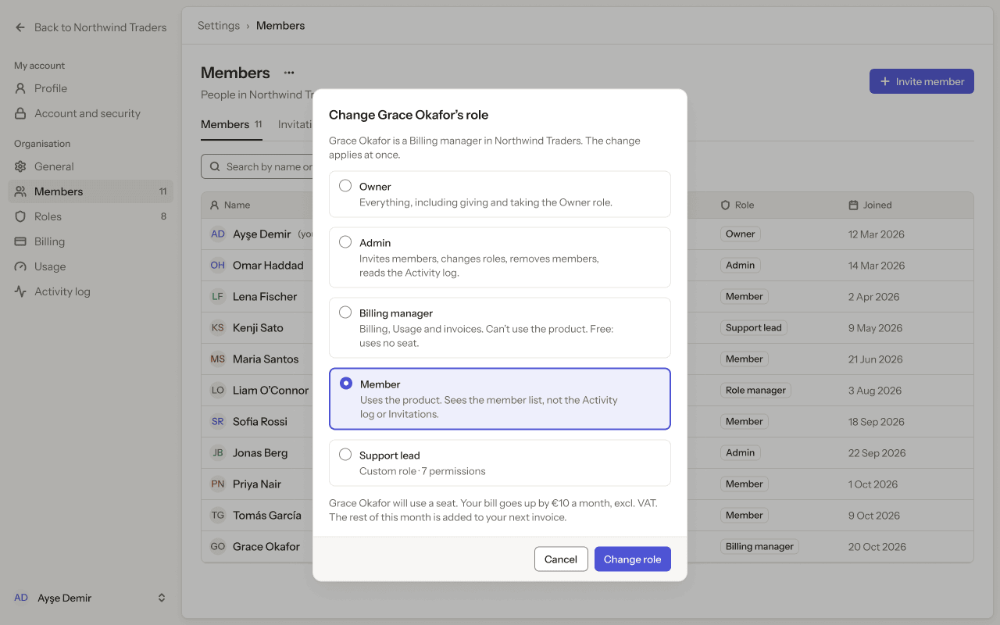

- **Who sees it:** The Billing manager role, and the Owner or Admin who gives it.
- **Device:** Desktop (1280 px and wider).
- **This state shows:** as the title says.
- **Values come from:** Role and permissions: our API. Seat and price lines: the plan's prices from our API. A Billing manager uses no seat.
- **Components:** Avatar ×11, Button ×5, Icon/calendar, Icon/mail, Icon/shield, Icon/user, Input, Label ×11, Sidebar, Tab ×2, Top bar.
- **Actions:**
  - No prototype link on this screen. The buttons follow the section's other screens.
- **Texts, word for word, top to bottom:**

  - Back to Northwind Traders
  - My account
  - Profile
  - Account and security
  - Organisation
  - General
  - Members
  - 11
  - Roles
  - 8
  - Billing
  - Usage
  - Activity log
  - AD
  - Ayşe Demir
  - Settings
  - ›
  - Members
  - Members
  - People in Northwind Traders and what they can do.
  - Invite member
  - Members
  - 11
  - Invitations
  - 2
  - Search by name or email
  - All roles
  - Name
  - Email
  - Role
  - Joined
  - AD
  - Ayşe Demir
  - (you)
  - ayse@northwind.example
  - Owner
  - 12 Mar 2026
  - OH
  - Omar Haddad
  - omar@northwind.example
  - Admin
  - 14 Mar 2026
  - LF
  - Lena Fischer
  - lena@northwind.example
  - Member
  - 2 Apr 2026
  - KS
  - Kenji Sato
  - kenji@northwind.example
  - Support lead
  - 9 May 2026
  - MS
  - Maria Santos
  - maria@northwind.example
  - Member
  - 21 Jun 2026
  - LO
  - Liam O’Connor
  - liam@northwind.example
  - Role manager
  - 3 Aug 2026
  - SR
  - Sofia Rossi
  - sofia@northwind.example
  - Member
  - 18 Sep 2026
  - JB
  - Jonas Berg
  - jonas@northwind.example
  - Admin
  - 22 Sep 2026
  - PN
  - Priya Nair
  - priya@northwind.example
  - Member
  - 1 Oct 2026
  - TG
  - Tomás García
  - tomas@northwind.example
  - Member
  - 9 Oct 2026
  - GO
  - Grace Okafor
  - grace@northwind.example
  - Billing manager
  - 20 Oct 2026
  - Change Grace Okafor’s role
  - Grace Okafor is a Billing manager in Northwind Traders. The change applies at once.
  - Owner
  - Everything, including giving and taking the Owner role.
  - Admin
  - Invites members, changes roles, removes members, reads the Activity log.
  - Billing manager
  - Billing, Usage and invoices. Can’t use the product. Free: uses no seat.
  - Member
  - Uses the product. Sees the member list, not the Activity log or Invitations.
  - Support lead
  - Custom role · 7 permissions
  - Grace Okafor will use a seat. Your bill goes up by €10 a month, excl. VAT. The rest of this month is added to your next invoice.
  - Cancel
  - Change role

Figma: [287:24948](https://www.figma.com/design/3Ev111okX8xCBwR9B3hyBM/?node-id=287-24948)

### 14.08 · Home · as a Billing manager

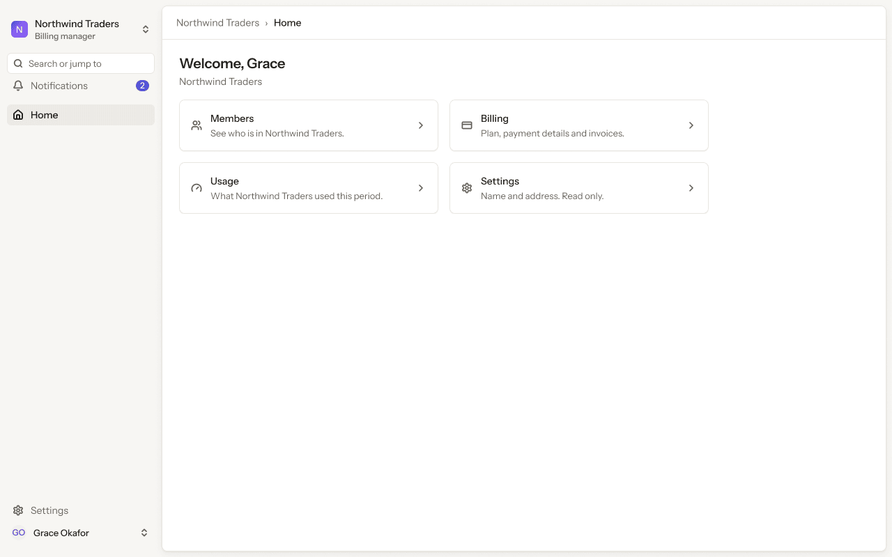

- **Who sees it:** A person with the Billing manager role. The Billing manager role, and the Owner or Admin who gives it.
- **Device:** Desktop (1280 px and wider).
- **This state shows:** for a person with the Billing manager role.
- **Values come from:** Role and permissions: our API. Seat and price lines: the plan's prices from our API. A Billing manager uses no seat.
- **Components:** Icon/chevron-down ×4, Icon/credit-card, Icon/gauge, Icon/settings, Icon/users, Sidebar, Top bar.
- **Actions:**
  - "See who is in Northwind Traders.": goes to [14.10 · Members · as a Billing manager](#1410--members--as-a-billing-manager).
  - "Plan, payment details and invoices.": goes to [14.11 · Billing · as a Billing manager](#1411--billing--as-a-billing-manager).
  - "What Northwind Traders used this period.": goes to [14.12 · Usage · as a Billing manager](#1412--usage--as-a-billing-manager).
  - "Name and address. Read only.": goes to [14.09 · General · as a Billing manager](#1409--general--as-a-billing-manager).
- **Texts, word for word, top to bottom:**

  - N
  - Northwind Traders
  - Billing manager
  - Search or jump to
  - Notifications
  - 2
  - Home
  - Settings
  - GO
  - Grace Okafor
  - Northwind Traders
  - ›
  - Home
  - Welcome, Grace
  - Northwind Traders
  - Members
  - See who is in Northwind Traders.
  - Billing
  - Plan, payment details and invoices.
  - Usage
  - What Northwind Traders used this period.
  - Settings
  - Name and address. Read only.

Figma: [287:25313](https://www.figma.com/design/3Ev111okX8xCBwR9B3hyBM/?node-id=287-25313)

### 14.09 · General · as a Billing manager

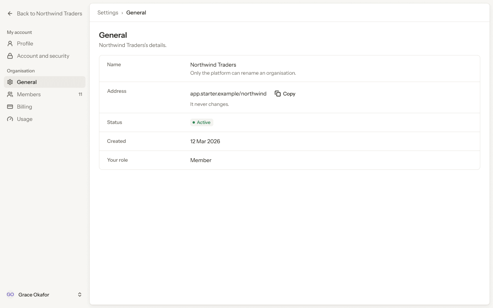

- **Who sees it:** A person with the Billing manager role. The Billing manager role, and the Owner or Admin who gives it.
- **Device:** Desktop (1280 px and wider).
- **This state shows:** for a person with the Billing manager role.
- **Values come from:** Role and permissions: our API. Seat and price lines: the plan's prices from our API. A Billing manager uses no seat.
- **Components:** Button, Pill, Sidebar, Top bar.
- **Actions:**
  - "Members": goes to [14.10 · Members · as a Billing manager](#1410--members--as-a-billing-manager).
  - "Billing": goes to [14.11 · Billing · as a Billing manager](#1411--billing--as-a-billing-manager).
  - "Usage": goes to [14.12 · Usage · as a Billing manager](#1412--usage--as-a-billing-manager).
- **Texts, word for word, top to bottom:**

  - Back to Northwind Traders
  - My account
  - Profile
  - Account and security
  - Organisation
  - General
  - Members
  - 11
  - Billing
  - Usage
  - GO
  - Grace Okafor
  - Settings
  - ›
  - General
  - General
  - Northwind Traders’s details.
  - Name
  - Northwind Traders
  - Only the platform can rename an organisation.
  - Address
  - app.starter.example/northwind
  - Copy
  - It never changes.
  - Status
  - Active
  - Created
  - 12 Mar 2026
  - Your role
  - Member

Figma: [287:25426](https://www.figma.com/design/3Ev111okX8xCBwR9B3hyBM/?node-id=287-25426)

### 14.10 · Members · as a Billing manager

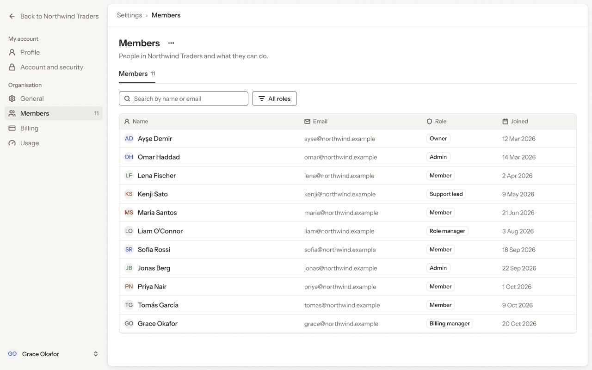

- **Who sees it:** A person with the Billing manager role. The Billing manager role, and the Owner or Admin who gives it.
- **Device:** Desktop (1280 px and wider).
- **This state shows:** for a person with the Billing manager role.
- **Values come from:** Role and permissions: our API. Seat and price lines: the plan's prices from our API. A Billing manager uses no seat.
- **Components:** Avatar ×11, Button ×2, Icon/calendar, Icon/mail, Icon/shield, Icon/user, Input, Label ×11, Sidebar, Tab, Top bar.
- **Actions:**
  - "General": goes to [14.09 · General · as a Billing manager](#1409--general--as-a-billing-manager).
  - "Billing": goes to [14.11 · Billing · as a Billing manager](#1411--billing--as-a-billing-manager).
  - "Usage": goes to [14.12 · Usage · as a Billing manager](#1412--usage--as-a-billing-manager).
- **Texts, word for word, top to bottom:**

  - Back to Northwind Traders
  - My account
  - Profile
  - Account and security
  - Organisation
  - General
  - Members
  - 11
  - Billing
  - Usage
  - GO
  - Grace Okafor
  - Settings
  - ›
  - Members
  - Members
  - People in Northwind Traders and what they can do.
  - Members
  - 11
  - Search by name or email
  - All roles
  - Name
  - Email
  - Role
  - Joined
  - AD
  - Ayşe Demir
  - ayse@northwind.example
  - Owner
  - 12 Mar 2026
  - OH
  - Omar Haddad
  - omar@northwind.example
  - Admin
  - 14 Mar 2026
  - LF
  - Lena Fischer
  - lena@northwind.example
  - Member
  - 2 Apr 2026
  - KS
  - Kenji Sato
  - kenji@northwind.example
  - Support lead
  - 9 May 2026
  - MS
  - Maria Santos
  - maria@northwind.example
  - Member
  - 21 Jun 2026
  - LO
  - Liam O’Connor
  - liam@northwind.example
  - Role manager
  - 3 Aug 2026
  - SR
  - Sofia Rossi
  - sofia@northwind.example
  - Member
  - 18 Sep 2026
  - JB
  - Jonas Berg
  - jonas@northwind.example
  - Admin
  - 22 Sep 2026
  - PN
  - Priya Nair
  - priya@northwind.example
  - Member
  - 1 Oct 2026
  - TG
  - Tomás García
  - tomas@northwind.example
  - Member
  - 9 Oct 2026
  - GO
  - Grace Okafor
  - grace@northwind.example
  - Billing manager
  - 20 Oct 2026

Figma: [287:25546](https://www.figma.com/design/3Ev111okX8xCBwR9B3hyBM/?node-id=287-25546)

### 14.11 · Billing · as a Billing manager

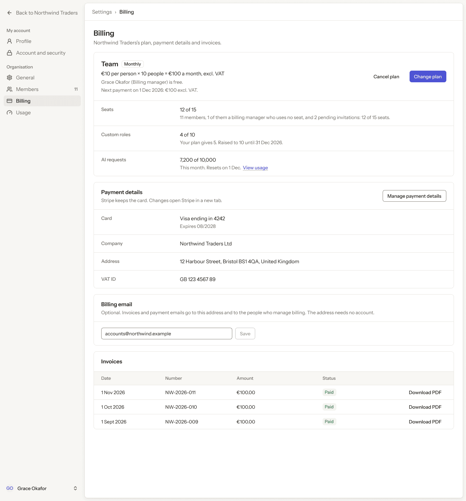

- **Who sees it:** A person with the Billing manager role. The Billing manager role, and the Owner or Admin who gives it.
- **Device:** Desktop (1280 px and wider).
- **This state shows:** for a person with the Billing manager role.
- **Values come from:** Role and permissions: our API. Seat and price lines: the plan's prices from our API. A Billing manager uses no seat.
- **Components:** Button ×7, Input, Label, Pill ×3, Sidebar, Top bar.
- **Actions:**
  - "General": goes to [14.09 · General · as a Billing manager](#1409--general--as-a-billing-manager).
  - "Members": goes to [14.10 · Members · as a Billing manager](#1410--members--as-a-billing-manager).
  - "Usage": goes to [14.12 · Usage · as a Billing manager](#1412--usage--as-a-billing-manager).
- **Texts, word for word, top to bottom:**

  - Back to Northwind Traders
  - My account
  - Profile
  - Account and security
  - Organisation
  - General
  - Members
  - 11
  - Billing
  - Usage
  - GO
  - Grace Okafor
  - Settings
  - ›
  - Billing
  - Billing
  - Northwind Traders’s plan, payment details and invoices.
  - Team
  - Monthly
  - €10 per person × 10 people = €100 a month, excl. VAT
  - Grace Okafor (Billing manager) is free.
  - Next payment on 1 Dec 2026: €100 excl. VAT.
  - Cancel plan
  - Change plan
  - Seats
  - 12 of 15
  - 11 members, 1 of them a billing manager who uses no seat, and 2 pending invitations: 12 of 15 seats.
  - Custom roles
  - 4 of 10
  - Your plan gives 5. Raised to 10 until 31 Dec 2026.
  - AI requests
  - 7,200 of 10,000
  - This month. Resets on 1 Dec.
  - View usage
  - Payment details
  - Stripe keeps the card. Changes open Stripe in a new tab.
  - Manage payment details
  - Card
  - Visa ending in 4242
  - Expires 08/2028
  - Company
  - Northwind Traders Ltd
  - Address
  - 12 Harbour Street, Bristol BS1 4QA, United Kingdom
  - VAT ID
  - GB 123 4567 89
  - Billing email
  - Optional. Invoices and payment emails go to this address and to the people who manage billing. The address needs no account.
  - accounts@northwind.example
  - Save
  - Invoices
  - Date
  - Number
  - Amount
  - Status
  - 1 Nov 2026
  - NW-2026-011
  - €100.00
  - Paid
  - Download PDF
  - 1 Oct 2026
  - NW-2026-010
  - €100.00
  - Paid
  - Download PDF
  - 1 Sept 2026
  - NW-2026-009
  - €100.00
  - Paid
  - Download PDF

Figma: [287:25861](https://www.figma.com/design/3Ev111okX8xCBwR9B3hyBM/?node-id=287-25861)

### 14.12 · Usage · as a Billing manager

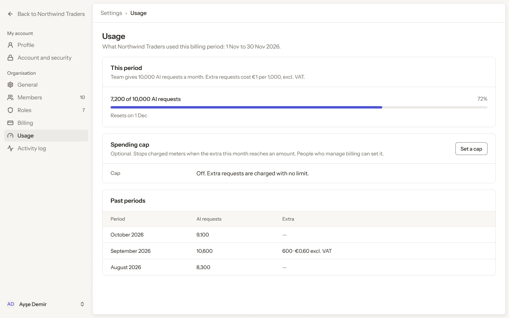

- **Who sees it:** A person with the Billing manager role. The Billing manager role, and the Owner or Admin who gives it.
- **Device:** Desktop (1280 px and wider).
- **This state shows:** for a person with the Billing manager role.
- **Values come from:** Role and permissions: our API. Seat and price lines: the plan's prices from our API. A Billing manager uses no seat.
- **Components:** Button, Meter, Sidebar, Top bar.
- **Actions:**
  - "General": goes to [14.09 · General · as a Billing manager](#1409--general--as-a-billing-manager).
  - "Members": goes to [14.10 · Members · as a Billing manager](#1410--members--as-a-billing-manager).
  - "Billing": goes to [14.11 · Billing · as a Billing manager](#1411--billing--as-a-billing-manager).
- **Texts, word for word, top to bottom:**

  - Back to Northwind Traders
  - My account
  - Profile
  - Account and security
  - Organisation
  - General
  - Members
  - 10
  - Roles
  - 7
  - Billing
  - Usage
  - Activity log
  - AD
  - Ayşe Demir
  - Settings
  - ›
  - Usage
  - Usage
  - What Northwind Traders used this billing period: 1 Nov to 30 Nov 2026.
  - This period
  - Team gives 10,000 AI requests a month. Extra requests cost €1 per 1,000, excl. VAT.
  - 7,200 of 10,000 AI requests
  - 72%
  - Resets on 1 Dec
  - Spending cap
  - Optional. Stops charged meters when the extra this month reaches an amount. People who manage billing can set it.
  - Set a cap
  - Cap
  - Off. Extra requests are charged with no limit.
  - Past periods
  - Period
  - AI requests
  - Extra
  - October 2026
  - 9,100
  - —
  - September 2026
  - 10,600
  - 600 · €0.60 excl. VAT
  - August 2026
  - 8,300
  - —

Figma: [287:26071](https://www.figma.com/design/3Ev111okX8xCBwR9B3hyBM/?node-id=287-26071)

### 14.13 · Phone · settings menu · Billing manager

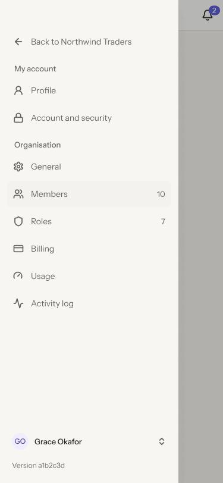

- **Who sees it:** A person with the Billing manager role. The Billing manager role, and the Owner or Admin who gives it.
- **Device:** Phone (up to 767 px).
- **This state shows:** on a phone.
- **Values come from:** Role and permissions: our API. Seat and price lines: the plan's prices from our API. A Billing manager uses no seat.
- **Components:** Phone drawer · Settings, Phone top bar.
- **Actions:**
  - "Version a1b2c3d": goes to node 218:1103 (not a numbered screen).
  - "Billing": goes to [14.14 · Phone · Billing · Billing manager](#1414--phone--billing--billing-manager).
  - "Usage": goes to [14.15 · Phone · Usage · Billing manager](#1415--phone--usage--billing-manager).
- **Texts, word for word, top to bottom:**

  - Billing
  - 2
  - Back to Northwind Traders
  - My account
  - Profile
  - Account and security
  - Organisation
  - General
  - Members
  - 10
  - Roles
  - 7
  - Billing
  - Usage
  - Activity log
  - GO
  - Grace Okafor
  - Version a1b2c3d

Figma: [287:26207](https://www.figma.com/design/3Ev111okX8xCBwR9B3hyBM/?node-id=287-26207)

### 14.14 · Phone · Billing · Billing manager

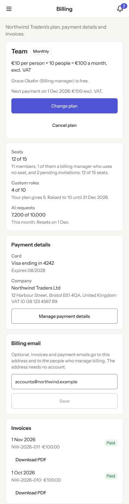

- **Who sees it:** A person with the Billing manager role. The Billing manager role, and the Owner or Admin who gives it.
- **Device:** Phone (up to 767 px).
- **This state shows:** on a phone.
- **Values come from:** Role and permissions: our API. Seat and price lines: the plan's prices from our API. A Billing manager uses no seat.
- **Components:** Button ×6, Input, Label, Phone top bar, Pill ×2.
- **Actions:**
  - "Area": goes to [14.13 · Phone · settings menu · Billing manager](#1413--phone--settings-menu--billing-manager).
- **Texts, word for word, top to bottom:**

  - Billing
  - 2
  - Northwind Traders’s plan, payment details and invoices.
  - Team
  - Monthly
  - €10 per person × 10 people = €100 a month, excl. VAT
  - Grace Okafor (Billing manager) is free.
  - Next payment on 1 Dec 2026: €100 excl. VAT.
  - Change plan
  - Cancel plan
  - Seats
  - 12 of 15
  - 11 members, 1 of them a billing manager who uses no seat, and 2 pending invitations: 12 of 15 seats.
  - Custom roles
  - 4 of 10
  - Your plan gives 5. Raised to 10 until 31 Dec 2026.
  - AI requests
  - 7,200 of 10,000
  - This month. Resets on 1 Dec.
  - Payment details
  - Card
  - Visa ending in 4242
  - Expires 08/2028
  - Company
  - Northwind Traders Ltd
  - 12 Harbour Street, Bristol BS1 4QA, United Kingdom · VAT ID GB 123 4567 89
  - Manage payment details
  - Billing email
  - Optional. Invoices and payment emails go to this address and to the people who manage billing. The address needs no account.
  - accounts@northwind.example
  - Save
  - Invoices
  - 1 Nov 2026
  - NW-2026-011 · €100.00
  - Paid
  - Download PDF
  - 1 Oct 2026
  - NW-2026-010 · €100.00
  - Paid
  - Download PDF

Figma: [287:26318](https://www.figma.com/design/3Ev111okX8xCBwR9B3hyBM/?node-id=287-26318)

### 14.15 · Phone · Usage · Billing manager

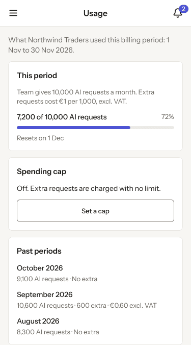

- **Who sees it:** A person with the Billing manager role. The Billing manager role, and the Owner or Admin who gives it.
- **Device:** Phone (up to 767 px).
- **This state shows:** on a phone.
- **Values come from:** Role and permissions: our API. Seat and price lines: the plan's prices from our API. A Billing manager uses no seat.
- **Components:** Button, Meter, Phone top bar.
- **Actions:**
  - "Area": goes to [14.13 · Phone · settings menu · Billing manager](#1413--phone--settings-menu--billing-manager).
- **Texts, word for word, top to bottom:**

  - Usage
  - 2
  - What Northwind Traders used this billing period: 1 Nov to 30 Nov 2026.
  - This period
  - Team gives 10,000 AI requests a month. Extra requests cost €1 per 1,000, excl. VAT.
  - 7,200 of 10,000 AI requests
  - 72%
  - Resets on 1 Dec
  - Spending cap
  - Off. Extra requests are charged with no limit.
  - Set a cap
  - Past periods
  - October 2026
  - 9,100 AI requests · No extra
  - September 2026
  - 10,600 AI requests · 600 extra · €0.60 excl. VAT
  - August 2026
  - 8,300 AI requests · No extra

Figma: [287:26411](https://www.figma.com/design/3Ev111okX8xCBwR9B3hyBM/?node-id=287-26411)
