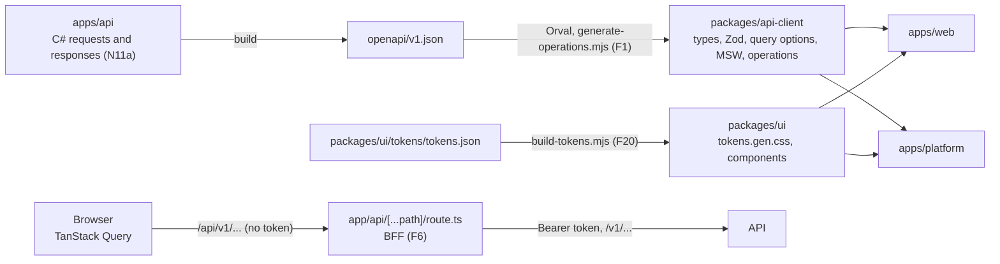

# Architecture: multi-tenant SaaS starter template (frontend)

This document is the single source of truth for the frontend: `apps/web`, `apps/platform`, `packages/api-client`, `packages/ui`, `packages/brand` and `packages/emails`. If the code does not agree with this document, the code changes. The API has its own document, `apps/api/docs/ARCHITECTURE.md`; this one follows its shape.

Each rule has an id that starts with `F` (`F1`, `F2`), so it never collides with an API rule. Use the id when you refer to a rule in a review, a commit message or a comment. A rule of the API keeps its own id here (`D1`, `N9`).

## Codemap

This map helps a first reader find their way. It names rules and places, not every file. Source: Aleksey Kladov, "ARCHITECTURE.md".

The API's C# types are the source of the contract. The API build writes `apps/api/openapi/v1.json`. Orval and one small script write the client from it into `packages/api-client`. The apps call the API only through that client, and the browser calls only the app's own BFF route, which adds the token and forwards the call.

| I look for | I find it in | Rule |
| --- | --- | --- |
| An API type, an enum, a Zod schema or a query's options | `packages/api-client/src/generated/`, one folder for each operation tag (`tenant-members/`), and `endpoints.schemas.gen.ts` for the types and enums. `@repo/api-client` exports them | F1, F2, F3 |
| The one `fetch` of the client | `packages/api-client/src/mutator.ts` | F1 |
| What a screen does with an error answer | `packages/api-client/src/problem-details.ts`; a failed call's code and reference in `problem.ts` (`problemOf`) | F4 |
| The response headers an operation declares | `packages/api-client/src/generated/operations.gen.ts`, read through `declaredResponseHeaders` | F6 |
| The BFF | `apps/<app>/src/app/api/[...path]/route.ts`, on `createBff` of `packages/api-client/src/bff.ts` | F6 |
| The app's variables, and how it runs on Railway | `apps/<app>/src/env.ts`, `.env.example`, `.railway/<app>.json`, `.railway/railway.ts`; `docs/deployment.md`, section 13 | F7 |
| The health check | `apps/<app>/src/app/health/route.ts` | F46 |
| Error tracking: the SDK's options, the privacy filter, what is not sent, `reportError` | `apps/<app>/src/error-tracking/`, started by `src/instrumentation-client.ts` and `src/instrumentation.ts`; the build's source map upload in `next.config.ts`, `apps/<app>/Dockerfile` and `scripts/ci/build-app-image.sh` | F55 |
| A design token | `packages/ui/tokens/tokens.json`; the CSS is `packages/ui/src/styles/tokens.gen.css` | F20 |
| A shared component | `packages/ui/src/components/<kebab-name>/`; the parts both apps share since step 22k: `list-error/`, `search/`, `avatar/`, and `useFailureText` in `src/lib/use-failure-text.ts` | F29, F31 |
| A screen | `apps/<app>/src/features/<feature>/`; the route in `src/app/` renders one component of it | F29 |
| Code that more than one feature of an app uses | `apps/<app>/src/shared/`: the tenant context, "No access yet", the account page of a suspended or deleted user, the problem screens and what leaves a list (`leaveOf`), the locale sync, what follows a refused command in the tenant web (`refresh.ts`, `afterRefusal`) | F29, F47 |
| Our own sign-in, the email code, Google, Microsoft and the second factor | `packages/ui/src/components/sign-in/` (`SignIn`, its steps, `SsoCallback`, the Clerk error map, the redirect rule), `code-input/`, `provider-buttons/`, `auth-layout/`; each app's `src/app/(public)/sign-in/` and `sso-callback/` render them | F41, F43, F45 |
| The platform's two-step gate and its screens | `apps/platform/src/proxy.ts`, `apps/platform/src/features/two-step/` | F42 |
| The platform's Organisations: the list, one organisation's Overview and their dialogs | `apps/platform/src/features/organisations/`, on the routes `/` and `/organisations/[tenantId]`; "Page not found", the `isolated` tag of a name in a sentence and `TextLink`, the underlined link inside running text (WCAG 1.4.1), in `apps/platform/src/shared/` | F9, F11, F47, F48 |
| The platform's Activity, and an organisation's Activity tab: the log, its states and its sentences | `apps/platform/src/features/activity/` on the route `/activity`; the log and its sentences in `apps/platform/src/shared/platform-activity.tsx` and `activity-sentence.tsx`, whose links are `TextLink`, which the Activity tab of `/organisations/[tenantId]?tab=activity` uses too; the day groups and the older button in `packages/ui/src/components/activity-log/` | F2, F9, F15, F18 |
| The platform's Users: the list, one user's page, Make Owner and the user's dialogs | `apps/platform/src/features/users/`, on the routes `/users` and `/users/[userId]`; the detail list, the organisation's initial and `useDates`, which both platform features use, in `apps/platform/src/shared/` | F9, F11, F47 |
| The platform's Settings › System admins: the list, Add, Remove and the code step of a stale second factor | `apps/platform/src/features/system-admins/`, on the route `/settings/system-admins`; Clerk's session reverification (`use-reverification.ts`) and `savedUnderKey` in `apps/platform/src/shared/` | F42, F47, F48 |
| The platform's Plans: the list, the plan editor and its impact preview; an organisation's Plan section with its override and change-plan dialogs | `apps/platform/src/features/plans/`, on the routes `/plans`, `/plans/new` and `/plans/[planId]`; the Plan section in `apps/platform/src/features/organisations/`; the entitlement keys of the generated client and their texts (`entitlements.ts`), a key's value control (`value-field.tsx`), the plans' query and page (`plans.ts`) and what follows any refused command (`refusal.ts`) in `apps/platform/src/shared/` | F11, F47, F48, F52 |
| The invitation's accept page | `apps/web/src/features/invitations/`, on the route `/invitations/accept` | F44 |
| Settings > Members: the members, the invitations and their dialogs | `apps/web/src/features/members/`, on the route `/[tenantSlug]/settings/members`; Permission denied in `apps/web/src/shared/`; the settings menu is the shell's (F59) | F5, F9, F47, F48, F51 |
| Settings > Roles: the list, a new role, one role, the delete dialog | `apps/web/src/features/roles/`, on `/[tenantSlug]/settings/roles`, `roles/new` and `roles/[roleId]`; the groups and the editor's rules in `permissions.ts` | F5, F11, F47, F48, F51 |
| What the tenant's plan allows: a feature on or off, a limit and its count, their reasons, the over-limit banner | `apps/web/src/shared/plan.ts` (`usePlan`), `use-plan-reason.ts` and `plan-banner.tsx` | F56 |
| Who may act on a role (the escalation rule) | `apps/web/src/shared/use-can-act-on.ts` (`holdsAll`, `useCanActOn`); a role's text in `shared/use-role-name.ts`, its order in `shared/roles.ts`; the built-in role names in `packages/api-client/src/roles.ts` | F3, F51 |
| In-app notifications: the bells, their list, the live stream and the links | The bell, its list and `useLiveSignal` in `packages/ui/src/components/notification-bell/` and `src/lib/use-live-signal.ts`; each bell's reads and the stream's keys in `packages/api-client/src/notifications.ts`; each app's `src/shared/notification-bell.tsx`, `notification-link.ts` and `notification-stream.tsx`, mounted once: the tenant web's signed-in layout, the platform's shell for a system admin | F6, F47, F57 |
| The Profile form of both apps: the name, the language, the time zone, and the theme beside it | `packages/ui/src/components/preferences-form/` and `theme-choice/`; each app's `features/profile/` gives it the calls, on `/[tenantSlug]/settings/profile` and the platform's `/settings/profile` | F11, F24, F47 |
| Home: the welcome and a card for each page the person can open | `apps/web/src/features/home/`, on the route `/[tenantSlug]` | F5, F59 |
| Settings › General and Activity log | `apps/web/src/features/general/` and `activity/`, on `/[tenantSlug]/settings/general` and `activity` | F5, F11, F18 |
| The page of a suspended or closed organisation | `apps/web/src/shared/blocked-organisation.tsx`, which `TenantProvider` renders in place of the shell | F4, F30, F47 |
| The shell: the sidebar, the settings menu, the phone's top bar and drawer, the command menu, the account menu, the environment strip, the connection bar and the tab title | `packages/ui/src/components/app-shell/`, `org-switcher/`, `account-menu/`, `environment-strip/`, `connection-bar/`, `app-frame/`; the server's reach in `packages/api-client/src/connection.ts`; each app's `features/shell/` and `src/shared/server-bar.tsx`; `APP_ENVIRONMENT` and `SOURCE_REVISION` in each app's `env.ts` and root layout | F28, F49, F59 |
| The states of the shell: 403, 404, the errors, the footer before sign-in | `packages/ui/src/components/not-found/`, `app-error/`, `auth-layout/auth-footer.tsx`; each app's `src/app/not-found.tsx`, the catch-all `[...missing]` outside the shell's layout (the tenant web's `[tenantSlug]/(shell)` group), its `error.tsx` files and `src/shared/error-page.tsx` | F27, F30, F59 |
| The shared patterns: Pill, Label, the cut text, the copy button, the empty value, the deleted user, the test locale | `packages/ui/src/components/pill/`, `label/`, `truncate/`, `copy-button/`, `empty-value/`, `deleted-user/`; `packages/ui/src/lib/pseudo-locale.ts` | F60 |
| A shadcn primitive on Base UI | `packages/ui/src/components/ui/`, which only the components of `packages/ui` and a few app screens use | F31 |
| A text on screen | `apps/<app>/messages/{en,tr,ar}.json`; shared texts in `packages/ui/messages/` | F14 |
| A date or a time on screen | `packages/ui/src/lib/format-date-time.ts` | F18 |
| A test | Beside the file it tests: `x.test.tsx` beside `x.tsx`. Playwright tests in `apps/<app>/e2e/` | F35 |
| A check | Biome in `biome.json`, or a rule in `packages/ui/test/architecture-rules.ts` that an `architecture.test.ts` runs | F36 |
| The product's name, support contact, privacy policy and status page | `packages/brand/brand.json`, with its typed export in `src/index.ts`. A product built from the template changes this one file; the emails read it, and so do the apps: the footer before sign-in, the connection bar and Contact support | F54, F59 |
| An email the API sends: its template, its texts, its preview | `packages/emails`: the templates in `src/templates/`, the shared layout in `src/layout/`, the texts in `messages/{en,tr,ar}.json`, the previews in `src/previews/` (`pnpm --filter @repo/emails dev`), the render script in `scripts/render.tsx` | F54, F14 |
| A generated file | A file that ends in `.gen.ts` or `.gen.css`; the rendered emails in the API's `Notifications.Application/Email/Generated/` | F32, F54, D1 |
| A rule | This document, by its id | |

## Purpose and scope

The purpose is the frontend of the multi-tenant SaaS starter template. Every future product is built on it. Correctness, one source for each piece of knowledge, and three languages from the first line matter more than speed.

The scope:

| In scope | Reason |
| --- | --- |
| `packages/api-client`: the client that Orval generates, its mutator and its error handling | Every app calls the API through it (N11a) |
| `packages/ui`: the design tokens, the 20 components of the Starter design system, the date formatter, the shared messages | Both apps and every later app share one look and one set of texts |
| `apps/web`: the tenant web, under `/[tenantSlug]/...` | The members of an organisation |
| `apps/platform`: the provider's app, "Platform" on screen | The system admins (N5) |
| One BFF route handler in each app | The browser never holds a token (F6) |
| The checks in Biome and in the architecture tests | A rule without a check decays (Ford, Parsons, Kua, Chapter 2) |
| `packages/brand`: the product's name and support contact | A product changes its identity in one file, so a merge from the template does not conflict (step r14) |
| `packages/emails`: the emails the API sends, written with React Email | The emails share one look and one set of texts with the product, and the API runs no Node (step r14, F54) |

Out of scope: a CSP (production preparation), Storybook, the mobile app, the marketing app.

The template names no product. Sample organisations in code, tests and screenshots use the invented names of the design system: Northwind Traders, Atlas Logistics, Shannon Studio, Kestrel Labs.

## 1. Contract and data

The client is generated. No app writes an API type, an enum value, a permission name, an error code or a limit by hand (D1, N11a).

| # | Rule | Source | Check |
| --- | --- | --- | --- |
| F1 | Orval generates the client from `apps/api/openapi/v1.json` into `packages/api-client/src/generated/`: the types and enum objects (`endpoints.schemas.gen.ts`), one function and one query options function for each operation (`<tag>/<tag>.gen.ts`), the Zod schemas (`zod/<tag>/<tag>.zod.gen.ts`) and the MSW handlers (`<tag>/<tag>.msw.gen.ts`). `scripts/generate-operations.mjs` writes what Orval does not carry: `operations.gen.ts` (each operation's method, path, tag, request headers and declared response headers) and `msw.gen.ts` (the index of the handlers). One package serves `apps/web`, `apps/platform` and the later mobile app. `src/mutator.ts` is the one place that calls `fetch`: it takes the base address and headers from `configureApiClient`, returns the parsed body on success and throws `ProblemDetailsError` on an error status. A call can pass `onResponseHeaders` with its options; the mutator gives it the headers of a successful answer and never sends it. The platform's create dialog reads the `Location` of `CreateTenant`'s 201 so (RFC 9110, section 10.2.2; the maintainer's decision in step 22f). No retry, no cache, no token | Hunt and Thomas, *The Pragmatic Programmer*, Topic 9 (DRY). Orval documentation, "React Query" and "Custom HTTP client" | The `generated` CI job (`scripts/ci/check-generated.sh`); Biome `noRestrictedGlobals` on `fetch`; `mutator.test.ts` |
| F2 | A screen reads the API with `useQuery(getListMembersQueryOptions(...))`. The same options serve a prefetch and an invalidation. Orval writes a query's options only together with its hook (`@orval/query` 8.43), so both exist; a screen never imports a `use...` function from `@repo/api-client`. The query key is the operation id and its parameters (`["listMembers", tenantId, params]`). A command is a plain generated function (`inviteMember`), which a screen passes to `useMutation`. A cursor list (`ListAuditEntries`, `ListPlatformAuditEntries`) gets infinite options too: `orval.config.ts` names the operation, and Orval writes `getListAuditEntriesInfiniteQueryOptions`, whose page parameter is the `cursor`. A screen passes them to `useInfiniteQuery` with `initialPageParam` and `getNextPageParam` from `nextCursor`. A POST that only reads has no generated options: the screen gives it a key of the same shape, its operation id and its arguments (`["getInvitationPreview", code]` of F44; the platform's `["getPlanUpdatePreview", planId, body, params]`, a paged list whose next page is `page` plus one, and `["getTenantPlanChangePreview", tenantId, body]`) | TanStack Query documentation, "Query Options" and "Advanced Server Rendering" | Biome `noRestrictedImports` (a `use...` name from `@repo/api-client`) |
| F3 | Every enum of the contract is a const object at run time (`Language`, `Permission`, `ErrorCode`, `FieldErrorCode`, `AuditOperation`, the status enums). A screen lists the values with `Object.values(Language)` and compares with `Language.En`, never with a string it writes. A role is no enum since the API's step r4b: a request gives a role by its id, and the names of the built-in roles are written once, in `packages/api-client/src/roles.ts` (`BuiltInRole`, `builtInRoleOf`), beside the other helpers of the contract: `RoleResponse` says a built-in role answers `owner`, `admin` or `member` (the maintainer's decision in step 22h). The tenant web imports them from there since step 22i; its `shared/roles.ts` keeps only what is the web's: the list order, `nameTaken` and the invite dialog's first role. A name gives a role only its text and its place in a list; it decides nothing (F51). One exception is the platform's: a user's page disables Make Owner on an Owner membership by the built-in Owner role (`isOwnerMembership` of `apps/platform/src/features/users/owner-membership.ts`, the one place of the decision), because the platform holds no tenant permissions to compare, and the API's own rule knows the Owner role the same way (409 `member.already_owner`). A literal that only starts with a value, such as the message key `errors.tenant.not_found`, is a key, not a value. The check reads every const object of the generated client but the sort orders (`...Sort`), the kinds (`...Kind`) and the reserved slugs (`ReservedSlug`): their values are common words of code and HTML (`email`, `name`, `user`, `status`), so the check would refuse `type="email"` or `role="status"`. A screen still writes them through the const object (`ListMembersSort.Email`). A literal type, such as the element name of `ComponentProps<"tr">`, is no value. A member's name comes from the `x-enumNames` of the API's document (N11z): `ErrorCode.ServerError` is `server.error` | Hunt and Thomas, Topic 9 (DRY). The API's D1 and N11f | `enumLiterals` in every `architecture.test.ts`; `index.test.ts` (`Object.values` of `Language`); `roles.test.ts` of `packages/api-client`; `declarationsOf` in the web's `architecture.test.ts` (no own `BuiltInRole` or `builtInRoleOf`) |
| F4 | `problem-details.ts` reads an error answer. `actionFor(status, problem)` is a pure function: 401 goes to sign-in, which says "Your session ended" and comes back to the same page (`signInAgainUrl` of `packages/ui`: `?reason=session-ended&redirect_url=`); 403 `user.suspended` goes to the suspended screen (`account-suspended`) and 403 `user.deleted` to the deleted one (`account-deleted`); 403 `tenant.suspended` or `tenant.closed` goes to the organisation's blocked page (`tenant-blocked`, with the status); field errors (`errors`, keyed by the field's JSON name) go to the form; any other code shows the message `errors.<code>`; a body that is not Problem Details shows `errors.server.error`. A screen shows its own text from `code`, never `detail` (K5) | RFC 9457, Problem Details. The API's N11w and N11x | `problem-details.test.ts`, one test for each branch |
| F5 | `can(permission)` reads `GetMyTenant.permissions`. A permission name is a value of the generated `Permission`. The screen hides what the user may not do; the API still decides (K5). An action on a role also follows F51 | OWASP ASVS, V4 (access control on the server) | `enumLiterals`; `tenant-context.test.tsx` (`useCan`) |
| F51 | The screen follows the API's escalation rule: the viewer acts on a role only when their own role holds every permission of it (403 `role.escalation`). `holdsAll(viewerPermissions, role)` in `apps/web/src/shared/use-can-act-on.ts` is the one place of the rule, and `useCanActOn()` answers it for a role id from `GetMyTenant.permissions` and the tenant's roles (`ListRoles`, one page); a role id that `ListRoles` does not know answers false. Giving a role (the invite and change-role dialogs) needs `holdsAll` of that role. Changing or removing a member needs `tenant.members.update` or `tenant.members.delete` and `holdsAll` of the member's role. "Invite again", revoking and cancelling an invitation need `tenant.invitations.create` or `tenant.invitations.delete` and `holdsAll` of the invitation's role. The Owner role is not special in code: it is the only role that holds `tenant.owners.manage` (K1), so `holdsAll` keeps every other viewer off it. A role the viewer cannot give stays in the list, disabled, with its reason; a menu item the rule forbids stays, disabled, with its reason. A role's name gives only its text (`use-role-name.ts`) and its list order (`roles.ts`: Owner, Admin, Member, then the custom roles), and the invite dialog starts at the built-in Member. `role.escalation` and `role.not_found` show their texts and read the roles, the viewer's permissions and the lists again (F47). The roles screen follows the same rule: "Edit role" and "Delete role" of a custom role are disabled with the reason when the viewer's role does not hold every permission of it, and such a role opens read-only; a built-in role is read-only for everyone. A role in use (`memberCount` or `pendingInvitationCount` above 0, the API's rule of 409 `role.in_use`) has "Delete role" disabled with both counts in the reason, and the escalation reason wins when both apply; `role.in_use` in the dialog stays for the race. The row offers "See its members", the members list filtered by the role (`?roleId=`), or "See its invitations" (`?tab=invitations&roleId=`) when only invitations use it, each for a viewer who may read that list. What the plan closes on the roles screen follows F56 | The API's catalog, section 2 (the escalation rule). Kubernetes RBAC, "Privilege escalation prevention". OWASP ASVS, V4 | `roleNameDecisions` in `architecture.test.ts` (no comparison or `switch` on a role's name, `builtInRoleOf(...)` or `roleSelect(...)`, and no import of `builtInRoleOf` outside `shared/roles.ts` and `shared/use-role-name.ts`; in the platform outside `features/users/use-role-name.ts` and `features/users/owner-membership.ts`, the exception of F3); `use-can-act-on.test.tsx`; `change-role-dialog.test.tsx`, `invite-dialog.test.tsx`, `members-page.test.tsx`, `invitations-table.test.tsx`; `roles-page.test.tsx` and `role-editor.test.tsx` |
| F56 | The API is the guard of the plan (its E1 to E7); the tenant web closes what the plan does not allow and says why. `usePlan()` of `apps/web/src/shared/plan.ts` is the one place that reads `GetMyTenant.entitlements` and `GetMyTenant.usage`: for a key it answers whether a feature is on, and a limit's value (null is unlimited), the count, at the limit, over it and full (at or over). A key without a value is closed: a feature off, a limit 0 (E3). No screen compares the numbers itself. `usePlan()` takes the generated `FeatureKey` and `LimitKey` (F3). A feature that is off: reading stays open, creating and editing are disabled with the feature's reason, deleting keeps its own rules. With `roles.custom` off the roles list keeps the custom roles, "Create role" shows the reason in place of the count, "Edit role" is disabled with it, a custom role opens read-only with it, the new-role page shows it in place of the editor, and the invite and change-role dialogs keep each custom role, disabled, with it; a built-in role is always given. A limit shows its count beside the action to a viewer who may add (`tenant.roles.create`, `tenant.invitations.create`), and no count when unlimited; the members' count includes the pending invitations and says so. At the limit the action is disabled with the reason in place of the count; over it, the count stays and the banner shows too (`PlanBanner`), whose one link, "Contact us", is the brand's `supportUrl` (`packages/brand`); its text for the members depends on `tenant.members.delete`. The new-role page shows the limit's reason in place of the editor when it opens at or over the limit; it decides when it opens, so the save of the last role the plan allows still leaves for the list. These two texts replace the one limit text of step 22i (the RolesPlanCount board). Nothing is hidden or locked over a limit. A viewer who may not add sees no count and no banner. The reasons do not name the plan; only Settings › General shows its name. `usePlanReason()` holds the texts: a refusal (403 `plan.feature_unavailable`, 409 `plan.limit_reached`) shows the text of its `entitlement` in the dialog where it failed, the same text as the disabled action, and a key the web does not know shows `errors.plan.<code>`. `afterRefusal` then reads `GetMyTenant` again, and so does every command that adds or removes a member or an invitation, so the counts follow (F47). The maintainer chose the short reason with no link (Option A) and the read-only Plan row (Option A) in step 32-frontend-2 | The API's `apps/api/docs/flows/plans-and-entitlements.md`, sections 1 to 4. Hunt and Thomas, Topic 9 (DRY). OWASP ASVS, V4 (the server decides) | `plan.test.ts` (each state); `roles-page.test.tsx`, `role-page.test.tsx`, `role-editor.test.tsx`, `members-page.test.tsx`, `invite-dialog.test.tsx`, `change-role-dialog.test.tsx`, `general-page.test.tsx`; Playwright `roles.spec.ts` (custom roles off) and `members.spec.ts` (at the limit) |
| F6 | The browser never calls the API and never holds a token. Each app has one route handler, `app/api/[...path]/route.ts`. The handler builds `createBff` (`packages/api-client/src/bff.ts`), which both apps share, and passes it `fetch`, so only the handler calls `fetch`. It forwards `/api/v1/...` to `API_URL/v1/...` for GET, POST, PATCH and DELETE, and answers 404 for any other path, for a `..` segment and for an encoded separator (`%2f`, `%5c`), without a call. It adds `Authorization: Bearer <token>` from Clerk's `auth().getToken()`, without a template, because the API refuses a template token. It passes `Content-Type`, `Accept`, the request headers the operation declares (`Idempotency-Key`) and the body. It returns the API's status and body, `Content-Type`, and every header that `v1.json` declares for the operation (`declaredResponseHeaders`). No header name is a literal. Hop-by-hop headers never pass. A `Location` of `/v1/...` becomes `/api/v1/...`. Without a session it answers 401 and calls nothing. It passes the browser's `signal` on, so a browser that leaves ends the call to the API. A `text/event-stream` answer (the live stream of F57) passes as it comes: its `Cache-Control` with `no-transform`, so Next.js's compression neither changes nor holds it, and `X-Accel-Buffering: no` for a proxy that buffers | IETF, "OAuth 2.0 for Browser-Based Applications" (RFC 10017, BCP 212), "Backend For Frontend". RFC 9110, section 7.6.1 (hop-by-hop fields). RFC 9111, section 5.2.2.6 (`no-transform`). HTML Living Standard, "Server-sent events" | `src/app/api/[...path]/route.test.ts` in each app, with MSW |
| F7 | One image serves every environment, so a build reads no value that differs between environments, and the image holds none. `src/env.ts` reads every variable once through a Zod schema, so a missing variable fails at start, not at first use: `instrumentation.ts` calls `env()` when the server starts. No variable has a `NEXT_PUBLIC_` name, because Next.js writes such a value into the browser code at build time. `API_URL` is a server variable. `CLERK_PUBLISHABLE_KEY` is read at run time on the server, and the root layout and `proxy.ts` pass it to `ClerkProvider` and `clerkMiddleware`. A value that is the same in every environment stays a constant in the code: the sign-in page `/sign-in`, which both get as `signInUrl`. The build reads values that are the same in every environment. Error tracking reads the release `SOURCE_REVISION` and the source map upload (F55). The Dockerfile also writes `SOURCE_REVISION` into the runtime image, the same in every environment, and `env.ts` reads it at run time: the account menu shows its first seven characters (F59). `APP_ENVIRONMENT` names the environment at run time: `production`, `staging`, `local` or `preview-<pull request>` (`environmentPattern` of `packages/ui/src/lib/environment.ts`); it is required, so an image that does not know its environment does not start. The root layout gives both to the browser through `AppFrameProvider`. `CI` only shows the upload's log in CI. On Railway, `.railway/railway.ts` gives each app every variable of its `.env.example` | The Twelve-Factor App, Factor III (Config) and Factor V (Build, release, run). Next.js documentation, "Bundling Environment Variables for the Browser". Clerk documentation, `clerkMiddleware` options and `ClerkProvider` props | `env.test.ts` (the schema, and the app's service in `railway.ts`); `scripts/ci/run-app-image.sh` starts each image twice with two publishable keys, and each sign-in page must carry its own |

## 2. State

| # | Rule | Source | Check |
| --- | --- | --- | --- |
| F8 | Server data lives in TanStack Query, in the browser, against `/api`. One `QueryClient` per browser, with `staleTime` 60 s. A query retries a network error or a 5xx up to three times, and never a 4xx: the same request gets the same answer again (`retryUnlessClientError` in `packages/api-client/src/query-retry.ts`, which `newQueryClient` of each app's `providers.tsx` installs; step 22f moved it from the tenant web). Layouts and providers render on the server. Filters, tabs, paging and sort live in the URL. UI state is local `useState`. There is no global store | TanStack Query documentation, "Advanced Server Rendering" and "Query Retries". Kent C. Dodds, "Application State Management with React" | `query-retry.test.ts`; `providers.test.ts` of each app |
| F9 | The URL holds filters, tabs, paging and sort, through nuqs. A list's page, sort and filter are the API's list contract (K5). Each change pushes a history entry, so back and forward restore it. A search waits 300 ms after the last key, so a word sends one request | nuqs documentation, "Options" (`history`) | `members-page.test.tsx` (the URL drives the list; back and forward; the role filter shows its role and clears) |
| F10 | A table is TanStack Table v9 in manual mode (`manualPagination`, `manualSorting`, `rowCount` from the API's `total`), wrapped once in the `Table` component of `packages/ui`. Only that component imports `@tanstack/react-table`. `sortOf` and `sortFrom` of the same folder turn a column's sort into the API's sort value and back, for both apps | TanStack Table documentation, "Pagination" (manual, server-side) | Biome `noRestrictedImports` |
| F11 | A form uses React Hook Form with the generated Zod schema of its request (`schemas.InviteMemberBody`) and shadcn's `Field` pattern. The first form is the names of a new person on the accept page (F44): the generated `schemas.AcceptInvitationBody`, with both names required, because a person who is not a user yet must give them (the API's A7). `packages/ui` has no `Field` yet, so the form uses the `Input` component's label and error, which play its part. The second form is the invite dialog (`schemas.InviteMemberBody`). The third is Preferences: the generated `schemas.RenameMeBody`, with both names trimmed and required as the API counts them (A7), joined with `schemas.ChangePreferencesBody`. `Combobox` takes an `error` as `Input` does, so a field code of the API (`time_zone_invalid`) shows under its field. Both apps show the same form: `PreferencesForm` of `packages/ui` holds the fields, the schema's resolver and the one Save, which sends only the calls whose values changed, side by side, and waits for both (F47). A call that succeeds stays saved when the other fails; the failed call's field codes show under its fields. Each app's page gives the schema, the names' maximum of the generated schema (`nameMax`, which the too-long text names), the generated calls through `useMutation` (F2) and what follows a save or a failure, because `packages/ui` does not depend on the generated client at run time. The platform's Organisations dialogs use the generated `CreateTenantBody`, `RenameTenantBody`, `SuspendTenantBody` and `InviteOwnerBody`; the name and the reason are trimmed and required, as the API counts them. A field code of the API shows the board's text for that field (`field-text.ts`). The platform's Rename user dialog uses the generated `RenameUserBody`, with both names trimmed and 1 to 100 characters each, as the API counts them (A7). The fourth is the role editor of the tenant web (`features/roles/role-editor.tsx`): the generated `schemas.CreateRoleBody`, with the name trimmed and 1 to 100 characters as the API counts it, and unique in the organisation, without regard to case and the built-in names included (`nameTaken` of `shared/roles.ts`, the one place that knows the names). Before the API refuses, the editor holds its rules (`permissions.ts`): See the organisation's details is locked on; See roles is locked on while the role holds Invite people, Change members' roles, Remove members or Revoke and cancel invitations (the API's `role.roles_read_required` since r12), and unchecking all four leaves it checked and unlocked; a permission the viewer's role lacks is disabled (F51); Manage Owners never shows. Each lock and each disabled box gives its reason as the box's description. A permission is the `Checkbox` of `packages/ui` (F52). Save sends `UpdateRole` with the name and every permission the role holds afterwards, in the screen's order. Leaving with changes asks first (the RoleUnsaved board): `use-leave-guard.ts` holds a click on a link of the app in the capture phase, adds one history entry so the browser's back returns to the page and asks (a back without changes spends the entry, and the next change adds one), and leaves `beforeunload` to the browser. Next.js has no event that blocks an App Router navigation; `Link`'s `onNavigate` covers only its own link. The fifth is the platform's plan editor (`features/plans/plan-editor.tsx`): the generated `schemas.UpdatePlanBody` name, trimmed and 1 to 100 characters, the default mark, and one draft per key of the list (`shared/entitlements.ts`, from the generated `FeatureKey` and `LimitKey`), because a key's dots would nest a field's path. A feature is the `Switch` of `packages/ui`; a limit is a whole number with an Unlimited `Checkbox`; a key with no value says "Not set: closed". Save sends `UpdatePlan` with every key of the list that has a value on screen, so no key is left out by accident: the API closes a key left out. A save that lowers a limit or turns a feature off first asks `GetPlanUpdatePreview`, and opens the impact dialog only when an organisation goes over. The default plan's mark is checked and disabled with its reason. The sixth is the override dialog of an organisation's Plan section (`features/organisations/override-dialog.tsx`): the value, an optional expiry, the first moment of the chosen day in the system admin's zone (`startOfDay` of `format-date-time.ts`), and the reason, trimmed and 1 to 500 characters | React Hook Form documentation, "Schema Validation". shadcn/ui, "Forms" | `role-editor.test.tsx` (each rule, each error code, leaving by a link and by back) |
| F47 | After a command, the screen waits for the server's answer, then reads again. The dialog's action button is busy (`Dialog`'s `pending`) until the answer comes. On success the dialog closes, a toast confirms, and the screen invalidates the list's queries by the generated key (`queryClient.invalidateQueries({ queryKey: getListMembersQueryKey(tenantId) })`). On a refusal the dialog stays open and shows the text of the code. One exception: when the object is gone or changed meanwhile (`invitation.not_pending`, `invitation.not_found` on revoke), the dialog closes, the list is read again and a toast says so. The platform's Organisations dialogs keep the rule without the exception: a code that says the organisation changed meanwhile (`tenant.not_active`, `tenant.not_closed`, `tenant.reopen_period_ended`, `tenant.has_owner`, `tenant.not_found`) shows its text in the dialog, and the screen reads GetTenant and ListTenants again, because the boards write "The page has been refreshed" into the dialog (the ReopenOrg and InviteOwner boards). The platform's user dialogs and Make Owner keep the same rule: a code that says the user or a membership changed meanwhile (`user.not_found`, `user.deleted`, `user.suspended`, `user.is_system_admin`, `user.last_owner`, `user.has_memberships`, `member.already_owner`, `member.not_found`, `tenant.not_active`, `tenant.not_found`) shows its text in the dialog, and the screen reads GetUser and ListUsers again. A 409 `user.suspended` or `user.deleted` there names the user of the command, not the caller, so it reads no `GetMe` (`features/users/user.ts`). The plan screens keep the same rule: `plan.name_taken` and `plan.name_invalid` show under the name, `plan.entitlement_invalid` under its key (the answer's `entitlement`), and `plan.default_required` and `plan.not_found` show their texts and read GetPlan and ListPlans again (`shared/plans.ts`). The Plan section's dialogs read GetTenant, GetTenantPlan and ListTenants again after a success and after `tenant.not_active` or `plan.override_not_found`; `tenant.not_active` shows the board's "closed" sentence. Create organisation's `plan.not_found` shows under the Plan field and reads ListPlans again. The System admins dialogs keep the same rule: `system_admin.exists`, `system_admin.not_found`, `system_admin.root`, `system_admin.cannot_revoke_self`, `user.not_found`, `user.deleted` and `user.suspended` show their texts in the dialog, and the screen reads both lists of ListUsers and GetUser again; a success reads them too (`features/system-admins/system-admin.ts`). A system admin removed while they use the platform needs nothing more: the API refuses their next request. Suspend and Delete read the user's memberships from the cache of the user's page (`refetchOnMount: false`), and from GetUser when they open from the list. No optimistic update: the API owns the rules (K1), and a guess would show a state the API can refuse. A change of the caller's own role also invalidates `GetMyTenant` and `ListMyTenants`. A code that says the organisation stopped (`tenant.suspended`, `tenant.closed`, `tenant.not_found`) invalidates them too, so the tenant layout shows its page. `TenantProvider` watches the query and mutation caches, so a 403 `tenant.suspended` or `tenant.closed` from a call of this organisation, a read too, reads `ListMyTenants` again. When the organisation stops while its page is open, the page stays under a dialog that says so ("Northwind Traders was suspended"), and Close shows its page (the Suspended while open screen). When `GetMyTenant` answers another role while a page is open, the page says "Your role changed to Member" until the person opens another page. A call is this organisation's when its query key or its command's variables hold the tenant's id; a call of another tenant changes nothing. The member dialogs pass no id in their variables, and `afterRefusal` reads the list again for them. A 401 goes to sign-in. The API refuses a suspended or deleted user on every request (its A9). A read's 403 `user.suspended` or `user.deleted` shows the account page (the AccountBlocked board) in place of the shell at once: `TenantProvider` keeps the error and renders `ProblemScreen`, the one place that turns an answer into "No access yet" or the account page. A command's such refusal reads `GetMe` again, and its answer decides. The platform's "Load older activity" does the same with its 403 `user.suspended` or `user.deleted`, with no toast (`shared/platform-activity.tsx`). Outside the tenant layout, Choose an organisation and the accept page render `ProblemScreen` for their own calls. These answers are final: no query retries them (F8), and no screen shows a toast or logs them | TanStack Query documentation, "Optimistic Updates" and "Invalidations from Mutations" | `change-role-dialog.test.tsx`, `remove-member-dialog.test.tsx`, `invite-dialog.test.tsx`, `invitations-table.test.tsx` (the list is read again after a success; each code shows its text); `tenant-context.test.tsx` (a command's and a read's 403 `tenant.suspended` show the page; another tenant's does not read the list again; the first read's and a later read's 403 `user.suspended` and `user.deleted` show the account page; a command's reads `GetMe` again); `tenant-shell.test.tsx` and `choose-organisation.test.tsx` (`GetMe`'s); `query-retry.test.ts` of `packages/api-client` (no retry of a 4xx); `profile-page.test.tsx`; the platform's `*-dialog.test.tsx` of `features/organisations` and `features/users` (each code shows its text; a conflict reads again) and `organisations-page.test.tsx` (the list is read again after a rename) |
| F48 | A command that takes an `Idempotency-Key` (the API's I1) sends one key for each intent, made with `crypto.randomUUID()`. A form makes a new key when it opens. It keeps the key for a second click and for a retry after a network error, so the API replays the first answer and does not act twice (I5). A change of a field that goes into the request is a new intent and gets a new key, because the API answers 422 for a key with another body (I5). A success gets a new key. A refusal that the API saved under the key (a 4xx answer, I6) gets a new key too, so the same intent sent later runs again; a request still running (409 `idempotency.key_in_progress`) and a server failure (5xx, nothing saved) keep the key. An action without a form, such as "Invite again", is a new intent each time and sends a new key. `CreatePlan` follows it too: one key for each intent of the plan editor, and a new key after an edit and after a refusal. `useIntentKey` of `packages/ui/src/lib/use-intent-key.ts` holds the rule; step 22f moved it there from `features/members`, because the platform's `CreateTenant` and `InviteOwner` follow it too. `savedUnderKey` of the platform's `shared/saved-under-key.ts` says when a refusal needs a new key; step 22j moved it from `features/organisations`, because `GrantSystemAdmin` follows the rule too. A grant's 403 `system_admin.reverification_required` keeps the key: the API refuses it before it claims the key (I4), so the retry after the code step sends the same key and the grant runs once. Back to the email keeps the key; another person the email finds is another intent and gets a new key | Stripe, "Idempotent requests". IETF, "The Idempotency-Key HTTP Header Field" (draft 07) | `invite-dialog.test.tsx` (the same key on a retry; a new key after an edit, after a refusal and after a success; Enter twice sends once); `plan-editor.test.tsx` of the platform (CreatePlan: the same key on a retry; a new key after an edit and after a refusal); `invitations-table.test.tsx` (a new key for each "Invite again"); `role-editor.test.tsx` (a key on CreateRole; a new key after a refusal); the platform's `create-organisation-dialog.test.tsx` (the same key on a retry; a new key after a refusal and an edit) and `invite-owner-dialog.test.tsx` (the same key on a retry, after 409 `idempotency.key_in_progress` and after a 5xx; a new key after a refusal); `add-dialog.test.tsx` of `features/system-admins` (the same key after the code step and after Back; a new key after a refusal) |
| F57 | In-app notifications (`apps/api/docs/flows/notifications.md`). **The bells.** The tenant web shows the organisation's bell inside an organisation (`ListNotifications`: that tenant's and the personal ones) and the personal bell on "No access yet" and Choose an organisation (`ListMyNotifications`); the platform shows its own (`ListPlatformNotifications`). `notifications.ts` of `packages/api-client` names each bell's reads, its Mark all as read and its generated keys (`tenantBell`, `personalBell`, `platformBell`). `NotificationBell` of `packages/ui` draws the bell before the avatar: the unread count as a primary pill, 99+ above 99, in its accessible name; an unread item has a primary dot on a `primary-subtle` row (the design's Notifications popover); a popover from `bp-tablet`, a full screen under it (the maintainer confirmed the designer's three proposals: this full screen, the page of its own and Load more). The full screen is Base UI's Dialog, which has no swipe to dismiss: a drag down the list scrolls it, and only Close or Escape closes it. The count reads at once; the list reads each time the bell opens and pages by the API's cursor with Load more. The list shows the API's title as it comes and one line under it: the organisation's name and the relative time (3.01). The body stays on the notification's page and in its email. Both apps take the name from the item's `tenantName`, the organisation's name at that moment; a notification about no organisation shows the time alone. The screens write no notification sentence and keep no words of their own for a notification's area. The Unread and All tabs, the area and the actor come in a second pull request, which reads the `unread` filter, `area` and `actorName` that 35-backend-2 added to the API; the Unread tab lists only unread items (the maintainer's decision of 2026-11-04). A new item never moves a list that the reader has scrolled: "1 new" waits at the top. At the top it comes in first, highlighted for two seconds. A polite live region says it once. Offline, the last list stays under the offline row and Mark all as read waits. Mark all as read sits in the popover's header and is disabled while nothing is unread, the list has not loaded or the browser is offline; on a phone the header has Close, and Mark all as read is a row of its own above the items. The empty and error states are the compact `EmptyState`: a 20 px icon, 16 px on a phone, and a short title (3.03, 3.05, 3.15). The error is `ListError`, with the message of the API's code and the reference (F4); the loading state is `Skeleton` in two lines (3.04, F26). Opening an item marks it read (`MarkNotificationRead`) and follows its link at once; a modified click opens the link in a new tab and leaves this one. Mark all as read waits for its answer and reads the bell again, or says why it failed (F47). **The links.** One function of each app (`src/shared/notification-link.ts`) builds the URL from the link's kind and tenant: the tenant web by the tenant's slug in `ListMyTenants`, a tenant the person left and `start` to `/`; the platform's `platform_tenant` to the organisation's page. A kind the app does not know goes to `/` and is reported once (F55). **The live stream.** The tenant web's signed-in layout mounts one `NotificationStream`, and the platform's shell mounts it once the door has made the person a system admin (F42) (`src/shared/notification-stream.tsx`), which opens the tab's one `EventSource` through the BFF with `useLiveSignal` of `packages/ui`. A signal invalidates its bell's keys (`bellKeysOf`); a personal signal invalidates every tenant bell too. A signal also reads its organisation again (`accessKeysOf`: a tenant's signal that tenant's `GetMyTenant`, a personal signal every one), because the stream names no type and a notification may say that the member's role changed or the organisation stopped (`member.role_changed`, `tenant.suspended`); so the shell shows the change at once (F47, F59). When the stream opens again, the tab gets focus or the browser comes back online, every bell reads again (`everyBellKey`), and a closed stream opens again. There is no polling. **No settings.** Every notification type of the template is about the person's account or access: it is transactional, so the API fixes its channels and the person chooses none. Any other notification is activity, and the person chooses its channels. The apps have no notification settings and no Settings › Notifications page until a product adds its first activity type (the maintainer's decision of 2026-11-01; the API's U5) | The boards of step 33. HTML Living Standard, "Server-sent events". W3C, WCAG 2.2, 1.4.1 and 4.1.3. TanStack Query documentation, "Query Invalidation" and "Infinite Queries" | `notifications.test.ts`, `use-live-signal.test.tsx`, `notification-bell.test.tsx`; each app's `notification-link.test.ts`, `notification-bell.test.tsx` and `notification-stream.test.tsx`; `F57_*_IsTheSameInBothApps` in `packages/ui/src/architecture.test.ts`; Playwright `notifications.spec.ts` of each app |
| F12 | One Zod error map turns a Zod issue code into a message key (`validation.too_long`). A user never sees Zod's English | Zod documentation, "Customizing errors" | `packages/ui/src/lib/zod-error-map.test.ts`; each app installs it with `z.config` |

## 3. Language, direction and time

| # | Rule | Source | Check |
| --- | --- | --- | --- |
| F13 | next-intl, without i18n routing. The locale comes from a cookie that the app sets from `GetMe.language` after sign-in; before sign-in from `Accept-Language`, else `en`. A locale is a value of `Language`. `packages/ui/src/lib/locale.ts` chooses it. The direction of each language is a fact of ours, written once in the same file: `directions`, a `Record<Language, Direction>` (`ar` is `rtl`, every other language `ltr`), so a new language of the contract fails the type check until it has its entry. It never comes from the Intl API's `getTextInfo`, which not every browser or Node has. The one map of a language to its message files is `src/i18n/messages.ts` of each app, because a bundler needs a static import for each file. After sign-in, `LocaleSync` compares `GetMe.language` with the page's locale; on a difference a server action sets the cookie and the page renders again. It waits until Clerk's script has loaded (`useClerk().loaded`): in a development instance the script deletes and writes the dev browser cookie (`__clerk_db_jwt`) again on each answer of its Frontend API, and a refresh that reaches the proxy in that moment is signed out (`dev-browser-missing`) and sent to sign-in. The root layout sets `<html lang dir>`. Dates follow the message `locale.format` of the language (`en-IE`, `tr-TR`, `ar-SA`) | W3C, "Language tags in HTML and XML" and "Structural markup and right-to-left text in HTML". next-intl documentation, "App Router without i18n routing". Clerk documentation, `useClerk()` (`loaded`) | `locale.test.ts` (every `Language` value has a direction); `locale-sync.test.tsx` (no refresh before Clerk loads); Playwright: the Profile page in `en` and `ar` (`profile.spec.ts`) |
| F14 | Each app's texts are in `apps/<app>/messages/{en,tr,ar}.json`, keyed by feature (`members.invite`). The shared texts, buttons, error codes and validation, are in `packages/ui/messages/{en,tr,ar}.json`, merged at load. | next-intl documentation, "Messages" | Review |
| F15 | The three message files of one place have the same keys. Every `AuditOperation` has a sentence `activity.operations.<operation>` in each file of the tenant web; it names no email address (the API's K3). Every permission of the tenant pool (a `Permission` that starts with `tenant.`) has one label `permissions.<name>` in each file of the tenant web, which Activity and the roles screen read; a name the web does not know shows as it is, never as a blank. Every operation of the platform's log (the API's catalog, column Audit, P) has a sentence `activity.operations.<operation>` in each file of the platform app; it names people by their name, never an email (K3), and an entry the platform wrote itself (the purge and its warning) names no person. An operation the platform does not know, the tenant log's included, shows `activity.operations.unknown` with the operation's name, never a blank. A target organisation links to its page and a target user to the user's page; a deleted user does not link. A list of names follows the language's format (`Intl.ListFormat` with `locale.format`) and names at most three, then "and n more" (the Messages board). A name inside a sentence sits in `<bdi>` through `t.rich`, so a Latin name does not reorder the punctuation of an Arabic sentence: Activity in both apps, and since step 22k the platform's dialogs of Organisations, Users and System admins (the `isolated` tag of `shared/isolated.tsx`), each organisation of a list included; an `aria-label` stays plain text | Unicode CLDR; W3C Internationalization, "Localization"; ECMA-402, `Intl.ListFormat` | `messageKeySets`; `activity-sentence.test.tsx` of the tenant web reads the operations and the permissions from the generated client; `activity-sentence.test.tsx` of the platform's `shared/` holds the platform's operations and each sentence; the Arabic tests of the platform's rename, suspend and remove dialogs |
| F16 | Every `ErrorCode` has a message `errors.<code>` in each shared message file. The test reads the codes from the generated client | The API's K5 (a client shows its own text from `code`) | `errorCodeMessages` |
| F17 | Logical properties only: `ms-`, `me-`, `ps-`, `pe-`, `start-`, `end-`, `text-start`, `rounded-s-`, `border-s-`. A physical class (`ml-`, `left-`, `text-left`) does not mirror in Arabic | W3C, "Structural markup and right-to-left text in HTML"; CSS Logical Properties and Values Level 1 | `physicalDirectionClasses` |
| F18 | Dates and times use the Intl API only, with `numberingSystem: "latn"` and `calendar: "gregory"` (`ar-SA` would else use the Islamic calendar). No date library. `packages/ui/src/lib/format-date-time.ts` is the one place that formats a date or a time. It also gives the calendar day of an instant in a zone and the day before it (`calendarDay`, `dayBefore`: Activity groups by day at the zone's midnight and names today and yesterday), the first moment of a calendar day in a zone (`startOfDay`: an override's expiry from a date field), a zone's UTC offset (`utcOffset`), its name for a list (`zoneName`: the IANA city and the zone's generic name in the language, as the Intl API names no city) and the browser's zone. The time zones to choose from come from `Intl.supportedValuesOf("timeZone")`, which every browser that Next.js 16 supports has (Chrome and Edge 111, Firefox 111, Safari 16.4; the API came in Chrome 99, Firefox 93 and Safari 15.4). The API sends instants in UTC; the screen shows local time, and the zone and UTC are one hover away (the Time component). Relative time (`formatRelative`), only in notifications and recent items (F60): under 1 minute the language's "now"; from 1 minute to 7 days the largest unit that fits in the time (minutes, hours, days), with the count rounded to the nearest whole number, from `Intl.RelativeTimeFormat` with `numeric: "auto"` (so 1 day is "yesterday") and `style: "short"` ("2 min ago", "1 hr ago"; the design writes "1 h ago", which the Intl API does not give); after 7 days the date. The design system's README said "Now" under 15 minutes; the maintainer chose the units in step 21a-fix, because they are industry practice, and the design's 7 days in step 35-frontend (the Relative time pattern) | ECMA-402, `Intl.DateTimeFormat`, `Intl.RelativeTimeFormat` and `Intl.supportedValuesOf`. Next.js documentation, "Supported Browsers". W3C, "Working with time zones". GitHub Primer, "Relative time" | `dateFormattingOutsideFormatter`; `format-date-time.test.ts`, whose zone tests check the shape of a label (its UTC offset, Western digits), not a name that the runtime's ICU data supplies, and whose relative-time tests hold the rule at its edges (59 seconds, 1 minute, 59 minutes, 1 hour, 7 and 8 days) in `en-IE` and `ar-SA` |
| F19 | Fonts load through `next/font/local` from our own origin: Instrument Sans, JetBrains Mono and Noto Sans Arabic, the design's families (OFL-1.1). The files come from their Fontsource variable packages, so the lockfile pins them and the build makes no network request. `next/font/google` is not used: it downloads the files from Google during the build, and the build fails when Google is not reachable (Biome's `noRestrictedImports` rejects it). Arabic takes Noto Sans Arabic first and the taller lines of the design's Arabic text styles (`:root:lang(ar)` in `packages/ui/src/styles/globals.css`). No request goes to Google Fonts at run time. next/font names each family itself, so the app's `globals.css` binds the token stacks (`--font-sans`, `--font-arabic`, `--font-mono`) to next/font's variables, in the order of `tokens.json` | Next.js documentation, "Font Optimization" and the `next/font/local` API | Biome (`noRestrictedImports`); review; the CSP of a later step |

## 4. Look

| # | Rule | Source | Check |
| --- | --- | --- | --- |
| F20 | `packages/ui/tokens/tokens.json` is the source of every token. Its values are the variables of the Figma file of step 34 (colours light and dark, type, spacing, radius, shadows, breakpoints), read with `get_variable_defs`; three values keep the code's choice: `control-lg` stays 44 px, the touch minimum (the design draws 36 px), the `platform` colours (the design has no variable for them), and the shadows, which read `shadow-soft` and `shadow-wide`, so dark derives its shadows from them (the maintainer's decision of 2026-11-04). `packages/ui/scripts/build-tokens.mjs` writes `packages/ui/src/styles/tokens.gen.css`: colours and shadows for light on `:root` and for dark on `.dark`, every other token on `:root`, a `{name}` value as `var(--name)`, and the breakpoints in a Tailwind `@theme` block, because a media query cannot read a variable. It also writes the `@theme inline` block that maps the tokens into Tailwind's theme: each colour as `--color-<name>`, each size as `--spacing-<name>` (a `-max` size as `--container-<name>`), the shadows and the families under their own names, each text style of its own as `--text-<name>` with its line height, its weight when not 400 and its tracking when it has one, and each layer as `--z-index-<name>`. `globals.css` holds no token: only the imports, the custom variants, the base layer and the Arabic block of F19, which points the base text styles at their Arabic twins. shadcn's variable names are the token names. `cn` (`packages/ui/src/lib/utils.ts`) reads the text styles from `tokens.json`, so tailwind-merge keeps a text style such as `text-small` beside a text colour | Hunt and Thomas, Topic 9 (DRY). W3C Design Tokens Community Group, "Design Tokens Format Module" | `build-tokens.test.ts` (the theme block, and a new colour in it); `utils.test.ts` (a text style beside a text colour); the `generated` CI job |
| F21 | No hex colour and no `rgb()` outside `tokens.json` and `tokens.gen.css`. A colour is a token. One exception: the Google and Microsoft sign-in logos keep their brand colours, as their branding guidelines require. They are two files, `public/brands/google.svg` and `public/brands/microsoft.svg`, in each app, and only `ProviderButtons` shows them (F41). The amber tab icon outside production, `public/favicon-test.svg` in each app, writes the light value of the `warning` token, because a browser draws a tab icon without the page's CSS (F59) | As F20. Google, "Sign in with Google branding guidelines". Microsoft, "Sign in with Microsoft branding guidelines" | `colorLiterals`, which reads `src/` and so not the two logos |
| F22 | Icons are `lucide-react`, only through the `Icon` component | The design system's README, "Iconography" | Biome `noRestrictedImports` |
| F23 | A toast is sonner, only through the `Toast` component, with one `<Toaster />` in the root layout | The design system's Toast README | Biome `noRestrictedImports` |
| F24 | Theme: next-themes, the `class` strategy and `color-scheme`. System, Light and Dark, in that order, saved on the device; System is the default and follows the device. The Profile page of both apps holds the choice (`ThemeChoice` of `packages/ui`), under the form, because the account menu holds only Profile, Sign out and the version (Account and security joins it in step 36) (the maintainer's decision in step 35-frontend; the design adds the row in step 36). The API keeps no theme | next-themes documentation. GitHub and Linear keep the theme on a settings page | `theme-choice.test.tsx`; `profile-page.test.tsx` of each app |
| F25 | No user-facing text as a literal: JSX text and the `title`, `placeholder`, `aria-label` and `alt` attributes come from a message. A literal without a letter, such as `·`, is fine. `/dev/components` and tests are outside the rule | W3C Internationalization, "Localization" | `userFacingLiterals` |
| F26 | Loading: a `Skeleton` inside the component. `loading.tsx` only for a route shell. While the first reads of a signed-in page come (`ListMyTenants`, `GetMyTenant` and `GetMe` in the tenant web, `GetMe` and the door's `ListTenants` in the platform), the shell shows at once with what the route knows: the sidebar, its menu and the breadcrumb (the ListStates boards). The tenant web holds the organisation's name at the head of the sidebar with an `InlineSkeleton` (`PendingTenantShell`, which `TenantProvider` renders as its `pending`), and the content shows a `Skeleton`. Both wait `skeletonDelayMs` (200 ms, in `packages/ui/src/components/skeleton/`) before they show, so a fast answer shows no flash; below it the frame stays empty. "No access yet", "Organisation not found", the account page and the suspended and closed pages still replace the shell when their answer comes | The design system's Skeleton README. Nielsen, "Response Times: The 3 Important Limits" | `skeleton.test.tsx`; `tenant-shell.test.tsx` and `platform-shell.test.tsx` (the shell while the reads wait, no skeleton before the delay, each blocking page) |
| F27 | Every route group has an `error.tsx`, and the root keeps `global-error.tsx`. A page inside the shell that fails shows its error in the content, and the shell and its menu stay (`SectionErrorPage`: the tenant web's `[tenantSlug]/error.tsx`, the platform's `(app)/error.tsx`). A full-page error shows only when the app cannot start (`StartErrorPage`: the root, the public and the gate groups and the tenant web's `(app)` outside an organisation): "Starter couldn’t start", Reload and Contact support, whose `mailto:` body names the version. `global-error.tsx` runs without the providers, so it draws the same texts from the message files itself, and its Contact support has no version. Both are `AppError` of `packages/ui`; each app's `src/shared/error-page.tsx` adds its error tracking (F55) | Next.js documentation, "Error Handling". The Section failed and App couldn't start screens | `app-error.test.tsx`; `F59_src/shared/error-page.tsx_IsTheSameInBothApps` |
| F49 | The shell follows the Screen sizes rules of the design, whose variables `tokens.json` copies: a phone up to 767 px, a tablet from `bp-tablet` (768 px) to 1279 px, a desktop from `bp-desktop` (1280 px). These are the only breakpoints: the token theme removes Tailwind's own (`sm:` to `2xl:`), because they are in rem and ours in px, so Tailwind could not sort them and wrote `sm:` after `tablet:`. A class uses `tablet:`, `desktop:` and their `max-` forms. From `bp-desktop` the sidebar is open with its labels, `rail-expanded` (232 px) wide; on a tablet it is the icon rail, `rail-width` (56 px) wide, each label a tooltip on hover and on keyboard focus; under `bp-tablet` a top bar holds the menu button, the page's name and the bell, and the menu opens as a drawer from the start edge (`usePhone` of `packages/ui` reads `--bp-tablet` at run time, F20). The sidebar has no toggle and no cookie: the rail's toggle, ⌘B and the `sidebar_state` cookie of step 22o are gone. In Arabic the sidebar is at the right. The content sits in a card beside the sidebar, the breadcrumb at its top | The design's Screen sizes rules. W3C, WCAG 2.2, 1.4.13 (content on hover or focus) | The architecture test (`defaultBreakpointClasses`); `app-shell.test.tsx` (each layout, the phone's drawer, no other key than ⌘K and Ctrl K); Playwright `shell.spec.ts` of each app (desktop and phone) |
| F28 | ⌘K or Ctrl K opens the command menu: `cmdk` through shadcn's `Command`, wired to the shell. Its groups: Go to (Home and the product's sections in the tenant web; Organisations, Users, Plans and Activity log in the platform), Settings · My account, Settings · Organisation (or Settings · Platform), and Actions (Invite member, Switch organisation). Each lists only what the person may open (F5). No single key is a shortcut anywhere: only ⌘K or Ctrl K and the standard keys of each control. The search field of the sidebar names the shortcut in its tooltip and in `aria-keyshortcuts` | The design's Command menu screens. W3C, WCAG 2.2, 2.1.4 (character key shortcuts) | `app-shell.test.tsx`; `tenant-shell.test.tsx`; Playwright `shell.spec.ts` |
| F52 | A checkbox is the `Checkbox` and a radio is the `RadioGroup` of `packages/ui/src/components/ui/`, from shadcn on Base UI with our tokens; an app writes no native `type="checkbox"` or `type="radio"`. Each renders a native button, so a disabled control carries `disabled` and leaves the tab order, as the native input did. A reason of a locked or disabled control is its description (`aria-describedby`). The role editor's permissions, the role choice of the invite and change-role dialogs and the backup codes' confirmation use them (step 22k). A switch is the `Switch` of the same folder, on Base UI with the design system's `.st-switch` (36 by 20, primary when on): the plan editor's features and a feature's override (step 32) | WAI-ARIA Authoring Practices, "Checkbox" and "Radio Group". shadcn/ui, "Checkbox" and "Radio Group" (Base UI) | `nativeChoiceControls` in each app's `architecture.test.ts`; `checkbox.test.tsx`, `radio-group.test.tsx`, `switch.test.tsx` |
| F53 | A layer across the page is a layer token of `tokens.json`, never a number: the top bar, the phone's top bar and the environment strip are `z-sticky`, the phone drawer (`sheet.tsx`) `z-drawer`, a dialog and an alert dialog `z-dialog` on the backdrop and on the popup, and a popover, a menu, a combobox and a tooltip `z-popover` on the positioner. Each primitive of `packages/ui/src/components/ui/` names its layer in its own file, and no caller overrides it. The command palette is a dialog, so it follows. A tooltip shares `z-popover` with the menu it opens in: it opens later, so the DOM order puts it on top. An overlay renders in a portal, so shadcn's default `z-50` put it under the top bar. The only numeric class is `z-10`, for a stack inside one component (`avatar.tsx`, `input-otp.tsx`, `toggle-group.tsx`, the tooltip's kbd). One exception: sonner writes its own `z-index` (999999999) for the toasts, so `Toaster` does not use `z-toast` yet; a toast still sits above every layer | The design system's `tokens.json`, `zIndex`. Hunt and Thomas, Topic 9 (DRY). MDN, "Stacking context" | `architecture.test.ts` of `packages/ui` and of each app (`numericLayerClasses`: no `z-<number>` or `z-[...]` but `z-10` in a `.ts`, `.tsx` or `.css` file); `*.test.tsx` of each primitive in `packages/ui/src/components/ui/` (its layer's class); Playwright `elementFromPoint`: the platform's `users.spec.ts` (the "Updated" tooltip over the top bar) and the tenant web's `members.spec.ts` (a dialog's backdrop at the environment strip's start, beside the centred dialog) |
| F59 | The shell of both apps (the Shell screens of the design; `AppShell` of `packages/ui`). **The menu is the product's.** The tenant web's sidebar holds, from the top: the organisation switcher (its mark in the brand's gradient, its name and the person's role; with one organisation no chevron and no menu; with more, "Your organisations", each with its role under its name and a status that is not active as a `Pill`, and a click opens that organisation), search (⌘K, F28) as a row inside the sidebar, Notifications (the bell as a row with its label and its count, F57), Home, then the product's sections (`productSections` of `features/shell/tenant-shell.tsx`, empty in the template), and at the foot Settings and the account menu. The platform's sidebar holds the product and "Platform" in the switcher's face, which opens nothing, search, Notifications, Organisations, Users, Plans and Activity log, then Settings and the account menu. **Settings has its own layout.** Inside Settings the sidebar shows "← Back to <organisation>" (the platform: "Back to the platform") and its groups: My account (Profile) and Organisation (General, Members, Roles, Activity log), or My account and Platform (System admins). Members and Roles show their counts, the totals that `ListMembers` (one item) and the tenant's `ListRoles` answer already; they read only inside Settings. Settings opens Profile, the one page that every person can open. A page a person cannot open is not in their menu (F5): Account and security comes in step 36, Billing and Usage in step 40, Terms of use and Feature flags in steps 38 and 39. **Sizes.** From bp-desktop the sidebar is open: 30 px rows with 16 px icons. A part of the sidebar takes the place `rail`, so from bp-tablet to bp-desktop it is an icon of the 56 px rail, a 48 px item with an 18 px icon, and from bp-desktop its whole row. On a phone the drawer holds the main menu under the organisation's name (the switcher only with several organisations), in 44 px rows with 18 px icons, and inside Settings the settings menu with Back. The content sits in a card panel (`card`, `shadow-md`) with the breadcrumb above it; the design's "›" separates the crumbs, and a right-to-left line mirrors it. The command menu is 520 px wide and 90 px from the top (2.04, 2.05). **Home** (the tenant web, `/[tenantSlug]`) says "Welcome, <first name>" over the organisation's name and offers a card for each page the person can open: Members, Roles, Activity log and Settings (General), each by its read permission (F5). The terms notice on Home comes in step 38. **The account menu** (`AccountMenu`): the name and the email, Profile, Sign out and last "Version a1b2c3d", the first seven characters of `SOURCE_REVISION` (F7), the same value that error tracking names as the release; a click copies it and says "Copied" for two seconds, and a polite live region says it too. "Contact support" opens the brand's `supportUrl`, a `mailto:` with "Version: a1b2c3d" in its body (`supportLink`). **One bar at a time** sits above the breadcrumb, the first of the priority of the Billing bar priority pattern; today only the connection bar (`ConnectionBar`): offline, or 502, 503, 504 and a network error of the app's own calls (`serverReach` of `packages/api-client`), in amber, with a try after 5, 10 and then every 30 seconds and "Try now"; "Back online" in green for two seconds; "Check the status page" with the brand's optional `statusUrl`. **The environment strip** (`EnvironmentStrip`, drawn by `AppFrameProvider` of the root layout above every page, sign-in too): outside production a full-width strip at the very top, 24 px from bp-tablet and 28 px under a phone's safe area, `warning-subtle` with a flask, which pushes the layout down (`--strip-height`): "Staging", "Preview · #182", "Local". The tab title then starts with "[Staging]", and the tab icon is amber (`favicon-test.svg`); production shows nothing. **The tab title** of a signed-in page is "(2) Members · Starter": the bell's unread count, at zero left out, the page's name and the product (`useTabTitleText`). **The states.** 403 inside the shell says "You can’t open this page" with the role and Back to Home (`PermissionDenied`). 404: an old link inside the shell (a catch-all page calls `notFound()`; it sits outside the shell's layout, because the shell draws its page only once it knows the person or the organisation, which the server does not, and only a `notFound()` before the response starts answers 404 (Next.js documentation, "Streaming", "Status codes"); its `not-found.tsx` draws the shell: the tenant web's `[tenantSlug]/[...missing]` beside the `(shell)` group, the platform's root `[...missing]`), an organisation's address that the person has not ("Organisation not found", F30), and a signed-out visitor, who gets "Sign in" in the frame before sign-in (`NotFound`). Inside the shell "Page not found" is the last crumb and the tab's page, no row of the menu is current, and the empty state has the search-x tile and a secondary "Go to Home" (2.40, 2.41). In the tenant web it is the `page` size of `EmptyState`: 120 px below the top bar from bp-tablet, 40 px on a phone (2.40, 2.43); "You can't open this page" uses it too (2.15). The platform's frames keep the list's 40 px (2.22, 2.25). A role that changes while a page is open says so above the page until the person opens another page; an organisation that stops while its page is open says so in a dialog, and Close shows its page (F47). A failed section stays local (F27). **Before sign-in** every screen shows the Auth footer (`AuthFooter`): the language switcher and "Privacy", the brand's `privacyUrl` | The design's Shell screens, Sidebar description and App version pattern. Nielsen Norman Group, "Menu-Design Checklist". Material 3, "Navigation drawer" | `app-shell.test.tsx`, `account-menu.test.tsx`, `org-switcher.test.tsx`, `connection-bar.test.tsx`, `environment-strip.test.tsx`, `use-tab-title-text.test.tsx`, `not-found.test.tsx`, `auth-footer.test.tsx`, `connection.test.ts` of `packages/api-client`; `tenant-shell.test.tsx`, `platform-shell.test.tsx`, `tenant-context.test.tsx`, `home-page.test.tsx`; `F59_*_IsTheSameInBothApps`; Playwright `shell.spec.ts` and `sign-in.spec.ts` of each app |
| F60 | The patterns of the design's Patterns section, shared in `packages/ui`. A date shows the local date and time; on hover and on keyboard focus one line gives the full date, the zone and its offset: "1 Nov 2026, 14:32 · Irish Standard Time (UTC+0)" (`Time`, F18). Relative time shows only in notifications and recent items. An empty value is a muted "—" (`EmptyValue`); a deleted person is a muted "Deleted user" with the person icon (`DeletedUser`). Long text on one line is cut at its end with "…" and keeps its full text in a tooltip on hover and on keyboard focus; only a cut text takes a tab stop (`Truncate`). A copy button says "Copied" for two seconds (`CopyButton`). A status is a `Pill`, a soft fill with a 6 px dot: success green for active or current, warning amber for attention or suspended, info blue for scheduled or new, destructive red for being deleted or failed, neutral grey for ended or closed. A role or a plain fact is the neutral outlined `Label`. A "+" sits only on a button that creates or adds. Every screen is designed for text 40% longer than the English: a button never cuts and on a phone the buttons stack at full width; menus and tabs keep one line with "…"; a title has at most two lines; help text wraps. The test locale of `pseudo-locale.ts` makes every text 40% longer with accents; a server started with `E2E_PSEUDO_LOCALE=1` serves it for a request with the `pseudo-locale` cookie, and the shell's Playwright tests fail when the page scrolls sideways or a button of the content is cut | The design's Patterns section. W3C Internationalization, "Text size in translation". W3C, WCAG 2.2, 1.4.13 | `pill.test.tsx`, `label.test.tsx`, `empty-value.test.tsx`, `deleted-user.test.tsx`, `truncate.test.tsx`, `copy-button.test.tsx`, `time.test.tsx`, `pseudo-locale.test.ts`; Playwright `Shell_PseudoLocale_*` of each app |
| F61 | Every dialog is the `Dialog` of `packages/ui`, and the dialog decides its own layout on a phone, so every dialog follows the rule. From bp-tablet it is centred, cancel before confirm. Under bp-tablet a dialog that holds a field a person types into (an input that is no checkbox, radio or hidden input, a text area or a combobox) is a full-screen page: × and the title at the top, the main button at the foot; the viewport resizes with the keyboard (`interactiveWidget: "resizes-content"`), so the button stays above it. Any other dialog, a short choice or a confirmation, is a bottom sheet with a drag handle over the page dimmed by the `overlay` token, its buttons stacked at full width, the main action on top. A dialog without `cancelLabel` only informs: its one button closes it | Material 3, "Full-screen dialogs". Apple HIG, "Sheets". The design's Dialogs on a phone pattern | `dialog.test.tsx`; Playwright `Shell_PhoneForm_IsAFullScreenPage` of each app |

## 5. Places and names

| # | Rule | Source | Check |
| --- | --- | --- | --- |
| F29 | Feature folders and thin routes. `app/` holds routes only; each `page.tsx` renders one component of `features/<name>/`. A feature never imports from another feature. Code that both apps share goes to `packages/ui` or `packages/api-client`; code that features of one app share goes to that app's `src/shared/`. Each shared part has one copy (step 22k): `problemOf` and `referenceOf` in `packages/api-client`; `useFailureText`, `ListError`, `Search`, `Avatar` and `initialsOf`, and the day groups of `ActivityLog` in `packages/ui`. An app declares none of these names again | Robert C. Martin, "Screaming Architecture". bulletproof-react, "Project Structure". Hunt and Thomas, Topic 9 (DRY) | `crossFeatureImports`; `declarationsOf` with `from` and `rule` in each app's `architecture.test.ts` (no second copy of a shared part) |
| F30 | The tenant web's routes are `/[tenantSlug]/...`. The slug becomes the tenant id through the cached `ListMyTenants`. A slug that is not in the user's list shows "Organisation not found" with the address, or "No access yet" to a user who has no organisation at all; the API tells neither whether such an organisation exists. A tenant whose status is suspended or closed shows its page in place of the shell, with no reason (the Suspended and Closed boards); a purging tenant, whose purge has started, shows the Closed board, as the API refuses its members with `tenant.closed`; "Choose another organisation" shows only when the user has another one. The platform app has no tenant segment. The API path keeps the id (T1) | The API's section 12, "Slug in addresses" | `tenant-context.test.tsx`, `choose-organisation.test.tsx` |
| F58 | A tenant's slug and the tenant web's top-level routes share the first segment (F30), and Next.js takes a static route first, so a tenant whose slug is a route's name could not open its pages. The API reserves those names: `CreateTenant` refuses a slug of `ReservedSlugs` with 400 `request.validation_failed` and the field code `slug_reserved`, and the contract publishes the list as the enum `ReservedSlug`. Every top-level static segment of `apps/web/src/app` is a value of `ReservedSlug`; a route group (`(app)`), a slot (`@modal`), the slug itself (`[tenantSlug]`), a private folder (`_parts`) and an intercepting route (`(.)photo`) are no segment, and the folders of a group and of a slot count as top-level ones. So a new top-level route ships only after the API reserves its name. The platform has no slug segment (its organisation page is `/organisations/[tenantId]`), so its routes cannot collide and the rule does not read them. Each proxy matches an open route by whole segments, in one form, `/sign-in(/.*)?`: `/sign-in` and `/sign-in/...` are open, `/sign-inn` and `/sign-inn/...` need a session; the platform's two-step gate (F42) passes `/two-step(/.*)?` the same way. The matcher runs the proxy on every path but the static files, and on every `/api` path, because the BFF's `auth()` needs it; it names no `trpc`. The platform's Create organisation form shows "This slug is reserved." under the slug for `slug_reserved` (F11, F47), and refuses a slug of the generated list with the same text before the request; the API still decides | Hunt and Thomas, Topic 9 (DRY). Ford, Parsons and Kua, *Building Evolutionary Architectures*, chapter 2 (fitness functions). Next.js documentation, "Dynamic Routes" | `unreservedTopLevelRoutes` in `architecture-rules.test.ts` of `packages/ui` (a sample folder: a segment not reserved is a finding, one under a slot too; groups, the slug, private folders and intercepting routes are not) and `F58_AppsWebTopLevelRoutes_AreReservedSlugs` in the web's `architecture.test.ts`; `proxy.test.ts` of both apps (each open route, its sub-path and a longer segment; the gate); `create-organisation-dialog.test.tsx` (`slug_reserved` in en, tr and ar; a reserved slug sends nothing) |
| F31 | Names: files in kebab case, components in PascalCase, hooks `use-x.ts`, tests `x.test.tsx`, message keys `feature.camelCase`. On screen: "organisation", "Activity" and "Platform"; in code, routes and the API: `tenant`, `audit`, `platform`. "Admin" is only a role (the API's glossary, section 10) | Evans, *Domain-Driven Design*, Chapter 2 (Ubiquitous Language) | Review |
| F32 | A generated file ends in `.gen.ts` or `.gen.css`. One exception: the emails that `packages/emails` renders into the API keep the names the API reads them by (`invitation.en.html`), in a folder of their own, `Email/Generated/` (F54; the API's "Generated files"). Nobody edits one: change its source and run `pnpm generate`. Biome skips them, and `.gitattributes` folds them in a pull request | The API's D1 and "Generated files" | `generatedFileNames`; the `generated` CI job |
| F54 | The emails the API sends are React Email templates in `packages/emails`, rendered at build time (the maintainer's decision in step r14, option A). `pnpm generate` runs `scripts/render.tsx`, which writes each email in each language of the contract into the API's `Notifications.Application/Email/Generated/`: `<email>.<lang>.html`, `<email>.<lang>.txt` and `<email>.<lang>.subject.txt`, each value a placeholder `{{name}}` that the API fills and HTML-encodes (the API's section 7, "Email"), with `languages.json` (the built-in role names, the month names and the date patterns, because the API's image has no ICU), `notifications.json` (the title and the body of every notification type and its text without each optional value, the words of each closed list, and the footer of each type that goes by email, which the API renders in the bell and in the one generic notification email, `notification`; the API's U2 and U5) and `brand.json`. A template passes each value as a prop; only the render script writes a placeholder (React Email's skill, "Behavioral Guidelines"). The layout follows the email boards: the brand as text at the top, one column of at most 600px with a card, a flat button 44px high, the link under it in `dir="ltr"`, the footer under a rule. Every cell names the system font stack; an email loads no web font and no image. Each colour comes from `tokens.json` (F20): light inline, dark in a `prefers-color-scheme` rule that a class names. Arabic is right to left with Western digits; `Html` and `Body` take the language's `lang` and `dir` (F13). The plain-text part has the same texts in the same order, the brand first, a button as its label, a colon and the link on the next line, and the contact sentence with the support address on the next line. It leaves out the sentence under the button ("If the button doesn’t work, copy this link into your browser:"), because its button is the link already. An email uses physical alignment, `text-align: left` or `right` by the language's direction, not F17's logical properties: email clients do not support CSS Logical Properties, and `dir` on `Html`, `Body` and each table carries the direction. The texts are in `messages/{en,tr,ar}.json` with the same keys (F14, F15). The brand comes from `packages/brand` | React Email documentation, "render" and "Html". Resend, "Send Email". W3C, "Structural markup and right-to-left text in HTML". Hunt and Thomas, Topic 9 (DRY) | The API's `EmailTemplateTests` and the two handlers' tests (every email in every language, every placeholder filled); the `generated` CI job; `pnpm --filter @repo/emails check-types` |
| F33 | `/dev/components` renders every component, in each language and theme. It exists only outside production builds: the route is a `page.dev.tsx`, and `next.config.ts` adds the page extension `dev.tsx` outside production, so a production build has no such route | The design system's previews | `dev-components-page.test.tsx`; `next.config.test.ts` of each app (no `dev.tsx` page extension in production); Playwright |
| F34 | No Storybook. `/dev/components` and the component tests serve its purpose | Ousterhout, *A Philosophy of Software Design* (do not add a tool without a need) | Review |

## 6. Tests and checks

| # | Rule | Source | Check |
| --- | --- | --- | --- |
| F35 | Vitest and Testing Library, beside the file they test (`x.test.tsx` beside `x.tsx`); no `__tests__` folder. A test finds an element by its role and name. MSW handlers come from the generated client (`@repo/api-client/msw`). Playwright with `@clerk/testing` signs in through our sign-in page: the web with `E2E_CLERK_USER_EMAIL`, which never gets an authenticator app; the platform with a temporary user that its setup makes through Clerk's Backend API, enrols through our two-step screens and its teardown deletes (F42). Test names are `Operation_Scenario_ExpectedOutcome`; an architecture test is named `Rule_Scope_Expectation` (`F17_PackagesUi_UsesNoPhysicalDirectionClass`) | The API's N9 and section 9. Testing Library, "Guiding Principles". Khorikov, *Unit Testing Principles, Practices, and Patterns*, Chapter 9 (mock only what you do not own) | `testFolders`, `testsBesideTheirFile` |
| F36 | A rule gets a Biome rule when Biome has one. Otherwise it gets a Vitest architecture test: a pure function in `packages/ui/test/architecture-rules.ts`, which each `architecture.test.ts` runs on its own folder. No second linter | Ford, Parsons, Kua, *Building Evolutionary Architectures*, Chapter 2 (fitness functions) | `architecture-rules.test.ts` proves that each rule finds what it must find |
| F37 | Every Playwright page test runs `@axe-core/playwright` for WCAG 2.2 AA. The page tests of the platform include `organisations.spec.ts`, `users.spec.ts`, `system-admins.spec.ts`, `plans.spec.ts` and `activity.spec.ts`; those of the web include `roles.spec.ts`. An axe violation fails the test: `expectAccessible` has no list of known violations. A component of `packages/ui` that only an open state shows runs axe-core in its unit test: the open AccountMenu, whose live region of "Copied" sits beside the menu, because a menu holds only menu items and their groups (step 22k, step 35). jsdom counts Base UI's focus guards as focusable inside `aria-hidden`, so that test leaves them out | W3C, WCAG 2.2. WAI-ARIA Authoring Practices, "Menu Button" | `e2e/axe.ts` in each app; the `e2e` job of `.github/workflows/ci.yml` runs every Playwright test on each pull request; `account-menu.test.tsx` |
| F50 | In `apps/web`, `apps/platform` and `packages/ui` a Vitest test has one time limit: `testTimeout` in the package's Vitest config, 15 s, because CI runs the builds beside the tests. Testing Library's `findBy` and `waitFor` wait up to the same limit (`asyncUtilTimeout` in `test/setup.ts`), not its default of 1 s. With the default, `findByRole` gave up after 1 s while the page under test still loaded on CI, long before the test's own limit: `invite-dialog.test.tsx` failed so in 19 of 24 runs on a throttled machine. A test waits for what the user sees, never for a fixed time, and no test retries. `apps/platform` took the same limits in step 22e: two of its Preferences tests passed in 0.5 s here and timed out after 5 s on CI (pull request #129) | Testing Library documentation, "Configuration Options" (`asyncUtilTimeout`) and "Async Methods". Meszaros, *xUnit Test Patterns*, Chapter 16 (Erratic Test) | `test/setup.ts` in `apps/web`, `apps/platform` and `packages/ui` |

## 7. Versions and security

| # | Rule | Source | Check |
| --- | --- | --- | --- |
| F38 | A new package is the newest stable release (no beta, canary or rc). A new major of `next`, `react`, `react-dom`, `shadcn` or `@clerk/nextjs` is the maintainer's decision. A package needs a license that `.github/dependency-review-config.yml` allows, and a row in its package's README. `axe-core` and `@axe-core/playwright` are MPL-2.0 and allowed by name, for the tests only (the maintainer's decision in step 21a). `json-schema-typed` is allowed by name too: GitHub's detection adds "JSON" to its license, but its LICENSE.md and every file of 8.0.2 say BSD-2-Clause, and it comes with `react-email` through `conf` for TypeScript types only (the maintainer's decision in step r14). `sentry` is FSL-1.1-Apache-2.0 and allowed by name: Sentry's uploader, which `@sentry/nextjs` brings, runs in the build only to upload the source maps (F55), and each Dockerfile fails when it reaches the runtime stage. FSL-1.1 permits internal use (not a Competing Use), and each release becomes Apache-2.0 after two years (the maintainer's decision in step 30-frontend) | The API's fixed rule 4 | The `dependency-review` CI job |
| F39 | No CSP yet. The security headers of `next.config.ts` stay | OWASP Secure Headers Project | Review |
| F40 | Dependabot covers npm and each app's Dockerfile | GitHub Docs, "Configuring Dependabot version updates" | Review |
| F41 | Sign-in is our own screen. `SignIn` of `packages/ui` composes the email step (Google, Microsoft, "or", the email that gets a code), the code step and the second-factor step on Clerk's Core 3 custom-flow hooks (`useSignIn`: `emailCode`, `sso`, `mfa`, `finalize`). Each app's `(public)/sign-in/page.tsx` renders it and passes only its own title, the product's name, the Platform label in the platform app and its `setLocale` action, for the language before sign-in (F13). `/sso-callback` ends a Google or Microsoft sign-in with Clerk's `HandleSSOCallback`; a second factor goes back to the sign-in page, which shows that step. Both apps ask for the second factor, because one Clerk instance serves both. Every Clerk error code the flow can meet maps to a key under `signIn.errors` (`clerk-errors.ts`); an unknown code shows the generic message and is logged once, without the address or a code the person typed. No text tells whether an address has an account: strict enumeration protection keeps Clerk from saying it, and the codes that could say it share one neutral message. `packages/ui` takes `@clerk/nextjs` and `next-intl` as peers, so the app's one Clerk context and one next-intl context serve `SignIn`; it does not import `next`, so it follows the page with the browser's `window.location`. `CodeInput` draws the code as six separate boxes, as the sign-in and two-step boards do: each is `code-slot-width` by `code-slot-height` (two size tokens of `tokens.json`), 8 px apart, with its own border, and an error marks every box. One input still holds the six digits. The code step names no lifetime of the code, because the lifetime is Clerk's setting, not ours | Clerk documentation, "Custom flows" (Core 3) and "Frontend API errors". OWASP Authentication Cheat Sheet, "Authentication and Error Messages" | `sign-in.test.tsx` (each step, each status, each error), `clerk-errors.test.ts`, `sso-callback.test.tsx`, `code-input.test.tsx`, `code-step.test.tsx`; review for the imports of `packages/ui`; Playwright `sign-in.spec.ts` and the setup of each app |
| F42 | The platform's two-step gate. The platform door needs a verified second factor (the API's A6). `proxy.ts` sends a signed-in request whose session has no verified second factor (`factorVerificationAge[1]` below 0) to `/two-step`, except `/two-step`, `/sign-in`, `/sso-callback` and `/api`. This is a convenience: the API still refuses, and the BFF passes that answer on. `/two-step` decides: no authenticator app yet goes to the enrolment, an app without a verified second factor in the session goes to the challenge through Clerk's session reverification (`startVerification` at `second_factor`, then `attemptSecondFactorVerification`), and a session with one goes on. The enrolment draws the QR code in the browser (`qrcode.react`), so the TOTP secret goes to no server but Clerk's; the typed key is in groups of four, `font-mono`, left to right, with a copy button. The ten backup codes show once, only in the screen's state; "Download as text" builds the file in the browser; a checkbox gates "Continue to the platform". After the enrolment, a session that Clerk did not mark with the second factor passes the challenge too. The challenge's Clerk calls are one hook, `useReverification` of `apps/platform/src/shared/use-reverification.ts`. The code step of Settings › System admins uses it too (the step-up, the API's A6a): `GrantSystemAdmin` and `RevokeSystemAdmin` answer 403 `system_admin.reverification_required` for a second factor older than the API's window, the dialog shows "Confirm it’s you", and after a check that completes the hook asks Clerk for a fresh token (`getToken({ skipCache: true })`), which writes the session cookie again, so the BFF sends a token with the new factor's age. Then the dialog sends the same request again. Cancel at the code step sends nothing. The shell reads `GetMe` only behind the gate. A root system admin has no grant until their first platform request with a verified second factor: the door writes the grant then, and the user too when they are no user yet (`SystemAdminDirectory`). So when `GetMe` answers 404 `user.not_found`, or a user with `isSystemAdmin` false (for example a member of a tenant), the shell asks the door once per page load (`ListTenants`, one item) and reads `GetMe` again. A refusal, or `isSystemAdmin` still false, shows "You don't have access". The door's 403 is the expected answer for a person who is no admin: no toast, no logged error. The maintainer accepted the cost: a tenant user who opens the platform enrols an authenticator before they see that they have no access | The API's A6. OWASP ASVS, item 4.3.1. NIST SP 800-63B, "Single-Factor OTP" and "Look-Up Secrets" | `second-factor.test.ts`, `two-step-page.test.tsx`, `backup-codes.test.tsx`, `platform-shell.test.tsx`; the code step in `add-dialog.test.tsx` of `features/system-admins` (a right code, a wrong code, a backup code, cancel; the fresh token before the retry) and in `remove-dialog.test.tsx` (a right code, the fresh token, the retry); `two-step-page.test.tsx` (the challenge asks for the fresh token once); Playwright: the platform's setup (enrolment, then the challenge on the next sign-in), `two-step.spec.ts` (a backup code works once) and the code step in `system-admins.spec.ts` (Add after a stale second factor: the mocked 403 `system_admin.reverification_required` shows "Confirm it’s you", a real code of the setup's authenticator passes Clerk's session reverification, and the grant goes again with the same `Idempotency-Key`) |
| F43 | No prebuilt screen of Clerk: no `<SignIn />`, `<SignUp />` or `<UserProfile />` in either app. A screen of identity is ours, on Clerk's hooks | The design system's boards. Clerk documentation, "Custom flows" | Biome `noRestrictedImports` on those names from `@clerk/nextjs` |
| F44 | The invitation's accept page, `/invitations/accept?code=...` in the tenant web, is open in the proxy. A signed-out person with Clerk's `__clerk_ticket` signs up with the ticket (`signUp.ticket`), which verifies the invited address, and finalizes on this page, without the ticket; the page holds `
` for Clerk's bot protection. A signed-out person without a ticket goes to sign-in and back. Before it leaves for sign-in, the page keeps the code in this tab's `sessionStorage` and sends `redirect_url=/invitations/accept` without it, so the code never goes into a URL we build, nor to Clerk as a redirect address; the page reads it back and removes it after the join. A signed-in person sees `GetInvitationPreview`: a pending invitation for a known user (`GetMe`) is one click, for a person who is not a user yet (`GetMe` 404) the names form; expired, withdrawn, accepted and unknown (404) links say so, and name who can invite again; a finished invitation whose custom role was deleted has no `role`, and no screen shows an empty role row; the expiry is relative to the preview's `expiresAt`; 403 `invitation.email_mismatch` shows only the caller's address and "Switch account". The join's 422 `invitation.system_admin_cannot_join` says that a system admin cannot join, with "Switch account" (the AcceptSystemAdmin board); its 409 `tenant.suspended` says that the person can join when the organisation is active again (the Messages board); 403 `user.suspended` and `user.deleted` show the account page (F4). After a join the page invalidates `ListMyTenants` and `GetMe`, opens `/<slug>` and shows a toast. The code goes only into the two request bodies, never into a log, a toast or a message. `GetInvitationPreview` is a POST that only reads, so the page reads it with `useQuery` and a key of its own (`["getInvitationPreview", code]`, in this browser's memory only); F2's generated options exist only for a GET | The API's `apps/api/docs/flows/invitations.md`, section 1, "Invitation sign-up", and `apps/api/docs/flows/what-the-screens-read.md`. Clerk documentation, "Sign-up with application invitations". RFC 9110, section 17.9 | `accept-invitation-page.test.tsx` with MSW (each ended state without a role, the system admin, the suspended organisation, the deleted user); Playwright `invitations.spec.ts` |
| F45 | After sign-in the page goes to `redirect_url` only when it is a page of this app's own origin, as its path; anything else goes to `/`. An absolute address of this origin passes as its path, because Clerk's `auth.protect()` writes one. `SsoCallback` reads the same parameter, which `SignIn` puts on its callback address | OWASP, "Unvalidated Redirects and Forwards Cheat Sheet" | `safe-redirect.test.ts`; `sign-in.test.tsx` (a redirect to another origin finalizes to `/`) |
| F46 | Each app answers `GET /health` with 200 and no body: a liveness check that needs no session and calls no API. The route is `src/app/health/route.ts`, outside `/api`, so the BFF never forwards it, and `proxy.ts` lets it through without a session. `.railway/<app>.json` names the app's service, port and health path once; `.railway/railway.ts` and the deploy scripts read it. Railway's health check and the smoke test of `deploy.yml` call it | Railway documentation, "Healthchecks". Humble and Farley, *Continuous Delivery*, chapter 5 ("Smoke-test your deployments") | `src/app/health/route.test.ts` (the path of the file is the route; 200 with no body); `scripts/ci/run-app-image.sh` |
| F55 | Error tracking sends each error that someone must act on to Better Stack (Errors), through `@sentry/nextjs`. Each app has its own Errors application. **The SDK in one place.** Only `src/error-tracking/` and `next.config.ts` of each app import the SDK. A feature or a page calls `reportError` of `src/error-tracking/report-error.ts`. An error page calls `reportBrowserError`, and `onRequestError` of `instrumentation.ts` calls `reportRequestError`. `packages/ui` takes a callback, such as `onUnexpectedError` of `SignIn`, and never imports the SDK. **Errors only.** The SDK sends no trace, replay, profile, log, session or client report. `options.ts` keeps an allow-list of the SDK's integrations: those that catch an error, describe it or record a breadcrumb. In the browser they are `EventFilters`, `FunctionToString`, `BrowserApiErrors`, `Breadcrumbs`, `Console`, `GlobalHandlers`, `LinkedErrors`, `Dedupe`, `HttpContext` and `NextjsClientStackFrameNormalization`. On the server they are `EventFilters`, `FunctionToString`, `LinkedErrors`, `Dedupe`, `RequestData`, `NodeSystemError`, `Console`, `Http`, `NodeFetch`, `OnUncaughtException`, `OnUnhandledRejection`, `Context` and `DistDirRewriteFrames`. The browser's errors come from `GlobalHandlers` and from the error pages. The server's errors come from `onRequestError`: server components, route handlers and the proxy. Every server code runs on Node.js, the proxy too, so there is no edge configuration. **What is not sent.** One function decides it: `isNotSent` of `not-sent.ts`. It leaves out an answer of the API (`ProblemDetailsError`). The screen shows a 4xx as a message, and the API sends its own 5xx. It leaves out a Clerk error that the sign-in screens show (`isExpectedClerkError`, the codes of `clerk-errors.ts`). It leaves out a cancelled request or query (`AbortError`, TanStack Query's `CancelledError`). It leaves out Next.js's control flow: the digests of `redirect()`, `notFound()`, `forbidden()` and `unauthorized()`. `beforeSend` loads `not-sent.ts` with the first event, so the code that runs before React starts stays small. An error page sends a browser error only. A server error reaches the page with only its digest, and `onRequestError` sent it. **Privacy.** Every category of `dataCollection` is off. Since version 11 this option replaces `sendDefaultPii`. One filter, `privacy.ts`, runs in `beforeSend` and `beforeBreadcrumb`. It replaces an email address with `[email]`, also when a URL writes `@` as `%40`. It replaces the `code` of `/invitations/accept` with `[token]`. It replaces the value of every query parameter whose name starts with `__clerk_` with `[token]`. It does this in the message, the exception values, the request URL and query, and the breadcrumbs' messages and URLs. It does this in the `from` and `to` of a navigation breadcrumb too. An input breadcrumb names the element, never its value. **Run time.** The server reads `ERROR_TRACKING_DSN` and `ERROR_TRACKING_ENVIRONMENT` through `env.ts`. The DSN is optional. The environment is `staging` or `production`, and the DSN needs it. Without the DSN neither the server nor the browser starts the SDK. So local runs, CI and the tests send nothing. The root layout writes both values on `<html>`: `data-error-tracking-dsn` and `data-error-tracking-environment`. The parser reads that element before any script. `instrumentation-client.ts` reads the values and starts the browser's SDK. A browser DSN is not a secret. `.railway/railway.ts` sets the environment from the Railway environment, with the mapping of the API's services. It sets the DSN from a shared variable of each app. **Release.** CI passes the commit as the build argument `SOURCE_REVISION`, and each event names it. A build without it names no release. **Source maps.** The build gives each chunk a debug ID. Where CI has the token, the build uploads the maps to Better Stack (`scripts/ci/build-app-image.sh`). The token is a BuildKit secret. Then the build deletes the maps, so `.next/static` holds none. Without the token the build uploads nothing and passes. The uploader runs in the build only (F38). | Better Stack documentation, "Sentry SDK", "Upload source maps" and "Releases". Sentry documentation, "Next.js: Manual Setup", "Data Collected" and "Filtering". OWASP Logging Cheat Sheet, "Data to exclude". The Twelve-Factor App, Factor V (Build, release, run). Docker documentation, "Build secrets" | `privacy.test.ts` (each value and each place); `not-sent.test.ts`; `options.test.ts` (the server's allow-list, `dataCollection`, the two filters); `browser.test.tsx` (the browser's allow-list, the input breadcrumbs of the code step and the backup code, the values that start the browser's SDK); `report-error.test.ts` (the digest rule of the error pages); `instrumentation.test.ts` (no DSN starts nothing; `onRequestError`); `env.test.ts` (the variables, and the environment of the app's service in `railway.ts`); `clerk-errors.test.ts` and `sign-in.test.tsx` of `packages/ui`, `accept-invitation-page.test.tsx` and `two-step-page.test.tsx` (the callback); `F55_AppsWeb_ImportsTheErrorTrackerOnlyInItsConfig` and its platform twin run Biome's `noRestrictedImports` on `@sentry/*`; `F55_ErrorTracking_IsTheSameInBothApps`; the Dockerfiles fail when the uploader reaches the runtime stage |

## 8. Deviations from the books

These deviations were discussed openly and approved.

| Deviation | The way in the books | Reason |
| --- | --- | --- |
| The test name pattern is `Operation_Scenario_ExpectedOutcome` | Khorikov, Chapter 3: a plain sentence | The API's pattern, so one name pattern serves the repository |
| Orval writes a hook beside each query's options, and the apps do not use it | Ousterhout, Chapter 4: no code without a use | Orval 8.43 writes a query's options only with its hook. Biome refuses a `use...` import from the client, so the hook is dead code that a check guards |
| The providers, the error pages, the preferences page and the problem screens are written in each app | Hunt and Thomas, *The Pragmatic Programmer*, Topic 9 (DRY) | They depend on Next.js and the generated client, which `packages/ui` does not depend on. Since step 22k the list error state (`ListError`) and the failure text (`useFailureText`) are in `packages/ui`, and `problemOf` of `packages/api-client` is the bridge: the app reads a failed call with it, and they take what it returns, its code and its reference, so `packages/ui` still reads no generated client at run time (the maintainer's decisions in step 22k; Martin, *Clean Architecture*, the Stable Dependencies Principle). Since step 21b `packages/ui` takes next-intl and Clerk as peers, for `SignIn` only (F41, decision 1 of step 21b). Since step 22e the preferences page of each app is a thin page around `PreferencesForm` of `packages/ui`, which reads its texts with next-intl too: only the schema, the calls and what follows them stay in each app (F11; the maintainer's instruction in step 22e: one form for both apps, shared in `packages/ui`, with the API calls in each app). Since step 30-frontend each app has the same `src/error-tracking/`: it imports `@sentry/nextjs`, which F55 allows only there, and the generated client's `ProblemDetailsError`. `F55_ErrorTracking_IsTheSameInBothApps` keeps the two copies equal. Since step 33-frontend each app has its bells' calls (`src/shared/notification-bell.tsx`), the same live stream (`src/shared/notification-stream.tsx`) and the same Settings › Notifications page: they read the generated client and TanStack Query, which `packages/ui` does not depend on. The bell, its list, the email form and `useLiveSignal` are in `packages/ui`, and the bells and the stream's keys in `packages/api-client` (F57). `F57_*_IsTheSameInBothApps` keeps the stream and the page equal; the bells differ in their links |
| The theme sits on the Profile page, which the design draws without it, and the account menu holds no theme | The design's account menu and Profile screens | The account menu of the design and of the step's brief has no theme, and without the row a person could not choose one. The maintainer chose the Profile page in step 35-frontend; the design adds the row in step 36 (F24) |
| `control-lg` is 44 px; the design draws 36 px | The design's variable `control/lg` | 44 px is the touch minimum of a coarse pointer under bp-tablet (the maintainer's decision of 2026-11-04) |
| From bp-tablet to bp-desktop the sidebar is the 56 px icon rail; the frame "3.13 · Tablet" draws the expanded sidebar at 1024 px | The design's frame 3.13 | The design's Screen sizes rules name the icon rail for 768 to 1279 px, and frame 3.13 shows the bell, not the sidebar (F59) |
| The phone's drawer keeps the search row; the frame "2.29 · Phone · menu open" draws none | The design's frame 2.29 | The Screen sizes rules open the command menu on a phone "from the search button", and the phone's top bar has none (F28, F59) |
| A suspended organisation's Pill in the switcher is amber; the frame "2.03 · Switcher menu" draws it red | The design's frame 2.03 | The Pill's description and the Pill tones pattern make Suspended the warning tone (F60) |
| Each app holds the same connection bar (`src/shared/server-bar.tsx`) and the same error pages (`src/shared/error-page.tsx`) | Hunt and Thomas, *The Pragmatic Programmer*, Topic 9 (DRY) | The bar reads the app's QueryClient and the error pages its error tracking, which `packages/ui` does not depend on; `ConnectionBar`, `AppError` and `serverReach` are shared. `F59_*_IsTheSameInBothApps` keeps the copies equal |

React Hook Form against TanStack Form is no deviation: both are industry practice, and decision 4 of step 21a chose React Hook Form for its weight of use and shadcn's `Field` pattern.

## 9. Deferred

These parts are not in the frontend yet. Each one comes in when its written condition is true.

| What | Entry condition |
| --- | --- |
| A CSP | Production preparation |
| A denser mode | A user preference asks for it (the design system's README, "Density") |
| UTC on screen | A product sets it as an organisation setting (the design system's README, "Date and time") |
| The mobile app | The planned `apps/mobile` starts. It uses `@repo/api-client` |
| Tracing, replay, profiling and logs of error tracking (F55 sends errors only) | Step 42 |

## 10. Open items

| Item | Where it closes |
| --- | --- |
| The Members and Invitations tabs show no count, and the phone keeps the label "Invite member" (the boards show counts and "Invite") | A later step, when the counts are worth two more requests |
| A long press on a touch screen does not open the Time tooltip: Base UI's tooltip opens on hover and focus only | A later step, with a popover on touch |
| The Arabic sentences of Activity use the masculine verb for a person, because the API sends no gender. The platform's own sentences take the feminine verb of المنصة where the boards write it (`member.role_changed` by the platform, `tenant.reopened`); its other sentences keep the masculine verb until a translator reviews them. The Turkish and Arabic texts of step 21d have no native speaker's review. The platform app's Arabic Activity uses the masculine verb too, where its boards (ActivityAr, OrgActivityAr) write the feminine verb of their sample admin; its Turkish and Arabic sentences that the Messages board does not give have no native speaker's review (step 22g) | A translator's review |
| The page of a suspended or closed organisation reads no `GetMe`, so it follows the locale cookie, not a language changed on another device | A later step, if it matters |
| The Turkish and Arabic permission labels and the sentence of a role's rename, except the labels the boards give, have no native speaker's review (step 22d) | A translator's review |
| The Turkish descriptions of the Owner and Admin roles (the boards have no Turkish, step 22k) have no native speaker's review | A translator's review |
| The Turkish and Arabic text of Add system admin for more than one user with the email and the Make Owner sentence of a deleted new Owner (the boards have neither), and the Turkish terms Created and Deleted of an organisation (step 22n), have no native speaker's review | A translator's review |
| The roles list's "See its invitations" in Turkish and Arabic, and the Arabic plural forms of its counts that the boards do not write, have no native speaker's review (step 22i) | A translator's review |
| The Turkish and Arabic texts of the plan (the Messages board's Plans section, step 32-frontend-2), and the words on, off and unlimited of an override's sentence in Activity, which the boards do not write, have no native speaker's review | A translator's review |
| The Playwright mock of the tenant log (`e2e/api.ts`) has no entry of the plan; the unit tests of `activity-sentence.tsx` hold each sentence | A later step, if a page test needs them |
| A Clerk session task (`session.currentTask`) has no screen: `SignIn` finalizes to the page and leaves the task to Clerk. No task is configured today | The first session task in `.clerk/config.json` |
| A system admin cannot make new backup codes or change the authenticator app after the enrolment | The platform's account settings |
| `createRouteMatcher` of `proxy.ts` is deprecated in `@clerk/nextjs` 7 (the Clerk skill's migration guide) | The next major of `@clerk/nextjs`, the maintainer's decision (F38) |
| `@clerk/ui` and its shadcn theme serve no prebuilt screen any more (F43); `ClerkProvider` still loads them, and axe still leaves out Clerk's `.cl-footer` | A later step that removes them, with a check that no Clerk component draws UI |
| A custom role made before the API's step r12 may hold `tenant.members.delete` or `tenant.invitations.delete` without `tenant.roles.read`. It cannot read `ListRoles`, so `useCanActOn` answers false: its Remove, Revoke and Cancel items stay disabled with the reason "Your role can’t read roles" (F51). Since step 22c the role editor locks See roles on for these permissions, and r12 refuses a new such role | The first save of such a role adds See roles; the API's r12 for the stored ones |
| Being deleted shows under All but not under the Closed tab, although the boards count it there: the `status` filter of `ListTenants` takes one status (step 22f) | The API's filter takes more than one status |
| The status tabs of Organisations show no count: a count is one more request for each tab | As the Members tabs above |
| The Organisations table sorts by name from its header; the slug's sort (`sort=slug`) works from the URL only, because the boards have no slug column | A sort control of the Table, or a slug column |
| The waiting banner says until when the Owner's link works, not when it was sent: `OwnerInvitationResponse` has no `createdAt` | The API adds it |
| A closure that finds the organisation closed already (200, nothing written) shows the same toast as a new one; the board's "was already closed" needs to know which | The API says it in the answer |
| After a save, a discard or a delete, the history entry that the leave guard added stays: back from the next page shows the editor's address once more | A later step, if it matters |
| The role page's breadcrumb ends at Roles; the boards add the role's name | A breadcrumb that reads a page's own title |
| The RowMenu shows a reason only under a disabled item, so the boards' hint under an enabled "Invite again" ("Sends a new email. The old link stops working.") does not show | A RowMenu item with a hint |
| The Users tabs show no count, and a deleted user shows under All only: the boards draw All, Active and Suspended | As the Members tabs above |
| The Users table sorts by last name from its header; the email's sort (`sort=email`) works from the URL only, because the boards have no email column | A sort control of the Table |
| When `user.last_owner` names more than one organisation, "Open the organisation" opens the first; each named organisation is also a link | A board for more than one organisation |
| A deletion of a user who was deleted already (204, nothing written) shows the same toast as a new one; the board's "was already deleted" needs to know which | The API says it in the answer |
| The platform's Activity names a day before yesterday by its date, as the tenant web does; the boards add the weekday ("Wednesday, 14 Oct 2026") | A day label with the weekday in `ActivityLog`, for both apps |
| While the first reads come, the tenant web draws `PendingTenantShell`, and then `TenantShell` in another place of the tree, so `AppShell` mounts again when the reads answer: the focus in the sidebar is lost then (F26). The maintainer accepted it in step 22o | A `TenantProvider` that gives the shell a tenant that may be missing |
| The Turkish and Arabic texts of the emails (`packages/emails/messages/`, step r14) have no native speaker's review. The invitation's Turkish and Arabic expiry and the Arabic zone label follow the purge warning's words, not the boards' "UTC" (the inviter's zone, the maintainer's decision in step r14) | A translator's review |
| The Turkish and Arabic texts of the notifications, the footer of the notification email and the words "Deleted user" and "Unnamed user" (`packages/emails/messages/`, step 33-backend-2) have no native speaker's review. The Arabic verbs of a notification agree with an actor whose gender the API does not know, as Activity's do: the review decides whether they stay as written | A translator's review |
| The Turkish and Arabic texts of the bell and its list are the Messages boards' drafts, and the platform's Turkish page text, which the boards do not write, is ours (step 33-frontend); none has a native speaker's review | A translator's review |
| "No access yet" and Choose an organisation show the personal bell at the end of a header without the brand's mark and name, which the boards draw | A step of those pages |
| No Playwright test opens the bell's full screen on a phone; its unit test does | A later step, with a phone project in Playwright |
| An email writes the IANA city in English (`Istanbul`), where the boards write `İstanbul`: the API's image has no ICU | A localized city list in `packages/emails`, if a product needs it |
| Account and security is not in the menus: the page comes in step 36, and the platform's Profile keeps its email row until then | Step 36 |
| Billing and Usage (step 40), Terms of use and "Terms" in the footer (step 38) and Feature flags (step 39) are not in the menus yet | Steps 38 to 40 |
| The command menu's Actions hold Invite member and Switch organisation only; the platform has no action yet | A step that adds an action to a page |
| Inside Settings the sidebar shows no bell and no search, as the design's Settings layout draws it; ⌘K still opens the command menu | The design, if it changes |
| The pages still use `Status` and `Tag`; the shell uses the new `Pill` and `Label` (F60). The page content moves to them in the steps of the pages | The steps of the pages |
| The Turkish and Arabic texts of the shell, the patterns and the states of step 35-frontend have no native speaker's review | A translator's review |
| No Playwright test runs the phone drawer's settings menu, the connection bar or the role and organisation changes in a browser; their unit tests do | A later step, if they break |
