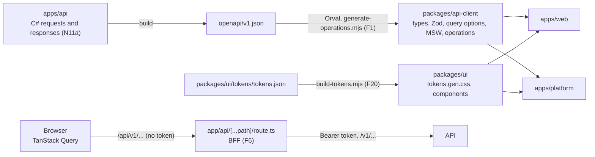

# Architecture: multi-tenant SaaS starter template (frontend)

This document is the single source of truth for the frontend: `apps/web`, `apps/platform`, `packages/api-client` and `packages/ui`. If the code does not agree with this document, the code changes. The API has its own document, `apps/api/docs/ARCHITECTURE.md`; this one follows its shape.

Each rule has an id that starts with `F` (`F1`, `F2`), so it never collides with an API rule. Use the id when you refer to a rule in a review, a commit message or a comment. A rule of the API keeps its own id here (`D1`, `N9`).

## Codemap

This map helps a first reader find their way. It names rules and places, not every file. Source: Aleksey Kladov, "ARCHITECTURE.md".

The API's C# types are the source of the contract. The API build writes `apps/api/openapi/v1.json`. Orval and one small script write the client from it into `packages/api-client`. The apps call the API only through that client, and the browser calls only the app's own BFF route, which adds the token and forwards the call.

| I look for | I find it in | Rule |
| --- | --- | --- |
| An API type, an enum, a Zod schema or a query's options | `packages/api-client/src/generated/`, one folder for each operation tag (`tenant-members/`), and `endpoints.schemas.gen.ts` for the types and enums. `@repo/api-client` exports them | F1, F2, F3 |
| The one `fetch` of the client | `packages/api-client/src/mutator.ts` | F1 |
| What a screen does with an error answer | `packages/api-client/src/problem-details.ts` | F4 |
| The response headers an operation declares | `packages/api-client/src/generated/operations.gen.ts`, read through `declaredResponseHeaders` | F6 |
| The BFF | `apps/<app>/src/app/api/[...path]/route.ts`, on `createBff` of `packages/api-client/src/bff.ts` | F6 |
| A design token | `packages/ui/tokens/tokens.json`; the CSS is `packages/ui/src/styles/tokens.gen.css` | F20 |
| A shared component | `packages/ui/src/components/<kebab-name>/` | F29, F31 |
| A screen | `apps/<app>/src/features/<feature>/`; the route in `src/app/` renders one component of it | F29 |
| Code that more than one feature of an app uses | `apps/<app>/src/shared/`: the tenant context, "No access yet", the problem screens, the locale sync | F29 |
| A shadcn primitive on Base UI | `packages/ui/src/components/ui/`, which only the components of `packages/ui` and a few app screens use | F31 |
| A text on screen | `apps/<app>/messages/{en,tr,ar}.json`; shared texts in `packages/ui/messages/` | F14 |
| A date or a time on screen | `packages/ui/src/lib/format-date-time.ts` | F18 |
| A test | Beside the file it tests: `x.test.tsx` beside `x.tsx`. Playwright tests in `apps/<app>/e2e/` | F35 |
| A check | Biome in `biome.json`, or a rule in `packages/ui/test/architecture-rules.ts` that an `architecture.test.ts` runs | F36 |
| A generated file | A file that ends in `.gen.ts` or `.gen.css` | F32, D1 |
| A rule | This document, by its id | |

## Purpose and scope

The purpose is the frontend of the multi-tenant SaaS starter template. Every future product is built on it. Correctness, one source for each piece of knowledge, and three languages from the first line matter more than speed.

The scope:

| In scope | Reason |
| --- | --- |
| `packages/api-client`: the client that Orval generates, its mutator and its error handling | Every app calls the API through it (N11a) |
| `packages/ui`: the design tokens, the 20 components of the Starter design system, the date formatter, the shared messages | Both apps and every later app share one look and one set of texts |
| `apps/web`: the tenant web, under `/[tenantSlug]/...` | The members of an organisation |
| `apps/platform`: the provider's app, "Platform" on screen | The system admins (N5) |
| One BFF route handler in each app | The browser never holds a token (F6) |
| The checks in Biome and in the architecture tests | A rule without a check decays (Ford, Parsons, Kua, Chapter 2) |

Out of scope: forms (the first form comes with a later step), a CSP (production preparation), Storybook, the mobile app, the marketing app.

The template names no product. Sample organisations in code, tests and screenshots use the invented names of the design system: Northwind MRO, Atlas Technic, Shannon Aero, Kestrel Base.

## 1. Contract and data

The client is generated. No app writes an API type, an enum value, a permission name, an error code or a limit by hand (D1, N11a).

| # | Rule | Source | Check |
| --- | --- | --- | --- |
| F1 | Orval generates the client from `apps/api/openapi/v1.json` into `packages/api-client/src/generated/`: the types and enum objects (`endpoints.schemas.gen.ts`), one function and one query options function for each operation (`<tag>/<tag>.gen.ts`), the Zod schemas (`zod/<tag>/<tag>.zod.gen.ts`) and the MSW handlers (`<tag>/<tag>.msw.gen.ts`). `scripts/generate-operations.mjs` writes what Orval does not carry: `operations.gen.ts` (each operation's method, path, tag, request headers and declared response headers) and `msw.gen.ts` (the index of the handlers). One package serves `apps/web`, `apps/platform` and the later mobile app. `src/mutator.ts` is the one place that calls `fetch`: it takes the base address and headers from `configureApiClient`, returns the parsed body on success and throws `ProblemDetailsError` on an error status. No retry, no cache, no token | Hunt and Thomas, *The Pragmatic Programmer*, Topic 9 (DRY). Orval documentation, "React Query" and "Custom HTTP client" | The `generated` CI job (`scripts/ci/check-generated.sh`); Biome `noRestrictedGlobals` on `fetch`; `mutator.test.ts` |
| F2 | A screen reads the API with `useQuery(getListMembersQueryOptions(...))`. The same options serve a prefetch and an invalidation. Orval writes a query's options only together with its hook (`@orval/query` 8.43), so both exist; a screen never imports a `use...` function from `@repo/api-client`. The query key is the operation id and its parameters (`["listMembers", tenantId, params]`). A command is a plain generated function (`inviteMember`), which a screen passes to `useMutation` | TanStack Query documentation, "Query Options" and "Advanced Server Rendering" | Biome `noRestrictedImports` (a `use...` name from `@repo/api-client`) |
| F3 | Every enum of the contract is a const object at run time (`Language`, `MemberRole`, `Permission`, `ErrorCode`, `FieldErrorCode`, `AuditOperation`, the status enums). A screen lists the values with `Object.values(Language)` and compares with `MemberRole.owner`, never with a string it writes. A literal that only starts with a value, such as the message key `errors.tenant.not_found`, is a key, not a value. The check reads every const object of the generated client but the sort orders (`...Sort`) and the kinds (`...Kind`): their values are common words of code and HTML (`email`, `name`, `user`), so the check would refuse `type="email"`. A screen still writes them through the const object (`ListMembersSort.email`). A literal type, such as the element name of `ComponentProps<"tr">`, is no value | Hunt and Thomas, Topic 9 (DRY). The API's D1 and N11f | `enumLiterals` in every `architecture.test.ts`; `index.test.ts` (`Object.values` of `Language` and `MemberRole`) |
| F4 | `problem-details.ts` reads an error answer. `actionFor(status, problem)` is a pure function: 401 goes to sign-in; 403 `user.suspended` goes to the suspended screen (`account-suspended`); field errors (`errors`, keyed by the field's JSON name) go to the form; any other code shows the message `errors.<code>`; a body that is not Problem Details shows `errors.server.error`. A screen shows its own text from `code`, never `detail` (K5) | RFC 9457, Problem Details. The API's N11w and N11x | `problem-details.test.ts`, one test for each branch |
| F5 | `can(permission)` reads `GetMyTenant.permissions`. A permission name is a value of the generated `Permission`. The screen hides what the user may not do; the API still decides (K5) | OWASP ASVS, V4 (access control on the server) | `enumLiterals`; `tenant-context.test.tsx` (`useCan`) |
| F6 | The browser never calls the API and never holds a token. Each app has one route handler, `app/api/[...path]/route.ts`. The handler builds `createBff` (`packages/api-client/src/bff.ts`), which both apps share, and passes it `fetch`, so only the handler calls `fetch`. It forwards `/api/v1/...` to `API_URL/v1/...` for GET, POST, PATCH and DELETE, and answers 404 for any other path, for a `..` segment and for an encoded separator (`%2f`, `%5c`), without a call. It adds `Authorization: Bearer <token>` from Clerk's `auth().getToken()`, without a template, because the API refuses a template token. It passes `Content-Type`, `Accept`, the request headers the operation declares (`Idempotency-Key`) and the body. It returns the API's status and body, `Content-Type`, and every header that `v1.json` declares for the operation (`declaredResponseHeaders`). No header name is a literal. Hop-by-hop headers never pass. A `Location` of `/v1/...` becomes `/api/v1/...`. Without a session it answers 401 and calls nothing | IETF, "OAuth 2.0 for Browser-Based Applications" (RFC 10017, BCP 212), "Backend For Frontend". RFC 9110, section 7.6.1 (hop-by-hop fields) | `src/app/api/[...path]/route.test.ts` in each app, with MSW |
| F7 | `API_URL` is a server variable. There is no `NEXT_PUBLIC_API_URL`. `src/env.ts` reads every variable once through a Zod schema, so a missing variable fails at start, not at first use: `instrumentation.ts` calls `env()` when the server starts. A build reads no variable | The Twelve-Factor App, Factor III (Config) | `env.test.ts`; `scripts/ci/run-app-image.sh` starts each image with every variable |

## 2. State

| # | Rule | Source | Check |
| --- | --- | --- | --- |
| F8 | Server data lives in TanStack Query, in the browser, against `/api`. One `QueryClient` per browser, with `staleTime` 60 s. Layouts and providers render on the server. Filters, tabs, paging and sort live in the URL. UI state is local `useState`. There is no global store | TanStack Query documentation, "Advanced Server Rendering". Kent C. Dodds, "Application State Management with React" | Review |
| F9 | The URL holds filters, tabs, paging and sort, through nuqs. A list's page, sort and filter are the API's list contract (K5) | nuqs documentation | Review |
| F10 | A table is TanStack Table v9 in manual mode (`manualPagination`, `manualSorting`, `rowCount` from the API's `total`), wrapped once in the `Table` component of `packages/ui`. Only that component imports `@tanstack/react-table` | TanStack Table documentation, "Pagination" (manual, server-side) | Biome `noRestrictedImports` |
| F11 | A form uses React Hook Form with the generated Zod schema of its request (`schemas.InviteMemberBody`) and shadcn's `Field` pattern. No form is built yet | React Hook Form documentation, "Schema Validation". shadcn/ui, "Forms" | Review |
| F12 | One Zod error map turns a Zod issue code into a message key (`validation.too_long`). A user never sees Zod's English | Zod documentation, "Customizing errors" | `packages/ui/src/lib/zod-error-map.test.ts`; each app installs it with `z.config` |

## 3. Language, direction and time

| # | Rule | Source | Check |
| --- | --- | --- | --- |
| F13 | next-intl, without i18n routing. The locale comes from a cookie that the app sets from `GetMe.language` after sign-in; before sign-in from `Accept-Language`, else `en`. A locale is a value of `Language`. `packages/ui/src/lib/locale.ts` chooses it. The direction of each language is a fact of ours, written once in the same file: `directions`, a `Record<Language, Direction>` (`ar` is `rtl`, every other language `ltr`), so a new language of the contract fails the type check until it has its entry. It never comes from the Intl API's `getTextInfo`, which not every browser or Node has. The one map of a language to its message files is `src/i18n/messages.ts` of each app, because a bundler needs a static import for each file. After sign-in, `LocaleSync` compares `GetMe.language` with the page's locale; on a difference a server action sets the cookie and the page renders again. The root layout sets `<html lang dir>`. Dates follow the message `locale.format` of the language (`en-IE`, `tr-TR`, `ar-SA`) | W3C, "Language tags in HTML and XML" and "Structural markup and right-to-left text in HTML". next-intl documentation, "App Router without i18n routing" | `locale.test.ts` (every `Language` value has a direction); Playwright: the preferences page in `en` and `ar` |
| F14 | Each app's texts are in `apps/<app>/messages/{en,tr,ar}.json`, keyed by feature (`members.invite`). The shared texts, buttons, error codes and validation, are in `packages/ui/messages/{en,tr,ar}.json`, merged at load | next-intl documentation, "Messages" | Review |
| F15 | The three message files of one place have the same keys | Unicode CLDR; W3C Internationalization, "Localization" | `messageKeySets` |
| F16 | Every `ErrorCode` has a message `errors.<code>` in each shared message file. The test reads the codes from the generated client | The API's K5 (a client shows its own text from `code`) | `errorCodeMessages` |
| F17 | Logical properties only: `ms-`, `me-`, `ps-`, `pe-`, `start-`, `end-`, `text-start`, `rounded-s-`, `border-s-`. A physical class (`ml-`, `left-`, `text-left`) does not mirror in Arabic | W3C, "Structural markup and right-to-left text in HTML"; CSS Logical Properties and Values Level 1 | `physicalDirectionClasses` |
| F18 | Dates and times use the Intl API only, with `numberingSystem: "latn"` and `calendar: "gregory"` (`ar-SA` would else use the Islamic calendar). No date library. `packages/ui/src/lib/format-date-time.ts` is the one place that formats a date or a time. The API sends instants in UTC; the screen shows local time, and the zone and UTC are one hover away (the Time component) | ECMA-402, `Intl.DateTimeFormat`. W3C, "Working with time zones" | `dateFormattingOutsideFormatter`; `format-date-time.test.ts`, whose zone tests check the shape of a label (its UTC offset, Western digits), not a name that the runtime's ICU data supplies |
| F19 | Fonts load through `next/font` from our own origin: Geist, Geist Mono and IBM Plex Sans Arabic. No request goes to Google Fonts at run time. next/font names each family itself, so the app's `globals.css` binds the token stacks (`--font-sans`, `--font-arabic`, `--font-mono`) to next/font's variables, in the order of `tokens.json` | Next.js documentation, "Font Optimization" | Review; the CSP of a later step |

## 4. Look

| # | Rule | Source | Check |
| --- | --- | --- | --- |
| F20 | `packages/ui/tokens/tokens.json`, copied from the Starter design system, is the source of every token. `packages/ui/scripts/build-tokens.mjs` writes `packages/ui/src/styles/tokens.gen.css`: colours and shadows for light on `:root` and for dark on `.dark`, every other token on `:root`, a `{name}` value as `var(--name)`, and the breakpoints in a Tailwind `@theme` block, because a media query cannot read a variable. `globals.css` maps the tokens into Tailwind's theme. shadcn's variable names are the token names | Hunt and Thomas, Topic 9 (DRY). W3C Design Tokens Community Group, "Design Tokens Format Module" | `build-tokens.test.ts`; the `generated` CI job |
| F21 | No hex colour and no `rgb()` outside `tokens.json` and `tokens.gen.css`. A colour is a token | As F20 | `colorLiterals` |
| F22 | Icons are `lucide-react`, only through the `Icon` component | The design system's README, "Iconography" | Biome `noRestrictedImports` |
| F23 | A toast is sonner, only through the `Toast` component, with one `<Toaster />` in the root layout | The design system's Toast README | Biome `noRestrictedImports` |
| F24 | Theme: next-themes, the `class` strategy and `color-scheme`. Light, dark and system, saved on the device | The design system's UserMenu README. next-themes documentation | Review |
| F25 | No user-facing text as a literal: JSX text and the `title`, `placeholder`, `aria-label` and `alt` attributes come from a message. A literal without a letter, such as `·`, is fine. `/dev/components` and tests are outside the rule | W3C Internationalization, "Localization" | `userFacingLiterals` |
| F26 | Loading: a `Skeleton` inside the component. `loading.tsx` only for a route shell | The design system's Skeleton README | Review |
| F27 | Every route group has an `error.tsx`. The root keeps `global-error.tsx` | Next.js documentation, "Error Handling" | Review |
| F28 | ⌘K opens the command palette: `cmdk` through shadcn's `Command`, wired to the shell, with the navigation items | The design system's AppShell README | Review |

## 5. Places and names

| # | Rule | Source | Check |
| --- | --- | --- | --- |
| F29 | Feature folders and thin routes. `app/` holds routes only; each `page.tsx` renders one component of `features/<name>/`. A feature never imports from another feature. Code that both apps share goes to `packages/ui` or `packages/api-client`; code that features of one app share goes to that app's `src/shared/` | Robert C. Martin, "Screaming Architecture". bulletproof-react, "Project Structure" | `crossFeatureImports` |
| F30 | The tenant web's routes are `/[tenantSlug]/...`. The slug becomes the tenant id through the cached `ListMyTenants`. A slug that is not in the user's list shows "No access yet". The platform app has no tenant segment. The API path keeps the id (T1) | The API's section 12, "Slug in addresses" | `tenant-context.test.tsx`, `choose-organisation.test.tsx` |
| F31 | Names: files in kebab case, components in PascalCase, hooks `use-x.ts`, tests `x.test.tsx`, message keys `feature.camelCase`. On screen: "organisation", "Activity" and "Platform"; in code, routes and the API: `tenant`, `audit`, `platform`. "Admin" is only a role (the API's glossary, section 10) | Evans, *Domain-Driven Design*, Chapter 2 (Ubiquitous Language) | Review |
| F32 | A generated file ends in `.gen.ts` or `.gen.css`. Nobody edits one: change its source and run `pnpm generate`. Biome skips them, and `.gitattributes` folds them in a pull request | The API's D1 and "Generated files" | `generatedFileNames`; the `generated` CI job |
| F33 | `/dev/components` renders every component, in each language and theme. It exists only outside production builds: the route is a `page.dev.tsx`, and `next.config.ts` adds the page extension `dev.tsx` outside production, so a production build has no such route | The design system's previews | `dev-components-page.test.tsx`; `next.config.test.ts` of each app (no `dev.tsx` page extension in production); Playwright |
| F34 | No Storybook. `/dev/components` and the component tests serve its purpose | Ousterhout, *A Philosophy of Software Design* (do not add a tool without a need) | Review |

## 6. Tests and checks

| # | Rule | Source | Check |
| --- | --- | --- | --- |
| F35 | Vitest and Testing Library, beside the file they test (`x.test.tsx` beside `x.tsx`); no `__tests__` folder. A test finds an element by its role and name. MSW handlers come from the generated client (`@repo/api-client/msw`). Playwright with `@clerk/testing` signs in through our sign-in page. Test names are `Operation_Scenario_ExpectedOutcome`; an architecture test is named `Rule_Scope_Expectation` (`F17_PackagesUi_UsesNoPhysicalDirectionClass`) | The API's N9 and section 9. Testing Library, "Guiding Principles". Khorikov, *Unit Testing Principles, Practices, and Patterns*, Chapter 9 (mock only what you do not own) | `testFolders`, `testsBesideTheirFile` |
| F36 | A rule gets a Biome rule when Biome has one. Otherwise it gets a Vitest architecture test: a pure function in `packages/ui/test/architecture-rules.ts`, which each `architecture.test.ts` runs on its own folder. No second linter | Ford, Parsons, Kua, *Building Evolutionary Architectures*, Chapter 2 (fitness functions) | `architecture-rules.test.ts` proves that each rule finds what it must find |
| F37 | Every Playwright page test runs `@axe-core/playwright` for WCAG 2.2 AA | W3C, WCAG 2.2 | `e2e/axe.ts` in each app |

## 7. Versions and security

| # | Rule | Source | Check |
| --- | --- | --- | --- |
| F38 | A new package is the newest stable release (no beta, canary or rc). A new major of `next`, `react`, `react-dom`, `shadcn` or `@clerk/nextjs` is the maintainer's decision. A package needs a license that `.github/dependency-review-config.yml` allows, and a row in its package's README. `axe-core` and `@axe-core/playwright` are MPL-2.0 and allowed by name, for the tests only (the maintainer's decision in step 21a) | The API's fixed rule 4 | The `dependency-review` CI job |
| F39 | No CSP yet. The security headers of `next.config.ts` stay | OWASP Secure Headers Project | Review |
| F40 | Dependabot covers npm and each app's Dockerfile | GitHub Docs, "Configuring Dependabot version updates" | Review |

## 8. Deviations from the books

These deviations were discussed openly and approved.

| Deviation | The way in the books | Reason |
| --- | --- | --- |
| The test name pattern is `Operation_Scenario_ExpectedOutcome` | Khorikov, Chapter 3: a plain sentence | The API's pattern, so one name pattern serves the repository |
| Orval writes a hook beside each query's options, and the apps do not use it | Ousterhout, Chapter 4: no code without a use | Orval 8.43 writes a query's options only with its hook. Biome refuses a `use...` import from the client, so the hook is dead code that a check guards |
| The providers, the error pages, the preferences page and the problem screens are written in each app | Hunt and Thomas, *The Pragmatic Programmer*, Topic 9 (DRY) | They depend on next-intl, Next.js and the generated client, which `packages/ui` does not depend on. A third package for two apps would cost more than a copy of a few small files. When a third app comes, they move to a package of their own |

React Hook Form against TanStack Form is no deviation: both are industry practice, and decision 4 of step 21a chose React Hook Form for its weight of use and shadcn's `Field` pattern.

## 9. Deferred

These parts are not in the frontend yet. Each one comes in when its written condition is true.

| What | Entry condition |
| --- | --- |
| A CSP | Production preparation |
| A denser mode | A user preference asks for it (the design system's README, "Density") |
| UTC on screen | A product sets it as an organisation setting (the design system's README, "Date and time") |
| The mobile app | The planned `apps/mobile` starts. It uses `@repo/api-client` |

## 10. Open items

| Item | Where it closes |
| --- | --- |
| The rail cannot be pinned open on desktop yet (the AppShell README) | The first product screen that needs labels in the rail |
| A long press on a touch screen does not open the Time tooltip: Base UI's tooltip opens on hover and focus only | A later step, with a popover on touch |
| The language and the time zone are read-only on the Preferences page | The first form, with `ChangePreferences` |
