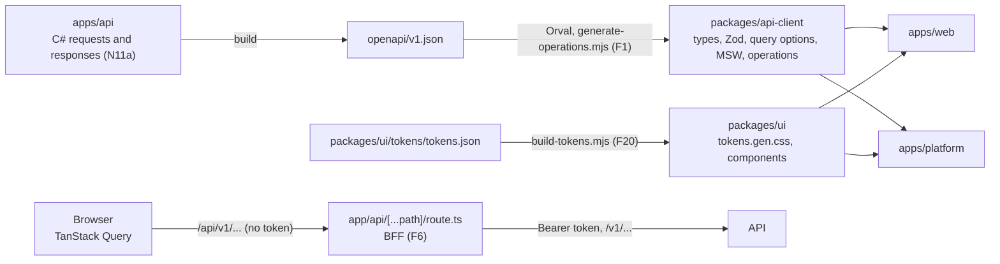

# Architecture: multi-tenant SaaS starter template (frontend)

This document is the single source of truth for the frontend: `apps/web`, `apps/platform`, `packages/api-client` and `packages/ui`. If the code does not agree with this document, the code changes. The API has its own document, `apps/api/docs/ARCHITECTURE.md`; this one follows its shape.

Each rule has an id that starts with `F` (`F1`, `F2`), so it never collides with an API rule. Use the id when you refer to a rule in a review, a commit message or a comment. A rule of the API keeps its own id here (`D1`, `N9`).

## Codemap

This map helps a first reader find their way. It names rules and places, not every file. Source: Aleksey Kladov, "ARCHITECTURE.md".

The API's C# types are the source of the contract. The API build writes `apps/api/openapi/v1.json`. Orval and one small script write the client from it into `packages/api-client`. The apps call the API only through that client, and the browser calls only the app's own BFF route, which adds the token and forwards the call.

| I look for | I find it in | Rule |
| --- | --- | --- |
| An API type, an enum, a Zod schema or a query's options | `packages/api-client/src/generated/`, one folder for each operation tag (`tenant-members/`), and `endpoints.schemas.gen.ts` for the types and enums. `@repo/api-client` exports them | F1, F2, F3 |
| The one `fetch` of the client | `packages/api-client/src/mutator.ts` | F1 |
| What a screen does with an error answer | `packages/api-client/src/problem-details.ts` | F4 |
| The response headers an operation declares | `packages/api-client/src/generated/operations.gen.ts`, read through `declaredResponseHeaders` | F6 |
| The BFF | `apps/<app>/src/app/api/[...path]/route.ts`, on `createBff` of `packages/api-client/src/bff.ts` | F6 |
| The app's variables, and how it runs on Railway | `apps/<app>/src/env.ts`, `.env.example`, `.railway/<app>.json`, `.railway/railway.ts`; `docs/deployment.md`, section 13 | F7 |
| The health check | `apps/<app>/src/app/health/route.ts` | F46 |
| A design token | `packages/ui/tokens/tokens.json`; the CSS is `packages/ui/src/styles/tokens.gen.css` | F20 |
| A shared component | `packages/ui/src/components/<kebab-name>/` | F29, F31 |
| A screen | `apps/<app>/src/features/<feature>/`; the route in `src/app/` renders one component of it | F29 |
| Code that more than one feature of an app uses | `apps/<app>/src/shared/`: the tenant context, "No access yet", the problem screens, a list's error state, the locale sync | F29 |
| Our own sign-in, the email code, Google, Microsoft and the second factor | `packages/ui/src/components/sign-in/` (`SignIn`, its steps, `SsoCallback`, the Clerk error map, the redirect rule), `code-input/`, `provider-buttons/`, `auth-layout/`; each app's `src/app/(public)/sign-in/` and `sso-callback/` render them | F41, F43, F45 |
| The platform's two-step gate and its screens | `apps/platform/src/proxy.ts`, `apps/platform/src/features/two-step/` | F42 |
| The invitation's accept page | `apps/web/src/features/invitations/`, on the route `/invitations/accept` | F44 |
| Settings > Members: the members, the invitations and their dialogs | `apps/web/src/features/members/`, on the route `/[tenantSlug]/settings/members`; the Settings SubNav and Permission denied in `apps/web/src/shared/` | F5, F9, F47, F48 |
| Settings > General, Activity and Preferences | `apps/web/src/features/general/`, `activity/` and `preferences/`, on `/[tenantSlug]/settings/general`, `activity` and `preferences` | F5, F11, F18 |
| The page of a suspended or closed organisation | `apps/web/src/shared/blocked-organisation.tsx`, which `TenantProvider` renders in place of the shell | F4, F30, F47 |
| The rail's cookie | `packages/ui/src/lib/rail-state.ts`; each app's signed-in layout reads it | F49 |
| A shadcn primitive on Base UI | `packages/ui/src/components/ui/`, which only the components of `packages/ui` and a few app screens use | F31 |
| A text on screen | `apps/<app>/messages/{en,tr,ar}.json`; shared texts in `packages/ui/messages/` | F14 |
| A date or a time on screen | `packages/ui/src/lib/format-date-time.ts` | F18 |
| A test | Beside the file it tests: `x.test.tsx` beside `x.tsx`. Playwright tests in `apps/<app>/e2e/` | F35 |
| A check | Biome in `biome.json`, or a rule in `packages/ui/test/architecture-rules.ts` that an `architecture.test.ts` runs | F36 |
| A generated file | A file that ends in `.gen.ts` or `.gen.css` | F32, D1 |
| A rule | This document, by its id | |

## Purpose and scope

The purpose is the frontend of the multi-tenant SaaS starter template. Every future product is built on it. Correctness, one source for each piece of knowledge, and three languages from the first line matter more than speed.

The scope:

| In scope | Reason |
| --- | --- |
| `packages/api-client`: the client that Orval generates, its mutator and its error handling | Every app calls the API through it (N11a) |
| `packages/ui`: the design tokens, the 20 components of the Starter design system, the date formatter, the shared messages | Both apps and every later app share one look and one set of texts |
| `apps/web`: the tenant web, under `/[tenantSlug]/...` | The members of an organisation |
| `apps/platform`: the provider's app, "Platform" on screen | The system admins (N5) |
| One BFF route handler in each app | The browser never holds a token (F6) |
| The checks in Biome and in the architecture tests | A rule without a check decays (Ford, Parsons, Kua, Chapter 2) |

Out of scope: a CSP (production preparation), Storybook, the mobile app, the marketing app.

The template names no product. Sample organisations in code, tests and screenshots use the invented names of the design system: Northwind Traders, Atlas Logistics, Shannon Studio, Kestrel Labs.

## 1. Contract and data

The client is generated. No app writes an API type, an enum value, a permission name, an error code or a limit by hand (D1, N11a).

| # | Rule | Source | Check |
| --- | --- | --- | --- |
| F1 | Orval generates the client from `apps/api/openapi/v1.json` into `packages/api-client/src/generated/`: the types and enum objects (`endpoints.schemas.gen.ts`), one function and one query options function for each operation (`<tag>/<tag>.gen.ts`), the Zod schemas (`zod/<tag>/<tag>.zod.gen.ts`) and the MSW handlers (`<tag>/<tag>.msw.gen.ts`). `scripts/generate-operations.mjs` writes what Orval does not carry: `operations.gen.ts` (each operation's method, path, tag, request headers and declared response headers) and `msw.gen.ts` (the index of the handlers). One package serves `apps/web`, `apps/platform` and the later mobile app. `src/mutator.ts` is the one place that calls `fetch`: it takes the base address and headers from `configureApiClient`, returns the parsed body on success and throws `ProblemDetailsError` on an error status. No retry, no cache, no token | Hunt and Thomas, *The Pragmatic Programmer*, Topic 9 (DRY). Orval documentation, "React Query" and "Custom HTTP client" | The `generated` CI job (`scripts/ci/check-generated.sh`); Biome `noRestrictedGlobals` on `fetch`; `mutator.test.ts` |
| F2 | A screen reads the API with `useQuery(getListMembersQueryOptions(...))`. The same options serve a prefetch and an invalidation. Orval writes a query's options only together with its hook (`@orval/query` 8.43), so both exist; a screen never imports a `use...` function from `@repo/api-client`. The query key is the operation id and its parameters (`["listMembers", tenantId, params]`). A command is a plain generated function (`inviteMember`), which a screen passes to `useMutation`. A cursor list (`ListAuditEntries`) gets infinite options too: `orval.config.ts` names the operation, and Orval writes `getListAuditEntriesInfiniteQueryOptions`, whose page parameter is the `cursor`. A screen passes them to `useInfiniteQuery` with `initialPageParam` and `getNextPageParam` from `nextCursor` | TanStack Query documentation, "Query Options" and "Advanced Server Rendering" | Biome `noRestrictedImports` (a `use...` name from `@repo/api-client`) |
| F3 | Every enum of the contract is a const object at run time (`Language`, `Permission`, `ErrorCode`, `FieldErrorCode`, `AuditOperation`, the status enums). A screen lists the values with `Object.values(Language)` and compares with `Language.En`, never with a string it writes. A role is no enum since the API's step r4b: a request gives a role by its id, and the names of the built-in roles are written once, in `apps/web/src/shared/roles.ts`, until the web checks permissions in place of roles (the maintainer's instruction in step r4b: the web keeps its role checks, and the frontend session moves them to permissions). A literal that only starts with a value, such as the message key `errors.tenant.not_found`, is a key, not a value. The check reads every const object of the generated client but the sort orders (`...Sort`) and the kinds (`...Kind`): their values are common words of code and HTML (`email`, `name`, `user`), so the check would refuse `type="email"`. A screen still writes them through the const object (`ListMembersSort.Email`). A literal type, such as the element name of `ComponentProps<"tr">`, is no value. A member's name comes from the `x-enumNames` of the API's document (N11z): `ErrorCode.ServerError` is `server.error` | Hunt and Thomas, Topic 9 (DRY). The API's D1 and N11f | `enumLiterals` in every `architecture.test.ts`; `index.test.ts` (`Object.values` of `Language`) |
| F4 | `problem-details.ts` reads an error answer. `actionFor(status, problem)` is a pure function: 401 goes to sign-in; 403 `user.suspended` goes to the suspended screen (`account-suspended`); 403 `tenant.suspended` or `tenant.closed` goes to the organisation's blocked page (`tenant-blocked`, with the status); field errors (`errors`, keyed by the field's JSON name) go to the form; any other code shows the message `errors.<code>`; a body that is not Problem Details shows `errors.server.error`. A screen shows its own text from `code`, never `detail` (K5) | RFC 9457, Problem Details. The API's N11w and N11x | `problem-details.test.ts`, one test for each branch |
| F5 | `can(permission)` reads `GetMyTenant.permissions`. A permission name is a value of the generated `Permission`. The screen hides what the user may not do; the API still decides (K5) | OWASP ASVS, V4 (access control on the server) | `enumLiterals`; `tenant-context.test.tsx` (`useCan`) |
| F6 | The browser never calls the API and never holds a token. Each app has one route handler, `app/api/[...path]/route.ts`. The handler builds `createBff` (`packages/api-client/src/bff.ts`), which both apps share, and passes it `fetch`, so only the handler calls `fetch`. It forwards `/api/v1/...` to `API_URL/v1/...` for GET, POST, PATCH and DELETE, and answers 404 for any other path, for a `..` segment and for an encoded separator (`%2f`, `%5c`), without a call. It adds `Authorization: Bearer <token>` from Clerk's `auth().getToken()`, without a template, because the API refuses a template token. It passes `Content-Type`, `Accept`, the request headers the operation declares (`Idempotency-Key`) and the body. It returns the API's status and body, `Content-Type`, and every header that `v1.json` declares for the operation (`declaredResponseHeaders`). No header name is a literal. Hop-by-hop headers never pass. A `Location` of `/v1/...` becomes `/api/v1/...`. Without a session it answers 401 and calls nothing | IETF, "OAuth 2.0 for Browser-Based Applications" (RFC 10017, BCP 212), "Backend For Frontend". RFC 9110, section 7.6.1 (hop-by-hop fields) | `src/app/api/[...path]/route.test.ts` in each app, with MSW |
| F7 | One image serves every environment, so a build reads no variable and the image holds no value that differs between environments. `src/env.ts` reads every variable once through a Zod schema, so a missing variable fails at start, not at first use: `instrumentation.ts` calls `env()` when the server starts. No variable has a `NEXT_PUBLIC_` name, because Next.js writes such a value into the browser code at build time. `API_URL` is a server variable. `CLERK_PUBLISHABLE_KEY` is read at run time on the server, and the root layout and `proxy.ts` pass it to `ClerkProvider` and `clerkMiddleware`. A value that is the same in every environment stays a constant in the code: the sign-in page `/sign-in`, which both get as `signInUrl`. On Railway, `.railway/railway.ts` gives each app every variable of its `.env.example` | The Twelve-Factor App, Factor III (Config) and Factor V (Build, release, run). Next.js documentation, "Bundling Environment Variables for the Browser". Clerk documentation, `clerkMiddleware` options and `ClerkProvider` props | `env.test.ts` (the schema, and the app's service in `railway.ts`); `scripts/ci/run-app-image.sh` starts each image twice with two publishable keys, and each sign-in page must carry its own |

## 2. State

| # | Rule | Source | Check |
| --- | --- | --- | --- |
| F8 | Server data lives in TanStack Query, in the browser, against `/api`. One `QueryClient` per browser, with `staleTime` 60 s. Layouts and providers render on the server. Filters, tabs, paging and sort live in the URL. UI state is local `useState`. There is no global store | TanStack Query documentation, "Advanced Server Rendering". Kent C. Dodds, "Application State Management with React" | Review |
| F9 | The URL holds filters, tabs, paging and sort, through nuqs. A list's page, sort and filter are the API's list contract (K5). Each change pushes a history entry, so back and forward restore it. A search waits 300 ms after the last key, so a word sends one request | nuqs documentation, "Options" (`history`) | `members-page.test.tsx` (the URL drives the list; back and forward) |
| F10 | A table is TanStack Table v9 in manual mode (`manualPagination`, `manualSorting`, `rowCount` from the API's `total`), wrapped once in the `Table` component of `packages/ui`. Only that component imports `@tanstack/react-table` | TanStack Table documentation, "Pagination" (manual, server-side) | Biome `noRestrictedImports` |
| F11 | A form uses React Hook Form with the generated Zod schema of its request (`schemas.InviteMemberBody`) and shadcn's `Field` pattern. The first form is the names of a new person on the accept page (F44): the generated `schemas.AcceptInvitationBody`, with both names required, because a person who is not a user yet must give them (the API's A7). `packages/ui` has no `Field` yet, so the form uses the `Input` component's label and error, which play its part. The second form is the invite dialog (`schemas.InviteMemberBody`). The third is Preferences (`schemas.ChangePreferencesBody`): `Combobox` takes an `error` as `Input` does, so a field code of the API (`time_zone_invalid`) shows under its field | React Hook Form documentation, "Schema Validation". shadcn/ui, "Forms" | Review |
| F47 | After a command, the screen waits for the server's answer, then reads again. The dialog's action button is busy (`Dialog`'s `pending`) until the answer comes. On success the dialog closes, a toast confirms, and the screen invalidates the list's queries by the generated key (`queryClient.invalidateQueries({ queryKey: getListMembersQueryKey(tenantId) })`). On a refusal the dialog stays open and shows the text of the code. One exception: when the object is gone or changed meanwhile (`invitation.not_pending`, `invitation.not_found` on revoke), the dialog closes, the list is read again and a toast says so. No optimistic update: the API owns the rules (K1), and a guess would show a state the API can refuse. A change of the caller's own role also invalidates `GetMyTenant` and `ListMyTenants`. A code that says the organisation stopped (`tenant.suspended`, `tenant.closed`, `tenant.not_found`) invalidates them too, so the tenant layout shows its page. `TenantProvider` watches the query and mutation caches, so a 403 `tenant.suspended` or `tenant.closed` from a call of this organisation, a read too, reads `ListMyTenants` again. A call is this organisation's when its query key or its command's variables hold the tenant's id; a call of another tenant changes nothing. The member dialogs pass no id in their variables, and `afterRefusal` reads the list again for them. A 401 goes to sign-in, and `user.suspended` reads `GetMe` again, so the shell shows the suspended screen (F4) | TanStack Query documentation, "Optimistic Updates" and "Invalidations from Mutations" | `change-role-dialog.test.tsx`, `remove-member-dialog.test.tsx`, `invite-dialog.test.tsx`, `invitations-table.test.tsx` (the list is read again after a success; each code shows its text); `tenant-context.test.tsx` (a command's and a read's 403 `tenant.suspended` show the page; another tenant's does not read the list again); `preferences-page.test.tsx` |
| F48 | A command that takes an `Idempotency-Key` (the API's I1) sends one key for each intent, made with `crypto.randomUUID()`. A form makes a new key when it opens. It keeps the key for a second click and for a retry after a network error, so the API replays the first answer and does not act twice (I5). A change of a field that goes into the request is a new intent and gets a new key, because the API answers 422 for a key with another body (I5). A success gets a new key. A refusal that the API saved under the key (a 4xx answer, I6) gets a new key too, so the same intent sent later runs again; a request still running (409 `idempotency.key_in_progress`) and a server failure (5xx, nothing saved) keep the key. An action without a form, such as "Invite again", is a new intent each time and sends a new key. `useIntentKey` of `features/members` holds the rule. The platform's `CreateTenant` and `InviteOwner` follow it when their screens come, and the hook moves to `src/shared/` or `packages/ui` when a second feature needs it | Stripe, "Idempotent requests". IETF, "The Idempotency-Key HTTP Header Field" (draft 07) | `invite-dialog.test.tsx` (the same key on a retry; a new key after an edit, after a refusal and after a success; Enter twice sends once); `invitations-table.test.tsx` (a new key for each "Invite again") |
| F12 | One Zod error map turns a Zod issue code into a message key (`validation.too_long`). A user never sees Zod's English | Zod documentation, "Customizing errors" | `packages/ui/src/lib/zod-error-map.test.ts`; each app installs it with `z.config` |

## 3. Language, direction and time

| # | Rule | Source | Check |
| --- | --- | --- | --- |
| F13 | next-intl, without i18n routing. The locale comes from a cookie that the app sets from `GetMe.language` after sign-in; before sign-in from `Accept-Language`, else `en`. A locale is a value of `Language`. `packages/ui/src/lib/locale.ts` chooses it. The direction of each language is a fact of ours, written once in the same file: `directions`, a `Record<Language, Direction>` (`ar` is `rtl`, every other language `ltr`), so a new language of the contract fails the type check until it has its entry. It never comes from the Intl API's `getTextInfo`, which not every browser or Node has. The one map of a language to its message files is `src/i18n/messages.ts` of each app, because a bundler needs a static import for each file. After sign-in, `LocaleSync` compares `GetMe.language` with the page's locale; on a difference a server action sets the cookie and the page renders again. It waits until Clerk's script has loaded (`useClerk().loaded`): in a development instance the script deletes and writes the dev browser cookie (`__clerk_db_jwt`) again on each answer of its Frontend API, and a refresh that reaches the proxy in that moment is signed out (`dev-browser-missing`) and sent to sign-in. The root layout sets `<html lang dir>`. Dates follow the message `locale.format` of the language (`en-IE`, `tr-TR`, `ar-SA`) | W3C, "Language tags in HTML and XML" and "Structural markup and right-to-left text in HTML". next-intl documentation, "App Router without i18n routing". Clerk documentation, `useClerk()` (`loaded`) | `locale.test.ts` (every `Language` value has a direction); `locale-sync.test.tsx` (no refresh before Clerk loads); Playwright: the preferences page in `en` and `ar` |
| F14 | Each app's texts are in `apps/<app>/messages/{en,tr,ar}.json`, keyed by feature (`members.invite`). The shared texts, buttons, error codes and validation, are in `packages/ui/messages/{en,tr,ar}.json`, merged at load | next-intl documentation, "Messages" | Review |
| F15 | The three message files of one place have the same keys. Every `AuditOperation` has a sentence `activity.operations.<operation>` in each file of the tenant web; it names no email address (the API's K3) | Unicode CLDR; W3C Internationalization, "Localization" | `messageKeySets`; `activity-sentence.test.tsx` reads the operations from the generated client |
| F16 | Every `ErrorCode` has a message `errors.<code>` in each shared message file. The test reads the codes from the generated client | The API's K5 (a client shows its own text from `code`) | `errorCodeMessages` |
| F17 | Logical properties only: `ms-`, `me-`, `ps-`, `pe-`, `start-`, `end-`, `text-start`, `rounded-s-`, `border-s-`. A physical class (`ml-`, `left-`, `text-left`) does not mirror in Arabic | W3C, "Structural markup and right-to-left text in HTML"; CSS Logical Properties and Values Level 1 | `physicalDirectionClasses` |
| F18 | Dates and times use the Intl API only, with `numberingSystem: "latn"` and `calendar: "gregory"` (`ar-SA` would else use the Islamic calendar). No date library. `packages/ui/src/lib/format-date-time.ts` is the one place that formats a date or a time. It also gives the calendar day of an instant in a zone and the day before it (`calendarDay`, `dayBefore`: Activity groups by day at the zone's midnight and names today and yesterday), a zone's UTC offset (`utcOffset`), its name for a list (`zoneName`: the IANA city and the zone's generic name in the language, as the Intl API names no city) and the browser's zone. The time zones to choose from come from `Intl.supportedValuesOf("timeZone")`, which every browser that Next.js 16 supports has (Chrome and Edge 111, Firefox 111, Safari 16.4; the API came in Chrome 99, Firefox 93 and Safari 15.4). The API sends instants in UTC; the screen shows local time, and the zone and UTC are one hover away (the Time component). Relative time (`formatRelative`): under 1 minute the language's "now"; from 1 minute to 30 days the largest unit that fits in the time (minutes, hours, days), with the count rounded to the nearest whole number, from `Intl.RelativeTimeFormat` with `numeric: "auto"` (so 1 day is "yesterday"); after 30 days the date. The design system's README said "Now" under 15 minutes; the maintainer chose this rule in step 21a-fix, because it is industry practice | ECMA-402, `Intl.DateTimeFormat`, `Intl.RelativeTimeFormat` and `Intl.supportedValuesOf`. Next.js documentation, "Supported Browsers". W3C, "Working with time zones". GitHub Primer, "Relative time" | `dateFormattingOutsideFormatter`; `format-date-time.test.ts`, whose zone tests check the shape of a label (its UTC offset, Western digits), not a name that the runtime's ICU data supplies, and whose relative-time tests hold the rule at its edges (59 seconds, 1 minute, 59 minutes, 1 hour, 30 and 31 days) in `en-IE` and `ar-SA` |
| F19 | Fonts load through `next/font` from our own origin: Geist, Geist Mono and IBM Plex Sans Arabic. No request goes to Google Fonts at run time. next/font names each family itself, so the app's `globals.css` binds the token stacks (`--font-sans`, `--font-arabic`, `--font-mono`) to next/font's variables, in the order of `tokens.json` | Next.js documentation, "Font Optimization" | Review; the CSP of a later step |

## 4. Look

| # | Rule | Source | Check |
| --- | --- | --- | --- |
| F20 | `packages/ui/tokens/tokens.json`, copied from the Starter design system, is the source of every token. `packages/ui/scripts/build-tokens.mjs` writes `packages/ui/src/styles/tokens.gen.css`: colours and shadows for light on `:root` and for dark on `.dark`, every other token on `:root`, a `{name}` value as `var(--name)`, and the breakpoints in a Tailwind `@theme` block, because a media query cannot read a variable. It also writes the `@theme inline` block that maps the tokens into Tailwind's theme: each colour as `--color-<name>`, each size as `--spacing-<name>` (a `-max` size as `--container-<name>`), the shadows and the families under their own names, each text style of its own as `--text-<name>` with its line height, its weight when not 400 and its tracking when it has one, and each layer as `--z-index-<name>`. `globals.css` holds no token: only the imports, the custom variants and the base layer. shadcn's variable names are the token names | Hunt and Thomas, Topic 9 (DRY). W3C Design Tokens Community Group, "Design Tokens Format Module" | `build-tokens.test.ts` (the theme block, and a new colour in it); the `generated` CI job |
| F21 | No hex colour and no `rgb()` outside `tokens.json` and `tokens.gen.css`. A colour is a token. One exception: the Google and Microsoft sign-in logos keep their brand colours, as their branding guidelines require. They are two files, `public/brands/google.svg` and `public/brands/microsoft.svg`, in each app, and only `ProviderButtons` shows them (F41) | As F20. Google, "Sign in with Google branding guidelines". Microsoft, "Sign in with Microsoft branding guidelines" | `colorLiterals`, which reads `src/` and so not the two logos |
| F22 | Icons are `lucide-react`, only through the `Icon` component | The design system's README, "Iconography" | Biome `noRestrictedImports` |
| F23 | A toast is sonner, only through the `Toast` component, with one `<Toaster />` in the root layout | The design system's Toast README | Biome `noRestrictedImports` |
| F24 | Theme: next-themes, the `class` strategy and `color-scheme`. Light, dark and system, saved on the device. The UserMenu holds the choice. In the tenant web, the Preferences page holds only what the API keeps (the Preferences board); the platform's Preferences page still shows the theme | The design system's UserMenu README. next-themes documentation | Review |
| F25 | No user-facing text as a literal: JSX text and the `title`, `placeholder`, `aria-label` and `alt` attributes come from a message. A literal without a letter, such as `·`, is fine. `/dev/components` and tests are outside the rule | W3C Internationalization, "Localization" | `userFacingLiterals` |
| F26 | Loading: a `Skeleton` inside the component. `loading.tsx` only for a route shell | The design system's Skeleton README | Review |
| F27 | Every route group has an `error.tsx`. The root keeps `global-error.tsx` | Next.js documentation, "Error Handling" | Review |
| F49 | The rail collapses and expands on desktop. From `bp-desktop`, a toggle at the foot of the rail switches between `rail-width` (icons, the labels as tooltips) and `rail-expanded` (icons with labels). ⌘B or Ctrl B toggles it too, on every device, but not inside a text field. The hint says ⌘B, as the search field's hint says ⌘K. Below `bp-desktop` the shortcut changes the saved choice without a visible change: the next desktop visit shows it. The toggle is a button with `aria-expanded` and one name from the messages. A tablet keeps the icon rail and a phone keeps the drawer. In Arabic the rail is at the right and grows to the left. The choice lives seven days in the cookie `sidebar_state`, as shadcn's Sidebar names it. `packages/ui/src/lib/rail-state.ts` holds its name and its value once. Each app's signed-in layout reads the cookie on the server and gives `AppShell` its `railExpanded`, so the first paint is right and nothing jumps. No cookie is the icon rail | shadcn/ui documentation, "Sidebar", "Persisted State" | `app-shell.test.tsx` (the toggle, ⌘B, Ctrl B, a text field, the cookie); `rail-state.test.ts`; Playwright `rail.spec.ts` (expanded and collapsed after a reload; no toggle on a tablet) |
| F28 | ⌘K opens the command palette: `cmdk` through shadcn's `Command`, wired to the shell, with the navigation items | The design system's AppShell README | Review |

## 5. Places and names

| # | Rule | Source | Check |
| --- | --- | --- | --- |
| F29 | Feature folders and thin routes. `app/` holds routes only; each `page.tsx` renders one component of `features/<name>/`. A feature never imports from another feature. Code that both apps share goes to `packages/ui` or `packages/api-client`; code that features of one app share goes to that app's `src/shared/` | Robert C. Martin, "Screaming Architecture". bulletproof-react, "Project Structure" | `crossFeatureImports` |
| F30 | The tenant web's routes are `/[tenantSlug]/...`. The slug becomes the tenant id through the cached `ListMyTenants`. A slug that is not in the user's list shows "No access yet". A tenant whose status is suspended or closed shows its page in place of the shell, with no reason (the Suspended and Closed boards); a purging tenant, whose purge has started, shows the Closed board, as the API refuses its members with `tenant.closed`; "Choose another organisation" shows only when the user has another one. The platform app has no tenant segment. The API path keeps the id (T1) | The API's section 12, "Slug in addresses" | `tenant-context.test.tsx`, `choose-organisation.test.tsx` |
| F31 | Names: files in kebab case, components in PascalCase, hooks `use-x.ts`, tests `x.test.tsx`, message keys `feature.camelCase`. On screen: "organisation", "Activity" and "Platform"; in code, routes and the API: `tenant`, `audit`, `platform`. "Admin" is only a role (the API's glossary, section 10) | Evans, *Domain-Driven Design*, Chapter 2 (Ubiquitous Language) | Review |
| F32 | A generated file ends in `.gen.ts` or `.gen.css`. Nobody edits one: change its source and run `pnpm generate`. Biome skips them, and `.gitattributes` folds them in a pull request | The API's D1 and "Generated files" | `generatedFileNames`; the `generated` CI job |
| F33 | `/dev/components` renders every component, in each language and theme. It exists only outside production builds: the route is a `page.dev.tsx`, and `next.config.ts` adds the page extension `dev.tsx` outside production, so a production build has no such route | The design system's previews | `dev-components-page.test.tsx`; `next.config.test.ts` of each app (no `dev.tsx` page extension in production); Playwright |
| F34 | No Storybook. `/dev/components` and the component tests serve its purpose | Ousterhout, *A Philosophy of Software Design* (do not add a tool without a need) | Review |

## 6. Tests and checks

| # | Rule | Source | Check |
| --- | --- | --- | --- |
| F35 | Vitest and Testing Library, beside the file they test (`x.test.tsx` beside `x.tsx`); no `__tests__` folder. A test finds an element by its role and name. MSW handlers come from the generated client (`@repo/api-client/msw`). Playwright with `@clerk/testing` signs in through our sign-in page: the web with `E2E_CLERK_USER_EMAIL`, which never gets an authenticator app; the platform with a temporary user that its setup makes through Clerk's Backend API, enrols through our two-step screens and its teardown deletes (F42). Test names are `Operation_Scenario_ExpectedOutcome`; an architecture test is named `Rule_Scope_Expectation` (`F17_PackagesUi_UsesNoPhysicalDirectionClass`) | The API's N9 and section 9. Testing Library, "Guiding Principles". Khorikov, *Unit Testing Principles, Practices, and Patterns*, Chapter 9 (mock only what you do not own) | `testFolders`, `testsBesideTheirFile` |
| F36 | A rule gets a Biome rule when Biome has one. Otherwise it gets a Vitest architecture test: a pure function in `packages/ui/test/architecture-rules.ts`, which each `architecture.test.ts` runs on its own folder. No second linter | Ford, Parsons, Kua, *Building Evolutionary Architectures*, Chapter 2 (fitness functions) | `architecture-rules.test.ts` proves that each rule finds what it must find |
| F37 | Every Playwright page test runs `@axe-core/playwright` for WCAG 2.2 AA | W3C, WCAG 2.2 | `e2e/axe.ts` in each app; the `e2e` job of `.github/workflows/ci.yml` runs every Playwright test on each pull request |
| F50 | In `apps/web` and `packages/ui` a Vitest test has one time limit: `testTimeout` in the package's Vitest config, 15 s, because CI runs the builds beside the tests. Testing Library's `findBy` and `waitFor` wait up to the same limit (`asyncUtilTimeout` in `test/setup.ts`), not its default of 1 s. With the default, `findByRole` gave up after 1 s while the page under test still loaded on CI, long before the test's own limit: `invite-dialog.test.tsx` failed so in 19 of 24 runs on a throttled machine. A test waits for what the user sees, never for a fixed time, and no test retries. `apps/platform` keeps Vitest's and Testing Library's defaults: none of its tests has failed so on CI | Testing Library documentation, "Configuration Options" (`asyncUtilTimeout`) and "Async Methods". Meszaros, *xUnit Test Patterns*, Chapter 16 (Erratic Test) | `test/setup.ts` in `apps/web` and `packages/ui` |

## 7. Versions and security

| # | Rule | Source | Check |
| --- | --- | --- | --- |
| F38 | A new package is the newest stable release (no beta, canary or rc). A new major of `next`, `react`, `react-dom`, `shadcn` or `@clerk/nextjs` is the maintainer's decision. A package needs a license that `.github/dependency-review-config.yml` allows, and a row in its package's README. `axe-core` and `@axe-core/playwright` are MPL-2.0 and allowed by name, for the tests only (the maintainer's decision in step 21a) | The API's fixed rule 4 | The `dependency-review` CI job |
| F39 | No CSP yet. The security headers of `next.config.ts` stay | OWASP Secure Headers Project | Review |
| F40 | Dependabot covers npm and each app's Dockerfile | GitHub Docs, "Configuring Dependabot version updates" | Review |
| F41 | Sign-in is our own screen. `SignIn` of `packages/ui` composes the email step (Google, Microsoft, "or", the email that gets a code), the code step and the second-factor step on Clerk's Core 3 custom-flow hooks (`useSignIn`: `emailCode`, `sso`, `mfa`, `finalize`). Each app's `(public)/sign-in/page.tsx` renders it and passes only its own title, the product's name, the Platform label in the platform app and its `setLocale` action, for the language before sign-in (F13). `/sso-callback` ends a Google or Microsoft sign-in with Clerk's `HandleSSOCallback`; a second factor goes back to the sign-in page, which shows that step. Both apps ask for the second factor, because one Clerk instance serves both. Every Clerk error code the flow can meet maps to a key under `signIn.errors` (`clerk-errors.ts`); an unknown code shows the generic message and is logged once, without the address or a code the person typed. No text tells whether an address has an account: strict enumeration protection keeps Clerk from saying it, and the codes that could say it share one neutral message. `packages/ui` takes `@clerk/nextjs` and `next-intl` as peers, so the app's one Clerk context and one next-intl context serve `SignIn`; it does not import `next`, so it follows the page with the browser's `window.location` | Clerk documentation, "Custom flows" (Core 3) and "Frontend API errors". OWASP Authentication Cheat Sheet, "Authentication and Error Messages" | `sign-in.test.tsx` (each step, each status, each error), `clerk-errors.test.ts`, `sso-callback.test.tsx`, `code-input.test.tsx`; review for the imports of `packages/ui`; Playwright `sign-in.spec.ts` and the setup of each app |
| F42 | The platform's two-step gate. The platform door needs a verified second factor (the API's A6). `proxy.ts` sends a signed-in request whose session has no verified second factor (`factorVerificationAge[1]` below 0) to `/two-step`, except `/two-step`, `/sign-in`, `/sso-callback` and `/api`. This is a convenience: the API still refuses, and the BFF passes that answer on. `/two-step` decides: no authenticator app yet goes to the enrolment, an app without a verified second factor in the session goes to the challenge through Clerk's session reverification (`startVerification` at `second_factor`, then `attemptSecondFactorVerification`), and a session with one goes on. The enrolment draws the QR code in the browser (`qrcode.react`), so the TOTP secret goes to no server but Clerk's; the typed key is in groups of four, `font-mono`, left to right, with a copy button. The ten backup codes show once, only in the screen's state; "Download as text" builds the file in the browser; a checkbox gates "Continue to the platform". After the enrolment, a session that Clerk did not mark with the second factor passes the challenge too. The shell reads `GetMe` only behind the gate. The first system admin has no user until their first platform request with a verified second factor (`SystemAdminDirectory`), so on `GetMe` 404 the shell asks the door once (`ListTenants`, one item) and reads `GetMe` again; a refusal shows "You don't have access". The maintainer accepted the cost: a tenant user who opens the platform enrols an authenticator before they see that they have no access | The API's A6. OWASP ASVS, item 4.3.1. NIST SP 800-63B, "Single-Factor OTP" and "Look-Up Secrets" | `second-factor.test.ts`, `two-step-page.test.tsx`, `backup-codes.test.tsx`, `platform-shell.test.tsx`; Playwright: the platform's setup (enrolment, then the challenge on the next sign-in) and `two-step.spec.ts` (a backup code works once) |
| F43 | No prebuilt screen of Clerk: no `<SignIn />`, `<SignUp />` or `<UserProfile />` in either app. A screen of identity is ours, on Clerk's hooks | The design system's boards. Clerk documentation, "Custom flows" | Biome `noRestrictedImports` on those names from `@clerk/nextjs` |
| F44 | The invitation's accept page, `/invitations/accept?code=...` in the tenant web, is open in the proxy. A signed-out person with Clerk's `__clerk_ticket` signs up with the ticket (`signUp.ticket`), which verifies the invited address, and finalizes on this page, without the ticket; the page holds `
` for Clerk's bot protection. A signed-out person without a ticket goes to sign-in and back. Before it leaves for sign-in, the page keeps the code in this tab's `sessionStorage` and sends `redirect_url=/invitations/accept` without it, so the code never goes into a URL we build, nor to Clerk as a redirect address; the page reads it back and removes it after the join. A signed-in person sees `GetInvitationPreview`: a pending invitation for a known user (`GetMe`) is one click, for a person who is not a user yet (`GetMe` 404) the names form; expired, withdrawn, accepted and unknown (404) links say so, and name who can invite again; 403 `invitation.email_mismatch` shows only the caller's address and "Switch account"; `invitation.system_admin_cannot_join` and `user.deleted` show the problem screen (F4). After a join the page invalidates `ListMyTenants` and `GetMe`, opens `/<slug>` and shows a toast. The code goes only into the two request bodies, never into a log, a toast or a message. `GetInvitationPreview` is a POST that only reads, so the page reads it with `useQuery` and a key of its own (`["getInvitationPreview", code]`, in this browser's memory only); F2's generated options exist only for a GET | The API's `apps/api/docs/flows/invitations.md`, section 1, "Invitation sign-up", and `apps/api/docs/flows/what-the-screens-read.md`. Clerk documentation, "Sign-up with application invitations". RFC 9110, section 17.9 | `accept-invitation-page.test.tsx` with MSW; Playwright `invitations.spec.ts` |
| F45 | After sign-in the page goes to `redirect_url` only when it is a page of this app's own origin, as its path; anything else goes to `/`. An absolute address of this origin passes as its path, because Clerk's `auth.protect()` writes one. `SsoCallback` reads the same parameter, which `SignIn` puts on its callback address | OWASP, "Unvalidated Redirects and Forwards Cheat Sheet" | `safe-redirect.test.ts`; `sign-in.test.tsx` (a redirect to another origin finalizes to `/`) |
| F46 | Each app answers `GET /health` with 200 and no body: a liveness check that needs no session and calls no API. The route is `src/app/health/route.ts`, outside `/api`, so the BFF never forwards it, and `proxy.ts` lets it through without a session. `.railway/<app>.json` names the app's service, port and health path once; `.railway/railway.ts` and the deploy scripts read it. Railway's health check and the smoke test of `deploy.yml` call it | Railway documentation, "Healthchecks". Humble and Farley, *Continuous Delivery*, chapter 5 ("Smoke-test your deployments") | `src/app/health/route.test.ts` (the path of the file is the route; 200 with no body); `scripts/ci/run-app-image.sh` |

## 8. Deviations from the books

These deviations were discussed openly and approved.

| Deviation | The way in the books | Reason |
| --- | --- | --- |
| The test name pattern is `Operation_Scenario_ExpectedOutcome` | Khorikov, Chapter 3: a plain sentence | The API's pattern, so one name pattern serves the repository |
| Orval writes a hook beside each query's options, and the apps do not use it | Ousterhout, Chapter 4: no code without a use | Orval 8.43 writes a query's options only with its hook. Biome refuses a `use...` import from the client, so the hook is dead code that a check guards |
| The providers, the error pages, the preferences page and the problem screens are written in each app | Hunt and Thomas, *The Pragmatic Programmer*, Topic 9 (DRY) | They depend on Next.js and the generated client, which `packages/ui` does not depend on. A third package for two apps would cost more than a copy of a few small files. When a third app comes, they move to a package of their own. Since step 21b `packages/ui` takes next-intl and Clerk as peers, for `SignIn` only (F41, decision 1 of step 21b) |

React Hook Form against TanStack Form is no deviation: both are industry practice, and decision 4 of step 21a chose React Hook Form for its weight of use and shadcn's `Field` pattern.

## 9. Deferred

These parts are not in the frontend yet. Each one comes in when its written condition is true.

| What | Entry condition |
| --- | --- |
| A CSP | Production preparation |
| A denser mode | A user preference asks for it (the design system's README, "Density") |
| UTC on screen | A product sets it as an organisation setting (the design system's README, "Date and time") |
| The mobile app | The planned `apps/mobile` starts. It uses `@repo/api-client` |

## 10. Open items

| Item | Where it closes |
| --- | --- |
| The Members and Invitations tabs show no count, and the phone keeps the label "Invite member" (the boards show counts and "Invite") | A later step, when the counts are worth two more requests |
| The platform's Preferences page shows the language and the time zone read-only, and the theme | The platform's Preferences form |
| A long press on a touch screen does not open the Time tooltip: Base UI's tooltip opens on hover and focus only | A later step, with a popover on touch |
| The Arabic sentences of Activity use the masculine verb for every actor, because the API sends no gender. The Turkish and Arabic texts of step 21d have no native speaker's review | A translator's review |
| The page of a suspended or closed organisation reads no `GetMe`, so it follows the locale cookie, not a language changed on another device | A later step, if it matters |
| A Clerk session task (`session.currentTask`) has no screen: `SignIn` finalizes to the page and leaves the task to Clerk. No task is configured today | The first session task in `.clerk/config.json` |
| A system admin cannot make new backup codes or change the authenticator app after the enrolment | The platform's account settings |
| `createRouteMatcher` of `proxy.ts` is deprecated in `@clerk/nextjs` 7 (the Clerk skill's migration guide) | The next major of `@clerk/nextjs`, the maintainer's decision (F38) |
| `@clerk/ui` and its shadcn theme serve no prebuilt screen any more (F43); `ClerkProvider` still loads them, and axe still leaves out Clerk's `.cl-footer` | A later step that removes them, with a check that no Clerk component draws UI |
